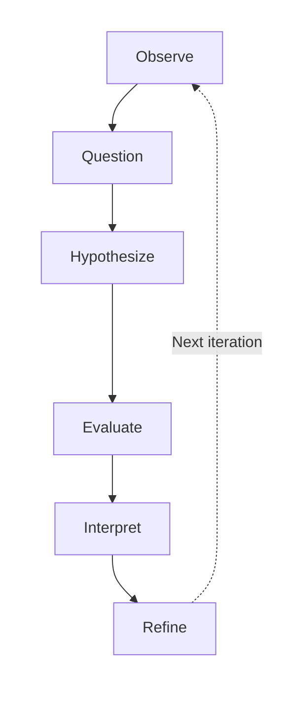

## Purpose

The goal is to improve the system of engineering work with agents: the people, the repository, the agent setup (instructions, docs, tools, and checks), the harness, and the model. A study should tell whether a change helps, for which tasks, and at what cost. For instructions such as `AGENTS.md`, only the results of real tasks can show this ([why]()). The study goes in a cycle:

**Research cycle:** Observe -> Question -> Hypothesize -> Evaluate -> Interpret -> Refine -> repeat.

The cycle repeats. Exploring can come before a hypothesis, and a disappointing result is useful when it changes what we understand or what we build.

## 1. Start from a decision and form a question

Ask first: what decision would the answer change? For example, should we add a root `AGENTS.md`, shorten the one we have, or move detailed rules into the docs?

Then name the context, the change or the thing being studied, what it's compared with (if anything), and the outcome. A question with these four parts can be answered.

- **Too broad:** "Are instruction files good?"
- **Better:** "For bug fixes in our Python repository, does a minimal root `AGENTS.md`, compared with no instruction file, reduce human corrections without lowering the share of accepted changes?"

Different questions need different evidence:

- **Descriptive:** Which instructions do agents load and use?
- **Comparative or causal:** Does putting a rule in the root file, compared with a linked doc, change the results of tasks?
- **Explanatory:** Why do agents ignore a rule they have read?
- **Design:** What change to the workflow prevents that failure at an acceptable cost?

## 2. A hypothesis is a testable expectation

A research question says what a study wants to learn. A hypothesis predicts something that can be observed, and it must be possible to find evidence against it.

**Example hypothesis:** "For bug fixes, a minimal root `AGENTS.md` reduces the number of human corrections per accepted change, without a loss in quality that matters in practice."

The hypothesis predicts a result. It doesn't establish it. Before testing it, define what counts as a correction, an accepted change, and a loss in quality that matters. Compare the result with the expectation that the change makes no difference to the main outcome.

A hypothesis doesn't need an arbitrary percentage. A threshold can be set once the baseline and the cost of the change are known. When nobody knows how the change would work, start by watching what happens. Hypotheses can come later.

## 3. Choose a method for what you want to learn

| Method | Core idea | Use in this project |
|---|---|---|
| **[Evidence-based software engineering]()** | Find, assess, and combine research and practitioners' evidence, and check whether the findings apply here. | Updating claims in the notes before spending effort on new studies. |
| **[Controlled experiment]()** | Compare conditions while keeping other differences small. | Telling whether a minimal file, a shorter rule, or a link to a doc changes the results. |
| **[Case study](#case-studies-and-qualitative-methods)** | Study an agent workflow in a real project, together with its surroundings. | Understanding how instructions, code structure, tools, and people interact in practice. |
| **Design science** | Build or revise an artifact or a way of working, evaluate how useful it is where it will be used, and repeat. | The whole effort of improving agent instructions and the workflow around them. |
| **Grounded theory** | Analyze qualitative observations systematically to build an explanation from patterns that repeat. | Finding how failures happen from session traces, reviews, and interviews, when nobody knows the cause yet. |

The methods work together. A case study can show a failure pattern, grounded theory can help explain it, an experiment can test a remedy, and design science organizes the cycle of building and evaluating. Grounded theory is a full qualitative method, so tagging notes isn't a grounded theory study.

The [Bottom-Up Approach]() combines two of these methods for a team's own workflows. It uses grounded theory to learn from cases and sandbox-first experiments to test each structure it adds.

## 4. Decide what counts as improvement

For work with coding agents, "better" needs more than the agent saying it succeeded or a shorter session. Separate these outcomes:

- **Result:** Was the task done correctly, and was the change accepted?
- **Human effort:** How much time did people spend preparing the task, steering the agent, reviewing its work, and correcting it?
- **Cost and risk:** What did the session cost, and did it cause unintended changes, defects, or missed questions to the people who own a decision?
- **Later effects:** Did the change keep the code easy and safe to change? Some effects show only in later tasks on the same code.

Choose a main outcome before looking at the results, and use the others as limits that the change must not break. Write a rule for measuring the main outcome that another reviewer could apply. For example, count the corrections made before acceptance, and judge completion by the tests plus an independent review by a person.

Make the outcome concrete for each task type. A good bug fix and a good investigation are different results. For each task type, write a list of what a good result is that someone can tick off, and test each line by asking whether two reviewers looking at the same pull request would agree ([What a good result looks like](#what-a-good-result-looks-like)).

## 5. Work with few tasks and hidden parameters

A team rarely has the conditions of a controlled experiment. It has a few tasks a week, and each one is different. The same task run twice gives two different results. The model, the harness, the setup, the tickets, and the person running the session change in the same weeks. Some of these parameters the team can't see or doesn't record, such as the harness's built-in prompt or a setup file in one developer's home folder. [Problems in Engineering Work with Agents](#many-parameters-some-of-them-hidden) lists these problems.

A study can still make them smaller:

- **Record the parameters with each task:** the model and harness versions, the commit of the repository and of the agent setup, the task type, and who ran the session.
- **Compare within one task type,** so that fewer parameters differ between the tasks.
- **Change one thing at a time,** and note what else changed in the same period.
- **Repeat before concluding.** Several tasks, or the same task run more than once, show more than one task.
- **Say what can't be told.** With a few tasks a week, only large effects show. A change with a small effect stays unproven.

[What the Approach Does about It](#what-the-approach-does-about-it) describes these practices in more detail.

## 6. Interpret results without overclaiming

A result can support the hypothesis, contradict it, or leave it unresolved. Ask:

1. How large is the change, and how uncertain is the estimate?
2. Is it useful in practice, after the cost, the risk, and the maintenance?
3. Could the difficulty of the tasks, a change of model, the reviewer's judgment, or chance explain it?
4. Does it appear across tasks and repositories, or only in one place?
5. What result would justify revising or dropping the recommendation?

A result that isn't statistically significant doesn't prove there's no effect. A local trial that went well doesn't make a general rule. Keep the original prediction, the observations, the counterexamples, and the limits visible, including negative results.

## 7. A short study note

Before starting a study, write seven short lines:

1. **Decision:** Which change to the notes or the workflow is being considered?
2. **Question:** What exactly needs to be learned?
3. **Hypothesis or aim:** What is predicted, or what is still unknown?
4. **Context:** Which agents, models and harness versions, repository, task type, and people?
5. **Evidence:** Existing research, observation, a case study, a controlled comparison, or a combination?
6. **Outcomes:** What will be observed, and by which criteria will it be judged?
7. **Revision rule:** Which findings would justify keeping, qualifying, rewriting, or removing the recommendation?

These lines are enough to prevent vague claims and early conclusions. The next step is to pick one question and turn the note into a small protocol: which tasks to use, which conditions to compare, how to score the results, and how to analyze them.

## Further reading

These are starting points on method. They aren't evidence that any specific `AGENTS.md` recommendation works.

- **Kitchenham, Dybå & Jørgensen (2004), "Evidence-based software engineering."** How to form questions that can be answered, assess evidence, and apply findings in context. [Durham bibliography](https://ebse.webspace.durham.ac.uk/ebse-bibliography/evidence-based-software-engineering/) · [DOI](https://doi.org/10.1109/ICSE.2004.1317449)
- **Wieringa (2014), Design Science Methodology for Information Systems and Software Engineering.** Research questions, artifact design, and evaluation in context. [Springer](https://doi.org/10.1007/978-3-662-43839-8) ([PDF](/sources/466ae150a72883885f071398cd467286.bin))
- **Wohlin et al. (2024), Experimentation in Software Engineering.** A fuller reference for choosing empirical methods and running experiments. [Springer](https://doi.org/10.1007/978-3-662-69306-3) ([PDF](/sources/c07438c70e29bb5bfa57fbc2bc8ae6b6.bin))
- **Runeson & Höst (2009), "Guidelines for conducting and reporting case study research in software engineering."** How to study complex real-world settings. [Open-access paper](https://doi.org/10.1007/s10664-008-9102-8)
- **Stol, Ralph & Fitzgerald (2016), "Grounded theory in software engineering research."** What grounded theory involves and how to apply it with care. [University repository](https://cora.ucc.ie/handle/10468/7041)

## Library sources

- [Dresch et al. 2015](/sources/793579948d2178f152744d2bba3792d1.bin), *Design Science Research* ([doi:10.1007/978-3-319-07374-3](https://doi.org/10.1007/978-3-319-07374-3))
- [Denzin and Lincoln 2018](/sources/22f3ac39414dd99205b2f2679dd71b89.bin), *The SAGE Handbook of Qualitative Research*
- [Marczyk et al. 2005](/sources/8b198ee52250fb21e5e2839e1fe56d96.bin), *Essentials of Research Design and Methodology*
- [Mendez et al. 2024](/sources/b6af38dfc99002789655e1059bc1901c.bin), *Handbook on Teaching Empirical Software Engineering*
- [Trochim et al. 2016](/sources/95c4dfddb0a330d19ccec7a9579c993f.bin), *Research Methods: The Essential Knowledge Base*
- [Wohlin and Runeson 2021](/sources/3cfb734c3eb89c6fc1a4f131e4a9b4d0.bin), *Guiding the selection of research methodology in industry-academia collaboration in software engineering* ([doi:10.1016/j.infsof.2021.106678](https://doi.org/10.1016/j.infsof.2021.106678))
- [Wohlin and Rainer 2022](/sources/259b57ac164515376430c68ba4848f6b.bin), *Is it a case study? A critical analysis and guidance*
