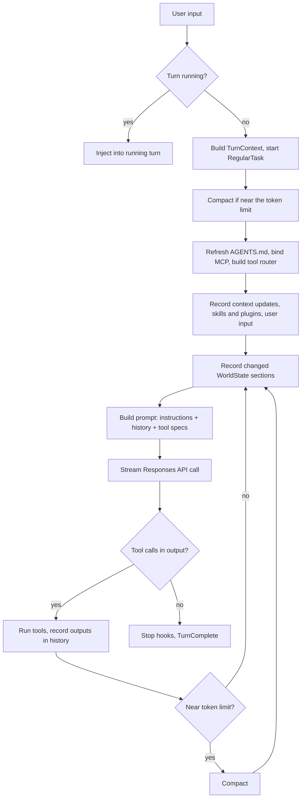

This note describes how the Codex CLI builds and runs an agent for each session: the main objects, the turn loop, how the context sent to the model is built, the memory and instruction sources, and the tools.


Repository: `~/projects/common/codex`, commit `b1573f1024` (2026-11-14). All paths are relative to `codex-rs/`. Line numbers will drift as the code changes.

[Checking the assembled context](#checking-the-assembled-context) comes from running `codex debug prompt-input` at this commit in the repo's devcontainer, with an empty `CODEX_HOME`. Later turns come from the test snapshots in `core/tests/suite/snapshots/`.


## Main concepts


| Concept                   | What it is                                                                                                           | Where                                                                                                                |
| ------------------------- | -------------------------------------------------------------------------------------------------------------------- | -------------------------------------------------------------------------------------------------------------------- |
| Thread / Session          | One conversation with the agent. New sessions, resumes, forks and sub-agents all go through the same spawn function. | `core/src/thread_manager.rs:2491` (`spawn_thread`)                                                                   |
| Turn                      | One user input and all the work the agent does for it. A turn contains one or more sampling requests (model calls).  | `core/src/session/turn.rs:217` (`run_turn`)                                                                          |
| Sampling request          | One call to the model. The turn keeps making them while the model asks for tools.                                    | `core/src/session/turn.rs:1895`                                                                                      |
| TurnContext / StepContext | Snapshot of settings for a turn or step: model, cwd, sandbox, MCP binding, tool router.                              | `core/src/session/turn_context.rs`, `session/step_context.rs`                                                        |
| WorldState                | The model-visible context, split into named sections. Sent in full once, then only changed sections are sent.        | `core/src/session/world_state.rs:78`                                                                                 |
| ContextManager            | Holds the conversation history (messages, tool calls, tool outputs) and normalizes it before each request.           | `core/src/context_manager/history.rs`                                                                                |
| ToolRouter                | The tool list and dispatch table. Rebuilt for every step; there is no session-wide registry.                         | `core/src/tools/spec_plan.rs:122`                                                                                    |
| Rollout                   | The saved session log, used for resume, fork and memory extraction.                                                  | `~/.codex/sessions/YYYY/MM/DD/rollout-<ts>-<id>.jsonl`, compressed to `.jsonl.zst` once the file is no longer in use |

## Session startup


`ThreadManager::spawn_thread` resolves the instructions, exec policy, MCP manager, plugins, auth and models manager, then calls `Session::spawn`. After the session emits `SessionConfigured`, it is wrapped in a `CodexThread` and registered.

`Session::initialize` (`core/src/session/mod.rs:699`) does this, in order:

1. Creates the submission channel and the event channel.
2. Resolves environment selections and loads the exec policy.
3. Picks the startup model and applies the token budget.
4. Picks the base instructions: from config, else from saved history, else from the model's template, which `render_model_instructions` in the `prompts` crate reads from the model metadata.
5. Builds `SessionConfiguration` and calls `Session::new`.
6. Starts `submission_loop` in a background task.

`Session::new` (`core/src/session/session.rs:790`) first runs three things in parallel: thread storage (create or resume), the state DB, and auth plus MCP config. It then builds:

1. Telemetry
2. The user shell and a shell snapshot
3. Thread environments
4. The AGENTS.md manager
5. Instructions, skills and thread name
6. `SessionState`
7. An empty MCP runtime and the hooks
8. The model client
9. `SessionServices` and the `Arc<Session>`

After that it emits `SessionConfigured`, installs the MCP runtime, starts MCP and model prewarming, and records the initial history.

## Turn loop


User input arrives as an `Op` on the submission channel (`core/src/session/handlers.rs:520`). If a turn is already running, the input is injected into it ("steering"). Otherwise a new `TurnContext` is built and a `RegularTask` is started (`core/src/tasks/regular.rs:52`).




Details of each part:

- **Before the loop** (`run_turn`): pre-sampling compaction, resolving required MCP servers and plugins, `capture_step_context_with_required_mcp_servers` (refreshes AGENTS.md and builds the tool router), recording context updates, injecting mentioned skills and plugins, running session-start hooks, and recording the user input.
- **Each loop pass**: drains steered input, recaptures the step context if needed, records changed WorldState sections, copies the history, and calls `run_sampling_request`.
- **Sampling request**: `history.for_prompt()` normalizes the history (adds missing call outputs, removes orphan outputs, strips unsupported media). `build_prompt` combines it with the visible tool specs and base instructions. In incremental-tools windows, the tool definitions and base instructions are already in the history, so `build_prompt` passes only hosted tools and empty base instructions (`core/src/session/turn.rs:1846-1883`). The client streams the Responses API over WebSocket and falls back to HTTP (`core/src/client.rs:2628`).
- **Stream handling**: each finished output item goes to `handle_output_item_done` (`core/src/stream_events_utils.rs:351`). If it is a tool call, the call is recorded and its future is queued, and a follow-up request is marked as needed. After the stream ends, `drain_in_flight` records tool outputs.
- **End of turn**: when no follow-up is needed, Stop hooks run and `TurnComplete` is emitted (`core/src/tasks/mod.rs:721`).

## How the context is built


The request has an `input` list. It has no top-level `instructions` field. Where the tool definitions and base instructions go depends on the model and provider:

- **Responses Lite models**, which are all bundled models except `gpt-5.5`. The `IncrementalTools` feature is on by default (`core/src/session/step_context.rs:61`, `features/src/lib.rs:1854`). At the start of each context window, Codex records the tool definitions as an `additional_tools` developer item and the base instructions as a developer message. Both are recorded in the history, at the start of `input`. The request has no `tools` field, and parallel tool calls are off.
- **Amazon Bedrock and GCP providers** have their own incremental-tools features, `IncrementalToolsLegacy` and `IncrementalToolsLegacyGcp`, also on by default.
- **Other models and providers**, such as `gpt-5.5`. The client puts the base instructions first in `input` on every request and sends the tool definitions in the top-level `tools` field.

[Where the base instructions go](#where-the-base-instructions-go-in-the-request) has the details.

**Base instructions.** The system prompt is a developer message in `input`. It comes from the config keys `instructions` or `model_instructions_file`, else from the saved history, else from the model's template. [How Codex builds its system prompt]() describes where the text comes from, how a session chooses it, and what changes it.

**WorldState sections.** Built per step in `build_world_state_for_step`, in this order:

1. Command sessions
2. Top-level tools (only in incremental-tools windows)
3. Model instructions
4. Token budget and context-window guidance
5. Realtime
6. AGENTS.md (`AgentsMdState`)
7. Permissions and sandbox
8. Collaboration mode and persistent mode
9. Environment context (cwd, shell, date, sub-agents)
10. Environments, apps and plugins instructions
11. Deferred tools
12. Extension sections (skills list, memory summary, and others)
13. Multi-agent hint and mode, model catalog
14. Managed developer instructions

**First turn, or after compaction.** `assemble_initial_context` (`core/src/session/mod.rs:5124`) groups the sections into a few messages. In incremental-tools windows, the tool definitions and base instructions come first, as prefix items (`split_prefix_updates`). Then:

1. One developer message with several text parts: a model-switch notice first if there is one, then `developer_instructions` from config, extension fragments (skills list, memory summary), the other developer sections (permissions, collaboration mode, the deferred tool list), and recommended plugins.
2. Standalone items, such as the multi-agent role message and the token budget context.
3. The multi-agent mode message.
4. One user message with AGENTS.md content and the environment context.
5. Guardian policy and managed developer messages.

[Checking the assembled context](#checking-the-assembled-context) shows what this looks like in a real request.

**Later steps.** `render_history_diff` compares each section with a saved baseline and sends only the sections that changed, as replacement or removal notices. Adjacent fragments with the same role are merged (`core/src/context_manager/updates.rs:20`). Codex appends these items and never edits earlier ones, so the start of `input` stays the same from one request to the next. The test snapshots show these cases:

- **Approval policy and cwd change** (`model_visible_layout_turn_overrides`): the next request adds a developer message with the new permissions text and a user message with the new environment context, before the prompt.
- **cwd change to a folder with a different AGENTS.md** (`model_visible_layout_cwd_change_refreshes_agents`): the next request adds a user message with the new AGENTS.md block and the environment context. The old block stays in the history.
- **Model switch in an incremental-tools window** (`incremental_tools_regular_responses`): the next request adds a developer notice that starts "This is an incremental tools update", an `additional_tools` item with only the changed tools, and a `<model_instructions>` developer message. That message names the new model and says its text replaces the previous base instructions.
- **Model switch without incremental tools** (`incremental_tools_responses_api`): the next request adds a `<model_switch>` developer message, and the client sends the new full tool list.

**History.** User and assistant messages, tool calls and tool outputs, in order, after normalization.

### Compaction


`context_window_token_status` (`core/src/session/context_window.rs:26`) decides when the history is too large. Compaction runs before a turn (limit reached, or a switch to a smaller model), in the middle of a turn (a follow-up is pending and the limit is hit), after a turn (a percentage threshold), or in the background.

`run_auto_compact` (`core/src/session/turn.rs:1687`) picks one of three strategies:

- **Token budget feature**: resets the context without a summary.
- **Remote**: the server returns one opaque compaction item. The new history is that item plus recent user items and a fresh initial context.
- **Local** (`core/src/compact.rs`): the model writes a summary with a summarization prompt. The new history is the summary plus recent user messages up to about 20k tokens.

After compaction, a new context window ID is set, the full WorldState is sent again, and a `Compacted` item is saved to the rollout. In the snapshots, the new window starts with the tool definitions and the current model's base instructions, then the kept user messages. The context messages are placed before the last kept user message, and the summary or compaction item comes after it.

### Persistence and resume


`RolloutRecorder` writes the session to `~/.codex/sessions/YYYY/MM/DD/rollout-<ts>-<id>.jsonl`. A background worker compresses files that are no longer in use to `.jsonl.zst`, and readers accept both forms (`rollout/src/compression.rs`). The rollout saves response items, events, turn contexts, WorldState snapshots or patches, compaction items and token usage.

On resume, `reconstruct_rollout` (`core/src/session/rollout_reconstruction.rs:214`) starts from the newest `Compacted` item and replays only what came after it. It restores the WorldState baseline, window IDs and token counts. The initial context is sent again on the first new turn.

### Checking the assembled context


`codex debug prompt-input [PROMPT]` builds a session and prints the `input` list for one turn as JSON, without calling the model (`cli/src/main.rs:275`, `core/src/prompt_debug.rs`). It takes the usual flags, such as `-m`, `-s`, `-a`, `-C` and `-c`. Its output stops before the client adds its own items. For models without incremental tools, such as `gpt-5.5`, it doesn't show the base instructions or the tools.

```bash
CODEX_HOME="$(mktemp -d)" codex -C <project> -m gpt-6.1-sol debug prompt-input "Add a unit test and run the tests."
```


For `gpt-6.1-sol` in the sem-rag project root, the first request has seven items and 55,898 characters:

| # | Item | Characters |
| --- | --- | --- |
| 0 | `additional_tools`: 11 tools in the namespaces `functions`, `clock` and `collaboration` | 21,211 as compact JSON |
| 1 | Base instructions | 21,769 |
| 2 | Developer message: skills list, permissions, collaboration mode | 2,169 + 3,882 + 920 |
| 3 | `<multi_agent_role>` | 2,400 |
| 4 | `<multi_agent_mode>` | 271 |
| 5 | User message: AGENTS.md, environment context | 2,725 + 495 |
| 6 | The prompt | 56 |

The tool definitions and base instructions are 77% of the request. [Examples of the first request](#examples-of-the-first-request) shows how the config changes these items.

Rollouts are a second source of real context. In `session_meta`, a rollout holds the saved base instructions with their provenance. It also holds the context messages, the `additional_tools` item and world-state records. Rollouts don't match the request exactly, though. The update-plan section is removed only in the request. Without incremental tools, the tools aren't recorded. Rollouts written by the desktop app also come from its own build of Codex, not from this commit.

## Memory and instruction sources


Codex has several separate sources. Only some of them go into the prompt automatically.

| Source | Where it lives | How it reaches the model |
|---|---|---|
| Global AGENTS.md | `~/.codex/AGENTS.override.md`, else `~/.codex/AGENTS.md` | User-role block, every session |
| Project AGENTS.md | Each directory from project root down to cwd | Same user-role block, after the global file |
| Memories | `~/.codex/memories/` (v1) or `memories_v2/` | Summary in developer context; rest read on demand |
| Skills | `SKILL.md` folders in several roots | List always in context; full text only when used |
| Hooks | `[hooks]` in config, or plugin `hooks/hooks.json` | `additionalContext` added as developer messages |
| `developer_instructions` | `config.toml` | Developer message |
| Prompt history | `~/.codex/history.jsonl` | Not in the prompt; used only for up-arrow recall in the TUI |
| State DBs | `~/.codex/*.sqlite` | Not in the prompt; metadata, memory jobs, usage counts |

### AGENTS.md


- **Global file**: `codex-home/src/instructions/mod.rs:40-84`. The first non-empty file of `AGENTS.override.md` and `AGENTS.md` is used, trimmed.
- **Project files**: `core/src/agents_md.rs:199-276`. Codex walks from cwd up to the project root, which is found by `project_root_markers` (default `.git`). If no root is found, only cwd is checked. In each directory it takes the first match of `AGENTS.override.md`, `AGENTS.md`, then names in `project_doc_fallback_filenames`. Files with only whitespace are skipped. Files are joined root first.
- **Limits**: `project_doc_max_bytes` defaults to 32 KiB and applies to project files only. A file that goes over the remaining budget is cut, later files are skipped, and Codex shows a warning. Nothing is loaded if the project is untrusted or the limit is 0.
- **Joining** (`core/src/agents_md.rs:384`): the global file comes first, then thread instructions from the host, if any. The line `--- project-doc ---` comes once, where that text ends and the project files start. Project files are separated by a blank line only, with no file names, so a file's own headings are the only sign of where it starts.
- **Format**: `# AGENTS.md instructions for <cwd>` followed by the text inside `<INSTRUCTIONS>` tags. It's the first text part of a user message, and the environment context is the second (`core/src/context/user_instructions.rs:22-41`). With two or more environments, the heading has no path, and each environment's files start with a line ``for `<id>` with root <cwd>`` (`core/src/agents_md.rs:419`).
- **Refresh** (`core/src/agents_md_manager.rs:69`): runs each time Codex captures the step context, which is before each model request. The global file is read again every time, so an edit shows up on the next request. Project files are searched again only when the environment selection (such as the cwd), the trust level, or `project_doc_max_bytes` changes. Otherwise the cached copy is used, so an edit to a project AGENTS.md during a session isn't seen until one of those changes. When the text changes, Codex appends a new user message with the AGENTS.md block and the environment context.
- **Example**: in the sem-rag repo, starting in `docs/harness` gives one block with `sem-rag/AGENTS.md` (2,725 characters) followed by `docs/harness/AGENTS.md`, 4,930 characters in total. The heading names only `docs/harness`. Starting at the root gives only the root file. Codex ignores `CLAUDE.md` and `.claude/` unless `CLAUDE.md` is listed in `project_doc_fallback_filenames`, and even then it's used only in folders that have no `AGENTS.md`.

### Memories feature


Off by default. Enabled by the `memories` feature and the `[memories]` config table (`config/src/types.rs:325-361`).

**Writing** runs as a background task at the start of a turn that has input (`memories/write/src/start.rs:24`). It skips ephemeral sessions and sub-agents.

1. **Phase 1, extraction** (`memories/write/src/phase1.rs`): for each recent rollout that has been idle long enough, a small model with low reasoning effort reads the rollout (up to 70% of its context window). It returns a raw memory, a rollout summary and a slug, which are stored in SQLite. Up to 8 jobs run at once.
2. **Phase 2, consolidation** (`memories/write/src/phase2.rs`): Codex writes `raw_memories.md` and `rollout_summaries/`, then starts a sub-agent. The sub-agent never asks for approval, can write only the memory folder, and has no network. It updates `MEMORY.md`, `memory_summary.md` and `skills/`. The memory folder is a git repository.

**Reading** (`ext/memories/src/extension.rs:56-104`): only `memory_summary.md` is added to the developer context, cut to 2,500 tokens and wrapped in a read-path template. The agent reads `MEMORY.md` and rollout summaries on demand with shell commands. With `dedicated_tools = true` it also gets `memories.list`, `memories.read`, `memories.search` and `memories.add_ad_hoc_note`.

**Usage feedback**: the model emits `<oai-mem-citation>` blocks when it uses a memory. These update usage counts, which affect ranking in phase 2.

**Exclusions**: threads that took in MCP, web or hook content are marked `polluted` and are not used for extraction.

Main config keys: `generate_memories`, `use_memories`, `dedicated_tools`, `extract_model`, `consolidation_model`, `max_rollout_age_days` (10), `min_rollout_idle_hours` (6), `max_rollouts_per_startup` (2), `max_unused_days` (30).


`memories/README.md` points to `core/src/memories/` and `read/templates/`, which no longer exist. The read side is in `ext/memories/`.


### Skills


A skill is a folder with a `SKILL.md` file. Its YAML front matter has `name`, `description` and an optional `short-description` (`skills/src/parser.rs`).

Skills are loaded from (`ext/skills/src/host_roots.rs:127-187`):

- Repo: `.codex/skills` and `.agents/skills`, from project root to cwd
- User: `~/.agents/skills`, and the older `~/.codex/skills`
- System: `~/.codex/skills/.system`, copied from samples in the binary
- Admin: `/etc/codex/skills`
- Plugin skill folders

In the context:

- **The list** of names, descriptions and paths is always present as a developer `<skills_instructions>` block. Its size is limited to 2% of the context window, or to `skills.max_context_tokens` (at most 10k).
- **The full text** is added as a user `<skill>` block only when the skill is selected: by `$name`, by a path mention, by the client, or by implicit selection (`core/src/skills.rs:237`).

### Plugins and apps


- Plugin instructions are developer text, added only for plugins the user mentions. They list the plugin's MCP servers and apps.
- Apps instructions are a developer `<apps_instructions>` block, controlled by `include_apps_instructions` and the Apps feature.

### Hooks


SessionStart, UserPromptSubmit, PreToolUse and PostToolUse hooks can return `additionalContext`. It is saved to history as developer messages (`core/src/hook_runtime.rs:889-914`).

### Config layers


Lowest to highest precedence (`config/src/loader/mod.rs:125-136`): package defaults, MDM, `/etc/codex/config.toml`, cloud config, `~/.codex/config.toml`, profile config, project `.codex/config.toml` (only for trusted projects), and `--config` flags.

Keys that change the context:

- `instructions`, `model_instructions_file`: replace the base system prompt
- `developer_instructions`: adds a developer message
- `include_permissions_instructions`, `include_apps_instructions`, `include_collaboration_mode_instructions`, `include_environment_context`, `include_environment_context_time`: turn context blocks on or off
- `compact_prompt`, `experimental_compact_prompt_file`: the compaction prompt
- `project_doc_max_bytes`, `project_doc_fallback_filenames`, `project_root_markers`: AGENTS.md discovery
- `personality`, `[memories]`, `[skills]`

## Tools

### Built-in tools


Registered in `add_core_tool_sources` (`core/src/tools/spec_plan.rs:1232`).

| Name the model sees | Purpose | Enabled when |
|---|---|---|
| `exec_command` | Run a command in a PTY or pipe | `shell_tool` feature (default on) |
| `write_stdin` | Write to or poll a running command | `unified_exec` feature (default on) |
| `apply_patch` | Edit files with a patch grammar | The model supports it |
| `update_plan` | Update a TODO plan | `[tools.update_plan] enabled = true` (default off) |
| `view_image` | Attach a local image | `view_image` feature (default on) |
| `request_user_input`, `request_user_input_async` | Ask the user structured questions | Default on; the async form needs model support |
| `send_message_to_user_async` | Send a message to the user without ending the turn | Feature or model catalog |
| `request_permissions` | Ask for more sandbox permissions | `request_permissions_tool` feature |
| `new_context`, `get_context_remaining` | Manage the context window | `token_budget` feature |
| `curr_time`, `sleep` | Read the clock, wait | Features or model catalog |
| `wait_for_environment` | Wait for a deferred executor | `deferred_executor` feature |
| `list_available_plugins_to_install`, `request_plugin_install` | Suggest or install plugins | `tool_suggest`, `apps` and `plugins` features |
| `list_mcp_resources`, `list_mcp_resource_templates`, `read_mcp_resource` | Read MCP resources | Any MCP server is configured |
| `tool_search` | Search over deferred tools (BM25) | The model supports search and some tools are deferred |
| `spawn_agent`, `send_input`, `resume_agent`, `wait_agent`, `close_agent` | Sub-agents, version 1 | `multi_agent` feature, within the depth limit |
| `spawn_agent`, `send_message`, `followup_task`, `wait_agent`, `interrupt_agent`, `list_agents` | Sub-agents, version 2 | `multi_agent_v2` feature |
| `exec`, `wait` | Code mode: run JavaScript in V8 that calls other tools | `code_mode` features or the model's tool mode |
| `web_search` | Hosted web search | `web_search_mode` and provider support |

Extension tools:

- `web.run`: standalone web search
- `image_gen.imagegen`: image generation; needs a paid plan and an image-capable model
- `memories.*`: see [Memories feature](#memories-feature)
- `skills.list`, `skills.read`, `skills.installations`
- `get_goal`, `create_goal`, `update_goal`: `goals` feature
- `history.*`, `notes.*`: `token_budget.use_history_notes_extension`

Dynamic tools come from the client and can be deferred.

This tree has no `shell`, `local_shell` or `js_repl` tool. The only shell tool types are `UnifiedExec` and `Disabled`.

### How the tool list is built for each step


`build_tool_router` (`core/src/tools/spec_plan.rs:122`) adds tools in this order: core tools, MCP tools, MCP exposure policy, extension tools, search-mode pruning, dynamic tools, hosted tools. `finalize_tool_router` then:

1. Applies tool policy filters and deferral rules.
2. Removes name collisions.
3. Sets up `tool_search`.
4. Registers code mode.
5. Keeps only tools whose exposure is `Direct` as model-visible specs.
6. Groups specs into namespaces, sorted by name.

Each tool has an exposure: `Direct`, `Deferred`, `DeferredModelOnly`, `DirectModelOnly`, `CodeModeOnly` or `Hidden` (`tools/src/tool_executor.rs:51`). Deferred tools are not in the prompt; the model finds them with `tool_search`.

### MCP tools


- Servers are configured as stdio or streamable HTTP (`config/src/mcp_types.rs:658`) and connected through the `codex-mcp` and `rmcp-client` crates. Each step gets a fixed `McpBinding`.
- Names are `mcp__<server>__<tool>` after sanitizing. Long or colliding names get a 12-character sha1 suffix. The `NonPrefixedMcpToolNames` feature removes the prefix.
- MCP tools are deferred when the model supports search; otherwise they are direct (`core/src/mcp_tool_exposure.rs:155`). Plugin tools over 8 KB each, or 64 KB in total, are hidden.
- `enabled_tools`, `disabled_tools` and `omit_tools_from` filter the list.
- MCP tools run in parallel only if the server allows it or the tool is marked read-only.

### Execution path


1. The model emits a tool call. `router.build_tool_call` turns it into a call object (`core/src/tools/router.rs:278`). The call is recorded in history first.
2. **Parallelism**: tools that support parallel runs take a read lock, the rest take a write lock (`core/src/tools/parallel.rs:298-310`). `exec_command`, `write_stdin`, `view_image`, `tool_search` and the MCP resource tools are parallel.
3. **Registry dispatch** (`core/src/tools/registry.rs:760`): look up the tool, check the payload type, resolve the environment, run PreToolUse hooks, run the guardian review if configured, call the handler, run PostToolUse hooks (they can block or replace the result), emit telemetry.
4. **Orchestrator** (`core/src/tools/orchestrator.rs:125`), used by `exec_command` and `apply_patch`:
   1. Gets the approval requirement from exec policy rules (`core/src/exec_policy.rs:345`).
   2. Asks for approval in this order: PermissionRequest hooks, the guardian auto-reviewer, then the user.
   3. Picks the sandbox: Seatbelt on macOS, seccomp plus bubblewrap on Linux, a restricted token or MXC on Windows, or none.
   4. Runs the command. If the sandbox denies it, Codex can ask again and retry without the sandbox.
5. The result becomes a response item and is added to history.

### Approval and sandbox settings


**Approval policy** (`protocol/src/protocol.rs:1187`):

- `untrusted`: ask for every command unless an exec policy rule allows it
- `on-request` (default): ask when the filesystem is restricted
- `granular`: per category (sandbox, rules, skills, permission requests, MCP elicitations); a category set to false is rejected automatically
- `never`: never ask; failures go back to the model

**Reviewer**: `user` (default) or `auto_review` (the guardian model).

**Sandbox mode**: `read-only` (default), `workspace-write`, `danger-full-access`.

**Exec policy results**: Skip (optionally without the sandbox), NeedsApproval (with a suggested rule change), NeedsHumanApproval, Forbidden.

## Sub-agents


- Sub-agents are started with the multi-agent tools. The v2 path is `tools/handlers/multi_agents_v2/spawn.rs:124`, then `thread_spawn::spawn` (`core/src/thread_spawn.rs:99`).
- The child config applies an agent role (`core/src/agent/role.rs`). A role can change only a few settings, and it can't replace the base instructions ([Agent roles](#agent-roles)). The session source is set to `SubAgent` with the parent, depth and agent path.
- `spawn_agent_internal` (`core/src/agent/control/spawn.rs:659`):
  1. Reserves a slot within the `max_threads` and depth limits.
  2. Prepares forked or fresh history.
  3. Calls `ThreadManager::spawn_child_thread`, the same spawn path as a normal session, with inherited auth, exec policy and cache key.
  4. Sends the first input.
- When the child's turn ends, the parent gets a completion message (`core/src/agent/control/completion.rs:28`).
- Sub-agents do not run memory extraction.
