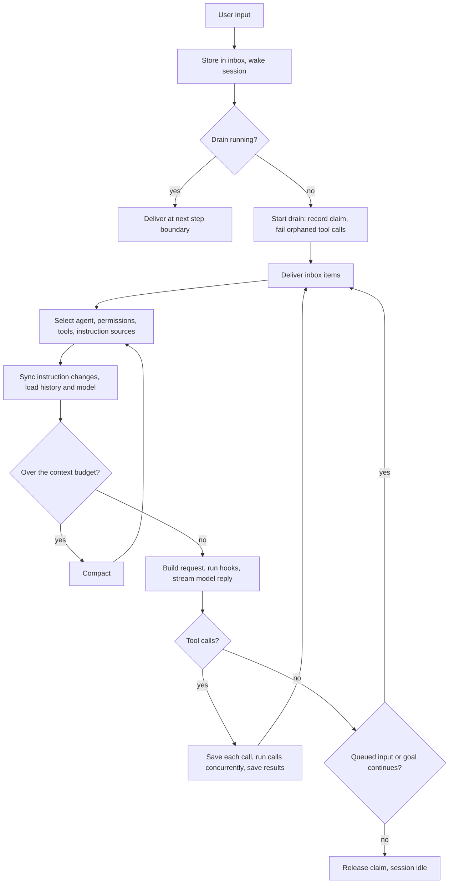

This note describes how OpenCode builds and runs an agent for each session: the main objects, the step loop, how the context sent to the model is built, the instruction sources and what persists, and the tools. It follows the sections of [How Codex Assembles an Agent Session]() so the two can be compared.


Repository: `~/projects/common/opencode`, commit `d759c548aa` (2026-11-14). This is the V2 runtime. Paths are relative to `packages/core/src/` unless they start with `packages/`, `specs/` or a root file name. Line numbers will drift as the code changes. The design specs `specs/v2/session.md` and `specs/v2/tools.md` explain the contracts; where the code differs from them, the note says so.


## Main concepts

| Concept | What it is | Where |
|---|---|---|
| Location | A directory and project. Tools, permissions, plugins, model resolution and the filesystem are scoped to one Location. | `location.ts`, `location-services.ts` |
| Session | One conversation, stored in SQLite. It records its Location, selected agent and model, and its own permission rules. New sessions, forks and sub-agents are all sessions. | `session/session.ts`, `session/store.ts` |
| Inbox | Holds new input until it is delivered into history. `steer` input is delivered at the next safe point between steps; `queue` input waits until the session is idle. Compaction and moves use the same inbox. | `session/inbox.ts` |
| Agent | Plain data: id, name, optional system prompt, model, mode (`primary`, `subagent`, `all`), hidden flag, step limit and permission rules. | `packages/schema/src/agent.ts:17`, `agent.ts` |
| Drain | One busy period of a session. It runs steps until the model stops calling tools, the step limit is reached, or the user interrupts. | `session/execution.ts`, `session/runner/llm.ts` |
| Step | One model request and the tools it calls. A step may make more than one physical attempt (retry, overflow compaction). | `session/runner/step.ts` |
| Instruction source | One named piece of context, such as AGENTS.md files, skills or the date. Each value is stored by hash, so changes can be detected and sent as updates. | `instructions/index.ts`, `session/context.ts:165` |
| Tool snapshot | The tools advertised for one request, filtered by permissions. Calls execute the tool captured in the snapshot. | `tool.ts:254` |
| Permission rules | `allow`, `ask` or `deny` for an action and a resource pattern. The last matching rule wins. | `permission.ts:94` |
| Plugin | The unit of extension. Built-in agents, tools, instruction sources and per-model prompts are all plugins. | `plugin/internal.ts:247` |
| Code Mode | Tools the model can call only from JavaScript inside one `execute` tool. | `codemode/` |

## Server and session startup

### One server for all clients

OpenCode runs as a background server. The TUI, the desktop app and other clients connect to it.

- `opencode service start` spawns `opencode serve --service` (`packages/cli/src/services/service-config.ts:150`). The server registers itself in `<XDG_STATE_HOME>/opencode/service.json` and listens on port `0xc0de` by default (`service-config.ts:41-58`).
- The TUI and the desktop app both call `Service.ensure`, which reuses a healthy server of the same version, replaces one with a version mismatch, or starts one (`packages/client/src/effect/service.ts:49-127`).
- `--server <url>` connects to a given server. `--standalone` starts a private server as a child process (`packages/cli/src/services/server-connection.ts:27-63`).
- Each request names its Location with the `location[directory]` query parameter or the `x-opencode-directory` header (`packages/server/src/location.ts:74-79`).

### What a Location builds

`Instance.layer` lists the services (`instance.ts:64-121`). Services marked global are built once per process: the database, the event bus, projects, sessions, execution and restart, jobs, schedules, worktrees and others. The rest are built once per Location, in list order after their dependencies: App, Location (resolves the project), lifecycle, environment, config, plugins and hooks, the plugin supervisor, snapshots, the model runner and VCS, and the file watcher last.

A Location is evicted after 60 minutes without activity (`location-activity.ts:30`).

### Plugin activation order

The plugin supervisor activates plugins at startup and again, debounced by 100 ms, when their sources change (`plugin/supervisor.ts:193-232`). The order is (`plugin/internal.ts:247-310`):

1. Built-in plugins that must run first, among them tool-input repair, MCP config and Code Mode defaults, the built-in agents, the plan agent, commands, goals, skills, the models catalog, providers, web search, the patch tool, the per-model prompt plugins and the built-in tools.
2. SDK and instance plugins.
3. Plugins from config packages.
4. Built-in plugins that must run last: configured instructions, references, agents, commands, providers, web search and policy.

The OpenCode provider plugin and the policy plugin can't be removed (`plugin/internal.ts:314`).

## Step loop

Input arrives through `Session.prompt`. It is stored in the inbox, and execution is woken (`specs/v2/session.md`). If a drain is already running, the input waits in the inbox and is delivered at the next step boundary.

Details of each part:

- **Drain start.** The session records a claim (`time_suspended`) in the same commit as the start event (`session/execution.ts:75-81`). Tool calls still marked running from an earlier process are failed before any model work, so their side effects are never replayed (`specs/v2/session.md`).
- **Selection** (`session/context.ts:136-176`). The runner loads the session, resolves the agent, merges agent and session permissions, and loads in parallel the tool snapshot, built-in instructions, AGENTS.md files, skills, references, MCP guidance and API instruction entries.
- **Loading** (`session/context.ts:178-195`). It resolves the model and reads history after the latest compaction.
- **Request** (`session/model-request.ts:106`, `:273`). `baseTranscript` builds the system parts and messages. Plugin hooks can change the system parts, messages, options and tools (`model-request.ts:463-471`). Then the model reply is streamed.
- **Tool calls.** Each call is saved before it runs. Calls start as soon as their call event is published, while the stream continues, and are awaited together (`session/runner/step.ts:145-182`). After the results are saved, the runner reloads history and starts a new step.
- **Step limit.** Agents have no step limit unless their `steps` field is set; no built-in agent sets it. At the limit, the runner appends `MAX_STEPS_PROMPT` as an assistant message and sets `toolChoice: "none"`, keeping the tool definitions so the cached prompt prefix still matches (`session/runner/llm.ts:261`, `:276-281`). The step count resets when new user input is delivered.
- **Idle.** When the session would go idle, the `experimental.idle` hook can admit more input so the drain continues. The goals plugin uses this ([Goals and schedules](#goals-and-schedules)).

### Retry

Retries cover rate limits, provider internal errors, transport failures and incomplete streams (`packages/ai/src/schema/errors.ts:197-224`). Authentication, quota, content policy and invalid requests are not retried.

The schedule is exponential from 2 seconds, each wait capped at 10 seconds, for at most 10 retries, with jitter. A provider's retry-after value is used as a minimum, up to 15 minutes (`model-retry.ts:12`, `:22-36`). Network-unreachable errors have a separate budget of one hour. The `retry` hook can change the decision.


`specs/v2/session.md` says the initial request plus at most four retries. The code allows 10 retries.


A context overflow is handled by compaction, not retry ([Compaction](#compaction)).

## How the context is built

A request has system parts, messages and tool definitions.

### System parts

`baseTranscript` builds two system parts (`session/model-request.ts:106-137`):

1. **The base prompt.** The agent's `system` field if it has one. Otherwise the default prompt in `session/runner/prompt/system.txt`, a short text about the harness, communication and working in codebases. `SessionSystemPrompt.make` inserts guidance for the shell, write and edit tools when they are present (`session/system-prompt.ts`).
2. **The instruction baseline**: the joined initial values of all instruction sources.

The per-model prompt plugins (`plugin/optimize.ts`) then change the first part through the `context` hook, unless the agent has its own `system`:

- GPT models get `gpt.txt` in place of the default, or `gpt-astra.txt` for ids containing "astra".
- Claude models get `anthropic.txt` added after the default.
- Kimi, Arcee Trinity and Meta Muse models get their own prompts.

### Instruction sources

`SessionContext.select` combines the sources in this order (`session/context.ts:165-173`). The comment there explains the order: from most shared across sessions to least, so the start of the request stays the same and can be served from the provider's prompt cache.

1. **Code Mode catalog** of tools callable inside `execute` ([Code Mode](#code-mode)).
2. **MCP guidance** from connected servers. Omitted for servers the permissions deny (`mcp/instructions.ts:73-86`).
3. **References**: extra directories the agent may read, each with a name, path and description. Only references with a description are listed (`reference/instructions.ts:58-65`).
4. **Skills**: name and description only ([Skills](#skills)).
5. **AGENTS.md and configured instructions** ([AGENTS.md](#agentsmd)).
6. **Built-ins**: today's date and an `<env>` block with the working directory, the workspace root, whether it is a git repository, the platform, and the temporary directory to use (`instructions/builtins.ts`).
7. **Instruction entries** added by plugins or clients through the API, at most 256 KiB each (`packages/schema/src/instruction-entry.ts:30`).

### First step, or after compaction

The baseline in the second system part holds the values that were current at the start of the instruction epoch. An epoch starts with the session and starts again after each completed compaction, when the current values become the new baseline.

### Later steps

Before each step that calls the model, the runner reads every source once, hashes the values, and stores one delta with the changed keys (`specs/v2/session.md`). A changed source is rendered once and added to history as a system message with `metadata.notice: "instructions"` (`session/message-updater.ts:154-165`). The baseline is not rewritten, so the cached prefix survives. Each source decides how to describe its change: AGENTS.md changes are sent as a diff when the diff is shorter than the new text (`instruction-discovery.ts:127-150`).

### History

`SessionHistory.entriesForRunner` reads the messages and the instruction baseline in one transaction (`session/history.ts:290-307`). It starts from the latest completed compaction (`history.ts:55-88`, `:203-214`) and drops instruction updates older than the epoch start, because the baseline already covers them (`history.ts:231-237`). Media the model can't accept is replaced by an error text, and images are bounded (`model-request.ts:219-265`).

### Compaction

Compaction is checked before every step and when the provider reports a context overflow (`session/runner/llm.ts:253-254`, `:319-325`).

- **Settings** (`session/compaction.ts:269`, `config/plugin/compaction.ts:17-26`): `compaction.auto` (default `true`), `compaction.buffer` (a percentage or a token count), and `compaction.keep.tokens` (default 15,000).
- **When it runs.** The window is the smaller of the model's input and context limits. Without `buffer`, the ceiling is the window minus the larger of 15% of the window and 16,000 tokens (16,000 applies only to windows of at least 32k). Compaction is due when the measured plus estimated tokens reach the ceiling (`compaction.ts:1132-1171`). A model with an unknown window is never compacted automatically.
- **Overflow.** If the provider rejects the request as too long before any output, the runner compacts once and rebuilds the same step. A second overflow is terminal (`specs/v2/session.md`).
- **What is kept.** The newest exchanges up to `keep` tokens, starting at a user message, plus a structured summary of the rest (`compaction.ts:1014-1056`).
- **Summary template** (`compaction.ts:173-212`): Objective, Requirements, Decisions, Work State (Completed, Active, Blocked), Next Move, Relevant Files (at most 15), Important Context. The prompt tells the model to leave out AGENTS.md, conventions and environment details, because the next agent receives current versions of them separately (`compaction.ts:214-227`).
- **Second compaction.** The update prompt asks the model to update the existing checkpoint into one consolidated summary, with newer history winning (`compaction.ts:228-244`).
- **Transcript for the summarizer.** If the history is too large for the summarizer, older exchanges are shortened in levels: tool outputs clipped, tool outputs removed, user text only, omitted. The newest exchange is never omitted (`compaction.ts:144-148`, `:720-788`).
- **Model.** The hidden `compaction` agent's model if configured, else the session's model. When the model supports provider-native compaction, that is used instead (`compaction.ts:283-292`, `:565-603`).
- **Background preparation.** Behind the experimental flag `background_compaction`, a summary is prepared before the ceiling while the provider cache is still fresh (`compaction.ts:365-438`).
- **Hook.** The `compaction` session hook can edit the summarizer request, or return a result and skip the model call (`compaction.ts:635`).
- **Manual.** `/compact` adds a compaction item to the inbox, handled at the next step boundary (`session/session.ts:259-277`).

### Persistence and resume

- **Database.** `<XDG_DATA_HOME>/opencode/opencode.db` in WAL mode. `OPENCODE_DB` overrides the path (`packages/cli/src/database-path.ts:4-12`).
- **Tables** (`database/schema.gen.ts`): among them `session_v2`, `session_message`, `session_part`, `session_inbox`, `instruction_state`, `instruction_entry`, `instruction_blob`, `event`, `event_sequence`, `permission` (saved approvals), `job`, `schedule`, `kv`, `worktree`.
- **Events and projections.** Every change is published as an event, and projectors update the tables in the same transaction (`bus.ts:317-433`, `session/projector.ts:864-1163`). The event payloads are written to the `event` table only when `persist` is set, which defaults to false (`bus.ts:214`). The local server doesn't set it; only the workerd build does (`packages/server/src/workerd.ts:73`). On the local server the tables are the record, and history is not rebuilt from events.
- **Crash recovery** (`session/execution/restart.ts`). At startup, the managed server finds sessions whose claim was never released, fails their stale tool calls, and resumes them with the synthetic message "The server restarted while you were working. Continue from where you left off...". After 10 attempts (`DEFAULT_MAX_ATTEMPTS`, `restart.ts:42`) it gives up with "Execution was interrupted repeatedly and will not be resumed automatically." Recovery doesn't guarantee exactly-once provider requests or tool effects.
- **Fork** (`session/session.ts:341-381`, `projector.ts:145-214`). A fork copies messages up to a chosen message (before it or through it), skipping incomplete assistant messages and running shell or compaction rows. The fork adopts the parent's current instruction values as its baseline.
- **Revert** (`session/revert.ts`). Staging a revert restores the files that later assistant messages changed, using snapshots kept in a shadow git repository at `<data>/snapshot/<projectID>/<hash>` (`snapshot.ts:95-97`). The revert is committed on the next prompt or compaction, which deletes the later messages and rewinds instruction state.
- **Move** (`session/move.ts`). A session can move to another Location. The move goes through the inbox and is applied at a step boundary. The session's directory and project change, a `location-switched` message is added, and instruction sources from the new Location arrive as updates.

## Memory and instruction sources

OpenCode has no memory feature that carries knowledge from one session to the next. Knowledge that should outlast a session has to be in files: AGENTS.md, skills, references, or configured instructions.

| Source | Where it lives | How it reaches the model |
|---|---|---|
| Global AGENTS.md | `~/.config/opencode/AGENTS.md` | Instruction baseline, every session |
| Project AGENTS.md | Every `AGENTS.md` from cwd up to the project root | Same source, after the global file |
| Nested AGENTS.md | `AGENTS.md` files below cwd | Added as a message when the `read` tool reads a file in that directory |
| Configured instructions | `instructions` in config: paths, globs or URLs | Same source as AGENTS.md |
| Skills | `skill/` and `skills/` in config directories, `.claude/skills`, `.agents/skills`, `skills` in config | List always present; full text through the `skill` tool |
| References | `references` in config | List of name, path and description |
| MCP guidance | Instructions from MCP servers | Instruction source |
| Instruction entries | Added by plugins or clients through the API | Instruction source, keyed `api/<key>` |
| Session history and summaries | SQLite | Messages after the latest compaction |
| Todo list | `todowrite` tool, behind the experimental flag `todo` | Tool results in history |
| Plan files | `~/.opencode/plan`, written by the plan agent | Read on demand |

### AGENTS.md

- **Global file**: `~/.config/opencode/AGENTS.md` (`config/plugin/instruction.ts:41`).
- **Project files**: OpenCode walks from cwd up to the project root and takes every `AGENTS.md` it finds (`config/plugin/instruction.ts:87`). The global file comes first, then project files from nearest to farthest (`instruction-discovery.ts:33-35`).
- **Nested files.** After a successful read, the `read` tool walks from the file's directory up to the Location root, exclusive, and loads any `AGENTS.md` it finds as a message, once per session (`tool/plugin/read.ts:131-152`, `session/instructions.ts`). Reads outside the project are skipped. If compaction or a revert removes that message, the file is loaded again on the next read.
- **Only `AGENTS.md`.** `CLAUDE.md` is never read as an instruction file. There is no override file and no fallback file names.
- **Configured instructions.** `instructions` in config takes paths, globs or http(s) URLs. URLs are fetched with a 5-second timeout (`config/plugin/instruction.ts:120-179`).
- **Format.** Each file is rendered as `Instructions from: <path>` followed by its content (`instruction-discovery.ts:123-125`).
- **Limits.** No size cap on AGENTS.md or configured instruction files.
- **Trust.** No project trust check. Project config, AGENTS.md, plugins and skills load automatically. Environment flags such as `OPENCODE_DISABLE_PROJECT_CONFIG` and managed policies are the only gates.

### Skills

A skill is a folder with a `SKILL.md` file.

- **Roots** (`config/discovery.ts:152-167`, `config/plugin/compatibility.ts:45`, `config/plugin/skill.ts:87-101`): `skill/` and `skills/` under each config directory, `skills/` under `~/.claude`, project `.claude` directories, `~/.agents` and project `.agents` directories, and paths or URLs listed under `skills` in config.
- **The list** of names and descriptions is always in the instruction baseline. A skill is listed only if it has a description, isn't marked `autoinvoke: false`, and isn't denied by the `skill` permission (`skill/instructions.ts:61-68`). The list has no size cap.
- **The full text** is loaded by the `skill` tool. Its output lists at most 10 bundled files (`skill.ts:69`, `:88`).

### Hooks

Plugins register hooks in five domains: `aisdk`, `session`, `permission`, `shell` and `tool` (`plugin/hooks.ts:13-19`). Callbacks run in registration order and change the event in place. Session hooks can be limited to one provider. Types are in `packages/plugin/src/effect/`.

| Hook | What it can change | Where |
|---|---|---|
| `tool` `execute.before` | Tool input, or reject the call | `tool.ts:123-131` |
| `tool` `execute.after` | Tool output, content, metadata or error | `tool.ts:157-175` |
| `permission` `evaluate` | The decision and its message | `permission.ts:190-198` |
| `shell` `create.before` | Command, cwd, timeout, shell, environment | `shell.ts:889-900` |
| `session` `prompt` | Prompt text, files, agents, skills, delivery | `session/prompt.ts:42-53` |
| `session` `context`, `compaction`, `generate` | System parts, messages, generation options and tools (rename, remove, edit; new tools are dropped) | `session/model-request.ts:286-317`, `:463-471` |
| `session` `title` | The title request, or the result | `session/title.ts:79` |
| `session` `experimental.model.resolve` | The model, within the same provider | `session/runner/model.ts:109` |
| `session` `model.request` | Base URL and headers | `session/model-request.ts:361` |
| `session` `http.request`, `http.response` | The whole HTTP request or response | `session/model-request.ts:382-396` |
| `session` `experimental.ws.*` | WebSocket URL, headers and frames | `session/model-request.ts:410-425` |
| `session` `retry` | The retry decision | `session/runner/retry.ts:39-53` |
| `session` `experimental.idle` | Admit input so the drain continues | `session/runner/llm.ts:184` |
| `session` `fork` | Nothing; notification only | `session/session.ts:388` |
| `aisdk` `sdk`, `language` | Replace the SDK or language model | `aisdk.ts:313-357` |

Built-in features use the same hooks. The per-model prompts and the patch tool swap use `context`, and the goals plugin uses `experimental.idle`.

### Config layers

Config files are `opencode.json` and `opencode.jsonc` (`config/discovery.ts:12`). Load order, lowest to highest (`config.ts:367-377`):

1. Managed policies
2. Console (integration) documents, fetched from `https://opencode.ai/console/api/v2/config`, limited to providers, MCP, policies and web search (`config/integration.ts:32-37`)
3. Well-known documents
4. Global: `~/.config/opencode`, or `OPENCODE_CONFIG_DIR`
5. `OPENCODE_CONFIG`, an explicit file
6. Project `opencode.json[c]` files, walking up from cwd
7. Project `.opencode/` directories
8. `OPENCODE_CONFIG_CONTENT`
9. Managed settings: `/Library/Application Support/opencode` on macOS, `/etc/opencode` on Linux, plus a macOS managed preferences plist (`config/discovery.ts:27-40`)

For settings, the last loaded value wins (`config.ts:28-31`). For policies, the first loaded wins, so managed policy overrides Console policy, which overrides user and project policy (`managed-policy.ts:9-35`).

Keys that change the context (`packages/schema/src/config.ts:25-117`):

- `instructions`: extra instruction files, globs or URLs
- `references`: extra directories with descriptions
- `agents.<id>.system`: replaces the base prompt. In agent Markdown files, the body becomes `system` (`config/plugin/agent.ts:182`). Other agent fields: `model`, `steps`, `permissions`, `mode`, `hidden`, `disabled`, `request`
- `skills`: extra skill paths or URLs
- `compaction`: `auto`, `buffer`, `keep.tokens`
- `tool_output`: `max_lines`, `max_bytes`
- `permissions` and `policies`: also remove denied skills and MCP guidance from the context
- `experimental.subagent_depth`, `experimental.image_generate`, and the feature flags `todo`, `background_compaction`, `schedules`, `artifacts`, `mcp_events`, `media_blob`, `console_watches`. The flags default to on in development builds and off in releases (`packages/schema/src/config/flag.ts:11-22`)

## Tools

### Built-in tools

These tools are on the provider's native tool list (`codemode: false`).

| Name the model sees | Purpose | Enabled when |
|---|---|---|
| `read` | Read a file or list a directory | Always |
| `write` | Create or replace a file | Unless the model uses `patch` |
| `edit` | Replace exact text in a file | Unless the model uses `patch` |
| `patch` | Add, update and delete files with a patch grammar | GPT models: the id contains "gpt-" and neither "oss" nor "gpt-4" (`tool/plugin/patch.ts:291-303`) |
| `glob` | Find files by pattern | Always |
| `grep` | Search file contents with ripgrep | Always |
| `shell` | Run a shell command | Always |
| `webfetch` | Fetch a URL as Markdown, text or HTML | Always |
| `websearch` | Web search | A search provider is configured (`tool/plugin/websearch.ts:182-189`) |
| `question` | Ask the user structured questions | Allowed for build and plan; denied for general and explore |
| `todowrite` | Update a todo list | Experimental flag `todo` |
| `skill` | Load a skill's full text | Always |
| `subagent` | Start or resume a sub-agent | Not denied by the `subagent` permission |
| `experimental_image_generate` | Generate an image | `experimental.image_generate` |

These tools are in Code Mode, in the `opencode` namespace and others:

- `session_rename`, `session_move`, `worktree_create`, `worktree_list`, `worktree_remove`, `models` (`tool/plugin/opencode.ts`)
- `schedule_create`, `schedule_list`, `schedule_pause`, `schedule_resume`, `schedule_delete`: experimental flag `schedules`
- `artifact_create`, `artifact_read`, `artifact_update`, `artifact_delete`: experimental flag `artifacts`
- `list_mcp_resources`, `read_mcp_resource`, and `watch_mcp_event` (experimental flag `mcp_events`)

Each tool is one object with input and output schemas and one `execute` function (`specs/v2/tools.md`). If two registrations use the same name, the latest active one wins, so a plugin can replace a built-in tool.

### Code Mode

A tool goes into Code Mode unless its `codemode` option is `false` (`tool.ts:263-268`). The default is true for plugin and MCP tools. If the `execute` tool is denied, every tool goes on the native list.

- **Catalog.** The Code Mode instruction source lists namespaces and tools within a budget of 2,000 tokens, counted as 4 characters per token, with descriptions cut to 120 characters (`codemode/catalog.ts:50-52`). Every namespace line is shown; pinned tools are always listed; the rest fill the budget one tool per namespace per round. Catalog updates have a budget of 1,000 (`codemode/instructions.ts:25`).
- **Search.** When the catalog can't list every tool, the prompt tells the model to find tools with the global `search(...)` function before calling them (`codemode/instructions.ts:9-17`).
- **Runtime.** `execute` takes JavaScript as free-form text. It runs in OpenCode's own interpreter for a subset of JavaScript, built on the acorn parser, in the server process (`packages/codemode/README.md`). OpenCode sets no timeout or call count. The interpreter caps strings, arrays, pending promises and value depth (`packages/codemode/src/runtime/limits.ts:7-13`). `fetch` inside Code Mode has a 30-second timeout and is checked against the `webfetch` permission (`codemode/fetch.ts:9`, `:32-40`).

### How the tool list is built for each step

1. **Snapshot.** `registry.snapshot(permissions)` drops every tool whose last matching rule is `deny` with resource `*` (`tool.ts:254-261`). The permissions are the agent's rules plus the session's.
2. **Per-model changes.** Hooks on `context` remove tools. The patch plugin keeps either `patch` or `edit` and `write`. A grep and glob removal for GPT and Claude models exists in `plugin/optimize.ts:35-49` but is disabled.
3. **Request.** Hooks may rename, remove or edit definitions; definitions a hook adds are dropped (`session/model-request.ts:286-317`). A free-form tool such as `patch` is sent as free-form only if the model supports it (`model-request.ts:350-354`).
4. **Execution.** A call to a tool that a hook removed fails on its own, without failing other calls (`tool.ts:312-315`).

### MCP tools

- **Config.** `mcp.servers` with local servers (`command`, `cwd`, `environment`) or remote servers (`url`, `headers`, `oauth`), plus a global `mcp.timeout` (`packages/schema/src/mcp.ts:24-73`).
- **Connection.** Local servers use stdio; remote servers use streamable HTTP (`mcp/client.ts:463-492`). Startup and catalog timeouts are 30 seconds; the execution timeout is 12 hours (`mcp/client.ts:41-43`). Servers connect in the background, so startup isn't blocked.
- **Names.** The namespace is the sanitized server name, and the tool is named `<server>_<tool>` (`tool/mcp.ts:23-25`). Unsupported characters become `_` (`tool/runtime.ts:289`). The permission action is the same name.
- **Exposure.** MCP tools go into Code Mode unless the server sets `codemode: false` (`tool/mcp.ts:57`). `plugin/mcp-codemode-defaults.ts` sets `false` for a few known servers.
- The tool registry refreshes when a server's tools change, debounced by 100 ms (`tool/mcp.ts:131-141`).

### Execution path

1. The runner saves the tool call with its assistant message ID before any side effect.
2. **Parallelism.** Every local call is started as soon as its call event is published (`session/runner/step.ts:145-159`). Edits are serialized only per file path, by a lock keyed on the resolved path, used by `edit`, `patch` and `write` (`file-mutation.ts:68-111`). Shell commands are not serialized.
3. **Registry** (`specs/v2/tools.md`): decode the input, run `execute.before` hooks, execute the tool, encode the output, bound the model content, run `execute.after` hooks, return one outcome.
4. **Permission check inside the tool.** Each built-in tool calls `permission.assert` with its action and resources before acting ([Permissions](#permissions)).
5. The outcome is saved, and the runner continues with a new step.

### Output limits

- **Registry bounding** (`tool-output.ts:13-15`): 2,000 lines or 50 KiB, whichever comes first, configurable with `tool_output`. The start of the output is kept, with a marker such as `[showing lines 1-2000 of 5000; full output saved to <file>]`. The full output is saved under `<data>/tool-output/` for 7 days.
- `read`: 2,000 lines or 50 KiB per read, lines cut at 2,000 characters (`tool/read-filesystem.ts:14-19`).
- `grep` and `glob`: 100 results by default, 30-second timeout (`filesystem.ts:66-67`).
- `shell`: keeps the end of the output with the same limits (`shell.ts:818-875`).
- `webfetch`: responses up to 5 MiB, 30-second default timeout, 120 seconds at most (`tool/plugin/webfetch.ts:14-16`).


`specs/v2/tools.md` describes a cut that keeps the start and the end of the output, and says a failure to save the full output fails the call. The code keeps only the start, and on a save failure it logs a warning and publishes the preview marked "full output could not be saved" (`tool-output.ts:90-116`).


### Shell

- Output is captured through a pipe, not a PTY, to a file under `<data>/shell/<projectID>/` (`shell.ts:138`, `:461-469`).
- The default timeout is 2 minutes (`tool/plugin/shell.ts:25`). When it expires, a foreground command moves to the background and keeps running; `background: true` returns at once. Completion arrives later as a message in the session (`shell.ts:135-167`, `:406-463`).

### Permissions

OpenCode has no OS sandbox. Its `SECURITY.md` says so: OpenCode "does **not** sandbox the agent", and the permission system is a user-interface feature that isn't designed for security isolation. A search of the whole repository for Seatbelt, bubblewrap, Landlock, seccomp, containers and similar terms found no sandbox code.

- **Matching** (`permission.ts:94-104`): the last rule that matches both the action and the resource wins. `*` and `?` are wildcards. No match means `ask`.
- **Order**: agent rules, then session rules. Rules from config are added after the built-in rules.
- **Default rules** (`packages/schema/src/agent.ts:46-51`): allow everything, ask before reading `*.env` and `*.env.*`, allow `*.env.example`.
- **Built-in agents** (`plugin/agent.ts:52-116`, `plugin/plan.ts:34-40`):
  - **build** (default): the default rules plus `question` allowed
  - **plan**: `question` allowed, edits denied except in `~/.opencode/plan`
  - **general** (sub-agent): `question` and `subagent` denied
  - **explore** (sub-agent): everything denied, then shell, grep, glob, webfetch, websearch, read and `external_directory` allowed, `subagent` denied
  - **compaction**, **title**, **summary**: hidden; title and summary deny everything
- **Asking.** An `ask` publishes a `permission.asked` event to clients. The user replies `once`, `always` or `reject`. `reject` fails every pending request in the session and returns the user's message as feedback. `always` stores the request's save patterns per project in SQLite (`permission.ts:229-366`). Most tools save `*`; shell saves the command prefix plus ` *`.
- **`external_directory`.** Paths outside the working directory or worktree need this permission. The default allow-everything rule covers it (`file-access.ts:90-137`).
- **Managed policy** (`config/plugin/policy.ts`). Policies can deny the use of tools, providers, MCP servers, skills, web search and plugins. Tool policy is enforced through a built-in `permission.evaluate` hook.
- **Unattended runs.** For schedules, rules settle an `ask` to allow or deny without a user (`permission.ts:199-209`).
- No repeated-call ("doom loop") check in V2. The guards are the optional step limit and the sub-agent depth.

## Sub-agents

- **Start.** The `subagent` tool takes an agent, a short description, a prompt, an optional model, and an optional `sessionID` (`tool/plugin/subagent.ts`). The agent must exist, must not be a primary-only agent, and must pass the `subagent` permission (`subagent.ts:134-145`).
- **Depth.** The tool counts the session's ancestors. The limit is `experimental.subagent_depth`, default 1, so a sub-agent can't start another one by default (`subagent.ts:117-133`).
- **Child session.** A new session with the parent's ID. The model is the requested one, else the agent's, else the parent's. The prompt starts with "You are a subagent spawned by another session." (`subagent.ts:178-214`).
- **Always in the background.** The tool starts a background job that runs the child and returns `status: "running"` at once (`session/subagent-job.ts:17-41`).
- **Result.** When the child finishes, its last assistant text, plus any background work still running, is delivered to the parent as a `<subagent>` message with `steer` delivery, and the parent is woken (`session/subagent-completion.ts:24-79`, `session/execution/subagent-report.ts:80-127`).
- **Follow-ups.** Calling `subagent` again with the child's `sessionID` sends it more input. The child's agent or model can be changed then (`subagent.ts:147-176`).

## Goals and schedules

### Goals

`/goal <objective>` sets an objective for the session; `pause`, `resume` and `clear` manage it (`plugin/goal.ts:343-435`). The goals plugin adds no tools.

- When the session would go idle, the `experimental.idle` hook runs a reviewer with `judge.txt`, which returns a verdict: done, continue, blocked, paused or wait.
- "continue" adds a continuation message, and the same drain keeps going.
- Limits: objective up to 4,000 characters, at most 50 rounds, pause after 3 rounds without progress or 30 minutes of waiting (`goal.ts:15-19`).
- The `context` hook adds a reminder when the objective is no longer visible in history (`goal.ts:220-231`).

### Schedules

Behind the experimental flag `schedules`, the `schedule_*` tools and `/schedule` create timed runs for the calling session: `in`, `at`, `every` or `cron`, with an optional check that decides whether to fire (`tool/plugin/schedule.ts`). The schedule loop runs in the server process. A lease in the key-value table makes sure only one process fires (`schedule.ts:539-553`). A firing adds a prompt to the session's inbox.

## Models and providers

- **Choice order** (`session/runner/model.ts:81-100`): the session's model, else the agent's model, else the configured default, else the first available text model.
- **Variants** are named settings for a model, such as reasoning levels, built from the models catalog (`variant.ts:29-63`).
- **Catalog.** The model list comes from `https://models.opencode.ai`, with a bundled snapshot as fallback, refreshed every 5 minutes (`models-dev.ts:136`, `:505-703`).
- **Titles.** The hidden title agent runs in the background on the first input of a session that still has the default title. It uses the title agent's model, else a small model from the same provider (`gpt-luna`, `gemini-flash-lite`, `gemini-flash` or `claude-haiku`, in that order) at its lowest reasoning variant (`session/context.ts:99-134`, `model.ts:308-320`).
- **Summary agent.** Defined with a prompt for a pull-request-style summary, but no code in this tree runs it.

### Claude Agent provider

The `claude-agent` provider runs the user's own `claude` program through the Claude Agent SDK (`specs/v2/claude-agent-provider.md`, `plugin/provider/claude-agent/`).

- **Claude Code's own parts are off** (`claude/query-options.ts:56-75`): no setting sources, no built-in tools, no skills, hooks disabled, permission mode `dontAsk`, and only `mcp__opencode__*` tools allowed. The environment also turns off CLAUDE.md files, auto memory and auto compaction.
- **System prompt.** Claude Code's own system prompt, plus a note that it runs in OpenCode, the OpenCode agent's prompt as "Agent role", and OpenCode's instruction sources. OpenCode's base prompt, date and environment blocks are dropped (`language-model/system-prompt.ts:9-23`).
- **Tools.** OpenCode's tools are served to Claude through an in-process MCP server named `opencode`. Calls go through OpenCode's normal tool pipeline, permissions included.
- Each session has one `claude` process, stopped after 5 idle minutes. OpenCode's own retry is turned off in this mode.

## Points for the comparison with Codex

These are the places where the two harnesses differ most, for a later comparison with [the Codex note]():

- **Unit of work**: Codex turns with sampling requests; OpenCode drains with steps, and input waiting in an inbox.
- **Base prompt per model**: a model template in Codex; a plugin hook in OpenCode.
- **Context updates**: Codex WorldState sections; OpenCode instruction sources with hashed values. Both send only what changed.
- **AGENTS.md**: Codex has override and fallback names, a 32 KiB cap, a trust check and a user-role message. OpenCode has none of these, adds configured globs and URLs, and loads nested files when the agent reads files in those directories.
- **Memory**: Codex has an optional memories feature; OpenCode has none.
- **Storage**: a JSONL rollout in Codex; SQLite tables in OpenCode.
- **Compaction**: three strategies in Codex; one structured summary in OpenCode, or the provider's native compaction.
- **Hidden tools**: Codex defers tools behind `tool_search`; OpenCode puts plugin and MCP tools in Code Mode with `search`.
- **Safety**: Codex has exec policy rules, approvals and an OS sandbox; OpenCode has permission rules and no sandbox.
- **Sub-agents**: Codex has multi-agent tools with thread and depth limits; OpenCode has one `subagent` tool, always in the background, with depth 1 by default.
- **Extra in OpenCode**: goals, schedules, Code Mode for all plugin tools, and a provider that runs Claude Code itself.
