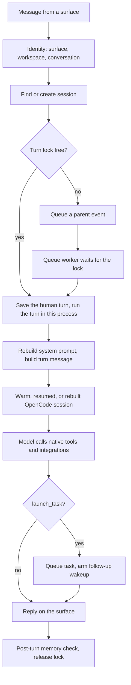

This note describes how Roomote builds and runs its two agents: the session agent, which holds the conversation, and the task agent, which works in a sandbox. Both are OpenCode. It covers how a message becomes a session turn, how each agent's context is built, how tasks are dispatched and prepared, and the tools, approvals, credentials and memory. It follows the sections of [How Codex Assembles an Agent Session]() and [How OpenCode Assembles an Agent Session]() where they apply. [Roomote]() describes the product and its deployment.


Repository: `~/projects/common/Roomote`, commit `6c8d4c3f0`, release 1.21.0 (2026-11-13). Paths are relative to the repository root. Line numbers will drift as the code changes.



Roomote pins the npm package `opencode-ai` at 1.18.30 (`apps/worker/Dockerfile:12`, `.docker/app/Dockerfile:319`). That package is built from `packages/opencode`, the 1.x runtime, with server routes such as `/session/:id/prompt_async` and `/global/event` and tool names such as `bash` and `task`. [The OpenCode note]() describes the 2.3.0 runtime. OpenCode behavior inside Roomote has to be checked against the `v1.18.30` tag in the OpenCode repository.


## Main concepts

| Concept | What it is | Where |
|---|---|---|
| Session (Fast conversation) | One conversation, whichever surface it came from. A Slack thread is one session. | `packages/db/src/schema.ts:3724` (`fast_agent_conversations`) |
| Session agent ("Fast") | The conversational agent. It answers, reads through APIs, and delegates tasks. It runs in a control-plane process. | `packages/cloud-agents/src/server/fast-agent/fast-agent-service.ts` |
| Parent event | A queued input for a session: a human follow-up, a task report, task activity, a finished task, a PR event, a wakeup, an automation trigger. | `packages/db/src/schema.ts:3831`, `packages/sdk/src/server/lib/fast-agent-parent-event.ts:228-362` |
| Task and task run | One delegated piece of work. Each run is one sandbox lifetime; a resume is a new run. | `packages/db/src/schema.ts:965`, `:1700` |
| Task agent | OpenCode running inside the sandbox for one task. | `apps/worker/src/sandbox-server/lib/harnesses/opencode-server/` |
| Environment | The YAML workspace definition: repositories, services, setup commands, ports, instructions, MCP servers, skills. | `packages/types/src/environment-config.ts` |
| Controller | Takes task runs from the queue and starts sandboxes on a compute provider. | `apps/controller/src/BaseController.ts` |
| Worker | The program inside the sandbox that prepares the workspace, starts OpenCode and reports back. | `apps/worker/` |
| Brain | A separate memory service with its own database. Agents read it through tools. | `.docker/gbrain/` |

## Where each agent runs

- **Session agent.** The model loop runs in whichever control-plane process owns the turn: the API, the web app, or the queue worker. It never runs in a sandbox (`fast-agent-service.ts:2016`, `:6711`).
	- It uses a shared pool of `opencode serve` processes, keyed by a hash of the command, environment and config (`packages/cloud-agents/src/server/opencode-runtime.ts:922`, `:1162`). A server stops after 10 idle minutes (`opencode-runtime.ts:67`).
	- Conversations are kept apart by directory: each one gets `tmp/roomote-fast-opencode/<sha256(sessionId)>` with its own `opencode.json`, rewritten every turn (`fast-agent-native-tool-bridge.ts:1620`, `:1729-1778`).
- **Task agent.** One `opencode serve --hostname 127.0.0.1 --port <free port>` per task, inside the sandbox (`apps/worker/src/sandbox-server/lib/harnesses/opencode-server/start.ts:202-212`). The worker waits up to 90 seconds for `GET /global/health` (`start.ts:85`).

## Session turn

### Entry

Every surface gives the message an identity of surface, workspace and conversation, and calls the same Fast entry.

- **Slack.** `apps/api/src/handlers/slack/events/message-entry.ts:1353` sends every message to Fast. `processFastAgentMessage` builds the identity `{surface: 'slack', workspaceId: teamId, conversationId: thread_ts || ts}` (`apps/api/src/handlers/slack/events/fast-agent.ts:100-109`).
- **Web.** `apps/web/src/trpc/commands/fast-sessions/index.ts:524`. A new web conversation gets a new ID.
- **API.** `apps/api/src/handlers/sessions/index.ts:431`.
- **Linear.** `packages/sdk/src/server/lib/linear-fast-session-turn.ts:135`.
- **Source control.** `packages/sdk/src/server/lib/source-control-fast-session.ts:123-177` joins the session that owns the pull request, if there is one.
- **Automations.** `packages/sdk/src/server/automations/custom-automations.ts:583` queues an `automation_triggered` event.

### New or existing session

`getOrCreate` takes an advisory lock on the identity and looks up, in order: the identity itself, the reply channel and thread, and an explicit session ID binding. If none matches, it creates a session (`fast-agent-conversation-repository.ts:1381-1469`).

### Running the turn now or later

- **Turn lock.** A Redis lock per conversation, prefix `fast-agent:conversation-lock:`, TTL 600 seconds (`fast-agent-turn-lock.ts:8-9`).
- **Lock free.** The human turn is saved with a 15-minute claim (`fast-agent-conversation-repository.ts:923`), and the turn runs right away in the process that received the message.
- **Lock busy.** The input becomes a `human_follow_up` parent event (`packages/sdk/src/server/lib/fast-agent-human-follow-up.ts:193-220`). The queue `fast-agent-parent-events` runs 20 sessions at once, retries a busy session every second, and recovers lost events every minute (`apps/bullmq/src/fast-agent-parent-event-queue.ts:16-66`).
- **No mid-turn steering.** The session agent never injects new input into a running OpenCode turn (`packages/cloud-agents/src/server/non-task-provider-usage.ts:2329-2330`). Follow-ups wait in the queue for the next turn.

## How the session agent's context is built

### System prompt

The system prompt is rebuilt every turn (`fast-agent-service.ts:4131`, `fast-agent-prompt.ts:338`). The order (`fast-agent-prompt.ts:574-1021`):

1. Identity: "You are \({PRODUCT_NAME} in fast mode on \){surfaceName}. You are the conversational orchestrator for this conversation...", and the release.
2. Turn handling; private-session guidance for private sessions.
3. All environments and their repositories.
4. Routing rules, the models available for delegated tasks, and coding-model routing.
5. Active or resumable delegated tasks; the session goal.
6. Deployment MCP servers and the built-in integration catalog.
7. Available skills.
8. The user's personalization, as `<user_personalization private="true">`. Left out for platform events (`fast-agent-prompt.ts:528`, `packages/cloud-agents/src/server/user-personalization.ts:55-93`).
9. Voice mode; setup sections during first-admin setup.
10. Native tools, then sections on communication, continuity, evidence and follow-through, the orchestration policy, and platform events.
11. Tone of voice.
12. Shared Agent Guidance: the deployment's Agent Guidance, as `<shared_agent_guidance>` (`fast-agent-prompt.ts:992-1000`).
13. Output and surface formatting; the capability boundary.

Memory is not in the prompt. The agent reads the Brain through tools ([Memory (Brain)](#memory-brain)).

### Turn message and history

`buildFastAgentMessages` (`fast-agent-service.ts:1749`) builds the turn message: a voice marker, skill-invocation context, the wrapped message with its sender and time, envelopes for unresolved requests and resumed turns, and extra thread context. Chat history from the surface is passed as JSON `<thread_context>` (`fast-agent-service.ts:1729-1747`).

The OpenCode session is reused in one of four ways (`fast-agent-opencode-session.ts:32-146`):

- **warm**: the session is cached in this process, a list of at most 250 entries; only the new turn is sent
- **cold resume**: the session ID saved in the database is checked with a one-message read and reused
- **cold rebuild**: there is no saved session; a bootstrap prompt replays the history as `[ROLE]` text (`fast-agent-service.ts:1861-1915`)
- **fallback rebuild**: the saved session no longer exists; same as a cold rebuild

A change in the tool configuration disposes the cached session (`fast-agent-service.ts:6683-6710`).

### Long history and large outputs

- Roomote stores the whole transcript in `fast_agent_messages` with no cap and does no compaction or summarizing of its own. Any compaction comes from OpenCode's default behavior.
- Tool outputs over 50 KiB or 2,000 lines go to a spill store in the process's temporary directory, kept for 10 minutes (`fast-agent-native-tool-bridge.ts:88-94`, `fast-agent-spill-store.ts:7-12`). The agent reads them back with `spill_read` (at most 5,000 bytes per call) and `spill_grep` (at most 12,000), within 6 calls and 24,000 bytes per turn.

## Delegation and results

### Launching a task

The model decides from the orchestration policy in the prompt (`fast-agent-prompt.ts:837-862`): source-control APIs for focused reads, `launch_task` when the work needs a checkout, edits, commands or tests, parallel tasks for independent work, `send_task_message` for a running task, and `review_pull_request` for reviews.

`launch_task` (`fast-agent-service.ts:5532-5773`):

- checks the launch criteria and the environment, which must be a listed environment, all repositories, or no repositories
- refuses environment verification, and allows environment setup only for admins
- resolves the model and removes duplicate launches within a turn
- queues a task with the `standard` workflow and metadata that names the parent session (`fast-agent-task-launcher.ts:39-121`, `packages/types/src/fast-agent.ts:390-401`)
- posts "[Started coding task](url)" and sets a follow-through wakeup

The task prompt wraps the description in `<request>...</request>`. The workflow instructions tell the task: "You are the coding executor for an orchestrator-owned task." (`packages/cloud-agents/src/server/workflows/standardTask.ts:383-396`, `:578-613`).

### Results back into the session

Everything a task sends back arrives as parent events:

- `child_message`: a report from the task's `report_to_parent_session` tool (`packages/sdk/src/server/lib/task-runs/report-to-parent-session.ts:55`)
- `task_activity`: a digest of the task's activity (`packages/sdk/src/server/lib/task-activity-digest.ts:341`)
- `task_settled`: the task finished (`packages/sdk/src/server/lib/task-runs/notify-fast-agent-parent-on-settle.ts:130`)
- pull request events: opened, feedback, status changed, conflict

**Triage.** Reports and activity pass a judgment-model filter (`fast-agent-task-communication-triage.ts:149-238`). It decides relay, redirect, quiet or uncertain, from scores such as "needs the user" (0.7), "changes the picture" (0.35) and "off track" (0.7). Closing reports and clarification questions are always relayed. The filter is an experimental setting.

**Wakeups.** A built-in wakeup "Follow through on session tasks" runs 10 minutes after delegation, 1 minute in voice mode (`packages/cloud-agents/src/server/session-wakeups/service.ts:33-42`). There is also a wakeup for continuing a session goal.

## Task run

### Dispatch

- The controller pops a run ID from the Redis task-run queue and spawns it, at most 10 at once (`apps/controller/src/BaseController.ts:167`, `:231-354`). Every 30 seconds it recovers stuck runs (`packages/types/src/sandbox-spawn.ts:28`). A run still pending after 5 minutes is claimed again (`apps/controller/src/orphaned-task-runs.ts:23-65`).
- `dequeueTaskRun` creates the run token and marks the run dequeued (`BaseController.ts:640-756`). The provider adapter then creates the sandbox: Docker, Modal, E2B, Daytona, Blaxel, Box, Azure, or Roomote's own broker (`packages/compute-providers/src/adapters/`, `apps/controller/src/RoomoteController.ts:86-417`). A sandbox lives at most 5 hours (`packages/types/src/compute-providers/worker-runtime.ts:8`).
- **Image.** `ghcr.io/roocodeinc/roomote-worker`: Ubuntu 24.04, user `roomote`, with OpenCode installed from npm (`apps/worker/Dockerfile:164`, `:281-318`). The image has no entrypoint. The Docker adapter starts the container with `sleep infinity`, copies the worker in, and runs `worker run <id>` with `docker exec` (`apps/controller/src/compute-providers/spawn-docker-worker.ts:60-61`, `:365-400`, `:544-552`). Other providers run the same command through their own command API.

### Workspace setup

In order (`apps/worker/src/commands/setup.ts`, `apps/worker/src/commands/utils/execute-task-run.ts`):

1. Claim the run, inject environment variables, mark the run as preparing.
2. Install system tools: bubblewrap, Python, a browser agent, media tools, mise, agent CLIs.
3. In parallel: clone the environment's repositories, install tool versions, write `REPOSITORIES.md`; start services and port proxies (`apps/worker/src/commands/setup/workspace/repositories.ts`, `workspace/services.ts`).
4. Start Docker Compose projects, possibly in the background.
5. Run the environment recipe, install environment and manual skills, run each repository's setup commands (`setup.ts:471-595`).
6. Wait for credential delivery ([Credentials](#credentials)), write `.bashrc`.

Then `runTask` (`apps/worker/src/run-task/run-task.ts`):

1. Set `HOME` to `<workspace>/.roomote-runtime-home` (`run-task.ts:141-143`).
2. Install the judgement and search tools, then instance skills into `$HOME/.agents/skills` (`run-task.ts:955-1019`).
3. Fetch MCP configs, build the instructions, and write a workspace-root `AGENTS.md` (`run-task.ts:1032-1152`).
4. Create the harness and start OpenCode (`run-task.ts:1448`, `apps/worker/src/run-task/create-harness.ts:117`, `:234`).
5. Start the sandbox server, mark the run as running, send the first prompt (`run-task.ts:2310-2471`).

### OpenCode configuration

`generateOpenCodeConfig` (`apps/worker/src/run-task/agent-home.ts:1943-2142`) writes the model and provider config to `~/.config/opencode` and passes the rest inline through `OPENCODE_CONFIG_CONTENT` (`bootstrap.ts:251`):

- `share: 'disabled'`, `autoupdate: false`, `subagent_depth: 2` (`agent-home.ts:2100-2102`)
- `permission`: everything allowed except `webfetch`, plus the integration approval rules ([Task tools](#task-tools))
- `skills.paths` with `$HOME/.agents/skills`
- `instructions`: a list of files, among them the developer instructions file, and the visual, judge, advisor and integration instructions (`agent-home.ts:1976-2087`)
- `mcp`: local and remote servers with a 10-minute timeout
- agents: `architect` and `advisor` always, `explore`, `judge` and `visual` when they apply; OpenCode's `general` agent is disabled (`agent-home.ts:1582-1682`)
- providers rebased onto Roomote's inference gateway (`agent-home.ts:1764-1803`)

Two settings change what OpenCode loads from the repository:

- `OPENCODE_DISABLE_PROJECT_CONFIG=1`. The code comment explains it: a repository's `opencode.json`, `.opencode` plugins and MCP servers would otherwise run at server start with the task's credentials, "pre-LLM RCE" (`bootstrap.ts:252-255`).
- `auth.json` is deleted, so OpenCode can't fall back to a stored login (`bootstrap.ts:344-372`).

Plugins are written as files into `$HOME/.config/opencode/plugins/` (`agent-home.ts:965-1012`):

| Plugin | What it does |
|---|---|
| `roomote-tool-safety.js` | Before a tool runs: blocks `printenv`, bare `env` and `pm2` environment dumps in bash, and reading `.env*`, the on-demand MCP catalog, and `.ico`/`.cur` files. After a tool runs: redacts secret environment values from the output (`apps/worker/src/run-task/opencode-tool-safety-plugin-script.ts:49-83`). |
| `roomote-slack-hooks.js` | Runs a check before tools that post to Slack, for example to stop a sub-agent from posting, and appends a Slack reminder to tool output (`opencode-slack-hooks-plugin-script.ts:83-145`). |
| ChatGPT gateway | For a ChatGPT subscription, limits OpenAI models to the subscription's models and sets their cost to zero (`opencode-chatgpt-gateway-plugin-script.ts:52-67`). |
| `roomote-identity.js` | Removes the "You are OpenCode" line from the system prompt (`packages/cloud-agents/src/opencode-identity-plugin.ts:8-16`). |

### Task prompt

- **Generation.** At dequeue, `generatePrompt` picks the workflow builder (`packages/sdk/src/server/lib/task-runs/dequeue-task-run.ts:544`, `packages/cloud-agents/src/server/cloud-agent-workflow.ts:172-403`). `standardTask` returns the prompt and the workflow instructions (`standardTask.ts:448-616`).
- **Developer instructions file.** Roomote's system prompt (`packages/cloud-agents/src/system-prompt.ts:40-61`), the workflow instructions, and the environment instructions, written to `roomote-opencode-developer-instructions.md` and listed in OpenCode's `instructions` (`run-task.ts:1131-1150`, `agent-home.ts:1980-1991`).
- **Environment instructions.** `combineAgentInstructions` joins the deployment Agent Guidance ("Organization-wide agent behavior:"), the environment's `agentInstructions` ("Environment-specific agent instructions:"), readiness warnings and sandbox notes inside `<environment-instructions>` (`run-task.ts:125-133`, `:480-530`).
- **First message.** Sent with `prompt_async` to the `build` agent, or `architect` while the planning skill is active, hidden from the visible transcript (`apps/worker/src/sandbox-server/lib/harnesses/opencode-server/harness.ts:3999-4087`).
- **Follow-ups.** Queued while the sandbox boots, sent to the live sandbox server while the task runs, or carried by a new resume run after the task has slept (`apps/api/src/handlers/tasks/sendMessageToTask.ts:629-666`, `:1220-1291`).

### Events back to Roomote

- OpenCode's event stream is mapped to Roomote runtime events: user prompt, assistant message and thought, plan, tool call and result, request for user input, cancellation (`apps/worker/src/sandbox-server/lib/harnesses/opencode-server/runtime-event-emitter.ts:123-541`, `packages/types/src/acp.ts:21-41`). The worker saves them through the SDK, with inference usage (`subscribe-harness-callbacks.ts:131-210`).
- Diffs and logs are pulled: a server in the sandbox on port 4200 serves the git diff, the harness log and status streams (`packages/types/src/sandbox-server.ts:5`).

### Stop, sleep and resume

- **Stop.** A cancel aborts the OpenCode session and stops `opencode serve` (`apps/worker/src/run-task/harness-manager.ts:590-653`).
- **Sleep.** After 30 idle minutes (`packages/types/src/constants.ts:15`), secrets are scrubbed. Docker, Blaxel, Box and Azure sandboxes go on standby; Modal, E2B, Daytona and Roomote's broker take a snapshot and stop the sandbox (`apps/bullmq/src/scheduled-jobs/sleep-check.ts:1117`, `:1247`, `apps/bullmq/src/jobs/snapshot.ts`).
- **Resume.** A new run restores the sandbox: `docker start` on the kept container, or a snapshot or standby resume. A fresh worker and a fresh `opencode serve` start and reattach to the same OpenCode session ID, keeping the git state (`apps/worker/src/commands/resume.ts`, `run-task.ts:2383-2400`).

## Memory and instruction sources

| Source | Stored in | Session agent | Task agent |
|---|---|---|---|
| Agent Guidance | `deployment_settings.global_agent_instructions`, up to 10,000 characters (`packages/db/src/schema.ts:406`) | `<shared_agent_guidance>` in the system prompt, read every turn | Inside `<environment-instructions>` |
| Environment instructions | `environments.config`, up to 10,000 characters | Not included | Inside `<environment-instructions>` |
| Automation instructions | `automations.instructions`, `custom_automations.prompt` | Prompt of the automation's session | "Additional team instructions:" in the task prompt |
| Task prompt | `tasks.prompt`, `task_runs.prompt` | -- | `<request>` |
| Personalization | `user_personalizations`, encrypted (`schema.ts:234-252`) | In the system prompt | Only for tasks a user started |
| Skills | Packaged, instance (`instance_skills`), environment, repository | Catalog of up to 64; `load_skill` | Installed into `$HOME/.agents/skills` |
| Repository list | `REPOSITORIES.md`, written by the worker | `list_repositories` tool | File in the workspace |
| Memory | Brain service | Tools only | Tools only |

### AGENTS.md

- **The repository's root `AGENTS.md` and `CLAUDE.md` don't load automatically.** In OpenCode 1.18.30, `OPENCODE_DISABLE_PROJECT_CONFIG` also skips the project's instruction files: `systemPaths` looks for them only when the flag is off (`packages/opencode/src/session/instruction.ts:123` at tag `v1.18.30` in the OpenCode repository).
- **Nested `AGENTS.md` files still load.** OpenCode 1.18.30 loads them when the agent reads a file below them, and that path doesn't check the flag (`instruction.ts:179` at `v1.18.30`).
- **Roomote replaces the root file with prompt text.** It writes its own `AGENTS.md` at the workspace root, saying that child `AGENTS.md` files "may not have been auto-loaded" and telling the agent to find them with `git ls-files` (`apps/worker/src/run-task/shared-workspace-agents.ts:71-110`). The `clone_repository` tool also tells the agent to read the repository's root `AGENTS.md` (`clone-repository.ts:63`).
- No Roomote code reads `CLAUDE.md`.

### Skills

- **Packaged skills** in `packages/cloud-agents/src/server/workflows/skills/standard/`. The session agent reads them from there or from `/roomote/skills/standard` in the app image (`fast-agent-skill-store.ts:9-48`). Its per-turn catalog lists instance, environment, marketplace and repository skills, at most 64 (`fast-agent-prompt-skill-catalog.ts:30`).
- **Instance skills** are stored in the database, at most 128, 64 KiB each (`packages/types/src/create-custom-skill-tool.ts:7-8`).
- **In the task**, instance skills, environment skills and the repository's own `.agents/skills` or `.claude/skills` are copied into `$HOME/.agents/skills`, with `.claude/skills` links (`agent-home.ts:380-600`, `repo-local-skills.ts:5-8`).
- **Routing.** A leading `$name` or `/name` in a request is kept outside `<request>` so the skill runs (`standardTask.ts:589-610`).

### Memory (Brain)

- **Service.** gbrain on its own Postgres database with 1536-dimension vectors, switched on by `deployment_settings.brain_enabled` (`.docker/gbrain/entrypoint.sh:26`, `schema.ts:355`). Default models: `gpt-5.6-luna` for writing and `text-embedding-3-small` for embeddings (`packages/sdk/src/server/lib/brain-inference.ts:30-40`).
- **Sources indexed**: Slack directory and public channels, people directories, Rippling, Discord, Notion, Granola, GitHub issues, Linear issues, task memories and pull-request facts (`brain-collectors.ts:406-417`). Code is not indexed.
- **Writing.** Only the server writes, through outbox tables drained into the Brain (`apps/bullmq/src/scheduled-jobs/brain-outbox-drain.ts:268-276`).
	- The agents can save memories directly: `save_memory` in the session, `save_task_memory` in the task.
	- After each session turn, a judgment model decides whether the turn holds something to keep (threshold 0.8), and a small model writes at most 3 facts (`fast-agent-post-turn-memory.ts:30-41`, `:169-304`).
	- After each standard task turn, the same kind of check (threshold 0.7) writes a task memory, unless the agent already saved one (`packages/cloud-agents/src/server/task-run-memory-distillation.ts:45-114`, `:291-400`).
	- Before any text leaves the deployment for the check, a scrubber removes credentials, emails, numbers shaped like SSNs, valid card numbers and phone numbers (`memory-check-scrub.ts:50-55`).
- **Reading.** Through a read-only proxy that allows `query`, `search`, `entity`, `synthesize`, `list_pages` and `get_page` (`apps/api/src/handlers/mcp/gbrain.ts:29-45`). The prompts tell the agent to query memory first (`packages/types/src/brain.ts:409-469`). Nothing is put into the context automatically.


The memory docs page doesn't list Linear issues as a source, but the code collects them. The skills docs page says packaged skills are in the per-turn catalog; the code leaves them out.


### Untrusted content

- Content from issues, pull requests and webhooks is wrapped in `<untrusted_external_content source=...>` with escaping, plus an `<untrusted_content_policy>` (`packages/cloud-agents/src/server/untrusted-content.ts:18-78`). Only automation work items, PR follow-ups and the issue fixer use it.
- Chat messages sent to tasks are escaped into `<communication_message>` (`packages/types/src/communication-message-prompt.ts:44-81`).
- The session prompt tells the agent to treat integration results, fetched pages, child-task events and webhook input as data (`fast-agent-prompt.ts:698`, `:873`, `:942-972`).

### Judgment model

A separate model that answers yes-or-no, choice and score questions without writing text (`packages/cloud-agents/src/server/typesafe-judgment.ts:28-65`). It runs on TypeSafe's Jev model through one of several providers, or on a self-hosted GLiNER service (`.docker/judgment/server.py:44`). Without one, a helper model answers. It gates memory writes, task-report triage, reply targets, launch decisions, automation launches and integration-tool auto-approval (`judgment-decision-catalog.ts:99-351`). In tasks, the worker also installs a `judgement check --staged` git hook that checks commits against the repository's rules (`apps/worker/src/run-task/repository-judgement.ts:7-28`).

## Tools

### Session tools

The session agent has about 35 native tools (`packages/types/src/fast-agent-tool-catalog.ts:7-39`):

| Group | Tools |
|---|---|
| Chat | `send_chat_reply`, `send_chat_reaction`, `ignore_event`, `request_user_input` (web only) |
| Delegation | `launch_task`, `send_task_message`, `stop_task`, `cancel_task`, `retry_task_start`, `review_pull_request` |
| Environments | `ensure_environment`, `list_repositories` |
| Memory | `save_memory`, `update_personalization` |
| Artifacts and UI | `create_artifact`, `show_widget`, `inspect_images` |
| Integrations | `find_integration_tools`, `connect_integration`, `add_remote_mcp`, `call_integration_tool`, `prepare_integration_key`, `list_integration_keys` |
| Session | `manage_wakeups`, `manage_goal` |
| Skills | `list_skills`, `load_skill` |
| Large outputs | `spill_read`, `spill_grep` |
| Other | `report_platform_issue`, `offer_capability` (web only), `evaluate_automation_launch_criteria` |

`save_memory`, `call_integration_tool`, `add_remote_mcp`, the integration key tools and `evaluate_automation_launch_criteria` are off by default and switched on per turn (`fast-agent-tool-policy.ts:16-28`, `:83-118`). Sub-agents get no delegation tools and only `find_integration_tools` among the native tools (`fast-agent-tool-policy.ts:30-42`).

How they reach OpenCode:

- **Native tools** are OpenCode custom-tool files. Each one posts to an HTTP bridge on `127.0.0.1` with a random token, and the bridge runs the tool for that conversation (`fast-agent-native-tool-bridge.ts:336-878`, `:1243-1550`).
- **Integrations** are remote MCP servers in `opencode.json`, pointed at the bridge's `/mcp/<capability>/<id>` (`fast-agent-native-tool-bridge.ts:1764-1775`). They cover user and deployment MCP servers, the Brain, and source control (GitHub, GitLab, Bitbucket, Gitea, Azure DevOps) through the deployment proxy (`fast-agent-integration-broker.ts:493-618`). Code Mode is on (`OPENCODE_EXPERIMENTAL_CODE_MODE=1`), so integrations are called inside `execute`.
- The server config denies OpenCode's own tools except `task`, so the session agent can't edit files or run commands (`opencode-runtime.ts:272-307`).

### Task tools

- **OpenCode built-ins.** The permission set allows `read`, `edit`, `glob`, `grep`, `list`, `bash`, `task`, `external_directory`, `todowrite`, `todoread`, `question`, `websearch`, `codesearch`, `lsp` and `skill`, and denies `webfetch` (`agent-home.ts:205-222`). Roomote's `roomote_fetch_url` replaces `webfetch` (`agent-home.ts:851`).
- **Roomote MCP server**, run over stdio in the sandbox (`apps/worker/src/commands/setup/setup-mcps.ts:44-50`). It includes `report_to_parent_session` for tasks started by a session, `send_chat_reply` otherwise, `request_environment_variables`, `save_task_memory` and `clone_repository` (`apps/worker/src/mcp/roomote-mcp-server/index.ts:1531`, `:1716-1806`).
- **Integrations.** Curated, Brain and custom servers are rewritten to the API's `/api/mcp/...` routes with the run token; GitHub always goes through `/api/mcp-routing/github` (`setup-mcps.ts:337-612`). Remote servers other than the Roomote server, memory and the broker aren't mounted. The agent reaches them through `roomote_find_integration_tools` and `roomote_call_integration_tool` (`agent-home.ts:729-817`).
- **Safety limits** (`packages/types/src/agent-safety.ts:2-7`): 5 identical completions, 20 polling completions, 20 minutes per pass, 1,000 task requests.

### Approvals

- **Modes** for an integration tool: allow (the default), always allow, ask, reject. A per-session Auto mode lets a model assess calls (`packages/types/src/integration-tool-approvals.ts:24-98`).
- **In the task**, the rules are compiled into OpenCode `ask` and `deny` rules. The worker relays each OpenCode ask to the API and polls every 1.5 seconds; any failure rejects the call (`apps/worker/src/sandbox-server/lib/harnesses/opencode-server/tool-approvals.ts:17`, `:205-269`). The API proxy is the enforcement point: it claims the approval for the exact call (`apps/api/src/handlers/mcp/tool-approval-enforcement.ts:41-62`). An approval lasts 10 minutes.
- **In the session**, the rules are written into the conversation's `opencode.json`, and OpenCode's ask is the only check (`fast-agent-native-tool-bridge.ts:1715-1762`).
- **Answering.** Cards in Slack, Discord or Telegram with "Allow once", "Allow for session" and "Deny"; only the user who made the request can answer (`packages/db/src/lib/integration-tool-approvals.ts:222-258`, `apps/api/src/handlers/tool-approval-action.ts:11-27`). The web app has its own route.
- OpenCode's built-in tools in the task (bash, edit and the rest) never ask.

## Credentials and isolation

### Credentials

- **Git.** A credential helper, `~/.roomote/git-credential-roomote.sh`, reads the token from a file on each call and refreshes it every 45 minutes (`apps/worker/src/lib/github-token.ts:43-160`, `apps/worker/src/run-task/polling/github-token-refresh.ts:10-12`). Providers other than GitHub and GitLab go through a local proxy.
- **Service API keys** never enter the sandbox. The sandbox gets substitute tokens (`rses_...`) and a proxy URL. The API checks each request against the live run, allows only HTTPS and the grant's methods (GET and HEAD by default), never follows redirects, and checks responses for echoed credentials (`apps/api/src/handlers/credential-egress/CONTRACT.md:12-188`).
- **What the shell can see.** Token variables are removed from the harness environment (`apps/worker/src/run-task/harnesses/harness-command-env.ts:9-19`), but:
	- `GH_TOKEN` is exported into every bash command again through `BASH_ENV` and a `gh` wrapper (`github-token.ts:48-57`, `:162-190`).
	- The run token `ROOMOTE_CLOUD_TOKEN` stays in the environment (`run-task.ts:795`, `agent-home.ts:1108-1118`).
	- The substitute service tokens and deployment variables are visible.

  The tool-safety plugin blocks only the obvious ways to print them and redacts them from output.

### Isolation

- **User.** Tasks run as `roomote` with passwordless sudo and membership in the docker group (`apps/worker/Dockerfile:109-113`), so the agent can act as root inside the sandbox.
- **Docker network** (`apps/controller/src/compute-providers/docker-sandbox-security.ts`):
	- Outbound internet by default, or no network with `DOCKER_WORKER_EGRESS_POLICY=none` (`packages/env/src/index.ts:122`).
	- With internet, link-local, carrier-grade NAT and metadata ranges are blocked, plus private ranges and the bridge gateway when a separate control network is used.
	- Workers drop the `NET_ADMIN` and `NET_RAW` capabilities.
- **Docker-in-Docker.** Environments with Docker projects get a privileged `docker:28-dind` container next to the task, reached over TCP without TLS (`spawn-docker-worker.ts:68`, `:403-428`).
- **Azure** allows outbound traffic with partial inspection (`packages/compute-providers/src/adapters/azure.ts:839-842`). No outbound rules were found for Modal, E2B, Daytona, Blaxel or Box.
- **The controller's Docker access** goes through a socket proxy that allows containers, exec, images, networks and volumes (`deploy/compose/docker-compose.prod.yml:380-405`). The separate Docker compute compose file mounts the raw socket.
- **Repository code** can't change the harness: project OpenCode config is off, and environment-defined MCP servers can't reference reserved runtime variables (`packages/types/src/environment-config.ts:471-501`).

## Points for the comparison with Codex and OpenCode

- **Two agents.** Codex and OpenCode run one agent per session, plus sub-agents. Roomote runs a session agent without a workspace and task agents with one, and the session agent's sub-agents are the tasks.
- **Harness use.** Roomote configures OpenCode 1.18.30 through generated config and environment variables, extends it with plugin files and custom tools, and doesn't fork it.
- **Input during work.** Codex steers input into a running turn, and OpenCode 2.x delivers it at the next step. Roomote's session agent queues input for the next turn.
- **Repository instructions.** Roomote turns off OpenCode's project config, which also stops the root `AGENTS.md` from loading. The file reaches the agent only because Roomote's instructions tell it to read it.
- **Memory.** Codex has an optional memories feature written from session logs. OpenCode has none. Roomote has a separate memory service fed by session turns, task turns and outside sources such as Slack and Linear, read only through tools.
- **Approvals.** Codex asks before risky commands and runs them in an OS sandbox. OpenCode asks according to permission rules. Roomote's tasks allow OpenCode's built-in tools except `webfetch` without asking and ask only for integration tools. The limits come from the sandbox and the credential proxy.
