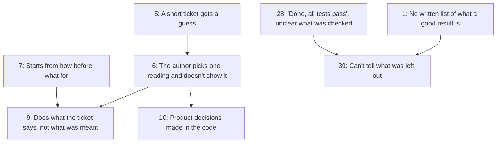
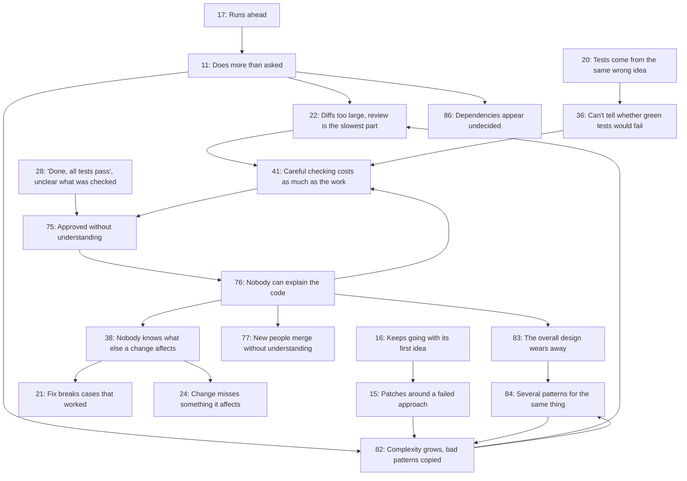
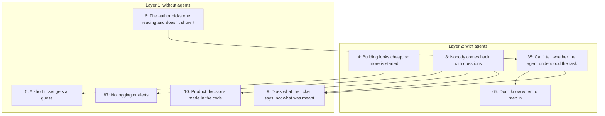
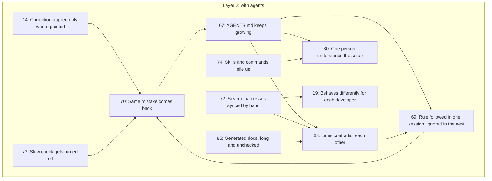
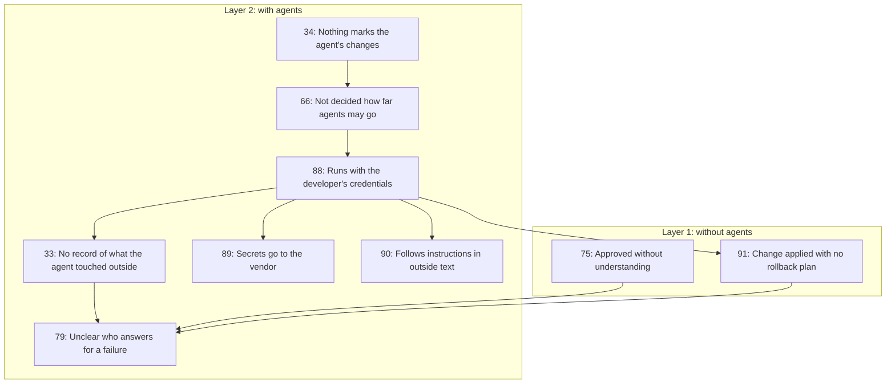
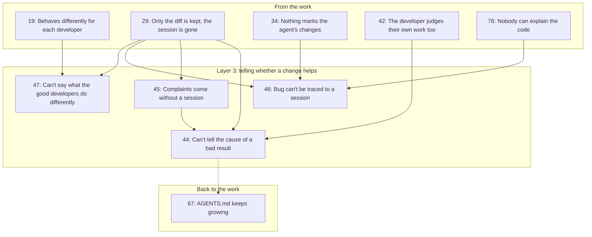
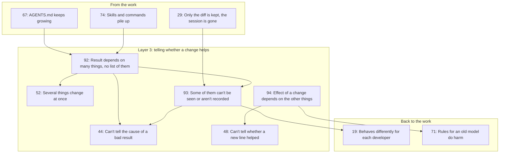
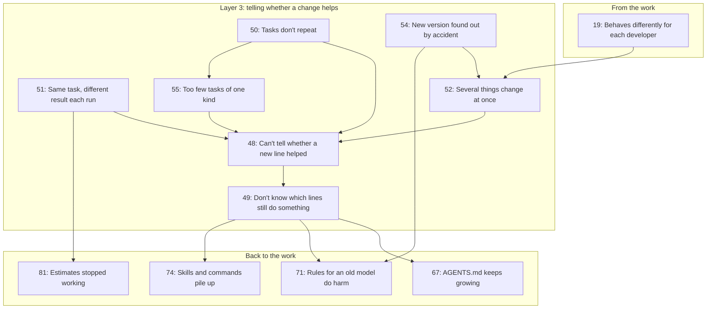

The problems in [Problems in Engineering Work with Agents]() aren't separate. One problem often leads to another, and the second leads to a third. This note draws those links in three layers. The numbers are the numbers in that list.

Every link here is my reasoning from how the problems are worded, and so is the layer of each problem. None of it was observed in a case from our work. A link stays only if a real case shows the first problem leading to the second.

## What a Link Means

An arrow from A to B means: when A happens, B happens more often or gets worse, or A is a reason why B can't be told.

A dashed arrow means the link goes through something people choose to do. For example, the same mistake comes back (70), so someone adds a line to `AGENTS.md`, and the file grows (67). The team could respond differently at a dashed arrow.

Each of the 126 links is drawn once. A problem can appear in more than one diagram.

## Three Layers

| Layer | What it holds | Problems | Numbers |
| --- | --- | --- | --- |
| 1. Without agents | Problems a team of developers has before any agent is involved. Agents can make them bigger. | 29 | 1, 5-7, 9-11, 15-17, 20-22, 24, 28, 36, 38, 39, 41, 43, 75-77, 82-84, 86, 87, 91 |
| 2. With agents | Problems that appear once agents do part of the work. | 40 | 4, 8, 12-14, 18, 19, 23, 25-27, 29-35, 37, 40, 42, 64-74, 78-81, 85, 88-90 |
| 3. Telling whether a change helps | Problems of finding the cause of a bad result, telling whether a change to the setup helped, and telling whether the whole thing pays off. | 25 | 2, 3, 44-63, 92-94 |

How a problem got its layer:

- A problem about finding a cause, comparing before and after, or measuring went to layer 3.
- Of the rest, a problem went to layer 1 if a team without agents has it as a regular thing.
- Everything else went to layer 2.

Five problems are in layer 2 although the list says they were known before agents: 4, 8, 26, 65, and 80. The column in the list records whether older work describes the pattern. The layer records whether a team without agents has the problem. A team without agents has no review handed to an agent (26) and no agent setup that only one person understands (80).

## Layer 1: Sequences a Team Has without Agents

### From the Ticket to the Wrong Feature

A short ticket gets a guess (5). The author picks one reading and doesn't show it (6), so the feature does what the ticket says and not what was meant (9), and product decisions get made in the code (10). An author who starts from how before what for ends in the same place (7). When "done" arrives and nobody wrote down what a good result is (28, 1), nobody can tell what was left out (39).

### From Large Diffs to Code Nobody Can Explain

The author runs ahead and does more than asked (17, 11), so diffs are large (22). Careful checking costs about as much as the work (41), and green tests don't show that the change is right (20, 36). Checking gets light, and changes are approved without understanding (75). Over time nobody can explain the code (76). Then nobody knows what else a change affects (38), changes miss things and break cases that worked (24, 21), and new people merge without understanding (77).

With nobody holding the design, it wears away (83), patterns multiply (84), and complexity grows (82). More complex code makes the next diff harder to review (22). So this sequence is a loop, and it exists before any agent is involved.

## Layer 2: What Agents Add

### Additions to the Ticket Sequence

Building looks cheap, so more is started and each ticket gets less thought (4). A developer used to come back with questions about a ticket, and the agent builds what the words say (8). That feeds the wrong feature (9), decisions made in the code (10), and missing logging (87). Nobody can tell whether the agent understood the task before it changes files (35), and the developer doesn't know when to step in (65).

### Additions to the Review Sequence

```mermaid
flowchart TD
    subgraph l2["Layer 2: with agents"]
        p12["12: States guesses as facts"]
        p13["13: Explains in words the developer can't follow"]
        p23["23: More output than anyone can review"]
        p25["25: Review comments bring back a new large diff"]
        p26["26: Review given to another agent"]
        p27["27: Generated description seldom says why"]
        p29["29: Only the diff is kept, the session is gone"]
        p30["30: Good pull request hides a bad session"]
        p31["31: Can't tell checked facts from guesses"]
        p32["32: Can't tell what the author thought about"]
        p37["37: Code looks tidy right or wrong"]
        p40["40: Can't tell how far to trust a second agent"]
        p66["66: Not decided how far agents may go"]
        p78["78: New member asks the agent, not a colleague"]
        p85["85: Generated docs, long and unchecked"]
    end
    subgraph l1["Layer 1: without agents"]
        p22["22: Diffs too large, review is the slowest part"]
        p28["28: 'Done, all tests pass', unclear what was checked"]
        p39["39: Can't tell what was left out"]
        p41["41: Careful checking costs as much as the work"]
        p75["75: Approved without understanding"]
        p77["77: New people merge without understanding"]
    end
    p12 --> p28
    p12 --> p31
    p13 --> p75
    p22 -.-> p26
    p23 --> p41
    p25 --> p22
    p26 --> p40
    p26 --> p75
    p27 --> p32
    p27 --> p39
    p29 --> p30
    p31 --> p41
    p32 --> p75
    p37 --> p41
    p66 --> p23
    p78 --> p77
    p85 --> p77
```

Agents add to the review sequence in three ways.

- **More arrives.** Review comments bring back a new large diff (25), and a run with no decided limit leaves more output than anyone can review (66, 23).
- **The signs a reviewer relied on stop working.** Code looks tidy whether it's right or wrong (37). The agent states guesses as facts (12), so nobody can tell which statements were checked (31), and "done, all tests pass" says less (28). The description is generated (27), so the reviewer can't tell what the author thought about (32), and the product owner can't tell what was left out (39). The explanation is in words the developer can't follow (13). A good pull request can hide a bad session (29, 30).
- **The review can go to another agent** (26, 40).

Most of these paths lead to careful checking (41) or approval without understanding (75), which are already in the layer 1 loop. New people are affected the same way: they ask the agent and read generated docs (78, 85), and merge without understanding (77).

### The Agent Setup

These problems have no counterpart in layer 1, because a team without agents has no agent setup. The same mistake comes back (70), and a line is added to `AGENTS.md` (67). A longer file has more contradictions (68), and the agent follows its rules less reliably (69), so mistakes come back again. This is the second loop. A correction applied only where the developer pointed (14) and a slow check that gets turned off (73) also bring mistakes back. Several harnesses synced by hand (72) and generated docs (85) add contradictions. Skills and commands pile up (74), and in the end one person understands the setup (80).

### Limits and Safety

Nothing marks the agent's changes (34), so there's nothing to base a decision on how far agents may go (66). With no decision, the agent runs with the developer's full credentials (88). Then secrets reach the vendor (89), an instruction in outside text can do more damage (90), changes are applied with no rollback plan (91), and there's no record of what the agent touched (33). When something breaks, it isn't clear who answers for it (79).

## Layer 3: Telling Whether a Change Helps

Each diagram has the layer 3 problems in the middle. Above them are the problems of the work that feed them, and below are the problems of the work they lead to.

### Finding the Cause

Only the diff is kept (29). So a complaint arrives without a session (45), a bug can't be traced back (46), and nobody can say what the developers with good results do differently (47). The developer who judges the result also wrote the ticket and steered the session (42). The cause of a bad result can't be told (44). The team still wants to do something, so it adds a line to `AGENTS.md` (67).

### Many Parameters, Some of Them Hidden

The setup grows (67, 74), so the result of a task depends on more things, and nobody has a list of them (92). With no list, nothing says what to record, and some of these things can't be seen at all (93). Only the diff is kept, so what the agent loaded into its context is gone too (29). A setup file that only one developer has makes the agent behave differently for that developer (19). With many things and some of them hidden, the cause of a bad result can't be told (44), and several things change at once without anyone noticing (52). The effect of a change also depends on the other things (94). So one line can't be judged by itself (48), and a rule that helped with an old model does harm with a new one (71).

Problems 92 to 94 and their ten links were added after the rest of this note. The group describes a problem that is older than agents: [the bottom-up approach](#many-parameters-some-of-them-hidden) says where else it appears and what the approach does about it.

### Telling Whether One Change Helped

Tasks don't repeat (50), there are too few of one kind (55), the same task gives a different result on each run (51), and several things change at once (52). So nobody can tell whether a new line helped (48) or which lines still do something (49). Nothing is removed: `AGENTS.md` grows (67), skills pile up (74), and rules written for an old model stay (71).

### Telling Whether It Pays Off

```mermaid
flowchart TD
    subgraph work["From the work"]
        p1["1: No written list of what a good result is"]
        p22["22: Diffs too large, review is the slowest part"]
        p41["41: Careful checking costs as much as the work"]
        p43["43: Some results show only weeks later"]
    end
    subgraph l3["Layer 3: telling whether a change helps"]
        p2["2: What can be counted isn't what the team cares about"]
        p3["3: The goal is 'handle tickets better'"]
        p48["48: Can't tell whether a new line helped"]
        p53["53: Helps one kind of task, hurts another"]
        p56["56: Can't say whether the setup is good"]
        p57["57: Bad sessions are remembered better"]
        p58["58: Can't tell whether time was saved"]
        p59["59: Faster, or only more code?"]
        p60["60: No number management can trust"]
        p61["61: Nothing recorded before agents"]
        p62["62: Token bill not connected to results"]
        p63["63: Benchmarks don't cover this repository"]
    end
    subgraph back["Back to the work"]
        p64["64: Don't know which tasks to give the agent"]
        p66["66: Not decided how far agents may go"]
    end
    p1 -.-> p2
    p1 --> p56
    p2 --> p59
    p2 --> p60
    p2 --> p62
    p3 --> p56
    p22 --> p59
    p41 --> p58
    p43 --> p59
    p48 --> p56
    p53 --> p56
    p56 --> p60
    p56 --> p64
    p56 --> p66
    p57 --> p53
    p57 --> p56
    p59 --> p60
    p61 --> p59
    p61 --> p60
    p63 --> p56
```

Nobody can say whether the setup is good (56). Six things feed that: no written list of what a good result is (1), a goal nobody can check (3), no way to tell whether single changes helped (48), impressions skewed toward bad sessions (57, 53), and benchmarks that don't cover this repository (63). With no list of what a good result is, the team counts what can be counted (2), and the counts don't say whether it ships faster (59), saves time (58), or earns the token bill (62). Management gets no number it can trust (60). Two decisions are left with nothing to base them on: which tasks to give the agent (64) and how far agents may go (66).

## How the Layers Connect

The table counts the links from the layer in each row to the layer in each column.

| From \ To | Layer 1 | Layer 2 | Layer 3 |
| --- | --- | --- | --- |
| 1. Without agents | 28 | 4 | 6 |
| 2. With agents | 17 | 24 | 11 |
| 3. Telling whether a change helps | 0 | 10 | 26 |

- **Layer 1 holds together without the others.** It has 28 links of its own and a loop. A team has these sequences before any agent is involved.
- **Layer 2 pushes into layer 1.** 17 links go from layer 2 into layer 1, and 4 go the other way. Eight of them end at three layer 1 problems: careful checking (41), approval without understanding (75), and new people merging without understanding (77).
- **Layer 3 takes from the work and gives back only to layer 2.** 17 links come in from layers 1 and 2. 10 go back, all to layer 2: the setup (67, 71, 74), how the agent behaves for each developer (19), what to trust the agent with (64, 66), and estimates (81). No link goes from layer 3 to layer 1.

## Two Loops

Two groups of problems form loops: following the arrows from a problem in the group leads back to it.

- **Review and understanding, in layer 1:** 22, 41, 75, 76, 83, 84, and 82. Agents add one more path through it, the review handed to another agent (26).
- **The setup and telling what a change did, in layers 2 and 3:** 19, 67, 68, 69, 70, and 74 in layer 2, and 44, 48, 49, 52, 92, and 93 in layer 3.

A problem inside a loop gets worse on each pass without any new cause. Fixing one problem in a loop may not hold if the others still feed it.

The second loop has two parts. The inner part is the setup alone: the same mistake comes back (70), a line is added (67), the file contradicts itself (68), and its rules are followed less reliably (69). The outer part goes through layer 3. With no cause (44) and no way to tell which lines work (48, 49), `AGENTS.md` grows (67) and skills pile up (74). A bigger setup means more things the result depends on (92, 93), and that makes the cause and the effect of a line harder to tell.

The outer part is new. Before problems 92 to 94 were added, layer 3 fed the setup loop from outside and had no way back. The two links from a growing setup to many parameters (67 to 92, and 74 to 92) close the loop.

## Where the Sequences Start and End

A start is a problem with arrows going out and none coming in. An end has arrows coming in and none going out. There are 29 starts and 23 ends. What the starts are, and which features of the work, people, and agents the problems trace back to, is in [Features behind the Problems in Work with Agents]().

| Layer | Starts | Ends |
| --- | --- | --- |
| 1. Without agents | 1, 7, 16, 17, 20, 43 | 9, 10, 21, 24, 39, 77, 86, 87 |
| 2. With agents | 4, 8, 12, 13, 14, 25, 27, 29, 34, 37, 42, 72, 73, 78, 85 | 30, 40, 64, 65, 71, 79, 80, 81, 89, 90 |
| 3. Telling whether a change helps | 3, 50, 51, 54, 57, 61, 63, 94 | 46, 47, 58, 60, 62 |

## Problems with the Most Links

| # | Problem | Layer | Arrows in | Arrows out |
| --- | --- | --- | --- | --- |
| 56 | Can't say whether the setup is good | 3 | 6 | 3 |
| 41 | Careful checking costs as much as the work | 1 | 6 | 2 |
| 48 | Can't tell whether a new line helped | 3 | 5 | 2 |
| 67 | AGENTS.md keeps growing | 2 | 3 | 4 |
| 75 | Approved without understanding | 1 | 5 | 2 |
| 22 | Diffs too large, review is the slowest part | 1 | 3 | 3 |
| 29 | Only the diff is kept, the session is gone | 2 | 0 | 6 |

## What Isn't Linked

"Sessions overwrite each other" (18), in layer 2, has no link to any other problem.

## Open Questions

- Which of these links show up in a real case, and which don't?
- Is each problem in the right layer? Several layer 1 problems, such as doing more than asked (11), may be so much bigger with agents that they belong in layer 2.
- Are the dashed arrows, where people choose a response, the places where a team can act?
