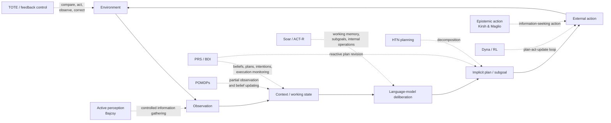
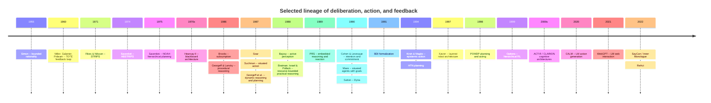
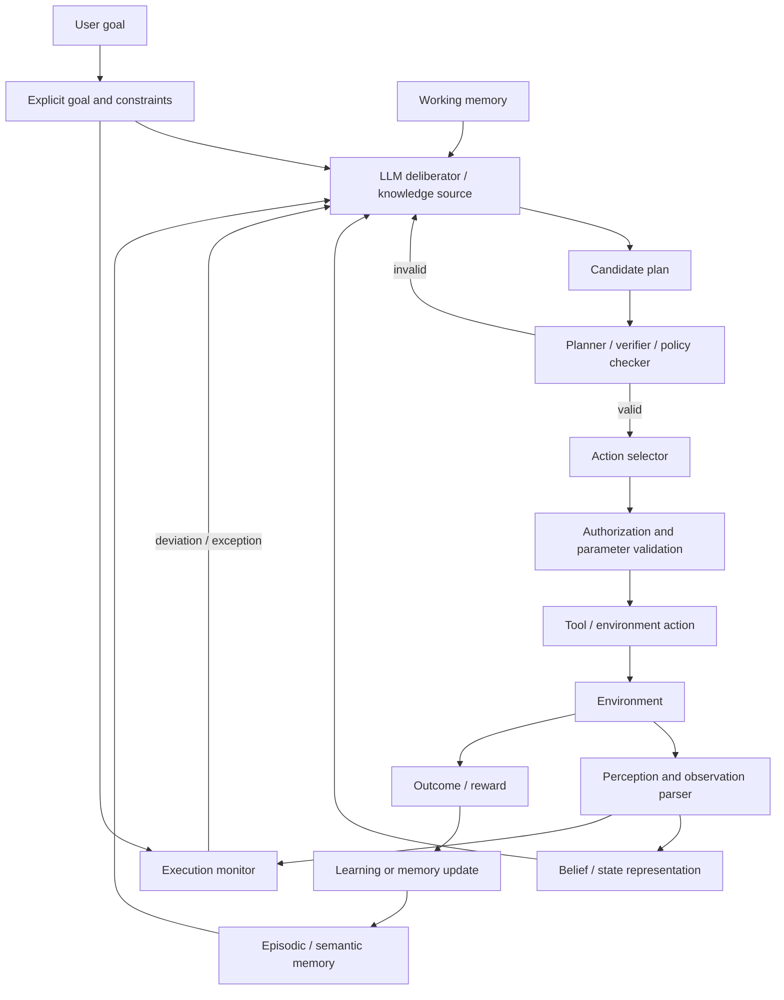

## Executive summary

**Main conclusion.** ReAct is best understood as a useful **LLM implementation pattern for a much older agent architecture**, not as the invention of combining reasoning and action. Its distinctive contribution was to show that a pretrained autoregressive language model can be prompted to place free-form natural-language deliberation, environment actions, and resulting observations in one token sequence, and that this simple interface can improve performance on some language and interactive tasks with little task-specific training. That contribution was timely and consequential. The higher-level ideas--closed-loop perception-deliberation-action, partial plans revised after observations, explicit internal state, subgoaling, epistemic actions used to acquire information, resource-bounded deliberation, reactive execution, and hierarchical goal pursuit--had already been developed in AI, robotics, cognitive architectures, planning, decision theory, psychology, and control over several decades.

The distinction matters because the original paper makes broader historical claims than its bibliography can support. It presents ReAct as a "novel prompt-based paradigm" and says, with an LLM qualifier in one important passage, that it is the first demonstration of combined reasoning and action in an interactive closed loop. Elsewhere the introduction characterizes prior research on reasoning and acting as largely separate. Yet work on PRS/BDI agents, Soar, Dyna, hierarchical planning, situated and reactive agents, active perception, POMDPs, and hybrid robot architectures had made the integration itself a central research problem long before LLMs.

A bibliographic audit of the ICLR 2023 paper makes the historical narrowing measurable. It has **40 bibliography entries: 32, or 80%, are from 2020-2022; 20, or 50%, are from 2022 alone.** All **20 citations in the dedicated Related Work section are from 2020-2022**. The eight pre-2020 references consist mainly of psychology/inner-speech sources and task datasets; the paper does not cite STRIPS, PRS, BDI, Soar, ACT-R, Brooks, blackboard systems, epistemic action, active perception, HTN planning, POMDPs, Dyna, or the classic practical-reasoning literature.

This is stronger evidence than merely observing that an NLP paper has recent references. The omitted literature addresses the paper's central abstraction--**how an intelligent system should interleave deliberation with action under changing observations**. STRIPS formalized action operators and world-state change; PRS was explicitly designed for goal-directed reasoning combined with rapid reactions to unforeseen environmental change; BDI formalized beliefs, desires, intentions, and commitment; Soar integrated working memory, subgoals, action, and learning; Dyna explicitly described itself as an architecture integrating "learning, planning, and reacting"; POMDP theory formalized acting under partial observation; Kirsh and Maglio called information-gathering behavior **epistemic action**; and active-perception research made information acquisition itself a controlled action.

The strongest concrete case of reinvention is ReAct's slogan-like distinction between **reasoning that improves action and action that improves reasoning**. The second direction is nearly a direct restatement, in modern LLM vocabulary, of Kirsh and Maglio's 1994 distinction between pragmatic actions that directly advance a physical task and **epistemic actions undertaken to make later cognition easier, faster, or more reliable**. Search, lookup, inspection, and exploratory manipulation are textbook epistemic actions. ReAct operationalizes that idea through a language model and textual APIs, which is new as an implementation, while the cognitive principle predates it by almost three decades.

A second major correspondence is with PRS/BDI. Georgeff and colleagues were studying agents that maintain beliefs about a changing world, commit to goals and partially elaborated plans, act before all planning is complete, monitor environmental events, and alter intentions or plans when circumstances change. That is much closer to ReAct's functional description than the ReAct related-work section suggests.

A third is with cognitive architectures. Soar's working memory and automatically generated subgoals, ACT-R's goal/declarative/perceptual buffers and production selection, and older blackboard systems all treat internal intermediate state as an explicit part of an ongoing problem-solving process. ReAct moves that workspace into an LLM's text context and makes the intermediate representations free-form language.

The empirical record also calls for a restrained interpretation. In the original paper, ReAct did **not** uniformly dominate simpler reasoning. On HotpotQA, ReAct scored 27.4 versus 29.4 for chain-of-thought; the hybrid ReAct -> CoT-SC strategy reached 35.1, while the cited supervised state of the art was 67.5. ReAct did better on FEVER, 60.9 versus 56.3 for CoT, and the hybrid reached 64.6 versus a cited supervised score of 89.5. The authors' own error analysis reports that reasoning errors account for 47% of examined ReAct failures and unsuccessful/noninformative search for another 23%; they also describe repetitive action loops.

Later evaluations reinforce this picture. AgentBench identifies long-term reasoning, decision-making, and instruction-following as major agent weaknesses. WebArena found its best evaluated GPT-4 agent completing 14.41% of realistic web tasks versus 78.24% for humans. GAIA originally reported 15% for GPT-4 with plugins versus 92% for humans. OSWorld reported 12.24% for its best evaluated model versus more than 72% for humans. τ-bench found state-of-the-art function-calling agents below 50% task success and much lower repeated-run reliability.

The newer critical literature also weakens three common extrapolations from ReAct. First, **textual reasoning is not automatically reliable planning**: controlled planning studies find low autonomous plan validity and show large benefits from external symbolic verification. Second, **visible thoughts are not automatically faithful explanations**: chain-of-thought can rationalize decisions whose actual causes are omitted. Third, **tool use introduces security boundaries that an undifferentiated thought/action/observation text stream does not solve**: InjecAgent found ReAct-prompted GPT-4 vulnerable to indirect prompt injection in 24% of its tested attacks, and ToolEmu, AgentDojo, Agent-SafetyBench, and AgentHarm document broader action-level hazards.

My overall assessment is therefore:

> **ReAct's important novelty lies at the LLM interface and prompting level: natural-language scratch work and environment actions are generated by the same pretrained sequence model and interleaved in a simple few-shot loop. Its abstract agent design is largely a re-expression of long-established architectures and theories.**

That is a stronger and more defensible characterization than either dismissing ReAct as "nothing new" or treating reasoning-plus-action as an invention of the LLM era.

## What ReAct contributes, and what it inherits

The original ReAct formulation augments the environment's ordinary action space with linguistic "thought" actions. These thoughts do not directly change the external environment; they change the sequence context available to the language model. The paper gives them functions including decomposing goals, forming and updating plans, using commonsense knowledge, extracting salient information from observations, tracking progress, and handling exceptions. External actions then obtain new observations, and the cycle repeats.

At this level, ReAct contains roughly six pieces:

| ReAct component | Functional role | Historical family it most closely resembles |
|---|---|---|
| Observation | Update what the agent knows about the current situation | perception-action loops; belief-state updates; working memory |
| Thought | Internal computation that does not directly alter the environment | production-system internal processing; working-memory operations; metareasoning |
| Plan/subgoal text | Preserve an intended course of action across steps | GPS/Soar subgoals; BDI intentions; HTN decomposition |
| External action | Change the environment or request information | operators in planning; policies/controllers; pragmatic action |
| Search/inspection action | Change the agent's information state | epistemic action; active perception; information gathering in partially observed decision problems |
| Observation -> revision loop | Repair or replace a plan after new information | execution monitoring; PRS/BDI replanning; feedback control; situated action |

The genuinely distinctive design choice is that **all six can be represented in one flat natural-language token stream and generated by one pretrained LM**. Earlier architectures usually separate state representations, planners, action selectors, execution monitors, perceptual systems, and learning machinery. ReAct gains enormous engineering simplicity by letting the language model implicitly implement several of these functions.

That simplification comes with a corresponding loss of structure. In classical planning, an operator has specified preconditions and effects. In BDI/PRS, beliefs, goals, intentions, and plans have distinct semantics. In a POMDP, observations update a probabilistic belief state. In ACT-R, different buffers and memory systems have defined computational roles. In ReAct, a sentence such as "I need to search for X first" can simultaneously serve as an informal belief, plan, subgoal, control instruction, mnemonic, and explanation. This flexibility is powerful, but makes formal correctness, state consistency, causal interpretation, and verification difficult.

The following diagram shows the architectural inheritance more accurately than a purely LLM-centered genealogy:

The correspondences in this diagram are functional, not claims of identity. ReAct does not implement BDI modal logic, Soar productions, a probabilistic POMDP belief state, or Dyna's learned transition model. The point is that the **organizational problem ReAct solves had already been decomposed and studied in these terms**.

A useful historical judgment therefore separates three levels of novelty:

| Level | Novel in ReAct? | Assessment |
|---|---:|---|
| "An intelligent agent should alternate internal reasoning with action and observation" | No | A longstanding AI, robotics, control, and cognitive-science idea. |
| "Actions can be chosen because they improve later reasoning by obtaining information" | No | Explicitly theorized as epistemic action and active perception decades earlier. |
| "A plan can remain partial and be revised as the environment changes" | No | Central to PRS/BDI, situated action, reactive planning, and execution-monitoring traditions. |
| "The same pretrained LLM can emit free-form thoughts and tool/action commands in one textual trajectory" | **Yes, substantially** | This is the cleanest statement of ReAct's architectural contribution in 2022. |
| "A few manually written trajectories can induce that behavior without task-specific agent training" | **Yes, substantially** | A direct consequence of the new in-context-learning regime. |
| "Such textual thoughts make the system's actual reasoning transparent" | Unproven | Later faithfulness studies show that generated rationales need not reveal the actual causes of outputs. |
| "The resulting system is generally more trustworthy/controllable" | Weakly supported in the original experiments | Later agent-security results show major hazards once observations and tools can contain adversarial content. |

The last distinction is especially important. ReAct's original "interpretability" evidence consists mainly of readable trajectories, qualitative inspection, an error taxonomy, and demonstrations that a human can modify an intermediate thought. Those results establish **observability and editability of a textual control channel**. They do not establish that the text is a faithful causal account of the model's computation. Turpin et al. demonstrated systematic cases where chain-of-thought explanations omit influential biases and rationalize biased answers; Lanham et al. found large task- and model-dependent variation in how much final answers actually depend on the displayed reasoning.

That does not make ReAct thoughts useless. They can be useful **computational state** even when they are imperfect **explanations**. This distinction would connect ReAct more naturally to working-memory and control-state theories and avoid giving generated prose stronger epistemic status than the evidence supports.

## Antecedents and foundational literature

The table below gives **thirty-four antecedents** that prefigure one or more ReAct components. I have intentionally included competing traditions. Classical symbolic planning, reactive robotics, BDI, cognitive architectures, reinforcement learning, situated cognition, active perception, and psychology disagreed about how much explicit representation an agent needs. Their disagreement is itself relevant: ReAct silently resolves many of those debates by placing a very large learned sequence model inside a simple feedback loop.

| Date | Authors / system or theory | Core idea | Mapping to ReAct |
|---|---|---|---|
| 1948 | Norbert Wiener, *Cybernetics* | Intelligent/regulatory behavior understood through feedback between system and environment | Ancestor of observation -> correction -> action loops |
| 1955 | Herbert Simon, bounded rationality | Real agents must choose under limited information and computational resources | ReAct's incremental deliberation can be seen as resource-bounded practical reasoning. |
| 1956 | Newell, Shaw & Simon, Logic Theorist | Symbolic intermediate states and heuristic search can realize reasoning procedures | Historical root of explicit reasoning traces and search-based cognition. |
| late 1950s | Newell, Shaw & Simon, General Problem Solver | Means-ends analysis; create subgoals to reduce differences between current and desired states | Direct ancestor of ReAct's goal decomposition and subgoal thoughts |
| 1960 | Miller, Galanter & Pribram, TOTE | Test-Operate-Test-Exit: actions occur inside a monitored feedback loop | Very close abstract shape to observe -> thought/action -> observe -> stop/revise. |
| 1971 | Fikes & Nilsson, STRIPS | Explicit world states and operators with preconditions/effects; search for action sequences | Formal counterpart to ReAct's implicit planning and discrete actions. |
| 1974 | Earl Sacerdoti, ABSTRIPS | Plan at abstract levels before refining details | Ancestor of coarse-to-fine subgoal decomposition. |
| 1975 | Sacerdoti, NOAH | Hierarchical, partially ordered plans plus critics that identify interactions and revise plans | Prefigures plan decomposition and revision when reasoning detects trouble. |
| 1970s | Erman et al., Hearsay-II / blackboard architecture | Multiple problem-solving processes communicate through a shared evolving workspace | ReAct transcript functions as a crude shared workspace for observations, plans, and deductions. |
| 1983-87 | Laird, Newell & Rosenbloom, Soar | General problem-solving architecture with working memory, operators, impasses, automatic subgoals, and learning | Close analogue for explicit intermediate state, subgoals, exception handling, and action selection. |
| 1986 | Rodney Brooks, subsumption architecture | Layered reactive behavior directly coupled to sensors and environment | Important countertradition: competence can arise from tight perception-action coupling without elaborate explicit plans. |
| 1986 | Georgeff & Lansky, procedural knowledge / early PRS | Goals are pursued through procedural plans and intentions during ongoing execution | Direct architecture-level antecedent of reason -> act -> monitor. |
| 1987 | Georgeff, Lansky & Schoppers, dynamic-domain reasoning | Partially elaborate plans before acting; remain reactive; revise goals and intentions as situations change | Almost exactly ReAct's stated role for interleaving reasoning and actions, implemented symbolically. |
| 1987 | Lucy Suchman, *Plans and Situated Actions* | Plans are resources for situated action; actual behavior is contingent on evolving circumstances | Theoretical precursor to treating a plan as revisable guidance rather than a fixed script. |
| 1987 | Agre & Chapman, Pengi | Situated activity can use deictic/current-situation representations and tightly coupled behavior | Prefigures context-sensitive acting without complete world models. |
| 1988 | Ruzena Bajcsy, active perception | An agent actively changes sensing/data acquisition to obtain useful information | Direct ancestor of ReAct's search/lookup actions used to improve later reasoning. |
| 1988 | Bratman, Israel & Pollack, resource-bounded practical reasoning | Plans and intentions constrain future deliberation because exhaustive reasoning is impossible | Strong theoretical precedent for keeping and revising a partial plan while acting. |
| 1989 | Georgeff & Ingrand, PRS | Goal-directed reasoning integrated with rapid response to unexpected environmental change | One of the clearest computational predecessors of ReAct's functional loop. |
| 1990 | Cohen & Levesque, intention and commitment | Formal account of relations among beliefs, goals, intentions, actions, and when goals may be abandoned | Formal version of state that ReAct represents informally in natural language. |
| 1990 | Pattie Maes, situated agents with goals | Runtime arbitration can combine situated/reactive action with persistent goals | Prefigures opportunistic yet goal-directed action selection. |
| 1990-91 | Richard Sutton, Dyna | An explicit architecture integrating trial-and-error learning, planning, model updates, and reactive execution | Much richer predecessor to integrated planning/acting; ReAct drops Dyna's explicit learned dynamics model and RL. |
| 1991 | Brooks, *Intelligence without Representation* | Intelligence can emerge through continual world interaction and direct perception-action coupling | Counterpoint to treating natural-language "thought" as the essence of agency. |
| 1991-95 | Rao & Georgeff, BDI | Agent state organized as beliefs, desires, and intentions; practical systems combine plans and reactions | ReAct's observation/context, goal, and plan-like thoughts loosely collapse these categories into prose. |
| 1994 | Kirsh & Maglio, epistemic action | Some external actions are performed primarily to simplify or improve later cognition | Near-direct conceptual precursor to ReAct's "acting to reason." |
| 1994 | Erol, Hendler & Nau, HTN planning | Solve complex tasks by recursively decomposing high-level tasks into subtasks | Formal predecessor of ReAct's natural-language task decomposition. |
| mid-1990s | RETSINA, Sycara, Decker et al. | Internet information agents formulate plans, query heterogeneous information sources, exchange information, and adapt | Striking predecessor for LLM agents that plan and call search/information tools. |
| 1997 | Simmons et al., Xavier layered robot architecture | Always-active obstacle avoidance, navigation, path planning, and task planning communicate while the robot acts | Concrete hybrid sense-plan-act system in continuous real-world operation. |
| 1998 | Kaelbling, Littman & Cassandra, POMDP planning | Choose actions under partial observability using belief states; observations inform subsequent choices | Normative model for ReAct's observation-dependent decision process and information gathering. |
| 1999 | Sutton, Precup & Singh, options | Temporally extended, closed-loop actions enable hierarchical reinforcement learning | Predecessor for multi-step subpolicies and hierarchical action abstraction. |
| 1990s-2000s | ACT-R, Anderson and collaborators | Goal, declarative-memory, perceptual, and motor modules exchange information through buffers; productions select operations | A structured cognitive-architecture analogue to ReAct's context-based selection of thought/action. |
| 2000s | Ron Sun, CLARION | Hybrid explicit/implicit cognition, action-centered and metacognitive subsystems | Relevant to the claim that explicit language reasoning and latent neural processing should be distinguished. |
| 2020 | Yao et al., CALM | Language model proposes/chooses actions in text-based interactive games | Direct pre-ReAct LLM action-generation predecessor, acknowledged by ReAct. |
| 2021 | Nakano et al., WebGPT | LM browses the web and gathers evidence using external actions | Direct predecessor for ReAct's search-enabled QA component, acknowledged by ReAct. |
| 2022 | Ahn et al., SayCan; Huang et al., Inner Monologue | Language models plan/actions are grounded in affordances; Inner Monologue explicitly feeds environment feedback back into language-model reasoning | Immediate contemporaries that narrow ReAct's plausible novelty to its specific generic thought/action prompting interface. |

A timeline makes the amount of prior conceptual development easier to see:

The key literature also disagrees in theoretically useful ways. Symbolic planning emphasizes explicit models and correctness; Brooks and situated-action theorists challenged dependence on elaborate internal representations; BDI focuses on commitment and practical reasoning; POMDPs formalize uncertainty; Dyna connects acting to model learning; cognitive architectures specify multiple memory and processing systems; Kirsh and Maglio show that cognition can be partly offloaded into the world. ReAct inherits pieces from all these positions while providing almost no explicit theory for choosing among them.

That theoretical underspecification becomes visible in a dimension-by-dimension comparison:

| Architecture | Memory/state | Planning | Perception | Action | Learning | Evaluation tradition |
|---|---|---|---|---|---|---|
| **ReAct, 2022** | Flat LM context containing observations and self-generated text | Informal natural-language plans/subgoals generated on demand | Primarily textual API/environment observations | Text commands/API operations | No online learning in original method; few-shot in-context adaptation | QA/fact-checking plus ALFWorld/WebShop. |
| **STRIPS, 1971** | Explicit symbolic world state | Search over operators with preconditions/effects | Usually assumed state description | Formal operators | Not central | Plan existence/quality and robot problem solving. |
| **NOAH/HTN** | Task/plan structures | Hierarchical decomposition and refinement | Mostly planner inputs | Primitive operators after decomposition | Not central | Correct/efficient hierarchical planning. |
| **Blackboard systems** | Explicit shared workspace | Opportunistic control by multiple knowledge sources | Domain-specific input processes | Domain-specific | Architecture-dependent | Complex multi-stage inference/problem solving. |
| **Soar** | Working memory plus long-term production/procedural structures | Operators, impasses, automatic subgoals | Input interface | Output operators | Chunking and other learning | Broad cognitive and problem-solving tasks. |
| **ACT-R** | Distinct declarative, procedural, goal and perceptual/motor components | Goal-directed production firing | Explicit perceptual modules | Motor modules | Production/declarative learning mechanisms | Quantitative fit to human cognitive performance. |
| **PRS/BDI** | Belief database plus goals, intentions and procedural plans | Partial procedural plans with runtime commitment/reconsideration | Events update beliefs | Plan steps/actions | Usually not the defining mechanism | Dynamic robotics, embedded and software-agent domains. |
| **Subsumption** | Minimal explicit global state | Little/no classical global planning | Direct sensor coupling | Layered reactive behaviors | Not core | Robust real-time robot behavior. |
| **Dyna** | Learned model plus value/policy information | Simulated planning from learned model | Environment state/feedback | RL actions | **Central:** world-model and value learning | Navigation and sequential-control tasks. |
| **POMDP** | Probabilistic belief state | Optimize expected future reward under uncertainty | Observations update beliefs | Policy chooses actions | Model learning optional | Expected return/formal policy quality. |
| **Epistemic-action theory** | Internal cognition plus structure left in/manipulated through world | No required planning formalism | Perception of action consequences | Epistemic and pragmatic action distinguished | Not central | Human task efficiency/cognitive cost. |
| **Active perception** | Current interpretation plus sensing model | Choose observations/sensing operations to improve information | Perception itself is controlled | Sensor movement/data-acquisition actions | Architecture-dependent | Information acquisition and perception quality. |
| **Xavier/hybrid robotics** | Multiple layer-specific states | Task planning + path planning alongside reactive layers | Real sensors | Navigation/manipulation | Not defining feature | Long-running physical robot reliability. |

This comparison suggests a useful interpretation of ReAct's engineering move: it **compresses architecture into prompting**. A single generative model and transcript stand in for components that earlier systems intentionally represented separately.

That compression is both ReAct's great advantage and one of its main weaknesses.

## Citation audit and evidence of historical narrowing

The audit covers the **40 entries in the reference list of the ICLR 2023 version**, assigning each entry its publication year and avoiding extra dates embedded in URLs or subsequent metadata. The resulting distribution is:

| Publication period | References | Share |
|---|---:|---:|
| 2022 | 20 | 50.0% |
| 2021 | 5 | 12.5% |
| 2020 | 7 | 17.5% |
| 2010-2019 | 5 | 12.5% |
| Before 2010 | 3 | 7.5% |
| **2020 or later** | **32** | **80.0%** |
| **Dedicated Related Work section, 2020 or later** | **20 of 20** | **100%** |

Half of all cited works are from 2022, the year the ReAct preprint itself appeared.

Recency alone is not evidence of poor scholarship. ReAct appeared during an extremely fast-moving period, and an NLP conference paper naturally needed to cite contemporary chain-of-thought, language-model tool-use, and benchmark literature. The important result is **which older work is absent**.

The pre-2020 citations largely serve two purposes. The paper does cite older psychological work on inner speech/working memory--Luria, Vygotsky, Baddeley, Fernyhough, and Alderson-Day--and it cites older benchmark/data papers. This is important counterevidence to any claim that ReAct simply ignored all pre-LLM intellectual history.

What it does not cite is the computational literature most directly concerned with its architectural contribution. There is no reference in the paper to STRIPS or classical planning; PRS; BDI; Soar; ACT-R; blackboard architectures; Brooks/subsumption; situated-action AI; epistemic action; active perception; POMDPs; Dyna; hierarchical task-network planning; practical reasoning under resource bounds; or layered deliberative/reactive robot architectures. The existence and relevance of those literatures are documented by their primary sources.

This omission is consequential because the ReAct introduction frames recent "reasoning" and "acting" work as two streams that had mostly been studied separately. That characterization is accurate **inside a narrow 2020-2022 language-model literature**. It is false as a description of AI as a field. PRS research explicitly studied reasoning while embedded in a dynamic environment; Sutton literally titled his 1990 paper *Integrated Architectures for Learning, Planning, and Reacting*; Kaelbling, Littman and Cassandra titled their 1998 paper *Planning and acting in partially observable stochastic domains*.

That leads to a more rigorous novelty statement:

> ReAct was among the first simple, general-purpose **prompting schemes for a large pretrained language model** that represented deliberation and environment actions in one interleaved text trajectory across both knowledge tasks and interactive text environments. It did not originate the architectural principle of integrating reasoning, planning, observation, and action in a closed loop.

The LLM qualifier matters. The paper's most defensible "first" claim explicitly says "using an LLM." Earlier PRS, BDI, Soar, Dyna, POMDP and robot architectures plainly do not invalidate such a narrowly worded claim. The problem occurs when that implementation-level novelty is allowed to imply an architecture-level novelty.

There is also a citation-selection effect created by terminology. Searching only for recent papers containing words such as *language model*, *reasoning trace*, *tool use*, or *interactive decision making* naturally produces a young literature. Searching for the **function** instead gives a very different history:

| ReAct terminology | Historically broader search terms |
|---|---|
| "reasoning + acting" | practical reasoning; deliberation and execution; embedded reasoning; integrated planning and reacting |
| "thought" | working memory; internal action; control state; metareasoning; subgoal |
| "update plans" | execution monitoring; replanning; intention reconsideration; reactive planning |
| "act to retrieve information" | epistemic action; information gathering; active perception; sensing action |
| "reason to act" | means-ends analysis; practical reasoning; policy selection; deliberative control |
| "handle exceptions" | contingency handling; plan repair; replanning; event-driven procedures |
| "closed-loop agent" | feedback control; situated agent; perception-action cycle; embedded agent |
| "tool use" | software agent; information agent; API/service composition; external action |

The lesson is methodological: literature search by fashionable implementation vocabulary can cause **conceptual amnesia** even when authors accurately cover their immediate subfield.

## Critical and diagnostic literature on ReAct-style agents

There are now substantially more than fifty papers that directly criticize, stress-test, or expose limitations of LLM reasoning/agent architectures. The strongest evidence does not come from opinion alone. It comes from planning tests, realistic interactive benchmarks, reproducibility/cost analyses, chain-of-thought faithfulness studies, and adversarial security evaluations.

I separate **direct criticism** from **diagnostic benchmarks** because much of the literature does not say "ReAct is wrong." It asks a harder question: does the broader ReAct-style recipe--LLM deliberation plus observations plus tool/action calls--actually provide reliable planning, explanation, autonomy, or safety?

The following is a **50-reference high-signal critical set**. The first forty are predominantly post-LLM critiques or diagnostic evaluations; the final ten give theoretical lenses needed to interpret those results.

| Theme | Ten selected references | Main critique |
|---|---|---|
| **Planning, verification, self-correction, and reasoning traces** | Valmeekam et al., *On the Planning Abilities of LLMs* (2023, original PlanBench); Valmeekam et al., *A Critical Investigation* (2023); Valmeekam, Marquez & Kambhampati, *Can LLMs Really Improve by Self-critiquing Their Own Plans?* (2023); Stechly, Marquez & Kambhampati, *GPT-4 Doesn't Know It's Wrong* (2023); Huang et al., *Large Language Models Cannot Self-Correct Reasoning Yet* (2023); Kambhampati et al., *LLMs Can't Plan, But Can Help Planning in LLM-Modulo Frameworks* (2024); Lin et al., *CriticBench* (2024); Turpin et al., *Language Models Don't Always Say What They Think* (2023); Lanham et al., *Measuring Faithfulness in Chain-of-Thought Reasoning* (2023); Liu et al., *Lost in the Middle* (2023). | Autoregressive generation does not reliably enforce action constraints or plan validity; LLM self-verification can produce false positives; intrinsic self-correction can reduce performance; displayed reasoning may be causally unfaithful; long contexts do not guarantee usable working memory. |
| **Realistic agent capability and methodology** | Liu et al., *AgentBench* (2023); Zhou et al., *WebArena* (2023/24); Mialon et al., *GAIA* (2023); Ma et al., *AgentBoard* (2024); Drouin et al., *WorkArena* (2024); Koh et al., *VisualWebArena* (2024); Xie et al., *OSWorld* (2024); Bonatti et al., *Windows Agent Arena* (2024); Yao et al., *τ-bench* (2024); Lu et al., *ToolSandbox* (2024). | Performance falls sharply as environments become stateful, multimodal, policy-constrained, or long-horizon. Final task success hides where agents fail. Repeated executions are inconsistent. |
| **Benchmark validity, cost, complexity, and reliability** | Kapoor et al., *AI Agents That Matter* (2024); Xia et al., *Agentless: Demystifying LLM-based Software Engineering Agents* (2024); Gioacchini et al., *AgentQuest* (2024); Huang et al., *MLAgentBench* (2023); Le Sellier de Chezelles et al., *BrowserGym* (2024); Miyai et al., *WebChoreArena* (2025); *ReliabilityBench* (2026); Albayaydh, Zhao & Flechais, *Beyond the Leaderboard* (2026); Yehudai et al., *Survey on Evaluation of LLM-based Agents* ([PDF](/sources/ai-engineering/evaluation/yehudai-2025-survey-on-evaluation-of-llm-based-agents.pdf.enc)) (2025); Chen et al., *Are More LLM Calls All You Need?* (2024). | Benchmark scores can reward complexity without cost control; model improvements and agent-architecture improvements are often confounded; holdout design and reproducibility are weak; failures compound across long trajectories; more scaffolding or calls do not guarantee proportionate reliability gains. |
| **Security, safety, privacy, and adversarial control** | Ruan et al., *ToolEmu* (2023); Greshake et al., *Not What You've Signed Up For* (2023); Zhan et al., *InjecAgent* (2024); Debenedetti et al., *AgentDojo* (2024); Zhang et al., *Agent-SafetyBench* (2024); Andriushchenko et al., *AgentHarm* (2024); Alizadeh et al., *Simple Prompt Injection Attacks Can Leak Personal Data...* (2025); Li et al., *AgentDyn* (2026); Chang et al., *ChatInject* (2025); Li et al., *DRIFT* (2025). | Tool outputs create an instruction/data boundary problem. Agents can be hijacked by retrieved content, leak information, execute harmful multi-step tasks, or violate policy. Prompt-only defenses are insufficient. |
| **Foundational theoretical critiques and interpretive lenses** | Bender & Koller, *Climbing Towards NLU* (2020); Bender et al., *On the Dangers of Stochastic Parrots* (2021); Shanahan, *Talking About Large Language Models* (2022/24); Jacovi & Goldberg, *Towards Faithfully Interpretable NLP Systems* (2020); Suchman, *Plans and Situated Actions* (1987); Kirsh & Maglio, *On Distinguishing Epistemic from Pragmatic Action* (1994); Brooks, *Intelligence Without Representation* (1991); Simon, *A Behavioral Model of Rational Choice* (1955); Bratman, Israel & Pollack, *Plans and Resource-Bounded Practical Reasoning* (1988); Rao & Georgeff, *BDI Agents: From Theory to Practice* (1995). | Generated language should not automatically be interpreted as meaning, belief, intention, or faithful reasoning. Plans are embedded in situated activity; action can perform cognitive work; rational deliberation is resource-bounded; explicit intention and commitment have richer semantics than self-generated prose. |

Several themes recur across this literature.

**Methodological critique.** Kapoor, Stroebl, Siegel, Nadgir and Narayanan argue that agent evaluation has focused too narrowly on accuracy while ignoring cost, has conflated the evaluation needs of foundation-model developers and downstream agent developers, sometimes lacks proper holdout sets, and suffers from inconsistent evaluation practices. This directly affects ReAct descendants because an "agent architecture" often means adding extra prompts, calls, retries, self-reflection stages, or search branches. A fair comparison must ask whether gains come from architecture, additional inference compute, a better base model, extra information, or benchmark-specific tuning.

**Planning critique.** Valmeekam and colleagues reported only about 3% autonomous executable-plan success in their initial PlanBench study and about 12% for GPT-4 in a later expanded study; external, sound planning/verifying components were far more useful. Kambhampati and collaborators consequently argue for "LLM-Modulo" systems in which language models provide approximate knowledge or candidate plans while formal components enforce constraints.

This is a direct theoretical challenge to one common reading of ReAct: emitting plan-shaped language is not the same thing as carrying out **model-based planning**. A ReAct trajectory may contain statements such as "first obtain X, then do Y," but unless the environment or a verifier checks preconditions, invariants, resource constraints, and resulting states, the system has no equivalent of a sound planning model.

**Self-reflection critique.** Valmeekam et al. found that an LLM used as its own plan verifier produced enough false positives to damage reliability and that self-critique could reduce plan performance. Stechly et al. similarly found weak performance at both solving and checking graph-coloring solutions. Huang et al. found that intrinsic self-correction without external feedback frequently fails or degrades reasoning.

This matters for the post-ReAct family of "reflection," "critique," and retry agents. More natural-language deliberation is not equivalent to an independent error-detection channel when the same model and similar representations generate both proposal and criticism.

**Empirical realism critique.** ReAct's interactive environments were valuable early testbeds, but ALFWorld and WebShop expose constrained textual interfaces. Later work deliberately increased realism. WebArena uses realistic self-hosted websites; WorkArena focuses on enterprise knowledge work; VisualWebArena adds visually grounded web tasks; OSWorld exposes agents to real desktop applications. Performance drops in these environments show that competence on a compact textual action space should not be generalized to arbitrary computer use.

**Reliability critique.** τ-bench introduced `pass^k` because a single successful run does not establish that an agent will reliably follow policies and reach the same state repeatedly. Its initial experiments found function-calling agents below 50% on tasks and retail `pass^8` below 25%. This is a better match for deployment risk than one-shot average success.

**Interpretability critique.** ReAct makes intermediate text visible, which helps debugging. The stronger claim that this text reveals "reasoning," however, conflicts with later causal tests. Turpin et al. showed that models can be systematically influenced by hidden/biasing features while generating explanations that omit them; Lanham et al. showed that models vary considerably in whether final answers actually depend on their stated chain of thought.

**Theoretical-language critique.** Shanahan warns researchers about slipping from operational descriptions of language models into psychologically loaded terms such as believing, knowing, and thinking. Bender and Koller similarly distinguish linguistic form from grounded meaning. Applied to ReAct, the safe scientific vocabulary is "the model generated an intermediate textual state that influenced subsequent token generation," unless an experiment establishes stronger cognitive interpretation.

**Security critique.** ReAct's most consequential architectural decision is also a security problem: observations from the environment become text in the same computation that interprets instructions and selects actions. Greshake et al. characterized the resulting indirect-prompt-injection problem as a blurring of instructions and data. InjecAgent then tested tool-using agents directly and reported a **24% attack vulnerability for ReAct-prompted GPT-4**, with stronger attack prompts increasing the rate substantially.

ToolEmu found potentially severe failures even for its safest tested LM agent in 23.9% of scenarios according to its evaluator. Agent-SafetyBench evaluated 16 agents over 2,000 cases and found none above a 60% safety score; its authors identify lack of robustness and risk awareness and conclude that defensive prompts alone are insufficient. AgentHarm shows that jailbroken agents can preserve enough multi-stage capability to complete harmful action sequences.

These are not incidental additions to ReAct. They follow directly from the architecture's central achievement: **connecting natural-language generation to consequential actions**.

There is also contrary evidence that prevents an overly simple anti-ReAct conclusion. ReAct reduced hallucination relative to chain-of-thought in the original paper's examined QA errors, and later reliability work has sometimes found the simple ReAct architecture more robust than more elaborate reflection schemes under perturbation. Simple closed-loop agents can therefore remain strong baselines. The criticism is that their success should not be interpreted as evidence that natural-language reasoning has solved planning, memory, uncertainty, interpretability, or safe control.

## Concrete cases of reinvention and rebranding

The strongest historical critique is not that later authors reused old ideas. Reusing old ideas is how research progresses. The problem is **re-description without conceptual linkage**, because this makes old results, old failure modes, and old evaluation criteria disappear from view.

| Modern ReAct framing | Older formulation | What was already known | What ReAct actually adds |
|---|---|---|---|
| **"Act to reason"**: search or interact so the LLM has better information | **Epistemic action**, Kirsh & Maglio 1994 | External actions can reduce cognitive computation or expose information that would otherwise be costly to infer. | A pretrained LM autonomously emits textual/API epistemic actions inside a few-shot prompt loop. |
| **Use action to obtain observations** | **Active perception**, Bajcsy 1988 | Sensing is an intentional, controlled process; the agent chooses what information to acquire based on its current interpretation and goals. | Generalizes active information acquisition to web/API/textual environments. |
| **Reason, act, observe, update, repeat** | **TOTE / feedback regulation** and later embedded-agent loops | Behavior can be organized as repeated comparison, operation, feedback, and termination/correction. | The internal controller is a pretrained generative LM and the state is textual. |
| **Update plans and handle exceptions after observations** | **PRS / dynamic-domain reasoning** | Agents can begin with partially elaborated plans, monitor world events, and revise goals/intentions when circumstances change. | No explicit plan library or belief logic is required; plan repair is generated in natural language. |
| **Maintain a goal over multiple steps** | **BDI intentions** | Intentions represent commitment that stabilizes action while still permitting reconsideration. | Commitment exists implicitly in context tokens rather than in an explicit intention data structure. |
| **Break a task into subtasks** | **Means-ends analysis, hierarchical planning, HTNs, Soar subgoals** | Hierarchical decomposition is a standard way of reducing search complexity and resolving impasses. | Decomposition can be generated from broad linguistic prior knowledge without a manually encoded domain hierarchy. |
| **Use thoughts as an internal scratchpad** | **Working memory / blackboard / production-system internal operations** | Intermediate representations can coordinate multiple stages of problem solving and retain current goals/results. | Natural language provides a universal, weakly structured scratch representation available through prompting. |
| **Interleave planning and execution** | **Dyna; hybrid deliberative/reactive architectures** | Planning need not finish before action; an agent can act, update models/state, then plan again. | Removes the explicit model/planner boundary and lets one LM approximate both roles. |
| **Act under incomplete information** | **POMDP/belief-state decision making** | Observation histories imply uncertainty about latent state; actions may be chosen partly for their informational consequences. | Avoids explicit probability models and approximates belief tracking in natural language. |
| **Ground language actions in environment feedback** | **Situated action / reactive robotics / affordances** | Action must be constrained by the current environment; plans alone do not determine situated behavior. | LLM semantic knowledge becomes an action-selection prior over text/API environments. |
| **Readable reasoning improves interpretability** | **Cognitive process models and explicit symbolic traces** | Explicit intermediate representations have long enabled inspection, debugging, and explanation | ReAct makes debugging especially convenient because those representations are ordinary language, but causal faithfulness remains unestablished. |

Several examples deserve closer criticism.

**Epistemic action is the clearest case.** ReAct describes actions as useful because they can retrieve external information and thereby support reasoning. Kirsh and Maglio's 1994 paper was explicitly about actions whose purpose is cognitive: they alter the world so that information becomes easier to obtain or computation easier to perform. The connection is sufficiently close that an historically grounded ReAct paper could have said: *LLMs provide a new mechanism for choosing and verbalizing epistemic actions*. That statement would have been both more precise and more intellectually informative than presenting "acting to reason" as an essentially new conceptual move.

**PRS is the clearest architectural case.** Georgeff, Lansky and collaborators were motivated by environments in which exhaustive planning before execution is impossible. Their agents deliberate, maintain procedural knowledge and intentions, begin execution with incomplete plans, perceive changes, and react quickly when reality invalidates assumptions. ReAct changes the representation and inference engine radically, while preserving much of the control logic.

**Dyna is the clearest machine-learning case.** Sutton's 1990 work describes an architecture operating alternately on the world and an internal model, integrating trial-and-error learning with execution-time planning. ReAct is actually *less* integrated along one dimension because the original method does not learn a dynamics model or policy online. Its great simplification is replacing explicit learning/planning components with pretrained LM priors and in-context computation.

**POMDPs expose a missing theory of uncertainty.** A ReAct transcript can say "I think X is probably true," but the architecture has no defined belief-update operator, calibrated posterior, or explicit value-of-information criterion. POMDP theory provides exactly those concepts. ReAct replaces them with a flexible learned heuristic. That can work well, but it makes it hard to distinguish principled information gathering from plausible-looking search behavior.

**BDI exposes a missing theory of commitment.** In ReAct, a generated "plan" may disappear or mutate because subsequent token probabilities change. BDI and philosophical theories of intention ask when an agent should retain an intention, when reconsideration is rational, and how beliefs and intentions interact. Those questions reappear in LLM agents as "goal drift," premature plan changes, loops, and failure to maintain constraints.

**Soar and ACT-R expose a missing theory of memory.** ReAct treats the transcript as both episodic history and working state. Classical cognitive architectures distinguish current goals, declarative memory, procedural knowledge, perceptual state, and learned skills. Modern LLM-agent work has slowly reintroduced distinct scratchpads, episodic memories, retrieval systems, planners, critics, and skill stores--effectively reconstructing modular cognitive architectures around the language model. Soar and ACT-R provide mature vocabulary for discussing why those stores should be separated and how information should move between them.

**Situated action corrects an opposite mistake.** Historical integration does not imply that classical symbolic AI had already solved everything. Suchman, Brooks, Agre, Chapman and others criticized rigid sense-plan-act systems because actual behavior depends continually on the environment. ReAct's success partly vindicates this line: its value comes from *not* committing to a complete upfront plan and from repeatedly consulting the environment.

So the historical synthesis is not "ReAct should have returned to STRIPS." It is that the old literature already identified the central tension:

> **An agent needs enough internal structure to preserve goals, reason about consequences, and detect errors, while remaining sufficiently coupled to its environment to exploit new information and recover from wrong models.**

ReAct is one contemporary point in that design space.

## Empirical and theoretical limits of the original paradigm

The original ReAct evidence supports several claims strongly and several others only weakly.

**Strongly supported:** putting thought tokens between observations and actions can change an LLM's behavior usefully; environment access can reduce purely parametric hallucination; free-form language can coordinate multi-step behavior; a small number of demonstrations can elicit these patterns; and a simple ReAct policy can outperform action-only prompting on the evaluated interactive environments.

**Only partially supported:** that ReAct itself is a superior general reasoning method. On HotpotQA, vanilla ReAct underperformed chain-of-thought, while the strongest result came from a hybrid strategy. The paper itself argues that reasoning and acting have complementary failure modes.

**Weakly supported:** broad claims about "human alignment," "trustworthiness," and interpretability. Readable text and the ability to edit a thought are useful interface properties, but they do not establish faithfulness, calibration, robustness to adversaries, policy compliance, or causal controllability. Later faithfulness and security evaluations make these distinctions necessary.

**The few-shot comparison also requires care.** ReAct emphasizes that its agent needs one or two in-context examples whereas some imitation/reinforcement-learning baselines use thousands of environment trajectories. That is a meaningful engineering result, but it is not a clean comparison of total learning efficiency: the LM arrives with enormous pretrained knowledge and capabilities that are not included when the paper counts task-specific examples. The proper conclusion is that ReAct has low **task-specific adaptation cost given a pretrained foundation model**, not that it learned the overall behavior from one or two examples. This is an inference from the experimental design described by the paper.

The same issue continues in later agent research. Changing the base model, number of calls, context size, retry policy, tool descriptions, demonstrations, and planner at once can make architectural attribution impossible. *AI Agents That Matter* explicitly identifies this kind of benchmark/evaluation conflation and argues for cost-controlled comparisons and stronger holdouts.

The original environments also encourage a particular representation of agency: all useful perception can be translated to text and all relevant action can be expressed through a compact discrete command interface. VisualWebArena and OSWorld show why that assumption is restrictive. Real computer interfaces require visual grounding, spatial reasoning, noisy state interpretation, cross-application workflows, and fine-grained action execution.

Long horizons create a second structural problem. Every ReAct observation and thought added to the transcript increases the amount of history from which the LM must recover relevant state. "Lost in the Middle" demonstrates that merely fitting information into a context window does not mean a language model uses that information reliably. This makes a flat transcript a poor substitute for intentionally organized working, episodic, semantic, and procedural memories as task horizons grow.

Planning creates a third. A natural-language plan has no intrinsic guarantee that its actions are executable or that its constraints are jointly satisfiable. PlanBench and related work show the gap between plausible language and valid plans; LLM-Modulo approaches respond by coupling LMs to sound external verifiers.

Security creates a fourth. ReAct's flat text interface often places user instructions, tool descriptions, observations retrieved from untrusted sources, prior thoughts, and action-selection cues into the same linguistic channel. Greshake et al.'s indirect-prompt-injection analysis identifies this mixing of instructions and untrusted data as a fundamental attack surface. AgentDojo and InjecAgent operationalize it in tool-using agents.

This is a point where old architecture work becomes immediately useful again. Traditional software and autonomous-agent designs distinguish:

- data from executable control;
- observations from goals;
- beliefs from commands;
- plans from permissions;
- action proposals from action authorization;
- untrusted perception from trusted policy state.

ReAct's conceptual elegance came partly from collapsing these distinctions into language. Reliable production agents increasingly have to put them back.

## Implications and recommendations for research

A better post-ReAct research program should keep the parts that worked--foundation-model priors, flexible language representations, cheap adaptation, environment interaction--while recovering distinctions that older AI developed for good reasons.

| Research practice | Concrete recommendation | Why it improves the science |
|---|---|---|
| **State novelty at the right abstraction level** | Say "we introduce an LLM prompting/control interface that..." when the underlying feedback architecture is old. Reserve architecture-level novelty claims for genuinely new control structures. | Prevents implementation novelty from being mistaken for a new theory of agency. |
| **Search literature by function** | For "tool use," also search *epistemic action, active perception, information gathering, software agents*. For "reflection," search *metareasoning, execution monitoring, plan repair*. For "agent memory," search *working memory, cognitive architectures, blackboard systems*. | Recovers literature whose vocabulary predates LLMs. |
| **Separate agent state types** | Give goals, observations, beliefs, plans, constraints, permissions, episodic memory, and untrusted tool output different representations or interfaces. | Makes consistency checking, security policy enforcement, and debugging possible. BDI, ACT-R, Soar and POMDPs offer useful precedents. |
| **Treat thoughts as computational artifacts, not automatically explanations** | Measure whether interventions on a reasoning trace causally affect later decisions, whether omitted information explains behavior, and whether independently generated traces agree. | Addresses the faithfulness problem documented by Turpin and Lanham. |
| **Use formal or independent verification where correctness matters** | Let an LLM propose plans, actions, constraints, or models; check them with planners, type systems, simulators, theorem provers, transaction validators, or deterministic policy code before execution. | Controlled planning studies show that sound external verification can outperform LLM self-critique. |
| **Compare architectures on the same base model** | Hold the model, tool set, demonstrations, token budget, retries, and information access fixed when comparing ReAct, plan-then-act, reflection, tree search, etc. | Separates architectural effects from increased compute or a stronger foundation model. |
| **Report inference cost** | Report tokens, model calls, latency, tool calls, and monetary/energy cost alongside task success. | More elaborate agent scaffolding can improve scores simply by spending more test-time compute. |
| **Measure repeated-run reliability** | Add `pass^k`, variance across seeds/samples, constraint-violation rates, and trajectory-level failure probabilities. | One successful trajectory is weak evidence for an autonomous system expected to act repeatedly. |
| **Evaluate the process, not only terminal reward** | Label failures by perception, state tracking, planning, tool choice, parameterization, execution, recovery, policy compliance, and memory. | AgentBoard, ToolSandbox and later syntheses show that final success alone hides where failure occurs. |
| **Test on realistic dynamic environments** | Include stateful sites, changing data, multimodal GUIs, ambiguous instructions, cross-application workflows, and long tasks. | WebArena, WorkArena and OSWorld reveal much larger gaps than compact textual benchmarks. |
| **Model uncertainty explicitly when consequences are high** | Separate "unknown," "probably true," and "verified"; use calibrated confidence, state estimators, or explicit belief representations where appropriate. | POMDP and decision-theoretic traditions provide a principled alternative to implicit certainty in generated prose. |
| **Treat information gathering as a first-class action type** | Evaluate value-of-information decisions: did the agent query the right source, at the right time, for information that could change its decision? | Reconnects LLM tool use to epistemic-action and active-perception theory. |
| **Separate proposal from authorization** | Never let arbitrary retrieved text directly redefine tool authority. Validate action parameters and permissions outside the language-model context. | Directly addresses indirect prompt injection and harmful tool use. |
| **Use old systems as conceptual baselines** | Compare an LLM agent with an HTN or classical planner where a model exists; with reactive policies on simple tasks; with a BDI-like explicit goal/plan controller; or with an LM-plus-verifier hybrid. | Shows which part of performance comes from LM knowledge and which comes from control architecture. |
| **Include historical crosswalks in papers** | A one-page table mapping each claimed contribution to older terminology is often enough: "our memory ≈ working/episodic memory," "our reflection ≈ execution monitoring," "our search step ≈ epistemic action." | Makes genuine novelty clearer and allows decades of known results to transfer. |

A historically grounded architecture for a modern LLM agent would therefore look less like one unconstrained stream of text and more like this:

This diagram is deliberately reminiscent of older hybrid AI. That is a feature. PRS/BDI supplies concepts for persistent goals and intentions; planning supplies explicit validity constraints; control and execution monitoring supply feedback; POMDP theory supplies belief under uncertainty; active perception and epistemic action supply information-gathering decisions; cognitive architectures supply differentiated memory; RL supplies adaptation from outcomes; and the LLM supplies broad learned knowledge, semantic interpretation, flexible proposal generation, and communication.

The research opportunity is therefore larger than "better prompting." LLMs make it possible to revisit questions that classical AI had to answer with hand-engineered representations, but modern systems do not have to discard the conceptual work that accumulated around those questions.

The most productive reinterpretation of ReAct is consequently historical rather than dismissive:

**ReAct demonstrated that a foundation model can act as an extremely flexible approximate implementation of several functions that older agent architectures represented explicitly.** That is a genuine advance. Its simplicity made reasoning-and-action loops accessible and helped start the present LLM-agent literature.

At the same time, treating the resulting text loop as though it newly discovered reasoning-plus-action obscures the deeper record. PRS had already integrated goal-directed reasoning with rapid response to environmental changes; BDI had formalized persistent intentions; Soar had integrated working memory, subgoaling, acting, and learning; Dyna had integrated planning, reacting, and learning; POMDPs had formalized action under partial observation; active-perception research had made sensing itself an action-selection problem; Kirsh and Maglio had given a precise name to actions taken for cognitive benefit.

Recovering that history changes what the next research questions should be. The central problems are no longer simply whether an LLM can emit a useful `Thought` before an `Action`. They are:

**What state should an agent represent explicitly? When should it deliberate, and when should it react? What makes an intention persist? When is additional information valuable enough to seek? How should uncertainty be represented? Which internal computations are trustworthy enough to use as verification? How should plans be checked against reality? How should memory be partitioned and updated? How can untrusted observations be prevented from becoming instructions? What guarantees should hold before an action with external consequences is authorized?**

Those are old questions. ReAct gives AI a new and powerful component with which to answer them. The literature before 2020 gives researchers several decades of theory, algorithms, negative results, and vocabulary that can make those answers considerably better.

The fair-comparison rule in this report (same base model, tools, demonstrations, and budget held fixed) and its distinction between plan-shaped text and model-based planning are two instances of a general problem: telling a capability from the conditions that produce or imitate it. [Capability claims and empirical method]() places them in that frame.

## Library sources

- [Zhu et al. 2025](/sources/ai-engineering/evaluation/zhu-2025-best-practices-for-rigorous-agentic-benchmarks.pdf.enc), *Establishing Best Practices for Building Rigorous Agentic Benchmarks* ([arXiv:2507.02825](https://arxiv.org/abs/2507.02825)) -- on *Critical and diagnostic literature on ReAct-style agents*
- [Li et al. 2024](/sources/thinking-and-learning/reflection-and-lessons-learned/li-2024-when-hindsight-is-not-20-20.pdf.enc), *When Hindsight is Not 20/20* ([arXiv:2404.09129](https://arxiv.org/abs/2404.09129)) -- on *Critical and diagnostic literature on ReAct-style agents*

Further reading:

- [Lin et al. 2025](/sources/ai-engineering/failures/lin-2025-llm-agents-hallucinations-survey.pdf.enc), *LLM-based Agents Suffer from Hallucinations* ([arXiv:2509.18970](https://arxiv.org/abs/2509.18970))
- [Dellibarda Varela et al. 2025](/sources/ai-foundations/capabilities-and-measurement/dellibarda-varela-2025-rethinking-illusion-of-thinking.pdf.enc), *Rethinking the Illusion of Thinking* ([arXiv:2507.01231](https://arxiv.org/abs/2507.01231))
- [Shojaee et al. 2025](/sources/ai-foundations/capabilities-and-measurement/shojaee-2025-illusion-of-thinking.pdf.enc), *The Illusion of Thinking*
- [Kotseruba and Tsotsos 2020](/sources/ai-foundations/cognition-and-mind/kotseruba-2020-40-years-of-cognitive-architectures.pdf.enc), *40 years of cognitive architectures* ([doi:10.1007/s10462-018-9646-y](https://doi.org/10.1007/s10462-018-9646-y))
- [Vernon 2022](/sources/ai-foundations/cognition-and-mind/vernon-2022-cognitive-architectures.pdf.enc), *Cognitive Architectures*
- [Silver and Sutton 2025](/sources/ai-foundations/intelligence-and-turing/silver-2025-era-of-experience.pdf.enc), *Welcome to the Era of Experience*
- [Mahowald et al. 2024](/sources/language/language-and-llms/mahowald-2024-dissociating-language-and-thought-in-llms.pdf.enc), *Dissociating language and thought in large language models* ([doi:10.1016/j.tics.2024.01.011](https://doi.org/10.1016/j.tics.2024.01.011))
