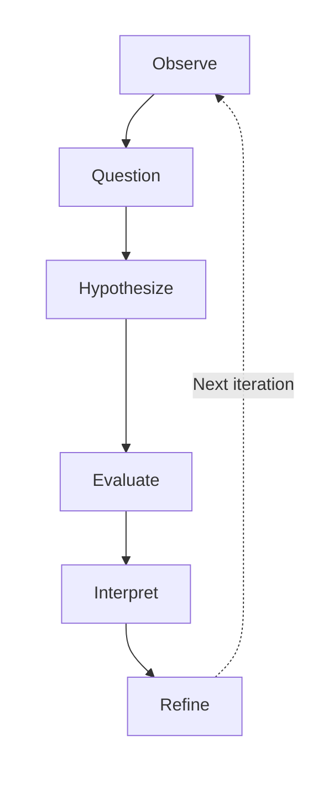

**Document type:** Conceptual methodology primer  
**Date:** 18 October 2026  
**Companion to:** *Research agenda: `AGENTS.md` and reliable coding-agent autonomy*  
**Scope:** Research thinking and method selection. A detailed experimental protocol comes later.

## Purpose

The goal is to improve the **user–repository–agent system**: its instructions, documentation, tools, validation, and human interaction. Evaluation should establish whether a change helps, for which tasks, and at what cost. A useful research cycle is:

**Research cycle:** Observe → Question → Hypothesize → Evaluate → Interpret → Refine → repeat.

This is an iterative cycle. Exploratory work can come before a hypothesis, and disappointing results are useful when they change the resulting understanding or design.

## 1. Start from a decision and form a question

Ask first: *What decision would this knowledge change?* For example, is it better to add a root `AGENTS.md`, shorten an existing one, or move detailed rules into documentation?

Then name the **context**, **intervention or phenomenon**, **comparison (if relevant)**, and **outcome**. This makes the question answerable.

- **Too broad:** “Are instruction files good?”
- **Better:** “For maintenance tasks in Python repositories, does a minimal root `AGENTS.md`, compared with no instruction file, reduce human corrections while preserving accepted task completion?”

Different questions call for different evidence:

- **Descriptive:** What instructions do agents actually load and use?
- **Comparative or causal:** Does placing a rule in root instructions versus a linked document change task outcomes?
- **Explanatory:** Why do agents ignore a rule they have encountered?
- **Design-oriented:** What change to the repository workflow prevents that failure at an acceptable cost?

## 2. A hypothesis is a testable expectation

A **research question** defines what an investigation aims to learn. A **hypothesis** predicts an observable relationship. It should be possible to encounter evidence inconsistent with the prediction.

**Example hypothesis:** “For comparable maintenance tasks, a minimal root `AGENTS.md` reduces the number of human corrections per accepted change without a practically important loss in task-completion quality.”

This predicts outcomes; it does not establish them. Before evaluating it, define *correction*, *accepted change*, and what counts as a meaningful quality loss. A useful comparison is the null expectation that the intervention makes no meaningful difference to the primary outcome.

A hypothesis need not specify an arbitrary percentage. A meaningful threshold can be set once the baseline and change cost are understood. When the mechanism is unknown, begin with exploratory observations; formal hypotheses can emerge afterward.

## 3. Choose a method based on the learning objective

| Approach | Core idea | Useful for this project |
|---|---|---|
| **Evidence-based software engineering** | Find, critically assess, and combine relevant research and practitioner evidence; check whether findings apply locally. | Updating claims in the guide before investing in new evaluations. |
| **Controlled experiment** | Compare alternative conditions while limiting other differences. | Estimating whether a minimal file, a shorter rule, or a documentation link changes outcomes. |
| **Case study** | Examine an agent workflow in a real project, with its surrounding context. | Understanding how instructions, code structure, tools, and humans interact in practice. |
| **Design science** | Build or revise an artifact or working method; evaluate its usefulness in the target context; iterate. | The overall program of improving agent instructions and the surrounding workflow. |
| **Grounded theory** | Analyze qualitative observations systematically to develop an explanation from recurring patterns. | Discovering failure mechanisms from session traces, reviews, and interviews when the testable mechanisms remain unknown. |

These approaches complement one another. For example, a case study can reveal a failure pattern; grounded-theory techniques can help develop an explanation; an experiment can test a proposed remedy; design science organizes the resulting build-and-evaluate cycle. **Grounded theory is a full qualitative methodology**, so ordinary note tagging alone should not be presented as a grounded-theory study.

## 4. Decide what would count as improvement

For coding-agent work, “better” needs more than a model's self-reported success or a shorter execution time. Distinguish:

- **Outcome:** Was the task correctly completed and acceptable for review or merge?
- **Human effort:** How much preparation, prompting, intervention, review, and correction was required?
- **Cost and risk:** What execution cost, unintended changes, defects, or missed escalations occurred?

Choose a **primary outcome** before looking at results; use the others as guardrails or secondary outcomes. Define a measurement rule that another reviewer could apply. For example, count corrections required before acceptance and assess completion with tests plus independent human review.

For a comparison to be useful, keep the task population, repository state, task wording, agent/model version, and available tools as comparable as practical. Repeated runs help reveal variability. Observational data can show associations; careful comparisons provide stronger evidence for cause and effect.

## 5. Interpret results without overclaiming

A result may **support**, **contradict**, or **leave unresolved** the proposed hypothesis. Ask:

1. How large is the observed change, and how uncertain is the estimate?
2. Is it useful in practice after accounting for cost, risk, and maintenance?
3. Could task difficulty, model changes, evaluator judgment, or random variation explain it?
4. Does it appear across different tasks and repositories, or only in one context?
5. What result would justify revising or abandoning the recommendation?

Do not interpret a non-significant result as proof of no effect. A successful local trial also does not establish a universal rule. Keep the original prediction, observations, counterexamples, and limits visible, including negative results.

## 6. A lightweight research note

Before investigating any of the eight agenda questions, write seven short lines:

1. **Decision:** What guide or workflow change is under consideration?
2. **Question:** What precisely needs to be learned?
3. **Hypothesis or exploratory aim:** What is predicted, or what remains unknown?
4. **Context:** Which agents, repository types, tasks, and users?
5. **Evidence approach:** Existing literature, observation, case study, controlled comparison, or a combination?
6. **Outcomes:** What observations and assessment criteria will be used?
7. **Revision rule:** What findings would justify retaining, qualifying, rewriting, or removing the recommendation?

This is enough to prevent vague claims and premature conclusions. The next step is to select one research question and turn this note into a small experimental protocol with task sampling, comparison conditions, a scoring rubric, and an analysis plan.

## Further reading

These are methodological starting points, not evidence that any specific `AGENTS.md` recommendation works.

- **Kitchenham, Dybå & Jørgensen (2004), “Evidence-based software engineering.”** How to formulate answerable questions, appraise evidence, and apply findings in context. [Durham bibliography](https://ebse.webspace.durham.ac.uk/ebse-bibliography/evidence-based-software-engineering/) · [DOI](https://doi.org/10.1109/ICSE.2004.1317449)
- **Wieringa (2014), Design Science Methodology for Information Systems and Software Engineering.** Research questions, artifact design, and evaluation in context. [Springer](https://doi.org/10.1007/978-3-662-43839-8)
- **Wohlin et al. (2024), Experimentation in Software Engineering.** A fuller reference for selecting empirical methods and running experiments. [Springer](https://doi.org/10.1007/978-3-662-69306-3)
- **Runeson & Höst (2009), “Guidelines for conducting and reporting case study research in software engineering.”** How to investigate complex real-world settings. [Open-access paper](https://doi.org/10.1007/s10664-008-9102-8)
- **Stol, Ralph & Fitzgerald (2016), “Grounded theory in software engineering research.”** What grounded theory entails and how to apply it responsibly. [University repository](https://cora.ucc.ie/handle/10468/7041)
