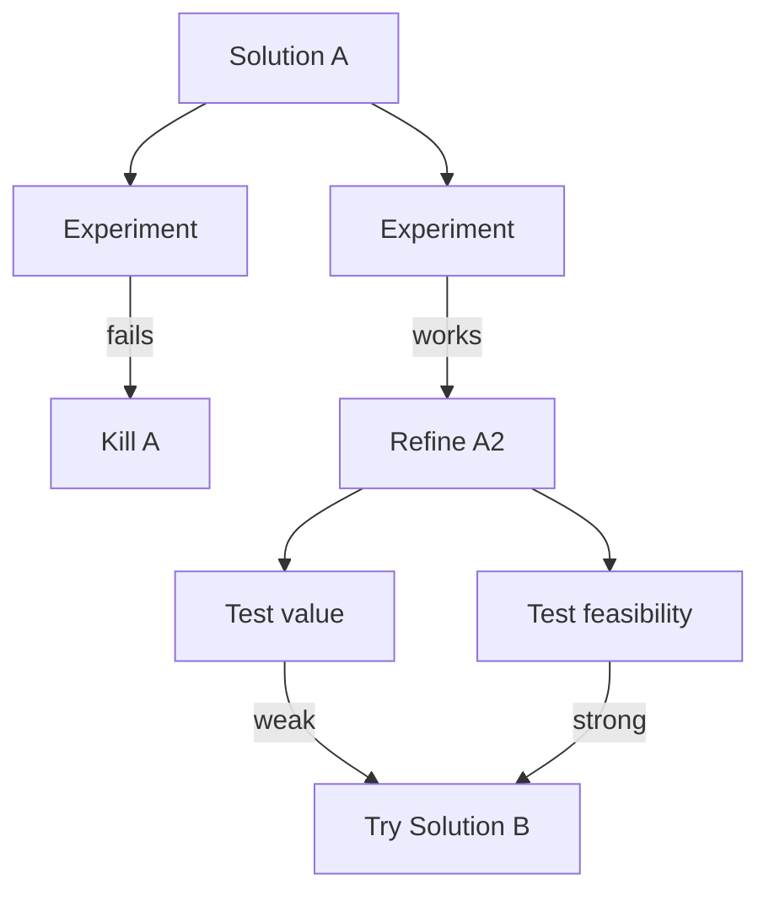
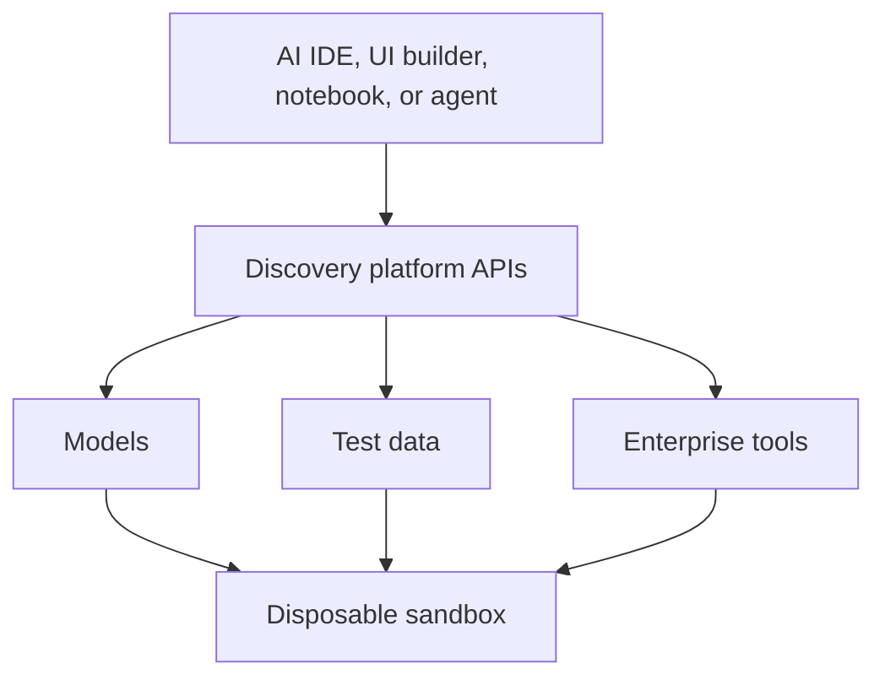
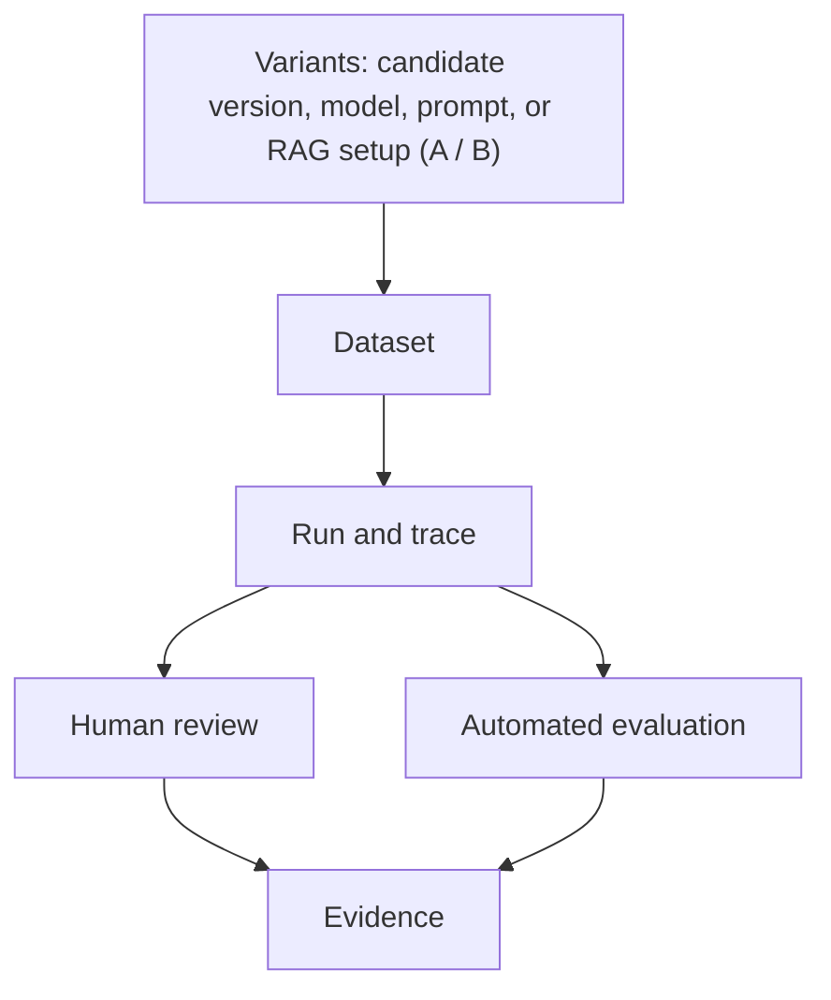
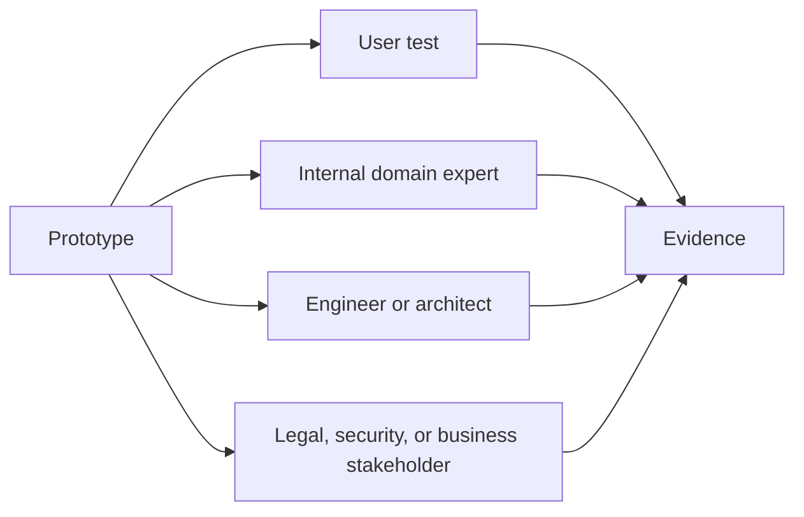

**Question:** what should a platform for AI product discovery provide, given that its job is to reduce uncertainty about candidate solutions rather than to run AI applications in production?

## A different product from the production platform


A discovery AI platform is a different product from the production AI platform. Its optimization target is:

> **Reduce uncertainty about candidate solutions as cheaply and quickly as possible.**

The main architectural decision follows from that target: the platform is centered on the learning loop, not on an AI application runtime.

Marty Cagan (SVPG) describes AI in discovery as mainly useful for rapid prototyping and decision support, with prototypes tested against the four product risks: value, usability, feasibility, and viability ([Build To Learn FAQ](https://www.svpg.com/build-to-learn-faq/)). Uber gives a concrete example: its teams use several AI prototyping tools to explore more alternatives earlier, make ideas tangible, get user and stakeholder feedback, and clarify scope before engineering commits ([Uber](https://www.uber.com/gb/en/blog/ai-prototyping/)).

**Definition.** A discovery AI platform manages evolving solution hypotheses through cheap, timeboxed experiments. It makes capability and product risk visible, preserves evidence and failures, and helps the team decide whether to kill, iterate, or commit a solution to production delivery.

**Architectural thesis.** The platform is connective tissue between prototyping, enterprise context, experimentation, evaluation, and organizational learning. It should make experiments cheap while making evidence durable.

## The discovery loop


The platform is modeled on one loop: **uncertainty -> experiment -> evidence -> decision**.

- **The evolving object is the candidate solution.** The loop runs around a solution, not a workflow around a feature. Problem, outcome, solution idea, prototype, effective solution, production solution, capability, and feature are different concepts, and the solution is the central object. See the [operating-model draft](#central-object).
- **The experiment is the main unit of work while uncertainty is high.** The capability funnel measures how far the evolving solution has progressed toward solving the user's job.

```text
                PRODUCT CONTEXT
    problem + desired outcome + constraints
                       │
                       ▼
          ┌────────────────────────┐
   ┌─────►│   CANDIDATE SOLUTION   │
   │      │  capability profile    │
   │      │  risk profile          │
   │      │  current evidence      │
   │      └────────────┬───────────┘
   │                   │  choose the uncertainty
   │                   │  worth reducing next
   │                   ▼
   │      ┌────────────────────────┐
   │      │       EXPERIMENT       │
   │      │  question              │
   │      │  hypothesis            │
   │      │  method                │
   │      │  timebox               │
   │      │  evidence criterion    │
   │      └────────────┬───────────┘
   │                   ▼
   │      ┌────────────────────────┐
   │      │     BUILD TO LEARN     │
   │      │  prototype             │
   │      │  AI workflow           │
   │      │  UI concept            │
   │      │  technical spike       │
   │      │  model comparison      │
   │      │  user test             │
   │      │  eval run              │
   │      └────────────┬───────────┘
   │                   ▼
   │      ┌────────────────────────┐
   │      │        EVIDENCE        │
   │      │  observations          │
   │      │  measurements          │
   │      │  traces                │
   │      │  failures              │
   │      │  user feedback         │
   │      └────────────┬───────────┘
   │                   ▼
   │            DECISION POINT
   │                   │
   │       ┌───────────┼───────────┐
   │       ▼           ▼           ▼
   │     KILL       ITERATE      COMMIT
   │       │           │           │
   │       ▼           │           ▼
   │   preserve        │       DELIVERY INTERFACE
   │   learning,       │       candidate solution
   │   archive         │       evidence
   │                   │       remaining risks
   └───────────────────┘       known constraints
```


Each pass picks the uncertainty most worth reducing next, runs a timeboxed experiment to build something that answers it, and ends at a decision: kill the solution and preserve what was learned, iterate on it, or commit it to delivery.

## The candidate solution


At any moment the platform should be able to represent each candidate solution roughly like this:

```text
Candidate solution

Problem:              What condition are we trying to change?
Desired outcome:      How would we know it improved?
Solution hypothesis:  What approach currently looks promising?
Capability profile:   How well can it perform the user's job?

Risk profile:
    Value        ███████░░░
    Usability    ██████░░░░
    Feasibility  ████████░░
    Viability    █████░░░░░

Evidence:             experiment A, experiment B, user test C, eval set D
Known constraints:    ...
```


The four risks give the main dimensions of uncertainty: value, usability, feasibility, and business viability. The purpose is not to "complete" all four. The team needs enough evidence to justify further investment, with the remaining uncertainty kept visible.

## Capability and risk


Capability and risk are two different views of a candidate solution. Keep them separate.

### Capability profile


The capability profile asks: how far does the solution get toward completing the user's job?

It is built on a capability funnel: progressive levels from basic operation toward solving the user's job. The funnel is an evaluation model attached to the evolving solution, not another lifecycle phase; see the [capability funnel]() note. For a query assistant:

```text
L5  User completes the analytical job
 ↑
L4  Answer matches the actual intent
 ↑
L3  Result is correct and relevant
 ↑
L2  Query executes
 ↑
L1  Valid query is generated
```


The funnel belongs inside the discovery platform because generic model benchmarks don't tell a team whether its solution works. The platform should let teams attach evaluation evidence to each level. With illustrative figures:

| Level | Capability | Evidence |
| --- | --- | --- |
| L1 | Valid SQL | 96% |
| L2 | Executable | 91% |
| L3 | Correct result | 73% |
| L4 | Correct intent | 54% |
| L5 | Job completed | Unknown; requires a user experiment |

A profile like this tells the product team something useful at once: stop optimizing SQL generation, because the uncertainty is now elsewhere. That is the kind of decision support the platform exists to provide.

### Risk profile


The risk profile asks a different question for each risk:

| Risk | Question |
| --- | --- |
| Value | Will people choose to use this? |
| Usability | Can they use it? |
| Feasibility | Can it be made to work well enough? |
| Viability | Does operating it make business sense? |

### One experiment updates both


A single experiment can move both profiles. An illustrative example:

```text
Experiment:         50 representative user questions

Result:             93% executable queries
                    74% correct results
                    51% correct interpretation

Capability effect:  L2 looks mostly solved
                    L3 is partly solved
                    L4 is the current bottleneck

Risk effect:        feasibility uncertainty ↓
                    value uncertainty unchanged
```


Keeping the two views apart prevents a common AI mistake: **an improved technical benchmark is not the same as a more valuable product.**

## The experiment

### A deliberately small record


The experiment is the platform's unit of work. Its record is deliberately small; it should not become Jira with more fields.

| Field | What it records |
| --- | --- |
| Question | The uncertainty being reduced. |
| Hypothesis | What the team currently believes. |
| Candidate solution | The solution the experiment is about. |
| Target | The capability, risk, or assumption being tested. |
| Method | Prototype, eval, interview, technical spike, or production test. |
| Prototype | The prototype used, if any. |
| Timebox | How much the team is willing to spend on learning. |
| Evidence criterion | The result that would change the decision. |
| Result | What actually happened, and the evidence. |
| Decision | Kill, iterate, commit, or investigate. |

The record ties together experiment-based planning, timeboxes, evaluation infrastructure, and sharing failed experiments. For the planning side, see [roadmap management](#roadmap-management) in the development approaches note.

### The decision-changing criterion


The key field is the evidence criterion: the result that would change the decision. Without it, teams accumulate demos:

```text
built something → interesting result → another demo → another demo → "AI strategy"
```


The record should force the loop instead:

```text
uncertainty → test → evidence → decision
```


As the [experimentation approach](#experimentation-approach) puts it, the output of an experiment is evidence and a decision, rather than implementation alone.

### Experiments form a decision tree


Experiments do not form a linear funnel. The solution space is better understood as an option tree or a decision process; the capability funnel is an evaluation model for one solution within it.



## Platform architecture


The platform's components follow from the model:

```text
                    DISCOVERY PLATFORM

┌────────────────────────────────────────────────────────┐
│ Solution workspace                                     │
│ problem / outcome / candidates / constraints           │
└────────────────────────────┬───────────────────────────┘
                             │
┌────────────────────────────▼───────────────────────────┐
│ Experiment manager                                     │
│ hypothesis / timebox / method / decision               │
└────────────┬───────────────────────────────┬───────────┘
             │                               │
             ▼                               ▼
┌────────────────────────┐      ┌────────────────────────┐
│ Prototype environment  │      │ Evaluation workbench   │
│ models                 │      │ datasets               │
│ agents                 │      │ human annotations      │
│ sandbox data           │      │ automated checks       │
│ tools and APIs         │      │ traces and comparisons │
│ preview environments   │      │ cost and latency       │
└────────────┬───────────┘      └────────────┬───────────┘
             │                               │
             └───────────────┬───────────────┘
                             ▼
                   Evidence repository
                             │
                     ┌───────┴───────┐
                     ▼               ▼
            capability profile   risk profile
                     │               │
                     └───────┬───────┘
                             ▼
                         decision
                 kill / iterate / commit
```


The experiment manager holds the experiment record described above. Underneath everything sits one horizontal infrastructure layer:

- safe model access;
- temporary credentials;
- sanitized or synthetic data;
- read-only enterprise context;
- spend limits;
- trace capture;
- isolated execution.

These are enabling primitives, not the conceptual model.

### Solution workspace


The workspace is where the team starts. It holds:

- the problem and desired outcome;
- current candidate solutions;
- known assumptions;
- the four-risk profile;
- the capability model;
- experiments and evidence.

From it, the platform can answer questions such as:

- What have we tried?
- What failed?
- What evidence changed the solution?
- Which capability currently limits usefulness?
- Which of the four risks still has high uncertainty?
- Why is this worth productizing?

These questions are far more useful than "how many AI POCs do we have?"

### Prototype environment


The rapid build environment should be intentionally cheap and disposable.

Don't build an internal version of Claude Code, Cursor, Figma Make, or Lovable. Uber's teams use a heterogeneous set of existing tools rather than one corporate prototyping environment ([Uber](https://www.uber.com/gb/en/blog/ai-prototyping/)). The platform provides the common substrate underneath those tools:




What it provides:

- easy access to several approved models;
- temporary environments;
- disposable databases;
- synthetic or sanitized data;
- safe read-only access to selected enterprise data;
- easy access to APIs and tools;
- mock services;
- preview deployments;
- notebooks;
- simple secrets handling;
- spend limits.

The target: an idea at 10:00 becomes a realistic prototype in front of someone by noon.

Here, agents that write mediocre code become much less of a problem, because most of this code is supposed to die rather than live long.

### Evaluation workbench


For AI solutions, prototypes alone are weak evidence, because demos are exceptionally easy to cherry-pick. An experiment and evaluation workbench is therefore probably the platform's core shared capability.




It should make these trivial:

- saving representative examples;
- replaying them against variants;
- inspecting traces;
- annotating failure modes;
- comparing outputs side by side;
- collecting human judgments;
- adding simple deterministic checks;
- using LLM judges where appropriate;
- comparing cost and latency;
- attaching customer-test results.

Teresa Torres describes a close match from building her Interview Coach: evals as a fast feedback loop analogous to continuous discovery, with error analysis and human-labelled traces driving iterative improvement ([Product Talk](https://www.producttalk.org/interview-coach-evals/)). She initially avoided dedicated eval platforms because they added complexity, and used notebooks and ordinary cloud primitives instead ([Product Talk Q&A](https://www.producttalk.org/interview-coach-evals-q-a/)).

Keep the evaluation layer very low ceremony.

### User and stakeholder testing


User experimentation has to be first-class. AI platform designs tend to overfocus on technical evaluation, but the four risks include value and usability as well as feasibility and viability. The platform therefore needs a route from prototype to people:




Cagan maps different risks to different people: value and usability are tested with users, feasibility with engineers, and viability with the relevant business stakeholders ([Build To Learn FAQ](https://www.svpg.com/build-to-learn-faq/)).

Support can be as simple as:

- shareable prototype links;
- session recording;
- structured feedback;
- experiment cohorts;
- opt-in beta users;
- response comparison;
- attached interview notes and results.

Uber found that tangible prototypes moved conversations from abstract interpretation to reactions to a common artifact, and produced more specific feedback ([Uber](https://www.uber.com/gb/en/blog/ai-prototyping/)).

### Safe access for experimentation


Discovery needs controls, but they should be designed for experimentation rather than copied from the production platform.

| Concern | Production | Discovery |
| --- | --- | --- |
| Data | Real customer data | Sanitized snapshots; synthetic data |
| Access | Write privileges | Read-only access |
| Credentials | Production credentials | Scoped temporary credentials |
| State | Persistent state | Isolated environments |
| Scale | Large-scale execution | Small cohorts; spend limits |

This is one place where the platform itself creates a lot of value. Without it, people either cannot prototype realistic solutions because enterprise access takes weeks (unverified), or they bypass controls and paste sensitive data into random tools.

### Failure memory


Failed experiments should become organizational memory. With AI the cost of trying things collapses, so the number of failed approaches rises sharply. Without memory, the same failure repeats:

```text
Team A: tries RAG approach X → fails
Team B, six months later: tries X
Team C, six months later: tries X
```


The evidence repository should make experiments searchable by problem, domain, model, approach, capability, failure mode, risk, and result. What is preserved is mostly learning, not infrastructure.

## What becomes durable


Which artifacts are disposable and which are durable is the defining design decision.

- **Usually disposable:** prototype code, sandboxes and other environments, agent code and temporary agents, prompt versions, mock integrations, temporary workflows.
- **Durable:** the problem definition, desired outcome, experiments, evidence, evaluation datasets, failure cases, risk history, decisions, known constraints, and the learning they add up to.

The platform therefore behaves almost like a scientific lab notebook combined with an AI prototyping environment. It preserves why the team believes something, not merely what it built.

## From discovery to delivery


The bridge from discovery to delivery promotes evidence, not code. Prototype code is treated as a **reference implementation unless consciously accepted otherwise**.

At the commit decision, what passes to delivery by default is:

- the candidate solution;
- the prototype, as a reference;
- capability evidence;
- four-risk evidence, including user evidence;
- the evaluation dataset and evaluation criteria;
- experiment traces;
- failure analysis and important failure cases;
- remaining uncertainty and risks;
- known constraints.

The prototype can serve as "prototype as spec", in Cagan's term, while delivery still builds the production-quality implementation ([Build To Learn FAQ](https://www.svpg.com/build-to-learn-faq/)).

The commit point is a conceptual interface inside the same cross-functional team, not a handoff. Discovery and delivery are continuous activities, and learning flows both ways; see [discovery and delivery]().

The same boundary applies to agents:

- **Discovery agents** generate aggressively, explore widely, build cheaply, try alternatives, and throw work away.
- **Delivery agents** operate under engineering constraints, produce reviewable changes, pass tests and evals, respect the architecture, and remain under engineering ownership.

## What not to build first


Don't start with:

- an enterprise agent orchestration framework;
- a universal RAG framework;
- long-term agent memory;
- an internal AI coding assistant;
- a large prompt-management system;
- production deployment machinery;
- elaborate AI governance workflows;
- a company-wide vector database.

Those are solution assumptions. Start with a relatively thin platform:

1. Model access.
2. Disposable sandboxes.
3. Safe data and tool access.
4. Prototype sharing.
5. Trace capture.
6. Dataset and eval workbench.
7. Experiment registry.
8. Evidence and failure repository.

Then let repeated experiments show which shared abstractions are actually missing. The core model is deliberately small, so platform capabilities can be derived from it without designing the implementation prematurely.

## Related notes


- [Development approaches and modes](): experiments, baselines, prototypes, and walking skeletons as modes chosen by the uncertainty being resolved.
- [AI product design and delivery framework](): the project lifecycle from framing to operation, with evaluation and evidence as a cross-cutting workstream.
- [Problem and response cycle](): framing the problem and desired outcome before choosing a response.
- [Reusable AI infrastructure](): shared platform primitives for production AI systems.
- [Evaluation harness and workspace](): controlled execution, trace review, version comparison, and human judgment.
- [Failure understanding](): turning recurring failures into failure modes and criteria.
- [AI products need evals, not just tests](): evals as behavioral evidence, with a lightweight experiment record and the capability funnel.
- [Operating-model draft](): the solution as central object, the experiment as primary unit of work, and the discovery-delivery interface.
- [Capability funnel](): the query-assistant levels; superseded by the [solution utility ladder]().
- [Discovery and delivery](): two kinds of work distinguished by purpose, with information moving both ways.
- [Experiments vs features](): practitioner arguments for timeboxed experiments, capability funnels, and sharing failures.
- Companion platform notes: [AI platform capabilities](), [AI platform team loop](), and [delivery capabilities]() for the delivery side.

## Sources


- Marty Cagan, [Build To Learn FAQ](https://www.svpg.com/build-to-learn-faq/), Silicon Valley Product Group: AI in discovery for rapid prototyping and decision support, prototypes tested against the four risks, risks mapped to people, and "prototype as spec".
- [AI Prototyping Is Changing How We Build Products at Uber](https://www.uber.com/gb/en/blog/ai-prototyping/), Uber blog: several existing prototyping tools, earlier exploration of alternatives, and more specific feedback on tangible prototypes.
- Teresa Torres, [How I Designed & Implemented Evals for Product Talk's Interview Coach](https://www.producttalk.org/interview-coach-evals/), Product Talk: evals as a fast feedback loop, error analysis, and human-labelled traces.
- Teresa Torres, [Q&A Session: Building AI Evals for the Interview Coach](https://www.producttalk.org/interview-coach-evals-q-a/), Product Talk: notebooks and ordinary cloud primitives instead of dedicated eval platforms.
