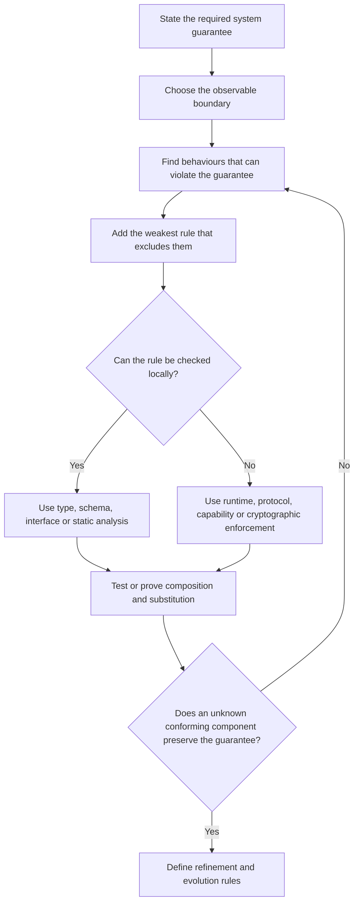

# Semantic substrate builder method


Editorial context, 2026-10-20: The questions, constraints, proposals, disagreements, and caveats below are reformulated from the saved research discussion. LLM recommendations remain attributed proposals, not decisions by the author or independently verified findings. Technical examples and quoted source passages retain their original wording.

<!-- Navigation added during reassembly on 2026-09-30. Source arguments are retained with editorial wording, 2026-10-20; quoted source passages remain exact. -->

The complete builder method comes from the [semantic-substrate report](). The [formal models]() explain the relation between constraints and guarantees. The builder dialogue imported during the preceding split stays with the method, including its original examples and navigation.

## Deriving requirements from work complexity


<!-- Navigation added during reassembly on 2026-10-01. Source arguments are retained with editorial wording, 2026-10-20; quoted source passages remain exact. -->

The following retained passage comes from the reply now grouped in [Complexity and work structure](). It proposes candidate requirements and mechanisms from a work profile. The sibling [comments]() distinguish the proposal from the guarantee-based method that follows.

The useful next step is to derive system requirements from each type of complexity.

For example:

```text
structural complexity
→ decomposition
→ dependency tracking
→ progress state
→ parallel execution

epistemic complexity
→ hypothesis generation
→ evidence
→ exploration
→ verification
→ abstention

environmental complexity
→ observation
→ event handling
→ replanning

coordination complexity
→ roles
→ shared state
→ handoffs
→ ownership
→ common ground

intent complexity
→ versioned goals
→ explicit revisions
→ invalidation / replanning

authority complexity
→ capabilities
→ proposal / approval
→ commitment boundaries

recovery complexity
→ checkpoints
→ durable state
→ idempotence
→ replay
```


This is much more satisfying than starting with:

> "A long task needs retries and a sandbox."

Because now retries are derived from a specific property:

`failure can happen after substantial accumulated work`

therefore:

`state must survive failure`

therefore:

`checkpoint / durability / idempotent recovery`.

## A builder method for minimal semantic constraints

### Begin with guarantees


The most important reversal from conventional architecture design is:

```text
components → APIs → architecture → hoped-for properties
```


should become:

```text
desired properties
        ↓
observable behaviours that can violate them
        ↓
minimal constraints excluding those behaviours
        ↓
composition and refinement rules
        ↓
enforcement
        ↓
components and higher-order structures
```


Dijkstra's weakest-precondition method, contract quotient and automated assumption generation all exemplify this backwards reasoning from a desired property towards sufficient conditions. [^turn15search0][^turn15search11][^turn15search4]

A practical design loop is:



### Treat the semantic waist as multidimensional


There is no reason every substrate needs every semantic dimension. Add one only when a required guarantee depends on it.

| Question | Add this semantic dimension when the answer is yes | Typical mechanism |
|---|---|---|
| Must consumers know the **shape** of values? | Invalid shapes can break composition. | Types, schemas, IDLs. |
| Does the **order/protocol** of messages matter? | Matching signatures alone can still deadlock or violate protocol. | Interface automata, process/session-style contracts, state machines. |
| Must some **state invariant** always hold? | Arbitrary updates could make authoritative state invalid. | Transaction/commit validator, database constraint, state-machine invariant. |
| Do **side effects** need to be visible in interfaces? | Hidden writes/network/action prevent local reasoning. | Effect systems, explicit command/effect values, handlers. |
| Does it matter **who may act**? | Possession of data must not imply authority. | Capabilities, RBAC/ABAC, signatures, cryptographic tokens. |
| Does execution happen on **replicated state**? | Ordering, consistency or convergence affects correctness. | Consensus/transactions or CRDT algebra. |
| Must the system know **why/how a value arose**? | Audit, trust, approval or derived authority depends on lineage. | Provenance graph, signed event log, immutable evidence references. |
| Must old and new implementations **coexist**? | Independent deployment or unknown future clients matter. | Refinement rules, wire compatibility, reserved fields, explicit version conversion. |
| Are there **resource/time limits**? | Otherwise a valid component can still starve or exhaust the system. | Budgets, quotas, schedulers, deadlines, gas. |
| Are **human decisions** part of the guarantee? | Some effects require accountable judgement or organisational authority. | Explicit approval objects plus authenticated identity; organisational controls where technical enforcement stops. |

This table should be read subtractively. Do not introduce provenance, identity, consensus, effect typing, or capability semantics because they seem generally desirable. Introduce them when a chosen guarantee depends on them.

### Choose enforcement according to the property


The semantic rule and the enforcement mechanism are separate design decisions.

| Enforcement mechanism | Best at | What it does not establish by itself |
|---|---|---|
| **Static type/schema checking** | Structural validity, resource/effect disciplines that can be represented statically | Runtime facts, external authority, business correctness |
| **Static formal verification** | Proving behavioural properties against a model/specification | Correctness of omitted environment assumptions or an inaccurate model |
| **Runtime validation** | State-dependent invariants, admission rules, dynamic policy | Properties of effects that escape the validator |
| **Capabilities / sandboxing** | Limiting which effects a component can cause | Whether an authorised effect is wise or semantically correct |
| **Cryptographic signatures/tokens** | Authenticity, integrity and possession of delegated credentials | Truth of signed content or correctness of policy |
| **Consensus/transactions** | Agreement, ordering and atomicity under a specified fault model | Application semantics outside the transaction boundary |
| **CRDT algebra** | Convergence under concurrent/disconnected updates | Arbitrary user-intent semantics |
| **Provenance/audit trails** | Attribution, diagnosis, evidence and causal reconstruction | Prevention, unless provenance becomes an input to a commit rule |
| **Organisational procedures** | Judgement, accountability and decisions that cannot be encoded completely | Machine-enforced safety unless the procedure is mediated by technical controls |

The capability literature is especially useful here: **visibility and authority should be modelled separately**. Knowing a value, seeing an object or being able to propose a command need not imply permission to modify it. [^turn3search0][^turn14search0]

Likewise, effect typing and capability typing should not be conflated:

\[\text{may perform FileWrite}\]

is a behavioural/effect statement, while:

\[\text{holds capability to write /accounts/17}\]

is an authority statement.

A mature semantic substrate may need both.

### Test for unknown components


A useful substrate should pass several tests.

**Local conformance:** can a component decide what it must satisfy by looking at its interface and documented environment assumptions rather than inspecting every other implementation? Interface theories and contracts are explicitly designed for this mode of reasoning. [^turn14search3][^turn15search11]

**Independent replacement:** can one implementation be replaced by a refinement-compatible implementation without invalidating consumers? This is the central promise of behavioural subtyping and refinement. [^turn16search0][^turn1search0]

**Independent invention:** could a separately designed future component interoperate by implementing the published semantics? Berners-Lee's independent-invention test is a useful informal version of this criterion. [^turn2search15]

**Independent evolution:** can producers and consumers run different versions temporarily? Protobuf's compatibility rules show why this requires explicit temporal constraints, not merely an initial interface. [^turn18search4][^turn18search5]

**No ambient bypass:** can a component violate the guarantee through an effect path outside the semantic boundary? Capability systems are particularly strong because they attempt to remove precisely such bypass paths. [^turn3search5][^turn14search0]

### Keep semantic strength proportional to the guarantee


A useful way to think about a substrate is as a vector rather than one scalar level of strictness:

\[
C =

(C_{\text{data}},

 C_{\text{protocol}},

 C_{\text{state}},

 C_{\text{effects}},

 C_{\text{authority}},

 C_{\text{consistency}},

 C_{\text{provenance}},

 C_{\text{evolution}})
\]

You may deliberately choose:

```text
data semantics       weak
workflow semantics   weak
component internals  unconstrained
topology             open

authority            strong
state transitions    strong
external effects     strong
provenance           strong
```


for a human/model/software environment.

That would be entirely consistent with constrained generativity. It means the system is **permissive along dimensions where variation is useful and strict along dimensions where variation would destroy the required guarantee**.

This provides a better theoretical basis for the architecture in the second research note than starting from "shared state + provenance + authority" as universal requirements. Those become a particular answer to a particular guarantee set. [^turn0file1]

For example:

\[
G=

\{

\text{no unauthorised external effects},

\text{state invariants preserved},

\text{every commit attributable}

\}
\]

naturally implies constraints on authority, commit validation and provenance.

It does **not** necessarily imply a fixed workflow, fixed graph, deterministic proposal generation, one particular model architecture, or shared mutable state for every component.

<!-- Navigation added during reassembly on 2026-09-30. Source arguments are retained with editorial wording, 2026-10-20; quoted source passages remain exact. -->

### Builder questions and examples from the dialogue


The following captured passages expand the builder method above. Their original section numbers are retained. The preceding [construction-rule discussion](#1-your-core-research-object-should-be-the-construction-rule) is now in the overview scope dialogue.

### 2. This changes what you give builders


If the stated goal is to let builders create their own systems, you probably shouldn't give them one architecture.

You want to give them something closer to a **system construction language + theory**.

A builder should be able to answer:

- What are the things in my system?
- What can they observe and produce?
- Which behaviors am I going to permit?
- Which guarantees do I need?
- Which guarantees follow from those restrictions?
- How can components be connected?
- What properties survive composition?
- What does the substrate enforce, and what remains up to individual components?
- How can somebody introduce a component I didn't anticipate without modifying the whole system?

That means the important object isn't necessarily:

```text
Human → Proposal → Shared State → Commit
LLM   → Proposal → Shared State → Commit
...
```


It's closer to:

```text
builder chooses

    vocabulary
    behavior model
    boundaries
    constraints
    invariants
    composition operators
    enforcement mechanisms

               ↓

       semantic substrate

               ↓

components conform to substrate

               ↓

arbitrary valid compositions

               ↓

system-level guarantees
```


The substrate itself becomes programmable.

The LLM proposal therefore favors **semantic substrate design** over "constrained collaborative computation system" for the broader stated goal. The latter sounds like a class of systems. The former describes what builders are doing.

"Constrained generativity" can describe the underlying principle.

<!-- Navigation added during reassembly on 2026-09-30. Source arguments are retained with editorial wording, 2026-10-20; quoted source passages remain exact. -->

The intervening section 3 critiques the earlier architecture-specific question and is now in [Refined research question](#3-the-second-problem-framing-is-currently-too-solution-shaped). After the examples below, the dialogue continues with the [relation between constraints and guarantees](#5-the-theory-needs-a-relation-between-constraints-and-guarantees).

### 4. Start from guarantees, then derive constraints


This gives you a much more useful builder methodology.

For example, imagine three builders.

```text
Builder A: Unix-like analysis system

desired:
    unknown tools can compose

constraint:
    Stream<T> → Stream<U>

guarantee:
    structural interoperability

doesn't need:
    authority
    persistent shared state
    proposal/commit
```


Another builder:

```text
Builder B: human + AI financial operations

desired:
    no unauthorized external effects
    attributable decisions
    human approval above threshold

constraints:
    explicit identity
    capabilities
    Proposal != Commit
    typed effects
    approval rules
    provenance

guarantees:
    effects are authorized
    decisions are attributable
```


Another:

```text
Builder C: collaborative research

desired:
    many generators can contribute
    claims remain traceable
    findings can be revised

constraints:
    typed artifacts
    immutable evidence references
    provenance
    versioning

guarantees:
    traceability
    independent contribution
    revision without losing history
```


All three are instances of the proposed theory.

Only the second looks like the architecture currently described in file 2.

That separation is important because it turns the human/LLM architecture into evidence for the theory instead of making the theory dependent on agents.

<!-- Navigation added during reassembly on 2026-09-30. Source arguments are retained with editorial wording, 2026-10-20; quoted source passages remain exact. -->

## Design and LLM roles from the captured DSL article


The following passages come from the captured article ["DSLs Enable Reliable Use of LLMs"](). They are article excerpts, separate from the report and dialogue above. The opening design discussion and closing discussion of LLM roles remain in their original wording.

Modern LLMs possess an incredible capability. They can generate large amounts of code, and sometimes entire systems, from just a high-level natural language description. An important assumption here is that the 'intent' of what needs to be built is well articulated, using precise words that LLMs can map to coding building blocks. However, there are two important points worth noting: the limits of upfront specification, and how design is discovered through implementation.

## The Limits of Upfront Specification


Building large systems involves a great many small design decisions, and these cannot all be known in advance or driven entirely from a high-level spec. A specification is at best a starting hypothesis: the real constraints, trade-offs, and edge cases are discovered iteratively, as we proceed with the implementation. We discussed this at length in an earlier article, where we called it [Upfront Specification Impossibility](https://martinfowler.com/articles/convo-llm-abstractions.html). The point is not that specs are worthless, but that the first one is a hypothesis to be revised, never a finished blueprint.

The natural response is to iterate: refine the spec, generate code, review what comes back, and feed what we learn into the next round. That loop works well when each round produces a small, reviewable change.

## Design Is Discovered Through Implementation


Reviewing code, particularly while we are still discovering the design, is not the same as writing it. While reviewing the generated code, we review through the chunks validating if it maps to our intent and looking for possible pitfalls. But reviewing rarely forces us to wrestle with the design decisions. Writing code, by contrast, forces us to think through concrete decisions--such as where a responsibility belongs or what boundaries should be exposed so the design can be extended further. It is in making those decisions that a design most fully reveals itself.

The programming language and paradigm we code in [shapes the design insight we get](https://martinfowler.com/articles/what-is-code.html). A functional design approach or an object-oriented design approach reveals different aspects of the design, along with idioms and patterns that are natural to the paradigm.

So where do LLMs fit in? I see LLMs playing two roles. They are a great help while we shape the design and its vocabulary, acting as brainstorming partners to help us explore the design space and discover the right abstractions. Once the vocabulary is established, LLMs work as an excellent natural language interface to it.

## Domain Abstractions and DSLs


A useful way to frame this is through [Domain Driven Design](http://martinfowler.com/bliki/DomainDrivenDesign.html). Its core insight is building a shared conceptual model of the domain in code, and then using that model - which DDD calls a [Ubiquitous Language](https://martinfowler.com/bliki/UbiquitousLanguage.html) - both to evolve the codebase and to give the team a vocabulary to think and communicate in. Often, it is highly effective to build a domain specific language on top of that model: a constrained syntax for expressing the domain's concepts and operations. Seen this way, most development is the process of building a domain model and using it to evolve the system. The LLM plays two distinct roles depending on whether the domain model already exists. In this article, I will focus on how [Domain-Specific Languages](https://martinfowler.com/dsl.html) (DSLs) work with LLMs.

<!-- Navigation added during reassembly on 2026-09-30. Original source text is unchanged. -->

The article's intervening examples are now in [DSL reliability](#example-using-llms-to-generate-diagram-rich-powerpoint-presentations) and the [Tickloom case study](). The case study keeps the semantic model and scenario DSL together. The closing discussion of the two phases follows.

## Two phases working with LLMs


A pattern emerges from the examples discussed above: in every one of them the LLM was useful in two quite different ways.

The first phase is *designing the abstraction or DSL itself*. Here the LLM is best treated as a brainstorming partner rather than a code generator. As argued at the start of this article, the design decisions that make up a semantic model cannot all be specified upfront -- we discover the constraints, trade-offs, and edge cases as we implement them. So this phase is inherently iterative and feedback-driven: you propose a structure, try it against a real case, see where it turns out awkward, and feed what you learned back into the next round. The LLM speeds that loop up -- it sketches alternatives, critiques a design, ports an idea from one language to another -- but you stay firmly in the driver's seat, because these are exactly the decisions you need to understand and own. The structures that make a DSL pleasant to use, like progressive interfaces that make an illegal scenario fail to compile or a semantic model kept separate from the builder that produces it, are the kind of thing you converge on by iterating, not by writing a specification and generating code.

The second phase begins once the abstraction or DSL is in place. Now what the LLM does changes: it becomes a *natural-language interface* to what you have built. The prompts in this article are examples -- "implement a quorum store as a Tickloom Replica", "write a scenario reproducing the DDIA §10.6 read", "create a slide YAML for this diagram". In each case the English description maps almost directly onto the vocabulary you defined, and the LLM is a dependable generator precisely because the abstraction supplies both the context that grounds the prompt and the harness that checks the result.

<!-- Navigation added during reassembly on 2026-09-30. Original source text is unchanged. -->

The article ends with [the DSL as the source of truth](#the-dsl-as-the-source-of-truth). The citation definitions below belong to the earlier semantic substrate report excerpts, not to the captured DSL article.

<!-- Navigation added during reassembly on 2026-09-30. Original source text is unchanged. -->

## Citation definitions for the imported report sections


The definitions below are local copies of the entries used in these passages. The [complete original bibliography](#references) remains in the report. The copies are separate from the original source text.

[^turn1search0]: [The Existence of Refinement Mappings](https://www.microsoft.com/en-us/research/publication/the-existence-of-refinement-mappings/)

[^turn14search3]: [Interface theories for component-based design](https://research-explorer.ista.ac.at/record/4623)

[^turn15search11]: [Compositional assume-guarantee reasoning for input/output component theories](https://www.sciencedirect.com/science/article/pii/S0167642314000057)

[^turn0file1]: User-provided source: `Pasted markdown (2).md`.

[^turn15search0]: [Guarded commands, non-determinacy and formal derivation of programs (EWD 472)](https://www.cs.utexas.edu/~EWD/transcriptions/EWD04xx/EWD472.html)

[^turn15search4]: [Learning Assumptions for Compositional Verification](https://ntrs.nasa.gov/citations/20030017771)

[^turn16search0]: [Family Values: A Behavioral Notion of Subtyping](https://www.cs.cmu.edu/afs/cs/project/venari/www/subtype-tr.html)

[^turn2search15]: [Principles of Design](https://www.w3.org/DesignIssues/Principles.html)

[^turn3search0]: [Overview: An Ode to the Granovetter Diagram](https://erights.org/elib/capability/ode/overview.html)

[^turn3search5]: [Auditors -- E language](https://www.erights.org/elang/kernel/auditors/index.html)

[^turn14search0]: [Capabilities -- seL4 documentation](https://docs.sel4.systems/Tutorials/capabilities.html)

[^turn18search4]: [Proto Best Practices](https://protobuf.dev/best-practices/dos-donts/)

[^turn18search5]: [Overview -- Protocol Buffers](https://protobuf.dev/overview/)
