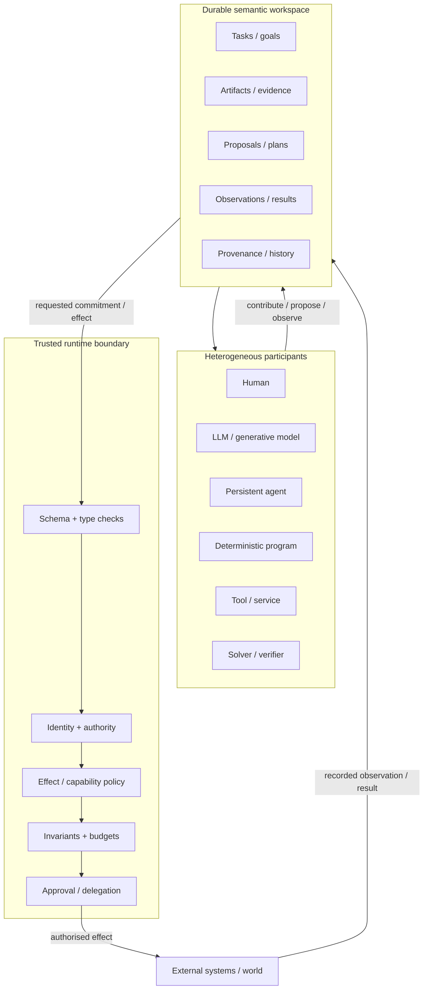

# Programmable environments for heterogeneous human-AI collaboration


Editorial context, 2026-10-20: The questions, constraints, proposals, disagreements, and caveats below are reformulated from the saved research discussion. LLM recommendations remain attributed proposals, not decisions by the author or independently verified findings. Technical examples and quoted source passages retain their original wording.

## Executive summary


The literature does not yet have a single established name for the system you are describing. Several mature research traditions each capture part of it: blackboard architectures model collaboration through shared hypotheses; multi-agent systems model autonomous participants and protocols; workflow and Petri-net research model explicit task/state transitions; operating systems model mediation of authority and effects; programming-language research models composition, types and effects; provenance standards model responsibility and derivation; mixed-initiative systems model the division of work between people and machines; and recent LLM systems add a powerful **generative search operator** that can propose plans, code, hypotheses, actions and even new problem representations. [^turn3search1][^turn4search2][^turn7search0][^turn6search0][^turn14search0]

The strongest framing identified by the saved LLM survey is:

> **A programmable socio-technical runtime in which heterogeneous participants contribute to a durable shared computation, while a smaller trusted substrate controls what becomes authoritative state and what may affect the external world.**

"Participant" is deliberately broader than "agent". A participant may be a person, an LLM invocation, a persistent agent, a deterministic function, a theorem prover, an organisation, a database, or a service. This fits the distinction in the attached working dictionary: task-solving intelligence, persistence, agency and autonomy are separate properties. An LLM can therefore be a capable generative participant without making the LLM itself the unit that owns authority or persistent agency. [^turn0file0]

A useful synthesis is to separate three planes:

```text
EPISTEMIC PLANE
What might be true / useful?
LLMs, people, search, simulation, solvers
→ hypotheses, alternatives, candidate plans, predictions

COORDINATION PLANE
What work exists and what has happened?
tasks, artefacts, dependencies, events, checkpoints,
observations, results, provenance

AUTHORITY / EFFECT PLANE
What is allowed to become consequential?
identity, permissions, approvals, capabilities,
invariants, budgets, validation, external effects
```


This separation is increasingly visible in recent systems. AlphaGeometry lets a language model propose constructions while a symbolic engine performs deductions; FunSearch and AlphaEvolve generate candidate programs and submit them to objective evaluators; LLM+P gives planning to a classical planner after an LLM translates the problem; Temporal separates deterministic durable orchestration from nondeterministic LLM/tool calls; LangGraph can pause a proposed tool action before execution for human approval; and CaMeL explicitly prevents untrusted model-observed data from determining control flow or unauthorised effects. [^turn18search12][^turn18search1][^turn18search0][^turn8academia3][^turn21search3][^turn21search11][^turn21search0]

The historical evidence also argues against constraining everything. Unix succeeded with a narrow compositional interface while permitting highly varied programs above it; effect systems constrain observable effects without prescribing algorithms; a reference monitor mediates security-sensitive operations without deciding how an application reasons; and workflow systems constrain state transitions where process guarantees are required. [^turn17search0][^turn6search0][^turn5search3][^turn4search2] A 2026 field experiment provides a useful contemporary warning: imposing a behavioural protocol on human-AI collaboration reduced document quality and production in that study, whereas a lighter cognitive intervention had different effects; the authors also report important experimental limitations. The result does not prove that workflow constraints are generally harmful, but it argues against assuming that more prescribed collaboration produces better work. [^turn15search0]

The practical implication is therefore to **constrain commitments more strongly than cognition**. In a general-purpose system the proposal is to make identity, authority, externally visible effects, durable state, provenance, resource limits and critical invariants part of the trusted substrate. The proposal is to normally leave search strategy, internal reasoning, number of generated alternatives, choice of specialist and local representation much more open. This closely resembles the Unix idea of a small compositional waist, extended with concepts Unix pipes did not need to carry: types, identity, provenance, trust and authority. Unix itself established compatible process/file/device I/O and pipelines as simple composition mechanisms; modern agent systems need a semantically richer waist because their outputs can themselves request consequential actions. [^turn17search0][^turn17search7][^turn14search0][^turn21search0]

The central research question can consequently be sharpened to:

> **What is the smallest semantic and trusted substrate that permits open-ended composition among humans, generative models and software while preserving the invariants we actually care about?**

That question is broader than neuro-symbolic AI. Neuro-symbolic AI gives an important answer to the **representation and reasoning** boundary: learned systems can generate or interpret representations consumed by symbolic reasoning systems. It says much less by itself about identities, multiple principals, human authority, durable execution, access control, resource ownership or external side effects. [^turn2search1][^turn2academia38]

<!-- Navigation added during reassembly on 2026-09-30. Source arguments are retained with editorial wording, 2026-10-20; quoted source passages remain exact. -->

## Sections moved to related notes


The [historical foundations and timeline](#historical-foundations-and-the-boundaries-they-introduced), [current systems and comparison matrices](#current-llm-systems-and-human-augmentation), and [trusted effect boundaries]() are now in related notes. The complete architectural synthesis, research agenda, and original bibliography remain below.

## Architectural synthesis and research agenda


The combined literature suggests that the system should be framed less as an "agent framework" and more as a **programming model plus trusted runtime for heterogeneous collaboration**.

A possible architecture is:




This architecture combines the blackboard insight that specialists can cooperate through a shared workspace, the workflow insight that durable state transitions should have explicit semantics, the effect-system insight that producing a value and causing an effect are distinct, the reference-monitor insight that consequential operations need a non-bypassable mediation point, and PROV's distinction among artefacts/activities/responsible actors. [^turn3search1][^turn4search2][^turn6search0][^turn5search3][^turn14search0] Temporal and LangGraph provide contemporary engineering examples of durable state and interruptible execution, while CaMeL demonstrates why the effect boundary cannot safely be implemented only as another instruction inside the same vulnerable LLM context. [^turn21search3][^turn21search11][^turn21search0]

The resulting proposal is to make the "thin waist" approximately this:

```text
Principal
Task
Artifact<T>
Observation<T>
Proposal<T>
Decision<T>
Approval<Effect>
EffectRequest<E>
EffectResult<E>
Provenance
Obligation
```


These are not intended as an exhaustive domain ontology. They represent **semantic roles in computation**.

`Artifact<T>` says that some participant has produced a durable object. `Observation<T>` says information arrived from an external event or tool and therefore may have a different trust class. `Proposal<T>` is deliberately non-authoritative. `Decision<T>` records a selected alternative. `Approval<E>` is an authority-bearing act by an authenticated principal over a particular effect or bounded class of effects. `EffectRequest<E>` is what crosses the reference-monitor boundary. `EffectResult<E>` is what actually happened, as distinct from what a participant expected to happen. `Provenance` links all of these. The need to distinguish these roles follows jointly from provenance standards, effect systems, HITL runtimes and recent prompt-injection work. [^turn14search0][^turn6search0][^turn21search11][^turn21search0]

The smallest core state transition could consequently be thought of as:

```text
propose :
    Context × Participant
    → Proposal<T>*

assess :
    Proposal<T> × Evidence*
    → Assessment

authorise :
    Principal × EffectRequest<E> × Policy
    → AuthorityDecision

commit :
    SharedState × EffectRequest<E> × AuthorityDecision
    → SharedState' × EffectResult<E>
```


An LLM can implement `propose`, `assess`, or parts of planning. So can a human. A theorem prover can implement a particular `assess`. A deterministic program can implement any of them. The runtime does not need to equate intelligence with any one role. That follows naturally from the working dictionary's distinction between capability/intelligence and agency. [^turn0file0]

The crucial rule is that:

> **No participant's generated representation becomes an external effect merely because that participant emitted it.**

This is the same separation seen in LangGraph when a model's tool call becomes an interrupt requiring `approve`, `edit` or `reject`; in AlphaEvolve/FunSearch where generated code becomes a candidate to an evaluator; and in CaMeL where the model's requested tool action is subject to non-model security policy. [^turn21search11][^turn18search0][^turn18search1][^turn21search0]

A second rule follows from distributed systems:

> **Authoritative shared state must have persistence and concurrency semantics independent of participants' memories.**

Blackboard architecture established the value of external shared state; Temporal records nondeterministic outcomes in durable history so execution can replay safely; LangGraph checkpoints shared graph state; A2A separates durable task state/artefacts from potentially transient messages. [^turn3search1][^turn21search3][^turn11search2][^turn15search3] An LLM's context window can be one *view* over this state. It should not be the only copy of it.

A third rule concerns humans:

> **A human should be modelled as a first-class principal and participant, not a boolean `human_in_the_loop` fallback.**

Mixed-initiative research supports dynamically shared initiative; Magentic-UI exposes several qualitatively different forms of participation; PROV distinguishes people from software agents while representing both as responsible agents; and modern approval middleware already needs authenticated human decisions that persist across execution. [^turn7search0][^turn21academia49][^turn14search0][^turn21search11] A person may be the task owner, an expert generating hypotheses, a critic, an approver, a source of observations, a delegated authority or the person whose workflow is being augmented. Those roles should not collapse into one `human` node.

A fourth rule is the closest analogue of Unix:

> **Keep participant interfaces small and compositional, while making effect semantics richer than the composition mechanism itself.**

Unix gave processes a common I/O substrate. FIPA and A2A show the value of protocol-level interoperability without requiring shared implementation. [^turn17search0][^turn2search10][^turn15search3] The modern extension is that values travelling across the common substrate should carry enough metadata to distinguish content from control:

```text
Envelope<T> {
    id
    semantic_type
    payload_or_reference
    producer_principal
    task / context
    provenance
    trust_class
    schema_version
}
```


Authority should be kept out of ordinary payload text:

```text
EffectRequest<E> {
    effect
    arguments
    proposed_by
    supporting_artifacts
    required_authority
    expected_effect_class
}

Approval<E> {
    principal
    exact_scope
    request_id
    expiry / constraints
    authenticated_evidence
}
```


This is a synthesis of PROV's provenance concepts, RBAC/capability security, LangGraph's explicit human action decisions and modern agent-security work; these exact types are proposed here rather than taken from one existing specification. [^turn14search0][^turn14search6][^turn5search2][^turn21search11][^turn21search0]

The fifth rule concerns the symbolic layer:

> **Use symbolic representations where the system needs stable semantics, inspection, composition or enforcement; do not require every useful cognitive representation to be symbolic.**

That is a broader reading of neuro-symbolic research. AlphaGeometry illustrates it well: the model can search a huge, poorly structured space of possible constructions while the theorem-proving portion remains symbolic. [^turn18search12] LLM+P similarly confines the formal planner to a PDDL representation. [^turn8academia3] Effect systems and workflow nets show two other symbolic representations--effects and state transitions--whose purpose has nothing specifically to do with reproducing human reasoning. [^turn6search0][^turn4search2] The architecture can therefore be "neuro-symbolic" in several independent places without having one global neuro-symbolic representation.

This leads to a useful set of **boundary questions** for evaluating any proposed architecture:

| Boundary | Question to make explicit |
|---|---|
| **Epistemic** | Which outputs are conjectures, estimates or generated possibilities, and which are verified facts? |
| **Semantic** | Which representations have machine-enforced types or formal meaning? |
| **State** | What is authoritative shared state, and who can update it? |
| **Control** | Who chooses the next computation or participant? |
| **Authority** | Which principal can approve which class of consequential operation? |
| **Effect** | Where does a proposal become a mutation of the external world? |
| **Trust** | Which data/control sources may be adversarial, mistaken or unauthenticated? |
| **Temporal** | What survives retry, restart, participant replacement and long delays? |
| **Provenance** | Can the system reconstruct which inputs, principals and activities produced a result? |
| **Resource** | Who owns/spends time, money, tokens, compute and scarce external resources? |

The surveyed traditions can largely be understood as choosing different subsets of these boundaries to formalise. Neuro-symbolic AI emphasises the semantic/epistemic boundary; MAS emphasises participant/control boundaries; workflow emphasises state/control/temporal boundaries; operating systems emphasise authority/effect/trust boundaries; provenance emphasises causal/responsibility history; control theory emphasises observation/action/feedback; mixed initiative emphasises control allocation between human and machine. [^turn2academia38][^turn16search0][^turn4search2][^turn5search3][^turn14search0][^turn7search3][^turn7search0]

That yields a more precise answer to the original "what should we constrain?" question:

**Constrain the parts for which global correctness depends on all participants agreeing.** In a general-purpose system those are usually identity, authority, the meaning of committed effects, durable state transitions, provenance, resource ownership and hard domain invariants. Classical OS, workflow, effect-system and provenance research all provide machinery for these concerns. [^turn5search3][^turn4search2][^turn6search0][^turn14search0]

**Allow plural implementations where diversity is useful.** Different participants should be free to generate hypotheses differently, use different models, call different local solvers, maintain private intermediate state, explore different plans or specialise in different skills. Blackboard, Unix, FIPA/A2A and generator-evaluator systems all gain power from this form of implementation independence. [^turn3search1][^turn17search0][^turn2search10][^turn15search3][^turn18search0]

**Represent uncertainty by allowing proposals to branch, rather than pretending every computation is a function producing one answer.** FunSearch, AlphaEvolve, self-consistency methods and modern multi-agent creative work explicitly exploit multiple generated candidates. [^turn18search1][^turn18search0][^turn18search8][^turn15search2] In this sense, generation is a first-class computational operation and "intelligence" is only one property of the component performing it.

**Do not put the most important guarantees inside the same component whose failures they are meant to contain.** seL4's trusted-kernel architecture is the classical version of this rule; CaMeL applies the same basic idea to prompt-injectable LLMs; runtime-enforcement research is extending it to consequential agent actions. [^turn5search2][^turn21search0][^turn20academia24][^turn20search4]

The resulting research programme is therefore larger than "make LLM agents better". It is closer to the intersection of programming languages, distributed systems, operating systems, HCI, AI and formal methods:

> **Design a small, typed and durable collaboration substrate through which heterogeneous participants can freely create and transform possibilities, while a separately trusted mechanism controls identity, authority, commitments and real-world effects.**

The strongest existing work provides pieces of that system. Blackboard architectures provide the shared-workspace abstraction; FIPA and A2A provide opaque heterogeneous participants; Unix provides compositional minimalism; workflow systems and Temporal provide durable process semantics; effect systems provide a vocabulary for separating computation from consequences; seL4 and reference monitors provide the trusted-kernel principle; PROV provides provenance and responsibility; mixed-initiative research and Magentic-UI provide first-class human participation; neuro-symbolic systems provide formal interfaces to generative cognition; and FunSearch, AlphaGeometry and AlphaEvolve demonstrate why generation should be treated as productive search rather than merely probabilistic error. [^turn3search1][^turn15search3][^turn17search0][^turn4search2][^turn21search3][^turn6search0][^turn5search2][^turn14search0][^turn7search0][^turn21academia49][^turn18search12][^turn18search1][^turn18search0]

What is still missing is a widely accepted **common semantic waist** joining all of those pieces. Current frameworks standardise graphs, conversations, tasks or tools; current security work adds action-level boundaries; current provenance models record responsibility. None yet provides a broadly adopted type system in which, for example, `Proposal<Plan>`, `Evidence<Claim>`, `Approval<Payment>`, `Delegation<Authority>`, `Observation<T>` and `CommittedEffect<T>` have portable meanings across humans, models, workflow engines and remote agents. The continued evolution of MCP Tasks and A2A's task/artifact model as of August 2026 suggests that this interface is still being worked out. [^turn14search2][^turn14search10][^turn15search3]

That gap looks like the most promising framing of the problem: **the research object is the collaboration substrate and its semantics, not any single intelligent component inside it.**

## References


The original Deep Research export used transient ChatGPT source identifiers. They are preserved as footnote IDs below and resolved to stable primary, standards, or official project sources where identifiable.

[^turn3search1]: Lee D. Erman, Frederick Hayes-Roth, Victor R. Lesser, and D. Raj Reddy, "The HEARSAY-II Speech Understanding System: Integrating Knowledge to Resolve Uncertainty," *ACM Computing Surveys* 12(2), 1980. <https://doi.org/10.1145/356810.356816> Original Deep Research source key: `turn3search1`.

[^turn4search2]: Wil M. P. van der Aalst, "The Application of Petri Nets to Workflow Management," *Journal of Circuits, Systems and Computers* 8(1), 1998. <https://doi.org/10.1142/S0218126698000043> Original Deep Research source key: `turn4search2`.

[^turn7search0]: Eric Horvitz, "Principles of Mixed-Initiative User Interfaces," *CHI '99*, 1999. <https://doi.org/10.1145/302979.303030> Original Deep Research source key: `turn7search0`.

[^turn6search0]: John M. Lucassen and David K. Gifford, "Polymorphic Effect Systems," *POPL '88*, 1988. <https://doi.org/10.1145/73560.73564> Original Deep Research source key: `turn6search0`.

[^turn14search0]: W3C, *PROV-DM: The PROV Data Model*, W3C Recommendation, 2013. <https://www.w3.org/TR/prov-dm/> Original Deep Research source key: `turn14search0`.

[^turn0file0]: Project working dictionary supplied to the Deep Research run as `dictionary.md` (user-provided source; no external URL). Original Deep Research source key: `turn0file0`.

[^turn18search12]: Trieu H. Trinh et al., "Solving olympiad geometry without human demonstrations," *Nature* 625, 2024. <https://doi.org/10.1038/s41586-023-06747-5> Original Deep Research source key: `turn18search12`.

[^turn18search1]: Bernardino Romera-Paredes et al., "Mathematical discoveries from program search with large language models," *Nature* 625, 2024. <https://doi.org/10.1038/s41586-023-06924-6> Original Deep Research source key: `turn18search1`.

[^turn18search0]: Alexander Novikov et al., "AlphaEvolve: A coding agent for scientific and algorithmic discovery," 2025. <https://arxiv.org/abs/2506.13131> Original Deep Research source key: `turn18search0`.

[^turn8academia3]: Bo Liu et al., "LLM+P: Empowering Large Language Models with Optimal Planning Proficiency," 2023. <https://arxiv.org/abs/2304.11477> Original Deep Research source key: `turn8academia3`.

[^turn21search3]: Temporal, "AI Agent Reference Architecture," current product/reference documentation. <https://go.temporal.io/platform-hub/ai-engineering/ai-reference-architecture> Original Deep Research source key: `turn21search3`.

[^turn21search11]: LangChain, "Human-in-the-loop," current LangGraph/LangChain documentation. <https://docs.langchain.com/oss/python/langchain/human-in-the-loop> Original Deep Research source key: `turn21search11`.

[^turn21search0]: Edoardo Debenedetti et al., "Defeating Prompt Injections by Design" (CaMeL), 2025; revised for IEEE SaTML 2026. <https://arxiv.org/abs/2503.18813> Original Deep Research source key: `turn21search0`.

[^turn17search0]: Dennis M. Ritchie and Ken Thompson, "The UNIX Time-Sharing System," *Communications of the ACM* 17(7), 1974. <https://doi.org/10.1145/361011.361061> Original Deep Research source key: `turn17search0`.

[^turn5search3]: NIST, *Glossary of Computer Security Terminology*, NISTIR 4659, including the reference-monitor definition. <https://nvlpubs.nist.gov/nistpubs/Legacy/IR/nistir4659.pdf> Original Deep Research source key: `turn5search3`.

[^turn15search0]: Alex Farach, Alexia Cambon, Lev Tankelevitch, Connie Hsueh, and Rebecca Janssen, "Scaffolding Human-AI Collaboration: A Field Experiment on Behavioral Protocols and Cognitive Reframing," 2026. <https://arxiv.org/abs/2604.08678> Original Deep Research source key: `turn15search0`.

[^turn17search7]: Dennis M. Ritchie, "The Evolution of the Unix Time-sharing System," 1979/1984 historical account. <https://pdos.csail.mit.edu/6.828/2009/readings/ritchie79evolution.html> Original Deep Research source key: `turn17search7`.

[^turn2search1]: Artur S. d'Avila Garcez, Krysia B. Broda, and Dov M. Gabbay, *Neural-Symbolic Learning Systems: Foundations and Applications*, Springer, 2002. <https://doi.org/10.1007/978-1-4471-0211-3> Original Deep Research source key: `turn2search1`.

[^turn2academia38]: Artur d'Avila Garcez and Luis C. Lamb, "Neurosymbolic AI: The 3rd Wave," 2020. <https://arxiv.org/abs/2012.05876> Original Deep Research source key: `turn2academia38`.

[^turn7search3]: Norbert Wiener, *Cybernetics or Control and Communication in the Animal and the Machine*, 1948. <https://direct.mit.edu/books/oa-monograph/4581/Cybernetics-or-Control-and-Communication-in-the> Original Deep Research source key: `turn7search3`.

[^turn0search0]: H. Penny Nii, "Blackboard Application Systems, Blackboard Systems and a Knowledge Engineering Perspective," *AI Magazine* 7(3), 1986. <https://doi.org/10.1609/aimag.v7i3.550> Original Deep Research source key: `turn0search0`.

[^turn16search0]: Michael Wooldridge, *An Introduction to MultiAgent Systems*, 2nd ed., Wiley, 2009. <https://www.wiley-vch.de/en/areas-interest/computing-computer-sciences/an-introduction-to-multiagent-systems-978-0-470-51946-2> Original Deep Research source key: `turn16search0`.

[^turn2search10]: FIPA, *Abstract Architecture Specification*. <https://www.fipa.org/specs/fipa00001/> Original Deep Research source key: `turn2search10`.

[^turn4search1]: Wil M. P. van der Aalst, "Workflow Verification: Finding Control-Flow Errors Using Petri-Net-Based Techniques," 2000. <https://doi.org/10.1007/3-540-45594-9_11> Original Deep Research source key: `turn4search1`.

[^turn6academia24]: Andrej Bauer and Matija Pretnar, "Programming with Algebraic Effects and Handlers," 2012/2015. <https://arxiv.org/abs/1203.1539> Original Deep Research source key: `turn6academia24`.

[^turn5search2]: Gerwin Klein et al., "seL4: Formal Verification of an OS Kernel," *SOSP '09*, 2009. <https://cgi.cse.unsw.edu.au/~kleing/papers/sosp09.html> Original Deep Research source key: `turn5search2`.

[^turn7search6]: Eric Horvitz, "Principles of Mixed-Initiative User Interfaces," *CHI '99*, 1999. <https://doi.org/10.1145/302979.303030> Original Deep Research source key: `turn7search6`.

[^turn3search12]: Victor R. Lesser, Richard D. Fennell, Lee D. Erman, and D. Raj Reddy, "Organization of the HEARSAY-II Speech Understanding System." <https://mas.cs.umass.edu/pub/paper_detail.php/280> Original Deep Research source key: `turn3search12`.

[^turn2search2]: FIPA, *ACL Message Structure Specification*. <https://www.fipa.org/specs/fipa00061/> Original Deep Research source key: `turn2search2`.

[^turn2search4]: FIPA, *Agent Management Specification*. <https://www.fipa.org/specs/fipa00023/> Original Deep Research source key: `turn2search4`.

[^turn4search0]: Wil M. P. van der Aalst, "Workflow Verification: Finding Control-Flow Errors Using Petri-Net-Based Techniques," 2000; includes compositional verification. <https://doi.org/10.1007/3-540-45594-9_11> Original Deep Research source key: `turn4search0`.

[^turn5search7]: seL4 Foundation, "Verification / Proofs," official seL4 verification documentation. <https://sel4.systems/Verification/proofs.html> Original Deep Research source key: `turn5search7`.

[^turn8academia0]: Shunyu Yao et al., "ReAct: Synergizing Reasoning and Acting in Language Models," 2022/ICLR 2023. <https://arxiv.org/abs/2210.03629> Original Deep Research source key: `turn8academia0`.

[^turn18academia34]: Luca Beurer-Kellner, Marc Fischer, and Martin Vechev, "Prompting Is Programming: A Query Language for Large Language Models" (LMQL), 2022/PLDI 2023. <https://arxiv.org/abs/2212.06094> Original Deep Research source key: `turn18academia34`.

[^turn19search2]: Omar Khattab et al., "DSPy: Compiling Declarative Language Model Calls into Self-Improving Pipelines," ICLR 2024. <https://arxiv.org/abs/2310.03714> Original Deep Research source key: `turn19search2`.

[^turn19academia23]: Omar Khattab et al., "DSPy: Compiling Declarative Language Model Calls into Self-Improving Pipelines," ICLR 2024. <https://arxiv.org/abs/2310.03714> Original Deep Research source key: `turn19academia23`.

[^turn9academia14]: Qingyun Wu et al., "AutoGen: Enabling Next-Gen LLM Applications via Multi-Agent Conversation," 2023. <https://arxiv.org/abs/2308.08155> Original Deep Research source key: `turn9academia14`.

[^turn9search1]: Microsoft AutoGen, "Core" documentation: actor-model, event-driven agent runtime. <https://microsoft.github.io/autogen/dev/user-guide/core-user-guide/index.html> Original Deep Research source key: `turn9search1`.

[^turn11search17]: LangChain, "Persistence," current LangGraph documentation. <https://docs.langchain.com/oss/python/langgraph/persistence> Original Deep Research source key: `turn11search17`.

[^turn11search2]: LangChain, "Persistence," current LangGraph documentation (checkpointed state and threads). <https://docs.langchain.com/oss/python/langgraph/persistence> Original Deep Research source key: `turn11search2`.

[^turn13search9]: Temporal, "AI Agent Reference Architecture," current reference documentation. <https://go.temporal.io/platform-hub/ai-engineering/ai-reference-architecture> Original Deep Research source key: `turn13search9`.

[^turn13search7]: Temporal, "AI Agent Reference Architecture," including messages/approval-oriented durable workflow patterns. <https://go.temporal.io/platform-hub/ai-engineering/ai-reference-architecture> Original Deep Research source key: `turn13search7`.

[^turn21academia49]: Hussein Mozannar et al., "Magentic-UI: Towards Human-in-the-loop Agentic Systems," Microsoft Research, 2025. <https://www.microsoft.com/en-us/research/publication/magentic-ui-report/> Original Deep Research source key: `turn21academia49`.

[^turn20search0]: Kai Greshake et al., "Not what you've signed up for: Compromising Real-World LLM-Integrated Applications with Indirect Prompt Injection," 2023. <https://arxiv.org/abs/2302.12173> Original Deep Research source key: `turn20search0`.

[^turn20search3]: Edoardo Debenedetti et al., "AgentDojo: A Dynamic Environment to Evaluate Prompt Injection Attacks and Defenses for LLM Agents," NeurIPS 2024. <https://arxiv.org/abs/2406.13352> Original Deep Research source key: `turn20search3`.

[^turn20search6]: Qiusi Zhan, Zhixiang Liang, Zifan Ying, and Daniel Kang, "InjecAgent: Benchmarking Indirect Prompt Injections in Tool-Integrated Large Language Model Agents," Findings of ACL 2024. <https://aclanthology.org/2024.findings-acl.624/> Original Deep Research source key: `turn20search6`.

[^turn5search4]: seL4 Foundation, "Verification Assumptions," official documentation of proof scope and assumptions. <https://sel4.systems/Verification/assumptions.html> Original Deep Research source key: `turn5search4`.

[^turn14search6]: Ravi S. Sandhu, Edward J. Coyne, Hal L. Feinstein, and Charles E. Youman, "Role-Based Access Control Models," *IEEE Computer* 29(2), 1996. <https://csrc.nist.gov/csrc/media/projects/role-based-access-control/documents/sandhu96.pdf> Original Deep Research source key: `turn14search6`.

[^turn21search8]: Edoardo Debenedetti et al., "Defeating Prompt Injections by Design" (CaMeL), 2025; revised for IEEE SaTML 2026. <https://arxiv.org/abs/2503.18813> Original Deep Research source key: `turn21search8`.

[^turn20academia24]: Haoyu Wang, Christopher M. Poskitt, and Jun Sun, "AgentSpec: Customizable Runtime Enforcement for Safe and Reliable LLM Agents," ICSE 2026. <https://doi.org/10.1145/3744916.3764546> Original Deep Research source key: `turn20academia24`.

[^turn20search4]: Yu He et al., "AttriGuard: Defeating Indirect Prompt Injection in LLM Agents via Causal Attribution of Tool Invocations," USENIX Security 2026. <https://www.usenix.org/conference/usenixsecurity26/presentation/he-yu> Original Deep Research source key: `turn20search4`.

[^turn20academia25]: Wei Zhao, Zhe Li, Peixin Zhang, and Jun Sun, "ClawGuard: A Runtime Security Framework for Tool-Augmented LLM Agents Against Indirect Prompt Injection," 2026. <https://arxiv.org/abs/2604.11790> Original Deep Research source key: `turn20academia25`.

[^turn20academia26]: Haoyu Wang, Christopher M. Poskitt, Jun Sun, and Jiali Wei, "Pro2Guard: Proactive Runtime Enforcement of LLM Agent Safety via Probabilistic Model Checking," 2025. <https://arxiv.org/abs/2508.00500> Original Deep Research source key: `turn20academia26`.

[^turn15search3]: Agent2Agent (A2A) Protocol, current specification and core concepts. <https://a2a-protocol.org/latest/topics/key-concepts/> Original Deep Research source key: `turn15search3`.

[^turn15search1]: Agent2Agent (A2A) Protocol, current enterprise/security and authorization guidance. <https://a2a-protocol.org/latest/topics/enterprise-ready/> Original Deep Research source key: `turn15search1`.

[^turn14search2]: Model Context Protocol maintainers, "The 2026-07-28 Specification," 28 July 2026. <https://blog.modelcontextprotocol.io/posts/2026-07-28/> Original Deep Research source key: `turn14search2`.

[^turn14search10]: Model Context Protocol maintainers, "The 2026-07-28 MCP Specification Release Candidate," including the Tasks extension redesign. <https://blog.modelcontextprotocol.io/posts/2026-07-28-release-candidate/> Original Deep Research source key: `turn14search10`.

[^turn14search9]: Model Context Protocol, experimental Tasks specification (2025-11-25), security considerations for task isolation and authorization-context binding. <https://modelcontextprotocol.io/specification/2025-11-25/basic/utilities/tasks> Original Deep Research source key: `turn14search9`.

[^turn18search8]: Xuezhi Wang et al., "Self-Consistency Improves Chain of Thought Reasoning in Language Models," 2022/ICLR 2023. <https://arxiv.org/abs/2203.11171> Original Deep Research source key: `turn18search8`.

[^turn15search2]: Keisuke Ueda et al., "Exploring the Design of Multi-Agent LLM Dialogues for Research Ideation," SIGDIAL 2025. <https://aclanthology.org/2025.sigdial-1.26/> Original Deep Research source key: `turn15search2`.
