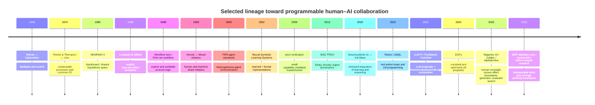

Editorial context, 2026-10-20: The questions, constraints, proposals, disagreements, and caveats below are reformulated from the saved research discussion. LLM recommendations remain attributed proposals, not decisions by the author or independently verified findings. Technical examples and quoted source passages retain their original wording.

To read:

- downloaded pdf 2025

## review


There is a substantial literature on this topic, though it appears under several names: **intelligence augmentation, human-computer symbiosis, human-AI collaboration, mixed-initiative systems, augmentation vs. automation,** and **future of work**. Recent reviews are a good entry point. ([Springer](https://link.springer.com/article/10.1007/s10796-025-10591-5?utm_source=chatgpt.com "Understanding Human-AI Augmentation in the Workplace: A Review and a Future Research Agenda | Information Systems Frontiers | Springer Nature Link"))

|Work|Why it is relevant|
|---|---|
|**Vannevar Bush -- "As We May Think" (1945)**|Early vision of computers extending human memory and knowledge work; introduces the _memex_. ([W3C](https://www.w3.org/History/1945/vbush/vbush.shtml?utm_source=chatgpt.com "As We May Think"))|
|**J. C. R. Licklider -- "Man-Computer Symbiosis" (1960)**|One of the clearest early statements of humans and computers combining complementary strengths. ([DOI](https://doi.org/10.1109/thfe2.1960.4503259?utm_source=chatgpt.com "Man-Computer Symbiosis"))|
|**Douglas Engelbart -- "Augmenting Human Intellect: A Conceptual Framework" (1962)**|Probably the foundational work if your topic is literally _augmenting human work_. Engelbart treats the worker, tools, language, methods, and organization as a combined system. ([dougengelbart.org](https://dougengelbart.org/pubs/augment-3906-Framework.html?utm_source=chatgpt.com "Augmenting Human Intellect: A Conceptual Framework - 1962 (AUGMENT,3906,) - Doug Engelbart Institute"))|
|**Eric Horvitz -- "Principles of Mixed-Initiative User Interfaces" (1999)**|How systems should divide initiative between a person and an intelligent agent. Very relevant to current copilots and agents. ([DOI](https://doi.org/10.1145/302979.303030?utm_source=chatgpt.com "Principles of mixed-initiative user interfaces \| Proceedings of the SIGCHI conference on Human Factors in Computing Systems"))|
|**Mohammad H. Jarrahi -- "Artificial Intelligence and the Future of Work: Human-AI Symbiosis in Organizational Decision Making" (2018)**|Applies the symbiosis idea directly to organizational work and decision making. ([ScienceDirect](https://www.sciencedirect.com/science/article/pii/S0007681318300387?utm_source=chatgpt.com "Artificial intelligence and the future of work: Human-AI symbiosis in organizational decision making - ScienceDirect"))|
|**Amershi et al. -- "Guidelines for Human-AI Interaction" (2019)**|18 empirically validated design guidelines for systems in which humans interact with AI. Good if you're designing augmentation tools. ([DOI](https://doi.org/10.1145/3290605.3300233?utm_source=chatgpt.com "Guidelines for Human-AI Interaction \| Proceedings of the 2019 CHI Conference on Human Factors in Computing Systems"))|
|**Raisch & Krakowski -- "Artificial Intelligence and Management: The Automation-Augmentation Paradox" (2021)**|Important conceptual paper: automation and augmentation are interdependent, so organizations have to reason about both together. ([DOI](https://doi.org/10.5465/amr.2018.0072?utm_source=chatgpt.com "Artificial Intelligence and Management: The Automation-Augmentation Paradox \| Academy of Management Review"))|
|**Paul et al. -- "Intelligence Augmentation: Human Factors in AI and Future of Work" (2022)**|Connects augmented intelligence to human factors, organizational context, ethics, and work design. ([AIS eLibrary](https://aisel.aisnet.org/thci/vol14/iss3/6/?utm_source=chatgpt.com "\"Human Factors in AI and Future of Work\" by Souren Paul, Lingyao Yuan et al."))|
|**Noy & Zhang -- "Experimental Evidence on the Productivity Effects of Generative Artificial Intelligence" (2023)**|Controlled experiment with professional writing: ChatGPT cut time by about 40% and increased assessed quality by about 18%. ([DOI](https://doi.org/10.1126/science.adh2586?utm_source=chatgpt.com "Experimental evidence on the productivity effects of generative artificial intelligence \| Science"))|
|**Brynjolfsson, Li & Raymond -- "Generative AI at Work" (2025)**|Large field study of 5,172 customer-support agents. AI increased productivity, with larger gains among less experienced workers. ([DOI](https://doi.org/10.1093/qje/qjae044?utm_source=chatgpt.com "Generative AI at Work* \| The Quarterly Journal of Economics \| Oxford Academic"))|
|**Dell'Acqua et al. -- "Navigating the Jagged Technological Frontier" (2026 journal publication; working paper 2023)**|758 consultants using GPT-4. AI helped substantially on tasks within its capability frontier but reduced correctness on a task outside that frontier. This is central to understanding when augmentation works. ([DOI](https://doi.org/10.1287/orsc.2025.21838?utm_source=chatgpt.com "Navigating the Jagged Technological Frontier: Field Experimental Evidence of the Effects of Artificial Intelligence on Knowledge Worker Productivity and Quality \| Organization Science"))|
|**Shao et al. -- "Future of Work with AI Agents: Auditing Automation and Augmentation Potential across the U.S. Workforce" (2025/26 preprint)**|Studies 844 tasks across 104 occupations and asks workers how much human involvement they actually want. Introduces a useful **Human Agency Scale**. ([DOI](https://doi.org/10.48550/arXiv.2506.06576?utm_source=chatgpt.com "[2506.06576] Future of Work with AI Agents: Auditing Automation and Augmentation Potential across the U.S. Workforce"))|

Two broader reviews are particularly useful if you're doing a literature review. **Nguyen & Elbanna, "Understanding Human-AI Augmentation in the Workplace" (2025)** organizes the literature around the nature, effects, and challenges of augmentation. ([Springer](https://link.springer.com/article/10.1007/s10796-025-10591-5?utm_source=chatgpt.com "Understanding Human-AI Augmentation in the Workplace: A Review and a Future Research Agenda | Information Systems Frontiers | Springer Nature Link")) **Lei & Kim, "Automation and Augmentation: Artificial Intelligence, Robots, and Work" (2024)** gives a broader sociological review covering productivity, inequality, expertise, autonomy, and working conditions. ([Annual Reviews](https://www.annualreviews.org/content/journals/10.1146/annurev-soc-090523-050708?utm_source=chatgpt.com "Automation and Augmentation: Artificial Intelligence, Robots, and Work | Annual Reviews"))

One point that emerges from the empirical literature is that **augmentation doesn't automatically improve work**. Noy & Zhang and Brynjolfsson et al. find sizable gains, particularly for less experienced workers. Dell'Acqua et al. show that results depend heavily on whether the task fits the AI's capabilities. And a 2025 randomized study of experienced open-source developers found that early-2025 AI tools made participants **19% slower** on their own mature codebases, despite the developers believing the tools were speeding them up. ([DOI](https://doi.org/10.1126/science.adh2586?utm_source=chatgpt.com "Experimental evidence on the productivity effects of generative artificial intelligence | Science"))

If the stated goal is to study **"Augmenting Human Work" as a research topic**, the proposal is to build the literature around four questions:

**human capabilities -> task allocation -> human/AI interaction -> effects on skills and work quality.**

Engelbart -> Jarrahi -> Raisch/Krakowski -> Dell'Acqua/Brynjolfsson -> Shao gives a particularly coherent reading path from the original idea to current AI agents.

There are some concrete system traditions here. Pirolli & Card studied intelligence analysts and modeled their work as iterating between **information foraging** and **sensemaking**--collecting evidence, organizing it, generating hypotheses, testing them, and restructuring the representation. ([ResearchGate](https://www.researchgate.net/publication/215439203_The_sensemaking_process_and_leverage_points_for_analyst_technology_as_identified_through_cognitive_task_analysis?utm_source=chatgpt.com "(PDF) The sensemaking process and leverage points for analyst technology as identified through cognitive task analysis")) More recent visual-analytics systems explicitly combine machine learning with this process. For example, _Cosmos_ lets an analyst spatially organize text evidence; the machine interprets those manipulations and retrieves/reorganizes information in response. The human and machine are effectively manipulating a shared conceptual model. ([ScienceDirect](https://www.sciencedirect.com/science/article/pii/S2214579618302995?utm_source=chatgpt.com "Interactive Visual Analytics for Sensemaking with Big Text - ScienceDirect"))

Another tradition may be especially relevant to the author's use of "epistemological": **knowledge building and epistemic agency**.

Scardamalia & Bereiter's Knowledge Building work treats ideas themselves as objects that a group works on. Participants identify gaps, generate explanations, criticize them, and progressively improve communal knowledge. ([Taylor & Francis Online](https://www.tandfonline.com/doi/abs/10.1207/s15327809jls0101_3?utm_source=chatgpt.com "Higher Levels of Agency for Children in Knowledge Building: A Challenge for the Design of New Knowledge Media: Journal of the Learning Sciences: Vol 1, No 1")) "Epistemic agency" refers to people retaining responsibility for questions such as _what do we need to know?_, _what counts as evidence?_, and _is this explanation adequate?_ ([Taylor & Francis Online](https://www.tandfonline.com/doi/full/10.1080/1475939X.2017.1369150?utm_source=chatgpt.com "Developing secondary students' epistemic agency in a knowledge-building community: Technology, Pedagogy and Education: Vol 27 , No 1 - Get Access"))

That distinction becomes important with AI. You could build an AI that gives the user a correct explanation, or you could build one that helps the user **exercise epistemic agency**:

```text
"What do you think is happening?"

"What evidence would distinguish A from B?"

"This observation conflicts with your current model."

"You're assuming X → Y. Do we actually have evidence for that?"

"Here are three plausible models consistent with what we know."

"What information would change your belief?"
```


The AI's contribution here isn't primarily an answer. It's helping maintain and manipulate an **epistemic state**: beliefs, evidence, hypotheses, uncertainties, causal relations, questions, and disagreements.

And this is starting to become an explicit Human-AI research area. A 2026 paper actually proposes the term **Sensemaking AI**, arguing for AI that supports collective meaning-making while preserving people's ability to interpret and revise the situation themselves. ([Springer](https://link.springer.com/article/10.1140/epjds/s13688-026-00634-5?utm_source=chatgpt.com "Sensemaking AI: Introducing a research and design agenda for human-AI networks | EPJ Data Science | Springer Nature Link")) A 2026 HCI thesis uses the term **Collaborative Sensemaking with AI** and includes a system called _InsightBridge_ designed to align mental models during interviews through shared information synthesis. ([CSE HKUST](https://cse.hkust.edu.hk/pg/defenses/Summer26/jlijj-09-06-2026.html?utm_source=chatgpt.com "Collaborative Sensemaking with AI: From In-Situ Context to Human Understanding | HKUST CSE")) There is also emerging work using terms such as **epistemic partnership**, **epistemic relationships**, and **knowledge-building AI**. ([arXiv](https://arxiv.org/abs/2508.03673?utm_source=chatgpt.com "Classifying Epistemic Relationships in Human-AI Interaction: An Exploratory Approach"))

<a id="5-co-storm-is-very-close-to-your-collaborative-investigation-idea"></a>

### 5. Co-STORM and the collaborative investigation proposal


This one is particularly relevant to what you said about humans + teams of agents.

Stanford's **Co-STORM** has:

```text
human
+
multiple LM experts
+
moderator agent
+
retrieval
+
shared evolving discourse
+
dynamic mind map
```


The human can observe the agents' discussion or intervene and steer it. Agents raise follow-up questions, and the system continuously organizes discoveries into a dynamic mind map that acts as shared conceptual space. ([GitHub](https://github.com/stanford-oval/storm?utm_source=chatgpt.com "GitHub - stanford-oval/storm: An LLM-powered knowledge curation system that researches a topic and generates a full-length report with citations. · GitHub"))

That's very close to:

> investigation isn't one query; it is a collaborative process whose representation evolves.

Their interface is largely conversation + mind map.

The proposed approach could generalize the shared object:

```text
Co-STORM:
shared mind map

Our possible model:
shared typed investigation state

  questions
  claims
  evidence
  conflicts
  sources
  computations
  agents
  people
```


And multiple views could project it.

Co-STORM is probably the paper proposed as a first reading on the **human interaction** side.

<!-- Navigation added during reassembly on 2026-09-30. Source arguments are retained with editorial wording, 2026-10-20; quoted source passages remain exact. -->

## Historical survey from the programmable environments report


The following historical survey and timeline come from the [programmable human-AI environments report](). They describe system boundaries across research traditions and complement the augmentation literature above. The report's [current systems discussion](#current-llm-systems-and-human-augmentation) contains the empirical collaboration study and its qualifications.

## Historical foundations and the boundaries they introduced


The most useful way to organise the older literature is by the boundary each tradition decided to make explicit.

| Tradition | Fundamental object | Boundary made explicit | What stays open or opaque | Contribution to the present problem |
|---|---|---|---|---|
| **Cybernetics / control** | feedback loop | observed state <-> action <-> consequence | internal mechanism of controller | Treat intelligence as part of a closed loop with observations and consequences. [^turn7search3] |
| **Unix composition** | process + stream/file | common I/O interface | implementation of each process | Small common substrate, arbitrary composition. [^turn17search0][^turn17search7] |
| **Blackboard architecture** | hypothesis in shared workspace | shared representations + control of attention | knowledge source internals | Heterogeneous specialists collaborate indirectly through shared state. [^turn3search1][^turn0search0] |
| **Multi-agent systems** | autonomous agent + message | communication protocol / social interaction | local beliefs and implementation | Treat participants as independent principals rather than functions in one program. [^turn16search0][^turn2search10] |
| **Workflow / Petri nets** | task + transition/token | admissible control/state transitions | implementation of task itself | Separate process semantics from task execution and verify the former. [^turn4search2][^turn4search1] |
| **Programming languages** | value + type/effect | admissible values and observable effects | algorithm producing them | Reject bad compositions before or during execution. [^turn6search0][^turn6academia24] |
| **OS/reference monitors** | principal + protected resource operation | authority over effects/resources | application behaviour | Put a small trusted mediator between untrusted computation and consequential actions. [^turn5search3][^turn5search2] |
| **Mixed initiative** | human-machine interaction | who takes initiative, when and with what confidence | each party's internal cognition | Human participation becomes part of system control, rather than an exception. [^turn7search0][^turn7search6] |
| **Provenance** | Entity, Activity, Agent | derivation and responsibility | correctness of the activity | Make "where did this come from and who was responsible?" machine-readable. [^turn14search0] |
| **Neuro-symbolic AI** | learned representation + symbolic knowledge/reasoning | interface between learned and formal representations | neural inference/search | Separate generative/learned competence from formal reasoning machinery. [^turn2search1][^turn2academia38] |

**Cybernetics gives the broadest behavioural framing.** Wiener's 1948 formulation made communication and feedback central to control in biological and mechanical systems. For the present problem its key idea is that an intelligent computation cannot be evaluated solely from its internal output: action changes the environment, new observations arrive, and those observations close the loop. [^turn7search3] Modern agent loops such as `observe -> propose -> act -> observe -> revise` are structurally close to this idea, even though current LLM systems usually do not inherit the mathematical stability theory associated with classical control.

**Unix gives the clearest compositional framing.** Ritchie and Thompson exposed processes through compatible file, device and inter-process I/O; later accounts of Unix's development explicitly discuss pipelined commands. The crucial architectural move was that composition did not require two programs to understand one another's implementations. [^turn17search0][^turn17search7] The limitation for human-AI systems is equally important: bytes flowing through a pipe carry almost none of the semantics needed to distinguish an observation from an instruction, a draft from a committed action, or a suggestion from an authorised approval.

**Blackboard systems come closest to the shared-state portion of the question.** HEARSAY-II coordinated independent knowledge sources by accumulating and evaluating hypotheses at different levels of abstraction in a common problem-solving structure, while a control mechanism allocated resources to promising actions. Later blackboard literature abstracted this into blackboard models, frameworks and application systems. [^turn3search1][^turn3search12][^turn0search0] The powerful assumption is that specialists need not be wired into a fixed call chain: they can react to, refine or challenge state visible in the shared workspace. Its weak point for modern use is that the original abstraction says little about mutually distrusting principals, fine-grained authority or irreversible external effects.

**Multi-agent systems move the abstraction boundary from functions to actors.** Wooldridge's textbook frames a MAS as many autonomous entities whose interactions can be cooperative or self-interested, while FIPA sought interoperability among heterogeneous agents through standard communication semantics and platform services. FIPA ACL messages represent speech acts and contain fields such as sender, receiver, content and ontology; its platform architecture also includes management/directory facilities and mechanisms to accommodate legacy software. [^turn16search0][^turn2search2][^turn2search4] This tradition is essential when people, organisations and services have distinct local authority. Its default emphasis on agent-to-agent communication, however, does not give you a single authoritative state or a global enforcement point for free.

**Workflow research makes the process itself a program.** Van der Aalst's Petri-net work treats business-process logic as an explicit object that can be modelled and checked, including concurrency and workflow correctness. Related work develops compositional/refinement approaches so parts of a workflow can be verified in stages. [^turn4search2][^turn4search1][^turn4search0] This is particularly strong where obligations such as "A and B must finish before C" are genuine requirements. It becomes restrictive when the useful sequence of work must itself be discovered while working.

**Programming-language effect systems give a more selective answer.** Lucassen and Gifford separate a value's type from an approximation of its side effects and regions, allowing the compiler to reason about which computations may interfere or can be safely scheduled. Modern algebraic-effect work generalises the principle that effects can be explicit in a program's semantics and handled separately from the computation that requests them. [^turn6search0][^turn6academia24] This distinction maps unusually well onto LLM systems: generating `SendEmail(to, body)` and being permitted to perform `SendEmail` are different propositions.

**Operating-system security gives the strongest trust-boundary framing.** The reference-monitor/security-kernel concept requires security-relevant accesses to pass through a protected and verifiable mechanism. seL4 shows how far this can be taken: its microkernel mediates access to resources using security capabilities, keeps policy largely outside the minimal kernel, and has machine-checked proofs covering functional correctness and important integrity/confidentiality properties under stated assumptions. [^turn5search3][^turn5search2][^turn5search7] The lesson for AI runtimes is structural: correctness need not require trusting every component. It requires identifying which operations cannot be allowed to bypass mediation.

**Mixed-initiative research is a foundation for human augmentation rather than autonomous-agent substitution.** Horvitz's work explicitly asks how automated inference and direct human interaction should coexist and when each party should take initiative. [^turn7search0][^turn7search6] This differs fundamentally from treating the human as an error handler invoked only when model confidence is low: the human can contribute goals, context, decisions, approvals and new work at arbitrary points.

**Provenance gives an overlooked common ontology.** W3C PROV defines `Entity`, `Activity` and `Agent` as its starting classes; it relates them through use, generation, derivation, association and attribution, and also supports delegation through `actedOnBehalfOf`. It includes `Plan` as an entity representing intended actions or steps. Its `Agent` subclasses explicitly include `Person`, `Organization` and `SoftwareAgent`. [^turn14search0] That makes PROV conceptually close to a heterogeneous collaboration system, although PROV describes responsibility and derivation; it does not decide whether a proposed operation should be allowed.

Finally, **neuro-symbolic AI addresses a different cut through the system**. Garcez, Broda and Gabbay's foundational treatment combines symbolic knowledge representation and reasoning with neural learning; later "third wave" work argues for principled integration motivated partly by interpretability, accountability and trustworthy reasoning. [^turn2search1][^turn2academia38] This remains valuable, especially for components such as AlphaGeometry. But "neural versus symbolic" is only one axis of a larger architecture. A human, database or payment service cannot be adequately classified by that distinction, and the distinction alone does not tell us who is authorised to send the payment.

<!-- Navigation added during reassembly on 2026-09-30. Source arguments are retained with editorial wording, 2026-10-20; quoted source passages remain exact. -->

The original report places its [current systems discussion and comparison matrices](#current-llm-systems-and-human-augmentation) and [trusted execution discussion]() between the historical survey above and the complete timeline below. The timeline and both paragraphs interpreting it remain together.

## Timeline of selected influential works


The timeline below is selective: it shows the conceptual lines that most directly contribute to the proposed architecture, rather than attempting a complete history of AI or distributed computing. The early milestones cover feedback/control, operating-system composition, shared-workspace AI, explicit effects and process semantics; the later milestones show neural-symbolic integration and the shift toward LLM proposal/evaluation, durable agent runtimes and enforced effect boundaries. [^turn7search3][^turn17search0][^turn3search1][^turn6search0][^turn4search2][^turn2search1][^turn5search2]




The post-2022 part should not be read as one linear replacement chain. ReAct, LMQL, DSPy and AutoGen make LLM computation easier to program; LLM+P, AlphaGeometry, FunSearch and AlphaEvolve specialise LLMs as generators inside stricter search/evaluation loops; Magentic-UI studies humans as active collaborators; CaMeL, AgentSpec and 2026 action-integrity work ask which parts of those systems must remain outside the model's discretion. [^turn8academia0][^turn18academia34][^turn19search2][^turn9academia14][^turn8academia3][^turn18search12][^turn18search1][^turn18search0][^turn21academia49][^turn21search0][^turn20academia24][^turn20search4]

The latest protocol work also shows that the abstraction is still moving. MCP's 28 July 2026 revision changed a previously stateful core to a stateless request/response core and moved long-running Tasks to an extension, while A2A treats long-running stateful `Task`s as a fundamental inter-agent object. [^turn14search2][^turn14search10][^turn15search3] That divergence is informative: **transport state, task state and application state are different things and need not live in the same layer.**

<!-- Navigation added during reassembly on 2026-09-30. Source arguments are retained with editorial wording, 2026-10-20; quoted source passages remain exact. -->

## Citation definitions for the imported report sections


These definitions are local copies from the [complete original bibliography](#references). They were added so the imported sections can be read on their own. They are not part of the moved source text.

[^turn3search1]: Lee D. Erman, Frederick Hayes-Roth, Victor R. Lesser, and D. Raj Reddy, "The HEARSAY-II Speech Understanding System: Integrating Knowledge to Resolve Uncertainty," *ACM Computing Surveys* 12(2), 1980. <https://doi.org/10.1145/356810.356816> Original Deep Research source key: `turn3search1`.

[^turn4search2]: Wil M. P. van der Aalst, "The Application of Petri Nets to Workflow Management," *Journal of Circuits, Systems and Computers* 8(1), 1998. <https://doi.org/10.1142/S0218126698000043> Original Deep Research source key: `turn4search2`.

[^turn7search0]: Eric Horvitz, "Principles of Mixed-Initiative User Interfaces," *CHI '99*, 1999. <https://doi.org/10.1145/302979.303030> Original Deep Research source key: `turn7search0`.

[^turn6search0]: John M. Lucassen and David K. Gifford, "Polymorphic Effect Systems," *POPL '88*, 1988. <https://doi.org/10.1145/73560.73564> Original Deep Research source key: `turn6search0`.

[^turn14search0]: W3C, *PROV-DM: The PROV Data Model*, W3C Recommendation, 2013. <https://www.w3.org/TR/prov-dm/> Original Deep Research source key: `turn14search0`.

[^turn18search12]: Trieu H. Trinh et al., "Solving olympiad geometry without human demonstrations," *Nature* 625, 2024. <https://doi.org/10.1038/s41586-023-06747-5> Original Deep Research source key: `turn18search12`.

[^turn18search1]: Bernardino Romera-Paredes et al., "Mathematical discoveries from program search with large language models," *Nature* 625, 2024. <https://doi.org/10.1038/s41586-023-06924-6> Original Deep Research source key: `turn18search1`.

[^turn18search0]: Alexander Novikov et al., "AlphaEvolve: A coding agent for scientific and algorithmic discovery," 2025. <https://arxiv.org/abs/2506.13131> Original Deep Research source key: `turn18search0`.

[^turn8academia3]: Bo Liu et al., "LLM+P: Empowering Large Language Models with Optimal Planning Proficiency," 2023. <https://arxiv.org/abs/2304.11477> Original Deep Research source key: `turn8academia3`.

[^turn21search0]: Edoardo Debenedetti et al., "Defeating Prompt Injections by Design" (CaMeL), 2025; revised for IEEE SaTML 2026. <https://arxiv.org/abs/2503.18813> Original Deep Research source key: `turn21search0`.

[^turn17search0]: Dennis M. Ritchie and Ken Thompson, "The UNIX Time-Sharing System," *Communications of the ACM* 17(7), 1974. <https://doi.org/10.1145/361011.361061> Original Deep Research source key: `turn17search0`.

[^turn5search3]: NIST, *Glossary of Computer Security Terminology*, NISTIR 4659, including the reference-monitor definition. <https://nvlpubs.nist.gov/nistpubs/Legacy/IR/nistir4659.pdf> Original Deep Research source key: `turn5search3`.

[^turn17search7]: Dennis M. Ritchie, "The Evolution of the Unix Time-sharing System," 1979/1984 historical account. <https://pdos.csail.mit.edu/6.828/2009/readings/ritchie79evolution.html> Original Deep Research source key: `turn17search7`.

[^turn2search1]: Artur S. d'Avila Garcez, Krysia B. Broda, and Dov M. Gabbay, *Neural-Symbolic Learning Systems: Foundations and Applications*, Springer, 2002. <https://doi.org/10.1007/978-1-4471-0211-3> Original Deep Research source key: `turn2search1`.

[^turn2academia38]: Artur d'Avila Garcez and Luis C. Lamb, "Neurosymbolic AI: The 3rd Wave," 2020. <https://arxiv.org/abs/2012.05876> Original Deep Research source key: `turn2academia38`.

[^turn7search3]: Norbert Wiener, *Cybernetics or Control and Communication in the Animal and the Machine*, 1948. <https://direct.mit.edu/books/oa-monograph/4581/Cybernetics-or-Control-and-Communication-in-the> Original Deep Research source key: `turn7search3`.

[^turn0search0]: H. Penny Nii, "Blackboard Application Systems, Blackboard Systems and a Knowledge Engineering Perspective," *AI Magazine* 7(3), 1986. <https://doi.org/10.1609/aimag.v7i3.550> Original Deep Research source key: `turn0search0`.

[^turn16search0]: Michael Wooldridge, *An Introduction to MultiAgent Systems*, 2nd ed., Wiley, 2009. <https://www.wiley-vch.de/en/areas-interest/computing-computer-sciences/an-introduction-to-multiagent-systems-978-0-470-51946-2> Original Deep Research source key: `turn16search0`.

[^turn2search10]: FIPA, *Abstract Architecture Specification*. <https://www.fipa.org/specs/fipa00001/> Original Deep Research source key: `turn2search10`.

[^turn4search1]: Wil M. P. van der Aalst, "Workflow Verification: Finding Control-Flow Errors Using Petri-Net-Based Techniques," 2000. <https://doi.org/10.1007/3-540-45594-9_11> Original Deep Research source key: `turn4search1`.

[^turn6academia24]: Andrej Bauer and Matija Pretnar, "Programming with Algebraic Effects and Handlers," 2012/2015. <https://arxiv.org/abs/1203.1539> Original Deep Research source key: `turn6academia24`.

[^turn5search2]: Gerwin Klein et al., "seL4: Formal Verification of an OS Kernel," *SOSP '09*, 2009. <https://cgi.cse.unsw.edu.au/~kleing/papers/sosp09.html> Original Deep Research source key: `turn5search2`.

[^turn7search6]: Eric Horvitz, "Principles of Mixed-Initiative User Interfaces," *CHI '99*, 1999. <https://doi.org/10.1145/302979.303030> Original Deep Research source key: `turn7search6`.

[^turn3search12]: Victor R. Lesser, Richard D. Fennell, Lee D. Erman, and D. Raj Reddy, "Organization of the HEARSAY-II Speech Understanding System." <https://mas.cs.umass.edu/pub/paper_detail.php/280> Original Deep Research source key: `turn3search12`.

[^turn2search2]: FIPA, *ACL Message Structure Specification*. <https://www.fipa.org/specs/fipa00061/> Original Deep Research source key: `turn2search2`.

[^turn2search4]: FIPA, *Agent Management Specification*. <https://www.fipa.org/specs/fipa00023/> Original Deep Research source key: `turn2search4`.

[^turn4search0]: Wil M. P. van der Aalst, "Workflow Verification: Finding Control-Flow Errors Using Petri-Net-Based Techniques," 2000; includes compositional verification. <https://doi.org/10.1007/3-540-45594-9_11> Original Deep Research source key: `turn4search0`.

[^turn5search7]: seL4 Foundation, "Verification / Proofs," official seL4 verification documentation. <https://sel4.systems/Verification/proofs.html> Original Deep Research source key: `turn5search7`.

[^turn8academia0]: Shunyu Yao et al., "ReAct: Synergizing Reasoning and Acting in Language Models," 2022/ICLR 2023. <https://arxiv.org/abs/2210.03629> Original Deep Research source key: `turn8academia0`.

[^turn18academia34]: Luca Beurer-Kellner, Marc Fischer, and Martin Vechev, "Prompting Is Programming: A Query Language for Large Language Models" (LMQL), 2022/PLDI 2023. <https://arxiv.org/abs/2212.06094> Original Deep Research source key: `turn18academia34`.

[^turn19search2]: Omar Khattab et al., "DSPy: Compiling Declarative Language Model Calls into Self-Improving Pipelines," ICLR 2024. <https://arxiv.org/abs/2310.03714> Original Deep Research source key: `turn19search2`.

[^turn9academia14]: Qingyun Wu et al., "AutoGen: Enabling Next-Gen LLM Applications via Multi-Agent Conversation," 2023. <https://arxiv.org/abs/2308.08155> Original Deep Research source key: `turn9academia14`.

[^turn21academia49]: Hussein Mozannar et al., "Magentic-UI: Towards Human-in-the-loop Agentic Systems," Microsoft Research, 2025. <https://www.microsoft.com/en-us/research/publication/magentic-ui-report/> Original Deep Research source key: `turn21academia49`.

[^turn20academia24]: Haoyu Wang, Christopher M. Poskitt, and Jun Sun, "AgentSpec: Customizable Runtime Enforcement for Safe and Reliable LLM Agents," ICSE 2026. <https://doi.org/10.1145/3744916.3764546> Original Deep Research source key: `turn20academia24`.

[^turn20search4]: Yu He et al., "AttriGuard: Defeating Indirect Prompt Injection in LLM Agents via Causal Attribution of Tool Invocations," USENIX Security 2026. <https://www.usenix.org/conference/usenixsecurity26/presentation/he-yu> Original Deep Research source key: `turn20search4`.

[^turn15search3]: Agent2Agent (A2A) Protocol, current specification and core concepts. <https://a2a-protocol.org/latest/topics/key-concepts/> Original Deep Research source key: `turn15search3`.

[^turn14search2]: Model Context Protocol maintainers, "The 2026-07-28 Specification," 28 July 2026. <https://blog.modelcontextprotocol.io/posts/2026-07-28/> Original Deep Research source key: `turn14search2`.

[^turn14search10]: Model Context Protocol maintainers, "The 2026-07-28 MCP Specification Release Candidate," including the Tasks extension redesign. <https://blog.modelcontextprotocol.io/posts/2026-07-28-release-candidate/> Original Deep Research source key: `turn14search10`.
