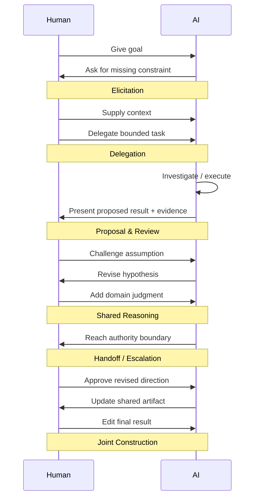

# Joint activity and collaboration model


Editorial context, 2026-04-20: The questions, constraints, proposals, disagreements, and caveats below are reformulated from the saved research discussion. LLM recommendations remain attributed proposals, not decisions by the author or independently verified findings. Technical examples and quoted source passages retain their original wording.

<!-- Navigation added during reassembly on 2026-04-01. Source arguments are retained with editorial wording, 2026-04-20; quoted source passages remain exact. -->

The retained LLM passages develop a collaboration model from joint activity, common ground, coordination, and teamwork. The earlier principles, later coverage reasoning, and compact model remain together. The sibling [comments]() explain the placement and limits.

[Augmenting human work]() provides the wider allocation and decision-point discussion. [Collaboration patterns]() continues the original source with specific interaction patterns. The [source redirect]() links both parts.

<a id="retained-dialogue"></a>

## Development of the proposal


The proposal is to name the underlying lens **joint activity** or **collaborative work**, not simply "team collaboration."

The core assumption is:

> Two or more actors are trying to achieve a shared outcome while information, capabilities, judgment, and authority are distributed between them.

From that, we ask:

- How do they align on the goal?
- How do they establish shared understanding?
- How do they divide and coordinate work?
- How do they observe and steer each other?
- How do they evaluate each other's contributions?
- How do they recover when something goes wrong?

That is the basis of the collaboration model we derived.

"Teamwork" research is one useful source, but our lens is broader. It also covers:

- two people collaborating,
- expert + learner,
- customer + support agent,
- manager + employee,
- human + AI,
- several humans + AI.

So the proposal is to describe our approach as:

**Use the mechanics of joint human work as a design lens for human-AI interaction.**

Then there are three underlying bodies of ideas we've implicitly used:

1. **Joint activity / common ground** -- how collaborators maintain shared understanding and coordinate intentions.
2. **Coordination / collaborative work** -- how work is divided, dependencies managed, and handoffs handled.
3. **Teamwork** -- goals, roles, monitoring, adaptation, backup, trust, communication.

And our AI-specific move is:

> Treat AI as another participant in the work, then ask how information, action, judgment, and authority should be distributed between human and AI.

That last sentence is probably the most precise statement of the approach.

## practices/principles-v0.1


Once we frame AI as a collaborator, a much larger set of design principles becomes available. Teresa's proposal/change-set pattern is one instance: the AI contributes to shared work in a way the user can inspect and revise.

From there, the proposal is to transfer principles from good human collaboration:

|Collaboration principle|AI design implication|
|---|---|
|**Shared goal**|AI should know what outcome both sides are working toward, not merely respond to the latest message.|
|**Clear roles**|Make clear what AI owns, what the user owns, and what requires joint judgment.|
|**Shared context**|Both sides should work from the same relevant facts, constraints, artifacts, and current state.|
|**Visible contributions**|Show what AI added, changed, inferred, or proposed.|
|**Review before commitment**|For consequential work, separate `propose` from `apply`.|
|**Ground claims in evidence**|Let the user trace an AI conclusion back to source material, data, or observations.|
|**Support disagreement**|The user should be able to say "that grouping is wrong" or "use this assumption," and AI should adapt.|
|**Repair misunderstandings**|Good collaboration includes detecting that the parties mean different things and re-establishing shared understanding.|
|**Explicit handoffs**|Make transitions clear: "I've done the analysis; I need you to choose between A and B."|
|**Track commitments and decisions**|Preserve what was agreed, rejected, deferred, or still unresolved.|
|**Expose uncertainty**|A collaborator should distinguish what it knows, assumes, and needs to verify.|
|**Respect authority boundaries**|AI shouldn't take an action merely because it can; authority should match the role it was given.|
|**Make work reversible**|Shared work should tolerate experimentation, revision, and undo.|
|**Escalate appropriately**|Know when the other collaborator has information, authority, or expertise the AI lacks.|

A few of these feel especially strong as AI product principles.

**Shared goal + clear roles** may be the foundation. A lot of weak AI experiences are vague about the relationship: is AI advising me, doing the task, reviewing my work, or making the decision? Collaboration works better when that division is explicit.

Then **proposal before commitment** is the pattern you already identified:

`AI contribution -> inspect -> discuss/modify -> commit`

And **repair** is probably underexplored. Human collaborators constantly repair shared understanding:

> "When you say 'conversion,' do you mean checkout conversion or signup conversion?"

That is more than clarification. It is maintaining **common ground**--a shared understanding of what the team is talking about.

Another useful one is **handoff design**. Good collaboration doesn't mean both parties participate equally in every step:

`AI investigates -> human decides -> AI executes -> human reviews`

The product should make those boundaries visible.

One possible framing of the overall area is:

**Design AI using the mechanics of effective collaboration: shared goals, clear roles, common ground, reviewable contributions, disagreement and repair, explicit handoffs, and reversible decisions.**

And then **inspectability / controllability / verifiability** become one subset of that broader collaborative-design model, rather than the whole model.

## Subset


In good collaboration, one participant usually doesn't silently modify shared work. They:

`propose -> show what changed -> explain if needed -> other person reviews -> accept / modify / reject`

So the broader design principle could be:

> Design AI actions using the same properties we need in collaborative work.

That naturally gives you:

- **Inspectability** -- I can see what you changed or propose.
- **Controllability** -- I can accept, reject, or modify it.
- **Justification** -- I can ask why you proposed it.
- **Verifiability** -- I can check it against evidence or source material.
- **Reversibility** -- We can undo or revise it.
- **Negotiability** -- I can disagree, and the collaborator can adapt.

The last one may be especially important. Collaboration isn't just "AI explains itself." It supports disagreement and revision.

> AI as a collaborator should make its contributions reviewable, challengeable, and revisable.

## Completeness reasoning and justifications


You can't prove you've found _all_ collaboration mechanics, but you can get much closer by triangulating several established collaboration theories and checking whether new sources keep adding new categories. The proposal is to treat this as a coverage/saturation exercise, not a brainstorming exercise.

A first finding from the literature is that our previous list was still mixing levels. "Shared goal" is a precondition, "handoff" is a coordination mechanism, and "trust" is an enabling condition. We should separate those before judging completeness.

TODO: Clarify the original `XXX` marker; no further text is recorded here.

The proposal is to verify it by triangulating established collaboration research, then checking whether additional frameworks keep adding new categories. We can't prove absolute completeness, but we can get to a point where the taxonomy is stable.

The saved LLM review reports comparing four fairly independent traditions:

- Clark & Brennan's work on **common ground**: collaborators have to coordinate both what they are doing and how they are doing it, and continually update shared understanding. ([CMU School of Computer Science](https://www.cs.cmu.edu/~illah/CLASSDOCS/Clark91.pdf?utm_source=chatgpt.com "GROUNDING IN COMMUNICATION"))
- Klein et al.'s work on **joint activity**, including human-automation teams: joint work requires commitment to the joint activity, mutual predictability, mutual directability, and common ground. ([ResearchGate](https://www.researchgate.net/publication/227992178_Common_Ground_and_Coordination_in_Joint_Activity?utm_source=chatgpt.com "(PDF) Common Ground and Coordination in Joint Activity"))
- Team research from Marks et al. and Salas et al.: teams plan, set goals, coordinate action, monitor progress and one another, provide backup, adapt, communicate, and maintain shared models and trust. ([studylib.net](https://studylib.net/doc/8897423/a-temporally-based-framework-and-taxonomy-of-team-processes?utm_source=chatgpt.com "Team Processes: Framework & Taxonomy"))
- Coordination/CSCW research: collaboration involves managing dependencies between activities and continually "meshing" distributed tasks and efforts when reality diverges from the plan. ([Bishtref](https://bishtref.com/articles/10.1145/174666.174668?utm_source=chatgpt.com "The interdisciplinary study of coordination (1994)"))

The proposed synthesis of those traditions is intended to clarify the earlier list.

### 1. Establish the collaboration


Before useful collaboration can happen:

**Goal** -- What are we trying to achieve together?

**Roles** -- Who is responsible for what?

**Authority** -- What may each participant decide or change?

**Commitment** -- Are both participants actually operating toward the joint goal?

For AI this gives questions like:

> What job has the AI accepted?
> What remains the user's responsibility?
> What can AI do autonomously?

This corresponds quite closely to Klein et al.'s "Basic Compact." ([ResearchGate](https://www.researchgate.net/publication/3454232_Ten_Challenges_for_Making_Automation_a_Team_Player_in_Joint_Human-Agent_Activity?utm_source=chatgpt.com "(PDF) Ten Challenges for Making Automation a \"Team Player\" in Joint Human-Agent Activity"))

### 2. Maintain common ground


Both collaborators need enough shared understanding of:

`goal + current state + relevant context + assumptions + terminology + previous decisions`

And they need mechanisms to repair that understanding:

`explain -> acknowledge -> clarify -> correct`

Clark and Brennan treat this continual grounding as foundational to collective action. ([CMU School of Computer Science](https://www.cs.cmu.edu/~illah/CLASSDOCS/Clark91.pdf?utm_source=chatgpt.com "GROUNDING IN COMMUNICATION"))

For AI, this gives us things such as context awareness, clarification, confirmation, memory of decisions, and making assumptions explicit.

### 3. Coordinate the work


Once the goal is shared, somebody still has to organize the work:

`divide work`

`order steps`

`manage dependencies`

`manage resources`

`handoff`

`wait/synchronize`

`reassign when necessary`

Malone and Crowston's very general definition of coordination is essentially **managing dependencies among activities**. ([Bishtref](https://bishtref.com/articles/10.1145/174666.174668?utm_source=chatgpt.com "The interdisciplinary study of coordination (1994)"))

This suggests that "handoffs" from our previous list are one instance of a larger category: **coordination**.

### 4. Stay mutually observable and directable


Collaborators need enough visibility to answer:

> What are you doing?
> What state are we in?
> Are you stuck?
> Why did you take that direction?

And they need ways to influence one another:

> Stop.
> Try this.
> Change direction.
> Let me handle this part.

Klein et al. call out **mutual predictability** and **mutual directability** as requirements for joint activity. ([ResearchGate](https://www.researchgate.net/publication/227992178_Common_Ground_and_Coordination_in_Joint_Activity?utm_source=chatgpt.com "(PDF) Common Ground and Coordination in Joint Activity"))

This is where several of our AI concepts fit:

**inspectability, controllability, progress visibility, intent visibility.**

They aren't isolated principles. They support a fundamental collaboration requirement: **I need to understand and steer my collaborator sufficiently to work with them.**

### 5. Evaluate and commit contributions


Collaborators contribute things:

`idea`

`interpretation`

`change`

`decision`

`work product`

The other participant may need to:

`inspect -> understand -> verify -> challenge -> modify -> accept`

This is exactly Teresa's change-set design:

`AI proposes -> human evaluates -> human changes -> AI adapts`

The proposal is to place the following here:

- inspectability
- justification
- verifiability
- accept/reject/edit
- provenance/evidence
- explicit commitment

So the earlier **proposal interface** is one concrete implementation of a general collaboration mechanic: **contributions need a review and commitment process when judgment matters.**

### 6. Handle breakdowns and adapt


Real collaboration never follows the plan perfectly.

People misunderstand each other. Evidence changes. Someone cannot do their part. A proposed approach fails.

Good collaboration therefore needs:

`detect breakdown -> surface it -> diagnose -> repair/replan -> continue`

This comes through strongly in both CSCW's "articulation work" and teamwork research on adaptability and backup behavior. Schmidt and Bannon argue that real work requires ongoing adjustment because contingencies cannot all be planned in advance. ([Welcome to DTU Research Database](https://orbit.dtu.dk/en/publications/taking-cscw-seriously-supporting-articulation-work/?utm_source=chatgpt.com "Taking CSCW seriously. Supporting articulation work - Welcome to DTU Research Database")) Salas et al. similarly include adaptability and backup behavior among their core teamwork components. ([Sage Journals](https://journals.sagepub.com/doi/pdf/10.1177/1046496405277134 "Is there a "Big Five" in Teamwork? - Eduardo Salas, Dana E. Sims, C. Shawn Burke, 2005"))

For AI that includes clarification, disagreement, correction, escalation, undo, retries, alternative plans, and admitting inability.

The proposal is to therefore reorganize our model into:

```text
COLLABORATION

1. Align
   goal · roles · authority · commitment

2. Ground
   shared context · assumptions · understanding

3. Coordinate
   divide work · dependencies · sequencing · handoffs

4. Observe & direct
   visibility · monitoring · steering

5. Review & commit
   inspect · justify · verify · challenge · accept

6. Repair & adapt
   disagreement · correction · replan · recover
```


Then there are **conditions that make those mechanics work well**, such as trust. Salas et al. explicitly treat mutual trust, shared mental models, and closed-loop communication as coordinating mechanisms supporting teamwork. ([Sage Journals](https://journals.sagepub.com/doi/pdf/10.1177/1046496405277134?utm_source=chatgpt.com "Is there a "Big Five" in Teamwork? - Eduardo Salas, Dana E. Sims, C. Shawn Burke, 2005")) Psychological safety is particularly relevant to human teams because it supports speaking up, admitting mistakes, and learning. ([Sage Journals](https://journals.sagepub.com/doi/pdf/10.2307/2666999?utm_source=chatgpt.com "Psychological Safety and Learning Behavior in Work Teams - Amy Edmondson, 1999")) The recommendation is not to mix these into the same taxonomy as "handoff" or "review," though.

And this gives us a way to test completeness.

Take any collaborative episode and walk through its lifecycle:

```text
Do we agree what we're doing?
↓
Do we understand the situation similarly?
↓
Do we know who is doing what and how the work connects?
↓
Can we see and influence each other's work?
↓
Can we evaluate and commit contributions?
↓
Can we recover when our understanding or plan breaks?
```


Then bring in another established collaboration framework. If it introduces a behavior that cannot fit anywhere in those six categories, our taxonomy is incomplete. If several independent frameworks stop adding categories and only add submechanisms, we have reached reasonable **conceptual saturation**.

The working interpretation is that this is a better way to verify the set than trying to brainstorm a longer list of principles. It also suggests that **inspectability, controllability, justification, verifiability, reversibility, handoffs, disagreement, etc. are lower-level mechanisms within a smaller collaboration model**, which is likely the desired structure.

## Model


The proposal is to formulate the model like this:

### Collaboration model


1. **Align** -- establish the shared goal, roles, responsibilities, and authority.
    _Why:_ Collaboration breaks down if participants are pursuing different outcomes or don't know who owns which decisions.
2. **Build common ground** -- maintain shared context, terminology, assumptions, and understanding of the current situation.
    _Why:_ Participants can't coordinate well if they are working from different interpretations of the problem.
3. **Coordinate** -- divide work, sequence actions, manage dependencies, and handle handoffs.
    _Why:_ Even when goals are aligned, the work still has to fit together.
4. **Make work observable and directable** -- make actions, state, and intent visible enough for the other participant to monitor and steer.
    _Why:_ A collaborator needs to understand what the other is doing and be able to redirect them when necessary.
5. **Review and commit** -- make important contributions inspectable, challengeable, verifiable, and explicitly accepted or changed.
    _Why:_ Shared work often involves judgment; collaborators need a way to evaluate a contribution before it becomes part of the shared result.
6. **Repair and adapt** -- detect misunderstandings, failures, disagreement, or changed conditions and adjust the plan.
    _Why:_ Collaboration happens under uncertainty, so the ability to recover is part of the normal process.

A compact version:

`align -> ground -> coordinate -> observe/direct -> review/commit -> repair/adapt`

And the proposal is to treat things like **trust, predictability, reversibility, transparency, and communication quality** as properties that support these mechanics, rather than additional stages.

<!-- Navigation added during reassembly on 2026-04-01. Source arguments are retained with editorial wording, 2026-04-20; quoted source passages remain exact. -->

## Research synthesis of collaboration mechanics


The following retained passages from the [research synthesis]() extend the earlier dialogue above. They retain the report's general mechanics and complete concluding model. The [model comments](#added-report-synthesis) distinguish the later synthesis from an accepted design.

## The collaboration mechanics that should sit underneath every pattern


The pattern taxonomy answers **how work is distributed**. It does not by itself tell you whether collaboration is good.

A useful synthesis of Clark and Brennan, Klein et al., Salas et al., CSCW, Google PAIR, Microsoft HAX, and contemporary agent practice gives six underlying mechanics:

| Collaboration requirement | Design question | Typical AI-interface mechanisms | Why it matters |
|---|---|---|---|
| **Align** | Do we agree on the goal, role, constraints, and authority? | task brief, scope, role statement, permissions, success criteria | Coordination is impossible if collaborators optimize different outcomes. Klein's Basic Compact starts with commitment to coordinated activity and sufficient goal alignment. [^5][^23] |
| **Ground** | Do we understand the relevant state and each other's meaning sufficiently? | clarification, context display, assumption surfacing, memory, acknowledgment | Common ground is continually constructed and repaired rather than established once. [^7] |
| **Coordinate** | Who is doing what, in what order, with which dependencies? | plan, task decomposition, progress, ownership, handoff | Teamwork requires interdependent activities to be organized around collective goals. [^4] |
| **Observe & direct** | Can each participant see enough of the other's activity and change its course? | status, preview, diff, interruption, steering, pause, permission limits | Klein identifies mutual predictability and directability as basic requirements of joint activity; modern agent users increasingly supervise through monitoring and intervention. [^5][^12] |
| **Review & commit** | Can a consequential contribution be evaluated before it becomes authoritative? | evidence, source links, rationale, diff, accept/edit/reject, approval gate | PAIR recommends review/approval and human supervision; HAX emphasizes correction, explanations, consequence visibility, and controls. [^1][^2] |
| **Repair & adapt** | What happens when understanding, execution, or the environment diverges from the plan? | correction, undo, retry, replanning, clarification, takeover, escalation | Adaptability and backup behavior are core teamwork properties, while PAIR explicitly treats graceful paths forward from AI failure as a design requirement. [^4][^33] |

Several commonly discussed AI concepts belong **inside** these mechanics rather than beside them as independent collaboration principles.

**Inspectability** is a form of observability: I can see the AI's contribution or intended action.

**Justification** is communicative support for evaluation: I can understand why this proposal was made.

**Verifiability** is stronger: I have evidence or an independent method by which I can determine whether the contribution is correct. Google's PAIR guidance is explicit that explanations should help people calibrate trust rather than induce blanket trust and that data sources can matter because users need to know what the system did and did not see. [^29]

**Directability / controllability** means my intervention can change what the AI does next. Klein's terminology is especially useful here because "control" can otherwise suggest only buttons and permissions; *directability* includes the ability to redirect a collaborator's behavior during joint work. [^5]

**Reversibility** supports exploration and repair. Google recommends making AI interactions safe to explore and avoiding automation without an undo or alternative path; Canvas similarly preserves earlier versions of a shared artifact. [^1][^20]

**Uncertainty communication** supports review and handoff, but simply displaying numerical confidence is not a universal solution. Google warns that confidence displays can confuse or mislead if they do not lead to actionable interpretation and recommends testing whether they actually improve decision making. [^29]

**Memory and continuity** support common ground. Microsoft HAX calls for remembering recent interactions, while contemporary agent communication research asks which previous interactions should remain salient to both parties. [^2][^32]

This also clarifies the role of **transparency**. Transparency is best treated as an umbrella quality, not the design instruction itself. A designer can act on:

> "Show the proposed changes, show the evidence, let the user challenge them, and require explicit commitment."

It is much harder to act on:

> "Make the AI transparent."

The first formulation maps directly onto collaboration work.

The report's [pattern catalog](#a-first-principles-model-and-the-vocabulary-practitioners-actually-use) and [selection guidance](#choosing-the-right-pattern) are retained separately. Its [validation framework](#validating-a-collaboration-design) has a dedicated note. The complete concluding model and workflow follow.

## Recommended model for design practice


The research supports a more precise model than either "AI as tool" or "AI as teammate." Treat the human-AI relationship as a **dynamic allocation of information, execution, judgment, and authority**, supported by collaboration mechanics and capable of changing modes over time. This avoids anthropomorphizing the system while still borrowing the parts of teamwork theory that are operationally useful. [^35][^5]

The proposal is to formalize it as:

```text
HUMAN-AI COLLABORATION

Collaboration modes
    Elicit
        AI needs information / context from the human

    Delegate
        AI owns bounded execution

    Propose & review
        AI produces; human evaluates and commits

    Critique / coach
        Human performs; AI evaluates and helps improve

    Reason together
        Understanding or judgment emerges iteratively

    Construct together
        Both directly shape a shared artifact

Mode transitions
    handoff · escalation · takeover · return of control

Collaboration substrate
    Align
        goal · role · authority · success criteria

    Ground
        context · terminology · assumptions · memory

    Coordinate
        plan · dependencies · ownership · sequencing

    Observe & direct
        status · intent · inspection · interruption · steering

    Review & commit
        evidence · justification · verification
        accept · edit · reject · authorize

    Repair & adapt
        correction · undo · replan · fallback · escalation
```


The most important refinement relative to the original seven-item list is therefore:

**Keep six as primary collaboration patterns. Treat handoff/escalation as the mechanism by which the system changes pattern.**

A workflow might consequently look like this:




This also resolves the **"shared reasoning loop"** question from earlier. It should remain a named, high-value collaboration pattern:

> **Give AI responsibility for moving the reasoning process forward, while deliberately deciding where human evidence, interpretation, challenge, and commitment remain in the loop.**

But "human in the loop" by itself is too weak a formulation. Anthropic's field data illustrates why: as agent use matures, oversight may move from approving every action to allowing longer autonomous stretches while monitoring and intervening selectively. The important question is therefore **where meaningful human judgment enters and whether the system preserves the information and controls required for that judgment to work**. [^12]

Likewise, the proposal interface can now be stated more precisely:

> **When AI contributes something consequential to shared work, make the contribution inspectable, challengeable, verifiable where necessary, explicitly committable, and recoverable.**

And the broad collaboration principle becomes:

> **Design not merely for human control over AI, but for effective coordination between two participants with different information, capabilities, judgment, and authority.**

That formulation is strongly consistent across the otherwise fragmented bodies of research: Clark and Brennan's common ground, Klein's joint activity, Salas's teamwork mechanisms, Horvitz's mixed initiative, Google PAIR's feedback/control and graceful failure, Microsoft HAX's correction and explainability guidelines, and today's agent products' plans, diffs, permissions, monitoring, intervention, and human review gates. [^7][^5][^4][^6][^1][^2][^9][^12]

The resulting design mindset is less "Where can we insert AI?" and more:

> **What kind of collaboration does this work actually require--and what must each participant be able to know, contribute, inspect, challenge, commit, and recover from for that collaboration to succeed?**

<!-- Navigation added during reassembly on 2026-04-01. Source arguments are retained with editorial wording, 2026-04-20; quoted source passages remain exact. -->

## Responsibility allocation and handoff


The following retained passage comes from the [collaboration framework proposal](). It develops the four-part allocation model discussed above. The sibling [comments](#framework-responsibility-allocation) explain the interpretation and open questions.

### The most important abstraction may be responsibility


One tentative proposal is to make this central.

From the research:

> Treat the human-AI relationship as a dynamic allocation of information, execution, judgment, and authority.

You could model those four explicitly:

```text
Responsibility {
    informationOwner
    executionOwner
    judgmentOwner
    authorityOwner
}
```


Then collaboration patterns become transformations of responsibility.

For example:

```text
Delegation

execution:
Human → AI

judgment:
Human

authority:
Human
```


Proposal/review:

```text
generation/execution:
AI

judgment:
Human

commit authority:
Human
```


Shared reasoning:

```text
information:
Human + AI

judgment:
Human + AI

commit authority:
perhaps Human
```


Handoff then becomes a first-class operation:

```text
transfer(
    responsibility = Execution,
    from = AI,
    to = Human,
    reason = "authority boundary reached"
)
```


That feels like a strong foundation.

## Citation definitions for the collaboration-pattern report


The definitions below are local copies of the original entries cited in the imported passages. They are added reference support, separate from the moved source text. The [complete original bibliography](#references) remains in the synthesis note. The sources and claims have not been independently checked during reassembly.

[^1]: Google PAIR. "[Feedback + Control](https://pair.withgoogle.com/guidebook-v2/chapter/feedback-controls/)." *People + AI Guidebook*.

[^2]: Microsoft. "[Guidelines for Human-AI Interaction](https://www.microsoft.com/en-us/haxtoolkit/ai-guidelines/)." *HAX Toolkit*. The guidelines originate in Amershi et al., CHI 2019.

[^4]: Salas, Eduardo, Dana E. Sims, and C. Shawn Burke. "[Is There a 'Big Five' in Teamwork?](https://doi.org/10.1177/1046496405277134)" *Small Group Research* 36, no. 5 (2005): 555-599.

[^5]: Klein, Gary, David D. Woods, Jeffrey M. Bradshaw, Robert R. Hoffman, and Paul J. Feltovich. "[Ten Challenges for Making Automation a 'Team Player' in Joint Human-Agent Activity](https://doi.org/10.1109/MIS.2004.74)." *IEEE Intelligent Systems* 19, no. 6 (2004): 91-95.

[^6]: Horvitz, Eric. "[Principles of Mixed-Initiative User Interfaces](https://www.microsoft.com/en-us/research/publication/principles-mixed-initiative-user-interfaces/)." In *Proceedings of CHI '99* (1999): 159-166. DOI: 10.1145/302979.303030.

[^7]: Clark, Herbert H., and Susan E. Brennan. "[Grounding in Communication](https://doi.org/10.1037/10096-006)." In *Perspectives on Socially Shared Cognition*, edited by L. B. Resnick, J. M. Levine, and S. D. Teasley (1991): 127-149.

[^9]: OpenAI. "[Introducing the Codex app](https://openai.com/index/introducing-the-codex-app/)."

[^12]: Anthropic. "[Measuring AI agent autonomy in practice](https://www.anthropic.com/research/measuring-agent-autonomy)." 2026.

[^20]: OpenAI. "[Introducing canvas](https://openai.com/index/introducing-canvas/)."

[^23]: Klein, Gary, Paul J. Feltovich, Jeffrey M. Bradshaw, and David D. Woods. "[Common Ground and Coordination in Joint Activity](https://doi.org/10.1002/0471739448.ch6)." In *Organizational Simulation*, edited by W. B. Rouse and K. R. Boff (2005).

[^29]: Google PAIR. "[Explainability + Trust](https://pair.withgoogle.com/guidebook-v2/chapter/explainability-trust/)." *People + AI Guidebook*.

[^32]: Bansal, Gagan, Jennifer Wortman Vaughan, Saleema Amershi, Eric Horvitz, Adam Fourney, Hussein Mozannar, Victor Dibia, and Daniel S. Weld. "[Challenges in Human-Agent Communication](https://www.microsoft.com/en-us/research/publication/human-agent-interaction-challenges/)." Microsoft Research Technical Report MSR-TR-2024-53 (2024).

[^33]: Google PAIR. "[Errors + Graceful Failure](https://pair.withgoogle.com/guidebook-v2/chapter/errors-failing/)." *People + AI Guidebook*.

[^35]: Naikar, Neelam, Robert R. Hoffman, Emilie M. Roth, Gary Klein, Laura G. Militello, Cindy Dominguez, et al. "[Should we Make AI More Tool-like or Teammate-Like?](https://doi.org/10.1177/15553434251346904)" *Journal of Cognitive Engineering and Decision Making* 20, no. 2 (2026).
