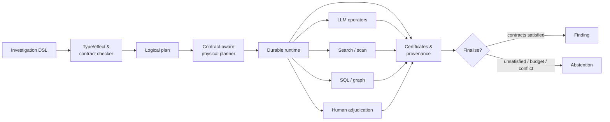

Editorial context, 2026-04-20: The questions, constraints, proposals, disagreements, and caveats below are reformulated from the saved research discussion. LLM recommendations remain attributed proposals, not decisions by the author or independently verified findings. Technical examples and quoted source passages retain their original wording.

The working interpretation is that that is the right next step.

The key proposed design choice is:

> The LLM should plan and operate the investigation, but the investigation itself should execute on a typed runtime with explicit semantics.

That gives you flexibility from the agent without turning the whole system into prompt soup.

A useful architecture is:

```text
User / Domain Expert
        │
        ▼
Planning Agent
        │
        ▼
Investigation Program
        │
        ▼
Typed Runtime
        │
        ├── retrieval operators
        ├── evidence operators
        ├── claim operators
        ├── control flow
        ├── provenance
        ├── authority
        └── validation
        │
        ▼
Investigation State
        │
        ├── evidence
        ├── claims
        ├── gaps
        ├── conflicts
        ├── coverage
        └── lineage
        │
        ▼
Agent observes state and modifies program
```


So the agent isn't itself the runtime.

It writes and modifies programs for the runtime.

<!-- Navigation added during reassembly on 2026-03-30. Source arguments are retained with editorial wording, 2026-04-20; quoted source passages remain exact. -->

The passages below come from the [typed investigation report](). The report's [shared bibliography](#references) remains in the main report.

### Durable and inspectable execution


**Temporal, DBOS and LangGraph** mean that workflow persistence itself should probably be treated as substrate in a first paper. Temporal already gives deterministic workflow histories around nondeterministic activities; DBOS gives database-backed durable state; LangGraph gives checkpoints, threads and human interrupts for agent graphs. Reimplementing crash recovery would add engineering work while doing little to establish the epistemic research claim.

**HASH's Petri-net work** makes Colored Petri Nets less suitable as the headline novelty. Petri nets remain a good candidate internal semantics for concurrency, resource tokens, joins and enabled transitions, and the visual representation is useful for inspectability. The first experiment should test whether they simplify the core semantics relative to an ordinary typed transition/dataflow system; the evidence contracts themselves are where the stronger differentiation lies.

The systems synthesis proposed for testing is therefore:




The compiler should not pretend to establish facts that only runtime execution can know. It should establish that the accepted physical plan is capable of producing all required certificates, and the finaliser should check those certificates after execution. This design is consistent with the separation between formal workflow checks in PlanCompiler/Lean4Agent and runtime uncertainty in probabilistic systems such as TRAQ.

<a id="6-langgraph-already-gives-you-part-of-the-abstract-machine"></a>

### 6. LangGraph provides part of the abstract machine


LangGraph models systems using three primitives:

```text
State
Nodes
Edges
```


Nodes transform state; edges determine subsequent computation. It supports cycles, dynamic workers, shared state, persistence, human intervention and multi-agent workflows. ([Docs by LangChain](https://docs.langchain.com/oss/javascript/langgraph/graph-api?utm_source=chatgpt.com "Graph API overview - Docs by LangChain"))

That's close to the proposed runtime layer:

```text
InvestigationState
      ↓
operator
      ↓
InvestigationState'
```


But LangGraph deliberately doesn't impose semantics on the state.

To it:

```text
Evidence
Claim
Source
Invoice
HotelBooking
```


are all just application data.

The potential research contribution would sit one level higher:

```text
generic agent runtime
       ↓
investigation runtime
       ↓
Evidence / Claim / Authority /
Coverage / Question semantics
```


So the recommendation is not to try to replace LangGraph. A prototype could potentially compile onto something like it.

## 1. Start with a small algebra


The recommendation is not to begin with a language grammar.

First define the objects and operations.

Objects:

```text
Corpus
Source
SourceUnit

Query
Question
Requirement

Candidate
Evidence
Claim
Conflict

AuthorityPolicy
Coverage
Finding
```


Core operations:

```text
select
search
expand
extract
map
filter
join
union
group
compare
rank
reduce
```


Then investigation-specific operations:

```text
decompose
reframe
screen
find_evidence
find_counterevidence
check_coverage
resolve_authority
find_conflicts
synthesize
abstain
```


That already gives you a kind of algebra.

For example:

```text
search : Corpus × Query → CandidateSet

extract : CandidateSet → EvidenceSet

claims : EvidenceSet → ClaimSet

conflicts : ClaimSet → ConflictSet

synthesize : EvidenceSet → Finding
```


Composition becomes meaningful because the types constrain it.

## 2. Keep logical operators separate from physical operators


This may be one of the most important architectural decisions.

The investigation program says:

```text
search(query)
```


The runtime decides that means:

```text
parallel {
    bm25
    dense
    hypothetical_question
    summary_search
    claim_search
}
→ union
→ rerank
```


So you have:

```text
DSL
 ↓
logical plan
 ↓
optimizer / planner
 ↓
physical execution plan
```


This is exactly the database model.

For example:

```text
find_evidence(question)
```


could have several execution strategies:

```text
Strategy A
whole-corpus summary screening
→ section screening
→ semantic units

Strategy B
dense + sparse retrieval
→ parent expansion
→ reranking

Strategy C
per-document LLM screening

Strategy D
hybrid of all three
```


The DSL shouldn't care.

That lets the proposed runtime improve later without breaking users' investigation programs.

## 3. The DSL can stay fairly small


Something like:

```text
corpus = load("engineering")

question =
  ask("What principles govern retry behavior?")

requirements =
  decompose(question)

evidence =
  corpus
  | search(requirements)
  | expand(parent="section")
  | extract_evidence()

evidence =
  evidence
  | require_authority(min="approved")

conflicts =
  evidence
  | extract_claims()
  | find_conflicts()

result =
  synthesize(evidence, conflicts)
  | require_coverage(0.99)
  | abstain_if_unsupported()

return result
```


A more sophisticated user could open `search`:

```text
search(requirements) {
    parallel {
        lexical(top=100)
        dense(top=100)
        hypothetical_questions(top=100)
        claims(top=50)
    }

    union
    deduplicate
    expand(parent=section)
    rerank(top=80)
}
```


That gives you progressive disclosure.

Most people use:

```text
search(...)
```


Experts can open it and modify the implementation.

The overall architecture proposed for exploration is therefore:

```text
                  Investigation Language
                         │
                         ▼
                     Typed AST
                         │
                         ▼
                    Logical Plan
                         │
                   ┌─────┴─────┐
                   │           │
             LLM Planner    Optimizer
                   │           │
                   └─────┬─────┘
                         ▼
                  Physical Plan
                         │
        ┌────────────────┼─────────────────┐
        │                │                 │
      Search            LLMs            Tools
        │                │                 │
        └────────────────┼─────────────────┘
                         ▼
                 Investigation Runtime
                         │
                         ▼
                  Provenance State
                         │
             ┌───────────┼───────────┐
             ▼           ▼           ▼
           Agent       Human        UI
```


And the LLM's role is:

> **synthesize, inspect, optimize, extend, and repair investigation programs.**

That framing feels much stronger than "agent orchestrates tools."

It makes the LLM a programmer/operator of an epistemic computing environment, while the environment itself supplies the constraints, semantics, state, lineage and execution guarantees.
