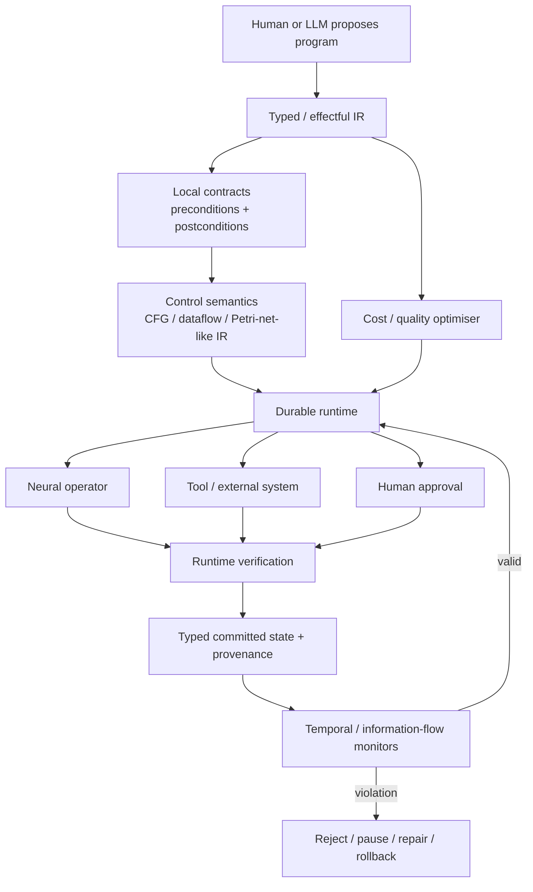

# Programmable Probabilistic Agent Computation


Editorial context, 2026-04-20: The questions, constraints, proposals, disagreements, and caveats below are reformulated from the saved research discussion. LLM recommendations remain attributed proposals, not decisions by the author or independently verified findings. Technical examples and quoted source passages retain their original wording.

## Executive summary


The broad research programme in the research notes can be stated as:

> **How should we program, execute, inspect and verify long-running computations in which some operators are neural and probabilistic, while control, authority, state, provenance and correctness obligations are governed by symbolic semantics?**

That is a defensible research framing. It is also timely. The research notes already separate neural proposal/judgement from symbolic control and ask whether probabilistic agent behaviour can live inside a deterministic, typed, durable computation model. [1](#ref-1) The compiler notes sharpen that further: move structural, authority, coverage, provenance and policy failures into compilation or explicit runtime obligations. [2](#ref-2)

The saved survey concludes that **the field is converging rapidly on the pieces of this architecture, but the survey did not identify a mature system that combines the whole stack**. The strongest recent precedents divide roughly as follows:

| Problem                                                                | Closest work I found                               |
| ---------------------------------------------------------------------- | -------------------------------------------------- |
| Typed symbolic state + local tool contracts                            | **ToolGate**, ACL 2026                             |
| Temporal constraints on agent actions                                  | **Agent-C**, 2025/26                               |
| Verified neural/model-call contracts                                   | **SEVerA**, 2026                                   |
| Persistent operational state + temporal verification                   | **STEADs**, 2026                                   |
| Neural processor inside deterministic execution kernel                 | **Arbiter-K**, 2026                                |
| Compile natural-language workflow instructions to controlled execution | **COVENANT**, 2026                                 |
| Typed deterministic compilation of LLM plans                           | **PlanCompiler**, 2026                             |
| Query algebra + database-style optimisation for agents                 | **RUBICON**, 2026                                  |
| Declarative programming/optimisation of LM pipelines                   | **DSPy**, ICLR 2024                                |
| Durable nondeterministic workflows                                     | **Temporal**, **DBOS**, **LangGraph**, **Restate** |

ToolGate is particularly close at the operator boundary: it stores trusted world state as a typed symbolic mapping and gives each tool a Hoare-style precondition/postcondition contract; a tool cannot run unless its precondition holds, and its result cannot enter trusted state unless the postcondition verifies. [3](#ref-3) Agent-C adds temporal policies by translating a DSL into first-order logic and using SMT solving during generation to block actions that would violate sequencing constraints. [4](#ref-4) SEVerA allows individual generative calls to carry first-order output contracts and wraps the model with enforcement that ensures returned values satisfy those contracts. [5](#ref-5)

At the systems level, Arbiter-K is perhaps the **closest conceptual match to the broad research framing**: its authors explicitly place a "Probabilistic Processing Unit" within a deterministic neuro-symbolic kernel, surrounded by a semantic instruction set, security context, dependency tracking, taint propagation, deterministic sinks and rollback. [6](#ref-6) COVENANT independently treats natural-language workflow instructions as source code, compiles them into an AST/control-flow representation, and places a controller between model proposals and state transitions. [7](#ref-7)

The important gap is the composition. The surveyed systems usually solve one or a few of these problems:

```text
types / contracts
temporal safety
authority / capabilities
persistent state
durable replay
provenance
concurrency / resources
program synthesis
self-modification
cost / quality optimisation
human intervention
```


The saved survey identified no system with a single semantics that integrates all of them. In particular, **formal agent work and durable-workflow work are largely separate communities**: formal systems generally reason about traces, actions and state but say little about crash recovery, retries and replay; Temporal/DBOS/LangGraph provide increasingly good durability but do not give application-specific semantic proofs for neural computations. [3](#ref-3), [4](#ref-4), [5](#ref-5), [8](#ref-8)

This appears to be the research opportunity. The proposal is to formulate it as:

> **A programming model for effectful probabilistic computation in which neural operations are explicit typed effects; symbolic contracts constrain state transitions; temporal specifications constrain traces; provenance accompanies values; execution is durable and replayable; and logical programs can be compiled to alternative physical implementations subject to safety, quality, cost and time requirements.**

One subtle point is important: much of the current "formal verification of agents" literature **does not formally reason about probabilities**. It abstracts the model as nondeterministic or checks the outputs/actions it produces. That is useful, but it leaves a research opening for the word *probabilistic* in the research framing: how should uncertainty, quality distributions and stochastic reliability become first-class program properties without pretending we can prove the semantic truth of arbitrary LLM judgements? Agent-C, ToolGate and the stateful STEAD formalisation all concentrate primarily on admissible transitions or traces; SEVerA constrains outputs but still separates hard contracts from soft learned utility. [3](#ref-3), [4](#ref-4), [5](#ref-5), [8](#ref-8)

My recommendation is therefore **not** to make "Petri nets for agents" or "a typed agent language" the broad thesis. Those are pieces. The broader research object is the **semantics and runtime of programs containing probabilistic neural operators**.

## Research landscape and closest precedents


The literature has changed materially during 2025-26. There is now enough adjacent work that a paper would need to position itself as an integration or semantic advance, not as the first attempt to put formal structure around agents. At the same time, the breadth of the convergence strengthens the case that there is a genuine systems/programming-languages problem here.

### Comparison of the closest academic systems


| Work                                                                                                                          | Scope and formalism                                                                               | Runtime model                                                               | Verification                                                         | Durability                                                                    | Human in loop                                                                            | Evaluation                                                                                                     | Artifact / licence                                                                               |
| ----------------------------------------------------------------------------------------------------------------------------- | ------------------------------------------------------------------------------------------------- | --------------------------------------------------------------------------- | -------------------------------------------------------------------- | ----------------------------------------------------------------------------- | ---------------------------------------------------------------------------------------- | -------------------------------------------------------------------------------------------------------------- | ------------------------------------------------------------------------------------------------ |
| [**ToolGate**](https://aclanthology.org/2026.findings-acl.470/)                                                               | Typed symbolic key-value state; Hoare-style tool pre/postconditions                               | Forward tool execution with guarded commits                                 | **Strong local contracts**: invocation + state-update checks         | Not a focus                                                                   | Not central                                                                              | Multi-step tool reasoning                                                                                      | ACL Findings 2026; paper distributed under ACL's post-2016 CC BY 4.0 terms. [3](#ref-3)          |
| [**Agent-C**](https://arxiv.org/abs/2512.23738)                                                                               | Temporal-policy DSL -> first-order logic -> SMT                                                   | Constraints enforced during LLM action generation                           | **Temporal safety** over action sequences                            | No general recovery semantics                                                 | Not central                                                                              | Retail and airline workflows; authors report 100% conformance/0% harm in their evaluation                      | Preprint; code/licence should be checked before reuse. [4](#ref-4)                               |
| [**SEVerA**](https://arxiv.org/abs/2603.25111)                                                                                | Per-model-call first-order contracts; constrained synthesis                                       | Generated agent programs containing formally guarded generative calls       | **Hard output contracts + whole-program verification**               | Not a focus                                                                   | Not central                                                                              | Dafny, symbolic maths, τ²-bench; authors report zero contract violations                                       | 2026 preprint. [5](#ref-5)                                                                       |
| [**Formal Verification of Agentic Systems over Operational Data / STEADs**](https://arxiv.org/abs/2608.03609)                 | Stateful tool-enabled agents over relational operational data; FO-CTL                             | Formal transition systems over persistent operational state                 | **System-level model checking theory**                               | Persistent state is intrinsic; crash recovery is outside its focus            | Not central                                                                              | Formal complexity results + case-management example                                                            | Very recent Aug 2026 preprint. [8](#ref-8)                                                       |
| [**Arbiter-K**](https://arxiv.org/abs/2604.18652)                                                                             | Probabilistic processor inside deterministic kernel; semantic ISA, dependency and taint machinery | Governance kernel mediates execution                                        | Deterministic sinks, information-flow/policy checks and rollback     | Rollback/dependencies, but not a general durable-workflow semantics           | Governance-oriented                                                                      | OpenClaw/NanoBot experiments; substantial unsafe-action interception reported                                  | Public ArbiterOS code is referenced by authors; verify repository licence for reuse. [6](#ref-6) |
| [**COVENANT**](https://arxiv.org/abs/2607.25400)                                                                              | Natural-language workflow -> AST -> CFG                                                           | Controller interprets workflow state and mediates model proposals           | Structural/workflow alignment at each state transition               | No general durable replay model                                               | Instructions can encode human workflow requirements; HITL is not the principal formalism | 120 cases across seven scenarios; authors report improved success and lower workflow misalignment              | 2026 preprint. [7](#ref-7)                                                                       |
| [**PlanCompiler**](https://arxiv.org/abs/2604.13092)                                                                          | Typed node registry and statically validated execution graph                                      | LLM emits structured plan; deterministic compiler emits executable pipeline | **Static structural/type validation**                                | No                                                                            | No                                                                                       | 300-task evaluation; 278/300 reported successes versus 202/300 and 187/300 for two direct-generation baselines | 2026 preprint. [9](#ref-9)                                                                       |
| [**RUBICON**](https://arxiv.org/abs/2604.21413)                                                                               | Agent Query Language, wrappers, relations, logical/physical planning                              | Database-style heterogeneous-data query processor                           | Structural/data semantics; less focused on formal behavioural safety | Materialised intermediate results, but not chiefly a workflow-recovery system | Human/domain metadata is important to its design                                         | Query-processing experiments                                                                                   | 2026 preprint/reference implementation. [10](#ref-10)                                            |
| [**DSPy**](https://proceedings.iclr.cc/paper_files/paper/2024/hash/f1cf02ce09757f57c3b93c0db83181e0-Abstract-Conference.html) | Declarative LM modules arranged as computational graphs; compiler optimises prompts/examples      | Python LM-program execution                                                 | Optimisation against metrics, **not hard formal verification**       | No                                                                            | Possible at application level                                                            | Broad LM-program benchmarks                                                                                    | MIT-licensed implementation. [11](#ref-11) [12](#ref-12)                                         |
| [**AgentSpec**](https://arxiv.org/abs/2503.18666)                                                                             | Declarative runtime constraints with triggers, predicates and enforcement                         | Policy monitor around agent actions                                         | Runtime safety-policy enforcement                                    | No                                                                            | Supports policies that can require user inspection                                       | Code, embodied and autonomous-driving evaluations                                                              | 2025 preprint; verify implementation licence independently. [13](#ref-13)                        |
| [**Progent**](https://arxiv.org/abs/2504.11703)                                                                               | Least-privilege DSL for tool permissions and dynamically generated policies                       | Deterministic policy enforcement around tool use                            | Capability/policy enforcement                                        | No                                                                            | Policy authoring/update can involve humans/LLMs                                          | AgentDojo, Agent Security Bench and AgentPoison                                                                | 2025 preprint. [14](#ref-14)                                                                     |

Three trends stand out.

First, **the LLM-as-programmer, symbolic-system-as-judge split is becoming common**. PlanCompiler validates a structured plan before deterministic compilation; COVENANT interprets an explicit workflow representation around neural proposals; AutoSpec+ uses a neural model to propose formal specifications and a symbolic verifier as a deterministic critic; and SEVerA synthesises agent programs under formal constraints. [5](#ref-5), [7](#ref-7), [9](#ref-9), [15](#ref-15)

Second, formalisation is moving from isolated tool calls toward **persistent state and traces**. ToolGate addresses the state transition locally, Agent-C handles temporal relationships among actions, and the STEAD work explicitly studies agents operating over changing relational operational data. The STEAD result is sobering: unrestricted verification is not simply a routine type-checking problem; the authors establish undecidability in the general setting and identify restricted conditions under which verification becomes decidable, with PSPACE-complete cases. [3](#ref-3), [4](#ref-4), [8](#ref-8)

Third, database researchers are independently attacking the same architectural weakness from a different side. RUBICON replaces open-ended data orchestration with explicit algebra, wrappers, visible intermediate results and query-planning machinery. That is closely aligned with the proposal to separate logical investigation semantics from physical retrieval/LLM implementations. [10](#ref-10) The database notes independently arrive at essentially this boundary: build the high-level semantics/compiler and reuse databases, search engines and workflow systems as physical execution backends. [16](#ref-16)

A useful way of seeing the research convergence is:




This diagram is a synthesis of the surveyed lines of work, not an architecture claimed by any one paper. ToolGate motivates the typed committed state and local contracts; Agent-C the temporal monitor; SEVerA the guarded neural operator; Arbiter-K the deterministic kernel; Temporal/DBOS the durable execution layer; and RUBICON the logical/physical optimiser boundary. [3](#ref-3), [4](#ref-4), [5](#ref-5), [6](#ref-6), [10](#ref-10), [17](#ref-17), [18](#ref-18)

## Research gaps and recommended agenda


The strongest contribution is available at the intersections between the existing lines of work.

**The semantic integration gap.** ToolGate gives local state-transition contracts; Agent-C gives temporal ordering; SEVerA gives formally guarded neural calls; Arbiter-K gives a deterministic governance kernel; durable runtimes give recovery; W3C/database provenance gives lineage. None of the surveyed systems supplies one compositional semantics covering those concerns together. [3](#ref-3), [4](#ref-4), [5](#ref-5), [6](#ref-6), [23](#ref-23)

A worthwhile theoretical target is therefore something like:

```text
Program judgement:

Γ ; C ; P ⊢ e : T ! ε ▷ O
```


where:

```text
Γ  = typed state/environment
C  = capabilities / authority
P  = provenance context
T  = result type
ε  = effects
O  = generated proof/runtime obligations
```


Compilation produces a logical transition system plus obligations; physical operators must prove/refute that they satisfy those obligations.

**The probability gap.** Current formal agent systems usually verify what an LLM *did* or whether an output satisfies a predicate. They rarely provide semantics for a statement such as:

```text
find_evidence
requires:
    P(critical_evidence_omitted) < 0.01
```


or:

```text
classifier
guarantee:
    recall >= .98
    with confidence >= .95
    on workload class W
```


SEVerA comes closest conceptually by separating hard formal constraints from a soft learned objective. [5](#ref-5) A major research problem is how empirically established statistical guarantees propagate through program composition, and where they must remain runtime/evaluation claims rather than static proofs.

**The durable semantics gap.** Formal verification generally assumes a transition happens once. Distributed execution gives you:

```text
started
crashed
unknown whether external system committed
retry
duplicate?
```


Temporal and DBOS solve large parts of this engineering problem, but agent verification papers have not generally integrated durability into their formal model. [17](#ref-17), [18](#ref-18) A strong paper could formalise *committed neural transitions* and prove invariants under crash/replay/retry.

**The verified adaptation gap.** COVENANT and PlanCompiler validate generated plans; SEVerA synthesises verified agent programs. [5](#ref-5), [7](#ref-7), [9](#ref-9) The harder case from the research vision is:

```text
running program P
      ↓
agent observes state
      ↓
proposes P'
      ↓
compiler checks delta
      ↓
migration of live durable state
      ↓
execution continues under P'
```


That introduces program-versioning, state-migration and temporal questions: must an obligation created under P remain true after switching to P'? Can a new policy invalidate an already authorised action? Can the runtime safely delete a branch containing outstanding obligations? The saved survey identified no mature general answer in the reviewed work.

**The provenance-and-epistemics gap.** Existing verification focuses heavily on actions and security. Investigation introduces an additional form of correctness:

```text
Did the result depend on the required evidence?
Was evidence omitted?
Was a source superseded?
Was the conclusion based on independent evidence?
Can every claim be traced to exact source material?
```


Standard provenance gives the lineage vocabulary, but does not itself supply notions such as evidential sufficiency, authority or contradiction. [23](#ref-23), [24](#ref-24) This can become a domain extension of the general machine, making the investigation project a good first workload rather than a separate research direction. [51](#ref-51)

**The optimiser gap.** Database systems separate logical requirements from physical execution. RUBICON is the clearest current agentic example of bringing that architecture to heterogeneous data access. [10](#ref-10) The broader open problem is:

\[\text{choose physical plan}\]

subject to:

\[
\begin{aligned}

&\text{safety contract} \\

&\text{quality / reliability target} \\

&\text{authority policy} \\

&\text{privacy policy} \\

&\text{budget} \\

&\text{deadline}

\end{aligned}
\]

while minimising expected resource cost. That is much richer than prompt optimisation and could eventually become a substantial research line of its own.

**The human-computation gap.** LangGraph and durable workflow systems support pauses and external intervention, but "human approval" is generally a runtime mechanism rather than a first-class formal object with identity, authority, scope, expiry and provenance. [29](#ref-29), [17](#ref-17) The visual-programming notes add a useful research angle: humans and agents could inspect and modify the same typed program/state through different projections while all changes remain part of the audited execution history. [52](#ref-52)

The proposal is to turn those gaps into a sequence of papers rather than one enormous implementation:

```text
Paper A
Typed/effectful probabilistic agent IR
+ contracts
+ formal semantics
+ integrated runtime prototype
        ↓
Paper B
Crash/replay-safe semantics for neural operations
+ durable execution
        ↓
Paper C
Verified dynamic modification of live agent programs
        ↓
Paper D
Cost/quality optimisation under semantic contracts
        ↓
Paper E
Human-agent programming environment
+ collaborative program/state manipulation
```


Investigation can provide the first difficult workload because coverage, provenance, contradiction, authority and abstention create properties ordinary customer-support benchmarks do not test.

The proposed central research question is:

> **Can neural inference be treated as an effectful probabilistic operator inside a typed, durable state machine, such that useful global properties of dataflow, authority, provenance and execution traces remain compositionally enforceable despite stochastic model behaviour, failures and runtime adaptation?**

That framing is broad enough to cover investigation, coding, operations, support, scientific agents and multi-agent systems while still describing a concrete computer-science problem.

<a id="key-works-i-would-cite-first"></a>

### Proposed initial citations


| Work | Why it belongs in the core bibliography |
|---|---|
| [**ToolGate: Contract-Grounded and Verified Tool Execution for LLMs**](https://aclanthology.org/2026.findings-acl.470/) | Best recent precedent for typed trusted state plus Hoare-style pre/post contracts around tools. [3](#ref-3) |
| [**Enforcing Temporal Constraints for LLM Agents / Agent-C**](https://arxiv.org/abs/2512.23738) | Concrete temporal DSL + FOL/SMT enforcement during action generation. [4](#ref-4) |
| [**SEVerA: Verified Synthesis of Self-Evolving Agents**](https://arxiv.org/abs/2603.25111) | Strong connection to verified program synthesis, hard per-neural-call contracts and safe optimisation/adaptation. [5](#ref-5) |
| [**Formal Verification of Agentic Systems over Operational Data**](https://arxiv.org/abs/2608.03609) | Gives the broad programme a formal reality check: persistent operational state makes verification a deep computational problem, including undecidability/complexity boundaries. [8](#ref-8) |
| [**From Craft to Kernel / Arbiter-K**](https://arxiv.org/abs/2604.18652) | Closest architectural precedent for explicitly placing a probabilistic neural processor inside a deterministic semantic/governance kernel. [6](#ref-6) |
| [**COVENANT**](https://arxiv.org/abs/2607.25400) | Strong precedent for treating workflow instructions as source programs and mediating every proposed state transition through compiled structure. [7](#ref-7) |
| [**PlanCompiler**](https://arxiv.org/abs/2604.13092) | Direct precedent for typed plan generation, static validation and deterministic lowering/execution. [9](#ref-9) |
| [**RUBICON: An Alternate Agentic AI Architecture**](https://arxiv.org/abs/2604.21413) | The strongest database/query-processing analogue: explicit algebra, wrappers, intermediate results and optimisation. [10](#ref-10) |
| [**DSPy: Compiling Declarative Language Model Calls into Self-Improving Pipelines**](https://proceedings.iclr.cc/paper_files/paper/2024/hash/f1cf02ce09757f57c3b93c0db83181e0-Abstract-Conference.html) | Peer-reviewed modern foundation for thinking of LM applications as declarative programs subject to compilation/optimisation. [11](#ref-11) |
| [**DBOS: a DBMS-oriented operating system**](https://mast.stanford.edu/pubs/dbos_a_proposal_for_a_data_centric_operating_system/) | Systems foundation for database-backed, inspectable, recoverable execution state. [32](#ref-32) |
| **W. M. P. van der Aalst, "The Application of Petri Nets to Workflow Management"** | Seminal workflow reference for using Petri-net semantics to represent and analyse concurrent long-running processes. [22](#ref-22) |
| **Lucassen & Gifford, "Polymorphic Effect Systems"** | Foundational basis for making effects part of static program semantics; directly relevant to modelling neural/tool/authority/resource effects. [19](#ref-19) |

Another proposal is to cite Pnueli's temporal-logic work for the temporal foundation and W3C PROV for interoperable provenance semantics, even if they fall just outside the twelve-item "first reading" list. [21](#ref-21), [23](#ref-23)

The resulting intellectual map is fairly clean:

```text
             PROGRAMMING LANGUAGES
        types • effects • contracts
                    │
                    │
FORMAL METHODS ─────┼───── DATABASE SYSTEMS
 temporal logic     │      algebra • optimisation
 model checking     │      provenance • state
                    │
                    ▼
      VERIFIED AGENTIC COMPUTATION
                    │
          ┌─────────┴─────────┐
          │                   │
   DURABLE SYSTEMS       NEURAL COMPUTATION
 replay • recovery       LLMs • learned models
 transactions            stochastic decisions
          │                   │
          └─────────┬─────────┘
                    ▼
          humans • tools • world
```


As of **25 August 2026**, the proposal is to characterise the opportunity this way: **the component ideas are no longer speculative, and several 2026 papers are approaching the same boundary from different directions. The generalised, compositional machine remains open enough to support a substantial research programme.** The strongest claim to pursue is therefore not that symbolic constraints around agents are new; the evidence clearly says otherwise. The stronger research claim is that these pieces can be given **one programming model with compositional semantics across neural uncertainty, durable state, authority, provenance, temporal behaviour and physical execution**, and that doing so produces measurable reliability benefits on long-running real agent workloads. [3](#ref-3), [4](#ref-4), [5](#ref-5), [8](#ref-8), [6](#ref-6), [7](#ref-7), [10](#ref-10)

<!-- Navigation added during reassembly on 2026-03-30. Source arguments are retained with editorial wording, 2026-04-20; quoted source passages remain exact. -->

## Sections moved during reassembly


The sections below continue in the linked notes with their original arguments retained and wording edited.

- <a id="formal-foundations-and-architectural-synthesis"></a>[Formal foundations and architectural synthesis](#formal-foundations-and-architectural-synthesis)
- <a id="durable-runtimes-open-source-systems-and-industry-practice"></a>[Durable runtimes, open-source systems and industry practice](#durable-runtimes-open-source-systems-and-industry-practice)
- <a id="benchmarks-baselines-and-experimental-design"></a>[Benchmarks, baselines and experimental design](#benchmarks-baselines-and-experimental-design)
- <a id="patents-legal-and-ethical-considerations"></a>[Patents, legal and ethical considerations](#patents-legal-and-ethical-considerations)

## References


1. <a id="ref-1"></a>Project note (user-provided). *startup-operating-environment.md*.
2. <a id="ref-2"></a>Project note (user-provided). *compiler-approach.md*.
3. <a id="ref-3"></a>Liu, Yanming, et al. 2026. [*ToolGate: Contract-Grounded and Verified Tool Execution for LLMs*](https://aclanthology.org/2026.findings-acl.470/). Findings of ACL 2026.
4. <a id="ref-4"></a>Kamath, Adharsh, et al. 2025. [*Enforcing Temporal Constraints for LLM Agents*](https://arxiv.org/abs/2512.23738). arXiv:2512.23738 (Agent-C).
5. <a id="ref-5"></a>Banerjee, Debangshu, Changming Xu, and Gagandeep Singh. 2026. [*SEVerA: Verified Synthesis of Self-Evolving Agents*](https://arxiv.org/abs/2603.25111). arXiv:2603.25111.
6. <a id="ref-6"></a>Wen, Xiangyu, et al. 2026. [*From Craft to Kernel: A Governance-First Execution Architecture and Semantic ISA for Agentic Computers*](https://arxiv.org/abs/2604.18652). arXiv:2604.18652 (Arbiter-K).
7. <a id="ref-7"></a>Wang, Jincheng, Min Zheng, and Tao Wei. 2026. [*COVENANT: Natural-Language Workflow Compilation for Aligned Agent Execution*](https://arxiv.org/abs/2607.25400). arXiv:2607.25400.
8. <a id="ref-8"></a>Mercado, Alejandro J., and Alessio Lomuscio. 2026. [*Formal Verification of Agentic Systems over Operational Data*](https://arxiv.org/abs/2608.03609). arXiv:2608.03609.
9. <a id="ref-9"></a>Harikumar, Pranav. 2026. [*PlanCompiler: A Deterministic Compilation Architecture for Structured Multi-Step LLM Pipelines*](https://arxiv.org/abs/2604.13092). arXiv:2604.13092.
10. <a id="ref-10"></a>Wenz, Fabian, Felix Treutwein, Kai Arenja, Çagatay Demiralp, and Michael Stonebraker. 2026. [*An Alternate Agentic AI Architecture (It's About the Data)*](https://arxiv.org/abs/2604.21413). arXiv:2604.21413 (RUBICON).
11. <a id="ref-11"></a>Khattab, Omar, et al. 2024. [*DSPy: Compiling Declarative Language Model Calls into State-of-the-Art Pipelines*](https://proceedings.iclr.cc/paper_files/paper/2024/hash/f1cf02ce09757f57c3b93c0db83181e0-Abstract-Conference.html). ICLR 2024.
12. <a id="ref-12"></a>Stanford NLP. [*stanfordnlp/dspy*](https://github.com/stanfordnlp/dspy). GitHub repository; MIT License.
13. <a id="ref-13"></a>Wang, Haoyu, Christopher M. Poskitt, and Jun Sun. 2025. [*AgentSpec: Customizable Runtime Enforcement for Safe and Reliable LLM Agents*](https://arxiv.org/abs/2503.18666). arXiv:2503.18666.
14. <a id="ref-14"></a>Shi, Tianneng, et al. 2025. [*Progent: Programmable Privilege Control for LLM Agents*](https://arxiv.org/abs/2504.11703). arXiv:2504.11703.
15. <a id="ref-15"></a>Wen, Cheng, et al. 2026. [*Formally Specifying the Intended Behavior of the Program: LLM-Driven Neuro-Symbolic Program Specification Synthesis*](https://aclanthology.org/2026.acl-demo.66/). ACL 2026 System Demonstrations (AutoSpec+).
16. <a id="ref-16"></a>Project note (user-provided). *db-approach.md*.
17. <a id="ref-17"></a>Temporal Technologies. [*AI Agent Reference Architecture*](https://go.temporal.io/platform-hub/ai-engineering/ai-reference-architecture). Temporal Platform Hub.
18. <a id="ref-18"></a>DBOS. [*AI Quickstart*](https://docs.dbos.dev/ai/ai-quickstart). DBOS documentation.
19. <a id="ref-19"></a>Lucassen, John M., and David K. Gifford. 1988. [*Polymorphic Effect Systems*](https://doi.org/10.1145/73560.73564). POPL 1988, pp. 47-57.
20. <a id="ref-20"></a>Hoare, C. A. R. 1969. [*An Axiomatic Basis for Computer Programming*](https://doi.org/10.1145/363235.363259). *Communications of the ACM* 12(10):576-580.
21. <a id="ref-21"></a>Pnueli, Amir. 1977. [*The Temporal Logic of Programs*](https://doi.org/10.1109/SFCS.1977.32). FOCS 1977, pp. 46-57.
22. <a id="ref-22"></a>van der Aalst, W. M. P. 1998. [*The Application of Petri Nets to Workflow Management*](https://doi.org/10.1142/S0218126698000043). *Journal of Circuits, Systems and Computers* 8(1):21-66.
23. <a id="ref-23"></a>W3C. 2013. [*PROV Model Primer*](https://www.w3.org/TR/prov-primer/). W3C Working Group Note.
24. <a id="ref-24"></a>Cheney, James, Paolo Missier, and Luc Moreau, eds. 2013. [*Constraints of the PROV Data Model*](https://www.w3.org/TR/prov-constraints/). W3C Recommendation.
25. <a id="ref-25"></a>Temporal Technologies. [*temporalio/temporal*](https://github.com/temporalio/temporal). GitHub repository; MIT License.
26. <a id="ref-26"></a>DBOS, Inc. [*dbos-inc/dbos-transact-py*](https://github.com/dbos-inc/dbos-transact-py). GitHub repository; MIT License.
27. <a id="ref-27"></a>DBOS. [*Use DBOS With the Vercel AI SDK*](https://docs.dbos.dev/integrations/vercel-ai). DBOS documentation.
28. <a id="ref-28"></a>LangChain. [*Persistence*](https://docs.langchain.com/oss/python/langgraph/persistence). LangGraph documentation.
29. <a id="ref-29"></a>LangChain. [*Interrupts*](https://docs.langchain.com/oss/python/langgraph/interrupts). LangGraph documentation.
30. <a id="ref-30"></a>LangChain. [*langchain-ai/langgraph*](https://github.com/langchain-ai/langgraph). GitHub repository; MIT License.
31. <a id="ref-31"></a>Restate. [*restatedev/restate*](https://github.com/restatedev/restate). GitHub repository; Business Source License 1.1, with the repository-specified change license/date terms.
32. <a id="ref-32"></a>Skiadopoulos, Athinagoras, et al. 2021. [*DBOS: a DBMS-oriented operating system*](https://mast.stanford.edu/pubs/dbos_a_proposal_for_a_data_centric_operating_system/). PVLDB; DOI 10.14778/3485450.3485454.
33. <a id="ref-33"></a>Debenedetti, Edoardo, et al. 2024. [*AgentDojo: A Dynamic Environment to Evaluate Prompt Injection Attacks and Defenses for LLM Agents*](https://arxiv.org/abs/2406.13352). NeurIPS 2024.
34. <a id="ref-34"></a>Zhang, Hanrong, et al. 2024. [*Agent Security Bench (ASB): Formalizing and Benchmarking Attacks and Defenses in LLM-based Agents*](https://arxiv.org/abs/2410.02644). arXiv:2410.02644.
35. <a id="ref-35"></a>Zong, Xuanjun, Zhiqi Shen, Lei Wang, Yunshi Lan, and Chao Yang. 2026. [*MCP-SafetyBench: A Benchmark for Safety Evaluation of Large Language Models with Real-World MCP Servers*](https://proceedings.iclr.cc/paper_files/paper/2026/hash/d46f127a80dc58cbc0732a717285c43a-Abstract-Conference.html). ICLR 2026.
36. <a id="ref-36"></a>Yao, Shunyu, Noah Shinn, Pedram Razavi, and Karthik Narasimhan. 2024. [*\(\tau\)-bench: A Benchmark for Tool-Agent-User Interaction in Real-World Domains*](https://arxiv.org/abs/2406.12045). arXiv:2406.12045.
37. <a id="ref-37"></a>Zhou, Shuyan, et al. 2024. [*WebArena: A Realistic Web Environment for Building Autonomous Agents*](https://proceedings.iclr.cc/paper_files/paper/2024/hash/4410c0711e9154a7a2d26f9b3816d1ef-Abstract-Conference.html). ICLR 2024.
38. <a id="ref-38"></a>Xie, Tianbao, et al. 2024. [*OSWorld: Benchmarking Multimodal Agents for Open-Ended Tasks in Real Computer Environments*](https://proceedings.nips.cc/paper_files/paper/2024/hash/5d413e48f84dc61244b6be550f1cd8f5-Abstract-Datasets_and_Benchmarks_Track.html). NeurIPS 2024 Datasets and Benchmarks Track.
39. <a id="ref-39"></a>Jimenez, Carlos E., et al. 2023. [*SWE-bench: Can Language Models Resolve Real-World GitHub Issues?*](https://arxiv.org/abs/2310.06770). arXiv:2310.06770.
40. <a id="ref-40"></a>Chen, Ziru, et al. 2024. [*ScienceAgentBench: Toward Rigorous Assessment of Language Agents for Data-Driven Scientific Discovery*](https://arxiv.org/abs/2410.05080). arXiv:2410.05080.
41. <a id="ref-41"></a>Project note (user-provided). *startup.md*.
42. <a id="ref-42"></a>Fang, Eric. 2026. [*AgentVerify: Compositional Formal Verification of AI Agent Safety Properties via LTL Model Checking*](https://www.preprints.org/manuscript/202604.1029). Preprints.org 202604.1029.
43. <a id="ref-43"></a>Citibank. [US20250348707A1](https://patents.google.com/patent/US20250348707A1/en) / [US12536406B2](https://patents.google.com/patent/US12536406B2/en). U.S. patent family concerning dynamic AI-agent orchestration.
44. <a id="ref-44"></a>JPMorgan Chase. [US12061970B1](https://patents.google.com/patent/US12061970B1/en). U.S. patent concerning LLM-driven orchestration of task-specific machine-learning agents.
45. <a id="ref-45"></a>JPMorgan Chase. [US12399691B2](https://patents.google.com/patent/US12399691B2/en). U.S. patent concerning automatic workflow generation using large language models.
46. <a id="ref-46"></a>[US20240289545A1](https://patents.google.com/patent/US20240289545A1/en). U.S. patent application concerning hierarchical plan generation/execution and dynamic control flow for LLM systems.
47. <a id="ref-47"></a>Citibank. [US12111754B1](https://patents.google.com/patent/US12111754B1/en). U.S. patent concerning dynamic validation of AI applications against compliance requirements.
48. <a id="ref-48"></a>European Commission. [*AI Act enters into force*](https://commission.europa.eu/news-and-media/news/ai-act-enters-force-2024-08-01_en), 1 August 2024; see also the Commission [AI Act regulatory framework](https://digital-strategy.ec.europa.eu/en/policies/regulatory-framework-ai) for the application timeline.
49. <a id="ref-49"></a>European Commission, AI Act Service Desk. [*Article 14: Human oversight*](https://ai-act-service-desk.ec.europa.eu/en/ai-act/article-14). Regulation (EU) 2024/1689.
50. <a id="ref-50"></a>Autio, Chloe, et al. 2024. [*Artificial Intelligence Risk Management Framework: Generative Artificial Intelligence Profile*](https://doi.org/10.6028/NIST.AI.600-1). NIST AI 600-1.
51. <a id="ref-51"></a>Project note (user-provided). *investigation-lang-alg-llm-layer.md*.
52. <a id="ref-52"></a>Project note (user-provided). *visual-programming-env.md*.

## Index


- [Programmable Probabilistic Agent Computation](#programmable-probabilistic-agent-computation)
  - [Executive summary](#executive-summary)
  - [Research landscape and closest precedents](#research-landscape-and-closest-precedents)
    - [Comparison of the closest academic systems](#comparison-of-the-closest-academic-systems)
  - [Formal foundations and architectural synthesis](#formal-foundations-and-architectural-synthesis)
  - [Durable runtimes, open-source systems and industry practice](#durable-runtimes-open-source-systems-and-industry-practice)
  - [Benchmarks, baselines and experimental design](#benchmarks-baselines-and-experimental-design)
  - [Patents, legal and ethical considerations](#patents-legal-and-ethical-considerations)
  - [Research gaps and recommended agenda](#research-gaps-and-recommended-agenda)
    - [Key works I would cite first](#key-works-i-would-cite-first)
  - [References](#references)
