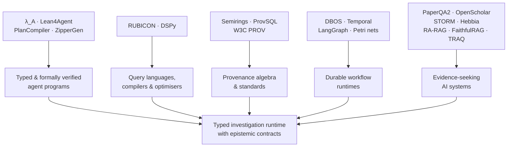

# Typed, Durable, Inspectable Runtimes for LLM-Based Investigation


Editorial context, 2026-04-20: The questions, constraints, proposals, disagreements, and caveats below are reformulated from the saved research discussion. LLM recommendations remain attributed proposals, not decisions by the author or independently verified findings. Technical examples and quoted source passages retain their original wording.

## Executive summary


The saved survey reports strong solutions for almost every **individual layer** of the proposed system, but did not identify a published system that combines the layers into one computation model with the proposed contract:

> **typed investigation program -> static epistemic checks -> logical plan -> contract-preserving optimisation -> physical plan -> durable execution -> inspectable evidence state -> finding or typed abstention**

The closest work falls into five groups. **PlanCompiler, λ_A, Lean4Agent and ZipperGen/Causal Past Logic** provide the strongest precedents for typed or formally checked agent programs. PlanCompiler is especially direct evidence that moving agent-plan errors into a compiler can improve reliability: it validates typed plans before deterministic execution and succeeds on 278/300 structured workflow tasks versus 202/300 and 187/300 for its free-form baselines.

**RUBICON and DSPy** are the closest precedents for the database/compiler side. RUBICON treats heterogeneous AI/data operations as a query-processing problem with an algebra, wrappers, visible intermediate results and cost-based optimisation; DSPy treats LM systems as declarative programs that can be compiled/optimised against metrics. Neither gives `Coverage`, `Authority`, `ConflictResolved` or `ProvenanceExact` the semantics of types or effects that gate construction of a final answer.

**Database provenance** is substantially more mature than AI-agent provenance. Provenance semirings give compositional algebra for explaining how outputs depend on inputs; ProvSQL implements provenance-aware relational computation in PostgreSQL and now has a Lean formalisation of its algebraic core; W3C PROV supplies a standard vocabulary for entities, activities, agents, derivations, revisions and primary sources. These appear directly reusable for the proposed provenance layer.

**Temporal, DBOS and LangGraph** already solve much of the engineering problem of durable execution: persistent state, failure recovery, replay/checkpointing, human pauses and long-running workflows. HASH's Petri-net work additionally shows that Petri nets are being explored as an explicit, inspectable control model for agent systems. Their missing layer is epistemic semantics: they durably execute computation, but they do not document a general mechanism by which an unresolved source conflict or incomplete corpus screening makes a `FinalFinding` unconstructable.

Finally, **PaperQA2, OpenScholar, STORM/Co-STORM and Hebbia Matrix** demonstrate that evidence-seeking workflows benefit from iterative retrieval, source-linked synthesis, contradiction detection, decomposition and inspectable intermediate state. More specialised work isolates individual epistemic dimensions: RA-RAG estimates source reliability, FaithfulRAG explicitly models fact-level conflicts, and TRAQ supplies an end-to-end *statistical* correctness guarantee for RAG through conformal prediction. None of these sources documents the complete five-contract model--coverage, provenance, authority, contradictions and abstention--as compositional program semantics.

That leaves a credible first-paper gap. The proposal is to formulate it more narrowly than "a new agent runtime":

> **Can evidence requirements be represented as compositional program contracts such that a compiler and runtime prevent an LLM investigation from finalising unless the execution produces machine-checkable certificates for the required epistemic conditions?**

That matches the distinction already emerging in the research notes: the compiler verifies properties of the *investigation computation* while probabilistic operators remain responsible for uncertain semantic judgements. The broader durable operating-environment idea can remain the architecture around this contribution. The bounded-corpus evaluation setup you sketched is particularly well aligned with making the claim testable.

A key caveat follows from the literature: The proposal is to **not call `coverage=complete` a guarantee that all semantically relevant evidence was found**. You can deterministically certify that every document in a frozen corpus snapshot was screened, that every required question facet received an execution path, or that every final claim has provenance. Semantic evidence recall remains dependent on probabilistic operators unless you place an explicit statistical or verified contract around those operators. TRAQ is useful precisely because it shows one way to put statistical coverage guarantees around otherwise uncertain RAG behaviour.

## Research claim and taxonomy


A useful way to position the project is as the missing intersection of programming languages, database systems, durable workflows and evidence-oriented AI:




This taxonomy is important because a superficial related-work comparison makes the idea look less distinct than it is. "Typed agent plans" already exist. "Durable agents" already exist. "RAG with citations" already exists. "Formal verification of probabilistic programs" has decades of work behind it. The contribution becomes more specific when the five pieces are composed into one semantic boundary.

The proposal is to distinguish four meanings of *coverage* in the paper:

| Coverage notion | What can plausibly be guaranteed? | Example certificate |
|---|---|---|
| **Execution coverage** | Deterministically, for a bounded frozen corpus | `Screened(4182/4182, snapshot=S)` |
| **Requirement coverage** | Deterministically at workflow level | Every declared facet ends in `Evidence` or `Abstention` |
| **Claim-support coverage** | Structurally, subject to semantic support judgements | Every final claim has one or more admissible evidence paths |
| **Semantic evidence recall** | Generally empirical/statistical unless stronger assumptions are supplied | Benchmark recall, calibrated lower bound, conformal/statistical guarantee |

Existing RAG benchmarks and systems often measure answer breadth, retrieval recall or citation completeness, while TRAQ demonstrates that a different kind of statistical correctness guarantee is possible. Treating those notions as equivalent would overstate what a compiler can prove.

For the comparison below, **E** means the dimension is enforced by an explicit formal/runtime mechanism, **F** means it is addressed as a feature or measured behaviour but is not exposed as a compositional program contract, and **Unspecified** means the survey identified no explicit statement in the primary source. "Unspecified" should not be read as evidence that a private implementation lacks the capability.

## Comparative landscape


| Name                                                     | Type                                |                      Year | Authors / organisation                                                                                                        | Core idea                                                                                                                                                                                         | Epistemic contracts **C / P / A / X / S**                                                             | Runtime model                                                                           | Language / DSL / optimiser                            | Verification / theorem                                                                                                                                               | Benchmarks / datasets                                                                                                     | Open source                                              | URL                                                                                                       |
| -------------------------------------------------------- | ----------------------------------- | ------------------------: | ----------------------------------------------------------------------------------------------------------------------------- | ------------------------------------------------------------------------------------------------------------------------------------------------------------------------------------------------- | ----------------------------------------------------------------------------------------------------- | --------------------------------------------------------------------------------------- | ----------------------------------------------------- | -------------------------------------------------------------------------------------------------------------------------------------------------------------------- | ------------------------------------------------------------------------------------------------------------------------- | -------------------------------------------------------- | --------------------------------------------------------------------------------------------------------- |
| **λ_A: Typed Lambda Calculus for LLM Agent Composition** | Paper                               |                      2026 | Qin Liu                                                                                                                       | Typed calculus for agent composition with oracle calls, bounded fixpoints, probabilistic choice and mutable environments; formalises common agent patterns.                                       | C Unspecified; P Unspecified; A Unspecified; X Unspecified; S Unspecified                             | Formal operational model; durable execution Unspecified                                 | Typed λ-calculus                                      | Type-safety/termination-style results and mechanisation are part of the formal development.                                                                          | Hundreds of real agent configurations are analysed in the paper.                                                          | Unspecified in source reviewed                           | [arXiv](https://arxiv.org/abs/2604.11767)                                                                 |
| **Lean4Agent / FormalAgentLib / LeanEvolve**             | Paper + code                        |                      2026 | Ruida Wang, Jerry Huang, Pengcheng Wang, Xuanqing Liu, Luyang Kong, Tong Zhang                                                | Models agent workflows and execution trajectories in Lean 4; verifies semantic consistency under explicit assumptions and uses failures to revise workflows.                                      | C Unspecified; P Unspecified; A Unspecified; X Unspecified; S Unspecified                             | Verification over workflow/trajectory state; durability Unspecified                     | Lean 4 dependent-type formalisation                   | Machine-checked workflow properties under explicit assumptions. Verification-passing workflows outperform failing ones by 11.94% on average in reported experiments. | Hard SWE-Bench-Verified subset; ELAIP-Bench subset; five LLMs.                                                            | Yes                                                      | [Paper](https://arxiv.org/abs/2606.06523) · [Code](https://github.com/RickySkywalker/Lean4Agent)          |
| **PlanCompiler**                                         | Paper                               |                      2026 | Pranav Harikumar                                                                                                              | LLM emits a typed JSON plan over a fixed primitive registry; compiler validates structure/types and only then emits executable Python.                                                            | All five Unspecified                                                                                  | Deterministic execution; SQL persistence tested; durable workflow semantics Unspecified | Typed registry + JSON plan + compiler                 | Static structural/type validation; no general formal theorem claimed in the abstract.                                                                                | 300 tasks covering depth, schema traps and SQL round trips; 278/300 overall.                                              | Unspecified                                              | [arXiv](https://arxiv.org/abs/2604.13092)                                                                 |
| **Causal Past Logic / ZipperGen**                        | Paper + language/runtime            |                      2026 | Benedikt Bollig / ZipperGen                                                                                                   | Past-time temporal guards over asynchronous distributed executions; ZipperGen provides a choreographic workflow model and visual execution structure.                                             | All five Unspecified                                                                                  | Concurrent/stateful; durability Unspecified                                             | ZipperGen DSL + temporal monitors                     | CPL monitor is proved against its semantics; ZipperGen documents Lean-checked properties for its core choreography model.                                            | Unspecified                                                                                                               | Yes                                                      | [Paper](https://arxiv.org/abs/2605.20923) · [Project](https://zippergen.io/)                              |
| **AutoSpec+**                                            | Paper/demo                          |                      2026 | Cheng Wen et al.                                                                                                              | LLM proposes formal program specifications; symbolic verification acts as deterministic critic and drives repair.                                                                                 | All five Unspecified                                                                                  | Synthesis/verification loop; not an investigation runtime                               | Structured specification synthesis                    | Checks legality, satisfiability and proof adequacy using symbolic verification.                                                                                      | Seven benchmark suites reported.                                                                                          | Yes; Dockerised artefact                                 | [ACL Anthology](https://aclanthology.org/2026.acl-demo.66/)                                               |
| **Caesar / HeyVL**                                       | Paper + verifier                    | 2026; foundations earlier | Philipp Schröer, Kevin Batz, Umut Yiğit Dural, Darion Haase, Benjamin Lucien Kaminski, Joost-Pieter Katoen, Christoph Matheja | Deductive verification for probabilistic programs using a quantitative intermediate verification language.                                                                                        | Investigation contracts Unspecified                                                                   | Program-verification engine, not agent runtime                                          | HeyVL quantitative verification language              | Generates quantitative verification conditions and can reason about probabilities, expectations and termination-related properties.                                  | Probabilistic verification examples/benchmarks                                                                            | Yes/project artefacts available                          | [arXiv](https://arxiv.org/abs/2605.15827)                                                                 |
| **Ellora**                                               | Paper / program logic               |                      2018 | Gilles Barthe et al.                                                                                                          | Assertion-based program logic expressive enough for rich probabilistic properties such as independence and distributions.                                                                         | Investigation contracts Unspecified                                                                   | Formal semantics, not workflow runtime                                                  | Probabilistic assertion logic / EasyCrypt             | Soundness and relative-completeness results form the theoretical contribution.                                                                                       | Formal examples/case studies                                                                                              | Implementation via EasyCrypt work                        | [arXiv](https://arxiv.org/abs/1803.05535)                                                                 |
| **Provenance Semirings**                                 | Paper / theory                      |                      2007 | Todd J. Green, Grigoris Karvounarakis, Val Tannen                                                                             | Propagates symbolic provenance compositionally through relational computations; alternatives and joint dependencies remain distinguishable algebraically.                                         | **P E**; C/A/X/S Unspecified                                                                          | Algebra, not runtime                                                                    | Provenance-annotated relational algebra / semirings   | Algebraic provenance semantics                                                                                                                                       | Database-query examples                                                                                                   | Theory; later implemented by systems such as ProvSQL     | [Author copy](https://www.cs.ucdavis.edu/~green/papers/pods07.pdf)                                        |
| **ProvSQL**                                              | Database extension                  |                   Current | ProvSQL project                                                                                                               | PostgreSQL extension that automatically computes provenance circuits and supports semiring-based interpretations; can export provenance representations.                                          | **P E**; C/A/X/S Unspecified                                                                          | Stateful PostgreSQL; workflow durability N/A                                            | SQL/query rewriting + provenance algebra              | Current project includes a Lean 4 formalisation of its provenance algebraic core.                                                                                    | Database examples/tests                                                                                                   | Yes, MIT                                                 | [ProvSQL](https://provsql.org/)                                                                           |
| **W3C PROV / PROV-O**                                    | Standard                            |                      2013 | W3C Provenance Working Group                                                                                                  | Standard data model for `Entity`, `Activity`, `Agent`, derivation, attribution, revision and primary-source relationships.                                                                        | **P F**; A metadata support only; C/X/S Unspecified                                                   | Representation/interchange standard                                                     | PROV-O ontology and related serialisations            | PROV family includes constraints and formal semantics; it does not itself impose an investigation acceptance policy.                                                 | N/A                                                                                                                       | Open standard                                            | [W3C PROV-O](https://www.w3.org/TR/prov-o/)                                                               |
| **Common Workflow Language**                             | Standard / ecosystem                |                     2016- | CWL community                                                                                                                 | Declarative, portable workflows composed from tools with explicit inputs/outputs; emphasises reproducibility and provenance.                                                                      | P F; C/A/X/S Unspecified                                                                              | Stateful execution; recovery semantics depend on runner                                 | CWL DSL                                               | Schema/workflow validation; no epistemic theorem                                                                                                                     | Scientific workflow workloads                                                                                             | Multiple open-source runners                             | [CWL](https://www.commonwl.org/)                                                                          |
| **DSPy + DSPy Assertions**                               | Paper + framework                   |                      2024 | Omar Khattab et al. / Stanford NLP                                                                                            | Declarative LM modules are assembled as programs and compiled/optimised against metrics; Assertions add computational constraints with retry/refinement behaviour.                                | Five target contracts Unspecified as formal semantics; assertions can express application constraints | Stateful within run; durable execution Unspecified                                      | Python programming model + optimisers                 | No type-safety/epistemic theorem; empirical optimisation                                                                                                             | Multi-hop QA, maths and LM pipeline tasks; Assertions evaluated on constraint satisfaction.                               | Yes                                                      | [DSPy](https://dspy.ai/) · [Paper](https://arxiv.org/abs/2310.03714)                                      |
| **RUBICON / An Alternate Agentic AI Architecture**       | Paper / prototype                   |                      2026 | Fabian Wenz, Felix Treutwein, Kai Arenja, Çağatay Demiralp, Michael Stonebraker                                               | Treats heterogeneous AI/data access as query processing: a small algebra, wrappers, materialised/inspectable intermediates and database-style cost optimisation.                                  | P F/auditability; C/A/X/S Unspecified                                                                 | Stateful query execution; durability Unspecified                                        | AQL + logical/physical planning + cost model          | No epistemic/type theorem reported in source reviewed                                                                                                                | Prototype/query workloads in paper                                                                                        | Unspecified in primary source reviewed                   | [arXiv](https://arxiv.org/abs/2604.21413)                                                                 |
| **LangGraph**                                            | Open-source runtime/product         |                   Current | LangChain                                                                                                                     | Graph/state runtime for long-running agents with checkpoints, threads, interrupts, replay/time travel and human intervention.                                                                     | Five contracts Unspecified                                                                            | **Durable, stateful**; production server supports persistent backing stores.            | Graph API; application semantics live in nodes/state  | No general formal verification theorem documented                                                                                                                    | Application examples/evals rather than one canonical benchmark                                                            | Yes                                                      | [Official docs](https://docs.langchain.com/oss/python/langgraph/overview)                                 |
| **Temporal**                                             | Open-source durable runtime/product |                   Current | Temporal Technologies                                                                                                         | Deterministic workflow history plus retryable activities provides crash recovery and replay for long-running processes; official AI guidance places nondeterministic LLM/tool work in Activities. | Five contracts Unspecified                                                                            | **Durable, stateful**                                                                   | Workflow SDKs, deterministic workflow model           | Durable-execution guarantees, not epistemic verification                                                                                                             | Production/workflow examples                                                                                              | Yes                                                      | [Temporal](https://temporal.io/)                                                                          |
| **DBOS**                                                 | Research project + runtime/product  |                     2022- | Michael Stonebraker et al. / DBOS                                                                                             | Uses database-backed state and transactions as the substrate for durable computation; current workflow system persists progress and supports recovery/observability.                              | Five contracts Unspecified                                                                            | **Durable, stateful**, Postgres-backed                                                  | Workflow SDK/runtime                                  | Transactional/execution guarantees; no epistemic theorem                                                                                                             | Systems/workflow benchmarks across project papers                                                                         | Yes                                                      | [DBOS docs](https://docs.dbos.dev/) · [Research project](https://dbos-project.github.io/)                 |
| **Petri Net-Powered Agents / HASH**                      | Industry research/blog + tooling    |                      2026 | Dora Ma / HASH                                                                                                                | Uses Petri nets to make agent plans, state, concurrency and firing conditions explicit; presents visual inspection and formal state-space analysis as benefits for agent orchestration.           | P F at execution level; target evidence contracts Unspecified                                         | Stateful Petri-net execution; durable semantics Unspecified                             | Petri-net model / Petrinaut tooling                   | Classical reachability/liveness/safety analysis is invoked; no published epistemic theorem or benchmark located                                                      | Unspecified                                                                                                               | Project/tooling available; licensing varies by component | [HASH blog](https://hash.ai/blog/petri-nets-for-agentic-ai)                                               |
| **PaperQA2**                                             | Paper + open-source system          |                      2024 | FutureHouse researchers                                                                                                       | Agentic scientific literature search and synthesis with source-linked evidence and a dedicated contradiction-detection capability.                                                                | C Unspecified; **P F**; A Unspecified; **X F**; S Unspecified                                         | Stateful investigation within run; durable workflow semantics Unspecified               | Agent workflow, no external DSL/compiler              | Empirical, no formal theorem                                                                                                                                         | LitQA2 plus retrieval, summarisation and contradiction tasks; paper reports expert validation of detected contradictions. | Yes                                                      | [Paper](https://arxiv.org/abs/2409.13740) · [Code](https://github.com/Future-House/paper-qa)              |
| **OpenScholar**                                          | Nature paper + system               |                      2026 | OpenScholar team                                                                                                              | Searches a very large scientific-paper store, adaptively retrieves/reranks and uses self-feedback to improve evidence-backed literature synthesis.                                                | **C F** as answer/evidence coverage objective; **P F**; A/X/S Unspecified                             | Iterative/stateful within investigation; durability Unspecified                         | Retrieval/synthesis pipeline, no public epistemic DSL | Empirical                                                                                                                                                            | ScholarQABench: 2,967 expert questions and 208 long-form answers across several research fields.                          | Code/models/data artefacts released according to paper   | [Nature](https://www.nature.com/articles/s41586-025-10072-4)                                              |
| **STORM / Co-STORM**                                     | Papers + open-source system         |                      2024 | Stanford OVAL                                                                                                                 | STORM decomposes research through multiple perspectives and grounded conversations; Co-STORM adds human steering and a shared evolving knowledge/mind-map representation.                         | C F/breadth; P F; A/X/S Unspecified                                                                   | Stateful research session; durability Unspecified                                       | Agent workflow, no typed DSL                          | Empirical                                                                                                                                                            | FreshWiki; Co-STORM/WildSeek evaluations.                                                                                 | Yes, MIT                                                 | [STORM paper](https://arxiv.org/abs/2402.14207) · [Code](https://github.com/stanford-oval/storm)          |
| **Hebbia Matrix**                                        | Product                             |                     2024- | Hebbia                                                                                                                        | Spreadsheet-like investigation surface that materialises analysis across large document sets, decomposes work into fields/steps and preserves source-linked citations for inspection.             | C F via corpus-scale/exhaustive product claims; P F; A/X/S Unspecified as generic contracts           | Persistent product workspace; formal durable-execution semantics Unspecified            | Proprietary visual workflow; compiler/DSL Unspecified | No public formal theorem; canonical public benchmark Unspecified                                                                                                     | Public benchmark Unspecified                                                                                              | No                                                       | [Hebbia product](https://www.hebbia.com/product)                                                          |
| **RA-RAG**                                               | Paper + code/data                   |                      2025 | Jeongyeon Hwang, Junyoung Park, Hyejin Park, Dongwoo Kim, Sangdon Park, Jungseul Ok                                           | Estimates reliability by cross-checking multiple sources, retrieves from reliable/relevant sources and aggregates with weighted majority voting.                                                  | C/P Unspecified; **A F** as empirical reliability; X/S Unspecified                                    | Retrieval pipeline; durability Unspecified                                              | Algorithm/pipeline, no DSL                            | Empirical                                                                                                                                                            | Heterogeneous-reliability and real-world source-reliability experiments.                                                  | Yes, code and data                                       | [ACL Anthology](https://aclanthology.org/2025.emnlp-main.1738/)                                           |
| **FaithfulRAG**                                          | Paper + code                        |                      2025 | Qinggang Zhang et al.                                                                                                         | Detects discrepancies between model parametric knowledge and retrieved evidence at fact level and reasons explicitly over those conflicts before generation.                                      | C/P/A Unspecified; **X F**; S Unspecified                                                             | RAG pipeline; durability Unspecified                                                    | Algorithm/pipeline                                    | Empirical, no formal conflict-resolution theorem                                                                                                                     | Multiple RAG experimental settings; details in paper                                                                      | Yes                                                      | [ACL Anthology](https://aclanthology.org/2025.acl-long.1062/)                                             |
| **TRAQ**                                                 | Paper + code                        |                      2024 | Shuo Li, Sangdon Park, Insup Lee, Osbert Bastani                                                                              | Wraps RAG with conformal prediction to provide an end-to-end statistical correctness guarantee; Bayesian optimisation reduces prediction-set size.                                                | Five target contracts Unspecified; **orthogonal formal statistical guarantee**                        | QA pipeline; durability Unspecified                                                     | Algorithm, no investigation DSL                       | Prediction sets contain a semantically correct response with the prescribed high-probability guarantee under conformal-prediction assumptions.                       | Extensive QA experiments; 16.2% smaller sets than ablation on average.                                                    | Yes                                                      | [ACL Anthology](https://aclanthology.org/2024.naacl-long.210/) · [Code](https://github.com/shuoli90/TRAQ) |

The table shows an important asymmetry. Programming-languages work is strongest on **structural correctness**; database work is strongest on **provenance and optimisation**; workflow systems are strongest on **durability**; research/RAG systems are strongest on **semantic evidence operations**. The five-way epistemic contract is largely absent from the interfaces joining those layers. This is an inference from the primary sources above, not a claim that no unpublished or proprietary implementation has such machinery.

## Annotated relationship to the proposed research


<!-- Navigation added during reassembly on 2026-03-30. Source arguments are retained with editorial wording, 2026-04-20; quoted source passages remain exact. -->

The annotations below continue in the linked notes with their original arguments retained and wording edited.

- <a id="formal-languages-and-verification"></a>[Formal languages and verification](#formal-languages-and-verification)
- <a id="provenance-query-processing-and-scientific-workflows"></a>[Provenance, query processing and scientific workflows](#provenance-query-processing-and-scientific-workflows)
- <a id="durable-and-inspectable-execution"></a>[Durable and inspectable execution](#durable-and-inspectable-execution)
- <a id="investigation-and-evidence-systems"></a>[Investigation and evidence systems](#investigation-and-evidence-systems)
- <a id="benchmarks-and-datasets"></a>[Benchmarks and datasets](#benchmarks-and-datasets)

## Gaps and direction for a first paper


The main gap is **not another typed orchestration language**. λ_A, Lean4Agent and PlanCompiler make that claim difficult to defend. It is also not another durable workflow engine, because LangGraph, Temporal and DBOS already occupy that layer, nor merely provenance-preserving RAG, because database provenance and evidence-oriented systems already cover substantial parts of that problem.

The proposed gap to defend is:

> **A compositional contract system for evidence-seeking probabilistic programs, in which conclusion strength is determined by machine-checkable evidence state and unsatisfied obligations become explicit abstention rather than silently degraded answers.**

<!-- Navigation added during reassembly on 2026-03-30. Source arguments are retained with editorial wording, 2026-04-20; quoted source passages remain exact. -->

The formal model, compiler example, and evaluation design continue in the linked notes.

- <a id="the-formal-core"></a>[The formal core](#the-formal-core)
- <a id="the-compiler-and-optimiser"></a>[The compiler and optimiser](#the-compiler-and-optimiser)
- <a id="the-evaluation"></a>[The evaluation](#the-evaluation)

### What looks most novel


Across the primary sources reviewed, **provenance by itself is mature**, **typed agent plans are becoming established**, **durable execution is established**, **contradiction handling exists**, **source reliability exists**, and even **statistically guaranteed RAG correctness exists**.

The underexplored composition is:

```text
declared epistemic requirements
            ↓
typed obligations
            ↓
compiler rejects structurally incapable plans
            ↓
optimizer chooses only contract-compatible implementations
            ↓
durable probabilistic execution
            ↓
runtime certificates + compositional provenance
            ↓
finding strength determined by certificates
            ↓
explicit abstention when obligations remain open
```


Within that composition, **authority is the least developed dimension identified by the survey**. RA-RAG learns source reliability, W3C PROV can record provenance/revision/primary-source relationships, and many systems let users restrict sources, but the survey identified no primary source here describing a general typed investigation policy such as:

```text
authority {
    statute > regulation > guidance
    accepted > draft
    current > superseded
    primary > derivative

    unresolved_conflict(
        source >= authoritative
    ) prohibits DefensibleFinding
}
```


RA-RAG's reliability estimation and W3C PROV's source metadata are useful ingredients, but neither supplies that policy semantics.

**Abstention as a type-level outcome** also looks promising. RGB tests negative rejection, and TRAQ gives a statistical treatment of uncertainty, but the architectural idea that *failure to discharge a declared evidence obligation automatically changes the set of constructible output types* is different from prompting a model to say "I don't know".

My strongest recommendation is therefore to make the first paper about **epistemic contracts and certificate-carrying investigation**, with durability, provenance and logical/physical planning implemented just deeply enough to make that semantics real. Petri nets, visual programming, multi-agent collaboration and a learned cost optimiser can remain part of the broader research programme. That gives the first paper a narrow falsifiable claim while preserving the larger architecture: a typed, durable, inspectable environment in which probabilistic agents operate inside symbolic constraints rather than being responsible for enforcing those constraints themselves.

## References


1. Qin Liu. **λ_A: A Typed Lambda Calculus for LLM Agent Composition** (2026). https://arxiv.org/abs/2604.11767
2. Ruida Wang, Jerry Huang, Pengcheng Wang, Xuanqing Liu, Luyang Kong, Tong Zhang. **Lean4Agent: Formal Modeling and Verification for Agent Workflow and Trajectory** (2026). https://arxiv.org/abs/2606.06523
3. Pranav Harikumar. **PlanCompiler: A Deterministic Compilation Architecture for Structured Multi-Step LLM Pipelines** (2026). https://arxiv.org/abs/2604.13092
4. Benedikt Bollig. **Causal Past Logic for Runtime Verification of Distributed LLM Agent Workflows** (2026). https://arxiv.org/abs/2605.20923
5. **ZipperGen** project. https://zippergen.io/
6. Cheng Wen et al. **Formally Specifying the Intended Behavior of the Program: LLM-Driven Neuro-Symbolic Program Specification Synthesis (AutoSpec+)** (ACL 2026 Demo). https://aclanthology.org/2026.acl-demo.66/
7. Philipp Schröer, Kevin Batz, Umut Yiğit Dural, Darion Haase, Benjamin Lucien Kaminski, Joost-Pieter Katoen, Christoph Matheja. **Caesar: A Deductive Verifier for Probabilistic Programs** (2026). https://arxiv.org/abs/2605.15827
8. Gilles Barthe et al. **An Assertion-Based Program Logic for Probabilistic Programs (Ellora)** (2018). https://arxiv.org/abs/1803.05535
9. Todd J. Green, Grigoris Karvounarakis, Val Tannen. **Provenance Semirings** (PODS 2007). https://www.cs.ucdavis.edu/~green/papers/pods07.pdf
10. **ProvSQL: Provenance and Probability for PostgreSQL**. https://provsql.org/
11. W3C Provenance Working Group. **PROV-O: The PROV Ontology** (2013). https://www.w3.org/TR/prov-o/
12. **Common Workflow Language (CWL)**. https://www.commonwl.org/
13. Omar Khattab et al. **DSPy: Compiling Declarative Language Model Calls into Self-Improving Pipelines** (2024). https://arxiv.org/abs/2310.03714
14. **DSPy Assertions: Computational Constraints for Self-Refining Language Model Pipelines**. https://arxiv.org/abs/2312.13382
15. Fabian Wenz, Felix Treutwein, Kai Arenja, Çağatay Demiralp, Michael Stonebraker. **An Alternate Agentic AI Architecture (It's About the Data) / RUBICON** (2026). https://arxiv.org/abs/2604.21413
16. **LangGraph** documentation. https://docs.langchain.com/oss/python/langgraph/overview
17. **Temporal** durable execution platform. https://temporal.io/
18. Michael Stonebraker et al. **DBOS** research project and runtime. https://dbos-project.github.io/ and https://docs.dbos.dev/
19. HASH. **Petri Net-Powered Agents** (2026). https://hash.ai/blog/petri-nets-for-agentic-ai
20. Michael D. Skarlinski et al. **Language agents achieve superhuman synthesis of scientific knowledge / PaperQA2** (2024). https://arxiv.org/abs/2409.13740
21. **PaperQA** repository. https://github.com/Future-House/paper-qa
22. **OpenScholar: Synthesizing scientific literature with retrieval-augmented language models**. Nature (2026). https://www.nature.com/articles/s41586-025-10072-4
23. Yijia Shao et al. **Assisting in Writing Wikipedia-like Articles From Scratch with Large Language Models (STORM)** (2024). https://arxiv.org/abs/2402.14207
24. **STORM / Co-STORM** repository. https://github.com/stanford-oval/storm
25. **Hebbia Matrix** product. https://www.hebbia.com/product
26. Jeongyeon Hwang et al. **Retrieval-Augmented Generation with Estimation of Source Reliability (RA-RAG)** (EMNLP 2025). https://aclanthology.org/2025.emnlp-main.1738/
27. Qinggang Zhang et al. **FaithfulRAG: Fact-Level Conflict Modeling for Context-Faithful Retrieval-Augmented Generation** (ACL 2025). https://aclanthology.org/2025.acl-long.1062/
28. Shuo Li, Sangdon Park, Insup Lee, Osbert Bastani. **TRAQ: Trustworthy Retrieval Augmented Question Answering via Conformal Prediction** (NAACL 2024). https://aclanthology.org/2024.naacl-long.210/
29. Tianyu Gao et al. **Enabling Large Language Models to Generate Text with Citations (ALCE)** (EMNLP 2023). https://aclanthology.org/2023.emnlp-main.398/
30. **ALCE** repository. https://github.com/princeton-nlp/ALCE
31. **Benchmarking Large Language Models in Retrieval-Augmented Generation (RGB)**. https://arxiv.org/abs/2309.01431
32. **RGB** repository. https://github.com/chen700564/RGB
33. **RAGTruth** dataset. https://github.com/ParticleMedia/RAGTruth
34. **MAGIC: A Multi-Hop and Graph-Based Benchmark for Inter-Context Conflicts in Retrieval-Augmented Generation** (Findings of EMNLP 2025). https://aclanthology.org/2025.findings-emnlp.466/
35. **RARE: Retrieval-Aware Robustness Evaluation for Retrieval-Augmented Generation Systems** (2025). https://arxiv.org/abs/2506.00789
36. **DeepResearch Bench: A Comprehensive Benchmark for Deep Research Agents** (2025). https://arxiv.org/abs/2506.11763
37. **DeepResearch Bench II: Diagnosing Deep Research Agents via Rubrics from Expert Report** (2026). https://arxiv.org/abs/2601.08536
38. **DeepScholar-Bench: A Live Benchmark and Automated Evaluation for Generative Research Synthesis** (2025). https://arxiv.org/abs/2508.20033
39. **PaSa: An LLM Agent for Comprehensive Academic Paper Search** (2025). https://arxiv.org/abs/2501.10120
40. User-provided note: **compiler-approach.md**.
41. User-provided note: **startup-operating-environment.md**.
42. User-provided note: **startup.md**.

## Index

### Sections


- [Executive summary](#executive-summary)
- [Research claim and taxonomy](#research-claim-and-taxonomy)
- [Comparative landscape](#comparative-landscape)
- [Annotated relationship to the proposed research](#annotated-relationship-to-the-proposed-research)
  - [Formal languages and verification](#formal-languages-and-verification)
  - [Provenance, query processing and scientific workflows](#provenance-query-processing-and-scientific-workflows)
  - [Durable and inspectable execution](#durable-and-inspectable-execution)
  - [Investigation and evidence systems](#investigation-and-evidence-systems)
- [Benchmarks and datasets](#benchmarks-and-datasets)
- [Gaps and direction for a first paper](#gaps-and-direction-for-a-first-paper)
  - [The formal core](#the-formal-core)
  - [The compiler and optimiser](#the-compiler-and-optimiser)
  - [The evaluation](#the-evaluation)
  - [What looks most novel](#what-looks-most-novel)
- [References](#references)

### Works and systems


- ALCE
- AutoSpec+
- Caesar / HeyVL
- Common Workflow Language
- DBOS
- DSPy / DSPy Assertions
- Ellora
- FaithfulRAG
- HASH Petri Net-Powered Agents
- Hebbia Matrix
- LangGraph
- Lean4Agent
- OpenScholar
- PaperQA2
- PlanCompiler
- Provenance Semirings
- ProvSQL
- RA-RAG
- RUBICON
- STORM / Co-STORM
- Temporal
- TRAQ
- W3C PROV / PROV-O
- ZipperGen / Causal Past Logic
- λ_A

### Benchmarks


- ALCE
- DeepResearch Bench
- DeepResearch Bench II
- DeepScholar-Bench
- LitQA2
- MAGIC
- PaSa / RealScholarQuery
- RAGTruth
- RARE / RARE-Set
- RGB
- ScholarQABench
