# Design research document map


<!-- Generated by _scripts/build_design_research_map.py. Edit document-map-relations.json for conceptual relationships. -->

The map covers the published design-research collection. The [index]() gives descriptions and a reading order. The reassembly log records original text movements and preservation checks.

Conceptual arrows show suggested relationships between discussions. They do not establish mathematical dependencies, causal relations, an accepted architecture, or a required research sequence. Original dialogues and sibling comments remain separate.

The snapshot includes 72 content notes, 32 sibling comment notes, and 3 navigation or audit files. Private external-source records are omitted from this public edition.

## How to use the map


First, use the topic diagrams to choose a discussion. Second, use the catalogue to follow explicit links and read the sibling comments. Third, use the conceptual relationship table to inspect the reason for each arrow.

The IDs identify files. O means overview, F means foundations, C means collaboration, L means language, I means investigation, R means runtime, E means reports and evaluation, and S means source material. A final C identifies a sibling comments file.

| Relationship | Meaning | Evidence |
|---|---|---|
| Conceptual | A suggested relation between the content of two discussions. | A checked passage and its current line number. |
| Explicit link | One document links to another file. | The original link location, stored in the data snapshot. |
| Comments on | A comments file has a matching sibling note. | The current file paths. |
| Audit reference | A link concerns the movement log or another audit file. | The recorded link. Historical checks have not been rerun by the map builder. |

## Conceptual coverage


The relationship table connects 71 of 72 content notes through 81 authored relationships. The 11 topic diagrams show 59 content notes. Coverage describes navigation, not completeness of the research or strength of its evidence.

Catalogue entries without conceptual arrows: [O03](). Their explicit links remain in the catalogue and data snapshot.

The sibling [map comments]() explain the reviewed gaps, the historical index, and the remaining work. The comments are separate editorial analysis and are excluded from relationship extraction.

## Topic diagrams


The diagrams show selected conceptual relations. The complete file catalogue and relationship table follow them, so omitted arrows do not imply that a note is unrelated.

### Theory, builder method, and applications


The general theory and builder method remain separate from application architectures. The arrows suggest reading connections, not proven derivations.

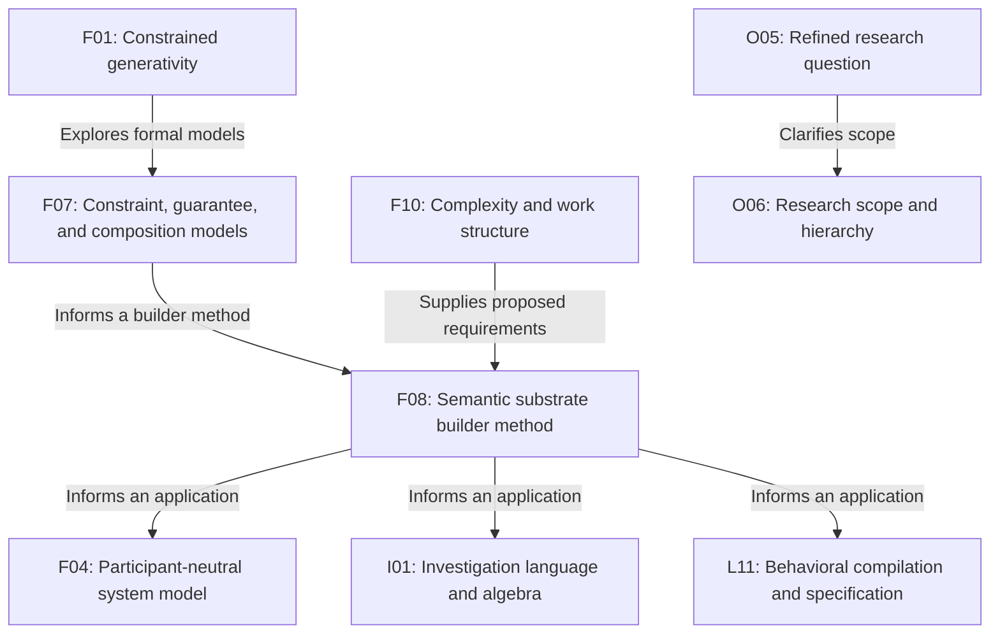


Documents: [F01](), [F04](), [F07](), [F08](), [F10](), [I01](), [L11](), [O05](), [O06]().

### Joint work and collaboration


The model, patterns, participant profiles, software framework, and proposed tests address different parts of collaborative work.

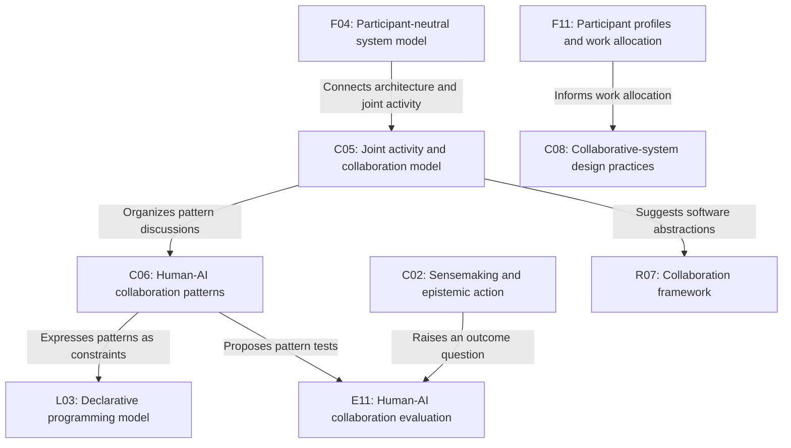


Documents: [C02](), [C05](), [C06](), [C08](), [E11](), [F04](), [F11](), [L03](), [R07]().

### Language, domain meaning, and verification


Compiler checks, domain meaning, behavioral synthesis, acceptance, and permission to act remain distinct.

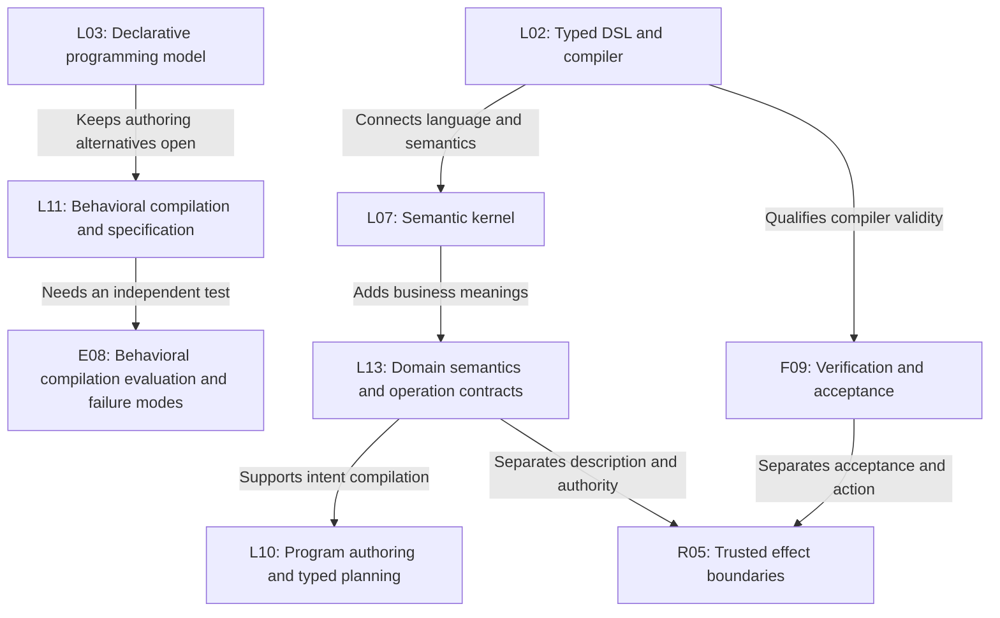


Documents: [E08](), [F09](), [L02](), [L03](), [L07](), [L10](), [L11](), [L13](), [R05]().

### Investigation and evidence


The investigation track connects an algebra, evidence contracts, retrieval, runtime plans, and proposed evidence tests.

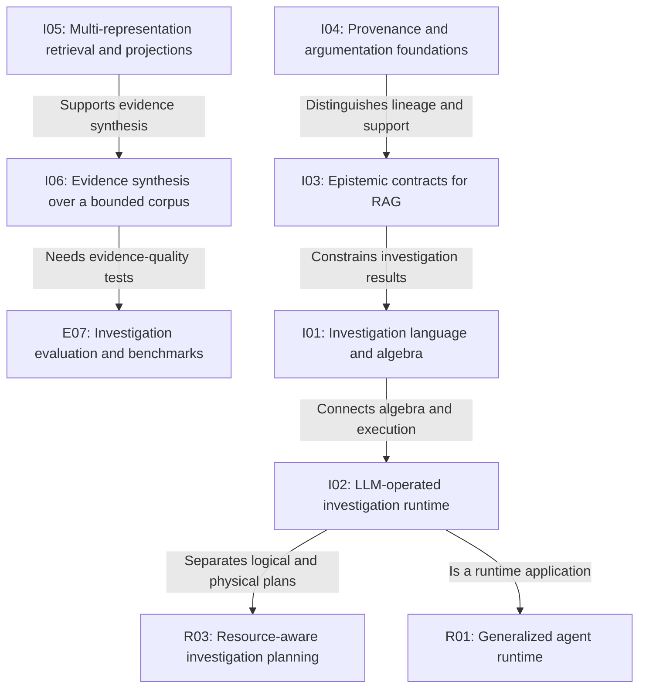


Documents: [E07](), [I01](), [I02](), [I03](), [I04](), [I05](), [I06](), [R01](), [R03]().

### Execution, history, and configuration


Execution tests, version records, prompt components, system revisions, and evaluation configuration retain their separate roles.

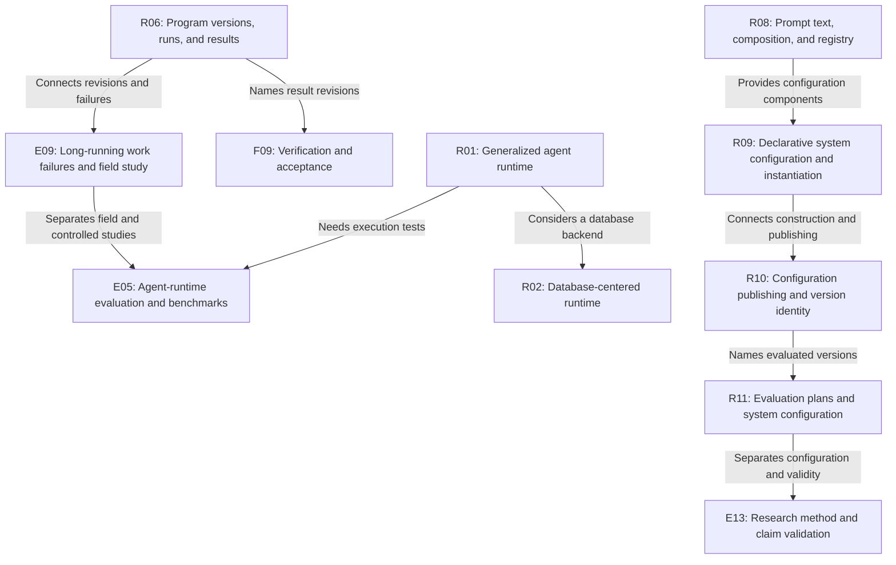


Documents: [E05](), [E09](), [E13](), [F09](), [R01](), [R02](), [R06](), [R08](), [R09](), [R10](), [R11]().

### Research claims and separate scope


Vocabulary and claim validation can inform studies without merging collaborative computation with the Alice research question.

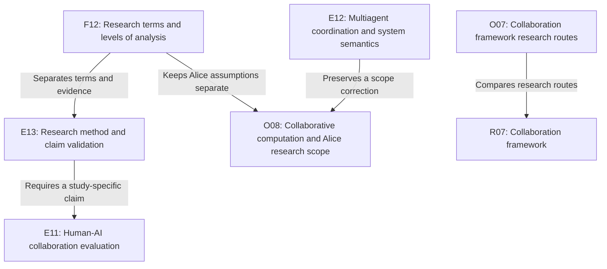


Documents: [E11](), [E12](), [E13](), [F12](), [O07](), [O08](), [R07]().

### Development of the framing question


The original prompt, alternative architectures, and later critique describe stages of the discussion. Their order does not select a research or implementation sequence.

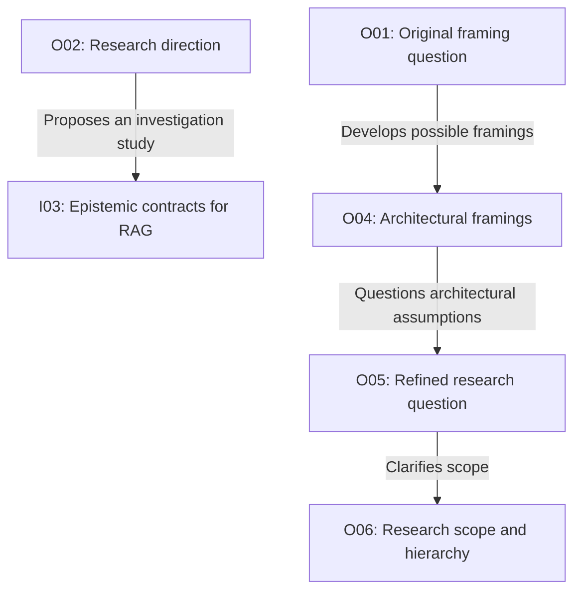


Documents: [I03](), [O01](), [O02](), [O04](), [O05](), [O06]().

### Protocols and execution properties


Interaction protocols and execution models concern permitted behavior. The proposed checks retain their assumptions and do not establish the truth of model judgments.

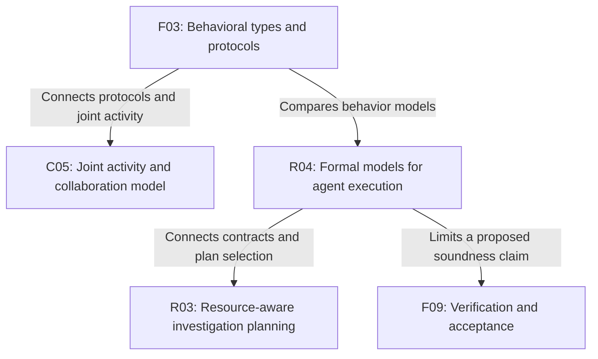


Documents: [C05](), [F03](), [F09](), [R03](), [R04]().

### Mediation, checks, and authority


Representation, isolation, authority, and commitment have different roles. The connections also show where revision history and result checks enter the discussion.

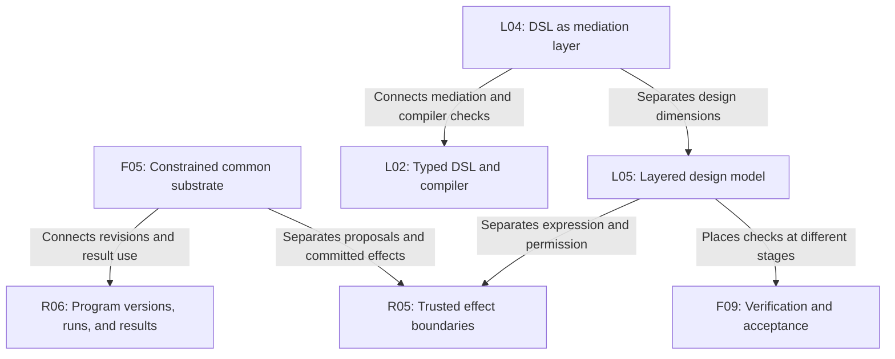


Documents: [F05](), [F09](), [L02](), [L04](), [L05](), [R05](), [R06]().

### Captured DSL examples and verification


The captured article and Tickloom example can be read beside kernel and verification discussions. The examples do not establish a general reliability improvement.

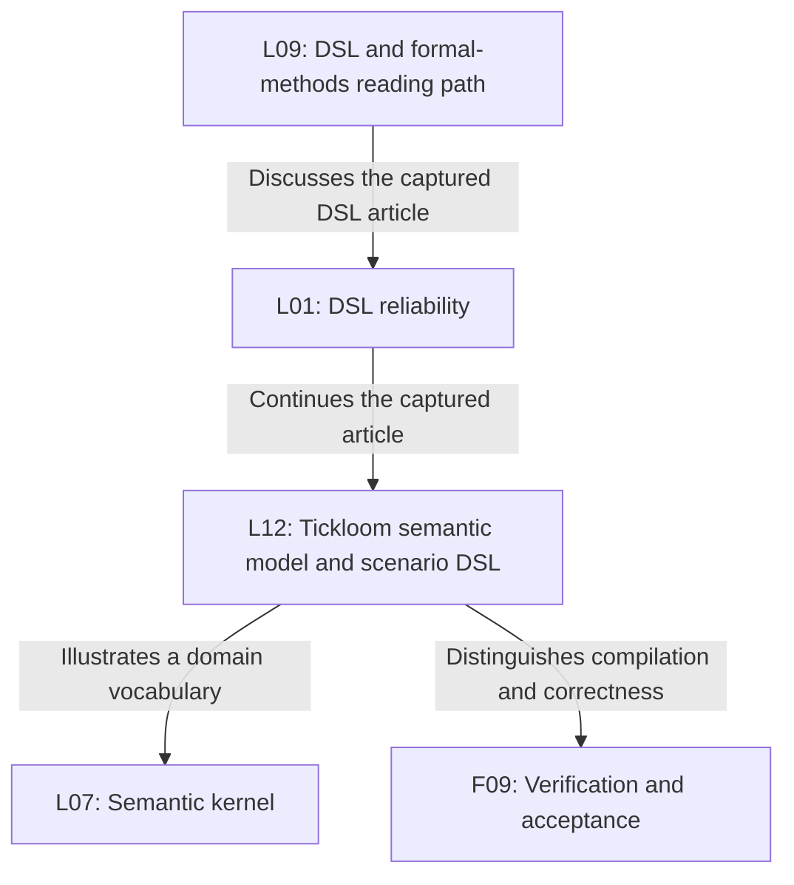


Documents: [F09](), [L01](), [L07](), [L09](), [L12]().

### Augmentation and interactive investigation


The historical reading discussion and interaction proposal connect to sensemaking and retrieval examples. Proposed user studies remain separate from evidence-contract tests.

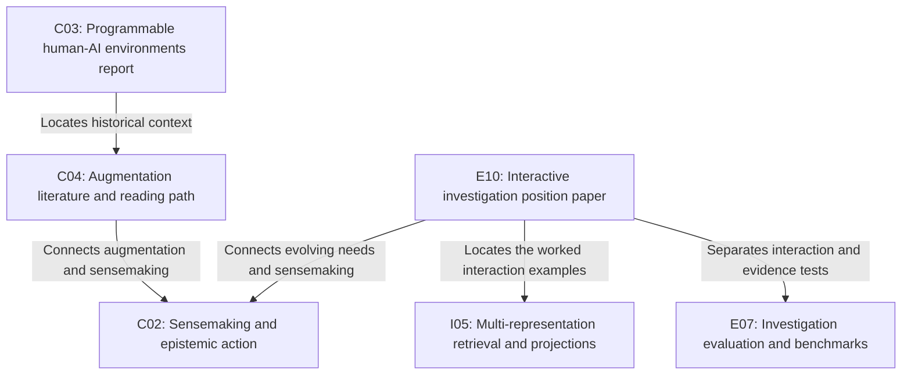


Documents: [C02](), [C03](), [C04](), [E07](), [E10](), [I05]().

## Conceptual relationships


The labels are new interpretation for navigation. Each evidence link opens the relevant section, and the JSON snapshot retains the exact matching text.

| From | Relationship | To | Evidence |
|---|---|---|---|
| [O05]() | Clarifies scope. The later critique distinguishes a general question from one architecture. | [O06]() | [Evidence](#scope-and-status) (line 15) |
| [F01]() | Explores formal models. The formal-model note develops candidate constraints and composition relations. | [F07]() | [Evidence](#foundations) (line 50)<br>[Evidence](#foundations) (line 56) |
| [F07]() | Informs a builder method. The builder method asks which constraints could support desired guarantees. | [F08]() | [Evidence](#scope-and-status) (line 17) |
| [F10]() | Supplies proposed requirements. The proposed work profile can inform design requirements but is not a validated metric. | [F08]() | [Evidence](#why-the-requirements-example-belongs-here) (line 5) |
| [F08]() | Informs an application. The participant-neutral architecture is an application rather than the general theory. | [F04]() | [Evidence](#scope-and-status) (line 13) |
| [F08]() | Informs an application. The investigation algebra is a separate application of the broader research. | [I01]() | [Evidence](#scope-and-status) (line 13) |
| [F08]() | Informs an application. Behavioral compilation is another application, with its own hypothesis. | [L11]() | [Evidence](#scope-and-status) (line 13) |
| [F04]() | Connects architecture and joint activity. The shared-work architecture and general collaboration mechanics address related questions. | [C05]() | [Evidence](#relation-to-the-wider-design-research) (line 41) |
| [C05]() | Organizes pattern discussions. The general collaboration model remains distinct from its proposed pattern catalogue. | [C06]() | [Evidence](#humanai-collaboration) (line 70)<br>[Evidence](#humanai-collaboration) (line 71) |
| [F11]() | Informs work allocation. Participant profiles offer a proposed input to design choices rather than universal participant properties. | [C08]() | [Evidence](#from-profiles-to-design-approaches) (line 47) |
| [C06]() | Expresses patterns as constraints. The declarative note retains proposal, review, delegation, and shared-reasoning examples. | [L03]() | [Evidence](#humanai-collaboration) (line 71)<br>[Evidence](#language-and-compiler) (line 79) |
| [C05]() | Suggests software abstractions. The framework proposes an implementation of collaboration mechanics, not a completed runtime. | [R07]() | [Evidence](#declared-contracts-and-enforced-checks) (line 13) |
| [C06]() | Proposes pattern tests. The evaluation note keeps the proposed tests separate from a completed study. | [E11]() | [Evidence](#choose-an-outcome-before-a-test) (line 13) |
| [C02]() | Raises an outcome question. Better understanding needs its own study and cannot be inferred from successful execution. | [E11]() | [Evidence](#claims-that-still-need-evidence) (line 49) |
| [L02]() | Connects language and semantics. The typed language and semantic kernel discuss related contracts and checks. | [L07]() | [Evidence](#language-and-compiler) (line 78)<br>[Evidence](#language-and-compiler) (line 83) |
| [L07]() | Adds business meanings. The domain-contract passage extends discussion beyond the kernel example without replacing it. | [L13]() | [Evidence](#domain-semantics-and-operation-contracts) (line 7) |
| [L13]() | Supports intent compilation. Operation descriptions help construct candidate plans, while interpretation can remain wrong. | [L10]() | [Evidence](#descriptions-and-formal-checks-have-different-roles) (line 35) |
| [L13]() | Separates description and authority. Describing an operation does not grant permission to invoke it. | [R05]() | [Evidence](#described-operations-are-not-security-authority) (line 13) |
| [L11]() | Needs an independent test. The behavioral evaluation distinguishes teacher fidelity from task correctness. | [E08]() | [Evidence](#language-and-compiler) (line 87)<br>[Evidence](#research-reports) (line 125) |
| [L03]() | Keeps authoring alternatives open. Maintained declarations and generated procedures have not been selected as one authoring model. | [L11]() | [Evidence](#generated-procedures-and-maintained-declarations) (line 21) |
| [L02]() | Qualifies compiler validity. Passing structural checks does not establish semantic truth. | [F09]() | [Evidence](#compiler-validity-and-semantic-truth) (line 27) |
| [F09]() | Separates acceptance and action. Accepting an exact result for a purpose is distinct from authorizing an external effect. | [R05]() | [Evidence](#terms-that-should-not-be-merged) (line 39) |
| [I01]() | Connects algebra and execution. The runtime proposal executes investigations through typed operators and plans. | [I02]() | [Evidence](#investigation-and-epistemics) (line 92)<br>[Evidence](#investigation-and-epistemics) (line 93) |
| [I03]() | Constrains investigation results. Epistemic contracts concern conditions for constructing conclusions and reporting gaps. | [I01]() | [Evidence](#investigation-and-epistemics) (line 94)<br>[Evidence](#investigation-and-epistemics) (line 92) |
| [I04]() | Distinguishes lineage and support. A derivation record alone does not establish that evidence supports a claim. | [I03]() | [Evidence](#claim-types-and-evidence-requirements) (line 17) |
| [I05]() | Supports evidence synthesis. The complete retrieval pipeline remains distinct from corpus and answer requirements. | [I06]() | [Evidence](#separate-corpus-consideration-from-completeness) (line 13) |
| [I05]() | Connects retrieval and inspection. Representation and execution views can support sensemaking without proving improved understanding. | [C02]() | [Evidence](#investigation-and-epistemics) (line 97)<br>[Evidence](#humanai-collaboration) (line 67) |
| [I06]() | Needs evidence-quality tests. Coverage, conflict handling, support, and abstention need separate evaluation. | [E07]() | [Evidence](#investigation-and-epistemics) (line 99)<br>[Evidence](#research-reports) (line 124) |
| [I02]() | Separates logical and physical plans. Resource-aware planning considers alternative implementations without weakening declared contracts. | [R03]() | [Evidence](#investigation-and-epistemics) (line 93)<br>[Evidence](#runtime-and-execution) (line 105) |
| [I02]() | Is a runtime application. The generalized runtime treats investigation as one workload, not its complete scope. | [R01]() | [Evidence]() (line 8) |
| [R01]() | Considers a database backend. Database-centered execution is an implementation proposal rather than a required architecture. | [R02]() | [Evidence](#runtime-and-execution) (line 103)<br>[Evidence](#runtime-and-execution) (line 104) |
| [R01]() | Needs execution tests. Recovery, runtime enforcement, and replay are not tests of evidence truth or human understanding. | [E05]() | [Evidence](#three-different-questions) (line 5) |
| [R06]() | Names result revisions. History and acceptance concern exact versions and purposes, not automatic permission to act. | [F09]() | [Evidence](#relation-to-verification-and-external-actions) (line 70) |
| [R06]() | Connects revisions and failures. The long-running-work dialogue links changing goals and dependent work to a proposed field study. | [E09]() | [Evidence](#different-versions-of-the-model) (line 25) |
| [E09]() | Separates field and controlled studies. Failures observed in practice and injected runtime failures answer different questions. | [E05]() | [Evidence](#field-study-and-controlled-evaluation) (line 19) |
| [R08]() | Provides configuration components. Prompt text, composition, and system configuration retain separate identities. | [R09]() | [Evidence](#the-later-question-expands-the-system-boundary) (line 9) |
| [R09]() | Connects construction and publishing. A resolved revision differs from a mutable selector or source commit. | [R10]() | [Evidence](#keep-the-identities-distinct) (line 5) |
| [R10]() | Names evaluated versions. The evaluation proposal references a selected system rather than redefining it. | [R11]() | [Evidence](#publishing-and-running-require-different-authority) (line 27) |
| [R11]() | Separates configuration and validity. Recording a system and evaluator version does not establish that the test measures its intended property. | [E13]() | [Evidence](#configuration-does-not-establish-evaluation-validity) (line 19) |
| [F12]() | Separates terms and evidence. Working definitions and levels of analysis inform the proposed claim-validation method. | [E13]() | [Evidence](#units-of-analysis-and-causal-attribution) (line 25) |
| [E12]() | Preserves a scope correction. The final reply separates collaborative computation from the emergence of cognition in Alice. | [O08]() | [Evidence](#collaborative-computation-and-alice-research-scope) (line 5) |
| [F12]() | Keeps Alice assumptions separate. Interleaved dictionary examples do not make Alice conditions requirements of a collaboration runtime. | [O08]() | [Evidence](#working-conventions-and-alice-assumptions) (line 40) |
| [E13]() | Requires a study-specific claim. A general method proposal does not replace collaboration, investigation, or runtime tests. | [E11]() | [Evidence](#proposed-research-practices-and-llm-use) (line 21) |
| [O07]() | Compares research routes. The route comparison explores ways to investigate the framework without selecting an implementation. | [R07]() | [Evidence](#collaboration-framework-research-routes) (line 7) |
| [S01]() | Links captured source passages. The interview navigation records where the technical exchanges are retained. | [R02]() | [Evidence](#stonebraker-interview-source) (line 13) |
| [O01]() | Develops possible framings. The retained response explores alternatives to the original prompt without selecting one architecture. | [O04]() | [Evidence](#architectural-framings) (line 5) |
| [O04]() | Questions architectural assumptions. The later critique separates one shared-environment proposal from the broader research question. | [O05]() | [Evidence](#3-the-second-problem-framing-is-currently-too-solution-shaped) (line 15) |
| [O02]() | Proposes an investigation study. The dialogue proposes evidence requirements as program semantics and explicitly limits what could be proved. | [I03]() | [Evidence](#retained-dialogue) (line 19) |
| [F02]() | Locates the report background. The retained report summary links its literature survey and case studies to the separate precedent discussion. | [F06]() | [Evidence](#executive-summary) (line 72) |
| [F06]() | Broadens the construction question. The dialogue continues from an open architectural stance to the more general composition principle. | [F01]() | [Evidence](#architectural-least-commitment-and-precedents) (line 5) |
| [F03]() | Connects protocols and joint activity. The saved discussion places permitted interaction sequences beside common ground and coordination. Protocol conformance alone does not establish shared understanding. | [C05]() | [Evidence]() (line 13) |
| [F03]() | Compares behavior models. The protocol discussion names traces, automata, and Petri nets as candidate models. The execution note develops several such models without choosing one universal formalism. | [R04]() | [Evidence](#2-there-is-a-standard-formal-structure-underneath-it) (line 214)<br>[Evidence](#formal-foundations-and-architectural-synthesis) (line 305) |
| [R04]() | Connects contracts and plan selection. The execution proposal allows physical implementations to vary while retaining the same logical contract. | [R03]() | [Evidence](#formal-foundations-and-architectural-synthesis) (line 446) |
| [R04]() | Limits a proposed soundness claim. The conditional execution argument concerns declared invariants rather than the truth of arbitrary model judgments. | [F09]() | [Evidence](#formal-foundations-and-architectural-synthesis) (line 452) |
| [F05]() | Separates proposals and committed effects. The substrate proposal distinguishes an untrusted contribution from an authoritative transition. | [R05]() | [Evidence](#the-key-abstraction-i-would-take-forward) (line 143) |
| [F05]() | Connects revisions and result use. The revision-integrity proposal keeps old artifacts inspectable while dependent results and acceptance may need review. | [R06]() | [Evidence](#revision-integrity) (line 266) |
| [L04]() | Separates design dimensions. The mediation dialogue and layered model distinguish representation, isolation, authority, and commitment. | [L05]() | [Evidence](#answer) (line 16)<br>[Evidence](#the-ladder-is-only-one-dimension) (line 83) |
| [L04]() | Connects mediation and compiler checks. The DSL proposal discusses inspecting complete programs and checking sequences before execution. | [L02]() | [Evidence](#level-2-program-mediated-execution-through-a-dsl) (line 168) |
| [L05]() | Places checks at different stages. The layered model separates structural checks, current conditions, observed outcomes, and user evaluation. | [F09]() | [Evidence](#3-move-each-check-to-the-earliest-suitable-layer) (line 152) |
| [L05]() | Separates expression and permission. The layered model permits a plan to be expressed without granting authority to execute it. | [R05]() | [Evidence](#2-separate-expressiveness-from-authority) (line 124) |
| [C01]() | Connects task properties and allocation. The augmentation dialogue proposes allocation by task properties rather than fixed participant categories. | [F11]() | [Evidence](#allocate-work-based-on-task-properties) (line 21) |
| [C01]() | Connects augmentation and joint activity. The augmentation note points to the separate collaboration model and preserves its own work-allocation discussion. | [C05]() | [Evidence]() (line 7) |
| [C03]() | Locates historical context. The environment report links its historical foundations and timeline to the augmentation reading note. | [C04]() | [Evidence](#sections-moved-to-related-notes) (line 47) |
| [C03]() | Locates the systems comparison. The environment report links its redistributed product discussion and comparison matrices. Their saved claims remain unverified. | [E03]() | [Evidence](#sections-moved-to-related-notes) (line 47) |
| [C04]() | Connects augmentation and sensemaking. The reading dialogue discusses helping people maintain and revise beliefs, evidence, questions, and disagreements. | [C02]() | [Evidence](#review) (line 57) |
| [C07]() | Locates the proposed pattern catalogue. The retained synthesis links its complete terminology comparison and pattern catalogue without establishing a settled taxonomy. | [C06]() | [Evidence](#redistributed-report-sections) (line 43) |
| [C07]() | Locates proposed collaboration tests. The retained synthesis links the separate pattern tests, audit, and review rubric. | [E11]() | [Evidence](#redistributed-report-sections) (line 45) |
| [L01]() | Continues the captured article. The reliability note links the complete Tickloom semantic-model and scenario examples. | [L12]() | [Evidence](#continuation-of-the-captured-article) (line 95) |
| [L12]() | Illustrates a domain vocabulary. The captured example supplies named types and operations for protocol code. It is a case to compare with kernel design, not a measured general result. | [L07]() | [Evidence](#example-tickloom-a-semantic-model-for-distributed-systems) (line 79) |
| [L12]() | Distinguishes compilation and correctness. The case comments explain why rejecting an invalid declaration differs from establishing the intended protocol behavior. | [F09]() | [Evidence](#what-the-example-shows) (line 15) |
| [L06]() | Compares roles for formalisms. Both dialogues assign different concerns to different languages or formal models. The suggestions do not select an implementation stack. | [R04]() | [Evidence](#other) (line 399)<br>[Evidence](#formal-foundations-and-architectural-synthesis) (line 305) |
| [L08]() | Proposes an investigation application. The candidate-project dialogue includes iterative retrieval with loops and exit conditions. The suggested first project remains a proposal. | [I01]() | [Evidence](#1-iterative-rag-research-query-processor) (line 38) |
| [L09]() | Discusses the captured DSL article. The reading dialogue discusses the article and its attribution. The saved literature descriptions have not been independently checked here. | [L01]() | [Evidence](#unmesh-comparison) (line 14) |
| [E01]() | Frames a runtime research question. The retained report frames long-running computation with uncertain operators and explicit control obligations. | [R01]() | [Evidence](#executive-summary) (line 4) |
| [E02]() | Locates the investigation-runtime discussion. The retained report links its durable and inspectable execution discussion to the runtime note. | [I02]() | [Evidence](#annotated-relationship-to-the-proposed-research) (line 106) |
| [E03]() | Compares visibility and authority. The saved systems comparison distinguishes visibility from authority. Product descriptions are context, not verified security guarantees. | [R05]() | [Evidence](#other) (line 25) |
| [E04]() | Locates behavioral-compilation comparisons. The related-work section retains the behavioral dialogue's comparisons and links the original abstraction analysis. | [L11]() | [Evidence](#related-work-from-the-behavioral-dialogue) (line 247) |
| [E06]() | Raises trust and access questions. The governance discussion separates the value of an audit trace from permission to read it. Its legal and patent claims remain outside this verification. | [R05]() | [Evidence](#patents-legal-and-ethical-considerations) (line 31) |
| [E10]() | Locates the worked interaction examples. The proposed paper links the complete retrieval and query-understanding examples in the existing retrieval note. | [I05]() | [Evidence](#interactive-investigation-position-paper) (line 7) |
| [E10]() | Connects evolving needs and sensemaking. The interaction proposal treats the information need as revisable and preserves questions and interpretations as working objects. | [C02]() | [Evidence](#3-synthesize-the-literature-into-principles) (line 195)<br>[Evidence](#3-synthesize-the-literature-into-principles) (line 183) |
| [E10]() | Separates interaction and evidence tests. The paper comments distinguish observations of user understanding and correction effort from controlled retrieval and contract tests. | [E07]() | [Evidence](#evaluation-agenda-and-benchmark-boundaries) (line 31) |

## Boundaries and open choices


The map retains the distinctions below. Grouping discussions does not resolve their differences.

| Discussions | Distinction to retain |
|---|---|
| [F01](), [F08](), [F04](), [O06]() | The general principle, builder method, and participant-neutral architecture are different levels. A database, shared state, or DSL is not a universal requirement. |
| [L02](), [F09](), [I03]() | Compiler validity, operator correctness, evidence support, and acceptance for a purpose require different checks. |
| [F09](), [R05](), [L13]() | A described operation or accepted result does not establish authority for an external action. |
| [L03](), [L11](), [GUIDE-C]() | Maintained declarations and generated executable behavior might be layers or alternatives. The notes do not select the relationship. |
| [I04](), [I06](), [I03]() | Lineage, corpus consideration, retrieval recall, evidence support, and conflict resolution are distinct properties. |
| [R06](), [R09](), [R10](), [R11]() | A program revision, resolved system revision, environment binding, evaluation plan, and observed run are different records. |
| [R01](), [R06](), [R09]() | Using recorded observations differs from making new live model or tool calls. Matching configuration identity does not guarantee exact outcomes. |
| [C02](), [E11](), [E05](), [E07](), [E08]() | Human understanding, runtime enforcement, evidence quality, and program generalization need different tests. |
| [F10](), [E09](), [E05]() | The work profile is proposed, the field study has not been conducted, and injected failures do not validate every task dimension. |
| [F12](), [F11](), [O08](), [E12]() | Working cognitive definitions, assigned work roles, security authority, and the emergence of agency are not interchangeable. |
| [O08](), [O06](), [E13]() | Alice is a separate research direction. Sharing a method does not make one direction a prerequisite of the other. |
| [R11](), [E13](), [E11]() | A runnable evaluation configuration is not evidence that its scoring rules are valid or its illustrative threshold is justified. |
| [F03](), [R04](), [C05](), [F09]() | Permitted interaction sequences, safety, eventual completion, shared understanding, and evidence truth require different checks. A monitor proposal does not establish all of them. |
| [L04](), [L05](), [L02](), [R05]() | A more structured program or isolated runner does not by itself grant authority. The accepted representation, current permission, and confirmed external outcome remain separate. |
| [L01](), [L12](), [L07](), [F09]() | The captured DSL examples illustrate domain vocabulary and scenario construction. They do not measure general generation reliability or establish every possible protocol execution. |
| [E10](), [C02](), [E07](), [E11]() | Interactive correction, user understanding, retrieval quality, and contract enforcement need distinct observations. The proposed paper and studies are not completed research. |

## Complete file catalogue


The explicit-link column lists all distinct outgoing links to content notes in the collection. Self-links, comments, navigation, and audit links are kept in the data snapshot but omitted from the column. An empty entry means there is no such explicit link, not that the subjects are unrelated.

### Overview


| Document | Explicit links to content notes | Sibling comments |
|---|---|---|
| O01: [Original framing question]() | [O06]() | No sibling. |
| O02: [Research direction]() | [O06]() | No sibling. |
| O03: [Original index notes]() | None recorded. | No sibling. |
| O04: [Architectural framings]() | [O01](), [O06]() | No sibling. |
| O05: [Refined research question]() | [O06]() | No sibling. |
| O06: [Research scope and hierarchy]() | [C02](), [F01](), [F04](), [F07](), [F08](), [I01](), [L11](), [O01](), [O02](), [O04](), [O05]() | No sibling. |
| O07: [Collaboration framework research routes]() | [L03](), [O06](), [R07]() | [O07C]() |
| O08: [Collaborative computation and Alice research scope]() | [E12](), [O06]() | [O08C]() |

### Foundations


| Document | Explicit links to content notes | Sibling comments |
|---|---|---|
| F01: [Constrained generativity]() | [F06](), [O06]() | No sibling. |
| F02: [Semantic substrate design report]() | [F06](), [F07](), [F08](), [I04]() | No sibling. |
| F03: [Behavioral types and protocols]() | None recorded. | No sibling. |
| F04: [Participant-neutral system model]() | [E09](), [F10](), [R06]() | [F04C]() |
| F05: [Constrained common substrate]() | [L11]() | No sibling. |
| F06: [Architectural least commitment and precedents]() | [F01](), [F02](), [F07](), [F08]() | No sibling. |
| F07: [Constraint, guarantee, and composition models]() | [F02](), [F06](), [F08]() | No sibling. |
| F08: [Semantic substrate builder method]() | [F02](), [F07](), [F10](), [L01](), [L03](), [L12](), [O05](), [O06]() | [F08C]() |
| F09: [Verification and acceptance]() | [E05](), [E07](), [E08](), [F05](), [I03](), [L02](), [L11](), [R06]() | No sibling. |
| F10: [Complexity and work structure]() | [E09](), [E12](), [F04](), [F08](), [R01](), [R06]() | [F10C]() |
| F11: [Participant profiles and work allocation]() | [C01](), [C08](), [F04]() | [F11C]() |
| F12: [Research terms and levels of analysis]() | [E13](), [F04](), [F11](), [O08]() | [F12C]() |

### Human and AI collaboration


| Document | Explicit links to content notes | Sibling comments |
|---|---|---|
| C01: [Augmenting human work]() | [C05](), [C06](), [C08](), [F11]() | [C01C]() |
| C02: [Sensemaking and epistemic action]() | None recorded. | No sibling. |
| C03: [Programmable human-AI environments report]() | [C04](), [E03](), [R05]() | No sibling. |
| C04: [Augmentation literature and reading path]() | [C03](), [E03](), [R05]() | No sibling. |
| C05: [Joint activity and collaboration model]() | [C01](), [C06](), [C07](), [E11](), [R07]() | [C05C]() |
| C06: [Human-AI collaboration patterns]() | [C02](), [C05](), [C07]() | [C06C]() |
| C07: [Collaboration patterns research synthesis]() | [C05](), [C06](), [E11]() | [C07C]() |
| C08: [Collaborative-system design practices]() | [C01](), [F08](), [F11]() | [C08C]() |

### Language and compiler


| Document | Explicit links to content notes | Sibling comments |
|---|---|---|
| L01: [DSL reliability]() | [F08](), [L03](), [L12]() | No sibling. |
| L02: [Typed DSL and compiler]() | [F09](), [L11](), [L12](), [R02]() | No sibling. |
| L03: [Declarative programming model]() | [F08](), [L01](), [O07]() | [L03C]() |
| L04: [DSL as mediation layer]() | None recorded. | No sibling. |
| L05: [Layered design model]() | None recorded. | No sibling. |
| L06: [Language and formalism choices]() | None recorded. | No sibling. |
| L07: [Semantic kernel]() | [L12]() | No sibling. |
| L08: [Typed-DSL project candidates]() | None recorded. | No sibling. |
| L09: [DSL and formal-methods reading path]() | None recorded. | No sibling. |
| L10: [Program authoring and typed planning]() | [L04](), [L13]() | No sibling. |
| L11: [Behavioral compilation and specification]() | [E04](), [E08](), [F05](), [F09](), [I04](), [L02](), [R01](), [R03](), [R06]() | No sibling. |
| L12: [Tickloom semantic model and scenario DSL]() | [F08](), [L01](), [L02](), [L03](), [L07]() | [L12C]() |
| L13: [Domain semantics and operation contracts]() | [L07](), [L10](), [R05]() | [L13C]() |

### Investigation and epistemics


| Document | Explicit links to content notes | Sibling comments |
|---|---|---|
| I01: [Investigation language and algebra]() | None recorded. | No sibling. |
| I02: [LLM-operated investigation runtime]() | [E02]() | No sibling. |
| I03: [Epistemic contracts for RAG]() | [E02](), [F09]() | No sibling. |
| I04: [Provenance and argumentation foundations]() | [E02](), [F02](), [L11]() | No sibling. |
| I05: [Multi-representation retrieval and projections]() | [E10](), [I01](), [I03](), [I04](), [I06]() | [I05C]() |
| I06: [Evidence synthesis over a bounded corpus]() | [I03](), [I05]() | [I06C]() |

### Runtime and execution


| Document | Explicit links to content notes | Sibling comments |
|---|---|---|
| R01: [Generalized agent runtime]() | [E01](), [E09](), [L11](), [R06]() | [R01C]() |
| R02: [Database-centered runtime]() | [S01]() | No sibling. |
| R03: [Resource-aware investigation planning]() | [E02](), [L11]() | No sibling. |
| R04: [Formal models for agent execution]() | [E01]() | No sibling. |
| R05: [Trusted effect boundaries]() | [C03](), [E03](), [L13]() | No sibling. |
| R06: [Program versions, runs, and results]() | [E09](), [F04](), [L11](), [R01]() | [R06C]() |
| R07: [Collaboration framework]() | [C05](), [F04]() | [R07C]() |
| R08: [Prompt text, composition, and registry]() | [R06](), [R09]() | [R08C]() |
| R09: [Declarative system configuration and instantiation]() | [R06](), [R08](), [R10]() | [R09C]() |
| R10: [Configuration publishing and version identity]() | [R08](), [R09](), [R11]() | [R10C]() |
| R11: [Evaluation plans and system configuration]() | [E05](), [E07](), [R10]() | [R11C]() |

### Research reports and evaluation


| Document | Explicit links to content notes | Sibling comments |
|---|---|---|
| E01: [Programmable probabilistic agent computation]() | [E05](), [E06](), [R01](), [R04]() | No sibling. |
| E02: [Typed, durable, inspectable runtimes]() | [E04](), [E07](), [I02](), [I03](), [I04](), [R03]() | No sibling. |
| E03: [Shared-runtime landscape]() | [C03](), [C04](), [R05]() | No sibling. |
| E04: [Investigation systems and related work]() | [E02](), [L11]() | No sibling. |
| E05: [Agent-runtime evaluation and benchmarks]() | [E01](), [E07](), [E08](), [F09](), [R02]() | [E05C]() |
| E06: [Governance, patents, and specification trust]() | [E01]() | No sibling. |
| E07: [Investigation evaluation and benchmarks]() | [E02](), [E12](), [F10]() | [E07C]() |
| E08: [Behavioral compilation evaluation and failure modes]() | [L11]() | No sibling. |
| E09: [Long-running work failures and field study]() | [E05](), [F04](), [F10](), [R01](), [R06]() | [E09C]() |
| E10: [Interactive investigation position paper]() | [C05](), [I05]() | [E10C]() |
| E11: [Human-AI collaboration evaluation]() | [C06](), [C07]() | [E11C]() |
| E12: [Multiagent coordination and system semantics]() | [E07](), [E13](), [F10](), [F12](), [O08](), [R07]() | [E12C]() |
| E13: [Research method and claim validation]() | [E05](), [E11](), [E12](), [F12](), [I04]() | [E13C]() |

### Captured source material


| Document | Explicit links to content notes | Sibling comments |
|---|---|---|
| S01: [Stonebraker interview transcript]() | [R02]() | No sibling. |

### Collection navigation and audit files


| Document | Role |
|---|---|
| GUIDE-C: [Comments on the design-research collection]() | comments |
| GUIDE: [Design research]() | navigation |
| AUDIT-DATA: [declarative-system-config-reassembly](/ai/design-research/document-map.assets/declarative-system-config-reassembly.json) | audit |
| AUDIT: Reassembly map | audit |

## Sources and related local collections


The references below connect the collection to source redirects, retained contextual drafts, project examples, and the sibling interactive-systems collection. Only direct references are mapped. The source and audit logs remain authoritative for original ranges; the map does not infer text origin from a link.

Private external-source paths and their metadata are omitted from this public edition.

## Navigation findings


The findings are observations about the current files. No existing note or source redirect was repaired while building the map.

| Document | Line | Reference | Finding |
|---|---:|---|---|
| [O06]() | 47 | `#another` | Heading anchor not indexed. |

The scan skipped live verification of 451 URI links, including web and application links. Their presence does not verify a cited claim.

## Data and maintenance


The [data snapshot](/ai/design-research/document-map.assets/document-map.json) contains every mapped file's hash, explicit outgoing and incoming relationships, link occurrences, sibling pairs, conceptual evidence, and navigation findings. Incoming relationships can be found by a relationship's `to` field. The [relationship definitions](/ai/design-research/document-map.assets/document-map-relations.json) contain the authored interpretations and diagram selections.

The map builder reads the notes without changing them. Check the saved map from the notes root:

```sh
python3 _scripts/build_design_research_map.py --check
```


After notes change, inspect updated output with `--emit markdown` and `--emit json`, then apply the output to the generated files with a patch. The checker reports stale output rather than rewriting notes. Update evidence passages when the meaning changes, not merely to make a check pass.

The generated map files, relationship definitions, and sibling map comments are excluded from the document inventory to avoid counting the map's own links as evidence. The data snapshot records the map comments separately by path and hash. The index link to the map is also excluded from relationship extraction.

Limits of the scan:

- External collections are boundary references, not a complete map of notes or source archive.
- Legacy wiki links are resolved only when a local path or unique filename identifies a file.
- Code, audit table paths in code spans, citations, and plain-text mentions are not document links.
- Inline links must stay on one line. Setext headings are not indexed; HTML a elements with id or name are indexed.
- Audit links show recorded history; they do not recheck prior byte-range reconstructions.
- Private external-source titles, headings, and hashes are omitted from the public map.
