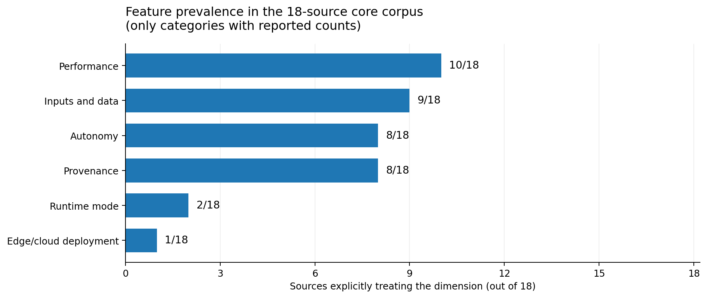
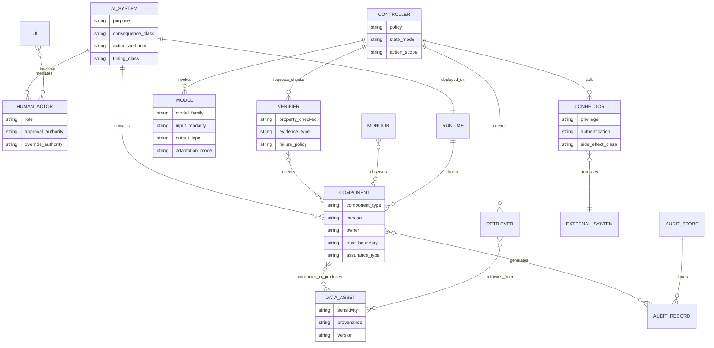
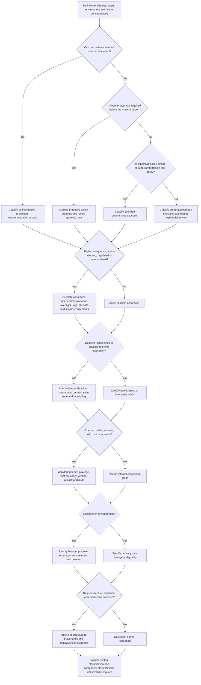

# Classification of AI Systems and Components: Features, Components, Invariants, and a Practical Taxonomy

## Executive summary and scope

**Scope and assumptions.** This report covers contemporary machine-learning and AI systems, including conventional predictive ML, generative AI, retrieval-augmented systems, tool-using agents, autonomous software, and safety-related cyber-physical systems. The evidence base runs through **October 22, 2026** and prioritizes standards bodies, regulators, original papers, and first-party system documentation. "AI system" is treated as broader than "AI model": the OECD describes a model as a core component used by a system to infer outputs, while the deployed system can combine one or more models with data, software, interfaces, and other components. [^1]

The main finding is that **there is no generally accepted single-axis taxonomy for AI systems**. Existing classifications answer different questions. The OECD classifies systems through People & Planet, Economic Context, Data & Input, AI Model, and Task & Output. NIST AI RMF organizes risk management around Govern, Map, Measure, and Manage and evaluates trustworthiness properties across the lifecycle. The EU AI Act primarily classifies legal risk and attaches obligations. ISO standards split architecture, lifecycle, data quality, robustness, risk management, testing, and management-system assurance across several documents. Human-factors taxonomies focus on allocation of work between people and automation, while agent research focuses on planning, action, and tool access. [^2]

A useful taxonomy therefore needs to be **multi-dimensional**. At minimum, a deployed system should be classified by:

| Dimension | Core question |
|---|---|
| Purpose and consequence | What task is performed, for whom, and what happens if it is wrong? |
| Action authority | Does the system inform, recommend, propose an action, or execute one? |
| Inputs and data | Structured, unstructured, multimodal, live/static, sensitive, trusted/untrusted? |
| Human control | Who approves, supervises, overrides, audits, or appeals? |
| Timing | Batch, interactive, streaming, or deadline-constrained real time? |
| Architecture | Monolithic or modular; which models, controllers, verifiers, monitors, and stores exist? |
| External dependencies | Which tools, APIs, retrieval systems, third-party models, and actuators can it call? |
| Deployment | Cloud, edge, embedded, hybrid; what compute/connectivity constraints apply? |
| Assurance | Empirical testing, monitoring, independent validation, certification, formal verification? |
| Governance | Provenance, traceability, privacy, data quality, retention, audit logs, change control? |
| Performance | Task quality, calibration, subgroup performance, latency, throughput, availability, cost, energy? |
| Transparency | What can be explained, interpreted, traced, reproduced, or independently checked? |

This structure follows a recurring pattern across OECD, NIST, ISO, EU, SAE/EASA, MLPerf, and the academic literature, while filling several gaps that those sources leave when used individually. [^3]

Three distinctions are especially important.

First, **capability and autonomy are separate properties**. A highly capable model can remain purely assistive because a human must approve every consequential action. Conversely, a narrower model may be highly autonomous inside a constrained operational domain. The classic human-automation literature allocates automation at different stages of information processing, and more recent AGI classification work likewise separates performance, generality, and autonomy. SAE driving automation provides a domain-specific example in which automation level concerns who performs the driving task and under what conditions, rather than raw model accuracy. [^4]

Second, **empirical quality, robustness, formal verification, and certification are different evidence types**. Testing can show that a system behaved well on sampled cases. Formal methods can prove a specified property within a defined mathematical domain; ISO/IEC 24029-2 covers formal robustness methods for neural networks, and Reluplex is an early example of proving or refuting bounded neural-network properties. Certification can concern an organization's management system: ISO/IEC 42006:2025, for example, specifies requirements for bodies certifying AI management systems under ISO/IEC 42001. That certification does not constitute a mathematical proof that an individual model is correct. ISO work on AI-system conformity-assessment schemes remains a separate area, including ISO/IEC DIS 42007, which is still under development. [^5]

Third, **the system boundary is critical**. Reliability of a model alone says little about a RAG application whose retriever can return stale documents, or an agent whose external API can fail, return malicious content, or perform irreversible actions. NIST explicitly calls for component-level and third-party risk management; ReAct and Toolformer show why modern systems increasingly contain reasoning/control loops and external tools as functional parts of the system. [^6]

The practical recommendation is therefore to classify both the **whole system and each material component**, then attach explicit invariants to system-component boundaries. High-value invariants include source and number provenance, complete action audit trails, version/replay information, authorization limits, approval gates, output/schema validation, latency bounds where deadlines exist, fail-safe behavior, monitoring and rollback, data-use restrictions, and explicitly bounded formal properties where verification is feasible. NIST, W3C PROV, EU requirements for logging of high-risk systems, and safety-case practice all support this evidence-centered view. [^7]

## Evidence base and classification dimensions

The evidence falls into several complementary families. OECD gives perhaps the clearest general-purpose **classification** framework: People & Planet, Economic Context, Data & Input, AI Model, and Task & Output. Its goal is to connect technical characteristics with policy consequences and to support assessment of issues such as bias, explainability, and robustness. [^8]

NIST AI RMF is better viewed as a **risk and assurance framework** than a finite taxonomy. It asks organizations to define purpose, context, users, limitations, human oversight, components, third-party dependencies, metrics, safety, security, explainability, privacy, and monitoring across Govern, Map, Measure, and Manage. NIST specifically calls for evaluation of whether systems can fail safely, including reliability, robustness, real-time monitoring, and response time to failures. NIST AI RMF 1.0 is under revision as of 2026, so the synthesis here uses its published core while noting that status. [^9]

The EU AI Act is primarily a **risk-based legal classification and obligations framework**. For high-risk systems, its requirements span risk management, data and data governance, technical documentation, logging, transparency, human oversight, and accuracy, robustness, and cybersecurity. It therefore supplies many assurance dimensions, while saying much less about whether an application is batch versus streaming, monolithic versus plug-in based, or cloud versus edge. [^10]

ISO spreads the problem across standards. ISO/IEC 23053 provides a conceptual framework for components and functions of ML-based AI systems; ISO/IEC 5338 addresses lifecycle processes; ISO/IEC 5259 addresses data quality; ISO/IEC 24029 addresses neural-network robustness; ISO/IEC 42001 addresses organizational AI management; and the ISO/IEC 42119 series addresses testing of AI systems and components. This division is useful in practice because "classification", "architecture", "testing", and "certification" are separate concerns. [^11]

Human-factors research adds a dimension these governance frameworks can flatten. Parasuraman, Sheridan, and Wickens classify automation according to where automation occurs in the information-processing chain: information acquisition, information analysis, decision/action selection, and action implementation. A system can therefore automate some stages while retaining human control of others. EASA makes a related distinction in aviation: Level 1 applications assist humans, while Level 2 introduces human-AI cooperation and automatic decision-making under human oversight; EASA's proposed 2026 Issue 3 extends the framework toward advanced automation. [^12]

The requested dimensions can be synthesized as follows.

| Classification dimension | Practical values to record | Interpretation and evidence |
|---|---|---|
| **Agentic/autonomous vs. assistive** | Information only; recommendation/draft; action proposed for approval; bounded automatic execution; autonomous execution within an operational domain | Record **action authority**, not merely how capable the model appears. ReAct systems reason and act through environments; NIST's 2026 agent initiative explicitly describes agents as capable of autonomous actions. SAE and EASA show that domain taxonomies can formalize degrees of automation and human responsibility. [^13] |
| **Input complexity** | Structured records; free text; documents; images/audio/video; sensor streams; multimodal combinations; live external state | OECD makes Data & Input a first-class dimension. Complexity should also record temporal behavior, sensitivity, provenance, and whether inputs cross a trust boundary. IDx-DR, for example, consumes ophthalmic images, while modern coding agents can consume repository data and visual inputs. [^14] |
| **Human-in-the-loop roles** | Requester; subject; reviewer; approver; operator; supervisor; override authority; auditor; affected person with appeal rights | A binary "human present" field loses too much information. Record both **role** and **control point**. NIST explicitly asks about human oversight; EASA treats human-AI interaction as part of safety assurance; current agent products use explicit approval checkpoints for consequential actions. [^15] |
| **Batch vs. real time** | Offline batch; asynchronous job; interactive; streaming; deadline-constrained real time | MLPerf makes the difference measurable: Offline benchmarks emphasize throughput, while Single-Stream emphasizes per-request latency and is used for latency-sensitive edge workloads. "Hard real time" should additionally record a maximum deadline and behavior on deadline miss. [^16] |
| **Safety and robustness** | Empirically tested; adversarially tested; monitored; fail-safe; formally bounded property | NIST requires regular safety evaluation and safe failure. ISO/IEC 24029-2 defines methodology for formal robustness assessment. These are distinct evidence levels. [^17] |
| **Provenance and traceability** | Source identity; data/model version; derivation chain; prompt/configuration; retrieved evidence; tool result; actor/action/time records | W3C PROV explicitly models entities, activities, agents, use, generation, derivation, and attribution. NIST also identifies provenance as supporting transparency and accountability. [^18] |
| **Verifiability and certifiability** | Testable only; independently validated; safety case; regulated authorization; management-system certification; formally verified bounded property | Formal verification proves a specified property under assumptions. Regulatory authorization and management-system certification provide different evidence. ISO/IEC 42006 certifies AIMS processes; ISO/IEC 24029-2 addresses formal robustness. [^19] |
| **Explainability and interpretability** | Intrinsic transparency; global explanation; per-decision explanation; user-facing rationale; explanation fidelity/accuracy | NIST distinguishes explainability, concerning representation of mechanisms or operation, from interpretability, concerning the meaning of an output in its functional context. Its XAI principles include existence of an explanation, meaningfulness, explanation accuracy, and knowledge limits. [^20] |
| **Data governance and privacy** | Collection authority; purpose; consent/legal basis where applicable; quality; lineage; retention; access; residency; sensitive attributes; deletion | Dataset documentation work records motivation, composition, collection and recommended uses; ISO/IEC 5259 formalizes data-quality concerns; NIST treats privacy as an independent trustworthiness property. [^21] |
| **Performance metrics** | Accuracy/F1/AUC; calibration; subgroup performance; task success; safety errors; latency; throughput; availability; cost; energy | Model Cards call for benchmark results under relevant conditions and groups. MLPerf separates model-quality constraints from inference metrics such as latency, throughput, and, for Tiny, optional energy consumption. [^22] |
| **Modularity and plug-in components** | Monolithic; fixed pipeline; replaceable modules; dynamically selected modules/tools; independently versioned components | ISO/IEC 23053 explicitly describes system components and interactions. GitHub's MCP implementation illustrates runtime-configurable toolsets whose availability changes an agent's reachable capabilities. [^23] |
| **External tools and APIs** | None; read-only retrieval; external computation; transactional API; actuator; dynamic tool discovery | Toolformer learns when and how to call APIs; ReAct interleaves model reasoning with calls to knowledge sources or environments. Tool capability should therefore be part of the system classification, especially when calls cause side effects. [^24] |
| **Deployment constraints** | Datacenter/cloud; private cloud; device/edge; embedded; hybrid; disconnected-capable | Cloud versus edge changes the relevant constraints. MLPerf maintains distinct datacenter, edge, mobile, and tiny-device suites; edge/tiny benchmarks make latency and resource/energy concerns explicit. [^25] |
| **Context and impact** | Low consequence; business critical; rights-affecting; regulated; safety-related; life/safety critical | OECD places people, economic context, and consequences around the technical system, while EU regulation changes requirements according to use context and risk. The same model can consequently belong to different system classes in different deployments. [^26] |
| **Lifecycle and adaptation** | Frozen; periodically updated; retrained; continuously learned; dynamically configured; externally versioned | Lifecycle and change behavior determine whether prior evidence remains applicable. ISO/IEC 5338 treats the AI lifecycle explicitly, and NIST calls for ongoing monitoring, third-party tracking, remediation, and decommissioning when risk tolerances are exceeded. [^27] |

A source-family comparison makes the gaps clearer:

| Source family | Main lens | Strong coverage | Commonly unspecified or secondary |
|---|---|---|---|
| OECD classification | General policy characterization | Context, stakeholders, inputs, model, task/output, autonomy implications | Precise timing class, edge/cloud topology, API/tool capability, hard guarantees |
| NIST AI RMF | Lifecycle risk and trustworthiness | Oversight, safety, robustness, metrics, explainability, privacy, provenance, components, third parties | Finite autonomy scale; a standard batch/stream/edge taxonomy |
| EU AI Act | Legal risk and required controls | Data governance, documentation, logs, oversight, transparency, accuracy, robustness, cybersecurity | Detailed internal architecture, runtime mode, tool orchestration |
| ISO AI standards | Technical/process standards | Components, lifecycle, management, data quality, testing, robustness, certification processes | No single document combines all dimensions |
| Human-automation / SAE / EASA | Allocation of control | Automation level, human roles, operational conditions, safety | Data governance, provenance, privacy, RAG/tool architecture |
| Agent and RAG papers | Computational architecture | Controllers, retrieval, external tools, action loops, modularity | Regulatory assurance, privacy, certification, operational safety processes |
| MLPerf | Deployed computational performance | Latency, throughput, model quality, device/edge/datacenter scenarios | Human authority, governance, provenance, legal risk |

These differences are reflected in a small prevalence analysis performed for this report. The corpus contains 18 deliberately selected primary or near-primary sources spanning OECD, NIST, EU, ISO, human-automation research, SAE, EASA, Model Cards, Datasheets, W3C PROV, ReAct, Toolformer, RAG, and MLPerf. [^28]

A dimension was counted only when the source gave it substantive explicit treatment. An omitted dimension therefore means **"not a first-class concern in this source"**, not that the source considers it irrelevant. This is a purposive coding exercise rather than a systematic meta-analysis. Performance appeared in 10/18 sources, inputs/data in 9/18, autonomy and provenance in 8/18 each, while explicit runtime mode appeared in only 2/18 and edge/cloud deployment in 1/18. The tail is significant: operational architecture is much less consistently classified than model behavior, performance, and governance.

*Figure reconstructed from the six counts explicitly stated in the report; the uploaded PDF contains a caption but no visible chart.*

The result supports a practical conclusion: **a taxonomy intended for engineering use needs operational dimensions that policy and model-documentation frameworks often omit**, especially runtime timing, dependency topology, privileges, and deployment location. Conversely, an engineering architecture taxonomy needs governance and human-impact dimensions that software diagrams often omit. [^29]

## Component taxonomy and architecture

A component taxonomy should classify components by **function**, then attach cross-cutting attributes such as learned versus deterministic, stateful versus stateless, internal versus third-party, privileged versus unprivileged, and safety-critical versus supporting. ISO/IEC 23053 establishes the general principle that ML systems consist of identifiable components and functions with interactions, while NIST explicitly asks organizations to map component and third-party risks instead of treating the model as the whole system. [^30]

The following functional decomposition works across traditional ML applications and modern agentic systems.

| Component type | Function | Typical examples | Component-level classification features |
|---|---|---|---|
| **Model** | Maps inputs/context to predictions, scores, representations, generated content, or policies | Classifier, regression model, vision model, LLM, embedding model, ranker, policy network | Learned/deterministic; model family; input/output modality; frozen/adaptive; calibration; resource demands; version |
| **Data pipeline** | Acquires, validates, transforms, labels, aggregates, and versions data | ETL pipeline, feature extraction, image preprocessing, document parser | Online/offline; deterministic; lineage completeness; data sensitivity; schema; retry semantics |
| **Retriever / knowledge subsystem** | Selects external knowledge for a downstream model | Dense vector index, search engine, document store | Corpus scope; freshness; indexing version; access controls; retrieval metrics; provenance |
| **Controller / orchestrator** | Decides what happens next and coordinates models/tools | Workflow engine, planner, agent loop, state machine | Deterministic/model-based; action authority; state/memory; termination rules; retry/budget limits |
| **Verifier / guard** | Checks a proposed input, output, decision, or action | Schema validator, business-rule checker, safety classifier, formal verifier, policy engine | Sound/complete or probabilistic; pre-action/post-action; fail-open/fail-closed; verified property |
| **Monitor** | Observes production behavior and triggers alerts or interventions | Drift detector, latency monitor, safety-event detector, anomaly monitor | Observation coverage; alert latency; thresholds; automatic shutdown capability |
| **UI / human-machine interface** | Mediates requests, explanations, approvals, overrides, and appeals | Chat UI, cockpit display, diagnostic console, approval dialog | User role; cognitive load; information shown; approval semantics; accessibility; override path |
| **Connector / tool adapter** | Crosses a system boundary to another service or physical capability | REST API adapter, database connector, MCP server, browser, payment API, actuator | Read/write privilege; authentication; authorization scope; idempotency; external SLA; trust boundary |
| **Provenance / audit subsystem** | Records derivations, versions, actions, actors, and evidence | Lineage store, event log, audit database, trace store | Completeness; integrity; retention; clock/order semantics; tamper resistance; queryability |
| **Runtime / deployment substrate** | Executes components and supplies isolation/resources | Cloud container, GPU server, mobile runtime, embedded accelerator, sandbox | Edge/cloud; memory/compute budget; isolation; availability; energy; network dependency; update mechanism |

RAG is a useful illustration of why this decomposition matters. The original RAG architecture separates a parametric generator from non-parametric memory accessed through a neural retriever. The paper explicitly motivates the design partly because provenance and updating knowledge are hard when knowledge exists only in model parameters. A deployed RAG service therefore has at least a generator, retriever, corpus/index, ingestion pipeline, and usually a citation or provenance layer; testing only the generator misses several primary failure modes. [^31]

Agent architectures make the controller and connector categories more important. ReAct interleaves reasoning and task-specific actions and uses those actions to interact with external knowledge bases or environments. Toolformer learns which APIs to call, when to call them, and what arguments to send. A tool-using model therefore introduces a new classification question that does not arise for a static classifier: **what effects are reachable through the tool graph?** [^32]

The same distinction is visible in deployed products. GitHub Copilot can use MCP servers to access repository and third-party context; GitHub documents toolsets as independently configurable and recommends enabling only necessary capability groups because tool availability affects both accuracy and security. Microsoft Copilot Cowork executes multi-step work across email, calendars, documents, Teams, research, and files, with sensitive actions gated by approval. The model is therefore one component inside a controller/tool/authorization/UI system. [^33]

Verifiers require a further distinction. A deterministic schema check can guarantee that a syntactically invalid action is rejected. A formal neural-network verifier can establish a mathematical property in a specified region; Reluplex, for example, was designed to verify neural-network properties or produce counterexamples. A learned "judge" or safety classifier supplies probabilistic evidence and can itself fail. These components should all be called verifiers only if their assurance type is recorded explicitly. [^34]

The following entity-relationship diagram captures a general system decomposition. It is a synthesis rather than a diagram prescribed by any single standard; its separation of models from the containing system follows OECD and ISO usage, and its component and dependency boundaries follow NIST and modern agent/RAG architectures. [^35]

Two component properties deserve explicit treatment because they propagate upward.

**Trust boundary.** Internal code, a third-party hosted model, retrieved web content, an enterprise database, and an actuator should not inherit one another's trust assumptions. NIST explicitly directs organizations to track pretrained and third-party components throughout risk management. [^36]

**Privilege and side effects.** A read-only search connector and a connector that can send messages, transfer money, modify source code, or command a machine are categorically different even when the same model calls them. Current agent products already reflect this distinction by placing approval gates around sensitive actions and using scoped tool credentials. [^37]

## Invariants and assurance requirements

"Invariant" is used loosely in AI discussions, so four evidence categories should be separated.

A **hard runtime invariant** is enforced on every execution within its technical assumptions: for example, "this agent token cannot invoke the payment API" or "an output that fails the JSON schema is never forwarded." A **bounded formal guarantee** proves a mathematical property in a specified domain, such as local robustness within a perturbation region. An **operational requirement** establishes a measurable bound such as a latency SLO or availability objective. An **assurance claim** is supported by accumulated evidence such as testing, process controls, independent validation, regulatory review, or a safety case. Formal neural-network verification and Waymo's safety-case methodology illustrate why these evidence forms should not be conflated. [^38]

Common invariants and guarantees map to systems as follows.

| Invariant or assurance requirement | Concrete form | Most important for | Evidence/implementation |
|---|---|---|---|
| **Source provenance** | Every external factual input records source, version/time, and derivation | RAG, analytics, regulated decisions, research | W3C PROV entity/activity/agent relations; source identifiers and content/version hashes. [^39] |
| **Number provenance** | Every material number can be traced to source data plus transformation/calculation | Financial/reporting agents, scientific systems, executive reporting | This is a useful application-specific specialization of general provenance; RAG research identifies provenance as a core knowledge-generation problem. [^40] |
| **Action audit trail** | Actor, intent, model/controller version, tool call, arguments, result, approval, and timestamp are recorded | Agents, high-risk decision systems, autonomous systems | EU high-risk logging requirements and NIST accountability/monitoring support this pattern. [^41] |
| **Reproducibility or replayability** | Versions of data/model/code/configuration and relevant randomness are retained | Batch ML, science, regulated validation | Model and dataset documentation are designed partly to expose evaluation context and data lifecycle information. External hosted models may permit replay evidence without guaranteeing bit-identical results. [^42] |
| **Authorization boundary** | Agent cannot invoke capabilities outside an explicit allowlist/scope | Tool-using agents, infrastructure agents | MCP tooling demonstrates scoped access and configurable toolsets; agent standards work emphasizes secure action on users' behalf. [^43] |
| **Human approval gate** | Defined consequential action classes cannot execute without approval | Assistive/high-impact agents | Copilot Cowork exposes actions and requires explicit approval for sensitive actions; EASA similarly makes oversight a design concern for automatic AI decisions. [^44] |
| **Override / shutdown** | Authorized human or safety controller can stop or deactivate the system | Autonomous and high-risk systems | NIST calls for safe failure and management processes including decommissioning when risk tolerances are exceeded. [^45] |
| **Fail-safe state** | Failure, uncertainty, or boundary violation transitions to a defined safe mode | Cyber-physical, medical, industrial, critical infrastructure | NIST explicitly requires evaluation of safe failure beyond knowledge limits. Safety cases then supply evidence that the full mechanism is credible. [^46] |
| **Operational-domain bound** | Autonomous behavior occurs only under declared environmental/task conditions | Vehicles, robots, industrial control | SAE defines driving automation in conjunction with operational conditions; Waymo uses an SAE Level 4 system and safety-readiness evidence for autonomous operation. [^47] |
| **Latency/deadline bound** | e.g. p99 ≤ X ms; deadline miss produces a defined fallback | Interactive, streaming, edge, control | MLPerf separates throughput-oriented Offline tests from latency-sensitive Single-Stream scenarios. [^16] |
| **Performance floor** | Quality stays above declared threshold on defined distribution and groups | Essentially all deployed ML; especially high impact | Model Cards emphasize benchmarked and subgroup evaluation; MLPerf couples performance benchmarking with model-quality requirements. [^22] |
| **Formal robustness property** | No input inside specified perturbation region changes behavior beyond property P | Suitable bounded neural-network applications | ISO/IEC 24029-2 and Reluplex provide formal-method examples. The guarantee covers the stated property/domain, not the entire system. [^48] |
| **Data-use/privacy boundary** | Only authorized purposes, identities, retention periods, and storage locations are permitted | Systems processing personal/confidential data | NIST treats privacy as a trustworthiness characteristic; ISO data-quality and documentation work address the data lifecycle. [^49] |
| **Version/change control** | Every behavior-affecting model, prompt, policy, tool, corpus, and config has identifiable version/change history | Continuously changing AI services | NIST calls for continuous third-party/component tracking; GitHub custom agents, for example, version agent definitions using Git commit SHAs. [^50] |
| **Fallback for dependencies** | Timeout, API failure, unavailable model, or stale corpus has an explicit degraded mode | Cloud and tool-dependent systems | External dependencies create failure modes outside the model; NIST explicitly treats third-party components as an ongoing risk-management concern. [^36] |

The correct invariant set depends strongly on system class.

A **batch analytical or scientific model** usually needs reproducibility, model/data lineage, declared metric thresholds, controlled changes, and enough provenance to recreate an analysis. Exact latency guarantees may be irrelevant. Model Cards and Datasheets directly support this class. [^42]

An **interactive assistant** adds response-time requirements, privacy controls, user-facing limitations, traceability to sources where factual grounding is expected, and a clear distinction between suggestions and actions. Human review can carry much of the decision authority when outputs remain proposals. [^51]

A **high-stakes decision-support system** should add explicit intended-use boundaries, independent validation, performance by relevant subgroups, uncertainty/calibration where meaningful, audit logs, human authority, appeal/correction mechanisms, and controlled changes. The EU high-risk controls, NIST RMF, Model Cards, and regulated medical-device practice converge on many of these requirements. [^52]

A **RAG or evidence-grounded generator** needs a different set of invariants: retrieval corpus/version, source identity, access rights, freshness policy, exact retrieved evidence, and a trace from generated factual claims or numbers to supporting evidence when that property is required. The original RAG paper's explicit motivation around knowledge updating and provenance makes this architectural difference clear. [^31]

A **tool-using agent** needs capability boundaries, authentication and authorization, approval policies, complete action logs, time and cost budgets, tool-result validation, termination criteria, and rollback/idempotency where actions can modify external state. Toolformer and ReAct establish external API/environment access as part of the computation; current NIST agent work focuses on secure and interoperable agent behavior, and deployed products already use explicit approval gates. [^53]

An **autonomous physical system** further requires an operational domain, timing guarantees, sensing and actuator health assumptions, safe-state behavior, extensive validation, continuous monitoring, and a structured safety argument. Waymo's safety case explicitly combines system description, development methodology, validation metrics, and validation results to justify deployment without a human driver. [^54]

One important engineering conclusion follows: **invariants belong at interfaces as often as they belong to models**. For an agent, "tool arguments satisfy policy before execution" is frequently more enforceable than "the LLM will never propose a dangerous action." For RAG, "every displayed citation resolves to a retrieved source used for that response" is more testable than a broad requirement that the model "never hallucinate." This follows from the distinction between probabilistic learned components and enforceable deterministic system boundaries reflected in NIST's component approach and formal verification work. [^55]

## Comparative system taxonomy

The table below applies the dimensions to representative system types. **"Unspecified" means that the cited public source does not make the dimension clear enough to classify confidently**; it should not be read as an assertion about the internal implementation.

| System type | Action authority and human role | Inputs and timing | Architecture / external dependencies / deployment | Primary invariants and assurance needs | Representative example |
|---|---|---|---|---|---|
| **Batch scientific predictor** | Assistive: produces scientific prediction; downstream interpretation remains human | Structured biological sequence/context; predominantly batch-style inference | Learned model; deployment topology is not a classification dimension in the cited source | Model/data version, reproducibility/replayability, task-quality metrics, uncertainty/limitations, provenance | **AlphaFold** predicts protein structures from biological information; DeepMind describes predictions that can be produced in minutes. [^56] |
| **Interactive assistive copilot** | Recommends/reviews; person decides whether to apply fixes | Source code, repository context, instructions; interactive/asynchronous | Model + repository context + optional MCP tools; cloud services may be involved | Access control, source/repo scope, auditability, versioning, disclosure of limitations, human review | **GitHub Copilot code review** identifies issues and suggests fixes the developer can apply; it can use MCP servers for external/internal context. [^57] |
| **Evidence-grounded generative system** | Usually assistive unless connected to actions | Unstructured query plus retrieved documents; typically interactive or batch | Retriever + vector/index memory + generator; corpus/index is an external knowledge component | Source/citation provenance, corpus/index version, freshness, access policy, retrieval quality, generator quality | **RAG architecture** of Lewis et al. combines a parametric generator with non-parametric memory and a neural retriever. [^31] |
| **Autonomous diagnostic function with clinical workflow** | Algorithm automatically detects specified condition; healthcare provider uses result and manages referral/workflow | Ophthalmic images; point-of-care diagnostic workflow; precise runtime class unspecified here | Diagnostic software plus specified imaging device; deployment topology unspecified in cited public record | Intended-use boundary, validated safety/effectiveness, input/device compatibility, handling of no-result/limitations, controlled changes | **IDx-DR** was authorized by FDA as a Class II retinal diagnostic software device and is indicated to automatically detect more-than-mild diabetic retinopathy in its defined population. [^58] |
| **Tool-using enterprise agent** | Goal is delegated; system performs multiple steps; sensitive actions require human approval | Natural-language goals plus emails, calendars, messages, files and organizational data; asynchronous/multi-step | Controller + model + Microsoft 365 connectors/tools; cloud-native execution | Least privilege, approval gates, visible actions, action logs, cancellation, tool validation, privacy, rollback where possible | **Microsoft Copilot Cowork** performs multi-step tasks such as sending emails, scheduling, document creation and file management; sensitive actions require explicit approval and the service supports pause/cancel. [^59] |
| **Coding agent with external tools** | Delegated software task; can modify code and open a pull request, with human review before merge in normal development workflow | Repository, issue/prompt, tests, optionally screenshots and external MCP context | Controller/model + sandbox/cloud development environment + git + MCP/tool interfaces | Repository/tool permission boundaries, reproducible branch/version, test evidence, session/action log, secret protection, review before consequential integration | **GitHub Copilot cloud agent** can research a repository, edit code, run tests, create a branch and open a pull request; custom agent definitions are versioned by commit SHA. [^60] |
| **Human-AI safety-related teaming** | AI may perform automatic decision-making under human oversight | Potentially sensor, structured and unstructured operational inputs; often deadline-sensitive | Domain-specific safety architecture; deployment specifics vary | Human factors, oversight/override, learning assurance, explainability, validated operational limits, safety evidence | **EASA Level 2** explicitly addresses human-AI cooperation and automatic decision-making under human oversight in aviation. [^61] |
| **Autonomous cyber-physical system** | Autonomous execution inside declared operating conditions; no human driver required during full autonomous operation | Continuous environmental sensing; real time | On-vehicle models, perception/planning/control stack, sensors/compute/actuators; external infrastructure may supplement | Operational-domain enforcement, latency, fail-safe/minimal-risk behavior, redundancy, monitoring, rigorous V&V, release governance, safety case | **Waymo Driver** is described by Waymo as a purpose-built SAE Level 4 system; its safety-case approach documents system design, development methods, validation metrics and evidence for driverless deployment. [^62] |

Several cross-cutting patterns emerge.

**Autonomy rises primarily when outputs become externally effective actions.** Generating an answer, prediction, draft, or code suggestion is usually assistive. Creating a pull request is a bounded external action. Sending email or modifying shared files carries broader organizational side effects. Steering a vehicle creates immediate physical effects. That gradient is better represented through action authority and operational boundaries than through a single "AI sophistication" score. [^63]

**Human oversight changes form with timing.** Pre-action approval works for an email agent because seconds of delay are acceptable. It cannot be the primary safety mechanism for every steering decision in an autonomous vehicle. Safety-related real-time systems therefore shift assurance toward prevalidated operational bounds, monitors, safety controllers, and safe failure. NIST's explicit treatment of response time and safe failure and the SAE/Waymo frameworks support this distinction. [^64]

**Deployment location is an independent feature.** A cloud-hosted model can serve an assistive or autonomous application; an edge model can likewise be advisory or safety-critical. Edge deployment mainly changes resource, connectivity, update, latency, privacy, and availability requirements. MLPerf's separate datacenter, edge, mobile, and tiny benchmarks illustrate this independent dimension. [^25]

**Modularity is both an architectural benefit and an assurance burden.** Components can be evaluated and replaced independently, but every component boundary creates dependency and versioning questions. A RAG system can update its corpus independently of its model; an agent can add a new tool without changing model weights; either change can substantially alter system behavior. NIST's third-party/component monitoring guidance is therefore directly relevant to modular architectures. [^65]

## Practical classification framework

For new systems, a useful classification record should contain **nine fields**. These are a synthesis of the evidence above; they are not claimed to be an OECD, NIST, ISO, SAE, or EU standard.

| Field | Decision rule | Example values |
|---|---|---|
| **Context and consequence** | Identify intended use, affected people, environment, failure consequences, regulatory domain | Internal productivity / business-critical / rights-affecting / regulated / safety-critical |
| **Action authority** | Classify the highest side effect the system can perform without additional human authorization | A0: information only; A1: recommendation/draft; A2: proposes action requiring approval; A3: automatically executes bounded actions with supervision/override; A4: autonomous execution inside a declared operational domain |
| **Input/data profile** | Record structure, modality, live/static behavior, source trust and sensitivity | Structured + text + images; streaming sensors; personal data; public documents |
| **Human control** | Name people and their control points instead of writing only "HITL" | Requester, reviewer, pre-action approver, runtime supervisor, emergency override, auditor, affected-person appeal |
| **Timing and deployment** | Record when results must exist and where computation runs | Offline batch / async / interactive / streaming / deadline ≤ X; cloud / edge / embedded / hybrid |
| **Architecture and dependencies** | Draw the component graph and identify trust boundaries | Models, retriever, controller, verifier, monitor, UI, stores, external APIs, actuators |
| **Assurance evidence** | State what supports each important claim | Benchmark test, subgroup test, red-team result, monitoring evidence, independent validation, regulatory authorization, safety case, formal proof |
| **Governance and traceability** | State what can be traced and retained | Data lineage, model/prompt/config versions, source citations, tool logs, approvals, privacy/retention policies |
| **Metrics and change policy** | Define acceptance criteria plus what triggers reevaluation | Accuracy ≥ X, p99 latency ≤ Y, task success ≥ Z, incident threshold, model/corpus/tool update revalidation |

The proposed **action-authority classes** deserve emphasis. They should not be treated as another universal "levels of AI" standard and they do not map one-to-one onto SAE driving levels. Their purpose is to give software architecture reviews an immediate answer to a practical question: *what can this system cause to happen without a new human decision?* The importance of that question follows from human-automation research, EASA's distinction between assistance and automatic decision-making under oversight, and current agent standards work. [^66]

The most useful decision rules are:

| Condition found during classification | Required escalation |
|---|---|
| **System only returns information or a draft** | Document intended use, evaluation metrics, limitations, privacy, provenance where factual grounding matters, and who reviews outputs. |
| **System can call external tools but all are read-only** | Add tool identity/version, access scope, response validation, availability/fallback, and provenance of retrieved data. ReAct and Toolformer show that external calls are part of system behavior. [^32] |
| **System can change external state** | Record exact capabilities and credentials; require action audit records, bounded authorization, termination/time/cost limits, and explicit policy for approval, rollback, and idempotency. NIST's agent initiative emphasizes secure actions on behalf of users. [^67] |
| **Action is difficult to reverse or can materially affect another person** | Default to pre-action approval or a narrowly specified, independently assured automatic policy; provide appeal/correction where appropriate. Current enterprise agents already use approval checkpoints for sensitive actions. [^68] |
| **System is high-stakes decision support** | Add subgroup performance, intended-use boundaries, independent validation, logs, human authority, explanations appropriate to users, and controlled changes. [^69] |
| **System operates a physical process in real time** | Define operational domain, deadlines, failure detection, safe state, override, redundancy assumptions, validation regime, release governance and safety case. [^46] |
| **Output is expected to be evidence-grounded** | Version retrieval sources; preserve retrieved evidence; attach source provenance; for material numerical claims, preserve source value and transformation path. [^40] |
| **Personal, confidential, or regulated data are used** | Add purpose/access controls, retention, deletion, residency where relevant, data-quality controls, and privacy evaluation. [^49] |
| **Third-party model/API is material to correctness or safety** | Treat it as a named component with owner, version/change policy, availability assumptions, monitoring, contingency, and decommission criteria. [^36] |
| **System learns or changes during operation** | Classify the change mechanism itself; define what evidence remains valid after updates, revalidation triggers, rollback, and version separation. [^27] |
| **System runs on constrained edge hardware** | Add memory/compute/energy limits, disconnected behavior, update integrity, latency distribution, thermal/resource limits, and degraded mode. MLPerf Tiny and Edge make quality, latency and energy distinct evaluation dimensions. [^70] |

The decision process can be operationalized as follows:

The resulting record should be reviewed **per component as well as per system**. A practical component checklist is:

1. What is this component's function and version?
2. Is it learned, deterministic, or a mixture?
3. Is it stateful? Can state survive requests?
4. What data can it read?
5. What external state can it modify?
6. Which credentials and privileges does it hold?
7. Is it first-party, third-party, or dynamically discovered?
8. What happens when it fails, times out, or returns malformed content?
9. Which invariant is enforced here, and is that enforcement deterministic, statistical, operational, or formally verified?
10. What telemetry proves the component behaved as expected?
11. Can it be rolled back or replaced independently?
12. What system-level evidence becomes invalid when it changes?

This approach is consistent with ISO's component view and NIST's instruction to track risks of connected components and pretrained/third-party models throughout their lifecycle. [^30]

A compact system descriptor can consequently look like:

> **Customer-support RAG agent:** medium-consequence enterprise system; A2 action authority; text/document input including personal data; interactive cloud deployment; LLM + retriever + enterprise corpus + controller + ticketing connector + policy verifier + audit store; pre-action approval for refunds/account changes; p95 response SLO; document/citation provenance; connector-level authorization; privacy/retention controls; empirical model/retrieval evaluations plus production monitoring.

That descriptor conveys substantially more engineering information than labels such as "LLM application", "agentic AI", or "human in the loop", because it identifies the actual authority, data, timing, dependencies, controls, and evidence.

## Findings, limitations, and implications

The research supports several general conclusions.

**AI system classification works best as a vector, not a hierarchy.** OECD's five dimensions, NIST's lifecycle controls, human-automation levels, performance benchmarks, and architecture papers each expose information that cannot be reconstructed from a single "risk level" or "autonomy level." In particular, performance, generality, autonomy, consequence, and deployment constraints are logically independent. [^71]

**Autonomy should be classified at the action boundary.** Whether the underlying technology is an LLM, vision network, symbolic planner, or hybrid is less informative for operational risk than whether it can execute consequential actions and under whose authority. NIST's 2026 agent initiative explicitly centers agents capable of autonomous actions, while deployed Cowork and GitHub systems expose action scope and approvals as concrete controls. [^72]

**"Human in the loop" is too coarse for serious system documentation.** Human roles can include request, review, pre-action approval, continuous supervision, emergency override, post-hoc audit, and appeal. The feasible role also depends on timing: manual approval may be appropriate for enterprise transactions yet impossible as the primary mechanism in millisecond-scale physical control. Human-automation research, EASA, NIST, and autonomous-driving classifications all reinforce this point. [^73]

**Provenance and explainability solve different problems.** Provenance answers questions such as "which source, data, model version, activity and actor led here?" W3C PROV provides explicit structures for that chain. Explainability concerns how a system arrived at or represents a decision mechanism, while interpretability concerns what the result means in context under NIST terminology. A system can have excellent provenance and weak mechanistic explainability, or the reverse. [^74]

**Verifiability must name the property being verified.** "Verified AI" without a property and domain is not a useful classification. Formal methods can establish properties such as bounded local robustness for certain networks; they do not thereby prove factual correctness, fairness, security, safe tool use, or correctness of the surrounding system. ISO/IEC 24029-2 and Reluplex make the scope of formal robustness verification explicit. [^48]

**Certification must name the object of certification.** ISO/IEC 42006 concerns bodies that audit and certify organizations' AI management systems according to ISO/IEC 42001. It is therefore evidence concerning management-system conformity. ISO work specifically directed at AI-system conformity-assessment schemes is separate and, as of October 2026, includes work still under development. [^75]

**Runtime and deployment characteristics are underrepresented in general AI taxonomies.** The prevalence coding in this report found only 2 of 18 sources making runtime mode a substantive feature and only one making edge/cloud deployment explicit at the classification level. MLPerf shows that these distinctions materially change what should be measured: Offline workloads optimize throughput, Single-Stream workloads expose latency, Tiny adds resource and optional energy concerns, and datacenter and edge systems are benchmarked separately. [^76]

**Modern agentic systems make component classification more important.** Once a model can select tools, retrieve external content, maintain state, and perform actions, overall behavior depends on controller logic, authorization, connectors, external service behavior, and human approval policies. ReAct and Toolformer establish the architectural pattern in the research literature; NIST's agent initiative and current Microsoft/GitHub implementations demonstrate its operational relevance. [^77]

**The most dependable guarantees are often enforced outside the generative model.** Authorization checks, schemas, transaction limits, tool allowlists, approval gates, provenance logging, runtime budgets, and fail-safe transitions can be engineered as deterministic controls even when the model generating a proposal is probabilistic. Formal neural-network methods can add stronger bounded claims where suitable; safety cases and lifecycle controls address broader system claims that cannot generally be reduced to a model proof. [^78]

Finally, the framework should preserve **"unspecified" as a valid value**. Missing information is itself important. Public documentation may describe model performance while omitting deployment topology; a regulatory authorization may describe intended use without disclosing internal architecture; an agent paper may specify its controller loop while saying little about privacy or operational auditability. Filling such fields by assumption would make the taxonomy less useful. Model Cards and Datasheets were created in part because systematic documentation of intended use, evaluation, data origin, and limitations cannot safely be inferred from the artifact alone. [^42]

The resulting practical rule is:

**Classify what the system is allowed to do, what it observes, where and when it operates, who retains authority, which components and dependencies determine its behavior, and exactly what evidence supports each promised property.** Then classify each material component with the same discipline. That formulation combines the strongest parts of the OECD system view, NIST lifecycle risk management, ISO component and assurance standards, human-automation taxonomies, formal verification research, provenance standards, and operational benchmark practice. [^79]

## References

[^1]: [What is AI? Can you make a clear distinction between AI ...](https://oecd.ai/en/wonk/definition)

[^2]: [The OECD Framework for Classifying AI Systems to assess ...](https://oecd.ai/en/wonk/classification)

[^3]: [The OECD Framework for Classifying AI Systems to assess ...](https://oecd.ai/en/wonk/classification)

[^4]: [A model for types and levels of human interaction with ...](https://dl.acm.org/doi/10.1109/3468.844354)

[^5]: [ISO/IEC 24029-2:2023 - Robustness of neural networks -- Part 2](https://www.iso.org/standard/79804.html)

[^6]: [Manage - AIRC - NIST AI Resource Center](https://airc.nist.gov/airmf-resources/playbook/manage/)

[^7]: [PROV-O: The PROV Ontology](https://www.w3.org/TR/prov-o/)

[^8]: [The OECD Framework for Classifying AI Systems to assess ...](https://oecd.ai/en/wonk/classification)

[^9]: [AI RMF Core - AIRC - NIST AI Resource Center](https://airc.nist.gov/airmf-resources/airmf/5-sec-core/)

[^10]: [Regulation - EU - 2024/1689 - EN - EUR-Lex - European Union](https://eur-lex.europa.eu/eli/reg/2024/1689/oj/eng)

[^11]: [ISO/IEC 23053:2022 - Framework for AI systems using ...](https://www.iso.org/standard/74438.html)

[^12]: [A model for types and levels of human interaction with ...](https://dl.acm.org/doi/10.1109/3468.844354)

[^13]: [ReAct: Synergizing Reasoning and Acting in Language Models](https://arxiv.org/abs/2210.03629)

[^14]: [The OECD Framework for Classifying AI Systems to assess ...](https://oecd.ai/en/wonk/classification)

[^15]: [AI RMF Core - AIRC - NIST AI Resource Center](https://airc.nist.gov/airmf-resources/airmf/5-sec-core/)

[^16]: [MLPerf Inference 5.1: Benchmarking Small LLMs with ...](https://mlcommons.org/2025/09/small-llm-inference-5-1/)

[^17]: [AI RMF Core - AIRC - NIST AI Resource Center](https://airc.nist.gov/airmf-resources/airmf/5-sec-core/)

[^18]: [PROV-O: The PROV Ontology](https://www.w3.org/TR/prov-o/)

[^19]: [ISO/IEC 42006:2025 Information technology](https://www.iso.org/standard/42006)

[^20]: [Trustworthy AI: Managing the Risks of Artificial Intelligence](https://www.nist.gov/speech-testimony/trustworthy-ai-managing-risks-artificial-intelligence)

[^21]: [Communications of the ACM](https://dl.acm.org/doi/fullHtml/10.1145/3458723)

[^22]: [Model Cards for Model Reporting](https://research.google/pubs/model-cards-for-model-reporting/)

[^23]: [ISO/IEC 23053:2022 - Framework for AI systems using ...](https://www.iso.org/standard/74438.html)

[^24]: [Toolformer: Language Models Can Teach Themselves to Use Tools](https://arxiv.org/abs/2302.04761)

[^25]: [Benchmark MLPerf Inference: Datacenter](https://mlcommons.org/benchmarks/inference-datacenter/)

[^26]: [The OECD Framework for Classifying AI Systems to assess ...](https://oecd.ai/en/wonk/classification)

[^27]: [Artificial intelligence](https://www.iso.org/sectors/it-technologies/ai)

[^28]: [The OECD Framework for Classifying AI Systems to assess ...](https://oecd.ai/en/wonk/classification)

[^29]: [The OECD Framework for Classifying AI Systems to assess ...](https://oecd.ai/en/wonk/classification)

[^30]: [ISO/IEC 23053:2022 - Framework for AI systems using ...](https://www.iso.org/standard/74438.html)

[^31]: [Retrieval-Augmented Generation for Knowledge-Intensive NLP Tasks](https://arxiv.org/abs/2005.11401)

[^32]: [ReAct: Synergizing Reasoning and Acting in Language Models](https://arxiv.org/abs/2210.03629)

[^33]: [MCP and cloud agent - GitHub Copilot](https://docs.github.com/en/copilot/concepts/agents/cloud-agent/mcp-and-cloud-agent)

[^34]: [An Efficient SMT Solver for Verifying Deep Neural Networks](https://arxiv.org/html/1702.01135v2)

[^35]: [What is AI? Can you make a clear distinction between AI ...](https://oecd.ai/en/wonk/definition)

[^36]: [Manage - AIRC - NIST AI Resource Center](https://airc.nist.gov/airmf-resources/playbook/manage/)

[^37]: [Application card: Microsoft Copilot Cowork](https://learn.microsoft.com/en-us/microsoft-365/copilot/responsible-ai/copilot-cowork-application-card)

[^38]: [An Efficient SMT Solver for Verifying Deep Neural Networks](https://arxiv.org/html/1702.01135v2)

[^39]: [PROV-O: The PROV Ontology](https://www.w3.org/TR/prov-o/)

[^40]: [PROV-O: The PROV Ontology](https://www.w3.org/TR/prov-o/)

[^41]: [Regulation - EU - 2024/1689 - EN - EUR-Lex - European Union](https://eur-lex.europa.eu/legal-content/EN-DE/ALL/?from=EN&uri=CELEX%3A32024R1689)

[^42]: [Model Cards for Model Reporting](https://research.google/pubs/model-cards-for-model-reporting/)

[^43]: [MCP and cloud agent - GitHub Copilot](https://docs.github.com/en/copilot/concepts/agents/cloud-agent/mcp-and-cloud-agent)

[^44]: [Application card: Microsoft Copilot Cowork](https://learn.microsoft.com/en-us/microsoft-365/copilot/responsible-ai/copilot-cowork-application-card)

[^45]: [AI RMF Core - AIRC - NIST AI Resource Center](https://airc.nist.gov/airmf-resources/airmf/5-sec-core/)

[^46]: [AI RMF Core - AIRC - NIST AI Resource Center](https://airc.nist.gov/airmf-resources/airmf/5-sec-core/)

[^47]: [J3259 : Taxonomy & Definitions for Operational Design ...](https://www.sae.org/standards/j3259-taxonomy-definitions-operational-design-domain-odd-driving-automation-systems)

[^48]: [ISO/IEC 24029-2:2023 - Robustness of neural networks -- Part 2](https://www.iso.org/standard/79804.html)

[^49]: [AI Risks and Trustworthiness - AIRC - NIST AI Resource Center](https://airc.nist.gov/airmf-resources/airmf/3-sec-characteristics/)

[^50]: [Manage - AIRC - NIST AI Resource Center](https://airc.nist.gov/airmf-resources/playbook/manage/)

[^51]: [Four Principles of Explainable Artificial Intelligence](https://nvlpubs.nist.gov/nistpubs/ir/2021/nist.ir.8312.pdf)

[^52]: [Regulation - EU - 2024/1689 - EN - EUR-Lex - European Union](https://eur-lex.europa.eu/eli/reg/2024/1689/oj/eng)

[^53]: [Toolformer: Language Models Can Teach Themselves to Use Tools](https://arxiv.org/abs/2302.04761)

[^54]: [Waymo's Toolkit For Building a Credible Safety Case](https://waymo.com/blog/2023/03/a-blueprint-for-av-safety-waymos)

[^55]: [Manage - AIRC - NIST AI Resource Center](https://airc.nist.gov/airmf-resources/playbook/manage/)

[^56]: [AlphaFold -- Google DeepMind](https://deepmind.google/science/alphafold/)

[^57]: [GitHub Copilot code review](https://docs.github.com/copilot/concepts/agents/code-review)

[^58]: [accessdata.fda.gov](https://www.accessdata.fda.gov/cdrh_docs/reviews/DEN180001.pdf)

[^59]: [Application card: Microsoft Copilot Cowork](https://learn.microsoft.com/en-us/microsoft-365/copilot/responsible-ai/copilot-cowork-application-card)

[^60]: [GitHub Copilot on GitHub.com](https://docs.github.com/copilot/concepts/agents/coding-agent/about-coding-agent)

[^61]: [EASA Artificial Intelligence concept paper (proposed Issue 2 ...](https://www.easa.europa.eu/en/newsroom-and-events/news/easa-artificial-intelligence-concept-paper-proposed-issue-2-open)

[^62]: [10 AI Lessons from Driving 200+ Million Fully Autonomous ...](https://waymo.com/blog/2026/08/10ailessons)

[^63]: [Application card: GitHub Copilot Agents](https://docs.github.com/en/copilot/responsible-use/agents)

[^64]: [AI RMF Core - AIRC - NIST AI Resource Center](https://airc.nist.gov/airmf-resources/airmf/5-sec-core/)

[^65]: [Retrieval-Augmented Generation for Knowledge-Intensive NLP Tasks](https://arxiv.org/abs/2005.11401)

[^66]: [A model for types and levels of human interaction with ...](https://dl.acm.org/doi/10.1109/3468.844354)

[^67]: [AI Agent Standards Initiative | NIST](https://www.nist.gov/artificial-intelligence/ai-agent-standards-initiative)

[^68]: [Application card: Microsoft Copilot Cowork](https://learn.microsoft.com/en-us/microsoft-365/copilot/responsible-ai/copilot-cowork-application-card)

[^69]: [Model Cards for Model Reporting](https://research.google/pubs/model-cards-for-model-reporting/)

[^70]: [Benchmark MLPerf Inference: Tiny](https://mlcommons.org/benchmarks/inference-tiny/)

[^71]: [The OECD Framework for Classifying AI Systems to assess ...](https://oecd.ai/en/wonk/classification)

[^72]: [AI Agent Standards Initiative | NIST](https://www.nist.gov/artificial-intelligence/ai-agent-standards-initiative)

[^73]: [A model for types and levels of human interaction with ...](https://dl.acm.org/doi/10.1109/3468.844354)

[^74]: [PROV-O: The PROV Ontology](https://www.w3.org/TR/prov-o/)

[^75]: [ISO/IEC 42006:2025 Information technology](https://www.iso.org/standard/42006)

[^76]: [MLPerf Inference 5.1: Benchmarking Small LLMs with ...](https://mlcommons.org/2025/09/small-llm-inference-5-1/)

[^77]: [ReAct: Synergizing Reasoning and Acting in Language Models](https://arxiv.org/abs/2210.03629)

[^78]: [AI RMF Core - AIRC - NIST AI Resource Center](https://airc.nist.gov/airmf-resources/airmf/5-sec-core/)

[^79]: [The OECD Framework for Classifying AI Systems to assess ...](https://oecd.ai/en/wonk/classification)
