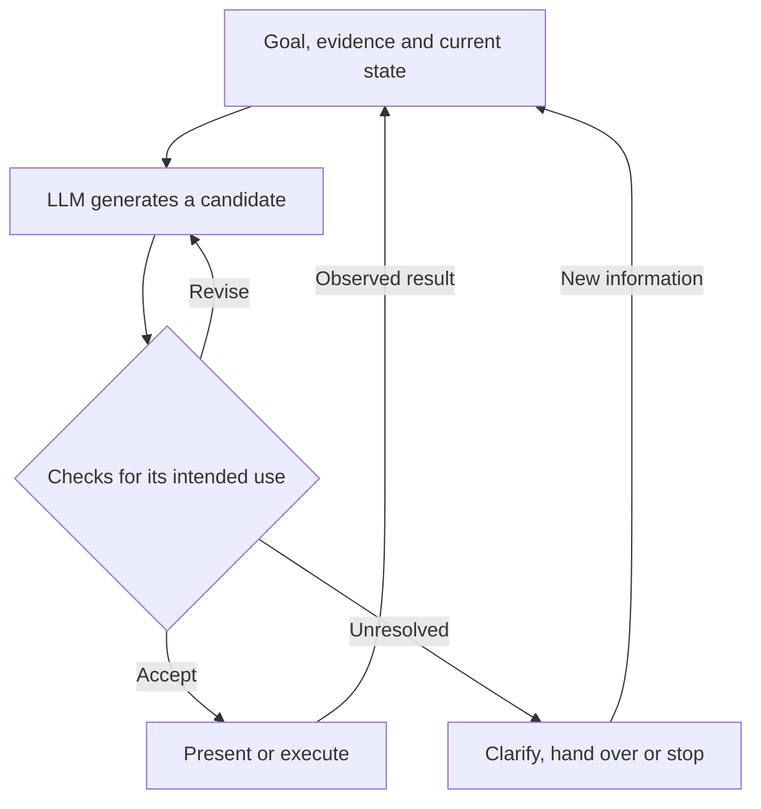

Publication note, 2026-10-28: This dialogue is edited for public release. Private source links and account metadata are omitted; personal details may be generalized.

Conversation captured on 2026-10-25. Main turns use `##` headings. Tables, lists, code, diagrams, and source links available in the page are preserved.

---

## User -- turn 1


Now let's reason about these things.

First, we have systems where we have people, code, data, usual components, and now we have LLMs. And LLMs have a set of features. Not only non-reliability, but also, like, they are able to generate text formally. Thus, from this text, they are generating what? So, something, propose actions, processing information, give something in the area of NLP, like we have usual there, but we have also the area where we can structure.

[https://valery.tech/ai/var/02-ai-project-examples/ai-project-examples-and-design-model/](<https://valery.tech/ai/var/02-ai-project-examples/ai-project-examples-and-design-model/>) Then about AI system types, maybe we should reason from the common perspective. Maybe later or now we could reason for the specific example, like clear agentic application.

So one direction, like security and restricting non-reliability of the LLMs. We could introduce here different means of achieving this and find out these means. It could be system architecture, like you can find the mods. We could introduce, like, software graphs. So it's kind of harness. Also we need to understand what we can use also. It could be, like, type modeling from the language, or maybe adding tools, a specific set of tools, and give them to the LLM in sandbox or some kind of restricted environments. It also could be, what, different guardrails, automatic judges, and other classifiers, maybe. Like, Jev, we can use some models to understand whether the system, LLM, propose this one. So this is one direction.

And next direction will be: could we, like, use the strong sides of LLMs, like text generation? It could have downsides; it has downsides, and, like, we... okay, and it has good sides, and we can benefit from the text generation. Like LLMs can analyze known structured information and propose us different ways of achieving the goal. So, and we need to understand what we can use to enforce or make use of these beneficials. Like also could be the type modeling, domain modeling, DSLs, what else? So we need to find it. Let's analyze conceptually my product or problem framing.

---

## Assistant -- turn 1


I'd keep your starting point: **the unit we're designing is the whole system--people, conventional software, data, and LLMs.** Then I'd frame the central question like this:

> Which parts of the work should we delegate to an LLM, and what must the surrounding system provide, check, and control to make that contribution useful?

Your two directions fit inside this question:

1. **Enable useful capabilities:** interpretation, generation, composition, exploration, and adaptation.
2. **Constrain failures and their consequences:** incorrect claims, invalid outputs, unauthorized actions, failed execution, and manipulation.

I would treat these as **two objectives applied to every design mechanism**. Domain models, types, DSLs, tools, and sandboxes can serve both. That overlap should be central to the framing.

### 1. Describe what the generated output contributes to the work


"LLMs generate text" describes the output medium. For system design, we need to describe what that output *means and does*.

For your model, I'd distinguish these possible contributions:

| Contribution | Example |
|---|---|
| **Interpretation** | Turn an ambiguous request into a proposed task, constraints, and unresolved questions. |
| **Transformation** | Extract records from documents, summarize evidence, or map between two structured representations. |
| **Generation of alternatives** | Propose explanations, designs, plans, queries, or code. |
| **Selection and adaptation** | Choose a next operation and revise that choice after observing its result. |
| **Communication** | Explain findings, ask for missing information, or help a person inspect and revise an artifact. |

These are responsibilities we can assign to a model and evaluate for a particular task.

This also answers your question about structured information: **both the input and the output can be structured.** The useful contribution may be choosing a mapping, composing operations, or proposing alternatives where specifying every case in conventional code would be difficult.

For example, a model might receive a structured description of available services and produce a structured migration plan. Its contribution lies in proposing the plan; the JSON serialization only makes the proposal consumable.

The application then assigns significance to that output:

- An explanation can be shown to a person.
- An extracted record can be checked before storage.
- A program can be compiled and tested.
- A proposed operation can be authorized and executed.

**The model's output and the authority granted to that output are separate design decisions.**

### 2. Organize mechanisms by what they change in the system


Your list mixes several kinds of mechanisms. I'd organize them by the part of the system they shape, then ask how each supports both objectives.

| Design area | How it enables useful work | How it constrains failures |
|---|---|---|
| **Domain models, types, and DSLs** | Give the model meaningful objects, relationships, and operations to work with. | Make specified representation and domain rules checkable. |
| **Context, retrieval, and explicit state** | Supply relevant evidence, definitions, examples, and current conditions. | Support source tracing and checks for missing or outdated information. |
| **Tools and computational services** | Provide search, calculation, database access, solvers, and execution. | Restrict available operations and validate arguments when enforced by the backend. |
| **Workflow graphs and state machines** | Decompose work, preserve progress, and organize dependencies and handoffs. | Enforce required stages, allowed transitions, stopping conditions, and retry limits. |
| **Permissions, sandboxes, and resource limits** | Make independent experimentation practical within a defined scope. | Limit accessible resources, external effects, and consumption. |
| **Validators, tests, and simulation** | Provide feedback for selecting and improving candidates. | Detect violations of encoded rules and failures in tested cases. |
| **Classifiers and model judges** | Assess meaning, relevance, or quality where explicit rules are difficult. | Detect some unwanted outputs and route uncertain cases for further review. |
| **Human interaction and shared artifacts** | Supply intent, domain judgment, clarification, correction, and steering. | Keep designated decisions with people and make proposed work inspectable. |
| **Model choice, prompts, examples, and training** | Improve the model's ability to perform the assigned task. | Reduce observed error patterns, subject to evaluation. |

This makes room for more than defensive controls.

A tool interface, for example, is also a way to make a task easier for the model: useful operation names, clear arguments, and informative results can change how successfully it works. Anthropic's tool-design guidance explicitly treats these interface choices as things to develop and evaluate. [anthropic.com](<https://www.anthropic.com/research/writing-tools-for-agents?utm_source=chatgpt.com>)

A sandbox provides another example. Restricting filesystem and network access can permit more independent execution within those boundaries. The restriction can increase usable autonomy. [anthropic.com](<https://www.anthropic.com/research/claude-code-sandboxing?utm_source=chatgpt.com>)

So the relationship between your directions is not necessarily a tradeoff. A mechanism can improve both. Whether it does so for a particular task needs evidence.

### 3. Domain modeling, types, and DSLs deserve separate treatment


They are closely related, but each answers a different question.

#### Domain modeling: what does the work involve?


A domain model identifies the meaningful objects, relationships, states, and rules.

For an investigation system, those might include:

- Questions and hypotheses.
- Sources and observations.
- Claims and supporting evidence.
- Conflicting findings.
- Unresolved gaps.

That model gives the LLM useful concepts. It also gives the application something explicit to store, display, check, and revise.

This is broader than giving the model a JSON schema. It defines what the system considers meaningful work.

#### Types and schemas: how can that work be represented?


Types can distinguish objects and encode constraints:

- A source identifier must refer to an existing source.
- A period must have a valid start and end.
- A proposed action differs from a completed action.
- A value can be known, missing, or awaiting clarification.

That last point is useful: a representation should allow the system to express missing information. Requiring a value everywhere can leave no faithful representation of an unresolved case.

However, enforcement depends on implementation. A type definition included in a prompt is guidance. A checked runtime representation can reject outputs that violate its encoded rules.

Even schema-conforming output can contain incorrect values or unsupported claims. OpenAI's Structured Outputs documentation explicitly distinguishes schema adherence from remaining content mistakes. [OpenAI API](<https://developers.openai.com/api/docs/guides/structured-outputs?utm_source=chatgpt.com>)

#### DSLs: what operations and compositions can be expressed?


A domain-specific language adds a vocabulary for doing something: querying, planning, transforming, configuring, or expressing rules.

Consider two possible interfaces:

```text
run_sql(sql)
```

```text
compare_metric(metric_id, grouping, period)
```


Both can have valid argument schemas. They provide different opportunities for the surrounding system to own metric definitions, access rules, query construction, and execution.

A DSL can therefore contribute in three ways:

1. Make useful solutions easier to express.
2. Make proposed solutions inspectable and checkable.
3. Give conventional software defined execution semantics.

Its limits also become part of the product. If the language excludes valid ways to solve the task, the system needs an appropriate extension or handoff.

**The design question is how much freedom the representation should provide, and which properties its interpreter can enforce.**

### 4. Separate guidance, judgment, and enforcement


I would avoid treating "guardrails" as one uniform category. It hides differences in what a mechanism can establish.

#### Guidance influences generation


Prompts, examples, instructions, and tool descriptions help the model produce appropriate behavior.

They can improve results, but their presence does not establish that the model will comply in every case.

#### Judgment assesses uncertain properties


Classifiers, LLM judges, and human reviewers can assess relevance, meaning, plausibility, intent, and other properties that are difficult to encode completely.

Their judgments can also be wrong. Research on LLM judges documents limitations such as position bias, verbosity bias, and limited reasoning ability. A judge therefore needs evaluation against the particular decisions you intend to delegate to it. [arxiv.org](<https://arxiv.org/abs/2306.05685?utm_source=chatgpt.com>)

#### Enforcement controls a specified boundary


Authorization checks, validated schemas, restricted interpreters, and operating-system isolation can enforce particular properties, subject to the correctness of those controls.

For example, an executor can reject an operation because the user lacks access to the resource, regardless of how persuasively the LLM explains it.

This gives us several separate questions about any proposed result:

- **Is it well formed?**
- **Does it satisfy the relevant domain rules?**
- **Are its factual claims supported?**
- **Is its use authorized?**
- **Does it serve the user's goal?**
- **Did execution produce the intended outcome?**

Passing one check doesn't answer the others.

I would also separate reliability from security within your first direction. Misunderstanding a request and being redirected by malicious input can produce similar consequences, but they have different causes and may need different controls. Recovery from a timeout or partial execution introduces another set of concerns.

### 5. A concrete agent example


Take an agent asked to **investigate an increase in checkout failures**.

Its useful model contributions could include interpreting the question, proposing hypotheses, selecting comparisons, and deciding what to inspect next.

The surrounding system could provide:

- A domain model for releases, checkout attempts, failure categories, and time periods.
- Tools that return defined metrics and relevant logs.
- A query language with supported metrics, filters, and groupings.
- Backend access checks and query budgets.
- An explicit record of hypotheses, observations, and unresolved questions.
- A way for the person to correct the investigation or request another comparison.

The model chooses a query, receives actual results, and revises its next step. That dynamic selection is the agentic part. The distinction between predefined workflows and agents that choose subsequent steps is also used in Anthropic's architectural account. [anthropic.com](<https://www.anthropic.com/engineering/building-effective-agents?utm_source=chatgpt.com>)

A general version of that arrangement looks like this:




The checks depend on the candidate. A query needs different checks from a written finding.

Here, both of your directions are present:

- The domain model and tools let the agent conduct useful investigations.
- The query language and executor constrain what it can access and run.
- Returned observations support revision.
- Evidence review helps assess the eventual explanation.

A remaining limitation is equally explicit: **correctly executed queries do not by themselves establish that the proposed causal explanation is correct.** The system still needs to assess whether the evidence supports that conclusion.

### 6. Connect this to product types through a separate design profile


I couldn't retrieve the exact URL you supplied. I did find your current [practitioner guide to seven AI product archetypes](<https://valery.tech/ai/var/practitioner-guide-seven-ai-product-types/?utm_source=chatgpt.com>), which separates the primary work from deployment decisions. That separation fits this framing. [Systems & Engineering](<https://valery.tech/ai/var/practitioner-guide-seven-ai-product-types/?utm_source=chatgpt.com>)

I would keep two descriptions of a system:

**Its product purpose:** investigation, document production, support, analysis, operations, and so on.

**Its design profile:**

| Dimension | Question |
|---|---|
| **Delegated work** | What interpretation, generation, or choice does the LLM perform? |
| **Representation and context** | What concepts, evidence, and current state can it use? |
| **Decision freedom** | Which steps are fixed, and which can the model choose? |
| **Authority** | What may it read, propose, change, or commit? |
| **Acceptance evidence** | What makes a result acceptable for its intended use? |
| **Failure and recovery** | What happens when the result is wrong, uncertain, or only partly executed? |

This allows the same design model to cover extraction systems, copilots, and agents.

It also keeps autonomy separate from consequence. A fixed workflow can execute a consequential transaction. An agent can investigate extensively with permission only to read.

### 7. What I would change in your problem framing


I would describe your current question as a **system-design problem that applies across product types**:

> How should people, models, data, representations, and software mechanisms be arranged so that useful model contributions can be produced, assessed, and used within the intended scope?

Then, for a particular product, add whose work is being improved, what outcome they need, and what current approach provides the comparison.

The design should be assessed on both objectives: whether people complete the intended work, and whether failures remain within acceptable limits. Include the effort required to inspect and correct results, along with cost and time.

That gives you a way to evaluate every proposed mechanism--including a harness, a DSL, an additional judge, or a new tool: **what responsibility does it carry, what useful behavior does it enable, what property does it enforce or assess, and what uncertainty remains?**

---

## User -- turn 2

### Reasoning about AI projects through worked examples


An activity and its intended result provide a starting unit for AI design; eight product cases help separate capabilities, workflow relationships, product scope, and implementation choices.

### Specific cases


The eight case notes are grouped in `cases/`. These are concrete examples for analysis, and their descriptions can overlap within one product.

| # | Case | Primary work | Examples |
| --- | --- | --- | --- |
| 1 | **[Closed-set task assistant](https://valery.tech/ai/var/02-ai-project-examples/cases/closed-set-task-assistant/)** | Supports predefined tasks with architectural guardrails; the application enforces valid transitions, permissions, and operations. | Booking, account recovery, form completion, predefined customer-service tasks. |
| 2 | **[General-purpose AI assistant](https://valery.tech/ai/var/02-ai-project-examples/cases/general-purpose-ai-assistant/)** | Supports open-ended questions, reasoning, explanations, exploration, and content creation, with the option to enter bounded workflows. | Questions, writing, brainstorming, explanation, document analysis. |
| 3 | **[Context-aware support assistant](https://valery.tech/ai/var/02-ai-project-examples/cases/context-aware-support-assistant/)** | Helps users understand and diagnose issues using product knowledge, authorized account information, operational state, and support history. | Billing explanations, configuration diagnosis, account troubleshooting, escalation. |
| 4 | **[AI-assisted analysis and investigation systems](https://valery.tech/ai/var/02-ai-project-examples/cases/ai-assisted-analysis-and-investigation-systems/)** | Develops questions, evidence, claims, and contradictions into findings or a better understanding. | Audit preparation, due diligence, policy research, incident investigation. |
| 5 | **[Clinical and domain-specific work copilots](https://valery.tech/ai/var/02-ai-project-examples/cases/clinical-and-domain-specific-copilots/)** | Helps professionals develop or check work products under domain requirements. | Clinical notes, transcript translation, contract review, receipt classification. |
| 6 | **[Agentic operations and coordination systems](https://valery.tech/ai/var/02-ai-project-examples/cases/agentic-operations-and-coordination/)** | Pursues delegated objectives by selecting steps, using permitted tools, coordinating participants, and handling exceptions. | Scheduling, customer follow-up, recruiting, onboarding coordination. |
| 7 | **[Analytical engines and programmable environments](https://valery.tech/ai/var/02-ai-project-examples/cases/analytical-engines-and-programmable-environments/)** | Provides computational engines for predefined pipelines and environments where people or agents construct new analyses. | Forecasting, optimization, scenario planning, SQL or DSL analysis. |
| 8 | **[Coding agents and software engineering workspaces](https://valery.tech/ai/var/02-ai-project-examples/cases/coding-agents-and-harnesses/)** | Develops and revises software in repositories and executable environments, using execution feedback and verification to guide subsequent steps. | Repository-level coding agents, code review and test loops, delegated software changes. |

### Case summaries


These examples can overlap and coexist within one product.

#### 1\. Closed-set task assistant


Helps users complete a predefined set of tasks while application logic enforces permitted operations, valid inputs, permissions, and execution conditions. The LLM can interpret requests, collect missing information, and guide users through a state machine or constraint graph, providing conversational or hybrid interaction within enforced boundaries.

#### 2\. General-purpose AI assistant


Supports open-ended questions, explanations, reasoning, exploration, content creation, and problem-solving as users refine or change their goals. It can operate in a restricted exploratory mode and transition into bounded workflows when the user wants to perform a supported operation. The application preserves relevant context while separately controlling workflow state, available operations, and authorization.

#### 3\. Context-aware support assistant


Helps users understand and diagnose issues using product knowledge, authorized account information, current system state, and support history. In the proposed architecture, the assistant has read-only access to business systems; corrections are handed off to separate bounded workflows that enforce their own permissions and execution conditions. It remains a separate case for analysis.

#### 4\. AI-assisted analysis and investigation systems


Helps people develop a supported understanding of complex information through predefined analyses, evolving investigations, and synthesis into findings or workpapers. Findings remain connected to evidence, calculations, assumptions, and unresolved questions, while experts review interpretations and decide which conclusions are justified.

#### 5\. Clinical and domain-specific work copilots


Assists specialized professional work that depends on domain knowledge, rules, and judgment. The clinical example explores information interpretation, documentation, and defined checks, emphasizing preservation of domain meaning, professional review, acceptance for a specific purpose, and separately authorized changes to external records.

#### 6\. Agentic operations and coordination systems


Supports delegated objectives by selecting and adapting steps, using permitted tools, and managing dependencies across people, services, and time. Depending on scope, ongoing work may require durable state, human intervention, recovery, and verification of external outcomes; action selection and coordination are related capabilities that can coexist.

#### 7\. Analytical engines and programmable environments


Provides computational capabilities for data processing, domain rules, forecasting, simulation, and optimization. Predefined pipelines can coexist with environments where people or agents construct analyses using SQL, DSLs, or code, with controlled execution and attention to correctness, provenance, reproducibility, assumptions, and uncertainty.

#### 8\. Coding agents and software engineering workspaces


Assists with or performs software engineering work by inspecting and modifying repositories, executing commands, and using tests and application behavior to guide revisions. A harness connects the model to tools, context, execution controls, and session state. The case also examines how specification, experimentation, feedback, review, and integration contribute to a delivered feature and maintainable system.

### Coexistence of the first two cases


A general-purpose assistant can provide restricted exploratory interaction and let users enter, suspend, resume, and exit bounded workflows. Relevant context and work in progress are preserved, while the application maintains workflow state and enforces execution boundaries. Moving between modes does not itself grant permission to perform an operation.

The closed-set task assistant emphasizes architectural guardrails for a predefined set of tasks. The general-purpose assistant emphasizes open-ended interaction and goals that can evolve. These approaches can coexist within one product.

### Related design concepts


[Operating regimes](https://valery.tech/ai/var/02-ai-project-examples/operating-regimes/) examines how work progresses and is controlled through open-ended interaction, bounded workflows, investigation, collaborative artifact work, and delegated execution. These candidate regimes can coexist within a product, with relevant state preserved and permissions enforced when moving between them.

### Initial design model

#### 1\. The starting unit: an activity and its result


An activity is a meaningful piece of work with an intended result. Examples include explaining a charge, producing a reviewed translation, comparing scenarios, and completing a booking. A result can be an explanation, an artifact, a decision, or a confirmed change in a business system.

One customer goal can involve several activities. Understanding an unexpected charge and correcting that charge contribute to the same goal, but have different results and permissions.

An activity does not imply a separate service, model, agent, or screen. Those are implementation choices made after the work and its constraints are understood.

The main terms in this model are:

| Term | Meaning |
| --- | --- |
| Activity | Work directed toward a meaningful result. |
| Capability | An operation used to perform work, such as retrieval, calculation, explanation, validation, or a defined transaction. A capability may be provided by ordinary software, a model, or a person. |
| Workflow | The relationships and progression between activities, including branches, repetition, waiting, and exceptions. |
| Product | The application through which people perform or delegate the work. It may support several connected activities. |
| Implementation | The components, tools, data stores, and services used to provide the capabilities and enforce the workflow. |

Open question: how should the product surface fit into this model?

#### Initial product sketch


The initial sketch includes several possible AI products:

- A closed-set task assistant and a chatbot.
- A support assistant that provides information about the system and the user's account.
- Reporting and analytical support for auditors, producing preliminary reports with appropriate invariants, as in &#91;&#91;analysis-1&#93;&#93;.
- A medical copilot that translates clients' transcripts and checks receipts.
- An agentic system that schedules meetings, uses tools, emails clients, or helps coordinate work.
- An analytical engine with complex rules, forecasting, and multiple pipelines that can support applications built on top of it. It may also provide SQL or DSL environments where agents can produce insights.

---

## Assistant -- turn 2


With this text, I'd anchor our earlier discussion in **the activity and its intended result**. Your model already separates the work from product scope and implementation choices.

The main addition I'd make is **how responsibility is allocated between people, models, and conventional software--and how their contributions become an acceptable result**. That gives your two directions a concrete place in the model.

### 1. Keep the existing concepts as related views of the system


Your terms answer different questions:

| Concept | Question it answers |
|---|---|
| **Activity and intended result** | What work are we trying to accomplish? |
| **Capability** | What abilities does that work require? |
| **Workflow** | How does the work progress, including dependencies, repetition, and exceptions? |
| **Product** | What connected work can people perform or delegate through this application? |
| **Implementation** | What components provide the capabilities and enforce the required behavior? |

These relationships allow reuse and composition. One activity can use several capabilities; one capability can support several activities. A workflow can combine predefined steps with steps selected during execution.

Your statement that an activity does not imply a separate agent, service, model, or screen should remain. It prevents an early description of the work from becoming an accidental architecture.

### 2. Add responsibility allocation between capabilities and implementation


Knowing that an activity needs "interpretation," "validation," or "execution" doesn't yet tell us how to design it.

For each activity, I would ask:

1. **What result is needed, and what would make it acceptable for its intended use?**
2. **What information, representations, and capabilities are needed?**
3. **What contribution should come from the LLM, conventional software, and people?**
4. **Which decisions and effects are delegated to each?**
5. **What feedback, intervention, and recovery are needed?**

For example, "validation" could involve a schema checker, a domain rule, an LLM judge, and a professional reviewer. Those participants assess different properties and provide different evidence. Naming the capability alone leaves that allocation unresolved.

I'd make one small adjustment to your capability definition: describe it as an **ability required to perform work**, which may be provided by software, a model, a person, or their combination. "Operation" can then describe a particular exercise of that ability.

This also separates three things from your original question:

- **Model capabilities:** interpreting language, generating candidates, composing representations, selecting steps.
- **Capabilities required by the activity:** explaining a charge, comparing scenarios, reviewing a translation.
- **Mechanisms that support those capabilities:** retrieval, schemas, DSLs, tools, execution environments, and review interfaces.

### 3. Apply both of your objectives to each allocation


For every responsibility assigned to the model, ask:

**How do we make its contribution useful?**

This includes supplying relevant evidence, meaningful domain concepts, suitable tools, examples, feedback, and opportunities for human correction.

**How do we handle an unsuitable contribution?**

This includes preventing some invalid outputs, detecting mistakes, limiting consequences, requesting clarification, and recovering from partial failure.

The same mechanism can answer both questions:

| Mechanism | Contribution to useful work | Contribution to handling failure |
|---|---|---|
| **Domain model and types** | Give the model meaningful objects and distinctions to use. | Make specified constraints checkable and allow missing information to be represented. |
| **DSL and interpreter** | Let the model compose queries, plans, or transformations. | Restrict operations and check the properties encoded in the language. |
| **Tools and execution environment** | Supply observations, computation, and opportunities to experiment. | Enforce access, resource, and effect limits. |
| **Workflow and explicit state** | Organize progress, dependencies, and continuation. | Preserve required checks and support interruption and recovery. |
| **Evidence and feedback** | Help the model revise candidates and choose subsequent work. | Expose unsupported claims, failed assumptions, and execution problems. |
| **Product interaction** | Let people clarify intent, inspect alternatives, and steer work. | Make mistakes visible and support intervention before consequential use. |

This is where your analytical-environment case is especially useful.

An LLM can translate a question into a proposed analysis expressed in a DSL. The domain model defines the available concepts; the interpreter checks the proposal and performs the computation; the returned results inform the next analysis or explanation.

Here, structure makes a useful contribution possible. It also creates specific things that software can check.

### 4. Distinguish generated output from the activity's result


Your activity/result starting point needs one further distinction:

- **Intended result:** what the activity is trying to accomplish.
- **Produced output:** what a participant or component has generated.
- **Accepted result:** what has been assessed as adequate for the intended use.

A generated report is a produced output. Whether it constitutes a supported investigation finding is a further question. Similarly, a message saying that a booking is complete is different from a confirmed booking in the business system.

This distinction also helps us reason about the strengths of generation.

**A candidate hypothesis and an accepted finding have different requirements.** A hypothesis can be useful because it suggests a worthwhile investigation, even when the investigation eventually rejects it. A final finding needs adequate support.

Therefore, "restrict unreliability" should depend on the role of the output. We may deliberately allow broad candidate generation while applying stricter requirements to what gets presented as established or executed as an action.

For exploratory activities, the intended result can also be better understanding, identified contradictions, or explicit remaining gaps. We don't have to prescribe the conclusion in advance.

### 5. Put the product surface inside the product, connecting people to the work


For the open question in your text, I would use this definition:

**Product surface:** the representations and controls through which people initiate, inspect, steer, and accept work and its results.

It connects people to several parts of the model:

- Activities: starting, clarifying, interrupting, or redirecting work.
- Results: inspecting and revising artifacts, explanations, and proposals.
- Workflow: understanding progress, waiting conditions, and handoffs.
- Delegation: specifying scope and retaining particular decisions.

The consequential design questions concern what people can see and do. Chat, forms, editors, comparison tables, dashboards, and code workspaces are ways to implement those interactions.

One surface may support several activities, and one activity may span several surfaces.

Your passage about switching modes without gaining permission is already a good expression of the boundary here: the surface communicates scope and collects decisions; the application enforces authorization.

#### Applying this to the coding-agent case


Assume a person delegates editing and testing a branch while retaining the merge decision.

| Activity and intended result | Allocation of responsibility | Product surface |
|---|---|---|
| **Clarify the change -> agreed behavior and open questions** | The model proposes an interpretation; the person supplies intent and resolves product choices. | Editable task description, examples, and unresolved questions. |
| **Develop the change -> candidate patch** | The model proposes and revises code; tools apply changes within the delegated scope. | Diff, affected files, and controls for steering the change. |
| **Verify the change -> evidence about the candidate** | Tools execute checks; the model investigates failures; people assess remaining judgment questions. | Check results, observed behavior, limitations, and the exact candidate examined. |
| **Integrate the change -> confirmed repository state** | The designated person or policy authorizes integration; software performs and records it. | Review decision and actual integration status. |

The harness supports these activities through context, tools, execution controls, and state. The surface lets the person participate in them.

This shows why the surface contributes to both directions: it supplies useful corrections and judgment while making mistakes and unfinished work easier to identify.

### 6. Keep the eight cases as worked examples


Your cases emphasize different things: task scope, domain requirements, forms of work, computational environments, and execution arrangements. Since you explicitly present them as overlapping examples, they don't need to form a mutually exclusive taxonomy.

Their value is in testing the common model:

- Does it describe both explaining a charge and correcting it?
- Does it accommodate investigation whose next step is unknown?
- Does it distinguish a proposed artifact from an accepted professional work product?
- Does it cover delegated execution and confirmed external outcomes?
- Does it explain how an environment enables people or agents to construct new analyses?

I would develop the document through a few such applications. For each, start with the activity and intended result, allocate responsibilities, and examine how representations, controls, feedback, and interaction support that allocation.

That would turn the two directions from broad lists of techniques into **reasons for choosing particular mechanisms for particular work**.
