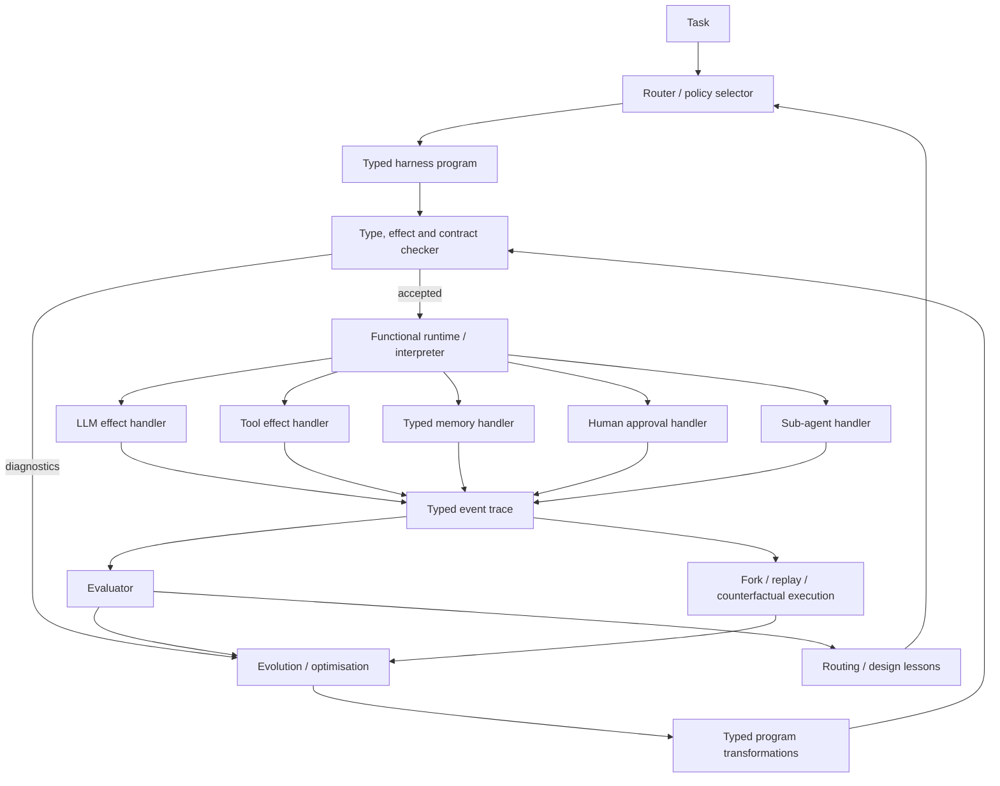

# Type-Oriented and Functional Harnesses for AI Agent Orchestration

## Executive summary


The strongest direction for a typed functional harness is **not to replace OO-Harness's specialisation and routing ideas, but to replace inheritance as the primary representation of harness behaviour**.

OO-Harness establishes an important empirical result: a family of specialised harnesses, selected per task, can outperform one global harness. Its hierarchy shares code through class inheritance, while an evolution agent learns subclasses and a router selects among them. It reports the best primary score among its baselines on AutomationBench, Workspace-Bench and Toolathlon-GYM, with improvements of up to roughly 15 percentage points over its base harness. [^1] The question is therefore not whether specialisation is useful. The open design question is **what representation should specialised harnesses use?**

The evidence points towards a complementary design:

> **Represent an agent harness as a typed functional program whose externally meaningful operations are explicit effects; specialise it by composing typed policies, handlers and program transformations; learn those compositions from traces.**

This approach combines four ideas that have so far appeared mostly separately:

1. **Type-oriented boundaries** for model outputs, tool inputs/outputs, memory, state, errors and agent-to-agent messages. Pydantic AI already demonstrates a pragmatic form of this: `Agent[Dependencies, Output]`, schemas derived from function signatures, runtime argument validation and validated agent outputs. [^2]
2. **Algebraic effects and handlers** for LLM calls, tool calls, memory access, approvals, filesystem/network writes, spawning agents and other externally observable actions. This is the central direction of ETAS and is closely related to Shepherd's typed effect stream. [^3]
3. **Functional composition rather than inheritance** for specialisation. Harness variants become combinations of reusable behaviours such as retry policy, context policy, completion checking, verification and tool-use strategy.
4. **Adaptive optimisation over the typed representation**, preserving the main insight of OO-Harness and borrowing from DSPy's compiler/optimizer model. DSPy already treats LM systems as parameterised programs that can be optimised against an explicit metric. [^4]

The most important recent work is **ETAS**, published in July 2026. It is almost exactly the programming-language version of the proposed direction: ordinary types plus effect rows, typed memory, model calls, approvals, policies and persistent typed action traces. It states type/effect soundness and policy-safety properties and implements a Rust compiler/interpreter. Its limitation is equally important: its current evaluation is primarily language/prototype-oriented; a production scheduler and optimisation representation are still outside the prototype. [^5]

**Shepherd** supplies the second major ingredient. It treats agents as typed functions and agent-environment interactions as typed effects recorded in a reversible execution trace. Its functional model allows observation, fork, rewind and replay, and parts of its semantics are mechanised in Lean. Its reported runtime results show that this can be practical: coupled agent/filesystem forks take roughly 134-143 ms in its evaluated setup, and replay reuses more than 95% of the provider's KV cache. [^6]

**Lacuna** shows another valuable type-oriented pattern: put an LLM call directly into a typed host program as `agent[T](task)`, let the LLM synthesize code, and compile that code against the surrounding type and capability context before executing it. On BrowseComp-Plus, 8.6% of generated actions were rejected before execution; on τ²-bench it solved 76.0% of 392 tasks, approximately matching its baseline while imposing its additional checks. [^7]

My recommendation is therefore a **hybrid**:

**OO-Harness outer loop + functional/effect-typed inner representation + Shepherd-style event sourcing + DSPy-style optimisation.**

This gives a typed functional harness a clear research hypothesis:

> **Can typed compositional harness evolution retain OO-Harness's task-specific gains while producing harnesses that are easier to compose, statically inspect, replay, verify and safely evolve?**

That hypothesis is both technically meaningful and experimentally testable.

## Design goals and core abstractions

### What a type-oriented functional harness is


OO-Harness defines the harness as executable code specifying prompts, tools and control flow around a language model. [^1] A type-oriented functional harness keeps that definition but represents the harness differently.

A useful abstract signature is:

```text
Harness[Input, Output, Effects, Error]
    : Input -> Program[Output, Effects, Error]
```


`Input` and `Output` specify the task boundary. `Effects` says what the harness may cause or request. `Error` enumerates expected failure modes. `Program` is a description of execution that can be interpreted in different ways.

That last property is crucial. The same program could be:

```text
interpret(program, LiveHandlers)
interpret(program, TestHandlers)
interpret(program, ReplayHandlers)
interpret(program, AuditHandlers)
interpret(program, SimulationHandlers)
```


This is the key distinction from a conventional class hierarchy. Behaviour is represented as **data and composition** sufficiently explicitly that different interpreters can execute, test, audit or replay it.

The underlying programming-language idea has a long history. Algebraic effects describe externally meaningful operations separately from the handlers that interpret them. Plotkin and Pretnar's foundational work covers effects including state, exceptions, nondeterminism, I/O and their combinations, while subsequent work demonstrated programmable handlers as a modular way of interpreting effects. [^8]

For agent systems this separation maps naturally:

```text
effect Infer
effect CallTool
effect ReadMemory
effect WriteMemory
effect SpawnAgent
effect AskHuman
effect FileRead
effect FileWrite
effect Network
effect CommitResult
```


ETAS independently arrives at essentially this formulation for model-backed agent systems. It makes model calls, tools, memory, approvals, policies and traces semantic elements of the language and tracks computations using both ordinary types and behavioural indices. [^9]

### Algebraic data types


Algebraic data types, especially tagged unions, should encode state transitions and agent actions.

Conceptually:

```ts
type Step =
  | { tag: "infer"; request: InferenceRequest }
  | { tag: "tool"; call: ToolCall }
  | { tag: "memory-read"; key: MemoryKey }
  | { tag: "memory-write"; write: MemoryWrite }
  | { tag: "delegate"; task: Delegation }
  | { tag: "approval"; request: ApprovalRequest }
  | { tag: "complete"; result: Result }
```


The important property is exhaustiveness. Adding a new kind of externally meaningful action forces handlers, auditors, test interpreters and policy engines to deal with it explicitly.

This is more useful for harness engineering than having a collection of methods whose effects are visible only by examining their implementations.

Agent states should use the same technique:

```ts
type RunState =
  | { tag: "planning"; plan: Plan }
  | { tag: "executing"; plan: Plan; cursor: number }
  | { tag: "awaiting-approval"; request: Approval }
  | { tag: "verifying"; candidate: Candidate }
  | { tag: "completed"; result: Result }
  | { tag: "failed"; reason: Failure };
```


Illegal states become harder to construct, and transitions become amenable to static analysis, property testing and model checking.

### Effects, monads and handlers


A monadic interface such as ZIO's `ZIO[R, E, A]` or Effect's corresponding typed effect abstraction is already close to what an agent harness needs: a computation can explicitly record the services it requires, the errors it can produce and its successful result. ZIO provides typed environments, failures and results together with structured concurrency; Effect supplies typed errors, typed services/dependency injection, resource management and structured concurrency for TypeScript. [^10]

For example, a TypeScript-facing API could expose something conceptually like:

```ts
type AgentEffect<A, E, R> = Effect.Effect<A, E, R>;

declare function prepareInvoice(
  request: InvoiceRequest
): AgentEffect<
  Invoice,
  ValidationError | ModelError | ToolError,
  LLM | CRM | Accounting | Memory
>;
```


For an agent harness, however, **I would not make "monad" the principal user abstraction**. The more useful surface is operations plus handlers:

```ts
const program = generateReport(topic).pipe(
  withResearchTools,
  withCitationVerification,
  withRetryPolicy({ attempts: 2 }),
  withCompletionCheck
);

await Runtime.run(program, liveHandlers);
```


Monads/effect runtimes can implement sequencing under the surface. The source-level mental model should remain "this program may perform these operations".

ETAS demonstrates why effect types become especially useful for agents. Its effect information can represent facts such as "this workflow may request company email and human approval", while trace specifications can constrain their temporal relationship. Its paper's motivating example points out that an ordinary graph can show `draft -> publish` yet does not itself prove that every email send is preceded by the correct approval; ETAS elevates those facts into the program's semantics. [^11]

### Contracts and temporal properties


Input/output types alone are insufficient for an agent.

A useful harness contract has at least four layers:

```text
Value contract
    Request -> Result

Capability contract
    may use Search + ReadRepo
    may not use SendEmail

Effect contract
    Infer | Search | ReadRepo

Trace contract
    Approval precedes ExternalWrite
    Commit occurs at most once
    Secret never reaches UntrustedPrompt
```


ETAS calls the last category trace specifications and compiles allow, deny and temporal constraints into monitors, with residual runtime obligations where static information is insufficient. [^9]

Static verification of workflow topology is also becoming practical. Agentproof, for example, extracts workflow graphs from major agent frameworks and checks structural and temporal properties; its reported verification runs complete in under a second for graphs of up to 5,000 nodes in its test corpus. [^12] AgentFlow similarly proposes a typed agent-dependency graph containing agents, prompts, models, capabilities, memory and control policies as a framework-independent static-analysis IR. [^13]

These works suggest that **a typed harness IR could become the common object used by execution, optimisation and verification**.

### DSL versus library


There are three realistic choices.

A **host-language library** gives the best adoption path. Pydantic AI uses Python generics and Pydantic validation: agents have typed dependencies and outputs, tool signatures become schemas, tool arguments are validated and invalid agent outputs can trigger retries. [^2] Effect offers the analogous host for a TypeScript implementation, with considerably stronger explicit treatment of effects, errors and concurrency. [^14]

A **dedicated DSL** gives stronger semantics. ETAS is the clearest example. AgentSPEX takes a lighter approach: declarative YAML workflows with typed steps, loops, branching, parallel execution, reusable submodules and explicit context management. [^15] BAML is moving further in the language direction: its current project describes a statically analysed agent language with persistent runtime types and typed errors, while also generating clients callable from mainstream languages. [^16]

A **typed IR with multiple front ends** is the approach I recommend. Application developers can initially use TypeScript/Python APIs. Evolution agents and tooling operate on a smaller canonical AST/IR. A textual DSL can be introduced later if the IR proves stable.

That avoids making language design a prerequisite for testing the core research hypothesis.

## Prior work and candidate approaches


Six approaches are especially relevant to the proposed design.

| Candidate | Typing | Composability | Runtime model | Learning / adaptation | Tooling maturity | Example |
|---|---|---|---|---|---|---|
| **ETAS** | **Very strong:** value types, effect rows, typed traces, policies/specs | **Very high:** effects + handlers + flows | Custom Rust compiler/interpreter | Low today; optimisation representation is future work | Early research prototype | [repo](https://github.com/etas-project/etas), [paper PDF](https://arxiv.org/pdf/2607.17780) |
| **Shepherd** | Strong typed task I/O and typed effect events | **Very high:** agents/executions treated as first-class functional objects | Python runtime + reversible process/filesystem trace | **High:** supervision, counterfactual optimisation, Tree-RL | Research prototype, substantial implementation | [repo](https://github.com/shepherd-agents/shepherd), [experiments](https://github.com/shepherd-agents/shepherd-experiments), [PDF](https://arxiv.org/pdf/2605.10913) |
| **Lacuna** | **Very strong host-language checking** around `agent[T]` and available capabilities | High; ordinary Scala control flow and recursive holes | Compile generated Scala fragments before execution | Medium: compiler-feedback retries and recursive LLM calls | Early Scala research prototype | [repo](https://github.com/noti0na1/lacuna), [PDF](https://arxiv.org/pdf/2605.28617) |
| **Pydantic AI / Graph** | Strong pragmatic Python typing + runtime schemas | High library-level composition | Python agent loop / typed graph; durable integrations available | Low as a harness optimiser | **High relative to research systems** | [repo](https://github.com/pydantic/pydantic-ai) |
| **AgentSPEX** | Typed workflow steps, explicit workflow/state structure | High via workflows/submodules | Declarative YAML + execution harness | Low; workflows currently authored rather than evolved | Early, but includes visual authoring/inspection | [repo](https://github.com/ScaleML/AgentSPEX), [PDF](https://arxiv.org/pdf/2604.13346) |
| **DSPy** | Declarative signatures; weaker static guarantees than ETAS/Lacuna | **Very high** module/program composition | Python program/compiler model | **Very high:** metric-driven optimisers | **High in the research ecosystem** | [repo](https://github.com/stanfordnlp/dspy), [PDF](https://arxiv.org/pdf/2310.03714) |

The entries above reflect different goals and therefore should not be read as one leaderboard. ETAS targets programming-language semantics and policy reasoning; Shepherd targets reversible higher-order agent execution; Lacuna targets safe model-generated code; Pydantic AI targets practical typed application development; AgentSPEX targets explicit portable workflow specification; DSPy targets optimisation of declarative LM programs. [^17]

### ETAS


ETAS is the closest direct precedent for an **effect-typed agent harness language**. Its program semantics cover model-backed agents, tools, prompts, typed memory, approvals, policies and traces. Computations carry an escaping effect row plus a persistent approximation of the typed action trace they may request. The work states preservation, progress, type/effect soundness, trace transparency for handlers and policy safety. [^18]

The important weakness is empirical maturity. The current prototype evaluation asks about expressiveness, static detection, runtime evidence and optimisation opportunities through case studies, diagnostics and interpreter traces. The authors explicitly say that a production scheduler and separate optimisation representation remain outside the current prototype and that their case studies do not establish trace completeness at production scale. [^19]

For a typed functional harness, ETAS should therefore be treated as **a semantic foundation**, not yet an empirical answer to harness optimisation.

### Shepherd


Shepherd turns an agent execution into a first-class reversible object. Agents are typed tasks; interactions become typed events in a Git-like trace; meta-agents can observe, fork, rewind, replay and modify workers. The paper grounds these operations in an algebraic-effects calculus with parts mechanised in Lean. [^20]

The results are directly relevant to harness optimisation. A supervisor improves CooperBench joint pass rate from 28.8% to 54.7%; counterfactual branching improves results on several benchmarks while cutting wall-clock time by as much as 58%; Tree-RL raises TerminalBench-2 from 34.2% to 39.4%. [^21]

This suggests an important architecture principle: **trace and fork semantics belong below the harness optimiser**. An optimiser should manipulate reversible executions instead of implementing checkpointing, branch isolation and replay itself.

### Lacuna


Lacuna's core primitive is exceptionally simple:

```scala
def agent[T](task: String): T
```


At runtime an LLM synthesises Scala code for the hole. The generated code is compiled in the surrounding lexical/type environment before execution. Code with the wrong return type or illegal resource use is rejected, and compiler diagnostics drive retries. [^7]

This makes several normally agent-specific constructs ordinary language constructs. Subagents become nested `agent[T]` calls; parallel decomposition can use normal parallel collections; planning can be ordinary code.

The lesson for the new design is broader than Scala: **LLM-generated harness changes should pass through a compiler/type checker before they become executable**. An evolution agent can propose AST transformations; the type/effect checker becomes the first admission gate, before expensive discovery-task rollouts.

### Typed coordination languages


For multi-agent systems, **Plumbing** is a useful emerging experiment. Its `.plumb` programs specify components, typed messages and routes; the runtime constructs channels and checks values crossing component boundaries. The resulting coordination graph can itself be nested as a component. [^22]

[Pact](https://arxiv.org/abs/2605.03143) takes a more formal multi-party direction: choreographic programming plus explicit agent choices/preferences, with protocols mapped to games so coordination strategies can be reasoned about. [^23]

These suggest that multi-agent coordination should have **typed channels/protocols at the harness level**, instead of relying solely on natural-language role prompts.

### Typed application frameworks


Pydantic AI provides a practical halfway point. `Agent[Deps, Output]` makes dependencies and the final result part of the type; Python function signatures become LLM tool schemas; tool arguments and outputs are validated; failed validation can be returned to the model for correction. Its OpenTelemetry instrumentation also makes model and tool calls observable. [^2]

BAML offers another useful boundary abstraction. It generates strongly typed clients for LLM functions in multiple host languages and associates schemas directly with LLM functions. Its current language project describes statically analysed typed errors and runtime-preserved types. [^24]

These approaches show that **typed LLM boundaries are already practical**. The missing step is extending the same discipline from inputs/outputs to control flow, effects, memory authority and traces.

### Declarative optimisation


DSPy's central contribution is complementary to the type-oriented work. It represents LM systems as modular programs with declarative LM signatures and optimises program parameters against an explicit metric. Its original experiments showed large gains over manually designed prompting baselines across reasoning and retrieval tasks. [^4]

A functional harness optimiser should borrow that separation:

```text
Program structure
+ Optimisable parameters/policies
+ Training examples
+ Metric
→ Optimised program
```


The difference for the proposed design is that optimisation would operate under a type/effect discipline.

## Comparison with OO-Harness


OO-Harness and a typed functional harness address partly orthogonal problems.

OO-Harness asks:

> How should reusable, specialised harness behaviour be organised and selected?

Its answer is inheritance plus routing. [^1]

An effect-typed functional design asks:

> How should harness behaviour be represented so composition, execution and side effects have explicit semantics?

Those ideas can therefore be combined.

### Modularity


Inheritance is effective when specialisation follows a mostly tree-shaped structure. OO-Harness's own ablation found that its inheritance-based evolution beat flat and base-reset variants on Workspace-Bench, supporting the value of carrying useful behaviour forward through its hierarchy. [^25]

The difficulty arises when features are orthogonal.

Suppose specialised behaviours are:

```text
A = stronger completion checking
B = compressed context
C = extra spreadsheet verification
D = conservative write policy
```


Inheritance encourages constructions resembling:

```text
Base
├── CompletionHarness
│   ├── CompletionContextHarness
│   └── CompletionSpreadsheetHarness
└── ConservativeWriteHarness
```


The number of useful combinations can grow much faster than the hierarchy.

Functional composition permits:

```ts
base.pipe(
  completionCheck,
  compressedContext,
  spreadsheetVerification,
  conservativeWrites,
)
```


Effects make these components safer to compose because their requirements and consequences can be inspected before execution.

My expectation is therefore:

**inheritance performs well for lineage; composition should perform better as the number of independent harness features grows.**

That claim needs direct experimental testing; the current literature does not yet provide an OO-Harness-versus-effect-system benchmark.

### Safety and verifiability


Here the functional/type-oriented design has the clearest conceptual advantage.

A class signature says little about whether an implementation will:

```text
send email
modify files
spawn an agent
read private memory
repeat a payment after retry
```


An effect type can expose those facts directly.

ETAS demonstrates the stronger version: it tracks not only effects but action traces and temporal policies. [^9] Shepherd similarly keeps actions visible as typed trace events even when higher-order agents observe or manipulate execution. [^20]

This opens the door to checks such as:

```text
requires HumanApproval before ExternalWrite
forbids Secret -> ExternalModel
at-most-once Payment.commit
worker may ReadRepo but may not Network
```


OO-Harness's representation is executable Python/class code, so these properties generally require testing, runtime guardrails or whole-program analysis rather than following directly from the harness abstraction. [^1]

### Performance


There is no evidence that function composition itself will meaningfully change LLM-agent throughput. LLM inference and external tools usually dominate ordinary language-level dispatch.

The relevant overhead comes from richer runtime semantics: schema validation, event recording, checkpoints, interpreters and policy checks.

Shepherd provides encouraging evidence that richer semantics need not make branching prohibitively expensive. In its environment it reports 134-143 ms coupled forks across images ranging from 42 MB to 5.8 GB; its execution model also permits substantial prompt-cache reuse during replay. [^26]

A typed intermediate representation could additionally enable optimisation unavailable to opaque OO code: dead-effect elimination, static tool pruning, capability narrowing, parallelisation of independent operations, deterministic caching and compilation of fixed subgraphs.

Those are proposed opportunities, not demonstrated results for agent harnesses.

### Learning and adaptation


This is the present advantage of OO-Harness.

OO-Harness already implements:

```text
execution
→ execution records
→ task clustering
→ specialised harness evolution
→ routing lessons
→ task-specific harness selection
```


and evaluates the resulting system on held-out tasks. [^1]

ETAS currently does not have a comparable harness-evolution experiment; its authors explicitly list optimisation as an evaluation/research question and say its separate optimisation representation is outside the current implementation. [^19]

The proposed system should retain OO-Harness's learning machinery while changing the **search space**.

Instead of generating:

```python
class SpreadsheetHarness(BaseHarness):
    def run(...):
        ...
```


the optimiser generates something like:

```text
BaseProgram
  |> AddCompletionCheck
  |> AddSpreadsheetVerifier
  |> SetContextPolicy(SpreadsheetFocused)
  |> SetRetryPolicy(VerificationOnly)
```


The compiler rejects ill-typed transformations before rollout. Evaluation decides whether well-typed transformations are useful.

This creates a useful separation:

```text
type system:     "is this admissible?"
evaluator:       "does this work?"
optimizer:       "which admissible change should we try?"
router:          "when should we use it?"
```

### Developer ergonomics


This is where a pure PL-research approach can lose.

ETAS has stronger semantics, but it requires a new language. Its own repository labels the implementation highly experimental and unsuitable for production/security-critical deployment today. [^27]

AgentSPEX provides evidence for the opposing pressure. In a 23-person study, participants generally found its declarative workflow easier to read and create from scratch, while preferring LangGraph for complex workflows because they perceived the latter as more customisable and rigorous. [^28]

That argues for an incremental design:

```text
simple use       -> typed host-language API
advanced use     -> functional combinators
tooling          -> canonical IR
verification     -> effect/trace contracts
eventual DSL     -> optional textual representation
```


Do not require users to adopt a novel programming language in the first prototype.

## Recommended architecture for a typed functional harness


I recommend treating **the typed agent program as the central artefact**, with execution, verification, routing and evolution all operating around it.




The architecture deliberately preserves the strongest ideas from OO-Harness: held-out evaluation, specialisation and routing from accumulated execution lessons. [^1] It adds ETAS-like static semantics and Shepherd-like trace/fork semantics. [^3]

### Core IR


The IR should initially remain deliberately small:

```ts
type Program<A> =
  | Pure<A>
  | Infer<A>
  | CallTool<I, O>
  | ReadMemory<A>
  | WriteMemory<A>
  | AskHuman<A>
  | Spawn<A>
  | Sequence<A>
  | Parallel<A>
  | Branch<A>
  | Retry<A>
  | Verify<A>;
```


Every effectful primitive carries metadata:

```ts
interface Tool<I, O, E> {
  readonly name: string;
  readonly input: Schema<I>;
  readonly output: Schema<O>;
  readonly effects: ReadonlySet<E>;
  readonly idempotency: "pure" | "idempotent" | "at-most-once";
}
```


The idempotency field is particularly important for agent retries. "Retry model inference" and "retry bank transfer" should never be represented by the same generic retry abstraction.

### Typed memory


Memory should be a typed resource:

```ts
interface MemoryKey<T> {
  name: string;
  schema: Schema<T>;
  scope: "run" | "user" | "project" | "global";
  trust: "trusted" | "untrusted";
}

declare function read<T>(
  key: MemoryKey<T>
): AgentEffect<T, MemoryError, MemoryRead>;

declare function write<T>(
  key: MemoryKey<T>,
  value: T
): AgentEffect<void, MemoryError, MemoryWrite>;
```


This makes several currently implicit harness decisions explicit:

```text
what may be stored?
who may read it?
how long does it live?
is its content trusted?
does writing it require permission?
```

### Tools and capabilities


A subagent should receive **capabilities**, not the entire parent runtime:

```ts
const researcher = spawn(researchProgram, {
  capabilities: [
    WebSearch,
    ReadProjectFiles,
  ],
});
```


The resulting type/effect environment can prove that this worker cannot invoke an email or deployment tool.

This is closely aligned with ETAS's effect/policy model and Lacuna's use of surrounding program scope to restrict resources available to generated code. [^29]

### Multi-agent coordination


Messages should be typed values:

```ts
type ResearchMessage =
  | { tag: "question"; id: TaskId; query: string }
  | { tag: "finding"; id: TaskId; evidence: Citation[] }
  | { tag: "failure"; id: TaskId; reason: ResearchFailure };
```


Agent edges become:

```text
Researcher : ResearchQuestion -> ResearchResult
Reviewer   : ResearchResult   -> Review
Writer     : (ResearchResult, Review) -> Report
```


Plumbing already demonstrates the basic form of this idea: typed JSON messages crossing explicit channels in a graph of agents, tools and ordinary programs. [^22]

For sophisticated coordination, protocol types could eventually go beyond message shape and capture message order:

```text
Coordinator -> Worker : Task
Worker      -> Coordinator : Result | Failure
Coordinator -> Reviewer : Result
Reviewer    -> Coordinator : Accept | Revise
```


That is a later milestone. Do not put session types into the first implementation.

### Functional specialisation


Harness specialisation should be a transformation:

```ts
type HarnessTransform =
  (program: Program<TaskResult>) => Program<TaskResult>;
```


Examples:

```ts
const spreadsheetSpecialist =
  compose(
    focusContext(spreadsheetContext),
    addVerifier(formulaVerifier),
    retryOn(VerificationFailure, 2),
    requireCompletion(allRequestedCellsUpdated),
  );

const researchSpecialist =
  compose(
    paralleliseIndependentSearches(),
    requireCitations(),
    verifyClaims(),
  );
```


The evolution agent searches over transforms and their parameters.

This is the key replacement for subclass creation.

### Different handlers for the same program


A large payoff comes from making interpretation replaceable:

```ts
await run(program, productionHandlers);

await run(program, sandboxHandlers);

await run(program, replayHandlers(trace));

await run(program, simulatedTools);

await run(program, policyRestricted({
  deny: [NetworkWrite, SendEmail]
}));
```


This follows the core benefit of algebraic effects: operation interfaces remain stable while handlers change their interpretation. [^30] Shepherd demonstrates the analogous principle in an agent runtime by making typed effects observable and executions reversible. [^20]

### Evolution


The outer optimiser can follow OO-Harness closely:

```text
discover failure cluster
        ↓
select base program
        ↓
propose typed transformation
        ↓
compile / type-check
    ↙ reject       ↘ accept
diagnostics         rollout
    ↓                  ↓
revise            evaluate
                       ↓
                 retain or reject
                       ↓
              record design lesson
```


A further improvement would be to let the optimiser search at multiple levels:

```text
Level A: parameters
    retry count, context budget, model, temperature

Level B: composition
    add/remove/reorder reusable policies

Level C: graph
    parallelise, add verification loop, delegate

Level D: primitives
    synthesise a new tool or policy

Level E: representation
    introduce a reusable combinator from repeated successful patterns
```


Type/effect checking can progressively narrow the legal search space as proposals become more structural.

## Evaluation strategy and prototype roadmap


A convincing paper or engineering result needs to separate **agent performance**, **software properties** and **optimisation efficiency**.

### Head-to-head harness evaluation


The first experiment should deliberately reproduce the OO-Harness setup as closely as possible.

Use:

- **AutomationBench**
- **Workspace-Bench**
- **Toolathlon-GYM**

because those are the three benchmarks used in the OO-Harness paper. [^1]

Hold constant:

```text
executor model
discovery/test splits
tool set
initial/base harness
routing information
candidate-evaluation budget
model-call budget
grader
```


Then compare representations:

```text
Base harness
Global optimisation
OO-Harness inheritance
Flat compositional harnesses
Typed functional composition
Typed functional composition + effect contracts
```


This would directly answer whether the representation improves search and generalisation, instead of indirectly comparing numbers from unrelated papers.

### Additional behavioural benchmarks


Add benchmarks that exercise properties missing from the original OO-Harness evaluation.

**τ²-bench** and **BrowseComp-Plus** are useful because Lacuna has already evaluated typed model-generated programs there. Lacuna reports 76.0% on 392 τ²-bench tasks and 27.1% BrowseComp-Plus accuracy while rejecting 8.6% of generated actions before execution. [^7]

**SWE-bench Verified** is useful for long-running stateful tool use. AgentSPEX reports 77.1% across its Claude Opus 4.5/4.6 setup and, importantly, only a 0.2 percentage-point difference between its two tested model versions, although that result should be independently reproduced. [^31]

**CooperBench** is useful specifically for multi-agent interference and supervision because Shepherd demonstrates a sizeable improvement there from live meta-agent intervention. [^20]

AgentSPEX is also useful as evidence that explicit workflows can succeed beyond tool-use benchmarks: it evaluated seven domains/benchmarks including SWE-bench Verified, AIME 2025, ChemBench, SciBench, MMLU-Pro/StemEZ, WritingBench and ELAIPBench. [^32]

### Type and contract benchmark


The new architecture should add an evaluation category that existing harness leaderboards largely miss.

Construct programs containing seeded defects such as:

```text
wrong tool input type
wrong model output type
missing state case
tool used without capability
private-memory value sent to external model
write without approval
approval after write
double execution of at-most-once tool
retry across irreversible action
missing completion transition
infinite retry
incompatible agent message
parallel conflicting writes
unhandled expected error
```


Measure:

| Metric | Meaning |
|---|---|
| Static detection rate | Percentage caught before executing an LLM/tool |
| False-positive rate | Valid workflows rejected |
| Runtime violation rate | Contract failures reaching execution |
| Unsafe-effect prevention | Forbidden effects blocked before commitment |
| Temporal-policy coverage | Trace requirements checked |
| Diagnostic repair rate | Percentage an evolution agent fixes from compiler feedback |
| Detection latency | Compile/static-analysis time |

ETAS provides a conceptual basis for exactly this form of evaluation, although its current prototype uses case studies rather than a broad benchmark. [^19]

### Optimiser evaluation


Measure more than final accuracy.

For each representation record:

```text
held-out task reward
strict PASS
LLM calls during evolution
tokens during evolution
candidate rollouts
wall-clock optimisation time
candidate rejection before rollout
number of retained primitives
program size
duplicate behaviour
router accuracy
regressions on previously solved tasks
```


One hypothesis worth testing is that static rejection gives a type-oriented optimiser higher **sample efficiency**: it spends rollout budget only on programs that satisfy structural invariants.

Another is that functional composition reduces duplication relative to independent specialised harnesses while avoiding the coupling of deep inheritance trees.

Both are currently hypotheses.

### Property-based testing


A typed functional representation makes property-based tests natural:

```text
for every Program generated by grammar G:
    typecheck(program) implies
      all tool inputs match schemas

for every execution trace:
    ExternalWrite implies previously(Approval)

for every replay from checkpoint C:
    pure prefix before C is observationally identical

for every specialist transform T:
    type(T(base)) == type(base)
```


This is one of the stronger engineering arguments for putting the harness into an explicit IR.

### Prototype roadmap


A practical sequence for one experienced engineer, with occasional research/evaluation support, is:

| Milestone | Deliverable | Estimated effort |
|---|---|---:|
| **Core semantics** | `Program<A>` IR, ADTs for effects/errors/state, schemas, pure interpreter, design note | 4-6 engineer-days |
| **Runtime** | LLM/tool/memory handlers, tracing, retries, parallelism, capability scopes | 6-10 days |
| **Contracts** | Effect declarations, idempotency, basic allow/deny policies, approval-before-effect trace rule | 5-8 days |
| **Agent integration** | Typed subagents, typed channels, checkpointable state, replay hooks | 5-8 days |
| **Evolution adapter** | Transformation DSL, compiler/type-check admission gate, OO-Harness-style evaluation/routing loop | 8-12 days |
| **Benchmark prototype** | One OO-Harness benchmark plus synthetic contract suite and ablations | 8-12 days |
| **Full research evaluation** | Three OO-Harness benchmarks, safety suite, optimiser ablations, analysis | 3-5 additional weeks |

A useful **first research prototype is therefore about five to seven engineer-weeks**. A serious empirical study is closer to **eight to twelve weeks**, excluding large-scale rollout time and benchmark-specific infrastructure.

### What to build first


The smallest useful API is approximately:

```ts
const agent = defineAgent({
  input: Task,
  output: Result,

  program: ({ input }) =>
    infer(Plan, planPrompt(input))
      .flatMap(plan =>
        execute(plan, tools)
      )
      .flatMap(candidate =>
        verify(candidate)
      ),

  effects: [LLM, ToolRead, ToolWrite, Memory],

  contract: {
    before: [
      [ToolWrite, HumanApproval],
    ],
  },
});
```


Then prove that the same program can run through:

```ts
run(agent, live);
run(agent, sandbox);
run(agent, mock);
run(agent, replay(trace));
```


Then add one specialisation transform:

```ts
const completionFocused =
  agent.pipe(
    addCompletionCheck,
    retryVerificationFailures(2),
  );
```


Then optimise selection between `agent` and `completionFocused` on a discovery set.

That experiment tests most of the architecture without first building a new programming language.

## Conclusions and source guide


The evidence supports five conclusions.

**First, OO-Harness solves a genuine problem.** Heterogeneous tasks benefit from specialised execution strategies, and the paper provides direct held-out evidence that task-specific harness families can beat a single global harness. [^1] The new design should preserve specialisation and routing.

**Second, inheritance is only one representation for specialisation.** Algebraic effects, typed functional programs and composition offer a plausible alternative with stronger modularity across orthogonal behaviours and substantially more explicit semantics. The foundational PL literature gives these abstractions mature theoretical foundations. [^33]

**Third, the agent-specific pieces now exist.** ETAS applies type-and-effect semantics directly to model calls, tools, memory, policies, approvals and traces; Shepherd demonstrates typed effect traces and reversible higher-order executions; Lacuna demonstrates compile-time rejection of model-generated actions; Pydantic AI demonstrates practical typed agent boundaries. [^34]

**Fourth, optimisation is the missing bridge.** ETAS is strong semantically but does not yet offer an OO-Harness-level optimisation study; OO-Harness and DSPy provide the stronger precedent for learning/evolving programs from empirical feedback. [^35] That gap is where a typed functional harness can contribute.

**Fifth, I would make the first implementation a typed host-language library plus canonical IR, not a new standalone language.** If the representation succeeds experimentally, a DSL/compiler can follow. AgentSPEX's user study illustrates the ergonomics tension: declarative specifications were perceived as approachable, while developers still preferred a conventional programmable framework for more complex workflows. [^28]

The resulting design can be summarised as:

```text
OO-Harness:
    learn specialised subclasses
    + route among them

Proposed:
    learn specialised typed program transformations
    + compose them
    + statically reject invalid combinations
    + route among valid specialisations
    + execute through swappable effect handlers
    + retain a typed, forkable execution trace
```


The first result I would target is therefore:

> **Under equal model, discovery data and optimisation budget, compare inheritance-based OO-Harness against type-checked compositional harness evolution on the original OO-Harness benchmarks, measuring both task performance and candidate-search efficiency.**

A positive result would establish something stronger than a new framework: it would show that **programming-language structure can improve the search space for harness evolution**.

### Primary sources and implementations


**OO-Harness**

- Paper: [arXiv HTML](https://arxiv.org/html/2610.28380)
- PDF: [arXiv PDF](https://arxiv.org/pdf/2610.28380) [^1]

**ETAS -- An Effect-Typed Language for Agent Systems**

- Paper: [arXiv](https://arxiv.org/abs/2607.17780)
- PDF: [arXiv PDF](https://arxiv.org/pdf/2607.17780)
- Repository: [etas-project/etas](https://github.com/etas-project/etas) [^36]

**Shepherd -- functional runtime substrate for meta-agents**

- Paper: [arXiv](https://arxiv.org/abs/2605.10913)
- PDF: [arXiv PDF](https://arxiv.org/pdf/2605.10913)
- Runtime: [shepherd-agents/shepherd](https://github.com/shepherd-agents/shepherd)
- Experiments: [shepherd-agents/shepherd-experiments](https://github.com/shepherd-agents/shepherd-experiments) [^37]

**Lacuna -- Safe Agents as Recursive Program Holes**

- Paper: [arXiv](https://arxiv.org/abs/2605.28617)
- PDF: [arXiv PDF](https://arxiv.org/pdf/2605.28617)
- Repository: [noti0na1/lacuna](https://github.com/noti0na1/lacuna) [^38]

**AgentSPEX**

- Paper: [arXiv](https://arxiv.org/abs/2604.13346)
- PDF: [arXiv PDF](https://arxiv.org/pdf/2604.13346)
- Repository: [ScaleML/AgentSPEX](https://github.com/ScaleML/AgentSPEX) [^15]

**DSPy**

- Paper: [arXiv](https://arxiv.org/abs/2310.03714)
- PDF: [arXiv PDF](https://arxiv.org/pdf/2310.03714)
- Repository: [stanfordnlp/dspy](https://github.com/stanfordnlp/dspy) [^39]

**Pydantic AI**

- Repository: [pydantic/pydantic-ai](https://github.com/pydantic/pydantic-ai) [^40]

**BAML**

- Repository: [BoundaryML/baml](https://github.com/BoundaryML/baml) [^41]

**Plumbing -- typed agent coordination**

- Repository: [quantumsoftwarelab/plumbing](https://github.com/quantumsoftwarelab/plumbing) [^22]

**Foundations for algebraic effects**

- Plotkin & Pretnar, *Handlers of Algebraic Effects*: [PDF](https://homepages.inf.ed.ac.uk/gdp/publications/Effect_Handlers.pdf) [^42]
- Plotkin & Pretnar, *Handling Algebraic Effects*: [PDF](https://homepages.inf.ed.ac.uk/gdp/publications/handling-algebraic-effects.pdf) [^43]
- Bauer & Pretnar, *Programming with Algebraic Effects and Handlers*: [PDF](https://arxiv.org/pdf/1203.1539) [^44]
- Bauer & Pretnar, *An Effect System for Algebraic Effects and Handlers*: [arXiv](https://arxiv.org/abs/1306.6316) [^45]
- Koka, a practical language with algebraic data types and a polymorphic type-and-effect system: [official documentation](https://koka-lang.github.io/koka/doc/book.html) [^46]

**Production functional-effect systems useful as implementation substrates**

- Effect TypeScript: [official site](https://effect.website/) and [repository](https://github.com/Effect-TS/effect) [^14]
- ZIO: [repository](https://github.com/zio/zio) and [reference](https://zio.dev/reference/) [^47]

The principal limitation of the current evidence is that **there is no published apples-to-apples evaluation of OO-Harness inheritance against an effect-typed or functional-compositional harness optimiser**. ETAS is too early, Shepherd studies a different layer, Lacuna studies generated actions, and AgentSPEX studies explicit workflows. [^48] That missing experiment is precisely the strongest research opportunity for a typed functional harness.

## References


The numbered references follow the citations and source links in the supplied PDF.

[^1]: [\[2610.28380\] Object-Oriented Harness: Evolving Agent Harnesses through Object-Oriented Design](https://arxiv.org/abs/2610.28380)

[^2]: [pydantic-ai/docs/index.md at main · pydantic/pydantic-ai · GitHub](https://github.com/pydantic/pydantic-ai/blob/main/docs/index.md)

[^3]: [Etas: An Effect-Typed Language for Agent Systems](https://arxiv.org/html/2607.17780v1)

[^4]: [DSPy: Compiling Declarative Language Model Calls into Self-Improving Pipelines](https://arxiv.org/html/2310.03714)

[^5]: [ETAS: An Effect-Typed Language for Agent Systems](https://arxiv.org/abs/2607.17780)

[^6]: [Shepherd: A Runtime Substrate Empowering Meta-Agents with a Formalized Execution Trace](https://arxiv.org/html/2605.10913v1)

[^7]: [Lacuna: Safe Agents as Recursive Program Holes](https://arxiv.org/html/2605.28617v1)

[^8]: [Handlers of Algebraic Effects](https://homepages.inf.ed.ac.uk/gdp/publications/Effect_Handlers.pdf)

[^9]: [Etas: An Effect-Typed Language for Agent Systems](https://arxiv.org/html/2607.17780v1)

[^10]: [Effect | Production Grade TypeScript](https://effect.website/)

[^11]: [ETAS: An Effect-Typed Language for Agent Systems](https://arxiv.org/pdf/2607.17780)

[^12]: [Agentproof: Static Verification of Agent Workflow Graphs](https://arxiv.org/abs/2603.20356)

[^13]: [AgentFlow: Building Agent Dependency Graphs for Static ...](https://arxiv.org/html/2607.01640v1)

[^14]: [Effect | Production Grade TypeScript](https://effect.website/)

[^15]: [AgentSPEX: An Agent SPecification and EXecution Language](https://arxiv.org/html/2604.13346v1)

[^16]: [BoundaryML/baml: The programming language for agents](https://github.com/boundaryml/baml)

[^17]: [ETAS: An Effect-Typed Language for Agent Systems](https://arxiv.org/abs/2607.17780)

[^18]: [ETAS: An Effect-Typed Language for Agent Systems](https://arxiv.org/abs/2607.17780)

[^19]: [Etas: An Effect-Typed Language for Agent Systems](https://arxiv.org/html/2607.17780v1)

[^20]: [Shepherd: A Runtime Substrate Empowering Meta-Agents with a Formalized Execution Trace](https://arxiv.org/html/2605.10913v1)

[^21]: [Shepherd: A Runtime Substrate Empowering Meta-Agents with a Formalized Execution Trace](https://arxiv.org/abs/2605.10913)

[^22]: [GitHub - quantumsoftwarelab/plumbing: Typed AI Agent coordination · GitHub](https://github.com/quantumsoftwarelab/plumbing)

[^23]: [Pact: A Choreographic Language for Agentic Ecosystems](https://arxiv.org/abs/2605.03143)

[^24]: [BoundaryML/baml: The programming language for agents](https://github.com/boundaryml/baml)

[^25]: [Evolving Agent Harnesses through Object-Oriented Design](https://arxiv.org/abs/2610.28380)

[^26]: [Shepherd: A Runtime Substrate Empowering Meta-Agents with a Formalized Execution Trace](https://arxiv.org/html/2605.10913v1)

[^27]: [Etas programming language CLI, package manager ...](https://github.com/etas-project/etas)

[^28]: [AgentSPEX: An Agent SPecification and EXecution Language](https://arxiv.org/html/2604.13346v1)

[^29]: [Etas: An Effect-Typed Language for Agent Systems](https://arxiv.org/html/2607.17780v1)

[^30]: [Handlers of Algebraic Effects](https://homepages.inf.ed.ac.uk/gdp/publications/Effect_Handlers.pdf)

[^31]: [AgentSPEX: An Agent SPecification and EXecution Language](https://arxiv.org/html/2604.13346v1)

[^32]: [AgentSPEX: An Agent SPecification and EXecution Language](https://arxiv.org/html/2604.13346v1)

[^33]: [Handlers of Algebraic Effects](https://homepages.inf.ed.ac.uk/gdp/publications/Effect_Handlers.pdf)

[^34]: [Etas: An Effect-Typed Language for Agent Systems](https://arxiv.org/html/2607.17780v1)

[^35]: [Etas: An Effect-Typed Language for Agent Systems](https://arxiv.org/html/2607.17780v1)

[^36]: [ETAS: An Effect-Typed Language for Agent Systems](https://arxiv.org/abs/2607.17780)

[^37]: [Shepherd: A Runtime Substrate Empowering Meta-Agents with a Formalized Execution Trace](https://arxiv.org/abs/2605.10913)

[^38]: [noti0na1/lacuna: Typed, scope-aware LLM holes ...](https://github.com/noti0na1/lacuna)

[^39]: [DSPy: Compiling Declarative Language Model Calls into Self-Improving Pipelines](https://arxiv.org/abs/2310.03714)

[^40]: [pydantic/pydantic-ai: How Python does AI. Agents, realtime ...](https://github.com/pydantic/pydantic-ai)

[^41]: [BoundaryML/baml: The programming language for agents](https://github.com/boundaryml/baml)

[^42]: [Handlers of Algebraic Effects](https://homepages.inf.ed.ac.uk/gdp/publications/Effect_Handlers.pdf)

[^43]: [Handling Algebraic Effects](https://homepages.inf.ed.ac.uk/gdp/publications/handling-algebraic-effects.pdf)

[^44]: [Programming with Algebraic Effects and Handlers](https://arxiv.org/pdf/1203.1539)

[^45]: [An Effect System for Algebraic Effects and Handlers](https://arxiv.org/abs/1306.6316)

[^46]: [The Koka Programming Language](https://koka-lang.github.io/koka/doc/book.html)

[^47]: [ZIO -- A type-safe, composable library for async and ...](https://github.com/zio/zio)

[^48]: [Etas: An Effect-Typed Language for Agent Systems](https://arxiv.org/html/2607.17780v1)
