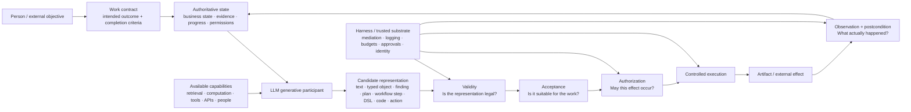
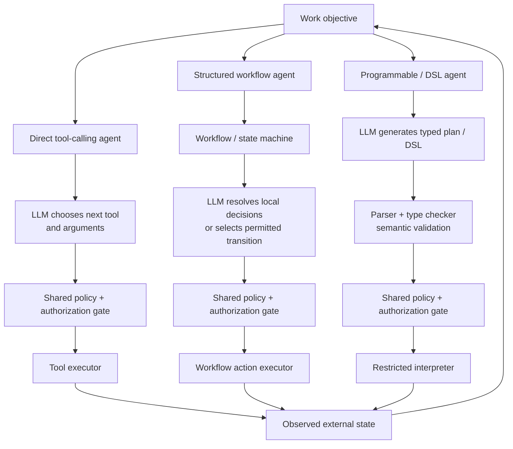
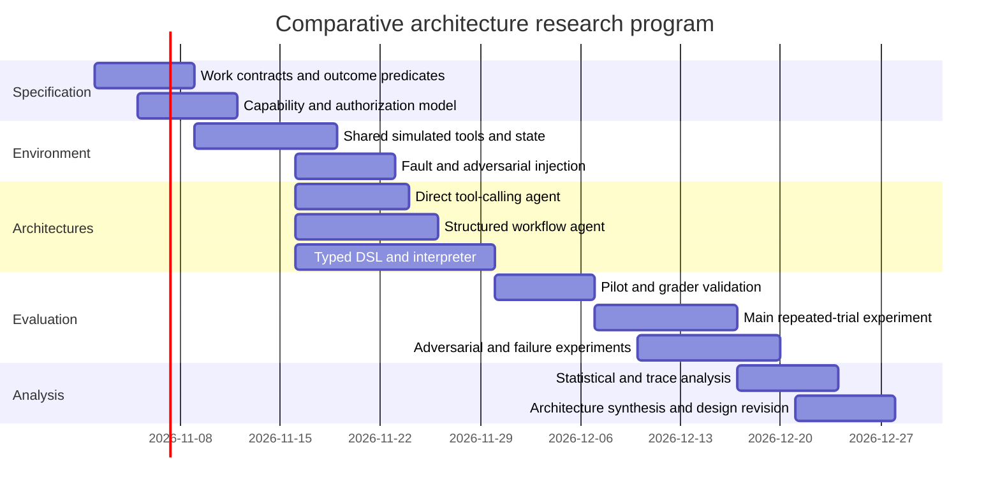

# A General Conceptual Design Model for Software Systems That Integrate LLMs


> Export note: Source links were recovered from the original report's citation panels. Citation groups retain every source for which a URL could be identified; additional source IDs without an exposed URL are marked unresolved. The exact original groups are preserved in the [citation metadata](/ai/design-research/input/reports/general-conceptual-design-model-for-llm-software-systems.assets/general-conceptual-design-model-for-llm-software-systems-citations.json).

## Executive summary


The strongest starting point is the one already present in your design notes: **begin with the work and its intended result**, then determine capabilities, workflow, product shape, and implementation. Your current model defines an activity as meaningful work directed toward a result and distinguishes explanation, artifact, decision, and confirmed business-system change as possible results. It also recognizes that the eight example cases can overlap inside one product. [^1]

I would extend that model with three separations.

First, separate **what kind of work the system supports** from **how the system operates**. Investigation, coding, coordination, domain work, and retrieval-oriented assistance describe kinds of work. Open-ended interaction, bounded workflow, delegated execution, programmable analysis, and human-reviewed artifact development describe operating regimes. A single product can move among several regimes while preserving state; your existing notes already move in this direction. [^1][^31]

Second, treat the LLM primarily as a **generator of candidate representations**. Those representations can be prose, classifications, structured objects, hypotheses, plans, workflow transitions, API requests, queries, DSL programs, code, or proposed actions. ReAct demonstrated the basic model-driven action/observation loop, RAG showed how generation can be conditioned on external memory, and LMQL showed that generation itself can be placed inside a programmable language with constraints and control flow. [^2][^14][^15] The useful property is therefore broader than "text generation": an LLM can construct **previously unspecified symbolic objects and procedures from contextual information and natural-language intent**.

Third, separate **generative freedom from authority**. The LLM may be allowed considerable freedom in proposing an analysis or composing a procedure while possessing very little direct authority over external state. Your programmable-environment notes already make this distinction: an agent can construct SQL, DSL, or code while execution remains inside controlled environments with restricted data access, resource limits, validation, and tracing. [^3] Coding-agent systems use the same pattern through harnesses, sandboxes, version control, tests, and review. [^4] Current agent-security work reinforces the architectural point: AgentDojo demonstrates that untrusted tool-returned data can induce harmful tool calls, while recent work such as Sapien interposes a stateful policy engine on agent tool calls even under a threat model in which the agent is fully compromised. [^5][^27]

This leads to the central proposed design model:

> **Work contract -> authoritative state and context -> generative proposal -> explicit representation -> validity checking -> acceptance decision -> authorization -> controlled execution -> observation and outcome verification -> updated authoritative state.**

The LLM can participate at several points, especially interpretation, proposal construction, planning, synthesis, and interpretation of feedback. The system should assign properties that require hard guarantees to ordinary software mechanisms whenever those properties can be stated precisely.

The four assurance concepts should remain distinct:

| Assurance property | Question | Typical way to establish it |
|---|---|---|
| **Validity** | Is this representation or transition permitted by its formal definition? | Schemas, types, parsers, state machines, DSL type checkers, invariants |
| **Acceptance** | Is this result good enough and correct for the intended work? | Executable specifications where possible; otherwise tests, evaluators, expert review, empirical evaluation |
| **Authorization** | May this principal cause this effect, on this resource, under these conditions, now? | Access-control system, policy engine, scoped credentials, approval state |
| **Execution / completion** | Was the authorized operation actually performed, and did the required outcome occur? | Transaction semantics, idempotency, external-state verification, postconditions, reconciliation |

These properties often collapse together in agent implementations, which is a source of confusion. A valid API call may be unauthorized. An authorized API call may be a poor choice. A successful HTTP response may fail to establish the business outcome. Your coordination notes make exactly this distinction by separating intended, proposed, authorized, attempted, and completed actions and observing that sending an email does not establish that a recipient replied. [^6]

The most important consequence is that **LLM reliability and system assurance need not be the same variable**. Assume an effectful operation can occur only through an unbypassable trusted executor, and that executor admits an operation only when an encoded authorization policy and required structural invariants hold. Under those assumptions, an arbitrarily bad LLM proposal still cannot create an effect outside the encoded boundary. The guarantee applies to the *encoded boundary*; it does not prove that the policy correctly captures human intent. Zanzibar and OPA illustrate conventional external authorization/policy mechanisms, while Sapien explores the corresponding reference-monitor pattern for stateful agent tool use. [^7][^32][^27]

That gives a useful design principle for the research program: **maximize generative freedom where it improves the work; minimize unmediated authority; encode hard constraints at the narrowest trusted execution boundary.**

The resulting architecture choice is then fairly clear:

| Situation | Default architecture |
|---|---|
| Path is unknown and consequences are low or well contained | Direct tool-calling agent |
| Process states and legal transitions are substantially known | Structured workflow/state-machine agent |
| Many novel compositions are valuable, but the meaningful operations and invariants can be defined | Typed DSL/program-generating agent |
| Arbitrary computation itself is the capability | Sandboxed coding/programming agent |
| Primary task is understanding evidence rather than changing external state | Investigation/evidence architecture |
| Main uncertainty concerns retrieved knowledge | Retrieval-grounded architecture with provenance and read authorization |

This is also consistent with StateFlow's benchmark evidence: imposing explicit state-machine structure produced higher success and lower cost than ReAct on its InterCode SQL and ALFWorld experiments, although those results are benchmark-specific and do not imply that workflows dominate open-ended tasks. [^8][^33] Anthropic's engineering guidance makes the same qualitative distinction: predefined workflows suit predictable processes, while autonomous agents are useful when the required path cannot reasonably be hard-coded. [^9]

## Conceptual foundations

### The unit of design is the work system


An LLM-integrated product is a system consisting of people, conventional code, data, policies, external services, execution infrastructure, and one or more models. NIST's Generative AI Profile explicitly treats trustworthiness as a concern across the design, development, use, and evaluation of AI products, services, and systems, rather than restricting risk analysis to model behavior. [^10][^34] Anthropic's current agent-security framing similarly separates the model, harness, tools, and environment because agent behavior depends on all four layers. [^11]

That supports retaining your existing **activity/result** concept as the starting unit. [^1] I would define the design object as a tuple:

\[D = (W, S, G, R, C, \Gamma, V, A, Z, X, O)\]

where:

- \(W\) is the **work contract**: intended result and observable completion criteria.
- \(S\) is authoritative **state**: business state, evidence, artifacts, workflow progress, permissions, and relevant history.
- \(G\) is a **generative participant**, usually an LLM.
- \(R\) is the set of **representations** the participant may construct.
- \(C\) is the set of available **capabilities**.
- \(\Gamma\) defines the allowed **composition space** over those capabilities.
- \(V\) determines formal **validity**.
- \(A\) establishes **acceptance** for the work.
- \(Z\) determines **authorization**.
- \(X\) is controlled **execution**.
- \(O\) observes effects and determines what actually happened.

The LLM therefore need not be represented as "the application." It is one participant that converts context into candidate objects in \(R\).

A generic interaction becomes:

\[p \leftarrow G(W,S,C,\Gamma)\]

followed, where applicable, by:

\[V(p,S)\]

\[A(p,W,S)\]

\[Z(principal,p,S)\]

\[S' \leftarrow X(p,S)\]

\[o \leftarrow O(S',W)\]

and the observation \(o\) updates the authoritative state for another iteration.

For an informational answer, some later stages collapse: execution may mean rendering an artifact. For an agent transferring money, changing an account, or sending a message, all the stages become meaningful.

### Conceptual model flow


The following is the proposed general flow. ReAct provides precedent for iterative action/observation, while your agentic and investigation notes show why authoritative state, outcome verification, and evidence should survive independently of a conversation transcript. [^12][^6][^25]




The diagram exposes an important asymmetry. **Generation can be probabilistic while the admission and execution path can still be deterministic for properties that have been formalized.** JSON Schema, for example, defines assertions about what a valid document must look like; OpenAI's Structured Outputs is one concrete implementation that constrains generation to a supplied JSON Schema. That can establish structural conformity, while correctness of the values remains a separate question. [^13][^23]

### The generative role


Calling the LLM a "text generator" is technically accurate but conceptually too narrow for system design. The useful abstraction is **conditional construction**.

Given incomplete, ambiguous, or heterogeneous context, the model can construct a candidate:

\[context \rightarrow candidate\ representation\]

The representation determines what engineering options become available afterward.

For example:

| Generated representation | Useful LLM contribution | What conventional software can subsequently do |
|---|---|---|
| Prose | Explain, summarize, synthesize | Render, store, review |
| Classification | Map ambiguous text to categories | Route deterministically |
| Typed record | Extract entities/intent/parameters | Validate fields and invariants |
| Domain entities/relations | Interpret information in domain terms | Reason over relationships/rules |
| Hypothesis/finding | Propose interpretation of evidence | Attach provenance, review, test |
| Plan | Construct possible sequence | Review, compile, instantiate |
| Workflow transition | Select among known next states | Check transition and execute |
| API request | Select operation and arguments | Validate, authorize, execute |
| SQL/DSL | Construct new computation | Parse, type-check, execute in controlled engine |
| General code | Construct arbitrary procedure | Execute in sandbox and verify |
| Test/specification | Construct a criterion | Run against implementation |

RAG is one instance of this model: retrieved non-parametric memory is supplied to generation, motivated in part by provenance and knowledge-update limitations of purely parametric models. [^14] LMQL demonstrates another: model generation can live inside a programming abstraction with constraints and control flow. [^15][^35] Your programmable-environment case extends the idea further: the LLM may formulate the question and construct a procedure, while a defined computational engine performs calculations and data operations. [^3]

This suggests that **representation design is one of the central design decisions in LLM systems**. Moving from prose to a typed object, workflow graph, evidence graph, or DSL program creates points where conventional software can inspect and constrain the generated artifact before it acquires consequences.

### Freedom of composition and authority are different dimensions


A useful continuum for generative freedom is:

| Freedom | LLM may generate | Typical structure |
|---|---|---|
| Very low | Field values / classification | Enum, schema |
| Low | One operation from a predefined set | Typed function call |
| Moderate | Next transition in a known process | State machine / workflow graph |
| Moderate-high | New sequence or graph using known primitives | Plan IR / workflow language |
| High | New domain procedure | DSL / SQL |
| Very high | Arbitrary computation | General-purpose code |

ReAct sits toward dynamic action composition: the model repeatedly selects actions and incorporates observations. [^12] StateFlow moves substantial process structure into an explicit state machine while retaining LLM decisions inside states or transitions. [^16] Programmable environments permit greater composition through SQL, DSLs, or code while placing execution inside constrained environments. [^3]

Authority should be modeled on a separate axis:

\[
authority \in

\{\text{observe},\text{propose},\text{prepare},\text{execute with approval},

\text{execute within scope}\}
\]

A system can therefore grant **high composition freedom and low authority**. A coding model may write almost arbitrary code in an isolated branch while lacking credentials to deploy it. An investigation model may formulate arbitrary hypotheses and SQL queries while having read-only data access. A coordinator may dynamically choose actions while every effectful operation is checked against a stateful authorization policy.

This separation is already visible in your notes: programmable analysis can be flexible while restricted by data access and execution limits, and agentic coordination can allow the LLM to propose/select operations while authorization and execution remain independently enforced. [^3][^6]

That is the conceptual foundation I would put underneath the whole model.

## Assurance mechanisms and guarantees

### What "mechanical guarantee" should mean


For this report, a **mechanical guarantee** means:

> Given a trusted implementation of an enforcement mechanism, no bypass around that mechanism, and a correctly stated machine-checkable property, the system rejects executions or representations that violate that encoded property.

This definition deliberately says nothing about whether the encoded property correctly expresses what the organization *meant*. Formal mechanisms close the gap between implementation and specification; they do not automatically close the gap between specification and real-world intent.

For example, a JSON Schema can establish that `amount` is a positive number and `currency` belongs to a specified enum. [^17][^13] It cannot by itself establish that sending that amount is appropriate. An OWL ontology has formally defined semantics and can support logical consistency and entailment over represented classes and relationships. [^18][^36] It does not establish that an LLM correctly mapped an ambiguous paragraph to those classes.

Similarly, tests provide evidence over tested executions. Your coding-agent notes correctly state that passing tests does not establish correctness beyond what the tests cover. [^4] Formal specification/model checking is stronger when applicable: TLC, for example, checks explicitly represented safety and liveness properties over a model's explored state space. [^19]

### Comparison of mechanisms


**Legend:** **M** = mechanical for an explicitly encoded property; **E** = empirical/probabilistic; **M/E** = a mechanically checkable layer surrounds a semantic step that remains empirical; **--** = the mechanism does not directly provide that property.

| Mechanism | Validity | Acceptance | Authorization | Execution / effects | What it actually buys |
|---|---:|---:|---:|---:|---|
| **Type systems / schemas** | **M** | E / -- | -- | -- | Enforce representational shape, enums, types and expressible invariants. Schema conformance does not imply semantic correctness. JSON Schema directly specifies structural assertions; constrained generation can force outputs into that shape. [^13][^23] |
| **Domain models / ontologies** | **M/E** | **M/E** | -- | -- | Formal ontologies can mechanically check encoded consistency/entailment; mapping messy real-world input to domain concepts and deciding whether the ontology reflects reality remain empirical/modeling questions. OWL provides formally defined semantics. [^18][^36] |
| **DSLs / intermediate representations** | **M** | **M/E** | **M** if authority is encoded in primitives/runtime | **M** if every effect is mediated by the interpreter | Restrict the expressible program space while preserving composition. Parsing, typing, capability rules and interpreters can reject illegal programs before execution. LMQL demonstrates constraints/control flow around generation; your notes extend the approach to semantic substrates and analytical DSLs. [^15][^3][^30] |
| **Workflow graphs / state machines** | **M** for transitions | **M/E** | **M** if guards include policy | **M** for mediated transitions | Encode legal states, transitions, prerequisites, waits and exception paths. The LLM's decision that transition X is the *right* one remains empirical unless the decision itself follows deterministic rules. StateFlow separates process grounding from subtask solving. [^16] |
| **Tools / APIs** | **M** for interface/preconditions | E / -- | **M** when receiving service/policy checks it | **M/E** | Turn broad intent into named operations with structured parameters and defined service semantics. Tool descriptions guide a model; the receiving service remains the place for hard input and permission checks. |
| **Sandboxes** | -- | -- | **M** for resource boundary | **M** for containment boundary | Bound filesystem, network, process and resource effects. They do not determine whether generated code solves the right problem. Anthropic's coding sandbox uses filesystem/network restrictions; agent-generated code still requires separate correctness checks. [^20][^37] |
| **Classifiers / LLM judges** | E | **E** | E, unsuitable as sole hard gate where strict policy is required | -- | Useful for semantic categories that are difficult to formalize. Their error rates must be measured. LLM judges have documented position, verbosity and self-preference biases. [^21][^38] |
| **Tests / runtime assertions** | **M** for the executed predicate | **E/M** | M if the policy predicate is tested at runtime | **M** for explicit postconditions | Tests give evidence within their coverage; runtime assertions mechanically reject explicitly detectable violations. Passing tests does not prove properties the tests omit. [^4] |
| **Formal verifier / model checker** | **M** relative to model/specification | **M/E** | **M** if authorization property is formalized | **M** for specified safety/liveness properties | Strongest assurance when behavior and property can be modeled. Model/specification fidelity remains an engineering obligation. TLC can check safety and liveness properties of explicit models. [^19] |
| **Retrieval + provenance** | **M** for source identity/data structure | **E** for relevance and support | **M** for source access if ACL enforced | -- | Makes external evidence inspectable and updateable. Retrieval relevance, completeness and the model's use of evidence remain empirical. RAG was motivated partly by provenance and updating limitations of parametric-only generation. [^14] |
| **Harness** | Depends on components | Depends | **M** if it is the unbypassable reference monitor | **M** for mediated effects | Central place for the interaction loop, tool routing, state, approvals, budgets, auditing and policy enforcement. A harness composes assurance mechanisms; it does not itself make model decisions correct. Your coding-agent framing and Anthropic's current architecture both use this concept. [^22][^11][^39] |

Several distinctions follow from this table.

**Schemas and types constrain representation.** They are especially useful at component boundaries. They prevent malformed data from silently becoming executable intent. OpenAI Structured Outputs provides a concrete example where supplied JSON Schema constrains output shape, while the semantic content of valid fields still depends on model behavior and downstream checks. [^23][^40]

**Domain models and ontologies constrain meaning more deeply than schemas.** A schema can say "this field is an `AccountId`"; an ontology or domain model can say how accounts, owners, transactions, approvals, and policies relate. OWL demonstrates the formal end of that spectrum through machine-interpretable classes, properties, relationships, and consistency reasoning. [^18][^36] The extraction of those concepts from natural language remains a model inference and should carry confidence/evidence rather than be treated as logically proven.

**A DSL constrains composition.** This is where I think your design direction has the most potential. Schemas constrain individual values. A DSL can constrain *programs*: which operations exist, how they compose, what types flow between them, which operations cause effects, and what preconditions/postconditions apply. Your programmable-environment case already describes agents constructing SQL, DSL expressions, scripts, and pipelines inside controlled execution infrastructure. [^3] LMQL establishes that language-level constraints around model generation are feasible, although its purpose is model interaction rather than business authorization. [^15]

**A workflow graph constrains topology.** It excels when the important states and transitions are understood ahead of time. StateFlow's separation between "process grounding" and "sub-task solving" is conceptually useful here: deterministic/stateful structure can own the process while LLMs solve local ambiguities. [^16] A DSL becomes more attractive when the number of useful compositions is too large to enumerate conveniently as a static graph.

**A sandbox constrains resources.** It answers questions such as "which files can this code change?" and "which network destinations can it reach?" It says little about whether the code is semantically correct. The sandbox and DSL therefore solve different problems and combine naturally. Anthropic's sandbox architecture explicitly applies filesystem and network controls, while its programmatic tool-calling guidance describes sandboxed generated code as an option for composing tools. [^20][^41]

**Authorization should be downstream of model interpretation.** Zanzibar shows that large systems can centralize evaluation of access-control relationships, and OPA provides a policy language in which queries evaluate assertions over structured data. [^7][^32] For LLM systems, identity, resource, operation, scope, delegation, previous approved actions, and current business state should feed such a decision. Retrieved text should never acquire authority merely because the model saw instructions inside it. AgentDojo's attacks demonstrate why: external tool data can contain prompt injections that redirect agent behavior. [^24]

**Judges and classifiers remain empirical components.** They may be excellent enough for a particular product, but their assurance claim is statistical: "on distribution \(D\), measured false-accept rate is \(x\)." LLM-as-a-judge research has repeatedly found order, verbosity and self-preference effects, which makes them especially inappropriate as the sole enforcement mechanism for a hard security invariant. [^21][^38]

### Assurance should follow the effect


A practical ordering emerges:

\[
\text{interpretation}

\rightarrow

\text{proposal}

\rightarrow

\text{validity}

\rightarrow

\text{acceptance}

\rightarrow

\text{authorization}

\rightarrow

\text{execution}

\rightarrow

\text{verification}
\]

The architecture should preserve these states explicitly for consequential operations. That yields records such as:

```text
Requested:    "Arrange interviews with the backend candidates."
Proposed:     send_email(candidate_42, template_3)
Valid:        yes
Accepted:     yes, based on workflow state
Authorized:   yes, recruiter delegation #781
Attempted:    202 Accepted by mail service
Observed:     delivered
Outcome:      awaiting candidate response
```


This solves a conceptual problem that appears frequently in agent frameworks: "tool succeeded" is treated as "task succeeded." Your coordination analysis correctly rejects that equivalence. [^6]

## System taxonomy and reference architectures

### Use a multi-axis taxonomy


Your eight-case taxonomy is a strong source of concrete examples, but several categories describe different dimensions. "Coding agent" identifies a work environment. "Agentic" identifies a degree of action-selection discretion. "RAG" identifies an information architecture. "Workflow" identifies process structure. "Sandbox" identifies an execution mechanism. Treating all of these as peers eventually produces overlapping categories.

I recommend preserving **work archetypes** as the top-level taxonomy and then annotating each system along orthogonal dimensions:

\[
System =

WorkType

\times OperatingRegime

\times Representation

\times CompositionFreedom

\times Authority

\times Assurance
\]

Your own notes already say the example cases overlap, and the operating-regime page treats modes of working as composable rather than mutually exclusive. [^1][^31]

### Recommended taxonomy


| System type | Primary outcome | Minimal necessary structure | Optional structure when it becomes useful | Main trade-off / reference architecture |
|---|---|---|---|---|
| **Open-ended assistant / content system** | Explanation, transformation, generated artifact | Model, context management, user-visible uncertainty/limitations where relevant | Schemas for downstream processing; retrieval; artifact state; judges | Maximum semantic freedom; weak mechanical assurance of semantic quality. `UI -> LLM -> artifact`. |
| **Retrieval-grounded application** | Answer or artifact supported by external knowledge | Authorized retrieval, source identity, retrieved-context boundary, provenance in output | Reranking, claim/evidence objects, citation validation, domain ontology | Better evidence accessibility and updateability; retrieval completeness and faithful synthesis remain empirical. RAG is the foundational pattern. [^14] |
| **Closed-set transactional assistant** | Valid business transaction | Typed operation schemas, workflow/state machine, explicit authorization, API adapters, durable transaction state, postcondition checks | LLM for intent resolution and missing information; classifier routing; approval UI | More up-front modeling, strong process guarantees. Your existing closed-set example already frames the application as enforcing transitions, permissions and operations. [^1] |
| **Investigation / evidence system** | Supported understanding, findings, unresolved questions | Evidence/provenance store; explicit distinction among observation, computation, interpretation and finding; reproducible analytical operations | Retrieval, ontology, analytical DSL, sandbox, hypothesis graph, human review | High freedom in asking questions while authority can remain read-only. Main risks become omission, evidence quality and incorrect interpretation. [^25] |
| **Domain work copilot** | Domain artifact or recommended decision | Domain representation, validation rules, provenance, explicit acceptance owner | Ontology/rule engine, retrieval, workflow, judges calibrated against experts | Captures more domain meaning but raises modeling and maintenance cost; formal validity often coexists with professional judgment. |
| **Agentic coordinator** | Delegated objective completed across systems/people/time | Durable goal/state, capability registry, identity and scoped authorization, event/wait/retry handling, effect journal, external outcome verification | Planner, dynamic workflow generation, human approvals, stateful policy engine, DSL | Handles unknown paths and changing conditions; strongest need for clear authority boundaries and recovery. Your coordination case identifies persistence, waits, exceptions and verification as central. [^6] |
| **Programmable analytical system** | Computation/analysis constructed at runtime | DSL/SQL/program representation, parser/type checker, controlled interpreter, data ACLs, reproducible execution and provenance | LLM authoring interface, richer ontology, general-code sandbox, optimization engine | Large composition space with tighter semantics than arbitrary code. Your analytical case directly describes this architecture. [^3] |
| **Coding agent / software workspace** | Repository change that satisfies an engineering goal | Isolated workspace, VCS, command execution boundary, compiler/tests/static checks, secret/network policy, diff/review/integration boundary | Planner, code retrieval/index, multiple cooperating agents, deployment verification | Very high generative freedom; sandbox and verification pipeline carry much of the assurance burden. [^26][^20] |

"Retrieval-grounded application" deserves a place because it is common and architecturally distinctive, but **RAG is also a reusable capability**. An investigator, coding agent, domain copilot, and coordinator may all contain RAG components. The same reasoning applies to "agent": agentic action selection can occur inside several work types. [^14][^6]

### Architecture comparison


The three architectures you proposed differ primarily in **where composition occurs**.




The **shared policy gate** is deliberate. Authorization should not depend on which orchestration style happens to be used. This also creates a fair experimental comparison: the study can compare generative/control structure without intentionally giving one architecture a defective security boundary.

| Dimension | Direct tool-calling agent | Structured workflow agent | Programmable / DSL agent |
|---|---|---|---|
| Primary generated object | Next action | Local decision / transition | Program or typed plan |
| Composition owner | LLM, step by step | Workflow structure + LLM locally | LLM within language grammar |
| Freedom | High | Low-moderate | Moderate-high |
| State legality | Usually harness checks | Explicit graph/state machine | Interpreter/program state |
| Novel procedure | Easy | Requires graph extension unless escape paths exist | Natural when expressible in DSL |
| Static validation | Limited to calls/plans | Strong for process topology | Strong for language-level properties |
| Runtime policy | Required | Required | Required |
| Explainability | Trace of actions | Explicit process state | Inspectable generated program |
| Recovery | Model/harness convention | Explicit recovery transitions | Interpreter/runtime + generated control flow |
| Up-front engineering | Lowest | Medium/high | Highest initially |
| Ongoing process changes | Prompt/tool changes can be quick but hard to reason about | Explicit graph modifications | Language/primitives can amortize across many workflows |
| Best fit | Open-ended tasks, exploration, low-consequence composition | Known processes and consequential operations | Many valid compositions over a stable set of domain operations |

StateFlow gives empirical evidence that explicit process structure can improve cost and success on some tasks. [^16] Direct agent patterns remain useful when the path is intrinsically difficult to specify ahead of time; ReAct is the seminal example of the reasoning/action/observation form. [^12] DSLs occupy the middle: they preserve runtime construction while providing a language in which more properties can be made machine-checkable. LMQL is evidence for constrained language-model programming, and your own analytical-system work describes the broader domain-programming version. [^15][^3]

The DSL architecture is therefore the most important architecture to investigate against the two common endpoints. The key research question is:

> **How much of the flexibility of an open agent can be preserved when the generated object is a typed domain program, while achieving assurance closer to a workflow engine?**

That is more precise than asking whether "agents" or "workflows" are better.

## Rebuilding example systems from first principles


The conceptual model becomes useful only if it can reconstruct systems without beginning from a product label or framework.

### A reconstruction procedure


For any example, work through the following sequence.

| Design step | Question | Resulting artifact |
|---|---|---|
| **Work and outcome** | What meaningful result is someone trying to obtain? What observation establishes completion? | Work contract + completion predicates |
| **Generative role** | Which uncertainty benefits from generation: interpretation, synthesis, planning, procedure construction, hypothesis formation? | Explicit LLM responsibilities |
| **Representation** | What should the LLM generate so ordinary software can inspect it? | Schema, domain object, evidence node, plan, DSL, code |
| **Capabilities** | Which information, computations and effects are available? | Capability registry |
| **Composition freedom** | Must operations be selected, sequenced, graphed, programmed, or arbitrarily coded? | Workflow/grammar/runtime choice |
| **Validity** | Which malformed or impossible proposals can be rejected mechanically? | Types, schemas, guards, invariants |
| **Acceptance** | What establishes that the work product is good enough? | Tests, criteria, evaluator or reviewer |
| **Authorization** | Which principal may cause which effect under which conditions? | Policy and delegated scopes |
| **Execution** | What trusted component performs effects? | Executor/interpreter/adapters |
| **Feedback** | How does the system learn what actually happened and recover? | Observation, postconditions, durable state, retry/replan rules |

This procedure usually reveals that an "AI architecture" consists of a relatively small generative section surrounded by conventional system design.

### Scheduling and booking


Start with the work:

> **Outcome:** a meeting satisfying participant, time, policy, and calendar constraints exists in the authoritative calendar system.

"Calendar API returned success" is only an execution observation; business completion may additionally require invitations, participant responses, or other conditions. Your coordination analysis explicitly distinguishes simple scheduling from longer-running recruiting coordination and warns against equating an operation with the delegated outcome. [^6]

The LLM's valuable generative role is comparatively small: interpret the user's request, identify missing constraints, potentially rank valid options, and perhaps select a permitted workflow transition.

A useful representation might be:

```text
MeetingRequest
  participants
  duration
  time_constraints
  location_constraints
  purpose
  flexibility

CandidateMeeting
  slot
  participants
  constraint_evidence

CreateMeetingCommand
  candidate_id
  expected_calendar_versions
```


Availability lookup is a read capability. `createMeeting`, `rescheduleMeeting`, and `cancelMeeting` are effectful capabilities. The normal composition space is known, so a workflow/state machine is preferable to arbitrary agent planning.

The minimum architecture becomes:

```text
conversation
    ↓
MeetingRequest
    ↓
constraint validation
    ↓
availability service
    ↓
CandidateMeeting[]
    ↓
user/policy acceptance
    ↓
authorization
    ↓
idempotent calendar operation
    ↓
calendar reread / postcondition
```


There is little reason to give the LLM raw calendar credentials or arbitrary API-sequencing freedom. Your closed-set model already identifies this structure: the LLM can interpret requests and collect information while the application owns permitted operations, transitions, permissions, and execution conditions. [^1]

### Investigation and audit analysis


Now start with a different outcome:

> **Outcome:** a set of findings whose observations, computations, evidence, assumptions, interpretations, and unresolved questions are inspectable by a professional reviewer.

Here the path is inherently exploratory. Your investigation analysis observes that a new finding can cause a new question, which can require more evidence and revise an earlier interpretation. It also argues for explicit distinctions among observations, derived results, interpretations, hypotheses, and unresolved questions. [^25]

A static workflow is therefore insufficient as the primary representation. The core domain model should resemble:

```text
Evidence
Observation
Computation
Hypothesis
Finding
Contradiction
Question
Assumption
EvidenceLink
Revision
```


For example:

```text
Observation:
  "Year-end postings from source X increased 41%."

Computation:
  query = ...
  dataset_version = ...
  result = ...

Hypothesis:
  "This may correspond to process Y."

Support:
  [observation_17, document_52]

Contradiction:
  evidence_71

Status:
  unresolved
```


The LLM has substantial generative freedom over questions, hypotheses and synthesis. Computations can be moved into deterministic SQL/DSL operations. Retrieval should retain source provenance. The system can remain read-only with respect to operational business systems.

That produces a hybrid architecture:

```text
evidence stores
      ↓
authorized retrieval
      ↓
investigation workspace ←→ LLM
      ↓
typed analytical query / DSL
      ↓
controlled analytical engine
      ↓
reproducible result
      ↓
evidence / finding graph
      ↓
professional acceptance
```


This case illustrates why "risk" is not synonymous with "external write access." Your investigation notes identify incorrect conclusions, omitted findings and misleading prioritization as risks even under read-only access. [^25] Retrieval/provenance, reproducible calculations, coverage evaluations and professional review therefore matter more than a transactional workflow.

### Recruiting coordinator


The work contract changes again:

> **Outcome:** an interview process progresses to the required state while respecting candidate, interviewer, organizational, privacy, and authorization constraints.

The exact path may depend on replies, availability changes, interviewer conflicts, approvals, feedback delays, and failures. Your coordination case identifies these long-lived dependencies, waits, recovery requirements and human decisions. [^6]

The authoritative representation now needs durable entities such as:

```text
Objective
Obligation
Participant
Dependency
PendingEvent
Deadline
Approval
ProposedAction
AuthorizedAction
ExecutionAttempt
ObservedEffect
Exception
```


A pure static workflow may grow cumbersome because valid processes depend on dynamic conditions. A pure direct agent leaves too much process semantics implicit inside conversation history.

This is a strong candidate for the proposed **programmable / semantic-substrate architecture**:

```text
Goal:
  complete_interview_loop(candidate)

Program:
  collect_required_interviewers(candidate)
  for role in required_roles:
      schedule_interview(candidate, role)
  await interview_completion
  collect_feedback
  if missing_feedback:
      follow_up(permitted_reviewers)
  advance_candidate_if(approved)
```


The actual language should be domain-specific and constrained. `send_money`, arbitrary shell access, or unrestricted database mutations simply do not exist in the language. Each primitive has typed inputs, authorization requirements, effect semantics, and observable completion conditions.

An external policy engine evaluates whether the current principal/delegation permits each effect. A stateful policy is particularly relevant when legality depends on previous steps; Sapien's current research explores exactly this class of trajectory-sensitive enforcement. [^27]

Here the LLM generates the procedure and adapts it; the runtime owns authority and durable semantics.

### Coding agent


Coding is the opposite end of the composition spectrum.

> **Outcome:** a repository change satisfies the requested behavior and the project's acceptance criteria, and is approved for integration.

The useful procedure usually cannot be represented as a small predefined workflow. The model may need to inspect arbitrary files, execute searches, write code, compile, run tests, inspect failures, and iterate. Your coding-agent case therefore places a programmable environment and execution feedback at the center of the architecture. [^4]

The minimum structure is closer to:

```text
Issue / work contract
        ↓
LLM + repository context
        ↓
isolated working tree
        ↓
shell / compiler / test tools
        ↓
sandbox
        ↓
execution observations
        ↺
diff
        ↓
verification pipeline
        ↓
human / policy acceptance
        ↓
integration
```


A sandbox provides resource containment; version control makes the generated effect inspectable and reversible; tests and static checks provide acceptance evidence; secrets/network/deployment credentials have a separate authority boundary. Anthropic's published coding sandbox similarly restricts filesystem and network access, and its discussion of generated-code execution calls out sandboxing, limits and monitoring as separate requirements. [^20][^37]

The crucial design feature is that **the LLM is allowed a broad language of construction because the effect is initially confined to a disposable or inspectable workspace**. This is a strong example of high generative freedom paired with bounded immediate authority.

These four reconstructions reveal a pattern:

| Example | Where the valuable freedom is | Where structure should be strongest |
|---|---|---|
| Booking | Natural-language interpretation | Workflow, authorization, transaction |
| Investigation | Questions, hypotheses, synthesis | Evidence/provenance and reproducible computation |
| Coordinator | Dynamic procedure construction | Authority, durable state, effect semantics |
| Coding | Arbitrary program construction | Sandbox, repository boundary, tests/review/integration |

The amount of structure should therefore follow the **kind of uncertainty and kind of consequence**, rather than a generic preference for either agents or workflows.

## Research program and comparative experiments

### Primary research question


The experimental program should test:

> **For the same work, capabilities, model, and authorization boundary, what do we gain or lose when composition is controlled by a direct tool-calling LLM, a structured workflow, or a generated DSL program?**

The important methodological choice is to keep the **trusted effect boundary common to all architectures**. Otherwise the experiment confounds orchestration style with basic security hygiene.

Agent evaluation also needs repeated trials because model behavior is stochastic and agent tasks are multi-turn and stateful. Anthropic's current agent-evaluation guidance emphasizes tasks, graders, traces and repeated trials for precisely these reasons. [^28] AgentDojo provides a precedent for simultaneously evaluating utility and security in realistic tool environments, including prompt injection delivered through untrusted tool data. [^29][^42]

### Experimental architectures


| Architecture | Implementation |
|---|---|
| **Direct tool-calling agent** | Model receives tool specifications and current state; repeatedly chooses the next call until it reports completion or budget expires. Harness validates schema and passes effectful calls through the shared policy gateway. |
| **Structured workflow agent** | Explicit state machine contains legal phases and transitions. LLM performs interpretation and localized decisions. Workflow owns state, retries, waits and most sequencing. All effects use the same policy gateway. |
| **Programmable / DSL agent** | LLM emits or incrementally revises a typed domain program. Parser/type checker validates it; restricted interpreter executes primitives; effectful primitives pass through the same policy gateway. |

Use the same underlying capability implementations in each architecture. A `schedule_interview` primitive should eventually invoke the same simulated calendar operation regardless of whether it was called directly, from a workflow node, or by the DSL interpreter.

### Task suites


The initial benchmark should contain at least three qualitatively different regimes.

**Bounded transactions** should include create/update/cancel/schedule tasks with clear completion predicates and permission boundaries. These test the domain where a workflow should have a structural advantage.

**Long-running coordination** should contain dependencies, waiting events, state changes, transient failures, conflicting constraints, and changes that invalidate earlier plans. This tests whether workflow structure becomes cumbersome and whether DSL composition provides useful freedom. Your recruiting example supplies a realistic template. [^6]

**Investigation and analysis** should require retrieving evidence, constructing calculations, updating hypotheses, and producing a supported conclusion. This tests a regime where adaptive exploration matters more than effectful actions. Your investigation and programmable-environment examples provide the domain structure. [^25][^3]

A later coding suite can test the high-freedom endpoint through repository tasks inside identical sandboxes.

Each suite should have benign tasks and controlled perturbations: stale state, transient API errors, ambiguous instructions, changed external data, unavailable capabilities, conflicting user requirements, and adversarial instructions embedded in retrieved/tool-returned data. AgentDojo provides strong motivation for including the final case. [^24]

### Metrics


The evaluation should distinguish **behavioral errors by the model** from **violations that escape the system boundary**.

| Metric | Operational definition | Preferred grader |
|---|---|---|
| **Task success** | Required final-state predicates satisfied | Deterministic environment-state grader wherever possible |
| **Partial success** | Fraction of required outcome predicates achieved | Deterministic state grader |
| **Unauthorized-action proposal rate** | Unauthorized effectful proposals / effectful proposals | Policy engine log |
| **Unauthorized-effect rate** | Forbidden state changes that actually occur / trials | Independent state audit |
| **Invalid-operation rate** | Proposals rejected for schema/type/precondition/state violations / proposals | Validator/runtime log |
| **Semantic wrong-action rate** | Valid and authorized actions that work against the task objective | Gold trajectory predicates or human/evaluator review |
| **Recovery rate** | Perturbed trials that eventually reach success | Environment-state grader |
| **Recovery cost** | Extra steps/model calls/time after injected fault | Trace instrumentation |
| **Completion accuracy** | Agent says "done" exactly when completion predicate holds | Compare model claim with environment |
| **Evidence support** | Claims backed by required source/computation evidence | Claim/evidence checker + sampled expert review |
| **Human interventions** | Approvals/corrections/escalations required per successful task | Harness trace |
| **Model cost** | Input/output tokens and model invocations | Runtime telemetry |
| **Tool cost** | Calls, retries and expensive external operations | Runtime telemetry |
| **Latency** | Wall-clock execution time excluding controlled synthetic waits | Runtime telemetry |
| **Implementation complexity** | Engineering effort plus structural size/change cost | Repository metrics + developer study |
| **Change cost** | Effort needed to support a new operation/task variation | Timed implementation exercise |
| **Trace comprehensibility** | Ability of reviewers to determine why an effect occurred | Blinded reviewer study |

**Unauthorized proposal rate and unauthorized effect rate must remain separate.** A well-constructed authorization gateway may drive unauthorized effects to zero across all three architectures. That does not make architectures behaviorally equivalent: one might generate hundreds of rejected requests while another rarely attempts them. Sapien's policy-enforcement results illustrate why evaluating utility and blocked attack trajectories separately is useful. [^27]

Likewise, **schema errors and semantic errors must remain separate**. Structured generation can mechanically eliminate some shape errors; it cannot establish that `recipient_id` is the person the user actually intended. OpenAI's Structured Outputs documentation makes the structural guarantee explicit. [^23]

For open-ended output, LLM judges can supplement human evaluation, but they should not be the sole ground truth. Documented position and style biases make deterministic state graders, executable assertions, source checks and expert samples preferable whenever the outcome can be stated that way. [^21][^38]

### Experimental controls


Use one model/version per comparison and record every model and harness version. Give the three systems semantically equivalent capability descriptions and identical access to business data. Pre-register task-success predicates and authorization policies before running the architectures. Randomize task order and use multiple independent trials per task.

A sensible initial study would use approximately **60-100 task scenarios**, each with several perturbations, and **5-10 independent runs per architecture/variant**. Those counts are a proposed experimental starting point, not a literature-derived threshold. The final sample size should be selected through pilot variance estimates and power analysis.

Report distributions rather than only averages. For example, direct agents may have similar median task success but a much longer tail of tool calls. Workflows may perform well on ordinary cases and fail sharply on task variants omitted from their graph. DSL agents may incur greater initial construction cost while adapting to task variants by generating new programs without modifying the runtime.

### Hypotheses


The experiment should attempt to falsify the following propositions.

**Structured workflow hypothesis.** On tasks whose state topology is substantially known in advance, explicit workflows will produce fewer invalid operations, easier recovery, more predictable traces, and lower model cost. StateFlow's InterCode SQL and ALFWorld results provide prior evidence in this direction, although the reported advantages are task-specific. [^16]

**Direct-agent hypothesis.** Direct agents will require the least domain modeling and handle novel operation sequences with the fewest architecture changes, while showing more variance in action count, invalid attempts, completion claims and recovery behavior. ReAct provides the canonical architecture for dynamically interleaving action choice and observations. [^12]

**DSL hypothesis.** A well-designed DSL will approach workflow-level mechanical validity and authorization while preserving substantially more composition freedom. Its main cost will shift from enumerating workflows to designing primitives, types, semantics and an interpreter. This proposition is only partially covered by existing work: prompt-programming systems establish the usefulness of language-level constraints, and your analytical architecture identifies controlled DSL execution, but the workflow-versus-DSL comparison under a common effect boundary remains a valuable research question. [^15][^3]

**Shared safety-kernel hypothesis.** With a correctly implemented, non-bypassable authorization/execution gate, orchestration style will primarily affect unauthorized *attempts* while unauthorized *effects* should remain near zero. Any actual unauthorized effect would therefore identify a defect in the trusted boundary, policy, or capability implementation rather than merely a poor LLM decision. The reference-monitor structure is consistent with conventional authorization systems and recent stateful-agent enforcement research. [^7][^27]

### Experimental timeline


An eight-week initial program starting after the current October 2026 research phase could look as follows:




The pilot is important because the evaluation environment itself becomes part of the experiment. A deterministic success predicate that omits a meaningful business requirement can produce a misleading "mechanical" score just as a deficient test suite can produce misleading confidence in code.

## Implications for the conceptual design model


The research points toward a more precise version of your current framing.

### Keep activity and result as the root


Your current definition is right: start with meaningful work and its result before choosing agents, workflows, screens, services, or models. [^1] I would expand the existing concept into:

\[
Work =

Outcome +

CompletionEvidence +

Consequences +

Participants
\]

The **completion evidence** addition is important. "Produce an answer," "schedule a meeting," "establish a supported audit finding," and "deliver a working software change" all have different observable completion semantics.

### Make representation a first-class concept


I would add **representation** alongside activity, capability, workflow, product, and implementation in your current vocabulary.

A representation is:

> **A machine- or human-interpretable object through which generated understanding, intent, procedure, evidence, or proposed action becomes inspectable by the rest of the system.**

Examples include schemas, domain entities, evidence graphs, workflow state, typed plans, DSL programs, code, and proposed transactions.

This is the bridge between the LLM's strength and conventional software's strength.

The LLM is useful precisely because it can move between weakly structured information and useful candidate structures. Once the candidate exists, parsers, type checkers, policy engines, deterministic calculations, transaction systems, tests, formal verifiers, and humans can operate on it.

### Add composition as a dimension distinct from capability


Your current "capability" concept denotes an operation used to perform work. [^1] It is useful to add:

> **Composition:** the set of permitted ways in which capabilities may be combined into larger procedures.

This produces a clean distinction:

```text
Capability:
    schedule_meeting(...)

Composition:
    schedule_meeting
    → wait_for_response
    → if declined then find_new_slot
    → reschedule
    → notify_recruiter
```


A workflow graph, plan language, DSL, or general-purpose programming language is therefore a **composition mechanism**.

This resolves part of the question you raised about the beneficial side of generation. Tool calling gives the LLM choices among operations. **A composition language lets it construct new procedures from those operations.** Types, effects and semantic constraints can then shape the procedure without eliminating generation.

### Treat the LLM as a participant in a semantic substrate


The strongest long-term architecture in your notes is the direction developed in your language/semantic-guarantees work: people and LLMs construct representations over a shared problem model, while a trusted semantic substrate controls execution. [^30]

Conceptually:

```text
                 work / domain model
                        │
          ┌─────────────┼─────────────┐
          │             │             │
       person          LLM       deterministic code
          │             │             │
          └────── construct/propose ──┘
                        │
                semantic representation
                        │
          parse / type / validate / authorize
                        │
                 trusted execution
                        │
             evidence / observed state
                        │
                 participants again
```


This architecture does not require every application to invent a DSL. The "semantic representation" can be as small as a JSON object in a closed-set task, as rich as an evidence graph in an investigation, or as expressive as source code in a coding agent.

The central variable is **how much language the problem needs**.

### Select the least expressive representation that preserves the useful freedom


This is a defensible default:

\[
\text{free text}

\rightarrow

\text{typed value}

\rightarrow

\text{named operation}

\rightarrow

\text{workflow transition}

\rightarrow

\text{typed plan}

\rightarrow

\text{DSL}

\rightarrow

\text{general code}
\]

Increasing expressiveness allows the model to construct more solutions. It also enlarges the behavior that the runtime must understand and constrain.

For booking, named operations and workflow transitions may be enough. For investigation, evidence objects plus analytical queries may be enough. For coordination, a typed domain program may be justified. For software engineering, arbitrary code is the work product, so a general-purpose language is unavoidable; assurance moves outward into the sandbox and verifier pipeline. Your own cases exhibit this progression. [^1][^25][^3][^4]

### Authority should attach to effects, not generated language


A language construct such as:

```text
send_email(candidate, message)
```


should denote a proposed operation. The interpreter resolves it through:

```text
principal
delegation
current workflow state
target resource
requested operation
arguments
applicable policy
approval state
```


before an external effect occurs.

Conventional authorization systems already separate policy decisions from application-level reasoning: Zanzibar stores and evaluates authorization relationships across services, and OPA evaluates declarative policies over application data. [^7][^32] The LLM layer should preserve this separation.

This also supplies a clear answer to prompt injection. An injected instruction may change the model's proposed program. It must not change the user's identity, delegated authority, policy, or capability boundary. AgentDojo shows why relying on the model alone to preserve that distinction is unsafe. [^24]

### The harness is the trusted integration layer


"Harness" is useful as a cross-cutting architectural term, provided it is kept separate from the work taxonomy.

Your coding-agent notes define the harness as the runtime connecting the model to tools and environment and managing the interaction loop, context, tool execution, approvals, and session state. [^4] Anthropic independently uses a similar decomposition of model, harness, tools, and environment and, in its managed-agent infrastructure, separates sessions, harnesses, and sandboxes. [^11][^39]

The proposed general harness therefore owns or coordinates:

```text
context assembly
capability discovery
proposal parsing
validation
policy enforcement
approval
execution routing
sandbox creation
budgets
durable state
event handling
tracing
provenance
postcondition checks
recovery
```


Some products need only a tiny subset. The concept is valuable because it makes the LLM replaceable while preserving system semantics.

The deeper architectural split can therefore be stated as:

\[
\boxed{

\text{generative participants}

\quad+\quad

\text{semantic/trusted substrate}

}
\]

The first side supplies interpretation and construction under uncertainty. The second side supplies durable meaning, permissions, execution, evidence, and the strongest available guarantees.

## Prioritized sources and synthesis


The research base should distinguish foundational standards and primary papers from vendor implementation experience and emerging work.

| Priority | Source | Why it should influence the model |
|---|---|---|
| **Core framing** | Your *AI Project Examples and Design Model* and associated case notes | Already grounds design in activity/result and separates capabilities, workflows, implementation and overlapping product cases. The agentic, investigation, analytical and coding cases supply concrete tests for the general model. [^1][^6][^25][^3][^4] |
| **System-level risk framing** | NIST AI RMF Generative AI Profile | Official cross-sector framework for incorporating trustworthiness considerations into AI products, services and systems across their lifecycle. [^10][^34] |
| **Structured validity** | JSON Schema specification | Primary standard-level basis for separating structural validity from semantic correctness. [^17][^13] |
| **Semantic modeling** | W3C OWL 2 | Primary standard showing what formally defined ontology semantics, consistency and inference can provide. [^18][^36] |
| **Authorization architecture** | Google Zanzibar; Open Policy Agent | Concrete, mature examples of keeping authorization/policy evaluation outside application reasoning. [^7][^32] |
| **Retrieval foundation** | Lewis et al., *Retrieval-Augmented Generation for Knowledge-Intensive NLP Tasks* | Seminal external-memory architecture; explicitly motivates provenance and updateable knowledge. [^14] |
| **Agent loop foundation** | Yao et al., *ReAct* | Seminal architecture interleaving model reasoning/action with environmental observations. [^12] |
| **Programmable generation** | Beurer-Kellner et al., *Prompting Is Programming / LMQL* | Primary evidence that generation can be combined with language-level constraints and control flow. [^15][^35] |
| **Structured agent processes** | Wu et al., *StateFlow* | Explicit separation between process grounding/state transitions and LLM subtask solving, with benchmark evidence for cost/success advantages over ReAct in tested tasks. [^8][^33] |
| **Agent security evaluation** | Debenedetti et al., *AgentDojo* | Primary benchmark demonstrating security failures when agents process untrusted data while possessing tools. [^29][^42] |
| **Stateful runtime enforcement** | *Sapien: A Stateful Policy Engine for Autonomous AI Agents* | Very recent 2026 research directly relevant to non-bypassable, trajectory-sensitive policy enforcement around a potentially compromised agent. Results should be treated as current research rather than established practice. [^27] |
| **Evaluation methodology** | Zheng et al., *Judging LLM-as-a-Judge*; later bias studies | Establishes why model judges provide empirical evidence and should be calibrated rather than treated as deterministic validators. [^21][^38] |
| **Formal verification reference point** | TLA+/TLC | Provides a useful upper bound on what "mechanical assurance" means when safety/liveness properties can be represented formally. [^19] |
| **Current implementation evidence** | Anthropic agent architecture, sandboxing and evaluation publications | Useful primary engineering evidence for separating model/harness/tools/environment, sandboxing execution, and running stateful repeated evaluations. [^11][^20][^28] |
| **Concrete constrained-generation implementation** | OpenAI Structured Outputs | Demonstrates that schema-level structural guarantees can be enforced during generation, illustrating the boundary between generated semantics and mechanically constrained representation. [^23][^40] |

The strongest conceptual conclusion from these sources is that **"LLM system design" should not be organized primarily around prompting techniques or agent frameworks**. The durable concepts are work, representations, capabilities, composition, authority, execution, evidence, state, and assurance. Frameworks are implementations of those concepts.

Your existing product examples can therefore be rebuilt into a general model with three layers:

\[\boxed{\text{Work layer}}\]

defines the outcome, participants, acceptance conditions, consequences, and observable completion.

\[\boxed{\text{Generative and representational layer}}\]

allows people, LLMs, and programs to interpret information and construct candidate artifacts, findings, plans, queries, workflows, programs, or actions.

\[\boxed{\text{Trusted execution and evidence layer}}\]

owns authoritative state, validation, authorization, controlled capabilities, sandbox boundaries, external execution, provenance, observation, and recovery.

Within that model, the role of the mechanisms becomes much clearer:

**Types and schemas** make generated objects structurally admissible. **Domain models and ontologies** give those objects explicit domain meaning. **Workflow graphs** restrict process topology. **DSLs** provide controlled generative composition. **Tools and APIs** expose executable primitives. **Sandboxes** restrict resource effects. **Authorization systems** determine permitted effects. **Classifiers and judges** provide empirically measured semantic decisions. **Tests and verifiers** establish explicit postconditions at varying strengths. **Retrieval and provenance** connect generated claims to external information. **Harnesses** ensure these mechanisms actually sit between generation and consequential execution. [^17][^18][^8][^15][^20][^7][^21][^14][^4]

This also resolves the apparent tension between constraining unreliable LLMs and benefiting from their generative ability. They are two independent architectural questions.

The first asks:

\[\textbf{What properties must remain true regardless of what the model generates?}\]

Those properties belong in schemas, types, policies, state machines, interpreters, sandboxes, authorization systems, transaction semantics, and verifiers.

The second asks:

\[\textbf{What useful objects should the model be free to construct that were not fully predetermined by the application developer?}\]

Those objects may be explanations, domain structures, hypotheses, plans, analyses, workflow fragments, DSL programs, or code.

The resulting research direction is therefore more precise than "how do we make agents reliable?" It is:

> **How should a software system divide work between probabilistic generative construction and mechanically controlled semantics, authority, and execution--and which representation gives the smallest restriction needed to make that division effective?**

The direct-agent, structured-workflow, and programmable-DSL experiment provides a concrete way to test that question rather than settle it architecturally in advance.

## Citation links


[^1]: [Ai Project Examples And Design Model \| Systems & Engineering](<https://valery.tech/ai/var/02-ai-project-examples/ai-project-examples-and-design-model/>).

[^2]: [ReAct: Synergizing Reasoning and Acting in Language Models](<https://arxiv.org/abs/2210.03629>).

[^3]: [Analytical Engines And Programmable Environments \| Systems & Engineering](<https://valery.tech/ai/var/02-ai-project-examples/cases/analytical-engines-and-programmable-environments/>).

[^4]: [Coding Agents And Harnesses \| Systems & Engineering](<https://valery.tech/ai/var/02-ai-project-examples/cases/coding-agents-and-harnesses/>).

[^5]: [AgentDojo: A Dynamic Environment to Evaluate Prompt Injection Attacks and Defenses for LLM Agents](<https://arxiv.org/abs/2406.13352>).

[^6]: [Agentic Operations And Coordination \| Systems & Engineering](<https://valery.tech/ai/var/02-ai-project-examples/cases/agentic-operations-and-coordination/>).

[^7]: [Zanzibar: Google's Consistent, Global Authorization System](<https://research.google/pubs/zanzibar-googles-consistent-global-authorization-system/>).

[^8]: [StateFlow: Enhancing LLM Task-Solving through State-Driven Workflows](<https://arxiv.org/abs/2403.11322>).

[^9]: [Building Effective AI Agents](<https://www.anthropic.com/engineering/building-effective-agents>).

[^10]: [AI Risk Management Framework \| NIST](<https://www.nist.gov/itl/ai-risk-management-framework>).

[^11]: [Trustworthy agents in practice](<https://www.anthropic.com/research/trustworthy-agents>).

[^12]: [ReAct: Synergizing Reasoning and Acting in Language Models](<https://arxiv.org/abs/2210.03629>).

[^13]: [A Vocabulary for Structural Validation of JSON](<https://json-schema.org/draft/2020-12/json-schema-validation>).

[^14]: [Retrieval-Augmented Generation for Knowledge-Intensive NLP Tasks](<https://arxiv.org/abs/2005.11401>).

[^15]: [Prompting Is Programming: A Query Language for Large ...](<https://arxiv.org/abs/2212.06094>).

[^16]: [StateFlow: Enhancing LLM Task-Solving through State-Driven Workflows](<https://arxiv.org/abs/2403.11322>).

[^17]: [Specification](<https://json-schema.org/specification>).

[^18]: [OWL 2 Web Ontology Language Document Overview ...](<https://www.w3.org/TR/owl2-overview/>).

[^19]: [TLA+ Tools - Leslie Lamport](<https://lamport.azurewebsites.net/tla/tools.html?unhideBut=hide-tlc&unhideDiv=tlc>).

[^20]: [making Claude Code more secure and autonomous - Anthropic](<https://www.anthropic.com/engineering/claude-code-sandboxing>).

[^21]: [Judging LLM-as-a-Judge with MT-Bench and Chatbot Arena](<https://arxiv.org/abs/2306.05685>).

[^22]: [Coding Agents And Harnesses \| Systems & Engineering](<https://valery.tech/ai/var/02-ai-project-examples/cases/coding-agents-and-harnesses/>).

[^23]: [Structured model outputs \| OpenAI API](<https://developers.openai.com/api/docs/guides/structured-outputs>).

[^24]: [AgentDojo: A Dynamic Environment to Evaluate Prompt Injection Attacks and Defenses for LLM Agents](<https://arxiv.org/abs/2406.13352>).

[^25]: [Ai Assisted Analysis And Investigation Systems \| Systems & Engineering](<https://valery.tech/ai/var/02-ai-project-examples/cases/ai-assisted-analysis-and-investigation-systems/>).

[^26]: [Coding Agents And Harnesses \| Systems & Engineering](<https://valery.tech/ai/var/02-ai-project-examples/cases/coding-agents-and-harnesses/>).

[^27]: [Sapien: A Stateful Policy Engine for Autonomous AI Agents](<https://arxiv.org/html/2610.00797v1>).

[^28]: [Demystifying evals for AI agents - Anthropic](<https://www.anthropic.com/engineering/demystifying-evals-for-ai-agents>).

[^29]: [AgentDojo: A Dynamic Environment to Evaluate Prompt Injection Attacks and Defenses for LLM Agents](<https://arxiv.org/abs/2406.13352>).

[^30]: [Language choice and semantic guarantees for AI systems \| Systems & Engineering](<https://valery.tech/ai/design/workflow-design/langs-aspects/>).

[^31]: Unresolved additional source from the original report (reference ID: `turn21view3`). Its URL was not exposed in the citation panel.

[^32]: Unresolved additional source from the original report (reference ID: `turn14search3`). Its URL was not exposed in the citation panel.

[^33]: Unresolved additional source from the original report (reference ID: `turn13search9`). Its URL was not exposed in the citation panel.

[^34]: Unresolved additional source from the original report (reference ID: `turn18search1`). Its URL was not exposed in the citation panel.

[^35]: Unresolved additional source from the original report (reference ID: `turn13search12`). Its URL was not exposed in the citation panel.

[^36]: Unresolved additional source from the original report (reference ID: `turn14search20`). Its URL was not exposed in the citation panel.

[^37]: Unresolved additional source from the original report (reference ID: `turn15search11`). Its URL was not exposed in the citation panel.

[^38]: Unresolved additional source from the original report (reference ID: `turn17search10`). Its URL was not exposed in the citation panel.

[^39]: Unresolved additional source from the original report (reference ID: `turn15search10`). Its URL was not exposed in the citation panel.

[^40]: Unresolved additional source from the original report (reference ID: `turn16search2`). Its URL was not exposed in the citation panel.

[^41]: Unresolved additional source from the original report (reference ID: `turn15search29`). Its URL was not exposed in the citation panel.

[^42]: Unresolved additional source from the original report (reference ID: `turn15search8`). Its URL was not exposed in the citation panel.
