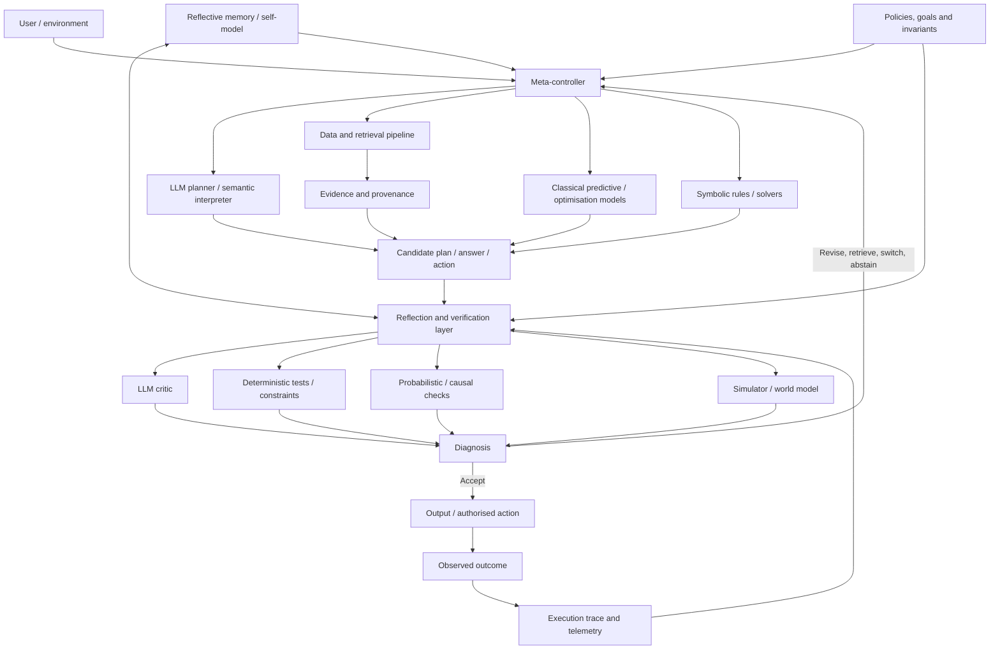
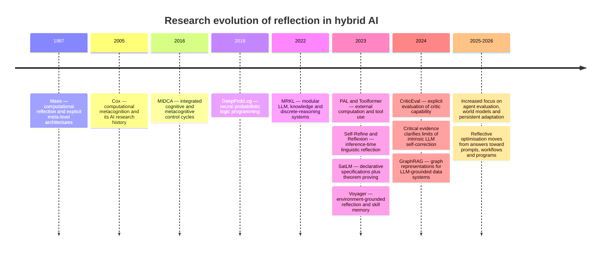

# Reflection in Hybrid AI Systems Combining LLMs, Data, and Classical Models


> Export note: Source links were recovered from the original report's citation panels. Citation groups retain every source for which a URL could be identified; additional source IDs without an exposed URL are marked unresolved. The exact original groups are preserved in the [citation metadata](/ai/design-research/input/reports/reflection-in-hybrid-ai-systems.assets/reflection-in-hybrid-ai-systems-citations.json).

## Executive summary


"Reflection" is used for several related ideas across philosophy, software systems, cognitive science, and current AI. The common structure is **second-order processing**: a system makes some part of its own state, reasoning, behaviour, knowledge, or execution available as an object that can be inspected and can influence subsequent behaviour. Philosophical accounts connect reflection with self-knowledge and awareness of one's own mental states; software reflection makes program structure or execution available to a meta-level; computational metacognition adds monitoring and control of cognition. [^1][^2][^9][^10]

For hybrid AI, a useful engineering definition is:

> **A system is reflective when it explicitly represents some aspect of its own operation, evaluates that representation against goals, evidence, or constraints, and uses the result to causally alter subsequent computation or behaviour.**

This definition requires three functions: **reification**--turning internal activity into explicit data; **meta-evaluation**--reasoning about that data; and **feedback**--making the evaluation affect subsequent state or actions. Under this definition, logging is observability but is not reflection by itself; asking an LLM to "think again" becomes reflection only when the resulting critique participates in a control loop. This interpretation closely connects classical computational reflection, architectures such as MIDCA, and contemporary systems such as Reflexion. [^2][^10][^11]

The main conclusion of the research is that **reflection should be modelled as a system property, not as an LLM prompting technique**. The strongest architecture for a hybrid system is therefore an explicit reflective control plane around heterogeneous components:

- the **LLM** interprets ambiguous inputs, proposes hypotheses and plans, translates between natural and formal representations, and can produce critiques;
- **data systems** supply evidence, provenance, historical state, schemas, and observations;
- **classical models** perform specialised prediction, optimisation, simulation, statistical inference, or control;
- **symbolic components** enforce constraints and perform deterministic inference or proof;
- a **meta-controller** observes the combined execution trace and decides whether to accept, verify, retry, retrieve more evidence, switch models, simulate, escalate, or stop.

This decomposition is consistent with the systems view behind MRKL and with later architectures that delegate computation to interpreters, APIs, theorem provers, and other tools. PAL, for example, lets an LLM generate an executable program while delegating computation to Python; SatLM generates a declarative specification whose solution is delegated to a theorem prover. [^3][^14][^5][^15]

The evidence also argues against treating ungrounded LLM self-critique as a verifier. Self-Refine reported substantial gains from iterative same-model feedback on its evaluated tasks, while subsequent analyses found that **intrinsic prompted self-correction is inconsistent and can make answers worse; reliable external feedback is a much stronger condition for successful correction**. This distinction is fundamental for hybrid architecture design. [^4][^8]

The recommended design is therefore **asymmetric reflection**: use generative models where ambiguity and semantic interpretation are unavoidable, and progressively move evaluation towards components with stronger semantics--retrieval evidence, executable tests, statistical models, causal models, constraint solvers, theorem provers, simulators, or human approval--as consequence severity increases. SatLM illustrates the underlying benefit and limitation precisely: the solver can guarantee correctness relative to the generated specification, while correctness of the specification itself remains a separate problem. [^5]

For representation, there is no universal reflective formalism. A practical system normally combines several:

| Need | Recommended primary representation |
|---|---|
| Execution and control | Typed state graph / state machine |
| Domain entities and relationships | Knowledge graph, RDF/OWL ontology |
| Evidence and provenance | Event/trace graph with immutable observations |
| Uncertainty | Probabilistic program or explicit distributions |
| Hard rules and constraints | Logic, declarative specification, solver input |
| Interventions and counterfactuals | Structural causal model |
| Learned perception plus rules | Neuro-symbolic representation |
| Episodic adaptation | Structured reflective memory |
| Self-modification | Restricted meta-program / reflective interpreter |
| Expensive action forecasting | Simulator or world model |

The core engineering recommendation is to **make the state graph and execution trace the backbone** and attach ontology, probabilistic, causal, symbolic, and simulator representations where their semantics are useful. LangGraph's separation between predefined workflows and dynamic agents is a concrete implementation example; AutoGen exposes a critic/primary-agent reflection pattern; DSPy's current GEPA optimisation uses explicit evaluation feedback and a separate reflection model to rewrite instructions. [^6][^16][^12]

Evaluation must likewise be layered. Final task accuracy is insufficient. A reflective system needs measures of error detection, correction gain, regression rate, critic calibration, constraint satisfaction, provenance, robustness, adaptation, cost, and safety. CriticEval explicitly separates dimensions of critique ability; FActScore decomposes long answers into atomic factual claims; agent environments such as AgentBench, WebArena, SWE-bench, and OSWorld test whether reasoning actually produces successful external actions. [^7][^29][^27][^44][^45][^46]

The most important implementation rule is consequently:

> **Do not give a reflective component more authority than the evidence used by that component can justify.**

A language-only critic may propose a revision. An executable test may reject code. A solver may reject a constraint violation. A calibrated risk model may trigger abstention. A human or formally authorised policy component should gate irreversible high-consequence actions. This layered design addresses both the empirical weakness of ungrounded self-correction and the security problems created when LLMs interpret external data as executable instructions. [^8][^33][^34]

## Foundations and working definition

### Philosophical reflection


At its broadest philosophical level, reflection is a form of **self-directed cognition**: the subject takes its own beliefs, experiences, intentions, reasons, or mental processes as objects of examination. Philosophical discussions of self-knowledge distinguish knowing one's own mental states from ordinary knowledge of external objects, while related accounts of self-consciousness concern awareness of oneself as oneself. [^1][^47]

For AI architecture, the useful part of this tradition is not a claim that reflective software is conscious. It is the **logical shape** of the process:

\[
\text{object-level cognition}

\quad\longrightarrow\quad

\text{representation of that cognition}

\quad\longrightarrow\quad

\text{assessment}

\quad\longrightarrow\quad

\text{possible revision}.
\]

This gives a clean distinction between performing a task and reasoning about how the task is being performed. No assumption about phenomenal consciousness is needed for this engineering interpretation. Computational metacognition uses exactly this functional distinction. [^9][^10]

### Software reflection


Computational reflection gave the idea an operational interpretation. Maes's 1987 work on computational reflection developed architectures in which a program can access representations of aspects of its own computation and use them at a meta-level. This established the enduring distinction between a **base level**, where ordinary computation occurs, and a **meta level**, where the computation itself becomes manipulable information. [^2][^48]

Two concepts from software reflection are particularly important for hybrid AI.

**Reification** converts normally implicit computational properties--control state, methods, environment, execution structure, or configuration--into explicit objects. **Causal connection** means changes made through the reflective representation affect the underlying computation. Without that connection, the representation is merely diagnostic information. [^2]

That gives a useful test for AI systems. An execution trace stored only for dashboards is telemetry. The same trace becomes part of reflection when a controller examines it, diagnoses a failure and changes routing, retrieval, constraints, memory, prompts, models, or actions as a result.

### Metacognition in AI


Metacognition concerns cognition about cognition and, more operationally, the **monitoring and regulation of cognitive activity**. Research on computational metacognition moved these concepts into AI systems for problem solving and comprehension. Cox's work surveys that development, while MIDCA implements a dual-cycle architecture in which metacognitive processes operate alongside a cognitive cycle and react to unexpected events in goal generation, planning and execution. [^9][^10]

MIDCA is important because it illustrates a point that became blurred during the LLM era: metacognition is not synonymous with generating an explanation. It is an architectural relationship between **object-level processes and processes that monitor or regulate them**. [^10]

Contemporary LLM work partially rediscovered this idea. Reflexion stores linguistic feedback in episodic memory and uses it on later trials without modifying model weights. Self-Refine alternates generation, feedback and revision. AutoGen exposes the same structural idea as a primary agent plus critic. [^11][^4][^16]

### A systems definition


For a hybrid AI system, let the operational state be

\[
S_t =

(X_t,D_t,L_t,M_t,K_t,C_t),
\]

where:

- \(X_t\) is the external environment or task state;
- \(D_t\) is available data, evidence and provenance;
- \(L_t\) is LLM state, context and memory;
- \(M_t\) represents classical statistical, optimisation, simulation or predictive models;
- \(K_t\) contains symbolic knowledge, rules and constraints;
- \(C_t\) is the control state.

During execution the system generates a trace

\[
\tau_t =

\operatorname{Trace}

(S_t,a_t,y_t,o_t),
\]

including decisions, retrieved evidence, model calls, tool calls, intermediate artefacts, validation results and external observations.

A reflector can then be modelled as

\[
R(\tau_t,G,\Gamma)

\rightarrow

(q_t,z_t,u_t),
\]

where \(G\) contains goals, \(\Gamma\) contains policies and invariants, \(q_t\) is an assessment or confidence state, \(z_t\) is a diagnosis, and \(u_t\) is a proposed intervention.

The controller applies the intervention through

\[S_{t+1}=F(S_t,u_t,o_t).\]

This separates **reflection** from ordinary inference: \(R\) reasons over a representation of system activity and has a defined path by which its output can change the next system state. This abstraction generalises software reflection, metacognitive architectures, Reflexion-style memory, critic-agent designs and solver-backed feedback. [^2][^10][^11][^16]

A useful maturity scale follows directly:

| Level | Capability | Example |
|---|---|---|
| Observation | Records internal/external state | tracing, provenance |
| Evaluation | Judges state or output | critic, validator |
| Regulation | Changes the next action | retry, switch tool, abstain |
| Adaptation | Changes persistent knowledge or policy | episodic lessons, prompt optimisation |
| Structural reflection | Changes workflow or executable structure | restricted program/workflow rewriting |

The upper levels increase adaptability and also enlarge the safety and verification problem. A system that rewrites persistent instructions, workflows or executable code therefore requires stronger validation than one that simply retries a failed query. DSPy's GEPA, for example, separates reflective prompt optimisation from held-out validation; its documentation explicitly recommends keeping a final test set independent from optimisation. [^12]

## Goals and system architecture

### Interpretability


Reflection creates an explicit place to represent **what the system believes happened**: which data were used, which modules were invoked, which constraints were applied, why a candidate was rejected and what changed after failure. Ontologies help by assigning formal meanings to entities and relations; OWL provides formally defined semantics for classes, properties, individuals and axioms. [^13]

Interpretability is nevertheless conditional on the representation being faithful. A fluent LLM-generated explanation is not evidence that the explanation corresponds to the mechanism that produced the answer. For hybrid systems, stronger interpretability comes from recording observable artefacts--queries, returned records, model versions, solver constraints, proofs, program execution, state transitions and environmental outcomes--alongside textual explanations.

### Controllability


Reflection can turn an open-ended generative process into a controlled decision process. Explicit workflow states give the system bounded transitions; policy checks limit available actions; a meta-controller can select modules, budgets and escalation paths. LangGraph makes a related distinction between workflows with predetermined code paths and agents that dynamically determine their processes and tool use. [^6]

A key modelling decision is therefore the **reflection action space**. A reflector should not receive an unrestricted instruction such as "improve the system". Prefer explicit actions such as:

\[
U=

\{

\text{retry},

\text{retrieve},

\text{switch-model},

\text{run-test},

\text{solve},

\text{simulate},

\text{ask-human},

\text{abstain},

\text{update-memory}

\}.
\]

Structural modifications such as changing prompts, rules or code should occupy a separate, more strongly validated action space.

### Verifiability


Hybrid systems can convert some AI problems from generative judgement into mechanically checkable computation. PAL delegates generated programs to an interpreter. SatLM translates natural-language problems into declarative specifications and delegates solving to an automated theorem prover. Logic-LM follows the broader pattern of translating natural language into symbolic representations for deterministic symbolic reasoning. [^14][^5][^22]

This is one of the strongest arguments for hybrid reflection. The LLM can remain responsible for semantic interpretation while another component determines whether an artefact satisfies machine-checkable conditions. The remaining problem is **semantic translation correctness**: a proof that solves the wrong formalisation is formally valid and operationally wrong. SatLM explicitly limits its correctness guarantee to correctness with respect to the parsed specification. [^5]

### Modularity


MRKL proposed an explicitly modular neuro-symbolic system built from language models, knowledge sources and discrete reasoning modules. The modularity principle allows reflection to operate on component boundaries: route to another expert, compare two models, isolate a failed transformation, replace a retrieval strategy, or strengthen verification only where needed. [^3]

Toolformer provides another version of modularity: the language model learns when and how to invoke external APIs for functions such as calculation, retrieval, translation and calendar access, allowing specialised components to perform operations for which an LLM is a poor computational substrate. [^15]

### Emergent and adaptive behaviour


Reflection can support adaptation by preserving outcomes and using them in subsequent decisions. Reflexion stores textual lessons in episodic memory; Voyager uses environmental feedback, execution errors and self-verification to improve programs while accumulating an executable skill library. [^11][^36]

The same feedback mechanism can create path dependence: an incorrect reflection stored persistently may affect many later episodes. For this reason, "emergent behaviour" is best treated as **something the reflective architecture must expose, measure and bound**, as well as a possible source of useful adaptation.

### Architectural patterns


The following architecture combines the main patterns found across computational metacognition, modular neuro-symbolic systems, current agent frameworks, solver-backed reasoning and reflective memory. [^10][^3][^16][^11]




The important architectural patterns are as follows.

**Meta-controller.** A controller maintains the system's control state, selects components and decides whether additional reflection is justified. MIDCA's metacognitive cycle and MRKL's modular routing provide precedents; modern graph-based agent frameworks provide practical orchestration mechanisms. [^10][^3][^6]

**Reflection layer.** A separate layer assesses proposed outputs or actions. It may contain an LLM critic, deterministic validators, statistical checks and policy rules. AutoGen's documented two-agent reflection pattern implements a simple version in which a critic evaluates a primary agent. [^16]

**Self-model or reflective memory.** The system records capabilities, failures, uncertainty, previous strategies and outcomes. Reflexion's episodic textual memory is a minimal implementation; Voyager's executable skill library is a richer persistent representation. [^11][^36]

**Simulator or world model.** Before taking costly actions, the system can predict consequences and reflect over simulated trajectories. Recent work explicitly applies this pattern to LLM agents; WorldEvolver, for example, maintains episodic and semantic memories from mismatches between predicted and realised transitions and selectively supplies predicted consequences to an agent. Because this work is recent, the broader reliability of LLM-agent world models remains an active research question. [^17][^49]

**Monitoring and feedback loop.** Real environmental observations are compared with intended outcomes. Deviations become inputs to diagnosis, replanning and model updates. This is stronger than language-only reflection because the feedback originates outside the model.

**Verifier gate.** A candidate passes through code execution, tests, formal constraints, proof, schema validation or another mechanically evaluable process before being accepted. PAL and SatLM provide clear examples. [^18][^5]

**Data reflection.** Reflection should include the data pipeline itself. The system may ask whether retrieval was complete, whether the graph is stale, whether an entity was incorrectly resolved, whether provenance is sufficient or whether another data source is needed. GraphRAG illustrates how extraction, network analysis, retrieval and summarisation can be represented as distinct stages over an LLM-derived knowledge graph. [^19]

## Representation formalisms and comparative analysis


No one formalism supplies all of semantics, uncertainty, causal reasoning, control, learnability and self-modification. The strongest designs are **multi-representational**, with conversions treated as explicit, testable interfaces.

### Graphs and ontologies


**Core idea.** Represent objects and their relationships explicitly:

\[G=(V,E,\phi),\]

where \(V\) contains entities or states, \(E\) contains relations or transitions, and \(\phi\) assigns properties, types or provenance.

For stronger semantics, an ontology \(\mathcal O\) adds formally interpreted concepts, relations and axioms. OWL 2 defines classes, properties, individuals and data values under formal semantics and supports logical inference. [^13]

**Advantages.** Graphs give reflection a structured view of relationships across data sources, execution stages and past events. They are useful for provenance, entity relationships, retrieval, dependency analysis and explaining paths through system state. Formal ontologies add machine-checkable semantics. GraphRAG demonstrates the usefulness of an LLM-generated entity graph combined with network analysis and summarisation for querying large text collections. [^13][^19]

**Limitations.** An explicit graph can faithfully encode incorrect extraction. Formal reasoning cannot repair an entity relation that an LLM hallucinated during graph construction. Ontology engineering also imposes schema governance and evolution costs.

**Typical uses.** Enterprise knowledge, provenance, lineage, global document analysis, semantic integration, policy concepts and reflective memory.

**Implementation.** Keep evidence and interpretation distinct: graph assertions should carry source identity, extraction confidence and time. Use RDF/OWL where formal domain semantics provide value; use GraphRAG-style graph construction where relationships must be induced from largely unstructured corpora. [^13][^19]

### Probabilistic programs


**Core idea.** Represent uncertainty as an executable generative model. A model may factorise as

\[p(x,z)=\prod_i p(v_i\mid \operatorname{pa}(v_i)),\]

with reflection computing posterior beliefs \(p(z\mid x)\), predictive uncertainty or decision probabilities when new observations arrive.

Pyro supports probabilistic modelling and inference within the Python/PyTorch ecosystem; Gen supports programmable inference and hybrid inference algorithms that can combine neural networks, variational methods, sequential Monte Carlo and MCMC. [^20][^50]

**Advantages.** Probabilistic programs give uncertainty explicit semantics and can integrate domain assumptions with observed data. They are appropriate when reflective decisions depend on confidence, latent state or noisy measurements.

**Limitations.** Results depend on model assumptions. Exact inference may be impossible, approximate inference introduces error, and an LLM that automatically generates a probabilistic model can silently encode inappropriate priors or dependencies.

**Typical uses.** Diagnosis, forecasting, anomaly attribution, sensor fusion, uncertainty-aware routing and decision support.

**Implementation.** Keep model structure versioned and reviewable. Treat LLM-produced model changes as proposals. Validate posterior predictive behaviour and calibration before allowing probability estimates to govern autonomous high-consequence decisions. Pyro and Gen are suitable implementation substrates. [^20][^43][^51]

### Hybrid neuro-symbolic models


**Core idea.** Combine learned representations with explicit symbolic structure. DeepProbLog extends probabilistic logic programming with neural predicates and supports symbolic and subsymbolic representations, probabilistic inference and learning. [^21]

A typical structure is

\[
\text{neural perception}

\rightarrow

\text{symbolic facts}

\rightarrow

\text{rules / constraints}

\rightarrow

\text{inference}.
\]

LLM systems such as Logic-LM and SatLM use a related architectural division: the language model performs semantic translation and symbolic machinery performs the formal reasoning. [^22][^5]

**Advantages.** Neural components handle ambiguous high-dimensional inputs, while symbolic components provide explicit compositional constraints and inspectable reasoning.

**Limitations.** The neural-to-symbolic boundary is a major error source. Formal consistency after translation says little about whether the translation correctly captured the original problem.

**Typical uses.** Rule-governed domains, scientific reasoning, symbolic mathematics, compliance, reasoning over learned perception and theorem-assisted systems.

**Implementation.** Store both the generated formal representation and the source evidence from which it was derived. Test semantic parsing independently from solving. When possible, generate multiple candidate formalisations and use consistency checks before invoking a solver.

### Structural causal models


**Core idea.** Represent causal relationships through structural equations

\[X_i=f_i(PA_i,U_i),\]

where \(PA_i\) are causal parents and \(U_i\) represents exogenous factors. Structural Causal Models support intervention and counterfactual queries in addition to ordinary prediction. Pearl's formulation provides a mathematical framework for interventions, counterfactuals and direct or indirect effects. [^23]

**Advantages.** Causal models let reflection ask the question that predictive models cannot answer directly: *what would happen if the system changed this variable or took this action?*

**Limitations.** Causal conclusions depend on causal assumptions and identifiability. An LLM's plausible causal story is not evidence for an edge in a causal graph.

**Typical uses.** Root-cause analysis, intervention planning, policy analysis, fault diagnosis and simulation of alternative decisions.

**Implementation.** Separate learned statistical relationships from assumed causal edges. Attach evidence and ownership to each structural assumption. The LLM can help formulate hypotheses and query the model, while causal identification and estimation should remain explicit.

### State machines and workflow graphs


**Core idea.** Represent execution as states and allowed transitions:

\[\delta:S\times E\rightarrow S.\]

A graph can extend this to branching, parallelism, retries, nested workflows and conditional routes.

**Advantages.** State is visible and transitions can be constrained, logged, replayed and tested. This makes state machines a strong substrate for controlling reflective agents.

**Limitations.** Complex workflows can suffer from state explosion, and excessively detailed control logic can remove the adaptability for which an LLM was introduced.

**Typical uses.** Agent orchestration, human approval, transactional workflows, recovery, retry logic and tool execution.

**Implementation.** Put irreversible actions behind explicit states. Limit reflection loops by iteration, cost, confidence or wall-clock budgets. LangGraph provides stateful workflows and dynamic agent patterns with persistence and debugging support. [^6]

### Reflective interpreters and meta-programs


**Core idea.** Make program structure or interpreter behaviour itself available to a meta-level. In abstract form:

\[
M(P,\sigma)

\rightarrow

P',
\]

where \(P\) is the base program, \(\sigma\) its execution/configuration state, and \(M\) is a meta-level operation that can produce a modified program or configuration.

This is the closest direct descendant of classical computational reflection. [^2][^48]

**Advantages.** It supports deep adaptation: routing policies, prompts, rules, transformations or even executable program structure can change based on observed performance.

**Limitations.** It greatly expands the verification surface. An unrestricted reflective interpreter can invalidate assumptions that its own safety checks rely on. Recursive reflection can also create difficult termination and debugging problems.

**Typical uses.** Adaptive compilers, configurable runtimes, automated program optimisation and controlled self-modifying AI systems.

**Implementation.** Permit changes only to explicitly declared meta-objects. Version every mutation, run candidate variants in a sandbox, evaluate on held-out data and require rollback. DSPy's GEPA is a useful lower-risk analogue: a reflection model rewrites program instructions based on metric feedback, while validation data is used to select candidates. [^12]

### Linguistic reflection and episodic memory


**Core idea.** Represent reflection as natural language:

\[
r_t =

\operatorname{LLM}(\tau_t,\text{feedback}),
\]

then condition subsequent decisions on \(r_t\).

Reflexion stores such reflections in episodic memory; Self-Refine iterates between generation, feedback and revision. [^11][^4]

**Advantages.** Almost any observation or failure can be expressed without defining a new formal language. It is therefore inexpensive to add and useful in domains whose failure categories are difficult to enumerate in advance.

**Limitations.** The representation has weak formal semantics. It may contain hallucinated causes, ambiguous rules or conflicting lessons. Same-model critics also tend to share failure modes with the original generator. The broader self-correction literature finds much more reliable improvements when external feedback is available. [^8]

**Typical uses.** Open-ended agents, planning lessons, coding feedback, strategy memory and early prototypes.

**Implementation.** Treat reflective text as a hypothesis, not as authoritative truth. Store the triggering evidence and outcome with each reflection; expire or supersede obsolete reflections; retrieve by task relevance; validate persistent lessons on later episodes.

### Comparative table


| Approach | Formalism | Main strength | Main weakness | Typical reflective use | Representative implementations / sources |
|---|---|---|---|---|---|
| Graphs and ontologies | \(G=(V,E)\), RDF/OWL axioms | Explicit relationships, provenance, semantic reasoning | Extraction and ontology errors become persistent | Knowledge/state introspection, provenance, data reflection | OWL 2; Microsoft GraphRAG. [^13][^19] |
| Probabilistic programs | Generative models, posterior inference | Principled uncertainty | Model misspecification and inference cost | Confidence, diagnosis, probabilistic routing | Pyro; Gen. [^20][^50] |
| Neuro-symbolic | Neural predicates + logic/rules | Learned perception with explicit constraints | Translation/interface errors | Rule-grounded reasoning and verification | DeepProbLog; Logic-LM; SatLM. [^24][^22][^5] |
| Causal models | SCMs, DAGs, structural equations | Interventions and counterfactuals | Requires justified causal assumptions | Root-cause and action reasoning | Pearl SCM framework. [^23] |
| State machines / workflow graphs | States + constrained transitions | Strong control and inspectability | State complexity; less open-ended | Meta-control, recovery, approvals | LangGraph. [^6] |
| Reflective interpreter | Base/meta levels, program transformation | Can adapt system structure | Largest verification and safety surface | Workflow, policy or program adaptation | Computational reflection; DSPy optimisation as restricted analogue. [^2][^12] |
| Linguistic reflection | Text critique + episodic memory | Flexible and low implementation cost | Weak semantics; correlated model errors | Strategy improvement and failure memory | Reflexion; Self-Refine; AutoGen critics. [^11][^4][^16] |
| Solver-backed declarative reflection | Logic/specification + proof/search | Mechanically checkable constraints | Specification gap | Validation and repair of candidate solutions | SatLM, PAL, LeanDojo. [^25][^14][^38] |
| World models / simulators | Learned or classical transition model | Evaluate consequences before acting | Simulation bias and compounding error | Planning, pre-action reflection | Emerging LLM world-model systems. [^17][^52] |

A practical architecture should not select one row. A strong system typically uses a **state graph for orchestration, graph/ontology for persistent knowledge, probabilistic representation for uncertainty, symbolic constraints for hard invariants, and linguistic reflection only for information that has not yet earned a stronger representation**.

## Evaluation methods and metrics


Evaluation should distinguish whether the system can **perform**, **detect an error**, **diagnose the error**, **choose a useful intervention**, and **improve without introducing new errors**. CriticEval supports this separation by evaluating critique capability across multiple dimensions and both scalar and textual forms. [^26]

### Task-level performance


The base metric \(J\) should correspond to real task utility: exact correctness, execution success, accumulated reward, proof success, test-suite pass rate or externally validated completion.

Agent benchmarks make this distinction important. AgentBench evaluates agents across interactive environments; WebArena measures functional success on realistic web tasks; SWE-bench requires successful changes to real software repositories rather than plausible code generation. [^27][^44][^45]

Evaluate at least:

\[
J_{\text{before}}, \qquad

J_{\text{after reflection}}, \qquad

\Delta J=J_{\text{after}}-J_{\text{before}}.
\]

The **reflection gain** \(\Delta J\) is more informative than final quality when studying the reflector itself.

### Error detection and correction


A reflector has two distinct jobs:

\[\text{Detection}: \text{Is something wrong?}\]

\[\text{Correction}: \text{What should change?}\]

Measure detection precision, recall and false-positive rate independently from final correction success. A critic that declares every candidate wrong can have high recall while destroying system quality.

Useful derived metrics are:

\[
\text{Correction precision}

=

\frac{\text{successful corrections}}

{\text{attempted corrections}},
\]

and

\[
\text{Regression rate}

=

P(J_{\text{after}}<J_{\text{before}}).
\]

A stricter regression metric should measure the probability of damaging an initially correct result. This is especially important because prompted self-correction can degrade correct reasoning in some settings. [^8]

### Critic quality


A critic should be evaluated separately from the actor. CriticEval was designed specifically because ordinary task benchmarks do not adequately measure critique ability. [^26]

Assess:

- error localisation;
- diagnosis correctness;
- proposed-fix correctness;
- severity ranking;
- confidence calibration;
- agreement with executable or human reference judgements.

LLM judges themselves require validation. Research on LLM-as-a-judge has documented biases including sensitivity to position, verbosity and self-preference, so a system should not use agreement with its own judge as its only evaluation signal. [^28]

### Grounding and factuality


For generated factual content, evaluation should decompose claims and test them against evidence. FActScore formalises this idea by breaking generations into atomic facts and measuring the fraction supported by a reliable knowledge source. [^29]

For hybrid data systems, complementary metrics include retrieval recall, evidence precision, provenance coverage, unsupported-claim rate, contradiction rate, data freshness violations and entity-resolution accuracy.

A useful reflective metric is

\[
\text{Provenance coverage}

=

\frac{\text{decisive claims backed by traceable evidence}}

{\text{decisive claims}}.
\]

### Uncertainty and abstention


A reflector that decides whether another check is needed must have calibrated uncertainty. Calibration asks whether declared confidence corresponds to empirical correctness; Guo et al. established widely used empirical calibration analysis for modern neural networks. [^30]

Useful measures include negative log likelihood, Brier score, expected calibration error and reliability plots.

For systems that can abstain or escalate, evaluate the **risk-coverage curve**: as the system handles fewer cases autonomously, how rapidly does error risk fall? Selective classification explicitly studies this trade-off between predictive coverage and risk. [^31]

### Formal and symbolic correctness


For symbolic components measure:

- parse/formalisation validity;
- satisfiable/unsatisfiable status;
- proof or solver completion;
- constraint-violation rate;
- generated-program compilation;
- executable test pass rate;
- consistency between source proposition and formal representation.

The final item is essential because solver correctness alone does not close the semantic specification gap demonstrated by architectures such as SatLM. [^5]

### Simulator and causal evaluation


A world model should not be evaluated only according to linguistic similarity between predicted and observed states. The relevant questions are whether it predicts action consequences and whether those predictions improve decisions.

Measure next-state prediction error, event accuracy, action-ranking accuracy, calibration of predicted outcomes, long-horizon drift, performance with versus without simulation, and error conditional on planning depth. Recent LLM world-model research explicitly studies the discrepancy between simulated and realised next states and the effect of selective use of predictions. [^17][^52]

For causal reflection, additionally test intervention predictions and counterfactual consistency against available experimental or quasi-experimental evidence. SCMs provide the formal basis for distinguishing observational, interventional and counterfactual queries. [^23]

### Adaptation and memory


Persistent reflection should be tested on data that did not influence its reflective updates. DSPy's current GEPA workflow explicitly separates training examples used for reflective optimisation, validation examples used for selection and a final held-out test set. [^12]

Measure:

\[
\text{Adaptation gain}

=

J_{\text{future, adapted}}

-

J_{\text{future, baseline}},
\]

together with forgetting on previous task distributions, stability across repeated runs, memory retrieval precision and the lifetime of a stored lesson.

### System-level efficiency


A reflection loop can always appear more accurate by spending more inference. Therefore report quality jointly with:

\[
\text{tokens},

\quad

\text{model calls},

\quad

\text{tool calls},

\quad

\text{wall-clock latency},

\quad

\text{monetary cost},

\quad

\text{iterations}.
\]

An informative efficiency metric is

\[
G_C =

\frac{\Delta J}{\Delta C},
\]

where \(C\) is an application-specific resource cost.

For deployed agents, the harness itself is part of what is being evaluated. Agent benchmark results depend on model, control architecture, environment and allowed interaction budget, so component-level ablations are needed in addition to end-to-end scores. [^32][^53]

### Recommended evaluation matrix


| Layer | Primary question | Suggested metrics |
|---|---|---|
| Actor | Can the base system solve the task? | task success, reward, pass rate |
| Critic | Can it identify faults? | precision, recall, localisation, CriticEval-style scores |
| Corrector | Does intervention improve outcomes? | \(\Delta J\), correction precision, regression rate |
| Data | Is evidence adequate? | retrieval recall, provenance coverage, freshness |
| Probabilistic | Does confidence mean anything? | ECE, Brier, NLL, risk-coverage |
| Symbolic | Are formal requirements satisfied? | proof/test/constraint success |
| Simulator | Are consequences predicted usefully? | transition error, action-ranking accuracy |
| Memory | Does experience improve later behaviour? | held-out adaptation gain, forgetting |
| Safety | Does reflection remain within authority? | violation rate, attack success, unsafe actions |
| Operations | Is the improvement economical? | latency, calls, tokens, \(\Delta J/\Delta C\) |

## Trade-offs, risks, and mitigations

### Self-confirming reflection


When the same model generates an answer, critiques it and decides whether its own critique is correct, the errors are strongly coupled. Self-Refine found gains in its tested settings, but the broader critical review by Kamoi et al. found that successful intrinsic self-correction without reliable external feedback is not generally established, while external feedback is substantially more dependable. [^4][^8]

**Mitigation:** progressively diversify feedback: independent model critics, retrieval evidence, code execution, formal solvers, classical predictions, environmental outcomes or human evaluation. The critic should be able to receive information that the generator did not possess when creating the original answer.

### The specification gap


Formal verification can prove that a solution satisfies a specification. It cannot prove automatically that an LLM faithfully translated the user's intention into that specification. SatLM makes the distinction explicit by guaranteeing correctness relative to the parsed specification. [^5]

**Mitigation:** retain natural-language input, formal representation and supporting evidence together; validate transformations independently; test formalisation accuracy as its own benchmark; use multiple parses or human review for high-consequence specifications.

### Memory poisoning and accumulated false lessons


Persistent reflective memory turns one erroneous diagnosis into a future prior. Reflexion and Voyager show why persistent feedback can be useful, but persistence also creates a new stateful failure mode absent from stateless prompting. [^11][^36]

**Mitigation:** attach provenance and outcomes to memories; distinguish observations from inferred lessons; assign confidence and expiry policies; require repeated evidence before promoting a linguistic lesson into a durable rule.

### Prompt injection through data


Hybrid systems blur the distinction between information and instructions. Indirect prompt-injection research demonstrated that malicious instructions placed in externally retrieved data can influence LLM-integrated applications, including their API use. [^33]

A reflective architecture can amplify this problem because retrieved content may be stored as memory or converted into a persistent rule.

**Mitigation:** maintain explicit trust boundaries between instructions and external content; use typed tool interfaces; constrain permissions; sanitise and label retrieved content; require policy checks after LLM interpretation; sandbox execution; prevent retrieved text from directly rewriting system policy or persistent meta-state.

### Unsafe self-modification


A reflective interpreter or optimisation system that can change the mechanisms used to supervise it creates a circular assurance problem.

**Mitigation:** divide mutable and immutable state. Keep core authority rules, approval requirements, security controls and audit mechanisms outside the modifiable set. Candidate prompt, rule or code changes should be versioned, tested against held-out and adversarial suites and rolled out with rollback capability. DSPy's explicit optimisation/validation separation is a useful restricted model of this pattern. [^12]

### Brittleness at module boundaries


Hybrid architectures move errors across representation boundaries:

\[
\text{language}

\rightarrow

\text{entities}

\rightarrow

\text{formal specification}

\rightarrow

\text{model input}

\rightarrow

\text{decision}.
\]

A deterministic downstream model can confidently process an incorrectly mapped input. DeepProbLog, PAL and SatLM illustrate architectures where the interface between neural interpretation and formal processing is central to overall correctness. [^21][^14][^5]

**Mitigation:** define typed interface contracts, validate units and schemas, test transformations independently, and preserve traceability across every representation boundary.

### Feedback-loop instability


Reflection introduces repeated dynamics:

\[S_{t+1}=F(S_t,R(S_t)).\]

A local improvement criterion does not guarantee stable global behaviour. Repeated revisions may oscillate, consume unbounded resources or overfit to the critic.

**Mitigation:** use bounded loops, acceptance thresholds, stop conditions, rollback to the best known state and monotonic invariants for safety-critical properties. Track whether each reflection step improved an external metric before allowing persistent changes.

### Cost and latency


Self-critique, multi-model voting, simulation and proof all consume resources. A design with unlimited compute can still be operationally poor if reflection runs on every low-risk decision.

**Mitigation:** treat reflection depth as a decision problem. Use lightweight deterministic checks first; escalate to retrieval, stronger critics, simulation or human review only when expected error cost justifies it. Evaluate quality against inference budget rather than comparing systems at unequal compute.

### Emergent multi-component failure


A hybrid system may exhibit failure modes that no individual module displays in isolation: one model produces slightly biased output, retrieval reinforces it, the critic accepts it, and memory converts it into a persistent rule. Agent benchmarks already show that long-horizon reasoning and interaction remain difficult even when individual model capabilities look strong in static tasks. [^27][^44]

**Mitigation:** evaluate complete trajectories and module interactions, run counterfactual ablations, preserve event-level traces and test recovery from injected faults.

### Governance and safety engineering


NIST's Generative AI profile frames trustworthy AI as a lifecycle concern spanning design, development, use and evaluation. That framing fits reflective systems particularly well because reflection changes system state after initial deployment. [^34]

A practical authority hierarchy is:

\[
\text{language suggestion}

<

\text{evidence-backed assessment}

<

\text{mechanically verified result}

<

\text{immutable policy constraint}.
\]

The reflector may recommend violating a constraint; it should not possess the authority to remove the constraint that rejects its recommendation.

## Case studies, research evolution, and implementation roadmap

### Representative systems


**Computational reflection -- Maes.** The foundational software architecture separates object-level computation from a meta-level representation capable of inspecting or modifying computation. Its main contribution to modern AI is the base/meta distinction and causal link between representation and system behaviour. [^2][^48]

**MIDCA.** MIDCA implements cognitive and metacognitive cycles to improve autonomy under unexpected circumstances, including goal generation, planning and execution. It provides a direct architectural ancestor for today's meta-controller pattern. [^10]

**DeepProbLog.** DeepProbLog combines neural predicates with probabilistic logic programming, demonstrating a representation in which neural and symbolic components participate in common inference and learning. It is a strong reference when reflection must reason over both perceptual uncertainty and explicit rules. [^21]

**MRKL / Jurassic-X.** MRKL explicitly proposes modular systems combining language models, external knowledge and discrete reasoning modules; the paper describes Jurassic-X as AI21 Labs' implementation. Its importance is architectural: it treats the LLM as part of a system of specialised reasoning components. [^3]

**PAL.** Program-Aided Language Models convert natural-language reasoning into executable programs and delegate computation to an interpreter. This is an effective pattern when the reflective question can be converted into an executable check. [^18]

**SatLM and Logic-LM.** These systems move further towards declarative symbolic reasoning. SatLM generates declarative specifications and uses an automated theorem prover; Logic-LM similarly uses LLMs to construct symbolic representations consumed by deterministic solvers. They show how reflection can become verification rather than another round of free-form text generation. [^35][^22]

**Toolformer.** Toolformer demonstrates learned selection and invocation of external APIs, including calculators and retrieval systems. It is less a reflection system itself than an important mechanism for building reflective systems whose meta-controller can invoke stronger specialised components. [^15]

**Reflexion.** Reflexion uses linguistic feedback and episodic memory instead of weight updates. It is the clearest contemporary example of linguistic reflection changing future behaviour through persistent state. [^11]

**Self-Refine.** Self-Refine uses one LLM as generator, feedback provider and refiner. It established the viability of inference-time iterative revision on several tasks but also exemplifies the correlated-critic design whose general reliability has subsequently been questioned. [^4][^8]

**Voyager.** Voyager combines an automatic curriculum, executable skill memory and iterative refinement driven by environmental feedback, execution errors and self-verification. It illustrates the move from textual reflection to reflection grounded in executable behaviour and external outcomes. [^36]

**Microsoft GraphRAG.** GraphRAG combines LLM extraction, network analysis, graph-based information organisation and summarisation. GraphRAG is not intrinsically reflective, but its explicit graph is a useful substrate on which a reflective layer can inspect provenance, relations and retrieval decisions. [^19]

**AutoGen.** AutoGen supports agents using combinations of LLMs, human inputs and tools, and its current documentation explicitly implements a two-agent reflection pattern with a primary agent and critic. It is a practical reference architecture for separating actor and reviewer roles. [^37][^16]

**LangGraph.** LangGraph provides explicit workflow graphs as well as dynamic agent execution, persistence and debugging. Its value for reflection is control: the reflective loop can be modelled as state transitions rather than hidden inside repeated prompts. [^6]

**DSPy / GEPA.** DSPy's current GEPA optimisation uses metric feedback and a selectable reflection language model to rewrite instructions, with separate training, validation and final-test roles. This is a practical example of reflection operating on the program configuration itself. [^12]

**LeanDojo.** LeanDojo provides infrastructure, data and models for theorem proving with Lean. It is relevant when the verification layer should return machine-checkable proofs rather than qualitative critiques. [^38]

### Research evolution


The main historical shift has been from **programs reasoning about their own execution**, through **cognitive architectures monitoring their cognition**, to **hybrid LLM systems whose reflective state spans text, data, tools, symbolic models, memory and external environments**. The milestones below are representative rather than exhaustive. [^2][^9][^10][^21][^3][^11][^7]




The trend is significant: reflection is moving **outwards from the model**. Early LLM work often treated reflection as additional natural-language generation. More structured systems turn execution, memory, tools, graphs, programs, proofs and environmental outcomes into explicit reflective state. The empirical weakness of ungrounded self-correction provides a strong reason for this direction. [^8][^7]

### Recommended modelling roadmap


The following roadmap assumes no fixed domain or compute constraint. It deliberately starts with representation and evaluation before adding autonomous self-modification.

| Stage | What to build | Primary representation | Suitable tools / patterns | Exit criterion |
|---|---|---|---|---|
| Define the reflection contract | Goals, observable state, invariants and allowed reflective actions | Typed schema | Domain schema + policy definitions | Every reflective intervention has explicit authority and stop conditions |
| Instrument execution | Capture data access, model calls, tool calls, outputs and outcomes | Event/trace graph | Application telemetry and provenance store | A failed trajectory can be replayed and attributed |
| Add explicit control | Move retries, branches, approval and termination out of prompts | State machine / workflow graph | LangGraph-style orchestration | Control flow is testable independently of the LLM. [^6] |
| Formalise persistent knowledge | Represent stable entities, relationships, sources and versions | Graph / ontology | RDF/OWL; GraphRAG where extraction is needed | Assertions have provenance and semantic ownership. [^13][^19] |
| Separate specialist computation | Delegate arithmetic, prediction, optimisation and domain models | Typed model/tool APIs | Classical models, PAL-style interpreters, MRKL pattern | Each component has an independent test suite. [^3][^14] |
| Build a verifier ladder | Apply progressively stronger checks | Rules, programs, formal specifications | Tests, theorem provers, LeanDojo, SatLM-style solving | High-risk outputs cannot bypass deterministic validation. [^25][^38] |
| Model uncertainty | Expose epistemic uncertainty where decisions depend on incomplete data | Probability distributions / programs | Pyro or Gen | Confidence is calibrated on held-out observations. [^20][^50][^30] |
| Add causal structure when interventions matter | Distinguish correlation from action consequences | SCM / causal graph | Structural causal modelling | Intervention assumptions are explicit and testable. [^23] |
| Add reflective diagnosis | Diagnose failures using trace, evidence and validators | Structured diagnosis + optional text | Independent LLM critic / AutoGen pattern | Detection and correction metrics beat non-reflective baseline. [^16][^7] |
| Add persistent reflective memory | Retain validated lessons across episodes | Structured episodic graph plus text | Reflexion/Voyager-inspired memory | Held-out future performance improves without unacceptable forgetting. [^11][^36] |
| Add simulation for expensive actions | Test candidate plans before execution | World model / simulator state | Domain simulator or learned world model | Simulation demonstrably improves external decisions |
| Permit bounded meta-adaptation | Optimise instructions, rules or workflow candidates | Versioned meta-program | DSPy/GEPA-style optimisation | Candidate changes pass independent validation and rollback tests. [^12] |
| Harden for deployment | Adversarial tests, permission controls, audit and abstention | Policy + immutable audit state | Security sandbox, approval gates, risk-coverage evaluation | Safety and regression thresholds are met under adversarial evaluation. [^39][^34][^31] |

### Recommended target representation


For a general-purpose hybrid system, I would use a **typed state graph as the canonical operational model**.

Each node or edge should identify:

\[
(\text{type},

\text{value},

\text{source},

\text{timestamp},

\text{confidence},

\text{producer},

\text{version}).
\]

The graph should distinguish at least:

- **observations** -- externally supplied facts;
- **interpretations** -- LLM or model-derived statements;
- **predictions** -- model forecasts;
- **constraints** -- required invariants;
- **decisions** -- selected actions;
- **outcomes** -- observed consequences;
- **reflections** -- diagnoses and proposed changes;
- **meta-changes** -- persistent modifications to memory, prompts, policy candidates or workflow configuration.

Stable domain semantics can be lifted into an OWL-style ontology where formal reasoning is useful. Probabilities should remain probability-valued objects rather than being flattened into words such as "likely". Causal claims should live in a causal representation rather than in an ordinary knowledge graph. Hard constraints should be executable or solver-checkable. [^40][^20][^23][^5]

### Recommended reflective control policy


A practical controller can implement a risk-sensitive escalation rule:

\[
\text{reflect if }

E[L \mid s,a]\cdot P(\text{undetected error}\mid s,a)
>
C_{\text{reflection}},
\]

where \(E[L]\) is expected loss from an incorrect action and \(C_{\text{reflection}}\) is the cost of additional checking.

The resulting sequence should normally be:

```text
LLM proposal
   ↓
schema / type validation
   ↓
data and provenance validation
   ↓
deterministic tests or domain model
   ↓
symbolic / probabilistic / causal check when applicable
   ↓
independent critic for residual semantic problems
   ↓
simulation for costly or irreversible actions
   ↓
human approval or abstention where required
   ↓
action
   ↓
observed outcome
   ↓
validated reflective memory
```


This ordering uses inexpensive, high-precision checks before expensive semantic reflection. It also prevents a language critic from overriding a stronger invariant.

### Recommended modelling position


The research supports five design principles.

**Reflection should operate over explicit state.** Hidden prompt context alone makes diagnosis, replay and governance difficult. State graphs, evidence objects and execution traces are better substrates. [^6][^13]

**Reflection should be grounded wherever possible.** External feedback, executable tests, solvers and environment observations give a reflective loop information unavailable to a same-model critic. The evidence on self-correction strongly favours this distinction. [^8][^14][^5]

**Different claims require different representations.** Relations belong naturally in graphs; uncertainty in probability models; causal claims in SCMs; hard requirements in logic or executable validators; open-ended diagnoses may remain natural language until enough evidence exists to formalise them. [^41][^50][^23][^21]

**Persistent reflection requires stronger evidence than transient reflection.** A speculative critique used for one retry is comparatively cheap. The same critique promoted to durable memory, policy or executable code can affect thousands of future decisions. Reflexion, Voyager and reflective optimisation make this distinction increasingly important. [^11][^36][^12]

**The final architecture should be reflective without becoming recursively unconstrained.** The meta-controller may inspect the base system; higher-risk meta-changes should pass through immutable constraints and independent evaluation. Classical computational reflection supplies the conceptual mechanism, while modern AI safety and agent evidence explains why its authority must be bounded. [^2][^33][^34]

## References


- Maes, P. (1987). *Concepts and Experiments in Computational Reflection*. OOPSLA. Foundational treatment of computational reflection, base/meta-level architecture and reflective computation. [^2]
- Cox, M. T. (2005). *Metacognition in Computation: A Selected Research Review*. Artificial Intelligence. Review of computational approaches to metacognition. [^9]
- Cox, M. et al. (2016). *MIDCA: A Metacognitive, Integrated Dual-Cycle Architecture for Self-Regulated Autonomy*. AAAI. [^10]
- Karpas, E. et al. (2022). *MRKL Systems: A Modular, Neuro-Symbolic Architecture that Combines Large Language Models, External Knowledge Sources and Discrete Reasoning*. [^3]
- Shinn, N. et al. (2023). *Reflexion: Language Agents with Verbal Reinforcement Learning*. [^11]
- Madaan, A. et al. (2023). *Self-Refine: Iterative Refinement with Self-Feedback*. NeurIPS. [^4]
- Kamoi, R. et al. (2024). *When Can LLMs Actually Correct Their Own Mistakes? A Critical Survey of Self-Correction of LLMs*. TACL. [^8]
- Lan, T. et al. (2024). *CriticEval: Evaluating Large-scale Language Model as Critic*. NeurIPS. [^26]
- Gao, L. et al. (2023). *PAL: Program-aided Language Models*. ICML. [^18]
- Ye, X. et al. (2023). *SatLM: Satisfiability-Aided Language Models Using Declarative Prompting*. NeurIPS. [^5]
- Pan, L. et al. (2023). *Logic-LM: Empowering Large Language Models with Symbolic Solvers for Faithful Logical Reasoning*. [^22]
- Schick, T. et al. (2023). *Toolformer: Language Models Can Teach Themselves to Use Tools*. NeurIPS. [^15]
- Manhaeve, R. et al. (2018). *DeepProbLog: Neural Probabilistic Logic Programming*. NeurIPS. [^21]
- Badreddine, S. et al. (2021). *Logic Tensor Networks*. A differentiable logical representation for neuro-symbolic learning and reasoning. [^42]
- Pearl, J. (2010). *Causal Inference*. Proceedings of Machine Learning Research. Formal overview of Structural Causal Models, interventions and counterfactuals. [^23]
- W3C. *OWL 2 Web Ontology Language Structural Specification and Functional-Style Syntax*. Formal ontology specification. [^13]
- Microsoft Research. *Project GraphRAG*. Official project description of graph extraction, network analysis, retrieval and LLM summarisation. [^19]
- Wang, G. et al. (2023). *Voyager: An Open-Ended Embodied Agent with Large Language Models*. [^36]
- Wu, Q. et al. (2023). *AutoGen: Enabling Next-Gen LLM Applications via Multi-Agent Conversation*. [^37]
- Microsoft AutoGen documentation. *Teams / Reflection Pattern*. Official implementation of a primary-agent/critic reflection design. [^16]
- LangChain. *LangGraph Workflows and Agents*. Official documentation for stateful workflow and dynamic-agent patterns. [^6]
- DSPy. *GEPA Optimization*. Official documentation for feedback-driven reflective instruction optimisation with a configurable reflection model and separate validation. [^12]
- Pyro. *Introduction to Pyro*. Official probabilistic-programming documentation. [^20]
- Gen. *Probabilistic Programming and Programmable Inference*. Official documentation. [^43][^50]
- Yang, K. et al. (2023). *LeanDojo: Theorem Proving with Retrieval-Augmented Language Models*. NeurIPS. [^38]
- Liu, X. et al. (2023). *AgentBench: Evaluating LLMs as Agents*. [^27]
- Zhou, S. et al. (2023). *WebArena: A Realistic Web Environment for Building Autonomous Agents*. [^44]
- Jimenez, C. E. et al. (2023). *SWE-bench: Can Language Models Resolve Real-World GitHub Issues?* [^45]
- Min, S. et al. (2023). *FActScore: Fine-grained Atomic Evaluation of Factual Precision in Long Form Text Generation*. EMNLP. [^29]
- Guo, C. et al. (2017). *On Calibration of Modern Neural Networks*. ICML. [^30]
- Geifman, Y. & El-Yaniv, R. (2017). *Selective Classification for Deep Neural Networks*. NeurIPS. [^31]
- Greshake, K. et al. (2023). *Not What You've Signed Up For: Compromising Real-World LLM-Integrated Applications with Indirect Prompt Injection*. [^33]
- NIST (2024, updated 2026). *Artificial Intelligence Risk Management Framework: Generative Artificial Intelligence Profile*, NIST AI 600-1. [^34]

## Citation links


[^1]: [Self-Knowledge - Stanford Encyclopedia of Philosophy](<https://plato.stanford.edu/entries/self-knowledge/>).

[^2]: [Concepts and experiments in computational reflection](<https://dl.acm.org/doi/10.1145/38807.38821>).

[^3]: [MRKL Systems: A modular, neuro-symbolic architecture that combines large language models, external knowledge sources and discrete reasoning](<https://arxiv.org/abs/2205.00445>).

[^4]: [Self-Refine: Iterative Refinement with Self-Feedback](<https://proceedings.neurips.cc/paper_files/paper/2023/hash/91edff07232fb1b55a505a9e9f6c0ff3-Abstract-Conference.html>).

[^5]: [SatLM: Satisfiability-Aided Language Models Using Declarative Prompting](<https://proceedings.neurips.cc/paper_files/paper/2023/hash/8e9c7d4a48bdac81a58f983a64aaf42b-Abstract-Conference.html>).

[^6]: [Workflows and agents - Docs by LangChain](<https://docs.langchain.com/oss/python/langgraph/workflows-agents>).

[^7]: [CriticEval: Evaluating Large-scale Language Model as Critic](<https://proceedings.neurips.cc/paper_files/paper/2024/hash/7b7d7985f62284060d65f532ed2ea5fa-Abstract-Conference.html>).

[^8]: [When Can LLMs Actually Correct Their Own Mistakes? A Critical Survey of Self-Correction of LLMs - ACL Anthology](<https://aclanthology.org/2024.tacl-1.78/>).

[^9]: [Metacognition in computation: A selected research review](<https://www.sciencedirect.com/science/article/pii/S0004370205001530>).

[^10]: [MIDCA: A Metacognitive, Integrated Dual-Cycle Architecture for Self-Regulated Autonomy \| Proceedings of the AAAI Conference on Artificial Intelligence](<https://ojs.aaai.org/index.php/AAAI/article/view/9886>).

[^11]: [Reflexion: Language Agents with Verbal Reinforcement Learning](<https://arxiv.org/abs/2303.11366>).

[^12]: [GEPA optimization - DSPy](<https://dspy.ai/current/getting-started/gepa-optimization/>).

[^13]: [OWL 2 Web Ontology Language Structural Specification and Functional-Style Syntax (Second Edition)](<https://www.w3.org/TR/owl2-syntax/>).

[^14]: [PAL: Program-aided Language Models](<https://proceedings.mlr.press/v202/gao23f.html>).

[^15]: [Toolformer: Language Models Can Teach Themselves to Use Tools](<https://proceedings.neurips.cc/paper_files/paper/2023/hash/d842425e4bf79ba039352da0f658a906-Abstract-Conference.html>).

[^16]: [Teams -- AutoGen](<https://microsoft.github.io/autogen/stable//user-guide/agentchat-user-guide/tutorial/teams.html>).

[^17]: [Self-Evolving World Models for LLM Agent Planning - arXiv](<https://arxiv.org/html/2606.30639v1>).

[^18]: [PAL: Program-aided Language Models](<https://proceedings.mlr.press/v202/gao23f.html>).

[^19]: [Project GraphRAG - Microsoft Research](<https://www.microsoft.com/en-us/research/project/graphrag/>).

[^20]: [Introduction to Pyro -- Pyro Tutorials 1.9.1 documentation](<https://pyro.ai/examples/intro_long.html>).

[^21]: [DeepProbLog: Neural Probabilistic Logic Programming](<https://proceedings.neurips.cc/paper/2018/hash/dc5d637ed5e62c36ecb73b654b05ba2a-Abstract.html>).

[^22]: [Logic-LM: Empowering Large Language Models with ...](<https://aclanthology.org/2023.findings-emnlp.248/>).

[^23]: [Causal Inference](<https://proceedings.mlr.press/v6/pearl10a.html>).

[^24]: [DeepProbLog: Neural Probabilistic Logic Programming](<https://proceedings.neurips.cc/paper/2018/hash/dc5d637ed5e62c36ecb73b654b05ba2a-Abstract.html>).

[^25]: [SatLM: Satisfiability-Aided Language Models Using Declarative Prompting](<https://proceedings.neurips.cc/paper_files/paper/2023/hash/8e9c7d4a48bdac81a58f983a64aaf42b-Abstract-Conference.html>).

[^26]: [CriticEval: Evaluating Large-scale Language Model as Critic](<https://proceedings.neurips.cc/paper_files/paper/2024/hash/7b7d7985f62284060d65f532ed2ea5fa-Abstract-Conference.html>).

[^27]: [AgentBench: Evaluating LLMs as Agents](<https://arxiv.org/abs/2308.03688>).

[^28]: [Judging LLM-as-a-Judge with MT-Bench and Chatbot Arena](<https://arxiv.org/abs/2306.05685>).

[^29]: [FActScore: Fine-grained Atomic Evaluation of Factual ...](<https://aclanthology.org/2023.emnlp-main.741/>).

[^30]: [On Calibration of Modern Neural Networks](<https://proceedings.mlr.press/v70/guo17a.html>).

[^31]: [Selective Classification for Deep Neural Networks](<https://papers.neurips.cc/paper/7073-selective-classification-for-deep-neural-networks>).

[^32]: [AgentBench: Evaluating LLMs as Agents](<https://arxiv.org/abs/2308.03688>).

[^33]: [Not what you've signed up for: Compromising Real-World LLM-Integrated Applications with Indirect Prompt Injection](<https://arxiv.org/abs/2302.12173>).

[^34]: [Artificial Intelligence Risk Management Framework: Generative Artificial Intelligence Profile \| NIST](<https://www.nist.gov/publications/artificial-intelligence-risk-management-framework-generative-artificial-intelligence>).

[^35]: [SatLM: Satisfiability-Aided Language Models Using Declarative Prompting](<https://proceedings.neurips.cc/paper_files/paper/2023/hash/8e9c7d4a48bdac81a58f983a64aaf42b-Abstract-Conference.html>).

[^36]: [Voyager: An Open-Ended Embodied Agent with Large Language Models](<https://arxiv.org/abs/2305.16291>).

[^37]: [AutoGen: Enabling Next-Gen LLM Applications via Multi ...](<https://arxiv.org/abs/2308.08155>).

[^38]: [LeanDojo: Theorem Proving with Retrieval-Augmented ...](<https://proceedings.neurips.cc/paper_files/paper/2023/hash/4441469427094f8873d0fecb0c4e1cee-Abstract-Datasets_and_Benchmarks.html>).

[^39]: [Not what you've signed up for: Compromising Real-World LLM-Integrated Applications with Indirect Prompt Injection](<https://arxiv.org/abs/2302.12173>).

[^40]: [OWL 2 Web Ontology Language Structural Specification and Functional-Style Syntax (Second Edition)](<https://www.w3.org/TR/owl2-syntax/>).

[^41]: [OWL 2 Web Ontology Language Structural Specification and Functional-Style Syntax (Second Edition)](<https://www.w3.org/TR/owl2-syntax/>).

[^42]: [Logic Tensor Networks](<https://arxiv.org/abs/2012.13635>).

[^43]: [Gen.jl](<https://www.gen.dev/docs/>).

[^44]: [WebArena: A Realistic Web Environment for Building Autonomous Agents](<https://arxiv.org/abs/2307.13854>).

[^45]: [SWE-bench: Can Language Models Resolve Real-World GitHub Issues?](<https://arxiv.org/abs/2310.06770>).

[^46]: Unresolved additional source from the original report (reference ID: `turn20search21`). Its URL was not exposed in the citation panel.

[^47]: Unresolved additional source from the original report (reference ID: `turn1search7`). Its URL was not exposed in the citation panel.

[^48]: Unresolved additional source from the original report (reference ID: `turn1search21`). Its URL was not exposed in the citation panel.

[^49]: Unresolved additional source from the original report (reference ID: `turn14search5`). Its URL was not exposed in the citation panel.

[^50]: Unresolved additional source from the original report (reference ID: `turn13search5`). Its URL was not exposed in the citation panel.

[^51]: Unresolved additional source from the original report (reference ID: `turn13search12`). Its URL was not exposed in the citation panel.

[^52]: Unresolved additional source from the original report (reference ID: `turn14search17`). Its URL was not exposed in the citation panel.

[^53]: Unresolved additional source from the original report (reference ID: `turn20search14`). Its URL was not exposed in the citation panel.
