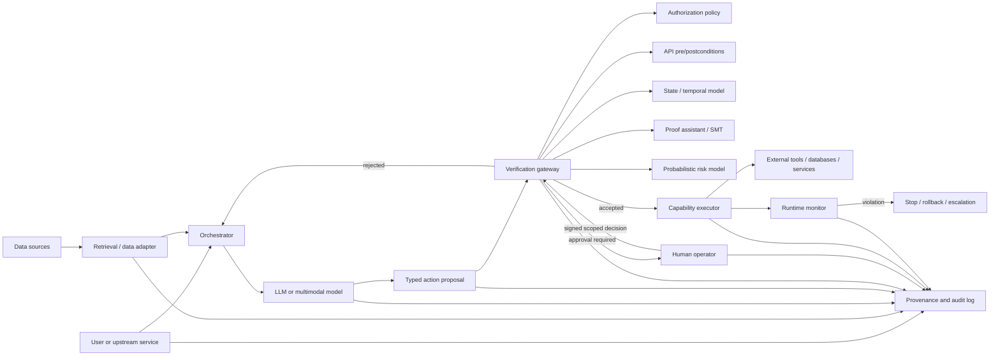
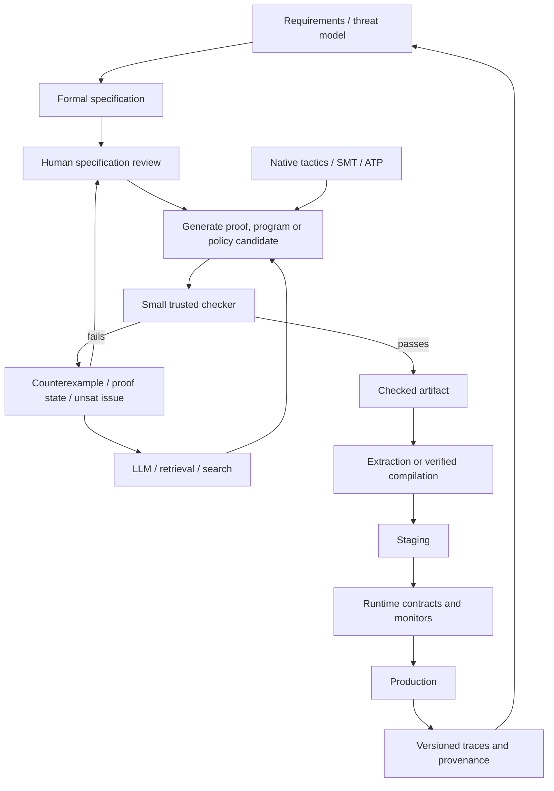
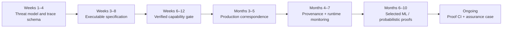

# Formal Verification for Systems Combining LLMs, Humans, Software, and Data

## Executive summary


Formal verification is most useful for LLM-based systems when the LLM is treated as an **untrusted, stochastic proposal generator inside a verified control structure**. The proof assistant does not need to prove that a language model is "correct." It can prove that every action capable of changing the world passes through mechanisms whose behavior is precisely specified: authorization checks, workflow state machines, API contracts, approval rules, data-handling policies, resource limits, and runtime monitors. LLMs can also generate proofs, specifications, policies, and programs, with a small proof kernel or independently checked solver certificate deciding what is accepted. LeanDojo, FVEL, CoqPyt, and Isabellm already demonstrate variants of the LLM-as-proof-proposer pattern. [^1][^2][^3][^4]

This changes the role of formal verification from "prove an algorithm once" to **maintain a machine-checkable contract for an evolving sociotechnical system**. The verified object can include software components, tool permissions, database transitions, data lineage, human approvals, temporal workflow requirements, and abstractions of probabilistic model behavior. AWS's Cedar is a strong current example of this broader approach: its authorization semantics and symbolic compiler are formalized in Lean, the production engine is implemented in Rust, differential testing connects the formal and production implementations, and SMT analysis is used to answer policy questions. [^5][^6]

No single formalism is best for the entire stack. A practical high-assurance architecture is layered:

| Problem | Most appropriate technique |
|---|---|
| Rich mathematical and system invariants | Lean, Rocq, Isabelle/HOL, HOL4/HOL Light |
| Verified executable components | Rocq extraction, F*, Lean, Agda; CompCert or CakeML for a stronger compilation chain |
| Access control | A formally specified policy engine such as Cedar |
| Tool/API workflows and concurrency | TLA+/TLC, Apalache, Spin, nuXmv, or an equivalent state-transition formalism |
| Stochastic system behavior | PRISM or Storm |
| Bounded neural-network properties | Vehicle plus a neural verifier such as Marabou |
| LLM/agent safety during operation | Runtime monitors such as AgentSpec, VeriGuard, Pro2Guard, or domain-specific monitors |
| Proof search | Native tactics, SMT/ATP automation, plus LLMs whose output is checked by the proof assistant |

TLC is the primary model checker in the TLA+ tool family; Apalache translates TLA+ problems toward SMT-based symbolic analysis; Spin checks concurrent software models; nuXmv combines SAT- and SMT-based symbolic verification; PRISM and Storm address probabilistic systems. [^7][^8][^9][^10][^11][^12]

The strongest early targets for an engineering team are usually **privileged actions and boundaries**: which agent may call which tool, under what context, which data may flow into or out of a request, which human must approve a transition, and what postcondition must hold after execution. These properties are substantially easier to formalize than open-ended claims such as "the model is aligned," and a small verified gate can cover many changing models and prompts. AgentSpec's ICSE 2026 work reports runtime enforcement across code execution, embodied agents, and autonomous-driving scenarios, while Cedar shows how formal authorization can be placed outside application-specific decision logic. [^13][^14][^15]

For probabilistic or learned components, the guarantee must state its scope. Marabou, for example, establishes or refutes specified properties over a given neural-network model and input region; Vehicle addresses the difficult translation between high-level neuro-symbolic specifications and neural-verifier inputs. Pro2Guard instead learns a finite probabilistic abstraction from execution traces and performs probabilistic reachability analysis at runtime. These are useful guarantees, but their assumptions differ sharply from a theorem proved for every execution of a deterministic transition system. [^16][^17][^18][^19]

The main limitation is the **specification and abstraction boundary**. Machine checking can establish that a theorem follows from the formal model; it cannot by itself establish that the model expresses what stakeholders actually meant. This is particularly important for LLM systems because natural-language intent, tool semantics, changing external data, and human judgment all sit near that boundary. seL4 explicitly documents the assumptions outside its machine-checked proof, and Vehicle's work calls the analogous neural-system problem the "embedding gap." [^20][^18]

The engineering recommendation is therefore to build a **verified control plane around probabilistic components**, keep the trusted computing base explicit, and expand the proof boundary only where the cost is justified. LLMs should be allowed to accelerate proof construction, policy synthesis, counterexample explanation, and specification drafting. They should not decide whether their own proof or policy is valid.

## Proof assistant landscape


The systems below share the idea that a small trusted mechanism validates a much richer layer of proof construction, but they make different choices about logic, programming, automation, and deployment.

| System           | Foundation and strengths                                                                                                                                                                                                                                                                                                       | Automation and ecosystem                                                                                                                                                                                                                                                | Interoperability and deployment                                                                                                                                                                                                 | Main engineering trade-offs                                                                                                                                                                                                                                                                              |
| ---------------- | ------------------------------------------------------------------------------------------------------------------------------------------------------------------------------------------------------------------------------------------------------------------------------------------------------------------------------ | ----------------------------------------------------------------------------------------------------------------------------------------------------------------------------------------------------------------------------------------------------------------------- | ------------------------------------------------------------------------------------------------------------------------------------------------------------------------------------------------------------------------------- | -------------------------------------------------------------------------------------------------------------------------------------------------------------------------------------------------------------------------------------------------------------------------------------------------------- |
| **Lean 4**       | Dependently typed programming language and theorem prover. It combines ordinary functional programming with proof development, making it attractive when specifications, verified algorithms, metaprograms, and engineering tooling should live in one environment. Mathlib supplies a very large reusable library. [^21][^22] | `simp`, `grind`, `lia`, proof-search tooling such as Aesop, and a rapidly developing package ecosystem through Lake and Reservoir. Recent Lean releases continue to expand automation. [^23][^24]                                                                       | Native programs, foreign-function interfaces, Lake packages, and particularly strong current LLM infrastructure: LeanDojo-v2 exposes repository tracing, datasets, retrieval and prover interaction. [^25][^1]                  | Very attractive for new LLM/formal-method projects. The ecosystem changes relatively quickly, so toolchain pinning matters. Executing verified Lean definitions also introduces compiler/runtime/FFI assumptions beyond the proof kernel, which must be represented in the trusted computing base. [^26] |
| **Rocq / Coq**   | Calculus-of-Inductive-Constructions family, mature dependent types, program verification and proof development. Long-running projects such as CompCert demonstrate large software proofs. [^27][^28]                                                                                                                           | Ltac/Ltac2, arithmetic decision procedures such as `lia`, MathComp/SSReflect, and plugin ecosystems for automation and testing. [^29]                                                                                                                                   | Certified programs can be extracted to OCaml, Haskell and Scheme. MetaRocq formalizes substantial parts of Rocq's own metatheory, while CoqPyt supplies Python-side proof navigation suited to LLM applications. [^30][^31][^2] | Excellent when verified executable algorithms or existing Coq developments matter. Compared with current Lean tooling, the LLM integration layer is somewhat less consolidated, although CoqPyt and other interfaces are closing that gap.                                                               |
| **Isabelle/HOL** | A generic proof assistant whose dominant object logic is classical higher-order logic. It is particularly strong for large structured system proofs; seL4 is the flagship example. The Archive of Formal Proofs provides a continuously maintained body of checked developments. [^32][^33]                                    | Sledgehammer connects interactive proofs to external automated theorem provers and SMT solvers and reconstructs results inside Isabelle. Isabelle 2026 includes continuing improvements to Sledgehammer and SMT integration, including cvc5 proof reconstruction. [^34] | Rich Isabelle/ML and Scala infrastructure; ATP/SMT integration; strong mechanisms for importing external automation while checking the resulting proof through Isabelle's trusted core. [^34]                                   | Strong choice for system semantics, security, protocols and classical mathematics. The environment is less similar to a conventional application-programming stack than Lean or F*, and the Isabelle-specific architecture has a substantial learning curve.                                             |
| **Agda**         | A dependently typed functional programming language with a close "programs as proofs" style. Cubical Agda directly supports cubical type-theoretic constructions. [^35]                                                                                                                                                        | Reflection exposes syntax and type-checking operations for user metaprogramming. Standard and cubical libraries provide reusable constructive mathematics. [^36][^37]                                                                                                   | Compilation backends and foreign-function integration make verified definitions executable; Agda is also useful as a host for strongly typed domain-specific languages. [^38]                                                   | Excellent for constructive specifications and language research. It has less push-button automation and a smaller software-verification/solver-integration ecosystem than Lean, Rocq or Isabelle, so large operational verification projects generally require more custom infrastructure.               |
| **HOL4**         | LCF-style classical higher-order logic with a small trusted kernel and a long history in hardware, semantics and systems verification. [^39]                                                                                                                                                                                   | Tactic-based proof development plus built-in decision procedures; external techniques can be integrated through explicitly identified oracle mechanisms. [^39]                                                                                                          | CakeML is developed in HOL4 and provides a verified path from functional programs toward machine code. [^40][^41]                                                                                                               | Strong assurance and semantics expertise, but older SML-centered tooling and a smaller contemporary application ecosystem than Lean/Rocq.                                                                                                                                                                |
| **HOL Light**    | A deliberately small, minimalist HOL prover implemented in OCaml. Its small logical core and extensible derived inference infrastructure make the trusted base easy to inspect. [^42]                                                                                                                                          | Automated arithmetic and mathematical decision procedures plus extensive libraries, especially in analysis and geometry. [^42]                                                                                                                                          | Direct OCaml embedding. Major developments include Flyspeck and AWS's s2n-bignum arithmetic verification. [^42][^43]                                                                                                            | Best suited to teams that place a premium on a small trusted base and specialized mathematical/crypto verification. Developer experience and package management are less integrated than in Lean.                                                                                                        |
| **F\***          | A proof-oriented, dependently typed programming language, verifier, compiler and proof assistant. Refinement types and effects let specifications sit directly on executable code. [^44]                                                                                                                                       | Verification conditions are heavily automated through SMT, especially Z3; metaprogramming and embedded DSLs support specialized reasoning. [^45]                                                                                                                        | Production-oriented extraction/compilation paths support OCaml/F# and low-level C/Wasm-oriented workflows; Pulse and EverParse address concurrent code and verified parsing. Project Everest is the major ecosystem. [^46][^44] | Often the shortest route from formal contracts to low-level production software. Heavy SMT automation means engineers need to understand solver sensitivity and the precise trusted boundary of extraction and external code.                                                                            |

For a new heterogeneous LLM system, my default choices would be **Lean** when the formal layer itself will be an actively developed software platform, **Isabelle/HOL** when the dominant problem is system or protocol reasoning, **Rocq** when its mature extraction/verification ecosystem or existing developments are decisive, and **F\*** when verified executable security-sensitive components are the objective. HOL4/HOL Light make sense when a small LCF-style foundation or existing HOL developments dominate. Agda is especially good when constructive types or a purpose-built typed DSL are central.

The more important choice, however, is not the proof assistant. It is the **verification boundary**. Cedar demonstrates that Lean can prove properties of a specification and symbolic compiler while a production Rust implementation is connected through differential testing. seL4 takes a different route, relating Isabelle/HOL models down to C implementations. CakeML goes farther toward a verified language/compiler stack. These examples show several valid ways to connect a proof environment to production software. [^6][^20][^40]

## Verification goals for LLM-based systems


A useful formal model treats the complete application as a transition system

\[\mathcal S = (M,O,D,C,H,E)\]

where \(M\) is one or more language or ML models, \(O\) the orchestrator, \(D\) data stores and retrieval systems, \(C\) external software/tools, \(H\) human operators, and \(E\) the external environment. A run is a trace

\[\tau = e_0,e_1,\ldots,e_n\]

of typed events such as `ModelOutput`, `DataRead`, `ToolProposed`, `Authorized`, `HumanApproved`, `ToolExecuted`, `DataWritten`, or `ModelChanged`.

This representation is useful because many important properties are statements about the **trace and its state transitions**, regardless of how the LLM produced its proposal. Runtime-verification work such as AgentSpec, VeriGuard, Pro2Guard and SENTINEL follows this general direction, using formal rules, verified policies, probabilistic transition models or temporal logic around agent execution. [^13][^47][^19][^48]

The following are operational definitions suitable for engineering. They intentionally scope terms such as "alignment" and "interpretability" to properties that can actually be specified and measured.

| Goal | Formalization | Useful measurable properties |
|---|---|---|
| **Safety** | Define a set of bad states or events \(B\). A deterministic invariant is \( \forall\tau\in Traces(\mathcal S),\, G\,\neg B \). Temporal forms can require, for example, that a dangerous action is never executed before authorization. | Number of reachable violating states; percentage of privileged transitions covered by the invariant; runtime violation/block rate; false-permit and false-reject rates of the enforcement layer; time from risky proposal to intervention. |
| **Robustness** | For a permitted perturbation relation \(R_\delta(x,x')\), require preservation of an invariant or bounded output difference: \(R_\delta(x,x')\Rightarrow d(O(x),O(x'))\le\epsilon\). For an agent, the more useful property is often "security-relevant decisions remain invariant under untrusted-context perturbations." | Certified input radius for tractable neural components; worst-case policy violation over an explicit perturbation set; percentage of security-sensitive decisions invariant to prompt/document perturbations; counterexamples found. Marabou is an example of a verifier that can prove a specified neural property over an analyzed region or return a violating input. [^16] |
| **Specification conformance** | Use pre/postconditions \(P(s,a)\Rightarrow Q(s,a,s')\), a refinement relation between implementation and abstract model, or temporal formulas such as `request -> F response`. | Percentage of critical APIs with checked pre/postconditions; proof-obligation pass rate; state-machine properties proved; escaped counterexamples; contract coverage of privileged transitions. |
| **Data provenance** | Represent artifacts and transformations as a provenance graph. A derived artifact is acceptable only if its lineage consists of approved sources and transformations and the bound identifiers/hashes correspond to what execution consumed. | Percentage of production outputs with complete machine-replayable lineage; number of missing or unverifiable lineage edges; fraction of model inputs bound to immutable versions; replay success rate. |
| **Access control** | For principal \(p\), action \(a\), resource \(r\), context \(c\), require that execution implies an authorization decision: `Execute(p,a,r,c) ⇒ Permit(p,a,r,c)`. Stronger properties include noninterference and least-privilege reachability constraints. | Unauthorized states reachable; privileges available per agent; percentage of capabilities mediated by the reference monitor; formally proved policy equivalence after policy changes; unauthorized-path counterexamples. Cedar's formal model and symbolic compiler are concrete examples of this style. [^5][^15] |
| **Interpretability / auditability** | Scope the claim to artifacts that can be checked: each consequential decision must identify the policy rule, evidence, source data, model/version and transition that led to it. Require that an explanation references facts present in the execution/provenance graph. | Percentage of consequential actions with replayable evidence; percentage of explanation claims traceable to a concrete source or rule; disagreement between explanation and executed transition; audit replay success. This does **not** establish that a natural-language chain of thought is a faithful causal description of model internals. |
| **Alignment** | Define an explicit behavioral contract \(A\): objective constraints, forbidden states, human-override semantics and perhaps preference orderings. Verify \(S\models A\), or for a stochastic model establish a declared probabilistic bound such as \(P[\neg A]\le\alpha\) under a stated abstraction/distribution. | Contract-violation rate; probability bounds from an explicit stochastic model; percentage of human overrides obeyed; goal/constraint preservation across delegation; severity-weighted violations. Probabilistic model checking gives a principled language for this narrower notion. [^49][^19] |

A crucial distinction is between three kinds of guarantee:

**Deductive guarantees** prove a logical statement for every behavior represented by the formal model. seL4's Isabelle development and CompCert's semantic-preservation proof are examples of this class. [^33][^28]

**Bounded or abstract guarantees** cover an explicit abstraction, region, depth or network class. Neural-network verification and bounded model checking fall here. Marabou takes a network and property and can establish the property or exhibit a counterexample for the supported query; Apalache can reason symbolically over bounded executions and also perform inductiveness checks. [^16][^8]

**Statistical guarantees** depend on a learned or estimated stochastic model. Pro2Guard, for example, abstracts traces into symbolic states, learns a discrete-time Markov chain and uses probabilistic reachability to trigger intervention; its guarantees therefore depend on the adequacy of that abstraction and learned transition model. [^19]

Calling all three "formally verified" without stating this distinction is a source of confusion. For LLM systems, assurance documentation should always name the model, assumptions, quantified domain, trusted computing base and property being established.

## Architectures, workflows, and practical toolchains


The architecture I recommend is a **mediated action architecture**. The LLM may read information and propose arbitrary structured plans, but it receives no direct capability to produce external side effects. All consequential operations pass through a deterministic control path.




The security property to prove is then much smaller than "the LLM will always behave safely." A typical theorem has the shape

\[
\text{ExternalEffect}(e)

\Longrightarrow

\text{Authorized}(e)

\land

\text{ContractValid}(e)

\land

\text{RequiredApprovalsPresent}(e).
\]

If every side-effecting capability is reachable only through `CapabilityExecutor`, and the executor verifies an unforgeable authorization/evidence object, the theorem remains useful when prompts, models and retrieval systems change. Cedar's approach of separating authorization policies from application logic is directly applicable here, and current AWS work applies Cedar-style policy enforcement to agentic workflows. [^50][^15][^51]

Human approval should itself be part of the formal protocol. An "approve" click should become a typed event containing the identity/role of the approver, exact proposed operation, relevant resource identifiers, scope, validity period and a binding to the version of the request being authorized. The transition relation can then prove that approval for operation \(x\) cannot silently authorize modified operation \(x'\). This also makes human escalation auditable.

A complementary development workflow uses the LLM aggressively while keeping it outside the trusted base:




LeanDojo formalizes the machine-facing side of this loop for Lean by exposing proof states and premises to learning systems; its original benchmark contained almost 100,000 mathlib theorems. CoqPyt provides a similar programmatic navigation layer for Rocq. FVEL converts verification problems into Isabelle proof problems and combines LLM proof generation with Isabelle checking. Isabellm uses an LLM to propose Isabelle commands and validates them through Isabelle in a bounded search loop. [^1][^2][^3][^4]

A practical toolchain can therefore be assembled by layer:

| Layer | Tools / pattern | Role in an LLM system |
|---|---|---|
| **Interactive proof** | Lean, Rocq, Isabelle/HOL, HOL4/HOL Light, Agda, F* | Semantics of workflows, policy engines, parsers, approval protocols, provenance rules, verified algorithms. |
| **Proof automation** | Lean Aesop/`grind`/`lia`; Rocq tactics; Isabelle Sledgehammer; F* verification-condition generation + Z3 | Discharge repetitive obligations while the kernel or trusted verification architecture controls acceptance. Lean and Isabelle continue to invest directly in this automation. [^23][^34][^45] |
| **SMT** | Z3; cvc5 | Efficient decision procedures for arithmetic, arrays, bit vectors and policy constraints. cvc5 can emit proof information in formats designed for reconstruction, including integration paths with Isabelle and Rocq tooling. [^52][^53] |
| **Finite-state / temporal verification** | TLC, Apalache, Spin, nuXmv | Agent workflow ordering, retries, approval races, delegation, concurrent tool calls, distributed protocol invariants and liveness. [^7][^8][^9][^10] |
| **Probabilistic verification** | PRISM, Storm | Analyze abstractions such as "probability of reaching unsafe state before intervention," expected cost, reliability and policy trade-offs. PRISM and Storm both operate on explicit probabilistic models/specifications rather than raw LLM weights. [^11][^12] |
| **Neural component verification** | Vehicle, Marabou | State a high-level property, translate it toward a neural-network verifier and incorporate the result into a larger system proof. Marabou uses SMT-style network analysis; Vehicle was designed to bridge higher-level specifications, verifiers and interactive theorem provers. [^16][^18] |
| **Verified compilation** | CompCert; CakeML | Reduce the risk that compilation invalidates a source-level proof. CompCert proves semantic preservation for C compilation; CakeML's source and compiler proofs are developed in HOL4. [^28][^40] |
| **Extraction** | Rocq extraction; F*; Agda; Lean executable definitions | Turn formally developed definitions into executable components. Rocq currently supports extraction to OCaml, Haskell and Scheme. [^30] |
| **Runtime verification** | AgentSpec, VeriGuard, Pro2Guard, SENTINEL or project-specific monitors | Check actual agent actions/traces after static proof can no longer capture the entire external environment. [^13][^47][^19][^48] |
| **Authorization** | Cedar + Cedar Analysis | Separate capability decisions from model reasoning; verify policy properties with a Lean-verified symbolic translation to SMT. [^5][^6] |
| **LLM/prover bridge** | LeanDojo-v2, CoqPyt, FVEL, Isabellm | Give an LLM structured proof states, premises and checker feedback while retaining the conventional prover as authority. [^25][^2][^54][^4] |

**API contracts** deserve special treatment because they are the boundary between the verified control plane and ordinary services. A language-neutral contract can define:

\[\{P(req,state)\}\; API(req)\; \{Q(req,res,state,state')\}\]

plus temporal restrictions such as "a payment commit must be preceded by a matching approved quote" or "a credential may never appear in a response event." JSON Schema, Protobuf or an existing IDL can remain the wire format; a separate formal model gives the request/response types their semantic meaning. Generated wrappers should validate the contract and emit an evidence record before the operation is allowed to affect external state.

**Data pipelines** should use the same scheme. Each transformation receives versioned inputs and emits an artifact together with machine-readable provenance: source identifiers, code/model version, relevant policy state, transformation identity and integrity bindings. The proof need not contain the data itself. It can prove that every artifact accepted into a sensitive stage possesses an admissible lineage and that the runtime checker enforces the same lineage predicate.

A useful deployment hierarchy is:

\[
\text{Proof assistant}

\rightarrow

\text{verified policy/validator}

\rightarrow

\text{small enforcement service}

\rightarrow

\text{unverified application and LLM}.
\]

That concentrates expensive formal work in a component with broad security leverage.

## Case studies and evidence


Existing work covers a useful spectrum from production systems with years of formal-methods history to very recent LLM-agent research.

| Case | Scope | Method | Demonstrated outcome | Maturity | Reproducibility |
|---|---|---|---|---|---|
| **seL4** | OS microkernel and security properties | Isabelle/HOL refinement and machine-checked system proofs | seL4's proofs use Isabelle/HOL from security properties toward the C implementation; the project explicitly documents proof assumptions. [^33][^20] | Production/industrial research; one of the strongest examples of large system verification | **High**: proof repository and verified configurations are published with build instructions. [^55] |
| **CompCert** | Optimizing C compiler | Rocq/Coq semantic-preservation proofs for compiler passes | Source-level safety properties are preserved by correctly generated executable behavior under CompCert's theorem and assumptions. The current project remains actively maintained. [^28] | Mature industrial verification | **High** for research/proof inspection; source and formal developments are published. |
| **CakeML** | Programming language + compiler stack | HOL4 definitions and proofs; verified compilation to machine code | Current CakeML documentation describes a verified compiler spanning multiple intermediate languages and targets; proofs and sources are developed in HOL4. [^41][^40] | Mature academic verification platform with substantial applications | **High**: open code and proofs. |
| **AWS Cedar** | Authorization policy language and analysis | Lean formalization; proved properties; Lean-implemented symbolic compiler to SMT; differential testing against production Rust implementation | The symbolic compiler's translation has soundness/completeness proofs; Cedar's validator soundness is formally proved, with differential testing used to relate the formal model to Rust. [^5][^6] | Production-oriented industry system | **High**: formal Lean source, generators and DRT framework are public with build instructions. [^6] |
| **AWS s2n-bignum** | High-performance crypto arithmetic | HOL Light functional-correctness and constant-time properties for assembly routines | The project supplies machine-checked proofs for optimized arithmetic used in AWS cryptographic software; current work includes formal constant-time properties for deployed routines. [^43][^42] | Production industry cryptography | **High**: source and HOL Light proofs are public. |
| **Project Everest / F\*** | Cryptography, protocol code, parsers and low-level security components | Dependent/refinement types, SMT verification, Low*/Pulse/EverParse-style DSLs, verified/validated low-level generation | Everest-derived verified components have been used in major production software, including operating-system, browser and networking stacks. [^46] | Production industry/research | **High to medium**, depending on component: major libraries and developments are public, while a complete deployment includes external build/platform assumptions. |
| **Vehicle + Marabou** | Neural components in larger neuro-symbolic systems | Dependently typed high-level specification compiled toward neural verifiers and ITP integration; Marabou solves network/property constraints | Vehicle is specifically designed to close the specification "embedding gap" and let neural verification results participate in wider formal developments. Marabou can return either a guarantee for the query or a concrete counterexample. [^17][^16] | Active academic research | **High** for experimentation: both toolchains are publicly available, with Vehicle tutorials and Marabou installation support. [^56][^16] |
| **LeanDojo / ReProver** | LLM-based theorem proving | Retrieval of accessible Lean premises + LLM tactic generation + Lean checking | The original work released an open toolkit and a 98,734-theorem benchmark, demonstrating retrieval-augmented formal proof generation; LeanDojo-v2 now provides an updated end-to-end framework. [^1][^25] | Mature research infrastructure | **High**: open toolkit, data/model infrastructure and benchmarks. |
| **FVEL** | LLM-assisted program verification | Transform verification tasks into Isabelle; LLM proposes proofs; Isabelle validates them | FVELER contains 758 theories, 29,125 lemmas and 200,646 proof steps; the paper reports improvements on SV-COMP after fine-tuning models on this formal corpus. [^3] | Research prototype/benchmark | **High to medium**: project page and dataset-oriented work are public. [^54] |
| **AgentSpec** | Runtime safety of code agents, embodied agents and autonomous-driving agents | DSL of triggers, predicates and enforcement actions around agent execution | Published evaluation reports prevention of unsafe execution in more than 90% of code-agent cases, elimination of evaluated hazardous embodied actions and full compliance in the evaluated AV scenarios, with millisecond-scale enforcement overhead. LLM-generated rules performed materially worse than hand-specified rules on recall, illustrating the specification problem. [^13] | ICSE 2026 research system | **High to medium**: implementation is public and integrates with agent frameworks. [^14] |
| **Pro2Guard / ProbGuard** | Predictive runtime safety for LLM agents | Symbolic abstraction of traces, learned DTMC and probabilistic model checking | The Pro2Guard evaluation reports intervention on up to 93.6% of unsafe embodied-agent tasks under aggressive thresholds and advance prediction of evaluated vehicle violations/collisions; the implementation includes PRISM. [^19] | Recent research prototype | **High to medium**: code is public, but guarantees are statistical and dependent on learned abstractions. |
| **VeriGuard** | Safety policies for LLM agents | Offline policy synthesis + formal verification, followed by online action checking against the verified policy | Separates expensive offline verification from lightweight runtime enforcement, closely matching the architecture recommended in this report. [^47] | Recent Google research | **Medium**: primary paper and project publication are available; reproducibility is less established than Cedar or LeanDojo in the consulted artifacts. |
| **SENTINEL** | Embodied-agent safety | Temporal-logic requirements checked at semantic, plan and trajectory levels | Evaluates foundation-model agents in VirtualHome and ALFRED and reports safety violations observable across multiple abstraction levels. [^48] | Recent research | **Medium/early**: strong formal evaluation design, with less production evidence than the mature system-verification cases. |

The table suggests an important division of labor. The most mature industrial results verify **deterministic infrastructure around computation**: compilers, kernels, cryptographic routines, parsers, authorization semantics. Current LLM-agent research largely verifies or monitors **actions, plans and abstractions of behavior**. That is a sensible architectural boundary because an LLM's enormous stochastic state space is poorly matched to traditional deductive verification, whereas its capabilities can be sharply constrained at a comparatively small number of external interfaces.

Cedar is particularly instructive for an LLM platform. The formal object is not every application using Cedar. Lean establishes properties of the policy semantics and analysis machinery; production software submits authorization requests; the authorization engine mediates the capability. The same structure can be used for model tools:

```text
LLM suggests:       send_email(Alice, confidential_document)
                         |
                         v
formal policy:      Is this principal permitted to disclose
                    this data classification to Alice in this context?
                         |
                  +------+------+
                  |             |
                 yes            no
                  |             |
            human rule?       reject
                  |
             execute
```


That is a much more tractable theorem than proving that the LLM will never *want* to disclose confidential information.

## Limitations, scaling problems, and open research questions


**The specification problem remains dominant.** A perfectly checked proof of the wrong requirement provides the wrong assurance. The LLM era makes this worse because important requirements often begin as natural language. AgentSpec gives a concrete warning: its LLM-generated policy rules had high precision but materially lower recall in the embodied-agent evaluation, so syntactically plausible automatically generated constraints omitted relevant cases. [^13]

A promising process is therefore:

\[
\text{natural-language requirement}

\rightarrow

\text{LLM draft}

\rightarrow

\text{formal counterexamples}

\rightarrow

\text{human approval}

\rightarrow

\text{machine-checked specification}.
\]

The human should approve the **formal interpretation**, not merely the original English sentence.

**Semantic abstraction is difficult.** A tool call named `transfer_funds` has a clean formal signature only if its real implementation behaves like the modeled operation. External APIs can have retries, partial failure, caches, hidden side effects, races and changing semantics. The proof boundary must therefore include adapters or monitors that connect concrete events to their abstract counterparts. Vehicle identifies the analogous challenge for neural systems: a high-level property must be connected correctly to the representation used by the neural verifier. [^18]

**The trusted computing base expands at deployment time.** A proof kernel can validate a theorem while the deployed system still depends on parsers, compilers, runtimes, FFI code, operating systems, hardware and external services. Lean explicitly distinguishes theorem checking from the additional trust involved when generated code is executed. seL4 publishes an assumptions analysis for exactly this reason. Verified compilers such as CompCert and CakeML can remove part of this gap, but no practical LLM service is proved down to every transistor and external API. [^26][^20][^28][^40]

**Solver automation creates another trust and maintenance boundary.** An architecture can trust an SMT implementation directly, or it can require proof evidence that a smaller checker reconstructs. Isabelle deliberately routes external automation back through proof construction, and current Isabelle releases include cvc5 proof-reconstruction improvements. Certificate-producing/reconstructing architectures should be preferred for the highest-assurance obligations. [^34]

**State explosion remains fundamental.** An agent with \(n\) tools, concurrent tasks, retries, human interventions and mutable data can have a vast transition state space. TLC, Spin, nuXmv, PRISM and similar systems therefore depend on abstraction, symmetry reduction, bounded reasoning or specialized symbolic representations; Apalache explicitly distinguishes bounded symbolic execution/model checking from inductiveness checking. [^8][^9][^10][^49]

The long-term answer is compositional verification: prove small contracts of the form

\[A_i \Rightarrow G_i\]

for component \(i\), then establish that other components provide the assumptions \(A_i\). For an agent system, the model might assume only that the LLM emits an arbitrary value from a typed proposal space, while proving that arbitrary values cannot violate capability invariants. This is dramatically more scalable than formalizing the model's entire generation process.

**Probabilistic guarantees can become stale.** Pro2Guard learns transition probabilities from traces. If the model, prompt, retrieval source, tool behavior or user population changes, the empirical transition model can shift. Statistical monitoring therefore needs versioned distributions, drift tests and explicit invalidation criteria. A proof that the PRISM formula was solved correctly does not prove that the learned Markov chain still represents production behavior. Pro2Guard itself explicitly bases the mechanism on a learned symbolic DTMC and probabilistic reachability. [^19]

**End-to-end neural verification remains sharply limited by scale and model structure.** Marabou is effective because supported neural properties can be reduced to structured constraint problems. The same approach does not make unrestricted autoregressive language generation with millions or billions of parameters, long contexts, sampling, retrieval and tool interaction tractable as one monolithic verification problem. Marabou itself describes its role as a network/property analyzer, and Vehicle builds an interface so such bounded neural results can be used within larger proofs. [^16][^18]

This suggests a useful decomposition:

\[
\underbrace{\text{LLM}}_{\text{mostly empirical}}

+

\underbrace{\text{typed interface}}_{\text{fully checkable}}

+

\underbrace{\text{policy}}_{\text{fully checkable}}

+

\underbrace{\text{workflow}}_{\text{model checkable}}

+

\underbrace{\text{critical algorithms}}_{\text{deductively provable}}

+

\underbrace{\text{runtime environment}}_{\text{monitored}}.
\]

**Interpretability is especially easy to overclaim.** Formal methods can prove that a displayed explanation references the actual policy rule that fired, that sources are genuinely present in the provenance graph, or that a counterexample explains a rejected transition. They do not thereby prove that generated prose is the model's faithful internal reason for producing a token sequence. For high-assurance applications, "interpretability" should therefore mean auditable causal structure in the surrounding system unless a more specific property is supplied.

**Alignment has the same problem.** Formal verification can establish compliance with an explicitly formalized utility, policy, preference relation, constitutional rule, approval protocol or forbidden-state set. It cannot establish that this formalization exhausts "human values." The useful engineering statement is "all executions in model \(S\) satisfy formal contract \(A\), subject to assumptions \(X\)," not "the agent is aligned."

**Human operators must be modeled as components.** A human can approve the wrong request, misunderstand a summary, approve stale data, be compromised, or act under the wrong role. Open research is needed on usable proof obligations for human decisions: how much formal evidence should be shown, how to bind a user's approval to an exact future action, and how to keep formal safeguards comprehensible without encouraging rubber-stamping.

**Proof maintenance is a software-engineering problem.** Toolchain changes, specification refactoring and upstream library updates can invalidate proof scripts. Lean's rapid release cadence illustrates why verification projects need pinned compilers/libraries and reproducible CI; the Isabelle AFP addresses a related problem by continuously checking formal developments against supported Isabelle releases. [^23][^26][^32]

Several research problems therefore deserve particular attention:

| Research problem | Why it matters |
|---|---|
| Verified natural-language-to-specification translation | The formal specification is increasingly the weakest link once proof automation becomes good. |
| Proof-carrying agent actions | A tool request could include compact machine-checkable evidence that its prerequisites and permissions hold. |
| Compositional contracts for multi-agent systems | Verification should scale by checking local assumptions/guarantees instead of constructing the full global state space. |
| Verified adapters between APIs and formal models | Real API semantics are a major source of model/implementation mismatch. |
| Proof certificates across tool boundaries | Lean/Rocq/Isabelle, SMT, model checkers and neural verifiers currently have limited common evidence formats. |
| Formal provenance semantics | We need standardized notions of what it means for an LLM output to be derived from, authorized by, or dependent on a data source. |
| Distribution-aware formal monitoring | Probabilistic guarantees need principled invalidation when behavior or environment drifts. |
| Formal approval semantics | Human consent should bind exactly to the operation, data and context that eventually execute. |
| Verified policy synthesis | LLMs are useful policy/specification writers, but omitted requirements must be discovered systematically through counterexamples and adversarial search. |
| Hybrid deductive/probabilistic assurance | Large systems need theorems for deterministic control logic and calibrated risk bounds for model-dependent behavior in a coherent assurance case. |

## Engineering adoption roadmap and prioritized primary sources


The adoption strategy should begin with a narrow invariant whose violation would be expensive and whose enforcement point is easy to identify. Trying to formalize the LLM itself at the start is unlikely to produce comparable value.

| Phase | Typical elapsed time | Work product | Success metrics |
|---|---:|---|---|
| **System and threat model** | Weeks 1-4 | Typed event vocabulary; diagram of models, tools, humans and data; inventory of side effects; trust-boundary document | 100% of privileged capabilities have a named enforcement path; every high-severity failure maps to a formalizable state/event or is explicitly declared outside scope |
| **Executable formal model** | Weeks 3-8 | Small Lean/Rocq/Isabelle/F* model plus a state-machine/model-checking model where useful | Important unsafe states are either proved unreachable or produce actionable counterexamples; CI can replay the entire model |
| **First verified gate** | Weeks 6-12 | Authorization/tool-call gate; typed action proposals; human-approval protocol; formal API contracts | Percentage of privileged operations mediated approaches 100%; no bypass path in architecture review; policy tests and proofs run in CI |
| **Production correspondence** | Months 3-5 | Differential tests, generated code, verified/extracted component, or refinement relation connecting formal and deployed implementations | Formal/reference implementation divergence tracked and driven to zero on generated corpus; versioned evidence produced for each release |
| **Provenance and runtime verification** | Months 4-7 | Versioned event/provenance store and runtime monitor | Provenance completeness; replay rate; false-permit/false-reject rate; monitor p95 latency; human-escalation rate |
| **Probabilistic/ML verification where justified** | Months 6-10 | Bounded neural properties or probabilistic transition model for selected high-risk components | Certified regions/properties, risk-model calibration, drift alarms, counterexample discovery rate |
| **Continuous formal assurance** | Ongoing | Proof CI, specification review, regression corpus, model-change procedure and evidence bundles | Proof rebuild time; percentage of high-risk transitions proved; escaped counterexamples; policy-to-implementation divergence; stale-assumption count |

An illustrative sequence is:




**Skills.** The smallest effective team does not need everyone to become a theorem-proving expert. A practical division is one or two engineers comfortable with the chosen proof assistant and formal semantics, application engineers who own the production adapters, a security/requirements owner responsible for threat and policy semantics, and domain experts who review formalized requirements. LLM-based proof assistants can lower proof-authoring effort, but formal-specification review remains a human responsibility. LeanDojo, CoqPyt, FVEL and Isabellm show that generating or repairing proof scripts through an LLM while retaining deterministic proof checking is already practical as research infrastructure. [^25][^2][^54][^4]

**Tool choice.** For a new engineering organization with no existing formal-method investment, I would start with **Lean 4 plus an external state/model-checking layer**, unless the product makes another choice clearly superior. Lean supplies a modern programming environment, large Mathlib ecosystem, active automation, Lake/Reservoir package management and the strongest current collection of open LLM/prover infrastructure among the systems examined here. [^21][^24][^23][^25]

Use **Rocq** when extraction, CompCert, MathComp or an existing Coq codebase dominates; **Isabelle/HOL** when system semantics, security proofs and powerful ATP-assisted reasoning dominate; **F\*** for production-oriented verified security components; **HOL4/HOL Light** when their small-kernel traditions or existing crypto/compiler developments are directly relevant. [^30][^28][^34][^44][^40][^42]

The first pilot I would choose is a **verified agent capability gateway**. Give the LLM typed proposed actions, place data classification and resource identity in explicit fields, make Cedar or a small equivalent formal authorization layer responsible for access decisions, require machine-verifiable human approval for selected transitions, and record every decision in an append-only provenance stream. Prove that no external side effect can bypass the gate. This pilot is small enough to finish, survives model replacement, exercises both formal and production integration, and measures something operationally clear. Cedar's architecture and recent runtime-verification systems provide strong precedents for the individual pieces. [^5][^6][^13][^47]

The second pilot should formalize a **multi-step workflow** with retries, cancellation, delegation and approval. Use TLA+/TLC, Apalache, Spin or nuXmv to find concurrency/state-machine problems and move the central invariants into the proof assistant if enduring deductive proofs are justified. [^7][^8][^9][^10]

The third should attack one **vertical trusted component**: a parser, policy compiler, cryptographic adapter, financial calculation, data-transformation rule or other deterministic code that materially affects safety. Depending on the stack, use Lean, F*, Rocq extraction or a verified compiler. CompCert, CakeML and Project Everest show what stronger end-to-end compilation paths can provide. [^28][^40][^46]

The central engineering dashboard should track a small set of assurance metrics:

| Metric                                                           | Why it is useful                      |
| ---------------------------------------------------------------- | ------------------------------------- |
| Privileged operations mediated by the verified gate              | Detects architectural bypasses        |
| High-severity transitions with a machine-checked invariant       | Measures meaningful proof coverage    |
| Formal API-contract coverage                                     | Measures the formal/concrete boundary |
| Production/reference-model divergence                            | Detects implementation drift          |
| Provenance completeness and replay success                       | Measures auditability                 |
| Runtime false permits and false rejects                          | Measures monitor usefulness           |
| Human escalation frequency and stale approvals                   | Measures human-process quality        |
| Proof/solver CI rebuild time                                     | Measures maintainability              |
| Counterexamples discovered pre-production vs. post-production    | Measures practical verification value |
| Number of assumptions whose validity is not continuously checked | Measures hidden assurance debt        |
| Model/data/tool versions bound into evidence records             | Measures reproducibility              |

The sources below are the ones I would read first. They are prioritized toward official documentation, original papers and runnable artifacts.

| Priority | Primary source | Reason to consult |
|---|---|---|
| **A** | **Lean language/reference documentation and Mathlib** [^21][^22] | Understand Lean as both programming language and proof assistant, plus the reusable mathematical/software base. |
| **A** | **Rocq reference manual and extraction documentation** [^29][^30] | Primary reference for Rocq proof construction and verified-program extraction. |
| **A** | **Isabelle official documentation and AFP** [^34][^32] | Best starting point for Isabelle/HOL, Sledgehammer and large formal developments. |
| **A** | **Agda language documentation, including Cubical Agda and reflection** [^35][^36] | Primary source for Agda's dependent types and metaprogramming model. |
| **A** | **HOL4 and HOL Light documentation** [^39][^42] | Understand the LCF/HOL tradition and the small-kernel design point. |
| **A** | **F\* proof-oriented programming documentation** [^44][^45] | Best source for the refinement-type/SMT approach and executable verified software. |
| **A** | **CompCert documentation** [^28] | Canonical case for a semantic-preservation theorem that carries source-level verification toward machine code. |
| **A** | **seL4 proof and assumptions documentation** [^33][^20][^55] | Essential reading on system-scale proof engineering, proof scope and explicit assumptions. |
| **A** | **Cedar paper, formal specification and Cedar Analysis** [^15][^6][^5] | Probably the most directly transferable industry architecture for a verified policy/control layer around LLM agents. |
| **A** | **CakeML project** [^41][^40] | Demonstrates the verified-language/verified-compiler route from theorem prover toward executable machine code. |
| **A** | **Project Everest/F\* ecosystem** [^46] | Major production-oriented example of proofs, security properties and deployable low-level code. |
| **B** | **LeanDojo** [^1][^25] | Key architecture for putting an LLM in a proof-generation loop while Lean remains the checker. |
| **B** | **CoqPyt** [^2] | Useful primary reference for programmatic Rocq interaction from an LLM-friendly Python environment. |
| **B** | **FVEL** [^3][^54] | Concrete example of translating software-verification problems into Isabelle and using LLMs for proof search. |
| **B** | **Vehicle and Marabou** [^18][^16] | Core reading for integrating bounded neural-network verification into larger formal system arguments. |
| **B** | **AgentSpec** [^13][^14] | Concrete runtime-enforcement language for LLM agents and a useful study of hand-authored versus LLM-generated safety rules. |
| **B** | **Pro2Guard / ProbGuard** [^19] | Shows how probabilistic model checking can operate on learned abstractions of LLM-agent behavior. |
| **B** | **VeriGuard** [^47] | Strong example of separating offline policy verification from online action monitoring. |
| **B** | **SENTINEL** [^48] | Useful treatment of temporal-logic safety at semantic, planning and execution levels for embodied agents. |
| **B** | **PRISM and Storm documentation** [^49][^12] | Primary tools for quantitative/probabilistic verification. |
| **B** | **TLA+/TLC and Apalache** [^7][^8] | Practical complements to proof assistants for workflows and distributed state machines. |
| **B** | **Spin and nuXmv** [^9][^10] | Mature alternatives for concurrency and symbolic state-transition verification. |

The resulting engineering strategy can be summarized in one principle:

\[
\boxed{

\text{Allow probabilistic components to propose;

require deterministic, checkable components to authorize and commit.}

}
\]

Formal verification is strongest where a system crosses from uncertain reasoning into consequential action. For LLM applications, that boundary includes tool calls, data movement, authorization, human consent, workflow transitions and code execution. Proving those mechanisms, and making them impossible to bypass, gives formal methods a role that remains valuable even as models, prompts, data and human workflows change.

## References


[^1]: LeanDojo: Theorem Proving with Retrieval-Augmented Language Models. <https://arxiv.org/abs/2306.15626>

[^2]: CoqPyt: Proof Navigation in Python in the Era of LLMs. <https://arxiv.org/html/2405.04282v1>

[^3]: FVEL: Interactive Formal Verification Environment with Large Language Models via Theorem Proving. <https://arxiv.org/abs/2406.14408>

[^4]: Zhe Hou, Vibe Coding an LLM-powered Theorem Prover (Isabellm), 2026. <https://arxiv.org/abs/2601.04653>

[^5]: AWS, Introducing Cedar Analysis: Open Source Tools for Verifying Authorization Policies. <https://aws.amazon.com/blogs/opensource/introducing-cedar-analysis-open-source-tools-for-verifying-authorization-policies/>

[^6]: Cedar formal specification and analysis implementation (Lean). <https://github.com/cedar-policy/cedar-spec>

[^7]: Leslie Lamport, TLA+ resources. <https://lamport.azurewebsites.net/tla/tla.html>

[^8]: Apalache: The Symbolic Model Checker for TLA+. <https://apalache-mc.org/>

[^9]: Spin: Formal Verification. <https://spinroot.com/>

[^10]: nuXmv: A Symbolic Model Checker. <https://es-static.fbk.eu/tools/nuxmv/>

[^11]: PRISM: Probabilistic Symbolic Model Checker. <https://www.prismmodelchecker.org/>

[^12]: Storm: A Modern Probabilistic Model Checker. <https://www.stormchecker.org/>

[^13]: AgentSpec: Customizable Runtime Enforcement for Safe and Reliable LLM Agents. <https://arxiv.org/abs/2503.18666>

[^14]: AgentSpec implementation. <https://github.com/haoyuwang99/AgentSpec>

[^15]: Cedar: A New Language for Expressive, Fast, Safe, and Analyzable Authorization. <https://arxiv.org/abs/2403.04651>

[^16]: Marabou: Neural Network Verification. <https://github.com/NeuralNetworkVerification/Marabou>

[^17]: Vehicle: A Toolkit for Enforcing Logical Specifications on Neural Networks. <https://drops.dagstuhl.de/entities/artifact/10.4230/artifacts.23126/gotoContentUri/0>

[^18]: The Vehicle Tutorial: Neural Network Verification with Vehicle. <https://research.birmingham.ac.uk/en/publications/the-vehicle-tutorial-neural-network-verification-with-vehicle/>

[^19]: Pro2Guard: Proactive Runtime Enforcement of LLM Agent Safety via Probabilistic Model Checking. <https://arxiv.org/abs/2508.00500>

[^20]: seL4: What the Proofs Assume. <https://sel4.systems/Verification/assumptions.html>

[^21]: Lean Programming Language, official website. <https://lean-lang.org/>

[^22]: Mathlib: Mathematical Library for Lean 4. <https://github.com/leanprover-community/mathlib4>

[^23]: Lean 4.33.0 Release Notes (2026-02-10). <https://lean-lang.org/doc/reference/latest/releases/v4.33.0/>

[^24]: Reservoir: Lean Package Registry. <https://reservoir.lean-lang.org/packages>

[^25]: LeanDojo-v2: AI-Assisted Theorem Proving in Lean 4. <https://github.com/lean-dojo/LeanDojo-v2>

[^26]: Lean Programming Language: Frequently Asked Questions. <https://lean-lang.org/faq/>

[^27]: The Rocq Prover, official website. <https://rocq-prover.org/>

[^28]: CompCert C: A Trustworthy Compiler. <https://compcert.org/man/manual001.html>

[^29]: The Rocq Prover Reference Manual. <https://rocq-prover.org/refman>

[^30]: The Rocq Prover: Program Extraction. <https://rocq-prover.org/doc/V9.2.0/refman/addendum/extraction.html>

[^31]: MetaRocq: Formalizing Rocq in Rocq. <https://github.com/MetaRocq/metarocq>

[^32]: Archive of Formal Proofs (Isabelle/HOL). <https://www.isa-afp.org/>

[^33]: seL4 Proofs. <https://sel4.systems/Verification/proofs.html>

[^34]: Isabelle Proof Assistant, official website. <https://isabelle.in.tum.de/>

[^35]: Agda Language Reference: Cubical Agda. <https://agda.readthedocs.io/en/latest/language/cubical.html>

[^36]: Agda Language Reference: Reflection. <https://agda.readthedocs.io/en/latest/language/reflection.html>

[^37]: Agda Standard Library. <https://github.com/agda/agda-stdlib>

[^38]: Agda Language Reference: Compilers. <https://agda.readthedocs.io/en/latest/tools/compilers.html>

[^39]: HOL: Higher Order Logic Theorem Prover (HOL4). <https://hol-theorem-prover.org/about>

[^40]: CakeML: A Verified Implementation of ML. <https://cakeml.org/>

[^41]: CakeML Verified Compiler and Proof Source. <https://github.com/CakeML/cakeml>

[^42]: HOL Light Theorem Prover. <https://hol-light.github.io/>

[^43]: AWS s2n-bignum: Verified Cryptographic Arithmetic. <https://github.com/awslabs/s2n-bignum/>

[^44]: F*: A Proof-Oriented Programming Language. <https://fstar-lang.org/tutorial/book/intro.html>

[^45]: F*: Verifying Imperative Programs with Functional Programming. <https://fstar-lang.org/tfp2019/tfp2019.html>

[^46]: Project Everest: Verified Systems Software. <https://project-everest.github.io/>

[^47]: VeriGuard: Enhancing LLM Agent Safety via Verified Code Generation. <https://arxiv.org/abs/2510.05156>

[^48]: SENTINEL: A Multi-Level Formal Framework for Safety Evaluation of LLM-based Embodied Agents. <https://arxiv.org/abs/2510.12985>

[^49]: PRISM Manual. <https://prismmodelchecker.org/manual/Main/AllOnOnePage>

[^50]: Cedar Policy Language, official project website. <https://cedarpolicy.com/>

[^51]: AWS, Why Policy in Amazon Bedrock AgentCore Chose Cedar for Securing Agentic Workflows. <https://aws.amazon.com/blogs/security/why-policy-in-amazon-bedrock-agentcore-chose-cedar-for-securing-agentic-workflows/>

[^52]: Microsoft, Online Z3 Guide. <https://microsoft.github.io/z3guide/docs/logic/intro/>

[^53]: cvc5: Proof Production. <https://cvc5.github.io/docs/latest/proofs/proofs.html>

[^54]: FVEL Research Project and Dataset. <https://fveler.github.io/>

[^55]: seL4 Verified Configurations. <https://docs.sel4.systems/projects/sel4/verified-configurations.html>

[^56]: Vehicle Tutorial and documentation. <https://vehicle-lang.github.io/tutorial/>
