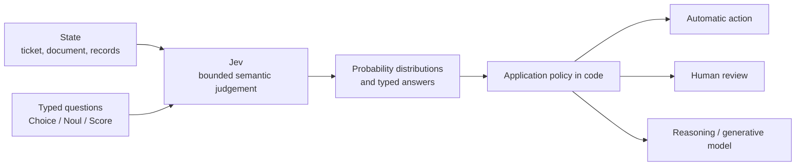
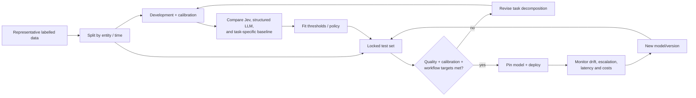

# Jev and System One decision models: motivation, principles, evidence, alternatives, and practical use

## Executive summary


**Jev is best understood as a general-purpose probabilistic decision model for bounded questions inside software.** A request supplies a `state`, one or more typed questions, and the allowed answer space. Jev returns probability distributions and typed values without generating an explanatory text response. TypeSafe currently exposes three main decision primitives: `Choice`, `Noul`, and `Score`; several questions can share the same state and are evaluated separately. TypeSafe positions this as an alternative to using an autoregressive language model for small classification, routing, verification, scoring, and policy decisions. [^1][^2]

As of **26 October 2026**, the current production release is **Jev 1.14.0**, released on 14 October 2026 at **US\$0.042 per million input tokens**, with output tokens unmetered. The important evidence caveat is that almost all independent research available so far evaluates **Jev 1.13**, so claims about 1.14 should not be inferred from those results without a fresh evaluation. [^2]

The core design makes sense for a specific class of problems:

\[
(\text{state},\ \text{question},\ \text{candidate answers})

\longrightarrow

\text{probability distribution}
\]

The software then decides what to do with that distribution. This separates **semantic judgement** from **application policy**. Jev can estimate that a ticket is probably billing-related; code decides whether 0.87 is enough to route automatically, whether the amount exceeds an approval limit, and what side effect to execute. TypeSafe explicitly recommends keeping deterministic calculations, workflow control, and side effects in code and decomposing broad judgements into small semantic questions. [^1][^3]




The strongest argument for Jev is **not merely structured output**. Modern generative models can already guarantee JSON-schema-conformant output. The stronger proposition is the combination of direct candidate probabilities, low output cost, parallel evaluation of many questions, and an API explicitly designed around uncertainty and selective automation. OpenAI's Structured Outputs, for example, guarantee schema adherence but explicitly warn that schema-valid responses can still contain semantic mistakes. [^4][^1]

The empirical picture is promising but narrower than TypeSafe's launch marketing:

| Claim | What the evidence supports | Assessment |
|---|---|---|
| **Fast** | An independent political-science study measured roughly **0.09-0.27 s per decision** for Jev 1.13 versus 0.75-1.04 s for its commercial LLM comparator in those experiments. | Strong evidence for low latency on bounded tasks, although geography, batching and rate limits affect measurements. [^5] |
| **Cheap** | A 346,009-request independent benchmark cost under \$10. But another study found **no price advantage over a low-cost LLM at batch pricing** on six of seven tasks. | Workload-dependent. The vendor's headline hundreds-fold savings should not be generalised. [^6][^5] |
| **Calibrated** | Jev often had good ECE and useful confidence ranking. In one study it was better calibrated than GPT-6 Luna token probabilities, but **not consistently better than Qwen3.8-27B**. | Supported as a useful property, not as a universal advantage. [^6][^5] |
| **Competitive accuracy** | Jev 1.13 performed strongly on many classification, routing and multiple-choice datasets and beat one-pass Qwen3.8-27B on 27/37 benchmark datasets. | Strong evidence for one-pass bounded decisions; comparison does **not** establish parity with reasoning-enabled frontier LLMs. [^6] |
| **Cannot hallucinate** | Its answer type can be constrained so it cannot invent an invalid enum/type. | The broad wording is misleading. It can still choose a valid but wrong answer, trust stale information or be manipulated by adversarial state. [^7][^8][^9] |
| **Handles reasoning** | Evidence shows high performance when the answer is available from a single-pass judgement. Performance falls on state tracking and problems requiring intermediate reasoning. | This is the clearest boundary of the model class. [^9] |

My overall conclusion is that **Jev represents a useful software architecture, not a replacement for an LLM**. It is most compelling when the answer space can be bounded in advance, the evidence is already present in the supplied state, the semantic judgement is short, latency or volume matters, and uncertainty can be used to escalate ambiguous cases. The design becomes much less attractive when the model must derive new facts through several reasoning steps, generate content, calculate exactly, repair stale context, or discover an answer outside the supplied candidates. That conclusion agrees both with TypeSafe's own guidance and with recent independent results. [^1][^8][^9]

## Motivation and design target


TypeSafe's starting argument is that conventional LLMs were optimised around **human-readable token generation**, while a large fraction of software use cases need only a machine-readable judgement. In a normal LLM integration, an application asks a question, the model generates a sequence, the application parses that sequence, validates its structure, interprets the answer, and often tries to recover a confidence estimate. Jev collapses that interface into a direct typed decision. [^1][^10]

The concrete target is something like:

```text
Given:
  state = support ticket + account facts

Decide:
  billing | technical | account | other

Return:
  billing      0.03
  technical    0.91
  account      0.02
  other        0.04
```


This is close to a **zero-shot classifier whose label set and task description are supplied at inference time**, but TypeSafe wraps that idea in primitives intended for application composition. Earlier systems such as GLiClass already addressed dynamic zero-shot/few-shot label classification without free-form generation, so the general idea of inference-time label descriptions is not unique to Jev. [^11]

There are several specific problems the design is trying to address.

**Sequential generation is often wasted work.** An autoregressive LLM must generate output tokens sequentially. If the application ultimately needs one enum, several booleans, or a small collection of scores, generating prose is additional computation. TypeSafe says Jev evaluates its decisions without text generation and handles several questions over the same state in parallel. Its launch materials report 70-500 ms response times and much larger workflow-level speedups, although TypeSafe also says its own published workflows are favourable to this design and acknowledges possible evaluator bias. [^7][^1]

**Machine actions need uncertainty.** A categorical answer alone gives the application little information about whether it should trust the answer. Jev makes probabilities part of the API contract. This supports selective prediction: automate high-confidence cases while deferring others. Selective classification is a well-established idea in machine learning, where rejection trades coverage for lower risk on the cases the model does handle. [^12][^13]

**The output vocabulary should be controlled by the program.** A `Choice` can select only one of the options supplied by the caller. That eliminates a whole class of invalid-output errors. Modern constrained decoding provides the same structural property for generative LLMs, however, so this is no longer by itself a reason to use a specialised decision model. OpenAI's current Structured Outputs, for example, guarantee adherence to a supplied JSON schema. [^4]

**The workflow should remain inspectable.** TypeSafe's recommended architecture is deliberately different from an autonomous agent loop. AI supplies narrow semantic judgements; ordinary program logic combines those judgements and performs effects. This lets a developer inspect the rule that, say, refunds transactions below £100 only when three semantic conditions pass, without relying on a model to reconstruct that policy from a long instruction on every request. [^3]

A useful example is refund automation:

```text
Model judgements:
  "Does the customer request a refund?"       → 0.98
  "Does the complaint describe duplication?"  → 0.93
  "Does supplied policy support the request?" → 0.89

Code:
  transaction_exists = db lookup
  amount_ok = transaction.amount < limit
  not_already_refunded = deterministic check

Policy:
  model conditions + deterministic conditions → refund / review
```


The point is that a model is used only where normal code cannot cleanly express the semantics. TypeSafe explicitly advises using code for arithmetic, date comparison, counts and other deterministic computations. [^8]

That architecture also explains why **"System One" should be read as a workload description, not a validated theory of machine cognition**. TypeSafe took the name from Kahneman's fast-versus-deliberative distinction and describes Jev as suitable for judgements a knowledgeable person could make quickly given the right context. The metaphor does not demonstrate that Jev implements human System 1 cognition. [^7][^1]

The launch blog's economic motivation is also explicit: TypeSafe invokes the Jevons paradox, arguing that a large reduction in the unit cost of machine judgement could make many previously uneconomic automated decisions worthwhile. Jev is named after William Stanley Jevons for this reason. [^7]

The strongest version of the motivation is therefore:

> **Use an expensive general-purpose generator when the application needs generation or extended reasoning; use a bounded decision model when the application already knows the possible answers and needs a fast estimate of which one the evidence supports.**

That proposition is narrower, and more defensible, than claiming that decision models are generally superior to LLMs.

## Underlying principles and training claims


A useful formalisation of a Jev-style decision model is:

\[p_\theta(y\mid s,q,A)\]

where:

- \(s\) is the supplied state;
- \(q\) describes the question;
- \(A=\{a_1,\ldots,a_K\}\) is the candidate set;
- the model returns a probability vector over \(A\).

For a Choice,

\[\hat y=\operatorname*{arg\,max}_{a_i\in A}p_\theta(a_i\mid s,q,A).\]

This framing is also used in independent research on one-pass decision models. [^9]

For a **Noul**, the output is essentially

\[\hat p=P_\theta(Y=1\mid s,q),\]

so the application can set its own positive and negative thresholds. TypeSafe deliberately does not return a separate `confidence` value for Noul; the probability itself is the relevant quantity. [^14]

For a **Score** with ordered levels \(0,\ldots,K-1\), TypeSafe returns the full level distribution and the expectation

\[
\operatorname{score}

  =\sum_{i=0}^{K-1} i\,p_i.
\]

The result should therefore be interpreted as an expected location on a descriptive rubric. It is not an estimate of an underlying physical quantity. TypeSafe specifically warns against using Score interpolation to reconstruct precise numerical values. [^15][^8]

**Calibration** is central to TypeSafe's case. In the binary case, ideal calibration can be written conceptually as

\[P(Y=1\mid \hat p=p)=p.\]

For top-label multiclass calibration,

\[P(Y=\hat Y\mid \hat p_{\max}=p)=p.\]

So among cases assigned approximately 0.8 probability, about 80% should be correct. This is a statement about groups of predictions, never a guarantee that an individual 0.8 prediction is correct. TypeSafe uses this same interpretation, and calibration is a standard concern in neural classification. [^10][^16]

This distinction is important because **accuracy and calibration measure different things**. A classifier can be accurate but overconfident. Conversely, a trivial predictor that always reports the population base rate can be calibrated while having little ability to separate easy and hard cases. For deployment, you therefore want task accuracy or F-score, a probability-quality metric such as Brier or log loss, and measures of ranking/selective performance. [^16][^6]

A common multiclass **Brier score** is

\[
\operatorname{BS}

=

\frac{1}{N}

\sum_{j=1}^{N}

\sum_{k=1}^{K}

\left(

p_{jk}-\mathbf{1}[y_j=k]

\right)^2.
\]

Log loss is

\[
\operatorname{NLL}

=

-\frac{1}{N}

\sum_{j=1}^{N}

\log p_{j,y_j}.
\]

Both belong to the family of **proper scoring rules**. A strictly proper scoring rule is constructed so that the expected score is optimised by reporting the forecaster's true predictive distribution. That gives a principled basis for training and evaluating probabilistic models: a model cannot improve the expected score by systematically exaggerating or suppressing its probabilities. [^17]

This matters for Jev because there is nothing about ordinary classification accuracy that forces a model to report useful probabilities. A system optimised only for `argmax` correctness may obtain the same accuracy whether the winning probability is 0.51 or 0.999. A proper probability loss rewards the distinction.

**Selective prediction** turns those probabilities into an application mechanism. Let \(c(x)\) be an uncertainty score and define

\[g_\tau(x)=\mathbf{1}[c(x)\ge \tau].\]

Then

\[\operatorname{coverage}(\tau)=P(g_\tau(X)=1)\]

is the fraction of cases automated, while

\[
R(\tau)

=

E[\ell(\hat Y,Y)\mid g_\tau(X)=1]
\]

is the error or risk among automated cases. Raising the threshold normally lowers coverage and, when uncertainty ranking is useful, lowers selective risk. This is the basis of human review and stronger-model escalation. [^12][^13]

Application policy should go one step further and model the **cost of outcomes**. Given a loss \(L(a,y)\), the natural decision is

\[
a^*

=

\operatorname*{arg\,min}_a

\sum_y

P(y\mid x)L(a,y).
\]

Suppose a wrong automatic action costs 100 units, a correct automatic action costs 0, and review costs 2. Under a simplified perfect-review assumption, auto-action is preferable only when

\[
100(1-p)<2

\quad\Longrightarrow\quad

p>0.98.
\]

This illustrates why copying somebody else's `confidence > 0.7` threshold has no principled justification. TypeSafe's own documentation recommends tuning thresholds to the domain and the consequences of error. [^14]

There is also an important distinction between **probability** and TypeSafe's field called `confidence`. For a Choice with \(K\) options, TypeSafe computes

\[
\operatorname{confidence}

=

\frac{p_{\max}-1/K}{1-1/K}.
\]

It is therefore a deterministic transformation of the largest returned probability. For three options, `(0.6, 0.3, 0.1)` and `(0.6, 0.2, 0.2)` both produce confidence 0.4. It is **not a separately trained estimate of "probability I am correct"**. TypeSafe explicitly documents this and recommends examining the top probability or top-to-second ratio as alternatives. [^14]

Score confidence uses a different statistic because the levels are ordered:

\[
C

=

\max\left(

0,

1-

\frac{\sum_i p_i|i-m|}

{\operatorname{MAD}_{\text{unif}}}

\right),
\]

where \(m\) is the modal level and the denominator normalises dispersion against a uniform distribution. Again, this summarises the *shape* of the model's own distribution; empirical calibration must still be established separately. [^14]

**"Questions are independent" needs careful interpretation.** TypeSafe means that bundled questions are evaluated in isolation rather than seeing one another's answers. It does not imply that their *errors are statistically independent*. Two questions using the same state and the same model can fail for the same reason. Multiplying their probabilities as though they were independent events therefore requires a separate probabilistic justification. [^1]

### What is publicly known about RLCD


TypeSafe says Jev is trained using **Reinforcement Learning for Calibrated Decisions (RLCD)**. Its public description says RLCD optimises decisions and probability estimates rather than human-preferred generated responses. TypeSafe contrasts it with RLHF and RLVR and claims the goal is epistemically honest uncertainty. [^10][^7]

The central limitation is that, in the public material reviewed for this report, **RLCD is a product-level description rather than a reproducible algorithm**. TypeSafe has not published enough detail to reconstruct the reward, reinforcement-learning algorithm, sampling scheme, probability loss, calibration set, architecture, base model, training corpus, optimisation schedule, or relevant ablations. Independent researchers consequently state that Jev's architecture and training data are not public and cannot attribute performance differences to any specific mechanism. [^6][^5]

That creates several unresolved questions:

| RLCD question | Public answer as of 26 Oct 2026 |
|---|---|
| What exact RL algorithm is used? | Not specified in the reviewed public documentation. [^10] |
| What reward is being optimised? | Described conceptually as calibrated decisions; exact mathematical reward not disclosed. [^10] |
| Is a proper scoring rule part of the reward? | Not publicly specified. |
| How are candidate sets sampled? | Not publicly specified. |
| Is calibration trained jointly or applied afterwards? | Not publicly specified. |
| What is the underlying backbone/parameter count? | Not publicly specified. Independent papers therefore cannot normalise comparisons by model size. [^6] |
| What training data are used? | Not disclosed sufficiently to rule out benchmark contamination. [^6] |
| Does RLCD cause the observed calibration advantage? | Not established by published ablations. |

This does **not** imply that RLCD is ineffective. It means that the causal claim cannot currently be evaluated independently.

There is also no theoretical requirement to use reinforcement learning merely to obtain probabilistic decisions. **Open-Jev**, an independent Jev-inspired implementation, trains a scalar decision head with soft cross-entropy plus a Brier component and fits a temperature on calibration data. Standard temperature scaling is itself an established calibration technique. That provides a concrete counterexample to any stronger claim that RL is necessary for this model interface. [^18][^16]

Kev takes yet another route: its current open implementation puts a small pointer-style decision head on Qwen backbones and trains primarily with cross-entropy. A softmax over candidate scores produces the option distribution. This is not evidence about Jev's proprietary architecture; it simply demonstrates that a Jev-like API can be implemented with familiar classification machinery. [^19]

The correct scientific position is therefore: **RLCD is TypeSafe's claimed training contribution, observed Jev probabilities are often useful, but the link between those two facts remains unverified because the training method is not reproducibly specified.**

## Empirical evidence, trade-offs, and limits


The largest independent public evaluation I found is Deußer, Sparrenberg and Sifa's **29 September 2026** benchmark of Jev 1.13.0. It covered **37 datasets, 346,009 requests, seven task families and more than 200 language varieties**, using one frozen zero-shot template per dataset. The authors published their harness and raw responses. [^6]

Selected results illustrate both strengths and weaknesses:

| Dataset / task | Jev 1.13 | Jev ECE ↓ | Qwen3.8-27B | Qwen ECE ↓ |
|---|---:|---:|---:|---:|
| IMDB sentiment | 96.5% accuracy | .019 | 96.5% | .018 |
| Banking77 routing | 79.7% accuracy | .087 | 77.4% | .094 |
| CLINC150 routing | 89.5% accuracy | .025 | 88.8% | .037 |
| MMLU | 91.8% accuracy | .025 | 81.7% | .045 |
| HellaSwag | 95.5% accuracy | .019 | 94.9% | .019 |
| ARC | 98.8% accuracy | .005 | 98.0% | .007 |
| Prompt-injection detection | 74.1% accuracy | .236 | 76.7% | .248 |
| UNFAIR-ToS | .499 micro-F1 | .088 | .582 | .024 |
| SummEval | .554 Spearman ρ | -- | .540 | -- |
| HelpSteer2 | .412 Spearman ρ | -- | .443 | -- |

These numbers come from identical one-pass option-scoring requests. The benchmark disabled Qwen's reasoning and generated no answer text; consequently it is a useful comparison of **one-pass decision capability**, but it is not evidence that Jev outperforms a reasoning-enabled 27B or frontier LLM on the same tasks. [^6]

That qualification is important. The benchmark reports Jev ahead of Qwen3.8-27B on 27 of 37 datasets and Gemma-4-E4B on all 37, but the authors explicitly state that Jev's unknown architecture, size and training data prevent attributing the difference to any particular design feature. They also could not rule out question-answer contamination in the striking MMLU results. [^6]

**Calibration is uneven across tasks.** ECE was exceptionally low on ARC (.005), SST-2 (.015) and IMDB (.019), but .279 on Emotion, .236 on prompt-injection detection and .264 on the AGB-DE legal task. This alone is enough to reject the interpretation that a model can be assumed globally calibrated because it was "trained for calibration". Calibration must be measured under the actual workload and distribution. [^6]

At the same time, the model's uncertainty ranking was useful for selective prediction. In the benchmark, keeping only the highest-confidence examples substantially increased accuracy on several datasets; for example Banking77 rose from roughly 79.7% overall to 88.8% on the top 80% and 96.3% on the top 50%, while MMLU rose from 91.8% to 96.7% and 98.1% respectively. [^6]

```mermaid
xychart-beta
    title "Jev 1.13 selective accuracy: all cases vs most-confident subsets"
    x-axis ["AG News", "Banking77", "CLINC150", "MMLU", "Emotion"]
    y-axis "Accuracy" 0.5 --> 1.0
    bar [0.885, 0.797, 0.895, 0.918, 0.585]
    bar [0.942, 0.888, 0.958, 0.967, 0.642]
    bar [0.953, 0.963, 0.979, 0.981, 0.733]
```




Bars in each group are, in order, **all cases**, **top 80% by confidence**, and **top 50% by confidence**. The practical implication is not that these exact thresholds transfer to another application; it is that the ranking signal contained useful information in these datasets. [^6]

For binary tasks, the benchmark exposed another subtlety: **good ranking does not imply a good 0.5 operating threshold**. On UNFAIR-ToS, tuning thresholds on held-out training data raised micro-F1 from about **0.50 to 0.75**. ToxicChat jailbreak detection similarly improved after threshold selection. This supports treating thresholds as part of the application configuration, not as universal constants supplied by the model. [^6]

The cost result was also concrete. The benchmark processed roughly **218 million input tokens** and 346,009 requests for **\$9.15**, averaging roughly 630 input tokens per request. It ran in about 5¼ hours under the study's concurrency and rate limits. These are compelling economics for bulk classification, but they should be compared against the actual alternative for the workload rather than against the price of a frontier reasoning model by default. [^6]

That point is reinforced by Denney and DiGiuseppe's **5 October 2026** study reproducing seven political-science applications. They found Jev broadly competitive with their LLM comparisons and clearly faster, with sequential timings of about **0.09-0.27 seconds per decision** versus **0.75-1.04 seconds** for GPT-6 Luna and **0.39-0.87 seconds** for their hosted Qwen route. But GPT-6 Luna using batch pricing was cheaper on six of seven primary tasks; Jev was generally cheaper under Luna's standard real-time pricing. [^5]

Their calibration findings were similarly nuanced. Jev was better calibrated than GPT-6 Luna's returned token probabilities on all eight categorical reading tasks when each item was asked once, but its advantage over Qwen3.8-27B varied by task. The paper therefore concludes that Jev's clearest benefits in that setting are **speed and directly parseable bounded probabilities**, not a universal accuracy, price or calibration lead. [^5]

The most important negative result comes from the **18 October 2026** paper *What Can't Jev Decide?*. In controlled experiments, Jev could retrieve and select records correctly with as many as 20,000 input tokens and 64 options, yet performance fell when the answer required tracking multiple updates to the same entity. At sixteen updates it reached only 53-80%, depending on condition. When researchers supplied a stale summary, Jev tended to trust the summary instead of reconstructing the correct current state. [^9]

On 738 real tasks classified by the amount of intermediate reasoning needed by a reference LLM, Jev answered **97.5% of cases that the reference model could solve in one forward pass**, versus **74% of cases requiring additional reasoning**. Confidence was useful for detecting errors Jev made itself but poor at detecting errors inherited from incorrect supplied state. This is a major architectural boundary: **uncertainty about one's classification is different from uncertainty about the truth of one's premises**. [^9]

That distinction has practical consequences for RAG and agent systems. A Jev question such as "Does this supplied summary authorise the action?" may be answered correctly *relative to the summary* even when the summary itself is stale or wrong. A confidence threshold cannot repair that upstream failure.

A separate 2026 agent-controller evaluation illustrates a related systems lesson. A Jev-based controller was a reasonably good offline predictor of whether an agent had finished, but inserting it into an actual Terminal-Bench agent loop increased cost by about **19% without changing the roughly 73% pass rate** in that experiment. Its offline finish-ranking AUROC was about .78, yet its probability estimates caused unnecessary verification. In other words, **predictive usefulness does not guarantee intervention usefulness**. [^20]

TypeSafe's own failure-mode documentation is unusually explicit and largely consistent with these independent findings. For Jev 1.13 it warns about literal wording, counting and numerical precision, date comparisons, multi-hop indirection, irrelevant long context, adversarial content, contradictory instructions, option-order effects, and attempts at generation. It recommends doing arithmetic and date logic in code, filtering state, explicitly testing option permutations, and using a generative model when generation is actually required. [^8]

This also limits TypeSafe's launch statement that Jev "can't hallucinate". The defensible interpretation is **schema-level**: a constrained Choice cannot invent an option outside its answer set. The semantic interpretation is false: Jev can confidently choose the wrong valid option, follow a stale premise, mishandle an adversarially framed state, or be forced to choose when none of the supplied options is appropriate. TypeSafe's own launch post distinguishes its mathematical "no type errors" guarantee from empirical accuracy claims. [^7][^8]

Finally, versioning matters. All the independent results above primarily concern **Jev 1.13.0**, while production now offers **1.14.0**. TypeSafe's `jev-latest` alias currently maps to 1.14.0 and will move on future releases. Any system with calibrated thresholds should pin the model ID, evaluate the new release offline, then update deliberately. TypeSafe recommends exactly this. [^2]

## Related approaches and when to choose them


Jev sits between three established categories: zero-shot classifiers, specialised probabilistic classifiers, and full generative LLMs. The most useful comparison is therefore based on the workload rather than on whether something is marketed as a "System One" model.

| Approach | Core mechanism and output | Main advantages | Main disadvantages | Choose it when |
|---|---|---|---|---|
| **Jev 1.14** | Hosted model; state + inference-time typed questions -> bounded probabilities. No text generation. [^2][^1] | Dynamic tasks without per-task training; first-class probabilities; multiple questions; low latency; simple API. | Closed weights and training; no customer fine-tuning; one-pass reasoning ceiling; calibration is task-dependent. [^2][^9] | You need many small semantic decisions and can define the answer space in advance. |
| **Kev** | Open Jev-like models using Qwen backbones with decision/pointer heads; exposes a System One-compatible API; current variants can run locally. [^19] | Inspectable, self-hostable, modifiable; TypeSafe API compatibility; can train on your data. | You own serving, calibration and evaluation; smaller checkpoints can trail Jev; it is an independent reconstruction, not Jev's architecture. [^19] | Local inference, data control, reproducibility or custom training are more important than using the commercial model. |
| **Open-Jev** | Independent decision-head implementation; LoRA + scalar head, soft cross-entropy/Brier training and held-out temperature calibration. [^18] | Reproducible experimentation with training/calibration; easy to modify research objectives. | Experimental; does not reproduce TypeSafe's proprietary RLCD, weights or claimed architecture; some optimisations remain experimental. [^18] | You want to study or modify Jev-style training and probability calibration. |
| **GLiClass** | Lightweight generalist sequence classifier adapted from GLiNER; supports inference-time labels and zero/few-shot classification. [^11] | Open, efficient, specifically designed for dynamic classification; can be trained/fine-tuned. | Primarily a classification system, without Jev's application-level Choice/Noul/Score contract or a comparable claim of calibrated workflow probabilities. | Your problem is fundamentally text classification with changing labels and you want an open classifier. |
| **SetFit** | Contrastively fine-tunes a sentence transformer on a small labelled set, then trains a classification head. [^21] | Lightweight, fast to train, effective with limited labelled data, local deployment. | Needs task-specific labelled examples and typically a stable label/task definition; probability calibration is a separate concern. | The task repeats at large scale and you can collect representative labels. |
| **Structured-output LLM** | Autoregressive LLM performs generation/reasoning while constrained to a JSON schema. [^4] | Far more flexible; handles reasoning, extraction and generation; schema-valid outputs can still be guaranteed. | More inference work for small decisions; schema validity does not imply semantic correctness; calibrated candidate distributions usually are not the main API abstraction. [^4] | The answer requires multi-step reasoning, synthesis, generation, open-ended extraction, or tool use. |
| **RouteLLM** | Learns a router from preference data that chooses between a stronger/costlier and weaker/cheaper LLM. [^22] | Directly optimises a cost/quality routing problem; peer-reviewed work showed >2× savings in some benchmark settings. | Specialised to model selection; requires routing data/objective; not a general semantic-decision API. | Your main question is "which downstream model should answer this prompt?" |

**Kev is the closest operational substitute.** Its current repository documents a System One-compatible API and an explicit architecture. Current checkpoints combine a Qwen backbone with a decision head; the head scores candidates and a softmax produces the distribution. The repository's current 27B model is trained differently from the smaller LoRA variants, so "Kev" is itself now a family rather than one architecture. Its transparency is valuable because experiments can distinguish backbone, decision head, data and calibration choices--something impossible with Jev today. [^19]

Kev also illustrates an important point about Jev's product proposition: **you do not need proprietary machinery to obtain a one-pass bounded probability interface**. What remains to be established empirically is whether TypeSafe's training and serving stack gives better quality, calibration, throughput or economics than open implementations for a given workload.

**Open-Jev is more useful as a research reference than as proof that Jev works a particular way.** Its current training pipeline uses group-isolated splits, LoRA, a scalar head, soft cross-entropy plus a 0.1 Brier term, and temperature fitting on calibration data. This is useful because every component is testable, but the maintainers do not claim that this reproduces RLCD. [^18]

**GLiClass occupies a slightly older conceptual niche:** flexible classification without generative decoding. Its authors explicitly motivate it with the inefficiency of using generative LLMs for zero-shot classification and the limitations of conventional cross-encoders or embedding systems when labels change dynamically. It therefore provides an important baseline against which "decision model" novelty should be assessed. [^11]

The main difference is interface and scope. A Jev request can bundle heterogeneous questions--"which department?", "does this contain evidence?", "how severe?"--over one state. GLiClass is designed primarily around sequence classification. For a straightforward dynamic label problem, GLiClass may be the cleaner open baseline.

**SetFit represents the opposite trade-off.** Rather than describe a new task to a generic model at runtime, you fine-tune a small embedding model using labelled examples. Its original paper uses contrastive sentence-transformer training followed by a classification head and reports strong few-shot performance with far fewer parameters than the large prompt-based systems of the time. [^21]

That suggests a practical rule:

- For a **new or constantly changing decision**, start with Jev/GLiClass/structured LLM zero-shot evaluation.
- For a **stable decision that runs millions of times**, collect labels and test a dedicated classifier such as SetFit.
- For a **decision requiring reasoning**, use a reasoning-capable LLM.
- For a **decision about which LLM to call**, test RouteLLM or another dedicated router.

**Structured-output LLMs are the most important alternative because they remove one of Jev's original motivations.** Schema enforcement can guarantee valid enums and object structures. OpenAI, for example, explicitly guarantees adherence to supported JSON schemas, while also cautioning that a schema-conformant response can still contain mistakes or hallucinated values when the input is incompatible with the task. [^4]

The remaining Jev proposition is therefore narrower and testable:

\[
\text{Jev value}

\approx

\text{decision quality}

+

\text{useful probabilities}

+

\text{throughput/latency advantage}

+

\text{lower marginal cost}
\]

for workloads where generation and long reasoning add little value.

That proposition should be benchmarked against the cheapest adequate structured-output LLM, rather than against an expensive frontier reasoning model.

**RouteLLM solves a different optimisation problem.** Its ICLR 2025 work learns, from preference data, whether a query should be sent to a strong or weak model. The authors reported more than a twofold reduction in cost in some benchmark settings without sacrificing their target response quality. The choice space is therefore downstream model identity, whereas Jev can be used for arbitrary bounded semantic questions. [^22]

One could even combine them:


The important question is whether a generic Jev judgement is a better router for a given workload than a router trained specifically on downstream model preferences. RouteLLM's approach has the advantage that its training objective is directly aligned with that routing decision. [^22]

## Practical integration and operations


The basic Jev pattern is deliberately small. The following Python example follows TypeSafe's documented SDK/API shape and pins the current model version so that threshold behaviour cannot silently change when an alias moves. [^2][^1]

```python
from typesafe_sdk import Choice, TypeSafeClient

AUTO_ROUTE_MIN_P = 0.90

questions = {
    "team": Choice(
        instructions=(
            "Which team should handle this ticket? "
            "Use `other` when the message does not clearly fit another option."
        ),
        criteria={
            "billing": "Charges, invoices, refunds, or payment problems",
            "technical": "A software feature is failing or behaving incorrectly",
            "account": "Login, identity, permissions, or account settings",
            "other": "None of the above, or there is not enough information",
        },
    )
}

state = {
    "ticket": "PDF export spins forever in Safari. It works in Chrome.",
}

with TypeSafeClient(model="jev-1.14.0") as client:
    result = client.system_one(state=state, questions=questions)

answer = result.choices["team"]

top_probability = max(answer.probabilities.values())

if top_probability >= AUTO_ROUTE_MIN_P:
    destination = answer.choice
else:
    destination = "human_review"

print(destination, answer.probabilities, answer.confidence)
```


There are three deliberate choices here.

First, **`other` exists**. A closed candidate set should contain an explicit escape route whenever reality can fall outside it. Otherwise the model must choose the least-wrong candidate.

Second, the code gates on the actual top probability, not blindly on TypeSafe's derived `confidence` statistic. TypeSafe itself documents both alternatives and recommends domain-specific threshold evaluation. [^14]

Third, the policy remains code. Changing `AUTO_ROUTE_MIN_P` or inserting a business rule does not require the model to reinterpret the entire workflow.

A larger request should exploit **fan-out** when several genuinely independent judgements share the same state:

```python
# Conceptual shape: ask these in one request.
questions = {
    "department": ...,
    "contains_refund_request": ...,
    "severity": ...,
    "possible_prompt_injection": ...,
}
```


TypeSafe says questions are evaluated separately against the shared state, and this is one of the main intended efficiency advantages. Dependent questions--for example "given the department selected above, which specialist?"--should be a separate program step because the later question logically depends on the earlier answer. [^1]

A particularly good architecture for retrieval-augmented generation is:

```text
retrieve documents
        │
        ▼
ordinary code limits candidate set
        │
        ▼
Jev asks per-passage questions:
  relevance?
  contains answer evidence?
  contradicts claim?
  looks adversarial?
        │
        ▼
code applies thresholds
        │
        ├── drop irrelevant
        ├── escalate contradiction
        └── pass evidence to reasoner
```


TypeSafe publishes a worked version of this pattern for classifying RAG passages. It is a better fit than asking Jev to synthesise the final answer because relevance and evidence checks are bounded judgements, while synthesis is generation. [^23][^8]

**Model versioning should be treated like a software dependency.** TypeSafe's `jev-latest` currently resolves to 1.14.0 but will change as new stable versions ship. Store the exact returned model ID with every decision, pin production to the version against which thresholds were evaluated, run the next release through the locked test set, and migrate only after reviewing the delta. [^2]

**Context management affects quality.** Jev 1.14 and 1.13 have default limits of 64k tokens per request and 32k per question. An opt-in long-context header raises both to 262k, but TypeSafe explicitly says this mode is slower and less accurate. Its Jev 1.13 failure guide likewise says irrelevant state causes accuracy degradation. Retrieval or filtering before the call is therefore part of model quality, not just a token-cost optimisation. [^2][^8]

**High-throughput clients need normal networking engineering.** TypeSafe recommends reusing clients to avoid TLS setup, using zstd compression on larger payloads, using its recommended async stack at high request rates, and potentially creating one client per worker thread when connection pools become bottlenecks. The Python SDK defaults to HTTP/1.1 because multiple connections can outperform one multiplexed HTTP/2 connection at very high request rates; HTTP/2 can be useful under lower concurrency or connection-count constraints. [^24]

Rate limits are organisation-specific and enforced for both requests and tokens per second. The SDK retries 429 responses by default and honours `retry-after` when supplied. Capacity tests should therefore measure **p50, p95 and p99 latency under the intended concurrency**, not quote a single vendor latency. [^2]

Logging also deserves attention. TypeSafe's debug SDK logging redacts secret headers, but **request and response bodies are not automatically redacted**, so production systems carrying personal, legal or proprietary data should not enable body-level debug logging without an appropriate sanitisation policy. [^24]

TypeSafe says customer requests and responses are not used to train Jev and advertises zero-data-retention options for enterprise customers. These are service-policy claims; organisations with regulatory requirements should still review the applicable contract and data-processing terms rather than infer compliance from model architecture. [^2]

The service currently does **not provide per-customer Jev fine-tuning or LoRA adaptation**. Domain behaviour is configured through state, instructions and criteria. If a workload needs weights trained on proprietary examples, Kev, Open-Jev, GLiClass, SetFit, or another local classifier becomes more relevant. [^2][^19][^18]

## Evaluation and failure testing


The decision to deploy Jev should be treated as a supervised-model evaluation problem. Looking at ten outputs and deciding that they "feel right" defeats the main advantage of having probabilities.

A good test programme separates **model quality**, **probability quality**, and **system utility**.

| Dimension | Recommended measurements | Why |
|---|---|---|
| Point prediction | Accuracy, balanced accuracy, precision/recall/F1, correlation for scores | Measures the decision itself. The appropriate metric depends on label imbalance and task. [^6] |
| Probability quality | Brier score, log loss, reliability plots, ECE | Measures whether probability magnitudes are useful. [^16][^17] |
| Ranking | AUROC/AUPRC, especially for rare positives | Determines whether thresholds can separate useful from risky cases. [^5][^6] |
| Selective prediction | Accuracy/error at 90%, 80%, 50% coverage; risk-coverage curve/AURC | Shows what quality is achievable when uncertain cases are escalated. [^12][^6] |
| Operations | p50/p95/p99 latency, sustained throughput, 429 rate, input tokens, cost/decision | Determines whether the theoretical efficiency survives the production traffic pattern. [^5][^2] |
| System outcome | Completion rate, human review load, downstream error cost, total workflow cost | A better predictor can still make a workflow worse after interventions are added. [^20] |

The evaluation dataset should be split into at least a **development/calibration set and a locked test set**. Where records are correlated by customer, account, document, or time, splitting by that entity is preferable to random row splitting because it better approximates production generalisation. Thresholds should be fitted only on development/calibration data and frozen before the final test. The independent Jev benchmark followed the same basic discipline by freezing templates before its evaluation split and fitting binary operating thresholds on separate data. [^6]




The baseline comparison matters. For each production decision, I would ordinarily evaluate at least:

1. **Jev 1.14 pinned**;
2. a low-cost **structured-output LLM** with reasoning set appropriately for the workload;
3. a **dedicated classifier** if enough labels exist.

This directly tests the proposition that specialised decision modelling provides enough latency, cost, probability, or quality benefit to justify another model dependency.

Failure testing should go beyond the clean validation set:

| Test | Why it matters | Expected mitigation |
|---|---|---|
| **Shuffle Choice option order** | TypeSafe has observed first-option bias in Jev 1.13. | Evaluate several permutations; investigate unstable cases. [^8] |
| **Remove the correct answer** | A closed set otherwise forces the least-wrong option. | Add `other`, `none`, `unknown`, or a separate sufficiency check. |
| **Contradictory evidence** | Real states often contain multiple records or claims. | Include contradictions deliberately and measure calibration. [^8] |
| **Stale summary + fresh records** | Independent experiments show Jev can trust the stale summary. | Recompute authoritative state in code or a reasoner before deciding. [^9] |
| **Repeated state updates** | One-pass models degrade when the answer requires tracking updates. | Resolve state transitions deterministically first. [^9] |
| **Irrelevant long context** | TypeSafe reports context rot; long-context mode is less accurate. | Retrieve/filter before calling the model. [^8][^2] |
| **Prompt injection inside state** | Jev does not assume state is hostile and can be steered by adversarial text. | Explicit criteria, adversarial evals, and isolation of trusted fields. [^8] |
| **Counts, dates and arithmetic** | These are documented weak spots. | Calculate deterministically; use the model only to extract semantic components. [^8] |
| **Negation and indirect wording** | Literal and multi-hop instructions are less reliable. | Rewrite into direct atomic questions. [^8] |
| **Low-resource languages** | The broad benchmark found substantial performance variation by language; English is TypeSafe's primary language. | Evaluate every supported language separately. [^6][^2] |
| **Base-rate shift** | A previously calibrated probability may cease to be calibrated after the population changes. | Monitor calibration and recalibrate/rethreshold against recent labelled data. [^16] |
| **Correlated questions** | Parallel question isolation does not imply independent errors. | Avoid multiplying probabilities unless dependence assumptions are validated. [^1] |

One particularly useful production dashboard is a **coverage-risk table** rather than a single accuracy number:

| Auto-action coverage | Error among auto-actions | Human/reasoner escalation | Cost per item |
|---:|---:|---:|---:|
| 50% | ... | 50% | ... |
| 70% | ... | 30% | ... |
| 80% | ... | 20% | ... |
| 90% | ... | 10% | ... |
| 100% | ... | 0% | ... |

The optimal row is a business decision. A medical, financial or destructive workflow may tolerate low automation coverage for very low residual risk; lightweight routing may tolerate much more error. This is the operational form of selective prediction. [^12][^13]

For probability evaluation, I would also avoid relying on **ECE alone**. The Jev benchmark itself reports both ECE and Brier score, alongside ranking and selective-prediction metrics. Proper scoring rules evaluate the full probability forecast, while binned calibration statistics describe one aspect of it. [^6][^17]

Finally, test the **whole workflow**, not only Jev in isolation. The agent-controller study is a good warning: an offline classifier can rank outcomes well while the policy built around it adds calls, creates unnecessary escalations, and leaves task success unchanged. The ultimate metric is the behaviour of the system that acts on Jev's probabilities. [^20]

## Conclusions and key source links


The deepest idea underneath Jev is older than Jev itself: **represent uncertain semantic judgements as probability distributions, then let explicit software policy act on those distributions**. Calibration makes probability magnitudes interpretable; proper scoring rules provide principled objectives for probabilistic prediction; selective prediction turns uncertainty into a coverage-versus-risk control; and decision theory connects probabilities to the actual cost of an action. [^16][^17][^12]

Jev packages those principles into a general inference-time interface. The useful abstraction is:

\[
\boxed{

\text{semantic evidence}

\;\xrightarrow{\text{decision model}}\;

\text{bounded probabilities}

\;\xrightarrow{\text{explicit policy}}\;

\text{software action}

}
\]

Its practical strengths are clearest where the state already contains the information needed, the task has a bounded answer space, several small questions can reuse the state, low latency or high volume matters, and uncertain cases can be escalated. Independent Jev 1.13 evaluations provide credible evidence that the model can be accurate, inexpensive at scale, fast, and useful for selective prediction in this regime. [^6][^5]

Its limitations follow directly from the same architecture. A one-pass decision model is a poor place to put arithmetic, state reconstruction, several rounds of inference, open-ended synthesis or generation. It also cannot validate the truth of its supplied premises simply because its output probability is high. The strongest independent limit study makes this distinction especially clear. [^9]

The largest open scientific question is **RLCD**. TypeSafe attributes Jev's probability behaviour to Reinforcement Learning for Calibrated Decisions, but has not yet published enough algorithmic detail or ablations to establish what RLCD contributes relative to the base model, architecture, training data, conventional proper-scoring losses or post-hoc calibration. Open-Jev and Kev demonstrate that similar output contracts can be built with conventional decision heads and supervised objectives, so a reproducible RLCD paper would be needed to establish the stronger training-method claim. [^10][^18][^19]

The most defensible adoption decision today is therefore empirical: **evaluate Jev 1.14 on the exact decision distribution, compare it with a cheap structured-output LLM and a dedicated classifier where possible, measure probability quality and selective risk as well as accuracy, and pin the model version together with the thresholds that were validated against it.** Current independent evidence is strong enough to justify that experiment, but not strong enough to assume that Jev is automatically cheaper, better calibrated, or more accurate on an unseen production task. [^2][^5][^6]

Key primary and independent sources used in this research:

| Source | Link and relevance |
|---|---|
| TypeSafe -- Introduction | [docs.typesafe.ai/introduction](https://docs.typesafe.ai/introduction) -- current definition of Jev and System One primitives. [^1] |
| TypeSafe -- Models | [docs.typesafe.ai/models](https://docs.typesafe.ai/models) -- current Jev 1.14 version, pricing, context, aliases, customisation and rate limits. [^2] |
| TypeSafe -- AI primer | [docs.typesafe.ai/introduction/machine-learning-primer](https://docs.typesafe.ai/introduction/machine-learning-primer) -- TypeSafe's public description of RLCD and calibration. [^10] |
| TypeSafe -- Confidence | [docs.typesafe.ai/confidence](https://docs.typesafe.ai/confidence) -- exact Choice and Score confidence formulas. [^14] |
| TypeSafe -- Jev 1.13 failure modes | [docs.typesafe.ai/model-jaggedness/jev-1.13](https://docs.typesafe.ai/model-jaggedness/jev-1.13) -- arithmetic, indirection, context, adversarial and option-order weaknesses. [^8] |
| TypeSafe -- launch article | [typesafe.ai/blog/introducing-system-one-models-and-jev](https://typesafe.ai/blog/introducing-system-one-models-and-jev) -- architecture/training claims, motivation and vendor benchmark caveats. [^7] |
| Deußer et al. -- broad Jev benchmark | [arXiv:2609.37647](https://arxiv.org/abs/2609.37647) -- 37 datasets and 346k Jev 1.13 requests, including calibration and selective prediction. [^6] |
| Denney & DiGiuseppe -- political-science replications | [arXiv:2610.06625](https://arxiv.org/abs/2610.06625) -- independent accuracy, price, latency and calibration comparison. [^5] |
| Yang et al. -- one-pass limits | [arXiv:2610.24929](https://arxiv.org/abs/2610.24929) -- controlled study of state tracking, stale premises and reasoning requirements. [^9] |
| Kev | [github.com/jaredpalmer/kev](https://github.com/jaredpalmer/kev) -- open Jev-like models, architecture, training and compatible API. [^19] |
| Open-Jev | [github.com/Zefan-Cai/Open-Jev](https://github.com/Zefan-Cai/Open-Jev) -- independent open training implementation using cross-entropy/Brier and calibration. [^18] |
| GLiClass | [arXiv:2508.07662](https://arxiv.org/abs/2508.07662) -- lightweight dynamic zero/few-shot sequence classification. [^11] |
| SetFit | [arXiv:2209.11055](https://arxiv.org/abs/2209.11055) -- task-specific few-shot sentence classification baseline. [^21] |
| RouteLLM | [ICLR 2025 paper](https://proceedings.iclr.cc/paper_files/paper/2025/hash/5503a7c69d48a2f86fc00b3dc09de686-Abstract-Conference.html) -- learned cost/quality routing from preference data. [^22] |
| Guo et al. -- calibration | [PMLR 2017](https://proceedings.mlr.press/v70/guo17a.html) -- neural-network calibration and temperature scaling. [^16] |
| Gneiting & Raftery -- proper scoring rules | [University of Washington publication](https://stat.uw.edu/research/tech-reports/strictly-proper-scoring-rules-prediction-and-estimation) -- foundational theory of proper probabilistic scoring. [^17] |
| Geifman & El-Yaniv -- selective prediction | [NeurIPS 2017](https://papers.nips.cc/paper/7073-selective-classification-for-deep-neural-networks) and [SelectiveNet, ICML 2019](https://proceedings.mlr.press/v97/geifman19a.html) -- formal rejection/coverage framework. [^12][^13] |
| OpenAI -- Structured Outputs | [developers.openai.com/api/docs/guides/structured-outputs](https://developers.openai.com/api/docs/guides/structured-outputs) -- concrete modern LLM baseline for schema-constrained generation and its semantic limitations. [^4] |

## References


[^1]: TypeSafe, "Introduction," *TypeSafe Documentation*. [https://docs.typesafe.ai/introduction](https://docs.typesafe.ai/introduction).

[^2]: TypeSafe, "Models," *TypeSafe Documentation*. [https://docs.typesafe.ai/models](https://docs.typesafe.ai/models).

[^3]: TypeSafe, "How to Build with TypeSafe," *TypeSafe Documentation*. [https://docs.typesafe.ai/concepts/how-to-build-with-system-one](https://docs.typesafe.ai/concepts/how-to-build-with-system-one).

[^4]: OpenAI, "Structured Model Outputs," *API Documentation*. [https://developers.openai.com/api/docs/guides/structured-outputs](https://developers.openai.com/api/docs/guides/structured-outputs).

[^5]: Denney and DiGiuseppe, "JEV versus LLMs: Accuracy, Cost and Calibration on Seven Political Science Replications" (2026). [https://arxiv.org/abs/2610.06625](https://arxiv.org/abs/2610.06625).

[^6]: Deußer, Sparrenberg, and Sifa, "Evaluating and Benchmarking the System One Model Jev" (2026). [https://arxiv.org/abs/2609.37647](https://arxiv.org/abs/2609.37647).

[^7]: TypeSafe, "Introducing System One Models & Jev," *TypeSafe Blog*. [https://typesafe.ai/blog/introducing-system-one-models-and-jev](https://typesafe.ai/blog/introducing-system-one-models-and-jev).

[^8]: TypeSafe, "Jev 1.13 Jaggedness," *TypeSafe Documentation*. [https://docs.typesafe.ai/model-jaggedness/jev-1.13](https://docs.typesafe.ai/model-jaggedness/jev-1.13).

[^9]: Yang et al., "What Can't Jev Decide? Probing the Limits of One-Pass Decision Models" (2026). [https://arxiv.org/abs/2610.24929](https://arxiv.org/abs/2610.24929).

[^10]: TypeSafe, "AI Primer," *TypeSafe Documentation*. [https://docs.typesafe.ai/introduction/machine-learning-primer](https://docs.typesafe.ai/introduction/machine-learning-primer).

[^11]: "GLiClass: Generalist Lightweight Model for Sequence Classification Tasks" (2025). [https://arxiv.org/abs/2508.07662](https://arxiv.org/abs/2508.07662).

[^12]: Geifman and El-Yaniv, "Selective Classification for Deep Neural Networks," *NeurIPS* (2017). [https://papers.nips.cc/paper/7073-selective-classification-for-deep-neural-networks](https://papers.nips.cc/paper/7073-selective-classification-for-deep-neural-networks).

[^13]: Geifman and El-Yaniv, "SelectiveNet: A Deep Neural Network with an Integrated Reject Option," *ICML* (2019). [https://proceedings.mlr.press/v97/geifman19a.html](https://proceedings.mlr.press/v97/geifman19a.html).

[^14]: TypeSafe, "Confidence," *TypeSafe Documentation*. [https://docs.typesafe.ai/confidence](https://docs.typesafe.ai/confidence).

[^15]: TypeSafe, "Score," *TypeSafe Documentation*. [https://docs.typesafe.ai/primitives/score](https://docs.typesafe.ai/primitives/score).

[^16]: Guo et al., "On Calibration of Modern Neural Networks," *ICML* (2017). [https://proceedings.mlr.press/v70/guo17a.html](https://proceedings.mlr.press/v70/guo17a.html).

[^17]: Gneiting and Raftery, "Strictly Proper Scoring Rules, Prediction, and Estimation" (2007). [https://stat.uw.edu/research/tech-reports/strictly-proper-scoring-rules-prediction-and-estimation](https://stat.uw.edu/research/tech-reports/strictly-proper-scoring-rules-prediction-and-estimation).

[^18]: Cai et al., *Open-Jev*, project repository. [https://github.com/Zefan-Cai/Open-Jev](https://github.com/Zefan-Cai/Open-Jev).

[^19]: Palmer et al., *Kev: Jev-like Decision Models*, project repository. [https://github.com/jaredpalmer/kev](https://github.com/jaredpalmer/kev).

[^20]: "Good Judgment, Bad Advice: Decision-Model Controllers Raise Agent Cost Without Improving Success" (2026). [https://arxiv.org/abs/2610.24649](https://arxiv.org/abs/2610.24649).

[^21]: "Efficient Few-Shot Learning Without Prompts" (2022). [https://arxiv.org/abs/2209.11055](https://arxiv.org/abs/2209.11055).

[^22]: "RouteLLM: Learning to Route LLMs from Preference Data," *ICLR* (2025). [https://proceedings.iclr.cc/paper_files/paper/2025/hash/5503a7c69d48a2f86fc00b3dc09de686-Abstract-Conference.html](https://proceedings.iclr.cc/paper_files/paper/2025/hash/5503a7c69d48a2f86fc00b3dc09de686-Abstract-Conference.html).

[^23]: TypeSafe, "Classifying RAG Passages," *TypeSafe Documentation*. [https://docs.typesafe.ai/cookbooks/classifying_rag_passages](https://docs.typesafe.ai/cookbooks/classifying_rag_passages).

[^24]: TypeSafe, "Advanced Usage," *TypeSafe Python SDK Documentation*. [https://docs.typesafe.ai/sdk/python/usage/advanced](https://docs.typesafe.ai/sdk/python/usage/advanced).
