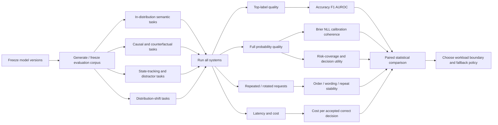

# System One, decision models, and Jev: a first-principles analysis

## Executive summary


**My main conclusion is that Jev has a strong theoretical justification as a software decision primitive, but a much weaker justification as an implementation of Kahneman's System 1.**

TypeSafe's core engineering idea is sound: many application steps are better represented as

\[
(\text{state},\ \text{question},\ \text{allowed outcomes})

\longrightarrow

P(\text{outcome})
\]

than as text generation. The resulting probabilities can be combined with an explicit loss function, an abstention policy, and deterministic code. This connects Jev directly to probabilistic classification, proper scoring rules, selective prediction, Bayesian decision theory and resource-rational computation. Those foundations stand independently of the System One terminology. [^typesafe-home][^proper-scoring][^selective-classification][^resource-rationality]

**The strongest theoretical reading of Jev is therefore:** a *prompt-conditioned probabilistic decision model optimised for bounded inference under compute, latency and interface constraints*. This is a more precise description than "machine System 1".

TypeSafe explicitly says its "System One" name was inspired by Kahneman's contrast between fast intuitive and slow deliberate thought. It presents Jev as returning typed probabilistic decisions in parallel, without autoregressive string generation, and describes RLCD--"Reinforcement Learning for Calibrated Decisions"--as its training approach. The public material also says there is a new architecture and sampler. However, the exact Jev architecture, parameter count, representation scheme, candidate readout, RLCD reward/objective, training corpus, optimisation algorithm and calibration procedure remain undisclosed in the primary material reviewed here. [^typesafe-home][^typesafe-intro]

That distinction is important because **Kahneman's own account of System 1 is richer than "one fast forward pass"**. In the supplied talk he says the essential distinction is between cognition that *happens to you* and cognition that *you deliberately do*. He explicitly places high-level automatised skills, language, common-sense causality, surprise, counterfactual thought and a representation capable of something resembling world simulation inside System 1. He also warns that equating System 1 with non-symbolic machine learning and System 2 with symbolic reasoning is "seriously imperfect". [^kahneman-talk]

That reading is broadly compatible with Evans and Stanovich's more technical dual-process account: **autonomy**, rather than speed, is their proposed defining property of Type 1; Type 2 is characterised by working-memory-demanding cognitive decoupling and hypothetical reasoning. Speed, parallelism, consciousness and associativity are correlates rather than necessary definitions. They also prefer "Type 1/Type 2" to "System 1/System 2" because there need not be two literal cognitive systems. [^evans-stanovich] Other cognitive scientists go further: Keren and Schul argue that two-system theories often lack precise definitions and discriminating tests, while Melnikoff and Bargh argue that bundling intentionality, controllability, consciousness and efficiency into two packages lacks sufficient empirical support. [^keren-schul][^melnikoff-bargh]

So the relationship looks like this:

| Claim | Assessment |
|---|---|
| Jev performs fast automatic-looking judgements | **Supported** |
| Jev avoids unnecessary autoregressive output generation | **Supported at the interface; exact internals unknown** |
| Jev provides useful probabilities | **Supported, but calibration is task-dependent** |
| Jev is naturally suited to selective automation | **Strongly justified theoretically** |
| Jev corresponds to Kahneman's System 1 because it is fast | **Insufficient** |
| Jev possesses the kind of world representation Kahneman describes | **Unknown** |
| Jev performs automatic causal/counterfactual simulation | **Not established** |
| RLCD is necessary for calibrated decision models | **No; proper losses and post-hoc calibration provide alternatives** |
| Jev should replace reasoning LLMs generally | **Contradicted by current evidence** |
| Jev can be a better primitive for bounded, high-volume decisions | **Supported enough to justify workload-specific evaluation** |

The independent Jev literature, all very recent and mostly preprint-level, reinforces this separation. One broad evaluation of Jev 1.13 across 37 datasets found strong classification performance and useful selective prediction from Choice probabilities, but binary probabilities often required task-specific thresholds. [^jev-benchmark] A constructed calibration benchmark found evidence that some binary-looking Choice outputs may conceal probability mass corresponding to an implicit "unknown" state. [^sys1cal] Another study found violations of probability coherence across logically related questions. [^prob-coherence] And a controlled study of multi-update state tracking found a large drop once decisions required combining several updates among similar distractors; supplying stale state summaries could also produce confidently wrong decisions. [^jev-limits]

**In other words: Jev's value does not depend on proving that it is cognitively System 1.** The stronger case comes from decision theory and resource constraints.

The earlier supplied Jev research correctly identified the engineering pattern--typed decisions, probabilities, confidence routing and code-controlled workflows--but it leaned too heavily on "fast bounded decision" as the meaning of System 1. [^previous-jev-report] The cognitive-science evidence supports a more careful separation.

## System One and System Two across cognitive science

### Kahneman's account is about automaticity, accessibility and world representation


Kahneman and Frederick's 2002 treatment introduced System 1/System 2 in the context of intuitive judgement and attribute substitution. Kahneman's 2003 synthesis relates intuitive judgements to accessibility: highly accessible impressions arise readily and can substitute for harder target attributes unless deliberate processing intervenes. [^kahneman-frederick][^kahneman-2003]

The popular "fast versus slow" description is therefore a useful mnemonic, but it loses important structure.

In the supplied later Kahneman talk, his clarification is explicit:

> "something that happens to you and something that you do."

He says automatised **high-level skills** belong to System 1. He also rejects the idea that System 1 must be non-symbolic: it handles language and linguistic thoughts. Most importantly for the Jev analogy, he says System 1 maintains a **representation of the world** that supports something resembling simulation; this representation distinguishes normal continuations from surprising events. Surprise, common-sense causality and significant counterfactual processing can consequently occur automatically. [^kahneman-talk]

This gives us at least six separable properties:

| Property | Kahneman's System 1 | Does Jev publicly establish it? |
|---|---|---|
| Autonomous response | Yes | Behaviourally, approximately |
| Fast processing | Typical | Yes, for intended workloads |
| Parallel processing | Typical | TypeSafe explicitly designs for parallel decisions |
| Learned high-level skills | Yes | Some semantic skills are demonstrated |
| Language understanding | Yes | Yes, behaviourally |
| Persistent/model-like representation of the world | Central in the supplied talk | **Unknown** |
| Causal/common-sense expectations | Included | Some task competence; architecture unknown |
| Counterfactual simulation | Can be automatic | **Not established** |
| Surprise/normality model | Explicitly important | **Not established as an internal mechanism** |

The last four rows matter. A classifier can answer "Which event is surprising?" from statistical associations without internally implementing the world model that generated the event. Behaviour on ordinary classification benchmarks cannot distinguish those explanations.

### Dual-process theory is itself not one settled architecture


Evans and Stanovich make an important refinement. They describe **Type 1 processes as autonomous** and Type 2 processing as requiring working memory and "cognitive decoupling": maintaining hypothetical secondary representations separately from the representation of actuality. They explicitly classify properties such as speed, parallelism and associativity as common correlates rather than definitions. Their paper also distinguishes *default-interventionist* theories, where autonomous processing proposes a default and reflective cognition may intervene, from *parallel-competitive* theories where multiple processes proceed simultaneously. [^evans-stanovich]

That makes a direct "Jev = System 1, reasoning LLM = System 2" mapping scientifically weak. A sufficiently trained network could perform a sophisticated causal judgement automatically; conversely, a computationally cheap operation might still belong to a deliberately controlled human sequence.

The critiques strengthen this warning. Keren and Schul argue that two-system accounts have often grouped together properties without adequate conceptual or empirical justification. [^keren-schul] Melnikoff and Bargh challenge the broader assumption that psychological processes naturally partition into exactly two clusters of intentional/controlled/conscious/inefficient versus their opposites. [^melnikoff-bargh] These critiques do not show that automatic versus controlled processing is meaningless; they show that **"two systems" should not be imported into an AI architecture as though cognitive science had identified two physical modules**.

The supplied Nobre and Gresch perspective on external versus internal attention gives a useful modern example. Its Figure 2 on page 7 explicitly lays out multiple possible control architectures: a superordinate controller, control distributed across specific processes, or competition without a master controller. The paper treats how attention shifts among representations as an empirical architectural question. [^nobre-gresch] This is a better methodological template for AI research than assuming that a reasoning controller and a fast decision model must map onto two biological "systems".

### A better correspondence


A defensible analogy is:

\[
\text{Jev}

\approx

\text{a machine mechanism specialised for low-compute autonomous judgement}
\]

That places Jev **inside a family of mechanisms that could play a System-1-like role**, without asserting equivalence to Kahneman's cognitive construct.

The distinction also gives a useful research question:

> Can a machine acquire sophisticated causal, model-based and counterfactual judgements that execute automatically after learning?

That question is much closer to Kahneman than "Can we classify something in one forward pass?"

## A first-principles theory of decision systems


Marr's framework is helpful because it prevents us from confusing the goal of a system with the algorithm or hardware that happens to implement it. Marr distinguishes the **computational level**--what problem is being solved and why--from the **algorithmic level**--representations and procedures--and the **implementation level**--physical realisation. Marr and Poggio's earlier formulation actually separated computation, algorithms, mechanisms and hardware into four nearly independent descriptions; Marr's later *Vision* established the familiar three-level presentation. [^marr-poggio][^marr-vision]

Applied to Jev:

| Marr level | Question | What we know about Jev |
|---|---|---|
| **Computational** | What problem should it solve? | Convert state + typed question + candidate space into useful probabilistic decisions cheaply and quickly. This is clear. [^typesafe-intro] |
| **Algorithmic** | What representations and algorithms produce those probabilities? | Only partly disclosed. TypeSafe says new architecture, sampler and RLCD; detailed representation/readout/training mechanics remain unknown. [^typesafe-home] |
| **Implementation** | How is it physically realised? | Hosted service; parameters, hardware topology and detailed serving implementation are undisclosed publicly. |

This matters because two systems can solve the same computational problem while having completely different internal algorithms.

### The minimal computational object


For a typed decision model, define:

- \(x\): observed state,
- \(q\): a natural-language decision question,
- \(A=\{a_1,\ldots,a_K\}\): permitted outcomes,
- \(y\): the latent correct outcome.

The prediction system estimates

\[\hat p(y\mid x,q,A).\]

That probability distribution is **not yet the decision**.

Suppose the software can choose an action \(d\), including a defer/review action \(\bot\). The rational decision is

\[
d^*

=

\operatorname*{arg\,min}_{d\in D\cup\{\bot\}}

\sum_y \hat p(y\mid x,q,A)L(d,y),
\]

where \(L(d,y)\) is the application-specific loss.

This immediately explains why calibrated probabilities are more useful than only a top label. An application where a false positive costs £1 and another where it costs £1 million should make different decisions from the same predictive distribution.

It also explains why a generic "confidence > 0.8 -> automate" rule has no principled basis unless the threshold is tied to the loss function and empirically validated probability quality.

### Representation


A decision system needs a representation \(h\) that preserves information relevant to the decision:

\[h = f_\theta(x,q,A).\]

There are several qualitatively different possibilities.

A **pattern classifier** may encode features sufficient to map observed strings to labels.

A **latent-state model** may explicitly or implicitly maintain entity state through time.

A stronger **world model** would support predictions about how latent state changes under events or actions. A causal world model should distinguish observation from intervention and support coherent counterfactual alternatives.

These properties cannot be inferred from the fact that a model returns probabilities.

Kahneman's "representation of the world" therefore corresponds to an algorithmic-level claim, whereas TypeSafe's decision API is primarily a computational/interface-level claim. [^kahneman-talk] Marr's separation is exactly why the two should not be conflated. [^marr-vision][^marr-poggio]

### Discriminative and generative inference


The classical distinction is between learning the conditional decision relation, roughly \(p(y\mid x)\), and modelling a joint/generative relation such as \(p(x,y)\). Ng and Jordan showed that discriminative and generative classifiers can have different statistical learning properties; neither category simply dominates the other. [^ng-jordan]

Jev has a **discriminative interface**: callers supply candidate outcomes and receive probabilities over them. Its undisclosed internals prevent a stronger architectural claim.

Kev makes one concrete implementation of the concept visible: it places a small option-scoring head over a Qwen representation and converts candidate scores to probabilities without generating an answer string. It shares the state across questions and uses explicit isolation between question branches. [^kev] Open-Jev takes another disclosed route using Qwen, LoRA, a scalar decision head, soft cross-entropy plus a Brier term, and a separate fitted calibration temperature. Its authors explicitly state that this does **not** reproduce TypeSafe's proprietary RLCD. [^open-jev]

An autoregressive LLM instead estimates sequences such as

\[
p(t_1,\ldots,t_T\mid x)

=

\prod_i p(t_i\mid t_{<i},x).
\]

Schema-constrained decoding can limit generated sequences to valid structured values. OpenAI's Structured Outputs is one example: constrained decoding enforces a supplied schema, while the model remains generative and can still make semantic mistakes within that schema. [^structured-outputs]

Crucially, **"generative language model" and "world model" are not synonyms**. Autoregressively generating plausible text does not by itself demonstrate an interventionally correct model of a domain; conversely, a discriminative network could contain rich latent causal representations.

### Calibration and proper scoring


For a probability \(p=0.8\) to carry its usual operational meaning, roughly 80% of comparable events assigned that probability should occur.

Accuracy does not imply this property. Neural classifiers can be accurate while systematically over- or under-confident; temperature scaling can substantially change calibration while leaving class rankings unchanged. [^guo-calibration]

Training can encourage probability quality through a **strictly proper scoring rule**. Proper scoring rules are constructed so that, in expectation, reporting the true predictive distribution is optimal. Gneiting and Raftery give the general theory. [^proper-scoring]

For a categorical prediction, a common example is Brier loss:

\[
BS =

\sum_{k=1}^K

\left(p_k-\mathbf{1}[y=k]\right)^2.
\]

Log loss is another proper scoring rule.

This is one reason **RL is not intrinsically required to train a calibrated decision model**. Supervised proper losses plus held-out recalibration are theoretically valid alternatives. Open-Jev demonstrates exactly such a public recipe. [^open-jev][^proper-scoring]

What RLCD adds beyond such methods cannot currently be analysed rigorously from public information because TypeSafe has not published the exact objective and optimisation procedure. Its public description says RLCD optimises calibrated decisions, but that is a goal-level description rather than a reproducible algorithm. [^typesafe-home][^typesafe-intro]

### Abstention and selective prediction


Suppose the model accepts only examples whose score exceeds threshold \(\tau\).

Coverage is

\[C(\tau)=P[s(X)\ge\tau],\]

and selective risk is

\[
R(\tau)

=

E[\ell(\hat Y,Y)\mid s(X)\ge\tau].
\]

A useful system should drive risk downward as it relinquishes difficult cases. Selective-classification theory formalises this risk-coverage trade-off and the reject option. [^selective-classification]

This is arguably **the strongest formal justification for Jev's interface**. Returning a probability distribution lets software choose:

\[
\text{automatic action}

\quad\text{vs}\quad

\text{review}

\quad\text{vs}\quad

\text{more expensive inference}.
\]

That is a much clearer engineering goal than reproducing human intuition.

### Compute itself belongs in the objective


Griffiths, Lieder and Goodman extend Marr's analysis with **resource rationality**: an algorithm can be understood as optimising decision quality subject to computation costs. They explicitly suggest balancing expected utility against time and other resources. [^resource-rationality]

For software, an analogous objective could be written

\[
J

=

E[L(D,Y)]

+

\lambda_t E[\text{latency}]

+

\lambda_c E[\text{monetary/compute cost}].
\]

This is a better theoretical foundation for Jev than literal cognitive dualism.

TypeSafe's central proposition--accept somewhat bounded inference in exchange for very low decision cost and latency--can be interpreted directly as **resource-rational architecture design**. TypeSafe currently lists Jev at \$0.042 per million input tokens with no output-token charge and advertises roughly 70-500 ms service latency for its intended workloads; these are provider claims and should be measured on the actual workload. [^typesafe-home][^typesafe-intro] A TypeSafe case study reported an 88% cost reduction and roughly halved screening time after replacing a small generative model in one candidate-screening stage, while recall was statistically indistinguishable in its offline comparison. This is useful production evidence but comes from the vendor and customer rather than an independent controlled study. [^case-study]

## Jev and comparable decision systems

### What Jev's evidence currently supports


TypeSafe describes Jev as a "System One Model" that consumes structured questions and returns typed probabilistic decisions. Its launch material contrasts this with autoregressive text generation and describes multiple independent decisions as parallel. It explicitly says the name was inspired by Kahneman. [^typesafe-intro][^typesafe-home] TypeSafe released Jev 1.14 in October 2026; most of the independent studies below evaluated 1.13, so their exact quantitative results should not automatically be transferred to later versions. [^jev-114]

The current independent picture is nuanced:

| Question | Evidence | Interpretation |
|---|---|---|
| **Can Jev classify/rank well?** | A 37-dataset evaluation of Jev 1.13 reported strong performance over classification, NLI, reading comprehension, routing, moderation and related tasks. [^jev-benchmark] | Yes, on many bounded semantic tasks. |
| **Are its probabilities universally calibrated?** | Choice probabilities were useful for selective prediction in that study, while binary probabilities often needed threshold tuning. [^jev-benchmark] | Calibration must be measured per task/interface. |
| **Do the probabilities behave like one coherent probability model?** | A separate preprint found violations across complements and mutually exclusive formulations. [^prob-coherence] | Marginal calibration does not establish logical coherence. |
| **Can there be hidden uncertainty?** | Sys1Cal-v1 reports behaviour consistent with unreported "unknown" mass in some binary Choice constructions. [^sys1cal] | Explicit `unknown`/`other` options deserve testing. |
| **Does one-pass inference handle multi-step state composition?** | Controlled state-update experiments found strong retrieval but substantial degradation when several similar updates had to be combined. [^jev-limits] | Direct decisions have a measurable reasoning boundary. |
| **Can confidence detect bad upstream state?** | In the same study, stale summaries often propagated into confident decisions. [^jev-limits] | Uncertainty about inference is not uncertainty about input truth. |
| **Does probabilistic output solve security gating?** | A prompt-injection study found Jev competitive but probabilities did not solve distribution shift; stringent low-false-negative operation required high escalation. [^prompt-injection] | Native probability output does not remove ordinary detector trade-offs. |
| **Does adding Jev to an agent necessarily improve the agent?** | A pre-specified Terminal-Bench study found a Jev controller increased cost with no measured pass-rate improvement, despite useful offline discrimination. [^agent-controller] | A good predictor can still produce a bad intervention policy. |

That final point is fundamental. **Prediction quality, calibration quality and policy value are three different things.**

### Comparison


Ratings such as "reasoning strength" below describe the architectural role, not a universal benchmark score. Latency figures across hosted APIs and local GPUs are not directly comparable.

| System | Main capability | Openness | Probability / calibration model | Reasoning strength | Latency and cost | Best fit |
|---|---|---|---|---|---|---|
| **Jev / TypeSafe System One** | Runtime-defined Choice/Noul/Score-style semantic decisions; multiple questions over shared state | Closed weights and internals | Native probabilities; TypeSafe says RLCD targets calibration. Independent results show useful but task-dependent calibration. [^typesafe-home][^jev-benchmark][^sys1cal] | Strong on bounded direct decisions; current evidence shows weaknesses in multi-update/intermediate-state tasks. [^jev-limits] | Hosted; vendor advertises 70-500 ms and \$0.042/M input tokens, output free. [^typesafe-intro][^typesafe-home] | High-volume routing, semantic gates, ranking, scoring, moderation, cheap fallback decisions |
| **Kev** | Jev-compatible local typed decision family built over Qwen; option-scoring head | Open, Apache-2.0 | Checkpoints ship fitted temperature calibration; full candidate probabilities | Similar direct-decision architecture; capability scales with base model and size | Self-hosted. Repo reports tens of ms of model time for some GPU workloads; hardware and serving dominate real cost. [^kev] | Privacy/local use, custom fine-tuning, studying decision-head architectures |
| **Open-Jev** | Independent Jev-inspired candidate scoring with 2B/9B/27B variants | Open implementation and training recipe; base weights separately required | Soft cross-entropy + Brier term; held-out temperature calibration | Direct candidate inference; its authors do not claim reproduction of Jev's private RLCD | Self-hosted; measured latency ranges strongly with context/candidate count, making hardware-normalised comparison essential. [^open-jev] | Reproducible research, custom training, architecture experiments |
| **GLiClass** | Dynamic-label, zero/few-shot sequence classification without text generation | Open research implementation | Calibration is not its defining contribution; measure or calibrate separately | Designed for classification rather than multi-step scratchpad reasoning | Lightweight classifier architecture intended to avoid generative-LLM inference overhead. [^gliclass] | Changing label taxonomies, zero-shot/multi-label classification |
| **Structured-output LLM** | General language model reasoning constrained to a schema/enum | Depends on model | Schema validity is separate from calibrated semantic probabilities; log-probability availability varies | Potentially strongest when task needs composition, planning or test-time reasoning | Sequential generation and optional reasoning increase compute/latency; cost is provider/model dependent. [^structured-outputs] | Complex decisions, extraction + judgement, decisions requiring intermediate reasoning |
| **SetFit** | Few-shot sentence-encoder fine-tuning followed by classification head | Open | Standard classifier; calibration can be fitted separately | Task-specific discrimination, not general reasoning | Small encoder inference; requires labelled examples and task training. Its paper reports much cheaper/faster few-shot training than prompt-heavy alternatives. [^setfit] | Stable label sets with a modest amount of labelled domain data |
| **RouteLLM** | Learns whether a request should go to a strong or weak LLM | Open research framework | Routing score is task-specific; probability calibration is not the main guarantee | Router itself does little domain reasoning; selected LLM supplies it | Adds cheap routing overhead but can reduce expensive-model calls; published experiments reported >2× cost savings in some settings without benchmark-quality loss. [^routellm] | Cost-aware model selection |

There are two especially important comparisons.

**Jev versus GLiClass/SetFit:** Jev's appeal is that the decision schema can be supplied at runtime. SetFit becomes more attractive when the task and labels are stable and you own enough labelled examples. GLiClass occupies a middle position: dynamic labels without autoregressive generation. [^gliclass][^setfit]

**Jev versus structured-output reasoning models:** schema-constrained LLMs can already guarantee that output belongs to a particular structural format. Jev therefore cannot be justified solely by "type safety". Its distinct value proposition is the combination of cheap direct inference, candidate-level probabilities, batching/parallelism and optimisation specifically for decisions. A reasoning LLM becomes preferable when solving the decision itself requires state composition, calculation, planning or explicit search. [^structured-outputs][^typesafe-intro][^jev-limits]

The open replicas provide another useful lesson. Kev and Open-Jev demonstrate that **a Jev-like interface does not require mysterious machinery**: pretrained representations plus specialised candidate readouts, appropriate decision training and calibration can reproduce much of the behavioural form. They do not reveal what TypeSafe actually built. [^kev][^open-jev]

## Falsifiable tests for automatic world-model-based judgement


The key scientific question is not whether Jev is fast. It is:

> **Does a direct decision model merely associate input patterns with labels, or has it learned representations that support automatic state, causal and counterfactual inference?**

Behaviour alone can constrain this question but cannot uniquely identify an internal mechanism. Marr's framework tells us why: multiple algorithms can implement the same input-output function. With Jev's internals closed, claims about its latent representation must therefore remain behavioural hypotheses. [^marr-vision][^marr-poggio]

A rigorous programme should test increasingly strong functional consequences of a world model.

### Causal intervention tests


Use structural causal models to generate fresh problems where observational correlation and intervention disagree.

For the same underlying graph, ask:

\[P(Y\mid X=x)\]

and

\[P(Y\mid do(X=x)).\]

Then ask a counterfactual conditional on an observed individual.

A correlation-based shortcut will fail systematically where conditioning and intervention disagree. A model that has learned the relevant causal relation should preserve the distinction after variable renaming, paraphrase and reversal of incidental correlations.

**CLadder** is a strong existing starting point because its questions span associational, interventional and counterfactual levels and are generated from known causal graphs with oracle answers. [^cladder] For stronger contamination control, generate new graph structures, variable names, numerical parameters and linguistic realisations *after model versions are frozen*.

Schölkopf and colleagues argue that causal representations should improve transfer precisely because causal mechanisms can remain invariant when observational distributions change. [^causal-representations] So a high-value test changes spurious correlations while preserving causal mechanisms.

### Latent-state tracking


Generate logs of events:

```text
A joins group X
B leaves group Y
A leaves group X
C joins group X
A joins group Z
...
```


Then ask about A's current state.

Factorially vary:

- number of updates affecting A,
- number of irrelevant records,
- semantic similarity of distractors,
- distance between relevant updates,
- whether an externally computed summary is correct or stale.

The recent one-pass Jev study already provides evidence that this design identifies a weakness: performance remained strong on retrieval-like conditions but fell once multiple relevant updates had to be composed among similar records. [^jev-limits]

A stronger experiment would compare:

1. raw event log -> decision,
2. deterministic state reducer -> decision,
3. raw event log + correct summary -> decision,
4. raw event log + deliberately stale summary -> decision.

This separates **representation/state computation** from the final semantic decision.

### Counterfactual coherence


Don't score only independent answers.

Generate linked questions whose probabilities must satisfy known constraints:

\[P(A)+P(\neg A)=1,\]

or, for mutually exclusive exhaustive outcomes,

\[\sum_iP(A_i)=1.\]

Then test cross-question identities implied by an SCM.

This turns "world-model consistency" into falsifiable equations. The recent Jev coherence study shows why this matters: strong average calibration did not guarantee item-level logical coherence across reformulations. [^prob-coherence]

### Surprise and normality


Kahneman's description makes normality and surprise central to System 1. [^kahneman-talk]

Construct environments with known transition dynamics:

\[s_t \xrightarrow{a_t} s_{t+1}.\]

Generate candidate next events with known oracle probabilities. Ask the model to rank or score those candidates.

Then introduce:

- an event that is statistically unlikely but causally possible;
- an event that is locally linguistically plausible but violates a domain invariant;
- a surprising event followed by evidence explaining it;
- counterfactual alternatives after changing one upstream cause.

A model driven mainly by textual association should be more vulnerable to surface plausibility. A system tracking domain state should follow transition constraints.

### Recombination and anti-memorisation


Hold out entire **combinations**, not only individual examples.

For example:

- training/evaluation exposure contains \(A\rightarrow B\) and \(C\rightarrow D\);
- evaluation requires new entities under an unseen causal graph;
- surface wording and labels are independently randomised.

The model must then recompute the relation rather than retrieve a familiar question-answer association.

Fresh synthetic generation is especially important because benchmark success cannot rule out contamination or memorised associations.

### Compute intervention


Evaluate the same decision using:

1. Jev/direct decision model;
2. same-size open model with direct answer;
3. generative model forced to answer immediately;
4. generative model allowed internal/test-time reasoning;
5. deterministic causal or symbolic oracle where applicable.

If direct models match the oracle on causal and counterfactual tasks without intermediate computation, that would be evidence that complex judgement has become **compiled into direct inference**--a machine analogue of an automatised skill.

If additional sequential compute systematically closes the gap, the evidence supports a different boundary: some problem classes require iterative computation under these architectures.

The existing Jev study finding 97.5% accuracy on items a reference model solved directly versus roughly 74% on the subset where that reference needed reasoning is suggestive, but its definition of "needs reasoning" is operational rather than a proof of computational necessity. [^jev-limits]

### Evaluation pipeline




The threshold-selection/calibration split must be separated from the final test split. Otherwise a purportedly calibrated selective system can simply overfit its operating threshold. This issue already appears empirically in Jev evaluations where task-specific binary thresholds materially changed downstream scores. [^jev-benchmark]

### Recommended metrics and datasets


No single metric is adequate.

| Property | Metrics | Suggested evaluations |
|---|---|---|
| Classification quality | Accuracy, macro-F1, AUROC, AUPRC | Banking77, NLI, moderation, UNFAIR-ToS; several appear in existing Jev evaluations. [^jev-benchmark] |
| Probability quality | Brier score, negative log loss, reliability curves, class-wise calibration error | Sys1Cal-v1 plus ordinary held-out labelled datasets. [^sys1cal][^proper-scoring] |
| Logical probability coherence | Complement error, additivity error, repeated-query variance | ChaosNLI/PubMedQA-style linked-question construction used by the Jev coherence work. [^prob-coherence] |
| Selective prediction | Risk-coverage curve, area under risk-coverage curve, coverage at fixed 1%/5% error | Any labelled task with sufficient test size. [^selective-classification] |
| Causal reasoning | Accuracy by causal rung, intervention consistency, counterfactual consistency | CLadder plus freshly generated SCMs. [^cladder] |
| State representation | Accuracy as update depth/distractor similarity increases | Controlled event-log benchmark based on the recent Jev limits study. [^jev-limits] |
| Robustness | OOD accuracy, calibration shift, worst-group error | Shift causal mechanisms separately from spurious correlations; adversarial/prompt-injection corpus. [^causal-representations][^prompt-injection] |
| Interface stability | Option-order sensitivity, paraphrase variance, repeated-call variance | Synthetic controlled variants |
| Operational utility | Realised loss, escalation rate, reviewer load, cost per successful automated case | Domain-specific shadow deployment |
| Systems performance | P50/P95/P99 latency, throughput, tokens/request, GPU-seconds where local, monetary cost | Same workload, same region/client, warmed and cold measurements separately |

For calibration, Brier/log loss and reliability curves should be primary measurements. ECE can be reported as a summary but depends on binning and can hide local failures. The distinction between discrimination and calibration is essential: temperature scaling can improve the latter without changing ranking accuracy. [^guo-calibration]

For each model, I would additionally report:

\[\boxed{\text{cost per correctly automated decision}}\]

and

\[\boxed{\text{coverage at a fixed tolerated error rate}}.\]

Those numbers directly measure the question Jev is designed to answer: **how much correct automated work can a system perform for a given resource and error budget?**

## Engineering patterns and failure modes

### Separate semantic inference from deterministic computation


A good Jev-style workflow should look roughly like:

```text
raw input
   │
   ├── deterministic parsing / lookup / arithmetic
   │
   ▼
prepared semantic state
   │
   ▼
decision model
   │
   ├── probabilities
   │
   ▼
explicit application policy
   │
   ├── act
   ├── gather more evidence
   ├── stronger reasoning model
   └── human review
```


TypeSafe itself frames Jev as a component inside a code-defined workflow rather than the entire workflow. [^typesafe-intro] Independent evidence on multi-update state tracking supports that separation: state reduction should remain deterministic when deterministic state is available. [^jev-limits]

For example:

```python
# Better architecture

account_age_days = (today - account.created_at).days
amount_is_above_limit = transaction.amount > policy.limit

decision = model(
    state={
        "message": ticket.text,
        "account_age_days": account_age_days,
        "amount_is_above_limit": amount_is_above_limit,
    },
    question="What kind of customer request is this?",
    choices=["refund_request", "technical_problem", "other"],
)

action = policy(decision.probabilities)
```


The model interprets semantic evidence; code handles exact arithmetic and policy.

### Treat probabilities as measurements that require validation


Never infer:

```text
model says 0.97
therefore it is right 97% of the time
```


Validate that claim on representative held-out data.

Calibration can change with domain, subgroup, phrasing and distribution shift. Independent Jev results already show variation between Choice and binary formulations and under distribution shift. [^jev-benchmark][^prompt-injection]

Thresholds should therefore be versioned configuration derived from an explicit cost model:

\[
\text{automate if}

\quad

E[L(\text{automate},Y)]

<

E[L(\text{review},Y)].
\]

### Include an escape outcome when the option set may be incomplete


A forced closed set,

```text
["billing", "technical"]
```


asserts something about the world: every valid case is one of those categories.

Where that assumption is false, provide an outcome such as:

```text
["billing", "technical", "other_or_insufficient_information"]
```


and evaluate it explicitly.

This is particularly important in light of the Sys1Cal result suggesting that Jev can behave as though some uncertainty mass is missing from an apparently exhaustive binary Choice representation. That result is one preprint and should be replicated, but it points to a real interface issue: **normalising over supplied candidates is not the same as estimating whether the supplied candidate set is complete**. [^sys1cal]

### Don't multiply probabilities from different questions casually


Suppose Jev gives:

\[P(A)=0.9,\quad P(B)=0.8.\]

It does not follow that

\[P(A\land B)=0.72.\]

That requires a conditional-independence assumption.

Parallel evaluation means computational branches can be evaluated independently; it does not make their errors statistically independent. The observed cross-formulation coherence violations make this especially important for Jev-like systems. [^prob-coherence]

### Distinguish model uncertainty from state uncertainty


This is one of the most consequential failure modes.

A model can be extremely confident **conditional on a false premise**:

\[P(y\mid \text{stale state}) \approx 0.99.\]

Its probability does not include the probability that the supplied state was wrong unless the system was trained and evaluated specifically for that uncertainty.

The controlled stale-summary experiments with Jev show exactly this problem. [^jev-limits]

Critical pipelines therefore need provenance and freshness checks before inference.

### Build escalation around selective risk, not an arbitrary confidence value


The correct operational graph is:

```text
                   ┌── cheap model → accept
request → Jev ─────┤
                   ├── reasoning model → accept
                   │
                   └── review
```


The thresholds should be chosen from empirical risk-coverage curves. [^selective-classification]

For example, a system might discover on calibration data:

| Policy | Automated | Error among automated |
|---|---:|---:|
| \(p_{\max}\ge .80\) | 83% | 7.1% |
| \(p_{\max}\ge .90\) | 64% | 3.8% |
| \(p_{\max}\ge .97\) | 38% | 1.2% |

Then the business loss function determines the operating point. Those figures are illustrative; every deployment needs its own measurements.

### Evaluate the intervention, not only the classifier


A controller can predict "this run probably needs checking" reasonably well while making the overall system slower and more expensive if the chosen interventions have little value.

That is what the Terminal-Bench Jev-controller preprint illustrates: its offline finishing signal had useful discrimination, yet the controller increased cost and produced no measured success-rate gain in that experiment. [^agent-controller]

Controller evaluation therefore needs:

\[\text{end-to-end task utility}\]

rather than only:

\[\text{controller AUROC}.\]

### Pin versions and replay evaluations


A production decision model becomes part of application semantics. Changing it can change thresholds, review rates and actions.

Version-pin the model used for a validated policy, retain representative request replays, and require a regression run before moving to a new version. TypeSafe's October 2026 Jev 1.14 release itself advises workload-specific evaluation because improvements are not uniform across domains. [^jev-114]

At minimum log:

```text
model version
state hash / provenance
question definition
candidate definitions
full returned distribution
selected decision
decision threshold / policy version
latency
fallback / escalation
eventual ground truth where obtainable
```


That makes calibration drift and policy regressions measurable.

### Keep a reasoning path available


Current evidence suggests a useful division of labour:

\[
\boxed{

\text{deterministic code}

\rightarrow

\text{cheap direct semantic decisions}

\rightarrow

\text{selective reasoning}

}
\]

Use ordinary code where the relation is known exactly. Use a Jev-like model where the task is semantic but bounded. Invoke a reasoning model where a decision requires combining state, applying several rules, exploring alternatives or verifying its premises.

The important engineering optimisation is **not to force every task through one model class**.

## Overall assessment


The best case for Jev becomes clearer after separating four claims that are easy to mix together.

**First, there is a cognitive claim:** humans exhibit automatic and controlled forms of processing. Kahneman, Evans and Stanovich provide important versions of this view, but contemporary dual-process theory does not reduce the distinction to "small fast computation versus large slow computation". Kahneman explicitly includes language, automatised expertise, world representation, common-sense causality, surprise and counterfactual thought within System 1. [^kahneman-talk] [^evans-stanovich]

**Second, there is an architectural claim:** a large class of software decisions can be solved without generating an explanatory text sequence. This claim is strong. Kev, Open-Jev, GLiClass, SetFit and ordinary classifiers demonstrate different points in that design space. [^kev][^open-jev][^gliclass][^setfit]

**Third, there is a decision-theoretic claim:** probability distributions plus explicit application loss and a reject option provide a better control surface than opaque top labels. Proper scoring rules and selective-prediction theory give this claim a mature formal foundation. [^proper-scoring][^selective-classification]

**Fourth, there is an economic claim:** spending less compute on decisions that do not require iterative generation can increase total system utility. Resource-rational analysis gives a principled form to exactly this trade-off. [^resource-rationality] Jev is commercially designed around that principle, although its actual advantage must be measured against the specific alternatives and deployment conditions. Independent research already finds both favourable cases and cases where the expected cost advantage disappears. [^political-replications][^case-study]

Those latter three claims are enough to justify the product category. The first is not required.

My preferred formal description of Jev is therefore:

\[
\boxed{

\textbf{Jev is a runtime-programmable probabilistic decision model

optimised for low-cost direct inference.}

}
\]

Calling that "System One" is a productive design metaphor **only when it means that a learned capability can execute directly and autonomously**. It becomes misleading when it is taken to mean that Kahneman defined System 1 as one-pass classification, or that fast inference establishes human-like intuitive cognition.

The central open research question is consequently deeper than benchmarking Jev against chat models:

\[
\boxed{

\begin{array}{c}

\text{How much stateful, causal and counterfactual competence}\\

\text{can be compiled into direct inference,}\\

\text{and when is sequential computation actually necessary?}

\end{array}

}
\]

That question connects TypeSafe's proposal to Kahneman far more closely than latency does.

A convincing "System One Model" in the stronger Kahnemanian sense would need to pass fresh, controlled tests of **latent-state maintenance, causal interventions, counterfactual consistency, normality/surprise, systematic recombination, distributional invariance and calibrated abstention**, all while remaining direct and low-compute. CLadder and synthetic structural causal models provide a starting point; the recent Jev state-composition and probability-coherence results already provide useful falsification templates. [^cladder][^jev-limits][^prob-coherence]

Until such evidence exists, the scientifically conservative conclusion is:

**Jev has demonstrated a useful class of direct probabilistic judgement. Whether it contains the richer world-model-based automatic cognition that Kahneman regarded as central to System 1 remains unknown.**

---

## References


[^typesafe-home]: TypeSafe AI. *System One Models and Jev* (official site). https://typesafe.ai/

[^proper-scoring]: Gneiting, T., & Raftery, A. E. (2007). Strictly proper scoring rules, prediction, and estimation. *Journal of the American Statistical Association*. https://doi.org/10.1198/016214506000001437

[^selective-classification]: Geifman, Y., & El-Yaniv, R. (2017). Selective classification for deep neural networks. *NeurIPS*. https://papers.neurips.cc/paper_files/paper/2017/hash/4a8423d5e91fda00bb7e46540e2b0cf1-Abstract.html

[^resource-rationality]: Griffiths, T. L., Lieder, F., & Goodman, N. D. (2015). Rational use of cognitive resources: Levels of analysis between the computational and the algorithmic. *Topics in Cognitive Science*. https://doi.org/10.1111/tops.12142

[^typesafe-intro]: TypeSafe AI. *Introducing System One Models & Jev* (launch article). https://typesafe.ai/blog/introducing-system-one-models-and-jev

[^kahneman-talk]: Daniel Kahneman, previously supplied talk about System 1 and System 2. **Original source unresolved:** the talk itself was cited as an uploaded file in the original report but is not among the two files provided for this conversion; its exact title and URL cannot be established here. For a related public discussion, see [Daniel Kahneman on Bias (2013 interview)](https://www.socialsciencespace.com/2013/01/daniel-kahneman-on-bias/); that interview has not been identified as the cited talk.

[^evans-stanovich]: Evans, J. St. B. T., & Stanovich, K. E. (2013). Dual-process theories of higher cognition: Advancing the debate. *Perspectives on Psychological Science*. https://doi.org/10.1177/1745691612460685

[^keren-schul]: Keren, G., & Schul, Y. (2009). Two is not always better than one: A critical evaluation of two-system theories. *Perspectives on Psychological Science*. https://doi.org/10.1111/j.1745-6924.2009.01164.x

[^melnikoff-bargh]: Melnikoff, D. E., & Bargh, J. A. *The Mythical Number Two* (Stanford Graduate School of Business publication page). https://www.gsb.stanford.edu/faculty-research/publications/mythical-number-two

[^jev-benchmark]: *Evaluating and Benchmarking the System One Model Jev* (2026). arXiv:2609.37647. https://arxiv.org/abs/2609.37647

[^sys1cal]: *Jev thinks "I don't know," but doesn't say it: Introducing Sys1Cal-v1 Dataset for Probability Calibration* (2026). arXiv:2609.35342. https://arxiv.org/abs/2609.35342

[^prob-coherence]: *Beyond Calibration: Do a Typed-Decision Model's Probabilities Obey the Probability Axioms?* (2026). arXiv:2609.33209. https://arxiv.org/abs/2609.33209

[^jev-limits]: *What Can't Jev Decide? Probing the Limits of One-Pass Decision Models* (2026). arXiv:2610.24929. https://arxiv.org/abs/2610.24929

[^previous-jev-report]: Earlier user-supplied Jev research report, *Jev and System One decision models: motivation, principles, evidence, alternatives, and practical use*. [Markdown copy](). This is a separate document cited by the source report.

[^kahneman-frederick]: Kahneman, D., & Frederick, S. (2002). Representativeness revisited: Attribute substitution in intuitive judgment. In *Heuristics and Biases*. Cambridge University Press. https://www.cambridge.org/core/books/abs/heuristics-and-biases/representativeness-revisited-attribute-substitution-in-intuitive-judgment/AAB5D933A3F944CFB5CB02265D376C8F

[^kahneman-2003]: Kahneman, D. (2003). Maps of bounded rationality: Psychology for behavioral economics. *American Economic Review*, 93(5), 1449-1475. https://doi.org/10.1257/000282803322655392

[^nobre-gresch]: Nobre, A. C., & Gresch, D. (2025). How the brain shifts between external and internal attention. *Neuron*, 113(15), 2382-2398. https://doi.org/10.1016/j.neuron.2025.06.013 (see Figure 2, p. 7).

[^marr-poggio]: Marr, D., & Poggio, T. *From Understanding Computation to Understanding Neural Circuitry*. MIT repository. https://dspace.mit.edu/entities/publication/c6722773-6065-4c2c-998c-7190be63f19a

[^marr-vision]: Marr, D. *Vision: A Computational Investigation into the Human Representation and Processing of Visual Information*. MIT Press. https://mitpress.mit.edu/9780262288989/vision/

[^ng-jordan]: Ng, A. Y., & Jordan, M. I. (2001). On discriminative vs. generative classifiers: A comparison of logistic regression and naive Bayes. *NeurIPS*. https://papers.nips.cc/paper_files/paper/2001/hash/7b7a53e239400a13bd6be6c91c4f6c4e-Abstract.html

[^kev]: Palmer, J. *Kev: Open Jev-like decision models* (code and model documentation). https://github.com/jaredpalmer/kev

[^open-jev]: Cai, Z. *Open-Jev* (implementation and training documentation). https://github.com/Zefan-Cai/Open-Jev

[^structured-outputs]: OpenAI. *Structured model outputs* (API documentation). https://developers.openai.com/api/docs/guides/structured-outputs

[^guo-calibration]: Guo, C., Pleiss, G., Sun, Y., & Weinberger, K. Q. (2017). On calibration of modern neural networks. *ICML*. https://proceedings.mlr.press/v70/guo17a.html

[^case-study]: TypeSafe AI. *How Jack & Jill Cut Candidate Screening Costs By 88% With Jev* (vendor case study). https://typesafe.ai/blog/jack-jill-jev-case-study

[^jev-114]: TypeSafe AI. *Jev: For the builders AND dreamers* (Jev 1.14 announcement). https://typesafe.ai/blog/jev-1-14

[^prompt-injection]: *From Detection to Decision: Calibration and Deferral for Prompt-Injection Detection* (2026). arXiv:2610.20907. https://arxiv.org/abs/2610.20907

[^agent-controller]: *Good Judgment, Bad Advice: Decision-Model Controllers Raise Agent Cost Without Improving Success* (2026). arXiv:2610.24649. https://arxiv.org/abs/2610.24649

[^gliclass]: *GLiClass: Generalist Lightweight Model for Sequence Classification Tasks* (2025). arXiv:2508.07662. https://arxiv.org/abs/2508.07662

[^setfit]: *Efficient Few-Shot Learning Without Prompts* (2022). arXiv:2209.11055. https://arxiv.org/abs/2209.11055

[^routellm]: *RouteLLM: Learning to Route LLMs with Preference Data* (2024/2025). arXiv:2406.18665. https://arxiv.org/abs/2406.18665

[^cladder]: *CLadder: Assessing Causal Reasoning in Language Models* (2023). *NeurIPS*. https://proceedings.neurips.cc/paper_files/paper/2023/hash/631bb9434d718ea309af82566347d607-Abstract-Conference.html

[^causal-representations]: Schölkopf, B., et al. *Toward Causal Representation Learning*. *Proceedings of the IEEE*. https://proceedingsoftheieee.ieee.org/toward-causal-representation-learning/

[^political-replications]: *JEV versus LLMs: Accuracy, Cost and Calibration on Seven Political Science Replications* (2026). arXiv:2610.06625. https://arxiv.org/abs/2610.06625
