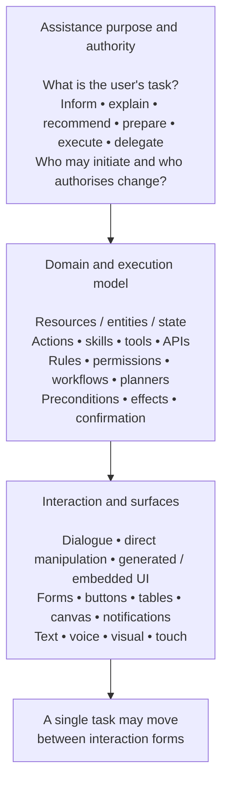

# Three-layer model for task assistance

[Reading map]()

## Model from the research report

Proposed practitioner definition:

> **AI task assistant:** an interactive AI system that helps a person understand, decide about, prepare, or carry out tasks in a domain by interpreting user intent and context, using defined or dynamically selected capabilities, and coordinating task execution with the person through one or more interaction forms. Those forms can include natural-language dialogue, direct manipulation, structured or generated interfaces, and proactive interactions.

Where cooperation is the emphasis, **human-AI task assistance system** is an even more neutral research term. "Task assistant" should be understood broadly enough to include an informational task such as explaining an electricity bill and an action task such as changing a recurring payment.

The proposed classification uses three layers.

**The first layer -- assistance purpose and authority -- classifies what relationship the system has to the user's work.** A practical capability progression is **inform -> recommend -> prepare -> execute -> delegate**. Initiative is a separate property: reactive, suggestive/proactive, or delegated. This layer distinguishes a Fuse-style informational assistant from an assistant that can prepare or commit state changes even when both use exactly the same chat component.

**The second layer -- domain and execution model -- describes what the system knows how to operate on and how work happens.** This is where the resource/domain model, ontology, task catalogue, action definitions, tools, permissions, workflows and planners belong. Rasa's "language versus logic" split, IBM's skills and automations, Apple's App Intents and Alexa's action/intents all provide practitioner precedents for keeping executable capabilities conceptually distinct from the conversation itself. [Rasa CALM](https://rasa.com/calm)

The same layer distinguishes two architectures that are frequently conflated:

`supported task -> prescribed application flow -> execution`

versus

`user goal -> model chooses/composes actions -> observes results -> adapts plan`.

Both may use the same domain APIs. The first is primarily **workflow-based assistance**; the second has greater **agentic process control**.

**The third layer -- interaction and surfaces -- says how the collaboration occurs at a particular moment.** It includes dialogue but does not privilege it. A user might start a task through text, inspect a proposal in a table, change one parameter with a form control, approve it with a button and later receive a notification. Current Microsoft, Apple, Amazon, Google and OpenAI interfaces all contain variants of this pattern. [User experience guidelines for MCP apps in declarative agents for Microsoft 365 Copilot](https://learn.microsoft.com/en-us/microsoft-365-copilot/extensibility/declarative-agent-ui-widgets-guidelines)

This model also assigns common names to the layers:

**assistant / copilot / agent** mostly describe layer one and the amount of initiative;

**workflow / skill / action / tool** mostly describe layer two;

**dialogue / conversational UI / multimodal / hybrid UI** mostly describe layer three;

**mixed-initiative** cuts across layers one and three because it specifies how initiative and control pass between human and machine.

That is much cleaner than making "dialogue system", "copilot", "workflow assistant" and "agent" mutually exclusive classes.

## Earlier formulation

The earlier proposal below orders domain and collaboration first. The research report above makes purpose and authority explicit as its first layer.

### A better conceptual hierarchy

The earlier proposal uses three layers:

Task and domain layer

User goals, resources, domain state, permitted operations

Assistance and collaboration layer

Reasoning, planning, workflows, proposals, authorization, execution

Interaction layer

Dialogue

Hybrid UI

Direct UI

Under this model, dialogue is one possible interaction mechanism. The common foundation for Fuse Energy, financial assistants, and other application assistants lives primarily in the first two layers.

### Possible names for the broader class

AI-assisted task systems is a reasonable descriptive umbrella, though it isn't a standardized research category.

Mixed-initiative task assistants is more specific when humans and AI can both propose actions and steer their completion.

Workflow-based task assistants describes the earlier, narrower architecture, with a predefined task catalog and controlled execution.

Preferred framing in this earlier proposal:

> A human-AI collaborative system that helps users understand and change domain state to accomplish tasks, using whichever interaction mechanisms best support the work.

This definition includes read-only assistance, proposed actions, controlled workflows, and delegated execution.

It also suggests a useful research direction: treat dialogue as one form of human-AI collaboration within task-oriented systems, while making the domain model, actions, and shared task state the central abstractions.

---

Related: [Task assistance beyond dialogue]() · [Terminology and taxonomy]() · [Action policy, readiness, and execution gates]().

Original text: [dialogue-systems-obsidian-references.md](/ai/design/dialogue-approach/01-framing/02-three-layer-model.assets/dialogue-systems-obsidian-references.txt) · [dialogue-systems-mislead.md](/ai/design/dialogue-approach/01-framing/02-three-layer-model.assets/dialogue-systems-mislead.txt).
