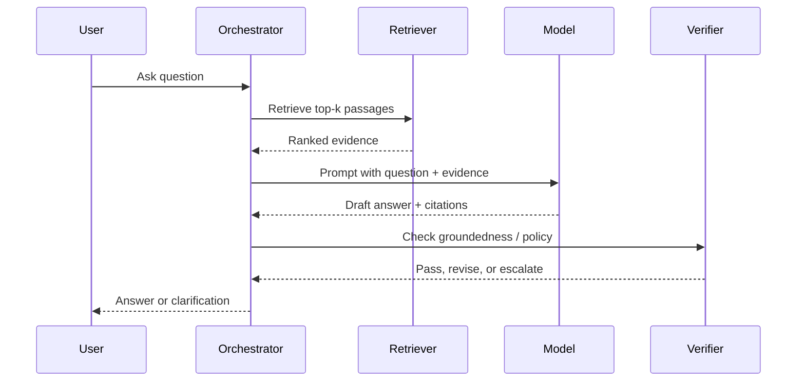
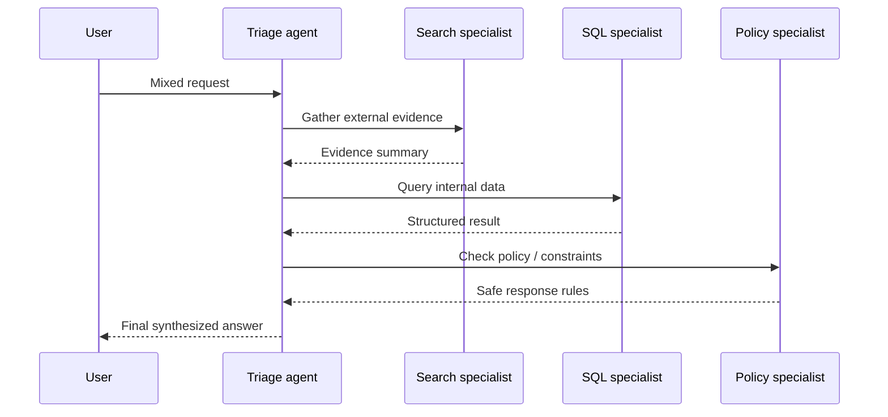
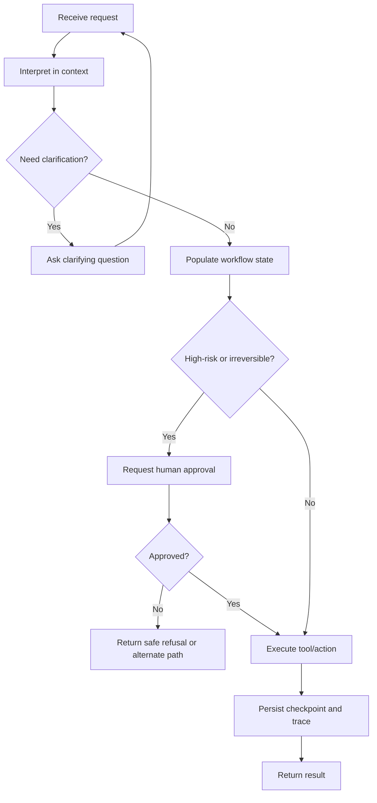
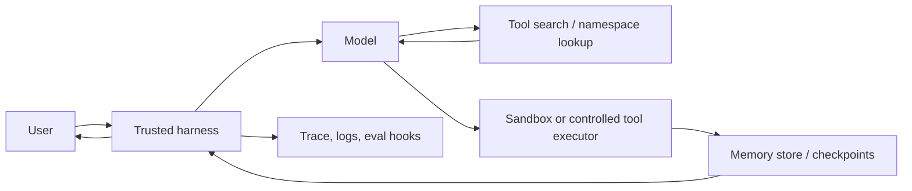

## Executive summary

Large language models have not eliminated the need to model user-system interactions; they have changed **where the structure lives**. In pre-LLM systems, structure sat predominantly at the front door: intent taxonomies, entity extractors, slot schemas, and dialogue rules. In LLM-era systems, more of the interaction is interpreted contextually by the model, while the hard structure moves downstream into **workflow graphs, tool contracts, approval gates, permission boundaries, memory layers, traces, evals, and policy controls**.[^1][^2][^3][^10][^19][^24][^29]

The biggest concrete difference is the shift from **single-turn classification and rule selection** to **contextual interpretation plus controlled execution**. Earlier systems, such as legacy Rasa NLU, organized training data around intents and entities and used stories or rules for dialogue management.[^1][^2] Newer LLM-based approaches, such as Rasa CALM, use the LLM to interpret the conversation and emit commands, while deterministic flows and policies retain control over business execution.[^3][^4][^5]

In production, the dominant pattern is **hybrid**, not fully autonomous. Anthropic recommends keeping agent designs simple and investing heavily in tool design; OpenAI recommends adding specialist agents only when it materially improves isolation or trace legibility; Microsoft recommends using the lowest orchestration complexity that reliably works; Google ADK distinguishes between deterministic graph workflows and more flexible dynamic flows.[^10][^13][^19][^21][^24]

For product teams, the implication is straightforward: intent is still useful, but it is now only one control signal among several. The core operational abstractions in LLM systems are now **routing signals, state, memory, tool surfaces, workflow topology, approval logic, risk controls, traces, and eval datasets**.[^11][^12][^17][^18][^25][^31]

## What changed from pre-LLM interaction management to LLM-era workflows

Pre-LLM conversational systems usually decomposed interaction into a pipeline:

1. classify user intent,
2. extract entities,
3. update slots,
4. choose the next action using rules, stories, or a learned dialogue policy.

This worked well when domains were narrow and paths were predictable. It became brittle when user requests were ambiguous, mixed, multi-step, or exploratory. Teams had to maintain growing intent taxonomies, edge-case training data, and repair logic.[^1][^2]

LLM-era systems move away from forcing each message into a fixed intent label before anything useful can happen. The LLM can interpret the request in context, infer missing structure, handle interruptions, ask clarifying questions, and coordinate multiple steps. But this does **not** mean the system should become unstructured. Instead, the structure moves into execution controls: flows, tools, schemas, permissions, checkpoints, policy gates, and observability.[^3][^4][^5][^10][^19][^29][^30]

At the research level, this shift appears in several influential patterns. ReAct showed that reasoning and action can be interleaved, allowing models to reason, call tools, observe results, and continue.[^6] Toolformer showed that models can learn when and how to use external APIs.[^7] More recent work on LLM-based dialogue state tracking shows that models can reduce dependence on traditional intent/entity datasets for certain workflow-state tasks.[^8]

The execution model has changed as well. OpenAI, Anthropic, Google, Microsoft, and LangChain now expose first-class concepts for tools, handoffs, state, memory, traces, guardrails, and workflow control.[^9][^10][^16][^18][^19][^23][^29][^30] The result is a different product architecture: more flexible at the language layer, but more explicit at the control layer.

## Comparison table

| Attribute | Pre-LLM dominant practice | LLM-era dominant practice | Main implication |
|---|---|---|---|
| Intent detection and routing | Front-door intent classification, often one label per turn, plus entities and fixed action selection. | Contextual interpretation across the whole thread; explicit intent may survive as a soft routing signal, not the universal abstraction. | Routing becomes more flexible, but downstream controls must become stronger.[^1][^3][^24] |
| State management and memory | Slots or dialogue state trackers, usually scoped to one conversation. | Layered memory: session state, working memory, long-term memory stores, checkpoints, compaction, resumable sessions. | Memory becomes an architectural subsystem, not just a few variables.[^17][^18][^30] |
| Multi-step orchestration | Rules, stories, finite-state machines, or workflow engines external to the model. | Model-in-the-loop planning plus explicit orchestration patterns: graphs, handoffs, specialists-as-tools, sequential and concurrent loops. | More capability on ambiguous tasks, but more coordination overhead.[^10][^19][^24][^29] |
| Tool use | Narrow API integrations hidden behind app logic. | Native function calling, server tools, MCP, tool search, strict schemas, parallel tool use, and sandboxes. | Tool-surface design becomes one of the highest-leverage engineering tasks.[^7][^14][^16][^37] |
| Clarification and repair | Hand-authored fallback prompts and repair states. | Context-aware clarification, flow repair, interruption handling, resume patterns, and approval checkpoints. | Repair shifts from brittle fallback trees to workflow patterns plus model judgment.[^3][^20][^26] |
| Human-in-the-loop | Escalation to a human was often a terminal fallback. | Human review becomes a first-class workflow state: approval, verification, data entry, resumption, selective review. | Human review moves from "failure path" to designed stage of execution.[^20][^26][^27] |
| Policy and risk control | Mostly moderation-at-input/output and back-end permissions. | Layered controls: scoped credentials, action approvals, sandboxes, prompt segmentation, guardrails, red teaming, trace review. | Safety becomes a workflow architecture problem.[^22][^27][^37] |
| Evaluation and observability | Intent/entity accuracy, containment, handle time, scripted task success. | Traces, trajectory grading, tool-call metrics, groundedness, task adherence, online/offline eval loops. | Evaluate both final answer and path taken.[^11][^12][^25][^28][^31] |
| Cost and latency | Cheap, predictable classifiers and rules. | Variable cost from tokens, tools, retrieval, memory, and multi-step execution. | Optimize workflow shape, not only model choice.[^36] |
| Developer ergonomics | Training-data curation, rule editing, state-machine tests. | Tool engineering, workflow graphs, prompt/context engineering, trace debugging, eval datasets, test-framework integration. | AI product engineering becomes software engineering plus evaluation science.[^9][^13][^31] |
| Data and privacy | Mostly transcripts, slots, CRM fields, analytics labels. | Prompts, responses, tool arguments/results, traces, memory files, embeddings, retrieved documents, cached context, sandbox artifacts. | Governance must cover the whole agent runtime.[^38][^39][^40] |

## The central architectural shift

The core shift can be summarized as:

> **From intent-first interaction design to context-and-control workflow design.**

In the older model, the system often had to decide early: "Which intent is this?" In the LLM-era model, the system can often delay that decision, interpret the user's goal in context, and proceed through a controlled workflow.

This changes the role of intent:

| Old role of intent | New role of intent |
|---|---|
| Primary representation of user meaning | One signal among several |
| Main routing mechanism | Optional routing/control feature |
| Required label for most messages | Useful only where branches are stable and consequential |
| Basis for analytics and dialogue policy | Part of a broader trace/eval/observability model |
| Often hard-gated | Often soft, probabilistic, or inferred inside a workflow |

The practical rule is:

> Use explicit intent when the **system** needs a stable switch. Use soft interpretation when the **user** needs flexibility.

## Architecture pattern 1: Retrieval-first assistant with verification

Use this when the task is primarily informational and grounded in trusted documents. The LLM synthesizes, but retrieval and verification constrain the answer.

This is the modern descendant of document QA. The interaction is flexible, but the answer remains grounded in retrieved evidence and checked for support.[^11][^21][^25]

## Architecture pattern 2: Manager agent with specialists as tools

Use this when one outer interaction should remain coherent while bounded specialist tasks are delegated behind the scenes.

OpenAI describes this as using agents as tools; LangChain and Microsoft describe related supervisor, handoff, and multi-agent patterns.[^10][^24][^29]

The key design decision is whether a specialist is merely a hidden helper or becomes the new owner of the conversation.

## Architecture pattern 3: Deterministic state graph with human approval

Use this when the workflow has well-defined steps, irreversible actions, regulated consequences, or high cost of error.

Google ADK, Microsoft Agent Framework, and LangGraph all converge on this idea: put the model inside a stateful, inspectable process, not above it.[^19][^20][^26][^30]

## Architecture pattern 4: Long-running agent with sandbox, memory, and deferred tools

Use this when the task spans many steps, produces artifacts, or depends on a controlled working environment.

The key principle is to separate the model's reasoning from the authority to act. The model may plan and request tools, but a trusted harness should control credentials, sandboxing, permissions, approval, logging, and persistence.[^14][^16][^22][^30][^37]

## Operational implications

### 1. Product design

Pre-LLM product design often centered on an intent map and a happy-path dialogue tree. LLM-era product design still needs task decomposition, but the more important questions are now:

- What state must persist?
- What tools may be called?
- Which actions require confirmation?
- What should happen when the user interrupts or changes direction?
- When should the system stop improvising and enter a deterministic branch?
- What counts as success: a good answer, a completed task, a safe handoff, or a verified artifact?

This means the product artifact changes from "intent taxonomy plus dialogue tree" toward "workflow topology plus control policy."

### 2. Safety and policy enforcement

Tool-using agents transform safety from an output-filtering problem into an execution-control problem. A hallucinated answer is bad; a hallucinated tool call can be worse. Prompt injection, memory contamination, and untrusted retrieved content can now influence actions, not just text.[^22][^37]

A practical control stack should include:

- strict tool schemas,
- least-privilege credentials,
- separation between trusted instructions and untrusted external content,
- approval gates for high-risk actions,
- sandboxed execution,
- trace logging,
- red-team tests,
- post-run review and evals.[^22][^27][^37]

### 3. Observability and evaluation

The evaluation unit changes from "did the final answer look good?" to "did the whole trajectory work?"

Modern agent observability should inspect:

- final response quality,
- tool selection,
- tool arguments,
- tool output use,
- retrieval quality,
- groundedness,
- handoff logic,
- clarification decisions,
- policy adherence,
- latency,
- cost per successful task,
- failure and recovery paths.[^11][^12][^25][^28][^31]

This is necessary because many failures happen mid-execution. The final answer may appear fluent even when the system used the wrong source, called the wrong tool, skipped approval, or polluted memory.

### 4. Cost and latency

LLM workflow cost is often determined by workflow shape, not just model price. Multi-step chains can multiply token usage, tool round trips, retrieval, and latency. OpenAI's latency guidance emphasizes fewer tokens, fewer requests, parallelization, and avoiding LLM calls where deterministic code suffices.[^36]

Useful tactics include:

- route simple tasks to deterministic code,
- use smaller models for classification or extraction,
- use tool search instead of loading all tools into context,
- cache stable context,
- parallelize independent tool calls,
- defer expensive retrieval until needed,
- measure cost per successful task, not only cost per call.[^36]

### 5. Developer ergonomics

Developers now spend less time only writing rules or labeling intents, and more time designing:

- tool contracts,
- schemas,
- workflows,
- prompts,
- memory policies,
- eval datasets,
- trace review loops,
- test harnesses,
- approval and permission systems.[^9][^13][^14][^31]

This makes LLM product development closer to software engineering plus empirical evaluation. The system is not fully specified in code, but it must still be tested, observed, and controlled.

### 6. Data, privacy, and governance

Agent systems widen the data plane. Sensitive information may appear in prompts, responses, retrieved documents, embeddings, tool arguments, tool outputs, traces, memory stores, sandbox files, and approval logs. Enterprise privacy and retention controls therefore need to cover the full agent runtime, not just user chat transcripts.[^38][^39][^40]

Governance should include:

- agent inventory,
- approved tool registries,
- connector and permission reviews,
- data-retention policies,
- memory-review policies,
- prompt and skill review,
- eval gates before deployment,
- red-team procedures,
- audit logs,
- clear ownership of each workflow.[^39]

## Explicit intent versus soft signals

Explicit intent detection still has a role. It is useful when workflows are stable, high-volume, consequential, or need deterministic routing.

| Situation | Use explicit intent? | Why |
|---|---|---|
| Stable high-volume workflows such as order tracking, booking, refund, password reset | Usually yes | Routing value is high and ambiguity cost is low. |
| Irreversible, regulated, or high-risk actions | Yes, plus confirmation | Intent or classification can gate entry; approval gates execution. |
| Multi-domain support with interruptions and resumptions | Hybrid | Let the model infer commands and context, but keep deterministic flows underneath. |
| Open-ended research, tutoring, drafting, or strategy work | Usually no hard intent layer | User goals are mixed, evolving, and partially formed. |
| Large tool catalogues | Soft signals first | Tool descriptions, namespaces, and tool search usually scale better than large intent hierarchies. |
| Single-assistant experience with minimal branching | Often no separate layer | Extra classification may add latency and maintenance without much value. |

The concise product rule:

> Intent is a useful control abstraction, but not a full model of interaction.

In LLM products, intent often survives as a soft routing hint, analytics label, or risk class. It should not be treated as the universal language of the whole product.

## Risk table

| Risk | Typical failure mode | Strong mitigations |
|---|---|---|
| Prompt injection and context contamination | Untrusted retrieved content or webpages alter planning or tool use. | Separate trusted/untrusted context, sandbox execution, require approvals, red-team retrieval/browser paths.[^22][^37] |
| Tool confusion | Wrong tool, wrong namespace, wrong environment, or bad parameters. | Minimal toolset, clear descriptions, strict schemas, namespaces, tool search, trace review.[^14][^16] |
| Runaway autonomy | Agent acts without appropriate user visibility or consent. | Human-in-the-loop stages, scoped permissions, confirmations, checkpoints, transparent UI.[^20][^26][^27] |
| Memory poisoning or leakage | Bad memory writes persist across sessions or cross user boundaries. | Client-controlled memory stores, namespace isolation, reviewable memory, retention policies.[^17][^18][^39] |
| Opaque failures | Final answer looks fine but path was brittle, unsafe, or expensive. | Trace-based observability, trajectory evals, online/offline eval loops.[^11][^12][^31] |
| Cost and latency blow-ups | Too many turns, tools, tokens, or model calls. | Fewer requests, smaller models, caching, parallelism, deferred tools, deterministic code.[^36] |
| Governance drift | Shadow agents, unreviewed skills, unclear ownership, inconsistent retention. | Agent inventory, approved tool registries, eval gates, ownership, audit logs.[^39] |

## Practical implications for the interaction model

The starting interaction model is:

> User-system interactions are complex. To build successful AI products, we need tools and lenses for understanding and managing them. Intent is one such lens.

The LLM-era revision is:

> User-system interactions are still complex, but LLMs let the system interpret more of that complexity dynamically. Therefore, the main design problem shifts from predefining every interaction path to constraining, observing, and evaluating how dynamic interpretation becomes action.

So the updated model is:

| Layer          | Pre-LLM emphasis                      | LLM-era emphasis                                                    |
| -------------- | ------------------------------------- | ------------------------------------------------------------------- |
| User utterance | Classify into intent and entities     | Interpret in context                                                |
| Dialogue       | Pre-authored flows and fallback paths | Model-assisted repair, clarification, and resumption                |
| Workflow       | External rules                        | Explicit graph/state/harness around the model                       |
| Tools          | Hidden integration layer              | First-class model-callable surface                                  |
| Safety         | Input/output filters                  | Permissions, approvals, sandboxes, policy gates                     |
| Evaluation     | Intent accuracy and task success      | Trace, trajectory, tool use, groundedness, cost, latency            |
| Governance     | Chat logs and CRM data                | Full runtime governance: prompts, memory, tools, traces, connectors |

The main conclusion:

> LLMs reduce the need for rigid front-door intent taxonomies, but increase the need for explicit workflow, tool, state, safety, and observability design.

## Prioritized source list

[^1]: [Rasa: NLU training data](https://rasa.com/docs/rasa/2.x/nlu-training-data/)

[^2]: [Rasa: Stories](https://rasa.com/docs/rasa/stories/)

[^3]: [Rasa: Dialogue Understanding / CALM](https://rasa.com/docs/learn/concepts/dialogue-understanding/)

[^4]: [Rasa: Flows](https://rasa.com/docs/reference/primitives/flows/)

[^5]: [Rasa: Flow Policy](https://rasa.com/docs/reference/config/policies/flow-policy/)

[^6]: [ReAct: Synergizing Reasoning and Acting in Language Models](https://arxiv.org/abs/2210.03629)

[^7]: [Toolformer: Language Models Can Teach Themselves to Use Tools](https://arxiv.org/abs/2302.04761)

[^8]: [LLM-based dialogue state tracking paper](https://arxiv.org/abs/2402.10466)

[^9]: [OpenAI: Agents guide](https://developers.openai.com/api/docs/guides/agents)

[^10]: [OpenAI: Agents orchestration](https://developers.openai.com/api/docs/guides/agents/orchestration)

[^11]: [OpenAI: Agent evals](https://developers.openai.com/api/docs/guides/agent-evals)

[^12]: [OpenAI: Agents observability integrations](https://developers.openai.com/api/docs/guides/agents/integrations-observability)

[^13]: [Anthropic: Building effective agents](https://www.anthropic.com/research/building-effective-agents)

[^14]: [Anthropic: Writing tools for agents](https://www.anthropic.com/engineering/writing-tools-for-agents)

[^15]: [Anthropic: Effective context engineering for agents](https://www.anthropic.com/engineering/effective-context-engineering-for-ai-agents)

[^16]: [Anthropic Claude docs: Tool use overview](https://platform.claude.com/docs/en/agents-and-tools/tool-use/overview)

[^17]: [Anthropic Claude docs: Memory tool](https://platform.claude.com/docs/en/agents-and-tools/tool-use/memory-tool)

[^18]: [Google ADK: Sessions](https://google.github.io/adk-docs/sessions/)

[^19]: [Google ADK: Workflows](https://google.github.io/adk-docs/workflows/)

[^20]: [Google ADK: Human input workflows](https://google.github.io/adk-docs/workflows/human-input/)

[^21]: [Google Cloud: Choose a design pattern for an agentic AI system](https://docs.cloud.google.com/architecture/choose-design-pattern-agentic-ai-system)

[^22]: [Google: Secure AI Agents whitepaper](https://storage.googleapis.com/gweb-research2023-media/pubtools/1018686.pdf)

[^23]: [Microsoft: Agent Framework overview](https://learn.microsoft.com/en-us/agent-framework/overview/)

[^24]: [Microsoft Azure Architecture Center: AI agent design patterns](https://learn.microsoft.com/en-us/azure/architecture/ai-ml/guide/ai-agent-design-patterns)

[^25]: [Microsoft Foundry: Agent evaluators](https://learn.microsoft.com/en-us/azure/foundry/concepts/evaluation-evaluators/agent-evaluators)

[^26]: [Microsoft Agent Framework: Human-in-the-loop workflows](https://learn.microsoft.com/en-us/agent-framework/workflows/human-in-the-loop)

[^27]: [Microsoft Agent Framework: Tool approval](https://learn.microsoft.com/en-us/agent-framework/agents/tools/tool-approval)

[^28]: [Microsoft Agent Framework: Observability](https://learn.microsoft.com/en-us/agent-framework/agents/observability)

[^29]: [LangGraph: Graph API](https://docs.langchain.com/oss/python/langgraph/graph-api)

[^30]: [LangGraph: Persistence](https://docs.langchain.com/oss/python/langgraph/persistence)

[^31]: [LangSmith: Evaluation](https://docs.langchain.com/langsmith/evaluation)

[^32]: [AgentBench](https://arxiv.org/abs/2308.03688)

[^33]: [API-Bank](https://arxiv.org/abs/2304.08244)

[^34]: [ToolSandbox](https://openreview.net/forum?id=2GmDdhBdDk)

[^35]: [Berkeley Function Calling Leaderboard / BFCL](https://arxiv.org/abs/2408.04682)

[^36]: [OpenAI: Latency optimization](https://developers.openai.com/api/docs/guides/latency-optimization)

[^37]: [OpenAI: MCP and connectors](https://developers.openai.com/api/docs/guides/tools-connectors-mcp)

[^38]: [OpenAI: Enterprise privacy](https://openai.com/enterprise-privacy/)

[^39]: [Microsoft 365 Copilot privacy](https://learn.microsoft.com/en-us/microsoft-365/copilot/microsoft-365-copilot-privacy)

[^40]: [Google Vertex AI: Zero data retention](https://docs.cloud.google.com/vertex-ai/generative-ai/docs/vertex-ai-zero-data-retention)

[^41]: [OpenAI case study: Klarna](https://openai.com/index/klarna/)

[^42]: [OpenAI case study: Morgan Stanley](https://openai.com/index/morgan-stanley/)

[^43]: [LangChain case study: Build.inc and LangGraph](https://www.langchain.com/blog/how-build-inc-used-langgraph-to-launch-a-multi-agent-architecture-for-automating-critical-cre-workflows-for-data-center-development)

[^44]: [OpenAI: Inside our in-house data agent](https://openai.com/index/inside-our-in-house-data-agent/)
