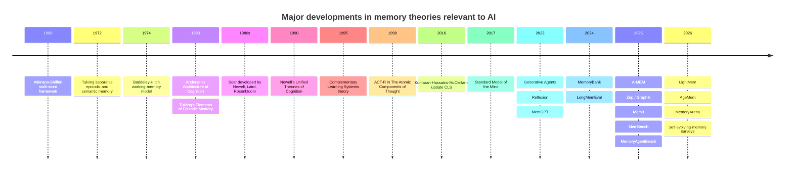
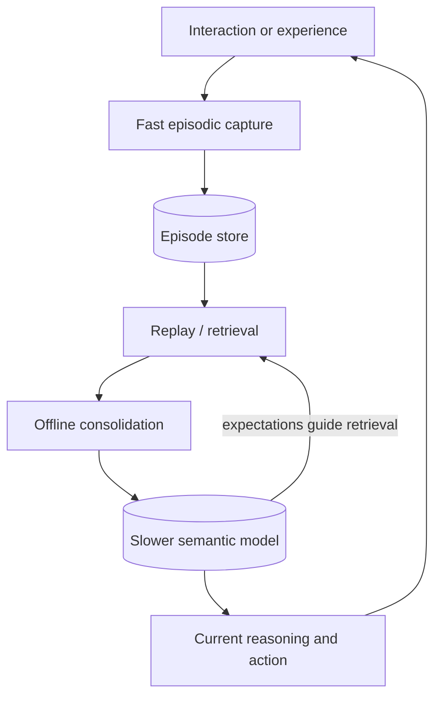
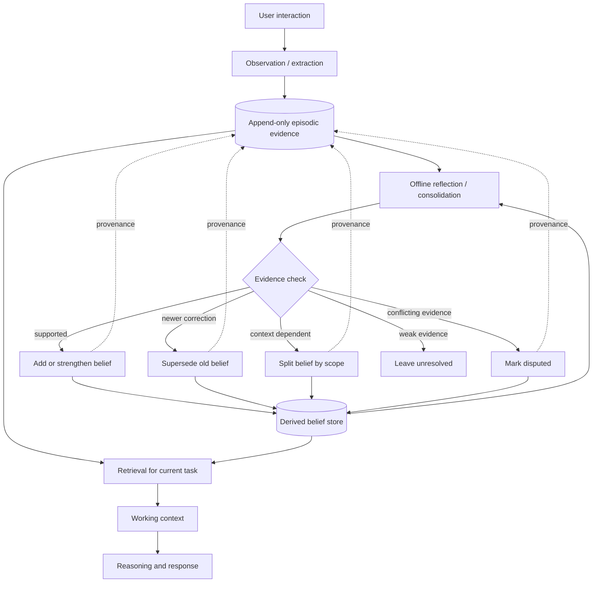

# Memory in Cognitive Architectures and AI Agents: From Human Memory Models to Reflective and Self-Managing Agent Memory

## Executive summary


The most useful way to understand "memory" in AI is as the meeting point of **two research traditions**.

The first is the **cognitive-architecture tradition**. Newell, Anderson, Laird, Rosenbloom, Lebiere, and others tried to specify the relatively stable computational machinery from which intelligent behavior emerges. Memory became part of that machinery because cognition is temporally extended: what an agent does now depends on knowledge, previous states, previous actions, goals, and learned experience. ACT-R explicitly separates declarative and procedural memory; modern Soar has working, procedural, semantic, and episodic memories. Newell's *Unified Theories of Cognition* supplied much of the intellectual program behind this idea. [@act-r-overview; @newell-unified-theories-of-cognition-1990; @laird-soar-cognitive-architecture-2012; @laird-lebiere-rosenbloom-standard-model-mind-2017]

The second is the **experimental psychology and neuroscience tradition**. Atkinson and Shiffrin distinguished memory stores and control processes; Baddeley and Hitch replaced a simple short-term store with working-memory mechanisms; Tulving distinguished episodic from semantic memory; neuroscience later distinguished complementary fast and slow learning systems and studied how replay and consolidation transform memories over time. [@atkinson-shiffrin-human-memory-1968; @baddeley-working-memory-review-2012; @tulving-elements-of-episodic-memory-1983; @mcclelland-mcnaughton-oreilly-cls-1995; @kumaran-hassabis-mcclelland-cls-2016]

These traditions increasingly converged. The 2017 "Standard Model of the Mind," for example, explicitly tried to identify common computational principles across AI, cognitive science, neuroscience, and robotics, using architectures including ACT-R and Soar as evidence. [@laird-lebiere-rosenbloom-standard-model-mind-2017]

**Consciousness is not the reason memory is part of a cognitive architecture.** ACT-R and Soar are computational theories and do not require phenomenal consciousness. Tulving did connect *episodic recollection* to a particular kind of self-aware consciousness--"autonoetic" awareness of oneself in subjective time--but that is a much narrower theoretical claim than "anything conscious must have memory." [@act-r-overview; @laird-soar-cognitive-architecture-2012; @tulving-episodic-memory-mind-to-brain-2002]

The current LLM-agent literature is replaying this history at high speed. The field started with largely **storage-oriented memory**--chat logs, retrieval, vector databases and summaries--then added **reflection and consolidation**, and is now moving toward **memory as an adaptive policy**: the agent decides what to retain, revise, compress, forget, retrieve, or abstract into reusable experience. The 2026 ACL survey *From Storage to Experience* explicitly describes this evolution as **Storage -> Reflection -> Experience**; a 2026 TMLR survey focuses on the transition toward self-evolving, long-horizon memory. [@luo-storage-to-experience-2026; @huang-agent-memory-second-half-2026]

That gives a useful conceptual sequence:




The dates and conceptual milestones above follow the original works and subsequent reviews. [@atkinson-shiffrin-human-memory-1968; @tulving-elements-of-episodic-memory-1983; @baddeley-working-memory-review-2012; @newell-unified-theories-of-cognition-1990; @mcclelland-mcnaughton-oreilly-cls-1995; @kumaran-hassabis-mcclelland-cls-2016; @laird-lebiere-rosenbloom-standard-model-mind-2017; @park-generative-agents-2023; @shinn-reflexion-2023; @packer-memgpt-2023; @zhong-memorybank-2024; @rasmussen-zep-temporal-knowledge-graph-2025; @chhikara-mem0-2025; @xu-a-mem-agentic-memory-2025; @fang-lightmem-2026; @yu-agentic-memory-2026]

The main proposed architectural conclusion is that a long-lived personalized agent should probably **not** have a single thing called "memory." It benefits from at least four logically separate facilities:

1. an immutable or nearly immutable **episodic evidence store**;
2. a revisable **semantic/belief model**;
3. a small **working state** used for the current interaction;
4. a **consolidation process** that turns episodes into beliefs, discovers conflicts and changes, and can revise previous abstractions.

For a client model, the proposal additionally makes **provenance and temporal validity first-class fields**. A statement such as "the client prefers detailed answers" should never become epistemically equivalent to the user explicitly saying that. Derived beliefs should remain traceable to their supporting and contradicting observations. This is an engineering synthesis of the cognitive-memory literature, temporal agent memory such as Zep/Graphiti, reflective architectures such as Generative Agents, and the knowledge-update requirements exposed by LongMemEval. [@park-generative-agents-2023; @rasmussen-zep-temporal-knowledge-graph-2025; @wu-longmemeval-2025]

A "sleep" process therefore has a good theoretical basis, provided the metaphor is used carefully. The useful abstraction is:

> **fast capture of episodes -> offline replay/retrieval -> comparison and abstraction -> slower revision of structured knowledge**

That is close to Complementary Learning Systems theory and to recent agent systems such as LightMem. It does **not** imply that an AI should imitate human REM/NREM physiology literally. [@mcclelland-mcnaughton-oreilly-cls-1995; @kumaran-hassabis-mcclelland-cls-2016; @brodt-sleep-systems-memory-consolidation-2023; @fang-lightmem-2026]

## Historical foundations and theoretical bridges

### From memory stores to cognitive architecture


Atkinson and Shiffrin's 1968 framework was important for more than its famous division into memory stores. It distinguished relatively stable **structural components** from **control processes** such as rehearsal, coding, and search. That distinction anticipates a question that has returned in agent memory: the store itself and the policy controlling the store are different problems. [@atkinson-shiffrin-human-memory-1968; @atkinson-shiffrin-1968-secondary-source]

Baddeley and Hitch then challenged the idea that short-term memory was simply a passive temporary store. The resulting working-memory tradition treated temporary memory as part storage and part active cognitive machinery. Baddeley's retrospective review describes the progression from the original multicomponent model toward a system involving attentional control, modality-specific storage, an episodic buffer, and interaction with long-term memory. [@baddeley-working-memory-review-2012]

Tulving introduced a different axis. **Semantic memory** concerns general knowledge; **episodic memory** concerns experienced events. His later account emphasized that episodic remembering involves subjective time and recollection of personal past experience. That distinction remains influential in cognitive neuroscience. [@tulving-elements-of-episodic-memory-1983; @tulving-episodic-semantic-memory-secondary-source; @tulving-episodic-memory-mind-to-brain-2002]

The categories are therefore not one clean hierarchy:

| Psychological concept | Main question | Approximate AI analogue | Important warning |
|---|---|---|---|
| Working memory | What information is actively available now? | Context window, scratchpad, active state | Context length is not itself a psychological model of working memory. [@baddeley-working-memory-review-2012] |
| Episodic memory | What happened in a particular event or experience? | Conversation/event log, trajectory store | A raw chat chunk is only a crude episode representation. [@tulving-elements-of-episodic-memory-1983; @tulving-episodic-memory-mind-to-brain-2002] |
| Semantic memory | What do I know independently of a particular event? | Facts, beliefs, entity models, knowledge graphs | Semantic facts often need provenance back to episodes. [@tulving-elements-of-episodic-memory-1983] |
| Procedural memory | How do I perform an action or skill? | Rules, policies, reusable plans, skills | Current LLM literature sometimes calls textual "lessons" procedural memory even though they still require explicit interpretation. [@act-r-overview] |
| Long-term memory | What persists beyond the current processing episode? | External store, graph, model weights | It is a duration category, not a single representational format. [@baddeley-working-memory-review-2012] |

This matters because modern papers routinely reuse the terms while changing their computational meaning. The recent broad survey *Memory in the Age of AI Agents* ([PDF](/sources/ai-engineering/agents/hu-2025-memory-in-the-age-of-ai-agents.pdf.enc)) argues that traditional short-term/long-term terminology alone is inadequate and instead examines memory in terms of **form, function, and dynamics**, including token-level, parametric and latent forms and factual, experiential and working functions. [@hu-memory-in-the-age-of-ai-agents-2025; @hu-memory-in-the-age-of-ai-agents-2025-secondary-source]

### Newell and the architectural tradition


Newell's central ambition was larger than modeling memory. *Unified Theories of Cognition* argued for integrated theories capable of explaining many cognitive phenomena with the same underlying architecture. Its organization explicitly moves from foundations of cognitive science to a "Human Cognitive Architecture." [@newell-unified-theories-of-cognition-1990]

This is the source of an important AI meaning of **architecture**: the relatively task-independent machinery through which task-specific knowledge is expressed and used. A cognitive architecture is therefore closer to an operating model for cognition than to an application-specific algorithm. The later Standard Model project describes cognitive architecture as a hypothesis about the fixed structure of the mind and traces the tradition back strongly to Newell. [@laird-lebiere-rosenbloom-standard-model-mind-2017]

Soar emerged from this program. Laird's definitive book describes Soar simultaneously as software for constructing agents and as a theory of computational structures required for human-level agents; newer Soar incorporated semantic and episodic memory alongside procedural knowledge and multiple learning mechanisms. [@laird-soar-cognitive-architecture-2012; @soar-architecture-secondary-source]

ACT-R approaches the same objective with somewhat different commitments. Its official description divides memory into **declarative memory**, containing factual chunks, and **procedural memory**, containing productions. Buffers expose current module state, while subsymbolic equations influence retrieval latency and production selection. Thus ACT-R is deliberately both symbolic and quantitative. [@act-r-overview]

The architecture literature remained broad. Kotseruba and Tsotsos' review of roughly four decades of cognitive architectures examines memory alongside perception, attention, action selection, learning, reasoning and metareasoning, illustrating why "memory" historically sits inside a larger account of cognition rather than existing as an isolated database service. [@kotseruba-tsotsos-40-years-cognitive-architectures-2020; @kotseruba-tsotsos-2020-secondary-source]

### Why memory is architectural without implying consciousness


The architectural argument can be stated without invoking consciousness:

```text
Current perception alone
        │
        ▼
purely reactive mapping
input ───────────────► action

Current perception + retained state/knowledge/experience
        │
        ▼
history-dependent cognition
input + prior experience + goals ───────────────► action
```


Once behavior is supposed to depend on learning, prior decisions, accumulated knowledge, ongoing goals, or previous interactions, some information from the past must affect computation in the present. ACT-R and Soar implement this computationally; neither requires a claim that the resulting software is conscious. [@act-r-overview; @laird-soar-cognitive-architecture-2012]

Tulving's theory does provide a specific consciousness connection: his mature account of episodic memory associates remembering one's past with autonoetic consciousness and subjective time. But this says something about a **particular human memory system**, rather than establishing memory as a necessary or sufficient criterion for consciousness. [@tulving-episodic-memory-mind-to-brain-2002]

This distinction is useful when reading modern agent papers. Calling a vector index "episodic memory" is an architectural analogy. It should not be taken to imply that the agent experiences or recollects episodes in Tulving's psychological sense.

### Complementary Learning Systems


The strongest theoretical bridge to the proposed "sleep" architecture is **Complementary Learning Systems**, or CLS.

McClelland, McNaughton, and O'Reilly's 1995 theory addresses a basic learning dilemma. A system that rapidly incorporates a new episode into a single shared representation risks disrupting old knowledge. A system that changes slowly can learn stable structure but is bad at retaining a new specific experience immediately. Their solution posits complementary systems: rapid hippocampal learning of specific events and slower neocortical learning that integrates regularities across experiences. Replay or reinstatement allows new information to be interleaved with prior knowledge. [@mcclelland-mcnaughton-oreilly-cls-1995]

Kumaran, Hassabis, and McClelland revisited CLS in 2016 explicitly in terms of what learning systems **intelligent agents** need. Their updated account retains the distinction between fast learning of specifics and slower acquisition of structured knowledge while incorporating newer findings about schema and generalization. [@kumaran-hassabis-mcclelland-cls-2016; @kumaran-hassabis-mcclelland-cls-2016-secondary-source]

That immediately suggests an AI architecture:




This is a conceptual analogy to CLS, not a claim that databases correspond anatomically to the hippocampus or that an LLM corresponds to neocortex. [@mcclelland-mcnaughton-oreilly-cls-1995; @kumaran-hassabis-mcclelland-cls-2016]

### Sleep and consolidation


Modern sleep research strengthens the general idea that memory is **transformed**, not merely preserved.

A 2023 *Neuron* review describes replay of neural activity as a major mechanism implicated in systems-memory consolidation during sleep. A 2024 *Trends in Cognitive Sciences* review discusses coordinated slow oscillations, spindles, and hippocampal ripples as mechanisms associated with selective reactivation and consolidation. Experimental work has also linked coordinated hippocampal, thalamic and cortical activity to sleep-dependent consolidation. [@brodt-sleep-systems-memory-consolidation-2023; @staresina-sleep-rhythms-memory-consolidation-2024; @sleep-dependent-consolidation-experimental-study]

At the same time, the neuroscience does not support a simplistic single "sleep algorithm." A 2026 *Nature Neuroscience* study, for example, reports procedural replay in dorsal striatum that can be independent of hippocampal replay, illustrating that different memory systems can consolidate differently. [@procedural-replay-nature-neuroscience-2026]

So the defensible engineering lesson is narrower:

> **Separate immediate capture from slower integration, and periodically revisit experience under conditions where the system can compare multiple memories rather than reacting to one event at a time.**

That principle has much stronger scientific support than attempts to map REM, NREM, dreaming, or hippocampal physiology directly onto LLM operations. [@mcclelland-mcnaughton-oreilly-cls-1995; @kumaran-hassabis-mcclelland-cls-2016; @brodt-sleep-systems-memory-consolidation-2023]

## Modern agent memory and the research community

### How the LLM-agent literature changed


A useful dividing line is between **retrieval memory** and **adaptive memory**.

Retrieval memory asks:

```text
What past information should I insert into the prompt?
```


Adaptive memory adds:

```text
What should become memory?
What should be merged?
What has become false?
What should be forgotten?
What general rule follows from several experiences?
Which old belief should change?
What should remain as raw evidence?
```


The field is increasingly moving toward the second set of questions. The peer-reviewed 2025 ACM *Transactions on Information Systems* survey provides a broad review of LLM-agent memory mechanisms; the 2026 ACL Findings survey explicitly characterizes the progression as Storage -> Reflection -> Experience; and the 2026 TMLR survey frames current research around self-evolving and long-horizon memory. [@zhang-survey-memory-llm-agents-tois-2025; @luo-storage-to-experience-2026; @huang-agent-memory-second-half-2026]

The recommended source-quality policy treats those peer-reviewed surveys as the primary maps of the field. The very broad 2025 *Memory in the Age of AI Agents* survey is useful as a reference and taxonomy but remains an arXiv paper in the source checked here. [@hu-memory-in-the-age-of-ai-agents-2025]

### Major systems


The following comparison mixes reported mechanisms with the architectural assessment proposed here of their consequences. "Scalability" therefore means architectural cost behavior, not a common benchmark score.

| System | Storage type | Update policy | Time handling | Provenance | Retrieval | Scalability / cost | Interpretability | Best fit |
|---|---|---|---|---|---|---|---|---|
| **Generative Agents** | Natural-language memory stream plus reflections | Observations appended; higher-level reflections periodically synthesized | Recency contributes to retrieval; no full temporal DB semantics | Partial: reflections arise from retrieved observations | Relevance + importance + recency | Reflection adds LLM calls; memory stream grows | High at textual level; abstractions can still be wrong | Persistent simulated agents; reflective personalization. [@park-generative-agents-2023; @park-generative-agents-2023-secondary-source] |
| **Reflexion** | Textual reflective episodes | Feedback triggers verbal self-reflection; reflection reused on later trials | Trial order, little explicit temporal semantics | Weak-to-medium | Recent/useful reflections inserted into context | Cheap compared with weight updates; bounded buffers often needed | High because lessons are textual | Learning from repeated task failure without training weights. [@shinn-reflexion-2023] |
| **MemGPT** | Hierarchical context and external storage | Agent moves information between memory tiers | Mainly session/history order | Depends on backing store | Agent-managed paging/search | Designed to keep active context bounded while external history grows | Medium-high because memory operations are explicit | Very long documents and multi-session assistants. [@packer-memgpt-2023] |
| **MemoryBank** | Persistent conversational memories and user portrait | Continuous memory updates and user-model synthesis | Time/forgetting influence memory maintenance | Moderate | Relevant-memory retrieval | External memory avoids replaying full history | High for explicit memories; portrait synthesis is less certain | Personalized dialogue. [@zhong-memorybank-2024] |
| **A-MEM** | Interlinked atomic-style notes with context, keywords and tags | New notes create links and can update representations of older notes | Evolution represented through changing note network; weaker than explicit valid-time semantics | Medium | Semantic/link-based neighborhood retrieval | More indexing and linking work than a flat vector store | High structurally, but rewritten context may obscure why a belief changed | Dynamically organized personal/agent knowledge. It was presented at ICLR 2026 according to OpenReview. [@xu-a-mem-agentic-memory-2025; @xu-a-mem-openreview-2026] |
| **Zep / Graphiti** | Temporal knowledge graph combining conversational and structured data | Extract relationships; update/invalidate changing graph facts | **Explicit temporal relationships are a central design goal** | Stronger than flat summaries when source and history are retained | Graph + semantic retrieval | More complex ingestion and graph maintenance; good targeted retrieval | High for explicit nodes/edges/history | Changing entity state, organizations, CRM-like memory. The published description is a Zep-authored preprint, so performance claims should be treated as vendor-reported. [@rasmussen-zep-temporal-knowledge-graph-2025] |
| **Mem0** | Extracted salient memories; optional graph representation | Extract, consolidate and update salient conversational information | Supports temporal questions but time is less central than in Graphiti | Medium | Semantic/graph retrieval | Explicitly designed to reduce context and retrieval costs | High-to-medium | Production conversational memory. Its reported benchmark gains come from the Mem0-authored preprint. [@chhikara-mem0-2025] |
| **LightMem** | Sensory/precompression stage, short-term consolidation, long-term memory | Includes an offline **"sleep-time" update** process | Session/topic grouping plus offline integration | Depends on stored representation | Compressed/hierarchical retrieval | Strong emphasis on reducing memory computation | Medium-high | Long-running agents where online latency matters. OpenReview lists it as an ICLR 2026 poster. [@fang-lightmem-2026] |
| **AgeMem** | Unified short- and long-term stores controlled as agent tools | Model chooses store, retrieve, update, summarize and discard operations | Can learn policies conditioned on interaction history | Depends on backing store and operation log | Policy-controlled | Adds RL training, can reduce unnecessary context operations | Operation trace is visible; policy rationale is less transparent | Agents that should learn **how to manage memory**, not follow fixed heuristics. ACL 2026 long paper. [@yu-agentic-memory-2026] |

Three systems are especially important historically.

**Generative Agents** made reflection a concrete architectural operation. Observations enter a memory stream, retrieval considers relevance, recency and importance, and periodic reflections synthesize higher-order information that then influences future behavior. Their ablations found that observation, planning and reflection each contributed to the behavioral results being studied. [@park-generative-agents-2023; @park-generative-agents-2023-secondary-source]

**Reflexion** demonstrated another meaning of reflection. The agent converts task feedback into textual lessons stored in an episodic memory buffer and applies them to future trials, without changing the base model's weights. This is closer to "learning from your mistakes" than to building a semantic model of a user. [@shinn-reflexion-2023]

**MemGPT** reframed memory as context management. Its operating-system analogy treats the model's active context as scarce fast memory and external storage as a larger slower tier, with information moved between them as needed. This is conceptually much closer to virtual memory than to Tulving's episodic memory. [@packer-memgpt-2023]

The 2025-26 systems broaden the question again. A-MEM focuses on evolving interlinked memory structures; Zep/Graphiti on temporally changing relations; Mem0 on scalable extraction/consolidation; LightMem on online/offline separation; and AgeMem makes memory operations part of a learned policy. [@rasmussen-zep-temporal-knowledge-graph-2025; @chhikara-mem0-2025; @xu-a-mem-agentic-memory-2025; @fang-lightmem-2026; @yu-agentic-memory-2026]

### Researchers and groups to know


This is not a ranking; it identifies research lineages that make the literature easier to navigate.

| Researcher / group | Affiliation relevant to this literature | Why to follow | Representative work |
|---|---|---|---|
| **Allen Newell** | Carnegie Mellon, historically | Unified cognitive architectures; founding Soar work | *Unified Theories of Cognition*; early Soar program. [@newell-unified-theories-of-cognition-1990] |
| **John E. Laird / Soar** | University of Michigan; Laird is emeritus | Long-running general cognitive architecture; procedural, semantic and episodic memory | *The Soar Cognitive Architecture*. [@laird-soar-cognitive-architecture-2012] |
| **John R. Anderson / ACT-R** | Carnegie Mellon University | Formal cognitive architecture grounded in experimental psychology; declarative/procedural memory and quantitative retrieval | *The Architecture of Cognition*; *The Atomic Components of Thought*; ACT-R. [@act-r-overview] |
| **James L. McClelland and the PDP/Stanford cognitive modeling tradition** | Stanford University | Distributed representation, learning, Complementary Learning Systems | McClelland, McNaughton & O'Reilly 1995; Kumaran, Hassabis & McClelland 2016. [@mcclelland-mcnaughton-oreilly-cls-1995; @kumaran-hassabis-mcclelland-cls-2016] |
| **Michael Bernstein / Stanford HCI and collaborators** | Bernstein is Professor of CS and Senior Fellow at Stanford HAI | Human-agent interaction and generative-agent architectures | Park et al., *Generative Agents*. [@michael-bernstein-stanford-profile; @park-generative-agents-2023] |
| **Karthik Narasimhan / Princeton NLP-agent research** | Associate Professor of Computer Science, Princeton; associated with Princeton NLP and AI/ML groups | Language agents that learn through interaction and feedback | Shinn et al., *Reflexion*. [@karthik-narasimhan-princeton-profile; @princeton-nlp-agent-research-profile; @shinn-reflexion-2023] |
| **Yongfeng Zhang and collaborators** | Associate Professor, Rutgers Computer Science | Personalized systems, recommender systems and newer agent-memory structures | Xu et al., *A-MEM*. [@yongfeng-zhang-rutgers-profile; @xu-a-mem-agentic-memory-2025] |
| **Julian McAuley and collaborators** | Professor of CSE, UC San Diego | Personalization and the recent benchmark line around memory agents | *MemoryAgentBench*; collaborator on *MemoryArena*. [@julian-mcauley-ucsd-profile; @julian-mcauley-memory-research-secondary-source; @hu-memoryagentbench-2025; @he-memoryarena-2026] |

The important intellectual connections run across these institutional boundaries. Newell and Anderson represent the classical architectural question--*what fixed machinery makes cognition possible?* McClelland and CLS ask *how can a learner retain specifics while extracting stable structure?* The current agent community is asking the corresponding engineering question: *what persistent machinery should surround a foundation model so that experience changes future behavior reliably?* This synthesis is an interpretation of the cited traditions. [@laird-lebiere-rosenbloom-standard-model-mind-2017; @mcclelland-mcnaughton-oreilly-cls-1995; @luo-storage-to-experience-2026]

## Architecture patterns, reflection, and evaluation

### A better decomposition of agent memory


Current terminology obscures three distinct problems:

```text
WRITE
What deserves to enter persistent memory?

MANAGE
How should existing memories be merged, revised,
invalidated, consolidated or forgotten?

READ
What should be retrieved for the current decision?
```


Recent agent-memory surveys increasingly treat memory as a lifecycle rather than simply a retrieval store. [@zhang-survey-memory-llm-agents-tois-2025; @luo-storage-to-experience-2026; @huang-agent-memory-second-half-2026; @hu-memory-in-the-age-of-ai-agents-2025]

For a client-facing long-lived agent, the proposed extension distinguishes evidence from derived beliefs:




This architecture is a synthesis proposed in this note, rather than a direct reproduction of one paper. It combines the episode/semantic distinction from cognitive science, reflective abstraction from Generative Agents, temporal updating emphasized by LongMemEval and Graphiti, and the offline-consolidation idea found in CLS and LightMem. [@tulving-elements-of-episodic-memory-1983; @park-generative-agents-2023; @wu-longmemeval-2025; @rasmussen-zep-temporal-knowledge-graph-2025; @mcclelland-mcnaughton-oreilly-cls-1995; @fang-lightmem-2026]

### Practical design patterns


| Pattern | Strength | Main failure mode | Where I would use it |
|---|---|---|---|
| **Raw episodic/event store** | Highest fidelity; preserves evidence and history | History grows indefinitely; retrieval can return irrelevant or obsolete events | Always, when auditability or long-term personalization matters |
| **Rolling summary** | Extremely simple and token-efficient | Repeated summarization progressively loses distinctions and provenance | Short-lived sessions; never as sole long-term source of truth |
| **Atomic fact store** | Precise retrieval and easy targeted updates | Extraction mistakes become authoritative facts; schema can be brittle | Stable user facts, project properties, explicit preferences |
| **Derived belief store** | Can represent confidence, uncertainty, scope and contradiction | Model may mistake its own inference for user-provided evidence | Personalized user/client models |
| **Temporal knowledge graph** | Represents entities, relations, history and changing truth | Entity-resolution errors and graph maintenance are expensive | Organizations, projects, CRM, evolving world state |
| **Reflective/consolidated memory** | Extracts patterns across many episodes | Hallucinated generalization and self-reinforcing conclusions | Preferences, strategies, recurring behavior |
| **Tiered memory** | Keeps active context small while retaining long history | Wrong paging decision can make required knowledge effectively inaccessible | Long sessions and large document/task histories |
| **Learned memory controller** | Can adapt write/read/delete strategy to task distribution | Reward hacking, opaque policy, distribution shift and incorrect forgetting | High-volume agents where fixed rules have become the bottleneck |
| **Parametric memory** | Very cheap to "retrieve" once learned | Poor provenance, difficult deletion/update, training cost and interference | Broad reusable skills or domain knowledge; poor choice for volatile client facts |

The first seven patterns are directly represented, in different combinations, by Generative Agents, MemGPT, MemoryBank, A-MEM, Zep, Mem0 and LightMem. AgeMem represents the explicit move toward learning the memory-management policy itself. [@park-generative-agents-2023; @packer-memgpt-2023; @zhong-memorybank-2024; @rasmussen-zep-temporal-knowledge-graph-2025; @chhikara-mem0-2025; @xu-a-mem-agentic-memory-2025; @fang-lightmem-2026; @yu-agentic-memory-2026]

<a id="your-sleep-proposal"></a>

### Proposed offline "sleep" process


The proposed offline-reflection approach has a technical basis, with one important qualification:

**the goal of sleep should be better organization of uncertainty, not maximum coherence.**

Suppose the evidence is:

```text
E1, January:
"I want detailed architectural explanations."

E2, February:
"Please keep normal replies concise."

E3, March:
"Be exhaustive on research questions."
```


A naive reflector may produce:

```text
Client prefers concise answers.
```


or:

```text
Client prefers detailed answers.
```


A better consolidator produces:

```yaml
belief:
  topic: response_detail
  default: concise
  status: active
  confidence: high

exceptions:
  - scope: architecture
    preference: detailed
  - scope: research
    preference: exhaustive

evidence:
  supporting: [E1, E2, E3]

last_reviewed: ...
```


That is not merely summarization. It is **model revision**.

A more serious example is temporal:

```text
January:
project.cloud = AWS

April:
"We migrated this project to GCP."

August:
question about archived AWS deployment
```


A flat memory system may retrieve all three. A good semantic memory should distinguish:

```text
project.cloud = AWS
valid_from = January
valid_to   = April

project.cloud = GCP
valid_from = April
valid_to   = present
```


while retaining the historical AWS episode for questions about the old system. LongMemEval explicitly tests knowledge updates and temporal reasoning, and Zep/Graphiti makes changing temporal relations part of its underlying representation. [@wu-longmemeval-2025; @rasmussen-zep-temporal-knowledge-graph-2025]

For client memory, the proposal further distinguishes two clocks:

```text
valid time       = when this was true in the world
observed time    = when the agent learned it
```


For example:

```text
Learned on August 5:
"Since July 1, I have been working at company B."
```


This lets the system distinguish a late report from a newly changed fact.

### The most dangerous reflection failure


The failure given the highest design priority here is **self-confirmation through derived memory**.

Consider:

```text
Raw episode:
Client once asks for Python code.

Reflection 1:
"Client probably prefers Python."

Reflection 2 retrieves Reflection 1:
"Client prefers Python."

Reflection 3 retrieves Reflections 1 and 2:
"Strong evidence client strongly prefers Python."
```


Nothing new was learned. The system amplified its own inference.

The proposed invariant is:

```text
A derived belief cannot increase in evidential confidence
merely because another derived belief repeats it.
```


Confidence must ultimately trace to independent observations, explicit user statements, successful predictions, or other external evidence.

This requirement goes beyond the mechanisms in most current memory systems. It follows from taking provenance seriously and from the benchmark literature's emphasis on updates, forgetting and reliable use of accumulated information. [@wu-longmemeval-2025; @hu-memoryagentbench-2025; @he-memoryarena-2026]

### Reflection operations


A useful consolidation API might therefore expose operations like:

```text
ADD            new supported proposition
STRENGTHEN     additional independent evidence
WEAKEN         counterevidence appeared
SUPERSEDE      later state replaces an earlier state
SCOPE          statement is valid only in context C
SPLIT          one broad belief becomes multiple conditional beliefs
DISPUTE        unresolved contradictory evidence
MERGE          duplicate representations refer to one proposition
FORGET         remove according to policy/user request
NOOP           evidence is insufficient to change the model
```


AgeMem is an example of the broader direction of making memory operations themselves agent actions: it exposes store, retrieve, update, summarize and discard as operations learned through reinforcement learning. [@yu-agentic-memory-2026]

### Current evaluation benchmarks


The evaluation literature has become much better because simple factual recall does not capture what persistent memory is for.

| Benchmark | What it tests | Why it matters |
|---|---|---|
| **LongMemEval** | 500 curated questions covering information extraction, multi-session reasoning, temporal reasoning, knowledge updates and abstention | Directly tests stale facts and changing user information. It was an ICLR 2025 poster. [@wu-longmemeval-2025; @wu-longmemeval-openreview-2025] |
| **MemBench** | Factual and reflective memory; participation and observation settings; effectiveness, efficiency and capacity | Separates merely recalling observations from higher-level reflective understanding. Findings of ACL 2025. [@tan-membench-2025] |
| **MemoryAgentBench** | Accurate retrieval, test-time learning, long-range understanding and selective forgetting under incremental multi-turn input | Tests memory as an evolving system rather than static QA over a document. [@hu-memoryagentbench-2025] |
| **MemoryArena** | Interdependent multi-session tasks where earlier experience must change later actions | Moves evaluation from "do you remember?" to "does remembering improve future behavior?" [@he-memoryarena-2026] |

MemoryArena exposes a particularly important gap: systems that perform strongly on conversation-recall benchmarks can still perform poorly when past experience has to guide future action. Its tasks include web navigation, preference-constrained planning, progressive information search and sequential formal reasoning. [@he-memoryarena-2026]

That suggests a hierarchy of evaluation:

```text
Level A   Can it retrieve something said earlier?
             ↓
Level B   Can it identify the currently valid fact?
             ↓
Level C   Can it infer a pattern across experiences?
             ↓
Level D   Can it revise that pattern after counterevidence?
             ↓
Level E   Can the revised memory improve future decisions?
             ↓
Level F   Can it selectively forget while preserving unrelated knowledge?
```


Current benchmarks distribute themselves across these levels rather than providing one complete evaluation. LongMemEval reaches strongly into A-D; MemBench explicitly includes reflective memory; MemoryAgentBench adds selective forgetting and test-time learning; MemoryArena makes behavioral consequences central. [@wu-longmemeval-2025; @tan-membench-2025; @hu-memoryagentbench-2025; @he-memoryarena-2026]

<a id="adversarial-tests-i-would-add"></a>

### Proposed adversarial tests


For the proposed client-model architecture, these tests could be more informative than a large number of random recall questions:

| Adversarial case | Expected behavior | Failure detected |
|---|---|---|
| **Explicit reversal**: "I use Python" -> later "I moved to Rust" | Current belief becomes Rust; Python remains historical | Stale-memory dominance |
| **Scoped preference**: "keep replies short" + "architecture reviews should be exhaustive" | Store conditional preferences | Forced coherence |
| **Weak pattern vs explicit correction** | Explicit correction gets greater authority than statistical inference | Incorrect evidence weighting |
| **Derived-memory echo** | Repeated reflections do not count as independent evidence | Self-confirmation |
| **Wrong-time distractor** | Retrieve temporally valid fact even if obsolete fact is more semantically similar | Vector-similarity bias |
| **Entity collision**: two clients/projects named Alex | Keep entities separate until evidence supports identity | Entity-resolution corruption |
| **Unknown fact** | Abstain | Hallucinated memory |
| **Deletion request** | Deleted fact stops affecting retrieval and derived beliefs where policy requires | Incomplete forgetting |
| **Consolidation repetition** | Ten "sleep" cycles do not progressively distort the underlying claims | Summary/reflection drift |
| **Counterexample search** | Reflection actively retrieves evidence against its tentative conclusion | Confirmation bias |
| **Provenance query** | Agent can identify which raw events justify a belief | Epistemic laundering |
| **Action test** | A learned preference or lesson improves a later decision without being explicitly restated | Memory that retrieves correctly but has no behavioral value |

LongMemEval supplies the foundation for update, temporal and abstention tests; MemoryAgentBench motivates selective-forgetting tests; MemoryArena motivates the final behavioral test. [@wu-longmemeval-2025; @hu-memoryagentbench-2025; @he-memoryarena-2026]

## Graduate curriculum


This curriculum assumes roughly one substantial paper or book section plus one implementation/research exercise per week. The aim is to understand **why memory architectures exist**, not merely how to connect a vector database to an LLM.

| Week | Theme and core readings | Learning objective | Exercise |
|---|---|---|---|
| **Week 1** | **Information-processing models.** Atkinson & Shiffrin, *Human Memory: A Proposed System and Its Control Processes*; Baddeley's 2012 historical review. [@atkinson-shiffrin-human-memory-1968; @baddeley-working-memory-review-2012] | Distinguish a memory store from control processes over memory. Understand why "short-term memory" evolved into "working memory." | Draw an architecture for a chat agent and separately label storage, encoding, rehearsal/compression, retrieval and forgetting. |
| **Week 2** | **Memory systems.** Tulving, *Elements of Episodic Memory*; Tulving, "Episodic Memory: From Mind to Brain." [@tulving-elements-of-episodic-memory-1983; @tulving-episodic-memory-mind-to-brain-2002] | Distinguish episodic and semantic memory; understand why episodic memory is more than timestamped facts. | Take one week of hypothetical client interactions and encode them separately as episodes and semantic claims. Identify what information is lost during conversion. |
| **Week 3** | **The cognitive-architecture program.** Newell, *Unified Theories of Cognition*, especially the foundations and human cognitive architecture material; Kotseruba & Tsotsos review. [@newell-unified-theories-of-cognition-1990; @kotseruba-tsotsos-40-years-cognitive-architectures-2020] | Understand what "architecture" means in classical AI/cognitive science and why memory is one subsystem among perception, action, learning and reasoning. | Compare a modern LLM-agent stack with Newell's notion of a cognitive architecture. Identify which components belong to the model and which live outside it. |
| **Week 4** | **ACT-R and Soar.** ACT-R overview; Anderson & Lebiere, *The Atomic Components of Thought*; Laird, *The Soar Cognitive Architecture*. [@act-r-overview; @laird-soar-cognitive-architecture-2012] | Understand declarative/procedural memory, working state, production rules, activation-based retrieval and multiple architectural memories. | Implement a tiny symbolic agent with a working store, fact store and rules. Add recency/frequency-dependent retrieval. |
| **Week 5** | **Connectionism and complementary systems.** McClelland, McNaughton & O'Reilly 1995; Kumaran, Hassabis & McClelland 2016. [@mcclelland-mcnaughton-oreilly-cls-1995; @kumaran-hassabis-mcclelland-cls-2016] | Understand the stability-plasticity problem: rapid learning of episodes versus slow extraction of structure. | Build a simple continual-learning experiment showing interference; compare sequential learning with replay/interleaving. |
| **Week 6** | **Sleep, replay and systems consolidation.** Brodt et al. 2023; Staresina et al. 2024; optionally the 2026 procedural-replay study for counterevidence to overly simple mappings. [@brodt-sleep-systems-memory-consolidation-2023; @staresina-sleep-rhythms-memory-consolidation-2024; @procedural-replay-nature-neuroscience-2026] | Separate well-supported principles of consolidation from speculative AI analogies. | Design an offline consolidation algorithm. For every operation, state whether it is biologically inspired or merely an engineering choice. |
| **Week 7** | **Reflection in language agents.** Generative Agents; Reflexion; MemoryBank. [@park-generative-agents-2023; @shinn-reflexion-2023; @zhong-memorybank-2024] | Compare reflection for semantic abstraction, reflection for task improvement, and persistent personalization. | Implement an episodic log plus periodic reflector. Measure how conclusions change when contradictory episodes are injected. |
| **Week 8** | **Memory as context management.** MemGPT; LongMemEval. [@packer-memgpt-2023; @wu-longmemeval-2025] | Understand active context as a resource-management problem; separate storage capacity from accessible context. | Build a two-tier memory system with bounded active context. Test it on multi-session update questions. |
| **Week 9** | **Structured and evolving memory.** A-MEM, Zep/Graphiti, Mem0. [@rasmussen-zep-temporal-knowledge-graph-2025; @chhikara-mem0-2025; @xu-a-mem-agentic-memory-2025] | Compare atomic notes, graphs and extracted semantic memories; understand entity linking and temporal updates. | Represent the same conversation history as vector chunks, atomic facts and a temporal graph. Compare answers to current-state and historical queries. |
| **Week 10** | **Offline consolidation and learned memory control.** LightMem and AgeMem. [@fang-lightmem-2026; @yu-agentic-memory-2026] | Understand the shift from heuristic pipelines toward explicit or learned policies for memory operations. | Implement a heuristic controller deciding `ADD/UPDATE/DELETE/NOOP`; compare it with a simple policy trained or optimized on downstream answer accuracy. |
| **Week 11** | **Evaluation.** LongMemEval, MemBench, MemoryAgentBench, MemoryArena. [@wu-longmemeval-2025; @tan-membench-2025; @hu-memoryagentbench-2025; @he-memoryarena-2026] | Understand that recall, temporal validity, reflection, forgetting and action utility are separate competencies. | Create a 100-case adversarial benchmark using reversals, scoped preferences, contradictions, deletions and false reflections. Run ablations on each memory layer. |
| **Week 12** | **Synthesis and the 2026 frontier.** Zhang et al. TOIS survey; Luo et al. ACL 2026; Huang et al. TMLR 2026. [@zhang-survey-memory-llm-agents-tois-2025; @luo-storage-to-experience-2026; @huang-agent-memory-second-half-2026] | Develop a coherent taxonomy of storage, representation, consolidation, retrieval and learned control; identify which cognitive analogies are useful and which are decorative. | Produce a design paper and evaluation report for a long-lived agent with explicit memory invariants, threat model and ablation plan. |

### Suggested graduate projects


**Client belief model with evidence-grounded consolidation.** Build the two-layer system described above: immutable episodes plus revisable beliefs. Every belief carries scope, confidence, valid time, observation time, evidence and counterevidence. Compare it with raw-vector retrieval and rolling summaries on LongMemEval-style updates and application-specific scoped-preference tests. LongMemEval provides an appropriate template for temporal reasoning and knowledge updates. [@wu-longmemeval-2025]

**Reflection without epistemic drift.** Repeatedly run a reflector over a fixed corpus for 10-50 consolidation cycles. Measure whether unsupported propositions appear, whether confidence increases without new primary evidence, and whether the final belief graph remains reconstructible from original episodes. This directly targets a weakness not isolated well by standard retrieval benchmarks, while MemBench's distinction between factual and reflective memory supplies a useful starting point. [@tan-membench-2025]

**Memory policy as an agent action space.** Define `STORE`, `RETRIEVE`, `UPDATE`, `SUPERSEDE`, `SUMMARIZE`, `FORGET` and `NOOP` operations and compare a hand-written controller with a learned policy. AgeMem provides a recent peer-reviewed reference for putting memory management into the agent's policy. [@yu-agentic-memory-2026]

**Behavioral value of memory.** Build a multi-session task where prior mistakes or client preferences change the optimal later action. Evaluate whether increasing recall accuracy actually improves task success. MemoryArena was designed specifically around this distinction. [@he-memoryarena-2026]

## Annotated reading list and research map

### Highest priority foundations


**Allen Newell -- *Unified Theories of Cognition* (1990).**

**Priority: essential. Canonical book.** Read this to understand why the phrase *cognitive architecture* means more than a software architecture diagram. Newell's objective is an integrated account of cognition operating across tasks, and Soar serves as a major concrete realization of that program. [@newell-unified-theories-of-cognition-1990]

**John E. Laird -- *The Soar Cognitive Architecture* (MIT Press, 2012).**

**Priority: essential. Canonical architecture book.** The clearest detailed treatment of Soar as both an implemented agent system and a cognitive theory. Particularly useful for seeing how procedural, episodic and semantic memories coexist inside one architecture. [@laird-soar-cognitive-architecture-2012; @soar-architecture-secondary-source]

**John R. Anderson & Christian Lebiere -- *The Atomic Components of Thought* (1998).**

**Priority: essential for ACT-R. Canonical book.** Read after Newell. ACT-R gives a more psychologically quantitative architecture in which declarative chunks, productions, activation and retrieval dynamics interact. The official ACT-R description is an excellent shorter entry point before the book. [@act-r-overview]

**Alan Baddeley, Michael Eysenck & Michael C. Anderson -- *Memory*, 4th ed. (2025).**

**Priority: essential textbook.** This is the proposed general human-memory textbook for the curriculum. The current fourth edition is explicitly designed as a comprehensive introduction to human memory and its applications. [@baddeley-eysenck-anderson-memory-4e-2025]

**Alan Baddeley -- "Working Memory: Theories, Models, and Controversies" (2012).**

**Priority: essential review. Peer-reviewed Annual Review.** Better than reading only the original 1974 chapter because Baddeley reconstructs the development of the model, its revisions and competing views. [@baddeley-working-memory-review-2012]

**Endel Tulving -- *Elements of Episodic Memory* (1983).**

**Priority: essential. Canonical book.** The source to read when an AI paper calls something "episodic memory." It forces the reader to see how much richer the original concept is than "a database containing old events." [@tulving-elements-of-episodic-memory-1983]

**Endel Tulving -- "Episodic Memory: From Mind to Brain" (2002).**

**Priority: high. Review/theoretical synthesis.** A concise mature statement of episodic memory, subjective time and autonoetic awareness. Particularly useful for preventing casual equations between AI memory and human consciousness. [@tulving-episodic-memory-mind-to-brain-2002]

**Laird, Lebiere & Rosenbloom -- "A Standard Model of the Mind" (2017).**

**Priority: high. Peer-reviewed AI Magazine article.** One of the best bridges between classical cognitive architectures and the question "what common computational machinery seems necessary for a human-like cognitive system?" [@laird-lebiere-rosenbloom-standard-model-mind-2017]

**Kotseruba & Tsotsos -- "40 Years of Cognitive Architectures" (2020).**

**Priority: high review. Peer-reviewed Artificial Intelligence Review article.** Read after Newell/ACT-R/Soar to avoid mistaking those architectures for the entire field. The review examines memory in the context of the broader capabilities expected from architectures. [@kotseruba-tsotsos-40-years-cognitive-architectures-2020]

### Highest priority learning and neuroscience


**McClelland, McNaughton & O'Reilly -- "Why There Are Complementary Learning Systems in the Hippocampus and Neocortex" (1995).**

**Priority: essential.** The theoretical foundation for the fast-memory/slow-learning architecture. For the offline-consolidation proposal, this is arguably more important than most agent-memory papers. [@mcclelland-mcnaughton-oreilly-cls-1995]

**Kumaran, Hassabis & McClelland -- "What Learning Systems Do Intelligent Agents Need? Complementary Learning Systems Theory Updated" (2016).**

**Priority: essential.** The title closely matches the research question. It updates CLS and explicitly connects the theory to intelligent agents, structured knowledge and generalization. [@kumaran-hassabis-mcclelland-cls-2016]

**Brodt et al. -- "Sleep--A Brain-State Serving Systems Memory Consolidation" (2023).**

**Priority: high. Peer-reviewed *Neuron* review.** Use it for the neuroscience behind replay and systems consolidation. It gives a much firmer basis for discussing "sleep" than anthropomorphic analogies in agent papers. [@brodt-sleep-systems-memory-consolidation-2023]

**Staresina and colleagues -- review of coupled sleep rhythms and memory consolidation (2024).**

**Priority: medium-high.** Useful for studying the mechanistic neuroscience beyond the abstract concept of replay: slow oscillations, spindles and ripples, and how coordinated activity can support selective reactivation. [@staresina-sleep-rhythms-memory-consolidation-2024]

### Core LLM-agent papers


**Park et al. -- "Generative Agents: Interactive Simulacra of Human Behavior" (UIST 2023).**

**Priority: essential. Peer-reviewed ACM paper.** This is the recommended first modern reflection paper. Its memory stream, retrieval criteria and higher-order reflection architecture are conceptually simple enough to reproduce and influential enough to establish much of the later vocabulary. [@park-generative-agents-2023]

**Shinn et al. -- "Reflexion: Language Agents with Verbal Reinforcement Learning" (NeurIPS 2023).**

**Priority: essential. Peer-reviewed.** Shows a different role for memory: retaining explicit lessons from previous failures so later attempts improve without modifying model weights. [@shinn-reflexion-2023]

**Packer et al. -- "MemGPT: Towards LLMs as Operating Systems" (2023).**

**Priority: high. Influential preprint.** Read this as a context-management architecture, not as a cognitive theory. The operating-system analogy of fast and slow memory tiers remains useful. [@packer-memgpt-2023]

**Zhong et al. -- "MemoryBank: Enhancing Large Language Models with Long-Term Memory" (AAAI 2024).**

**Priority: high. Peer-reviewed.** An early direct treatment of persistent conversational memory, continuous updates and user portraits. Particularly relevant to personalized agents. [@zhong-memorybank-2024; @zhong-memorybank-aaai-2024]

**Xu et al. -- "A-MEM: Agentic Memory for LLM Agents" (2025; ICLR 2026 poster).**

**Priority: high.** Uses Zettelkasten-like atomic notes, contextual attributes, links and evolving representations. Worth reading because it treats memory organization itself as dynamic. [@xu-a-mem-agentic-memory-2025; @xu-a-mem-openreview-2026]

**Rasmussen et al. -- "Zep: A Temporal Knowledge Graph Architecture for Agent Memory" (2025).**

**Priority: high for temporal memory; treat evaluation claims cautiously because it is a company-authored preprint.** The main architectural contribution is Graphiti's temporally aware graph representation for conversational and structured data. Recommended for domains where facts become obsolete while history must remain queryable. [@rasmussen-zep-temporal-knowledge-graph-2025]

**Chhikara et al. -- "Mem0: Building Production-Ready AI Agents with Scalable Long-Term Memory" (2025).**

**Priority: medium-high; company-authored preprint.** Useful engineering treatment of extracting, consolidating and retrieving salient memories, with an optional graph representation. Its reported accuracy/latency gains should be interpreted as author-reported results until independently replicated. [@chhikara-mem0-2025]

**Fang et al. -- "LightMem: Lightweight and Efficient Memory-Augmented Generation" (ICLR 2026).**

**Priority: high for this research question.** Its offline "sleep-time update" makes it the most literal modern implementation of the offline-consolidation concept. OpenReview records it as an ICLR 2026 poster. [@fang-lightmem-2026; @fang-lightmem-openreview-2026]

**Yu et al. -- "Agentic Memory: Learning Unified Long-Term and Short-Term Memory Management for Large Language Model Agents" (ACL 2026).**

**Priority: very high for the next stage of the field. Peer-reviewed ACL long paper.** Memory operations become actions under an agent policy, and reinforcement learning is used to teach when to store, retrieve, update, summarize and discard. This is the clearest shift from "memory component" toward **memory management as learned cognition** among the works in this curriculum. [@yu-agentic-memory-2026]

### Core evaluation papers


**Wu et al. -- "LongMemEval: Benchmarking Chat Assistants on Long-Term Interactive Memory" (ICLR 2025).**

**Priority: essential.** Its five competencies--information extraction, multi-session reasoning, temporal reasoning, knowledge updates and abstention--are close to a minimal functional specification for personalized conversational memory. [@wu-longmemeval-2025; @wu-longmemeval-openreview-2025]

**Tan et al. -- "MemBench: Towards More Comprehensive Evaluation on the Memory of LLM-Based Agents" (Findings of ACL 2025).**

**Priority: high.** Particularly useful because it distinguishes factual from reflective memory and evaluates effectiveness, efficiency and capacity. [@tan-membench-2025]

**Hu, Wang & McAuley -- "Evaluating Memory in LLM Agents via Incremental Multi-Turn Interactions" / MemoryAgentBench (2025).**

**Priority: very high.** Its four competencies--accurate retrieval, test-time learning, long-range understanding and selective forgetting--capture things that plain recall benchmarks miss. [@hu-memoryagentbench-2025]

**He et al. -- "MemoryArena: Benchmarking Agent Memory in Interdependent Multi-Session Agentic Tasks" (2026).**

**Priority: essential frontier reading. Preprint as of the literature checked here.** Its central question is the right one: does remembered experience actually change and improve subsequent behavior? [@he-memoryarena-2026]

### Reviews to use as maps


**Zhang et al. -- "A Survey on the Memory Mechanism of Large Language Model-Based Agents" (ACM TOIS, 2025).**

**Priority: first modern survey. Peer-reviewed journal article.** Use this as the baseline map of the pre-2025 literature. It is the final ACM publication of work that circulated earlier as an arXiv survey. [@zhang-survey-memory-llm-agents-tois-2025]

**Luo et al. -- "From Storage to Experience: A Survey on the Evolution of LLM Agent Memory Mechanisms" (Findings of ACL 2026).**

**Priority: recommended first 2026 survey. Peer-reviewed.** Its Storage -> Reflection -> Experience taxonomy is particularly good for understanding the direction of the field rather than merely cataloguing storage implementations. [@luo-storage-to-experience-2026]

**Huang et al. -- "A Survey of Agent Memory in the Second Half: Towards Self-Evolving and Long-Horizon Agents" (TMLR, 2026).**

**Priority: high/current.** OpenReview records the work as accepted by TMLR. It is useful for the current shift toward memory whose formation and evolution are themselves adaptive processes. [@huang-agent-memory-second-half-2026; @huang-agent-memory-tmlr-2026]

**Hu et al. -- "Memory in the Age of AI Agents" (2025).**

**Priority: reference work, second reading. Preprint in the source checked here.** Its forms/functions/dynamics framework is useful for distinguishing agent memory from RAG, context engineering and general model memory, and for recognizing that "memory" can exist as tokens, external structures, learned parameters or latent state. [@hu-memory-in-the-age-of-ai-agents-2025; @hu-memory-in-the-age-of-ai-agents-2025-secondary-source]

The recommendation is to **prioritize the peer-reviewed surveys above generic recent arXiv surveys**, then go directly to original papers whenever a survey makes an architectural or performance claim. That ordering avoids allowing one survey's taxonomy--or its citation network--to determine the view of the field.

### Condensed reading order


For a software engineer approaching this as an architecture problem, the proposed reading order is:

**Newell -> Baddeley -> Tulving -> ACT-R/Soar -> McClelland 1995 -> Kumaran 2016 -> Generative Agents -> Reflexion -> MemGPT -> LongMemEval -> A-MEM/Zep/Mem0 -> LightMem -> AgeMem -> MemoryAgentBench -> MemoryArena -> 2026 surveys.**

The conceptual progression is:

```text
memory as storage
       ↓
memory as active workspace
       ↓
multiple specialized memory systems
       ↓
memory inside an integrated cognitive architecture
       ↓
fast episodic learning + slow semantic integration
       ↓
replay / consolidation
       ↓
external memory around foundation models
       ↓
reflection over accumulated experience
       ↓
temporal and structured belief revision
       ↓
learned control over memory operations
       ↓
memory evaluated by its effect on future behavior
```


The historical sources support the first six stages; the modern agent and benchmark literature supports the latter stages. [@atkinson-shiffrin-human-memory-1968; @baddeley-working-memory-review-2012; @tulving-elements-of-episodic-memory-1983; @act-r-overview; @laird-soar-cognitive-architecture-2012; @mcclelland-mcnaughton-oreilly-cls-1995; @kumaran-hassabis-mcclelland-cls-2016; @park-generative-agents-2023; @shinn-reflexion-2023; @packer-memgpt-2023; @rasmussen-zep-temporal-knowledge-graph-2025; @yu-agentic-memory-2026; @he-memoryarena-2026]

The strongest proposed conclusion from that sequence is that **"agent memory" is becoming an architectural control problem, not a storage problem**. The difficult part of a long-lived agent is increasingly deciding what an observation means relative to everything already believed: whether it confirms something, contradicts it, replaces it, applies only in one context, reveals a new pattern, or should not be remembered at all. The movement from reflection systems such as Generative Agents, through temporal/evolving stores such as Graphiti and A-MEM, to policy-controlled memory such as AgeMem and behavior-oriented evaluation such as MemoryArena is consistent with that direction. [@park-generative-agents-2023; @rasmussen-zep-temporal-knowledge-graph-2025; @xu-a-mem-agentic-memory-2025; @yu-agentic-memory-2026; @he-memoryarena-2026]

For the client-understanding problem, the proposed architecture is therefore:

```text
                       ┌───────────────────────┐
                       │   Working context     │
                       └───────────▲───────────┘
                                   │ retrieve
                    ┌──────────────┴──────────────┐
                    │                             │
          ┌─────────┴─────────┐         ┌─────────┴─────────┐
          │ Episodic evidence │         │  Semantic beliefs │
          │                   │         │                   │
          │ raw interactions  │         │ current facts     │
          │ observations      │         │ preferences       │
          │ timestamps        │         │ relationships     │
          │ provenance        │         │ hypotheses        │
          └─────────▲─────────┘         │ uncertainty       │
                    │                   │ valid-time ranges │
                    │                   └─────────▲─────────┘
                    │                             │
                    │ evidence                    │ revisions
                    │                             │
                    └──────────┐       ┌──────────┘
                               │       │
                         ┌─────┴───────┴─────┐
                         │ Sleep/reflection   │
                         │                   │
                         │ replay             │
                         │ contradiction scan │
                         │ counterevidence    │
                         │ abstraction        │
                         │ scope detection    │
                         │ belief revision    │
                         │ forgetting         │
                         └────────────────────┘
```


The critical invariant is that the bottom process **may revise the semantic model but cannot rewrite history**. Every semantic conclusion should remain traceable to the episodic evidence that caused it, and the system should be permitted to remain uncertain or contradictory when the evidence does not justify a single coherent answer.

That design takes the most useful idea from the human-memory analogy--the separation between experience and consolidation--while preserving something biological memory does not naturally provide but software can: **explicit provenance, reversible updates, and auditable belief revision**. [@mcclelland-mcnaughton-oreilly-cls-1995; @kumaran-hassabis-mcclelland-cls-2016; @park-generative-agents-2023; @rasmussen-zep-temporal-knowledge-graph-2025; @wu-longmemeval-2025]

<!--

Citation slug map (original Deep Research source ids):

act-r-overview: turn17search0

newell-unified-theories-of-cognition-1990: turn17search1

laird-soar-cognitive-architecture-2012: turn17search6

laird-lebiere-rosenbloom-standard-model-mind-2017: turn19search2

atkinson-shiffrin-human-memory-1968: turn19search0

baddeley-working-memory-review-2012: turn18search1

tulving-elements-of-episodic-memory-1983: turn18search2

mcclelland-mcnaughton-oreilly-cls-1995: turn5search0

kumaran-hassabis-mcclelland-cls-2016: turn5search1

tulving-episodic-memory-mind-to-brain-2002: turn18search7

luo-storage-to-experience-2026: turn16search1

huang-agent-memory-second-half-2026: turn16search2

park-generative-agents-2023: turn20search0

shinn-reflexion-2023: turn20search1

packer-memgpt-2023: turn20search2

zhong-memorybank-2024: turn20search3

rasmussen-zep-temporal-knowledge-graph-2025: turn21search0

chhikara-mem0-2025: turn21search1

xu-a-mem-agentic-memory-2025: turn21search2

fang-lightmem-2026: turn23search3

yu-agentic-memory-2026: turn14search3

wu-longmemeval-2025: turn22search0

brodt-sleep-systems-memory-consolidation-2023: turn5search2

atkinson-shiffrin-1968-secondary-source: turn19search18

tulving-episodic-semantic-memory-secondary-source: turn18search3

hu-memory-in-the-age-of-ai-agents-2025: turn16search3

hu-memory-in-the-age-of-ai-agents-2025-secondary-source: turn16search33

soar-architecture-secondary-source: turn17search8

kotseruba-tsotsos-40-years-cognitive-architectures-2020: turn19search5

kotseruba-tsotsos-2020-secondary-source: turn19search13

kumaran-hassabis-mcclelland-cls-2016-secondary-source: turn5search9

staresina-sleep-rhythms-memory-consolidation-2024: turn5search34

sleep-dependent-consolidation-experimental-study: turn5search22

procedural-replay-nature-neuroscience-2026: turn5search10

zhang-survey-memory-llm-agents-tois-2025: turn16search0

park-generative-agents-2023-secondary-source: turn20search4

xu-a-mem-openreview-2026: turn23search23

michael-bernstein-stanford-profile: turn24search2

karthik-narasimhan-princeton-profile: turn24search5

princeton-nlp-agent-research-profile: turn24search34

yongfeng-zhang-rutgers-profile: turn24search3

julian-mcauley-ucsd-profile: turn24search0

julian-mcauley-memory-research-secondary-source: turn24search12

hu-memoryagentbench-2025: turn22search2

he-memoryarena-2026: turn22search3

wu-longmemeval-openreview-2025: turn23search22

tan-membench-2025: turn22search1

baddeley-eysenck-anderson-memory-4e-2025: turn18search0

zhong-memorybank-aaai-2024: turn20search15

fang-lightmem-openreview-2026: turn23search18

huang-agent-memory-tmlr-2026: turn16search10

-->

## Library sources


- [Mei et al. 2025](/sources/ai-engineering/agents/mei-2025-survey-of-context-engineering-for-llms.pdf.enc), *A Survey of Context Engineering for Large Language Models* ([arXiv:2507.13334](https://arxiv.org/abs/2507.13334))
- [Hogan et al. 2021](/sources/retrieval-and-knowledge/knowledge-graphs/hogan-2021-knowledge-graphs.pdf.enc), *Knowledge Graphs* ([doi:10.1145/3447772](https://doi.org/10.1145/3447772))
