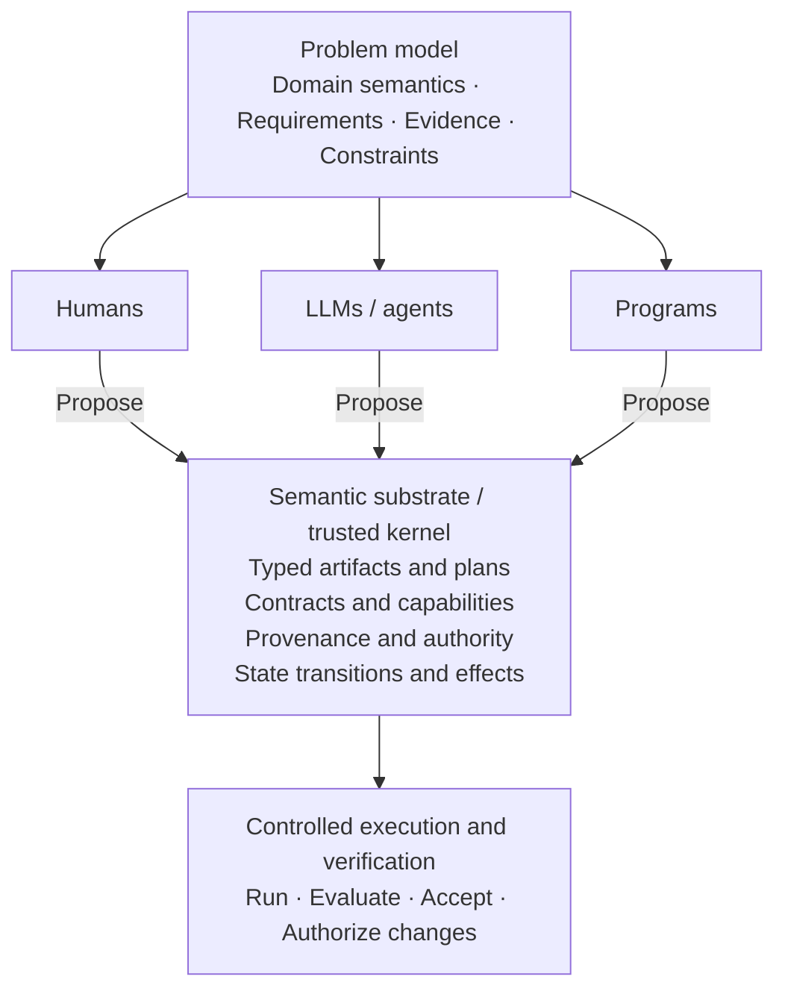

Source discussion: [BEAM languages explained](https://chatgpt.com/share/6ad81a28-376c-83e9-a239-5d008ce09749).

Article under discussion: The Boring Future of AI Coding ([original article](https://metamagic.substack.com/p/the-boring-future-of-ai-coding)).

This note connects language choice with a proposed semantic substrate for AI systems. It develops the research proposal first, then compares Go, Scala, Haskell, and BEAM for AI-generated code. The architectural choices and adoption predictions are proposals and qualitative assessments, rather than demonstrated results.

## Constrained generativity and semantic substrates

The research notes propose a shift in the design of AI systems that goes beyond choosing Go, Scala, Haskell, or BEAM.

The research notes share the central idea of **constrained generativity**: establish a small set of shared rules and guarantees, while allowing humans, LLMs, tools, and other components to generate and compose new behavior within those constraints.

The *Semantic Substrate Design* work defines this in terms of preserving guarantees across independently developed components. The *Problem Framing* work extends it into a collaborative environment where participants share state, but authority, effects, provenance, and invariants remain under explicit control. Problem framing

This shifts the central research question:

**What programming model should an AI system operate within, and what properties can the system guarantee about programs, decisions, and actions produced by its participants?**

This research question is broader and potentially more consequential than choosing the general-purpose language in which AI generates code most reliably.

**Three levels of the approach**

The proposal has three levels. They reinforce each other, but each makes a different claim.

| Level | Core idea | Implication |
|---|---|---|
| **Constrained generativity** | Choose constraints that preserve guarantees while allowing future composition | A general principle for designing software systems |
| **Participant-neutral programmable environment** | Humans, LLMs, programs, and tools contribute to shared computations governed by explicit semantics | A different architecture for AI products |
| **Typed DSLs and semantic compilation** | Generate constrained programs and validate them before controlled execution | A concrete implementation and verification mechanism |

The semantic substrate research goes beyond the specific architecture. It asks how to derive the least restrictive constraints sufficient to preserve a selected guarantee. Semantic substrate design report Semantic substrate builder method

The proposed research emphasis is deriving those constraints, rather than treating one product architecture as the whole problem.

**What changes for AI products?**

Proposed architecture:

This reflects the distinction between a participant proposing something and the system accepting it as authoritative.

It also allows LLMs to generate new hypotheses, workflows, or interpretations without requiring the entire workflow to be specified in advance. Problem framing

The *Behavioral Compilation* work adds another proposal: the system can use LLM outputs to discover requirements and synthesize reusable procedures. These procedures can still contain LLM operations. The goal is to make their behavior inspectable and subject to explicit contracts. Behavioral compilation and specification

**Reconsidering Go, Scala, Haskell, and BEAM**

Under this architecture, language choice concerns the implementation of the substrate and runtime, alongside code generation.

The article treats language choice largely as a property of code generation and runtime behavior. The proposal introduces another dimension: **how effectively semantics can be defined, composed, and enforced independently of the implementation language.**

Go could be a reasonable implementation of the execution runtime. Its toolchain, concurrency model, and deployment characteristics remain useful.

Haskell becomes attractive for discovering the algebra of the language: typed operations, effects, capabilities, composition rules, and interpreters.

Scala 3 becomes attractive when those abstractions must integrate with existing JVM applications.

BEAM could be valuable for supervising isolated execution processes. That gives runtime fault tolerance, although semantic correctness still depends on the contracts and verification system.

The *Language and Formalism Choices* document proposes that a family of focused languages sharing a common semantic intermediate representation may be preferable to one general-purpose language. Language and formalism choices

The article's language predictions therefore do not settle the language choices for this architecture.

**Technical challenges**

Two technical challenges remain open.

First, **formal validity and domain correctness remain separate**. A program can satisfy its types, permissions, and declared effects while selecting the wrong customers, drawing unsupported conclusions, or misinterpreting the user's intent.

The *Verification and Acceptance* notes distinguish compilation, verification, acceptance, and authorization for external effects. Verification and acceptance

Second, creating useful semantic contracts is expensive. Someone must define what a valid result means, which assumptions apply, and what happens when participants disagree.

If the semantic substrate requires comprehensive domain specification before an application can do anything useful, the development cost may exceed the benefit.

Constrained generativity suggests a direction: enforce only those constraints needed for selected guarantees, and leave the rest open.

But demonstrating that this can be done systematically is a substantial research problem.

**Testing the thesis**

A proposed starting point is the narrower case developed in the notes: **typed epistemic contracts for LLM-based investigation**.

For example, a system should only finalize a finding when its evidence satisfies declared coverage, authority, and provenance requirements. Otherwise, the result remains preliminary, unresolved, or an abstention. Epistemic contracts for RAG

Compare three implementations of the same investigation workload: a conventional tool-calling agent, a fixed workflow with validators, and the proposed semantic-substrate approach.

Measure factual support, invalid state transitions, human correction effort, recovery after failures, token costs, and implementation effort.

That would test whether the extra semantics deliver benefits beyond the existing workflow and validation approaches.

**Research thesis:** The broader proposal is a programming model in which generative systems can explore open-ended possibilities while a small, explicit semantic foundation preserves selected guarantees.

The decisive research question is whether those guarantees can be preserved through dynamic composition **without sacrificing the generative freedom that makes LLMs useful**. That is much more consequential than whether AI generates Go or Haskell code more easily.

## Language trade-offs for AI-generated code

One criticism of the article is that it gives insufficient weight to **strong type systems and compiler feedback for AI-generated code**. Scala and Haskell provide counterexamples to its emphasis on runtime fault isolation.

The article's predictions also mix three different questions:

1. How easily can AI generate code in a language?
2. How easily can we verify that generated code is correct?
3. How much damage can incorrect code cause in production?

These questions can favor different languages.

**Scala and Haskell as counterexamples**

The article does not explain its language-selection criteria, so the omission of Scala and Haskell cannot establish that they are unsuitable.

The article's argument appears to prioritize **runtime fault isolation**, which explains its preference for BEAM languages.

Scala and Haskell can also be assessed against the article's broader thesis.

**Scala: a strong counterargument**

Scala provides several properties that should be valuable for AI-assisted development.

**Compile-time verification.** Scala 3 supports algebraic data types, opaque types, union types, and other features that let developers express domain constraints in the type system. The compiler can reject generated code that violates those constraints. [1](https://docs.scala-lang.org/scala3/book/why-scala-3.html)

**Structured concurrency and fault handling.** Libraries such as ZIO support lightweight fibers, typed error channels, automatic supervision, and resource management. [2](https://zio.dev/reference/fiber/fiber.md/)

**Actor systems.** Apache Pekko supports actors with explicit supervision and restart strategies, providing some of the failure-handling mechanisms associated with BEAM. [3](https://pekko.apache.org/docs/pekko/current/typed/from-classic.html)

But Scala has disadvantages from an AI coding perspective.

Its flexibility permits many ways to solve the same problem. A codebase built around Cats Effect can look significantly different from one built around ZIO or traditional object-oriented Scala.

That can make generated code harder to integrate with established architectural conventions. Compilation and type errors can also be more complex than in Go.

Nevertheless, the author overlooks a useful property:

**A compiler capable of rejecting more invalid implementations can reduce the amount of AI-generated code humans need to review.**

Of course, strong types can't prove that an implementation meets the product requirements.

**Haskell: potentially an even stronger example**

Haskell is worth considering because the article discusses specifications, property testing, and reducing human review.

Haskell offers:

- Expressive algebraic data types for modeling valid states.
- Pure functions that simplify deterministic testing.
- QuickCheck for property-based testing, including automatically shrinking failing test cases. [4](https://hackage.haskell.org/package/QuickCheck/docs/Test-QuickCheck.html)
- Software Transactional Memory (STM), which supports composable concurrent state changes. [5](https://ghc.gitlab.haskell.org/ghc/doc/users_guide/exts/stm.html)

Imagine an AI agent tasked with implementing a business rule. In Haskell, you could provide a precise type signature, domain-specific types, and property tests. The agent can iterate against these constraints.

This aligns closely with the author's argument that engineers should focus on defining and verifying behavior.

The trade-offs include compiler feedback time, a smaller ecosystem in many application domains, and potentially more difficulty generating correct code involving advanced Haskell abstractions.

These trade-offs do not support an automatic prediction that Haskell adoption will increase. But **the author's theory gives reasons to investigate Haskell, not ignore it.**

**Go: toolchain feedback and limits**

The article states:

> C# or Go, which AI handles reasonably well, probably won't convert to anything else.

The article also identifies Go's built-in fuzzing as a feature that benefits AI-assisted engineering.

The general prediction that existing Go systems are unlikely to change languages simply because of AI is plausible. The article's explanation for that prediction could be stronger.

**Go toolchain advantages**

Go has a coherent development toolchain that supports short, repeatable validation cycles.

| Tool | Benefit for AI-generated code |
|---|---|
| `gofmt` | Enforces consistent formatting |
| `go test` | Fast, standardized tests |
| `go vet` | Detects suspicious constructs |
| `go test -race` | Detects data races in executed paths |
| `go test -fuzz` | Finds inputs that violate tested properties |
| `pprof` | Helps diagnose CPU and memory problems |

The race detector and native fuzzing support are especially relevant to the article's proposed automated verification pipelines. [6](https://go.dev/doc/security/best-practices), [7](https://go.dev/doc/security/fuzz/)

An AI agent can implement a change, run the checks, inspect failures, and make another attempt. Go makes that workflow straightforward.

Its relatively small language surface and consistent conventions also make it easier to standardize generated code.

**This is probably Go's strongest advantage for AI: fast feedback and a predictable toolchain.**

**Where the article's Go argument is incomplete**

Go has weaknesses under the author's own criteria.

**1. Goroutines don't provide BEAM-style fault isolation.**

Goroutines can access shared mutable memory. They require synchronization, and concurrency bugs can affect unrelated parts of the application.

An unrecovered panic in any goroutine terminates the entire Go process. Recovery must happen within the panicking goroutine. [8](https://go.dev/wiki/PanicAndRecover)

BEAM processes provide a stronger default boundary for runtime failures.

**2. Go's type system catches fewer domain mistakes than Scala's or Haskell's.**

For example, modeling a payment workflow with a closed set of valid states and transitions is generally more expressive in Scala or Haskell.

This matters because an AI-generated implementation can compile and pass basic tests while violating a business invariant.

**3. Fuzzing isn't automatic verification of correctness.**

Go's native fuzzing is coverage-guided: it generates inputs intended to explore new execution paths.

But developers still need meaningful assertions or properties that detect incorrect behavior.

An implementation can return the wrong business result for millions of inputs without triggering a fuzz failure if the tests don't define what correctness means.

**4. Simple syntax doesn't guarantee simple maintenance.**

Go's explicit error handling, interface-based design, and limited type-level modeling can sometimes produce repetitive code and push constraints into runtime checks.

For an AI agent, that means more implementation details to generate and potentially more code to maintain.

These are trade-offs, rather than reasons to avoid Go.

**Comparing the four approaches**

A qualitative comparison for the failure modes discussed in the article:

| Criterion | Go | Scala | Haskell | BEAM |
|---|---|---|---|---|
| Fast build/test feedback | Strong | Variable | Variable | Generally strong |
| Expressive type guarantees | Moderate | Strong | Very strong | Gleam strong; Elixir/Erlang dynamic |
| Property-based testing | Built-in fuzzing | Libraries | Mature ecosystem | Mature ecosystem |
| Runtime failure isolation | Limited | Library-level | Limited | Strong |
| Language/toolchain consistency | Strong | Mixed | Moderate | Strong within each language |
| Ease of AI integration | Relatively straightforward | Architecture-dependent | Architecture-dependent | Architecture-dependent |

These are qualitative engineering assessments, not measured AI coding benchmarks.

There's no single winner because the desirable properties differ.

**Preventing invalid implementations and containing failures**

The article identifies several consequences of AI-generated code: comprehension debt, increasing maintenance costs, growing review backlogs, and more production failures.

But the article's language predictions appear to give more weight to **containing failures after deployment** than to **preventing incorrect implementations from being accepted**.

That's a questionable assumption.

Suppose an AI generates an incorrect order-processing implementation:

- **Go:** Tooling can identify many mechanical, concurrency, and tested behavioral defects.
- **Scala:** Domain types can make certain invalid state transitions impossible to express in well-typed code.
- **Haskell:** Types, pure functions, and property tests can provide additional checks against specified behavior.
- **BEAM:** Process isolation and supervision can contain many runtime failures when they occur.

These mechanisms address different stages of the problem, and they can complement each other.

The article's conclusion that AI handles Go reasonably well is not supported by measurements in the article. It would be more convincing with language-specific data about escaped defects, successful agent iterations, review time, and maintenance cost.

**Adoption hypotheses**

The comparison suggests three adoption hypotheses:

**Go is likely to remain attractive** because its existing ecosystem, standard tooling, deployment model, and simple conventions make automated development practical.

**Scala and Haskell could benefit disproportionately from improvements in AI coding**, particularly if agents become better at using compiler errors, types, and property-based tests as feedback. But their relative adoption depends on tooling, ecosystem constraints, and whether those benefits compensate for added complexity.

**Elixir and Gleam could gain adoption for fault-tolerant services**, especially where supervision and process isolation are central requirements. However, runtime isolation alone doesn't solve comprehension debt or guarantee lower maintenance costs.

The broader research question is:

**As AI reduces the cost of writing code, does the value of a programming language shift from human productivity toward machine-verifiable correctness?**

If the answer is yes, languages with expressive type systems could become substantially more attractive, even if generating code in them is initially harder.

That would potentially favor Scala and Haskell more than the author's predictions suggest.

**External references**

1. [Why Scala 3? | Scala 3 -- Book | Scala Documentation](https://docs.scala-lang.org/scala3/book/why-scala-3.html)
2. [Fiber | ZIO](https://zio.dev/reference/fiber/fiber.md/)
3. [Learning Pekko Typed from Classic · Apache Pekko Documentation](https://pekko.apache.org/docs/pekko/current/typed/from-classic.html)
4. [Test.QuickCheck](https://hackage.haskell.org/package/QuickCheck/docs/Test-QuickCheck.html)
5. [6.15.2. Software Transactional Memory -- Glasgow Haskell Compiler 9.15.20260306 User's Guide](https://ghc.gitlab.haskell.org/ghc/doc/users_guide/exts/stm.html)
6. [Security Best Practices for Go Developers - The Go Programming Language](https://go.dev/doc/security/best-practices)
7. [Go Fuzzing - The Go Programming Language](https://go.dev/doc/security/fuzz/)
8. [Go Wiki: PanicAndRecover - The Go Programming Language](https://go.dev/wiki/PanicAndRecover)
