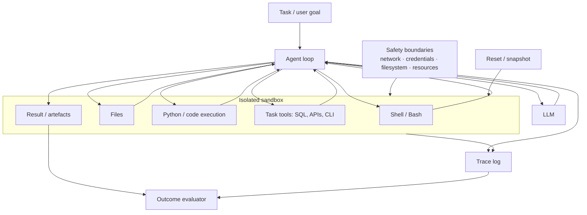
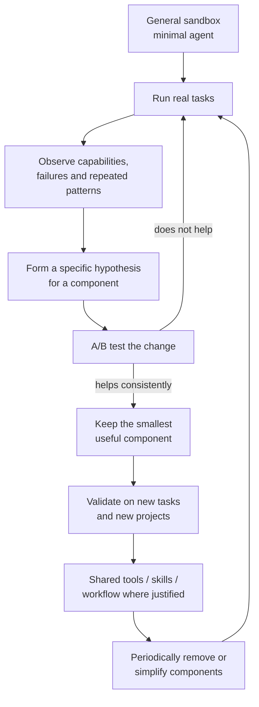

# Sandbox-First Capability Discovery for LLM Agents

## Executive summary

**Sandbox-First Capability Discovery**:

> Before designing a workflow around an LLM agent, give the agent a safe, general environment and enough basic tools to work. Let it solve representative tasks with as few assumptions about the method as possible. Observe what it can do. Add specialised components only after experiments show that they help.

The important word is **discovery**. Ordinary software components have explicitly implemented behaviour. LLMs learn behaviours during training, and their possible strategies lack a complete specification. Anthropic states this directly: "we don't understand how models do most of the things they do." [1](#ref-1)

A directly relevant research result comes from Cheng et al.'s 2026 paper, originally titled *LLM-in-Sandbox Elicits General Agentic Intelligence* and retitled *Computer Environments Elicit General Agentic Intelligence in LLMs*. It deliberately gives models a **minimal, general-purpose computer environment** with just Bash, a file editor and a finish action. Its two stated design principles are **minimal** and **exploratory**: preserve basic computer capabilities and encourage the model to "freely experiment within this environment". Strong models spontaneously installed tools, used files to handle large inputs and wrote programs to check their own outputs. The authors report gains across six non-coding domains, although weaker models sometimes became worse when given the same sandbox. [[2]](#ref-2)

This provides experimental support for the capability-elicitation premise. The research result and the proposed engineering method have distinct scopes:

**LLM-in-Sandbox** asks whether a computer environment can elicit more model capability.

**Sandbox-First Capability Discovery** is the proposed **engineering method around that idea**: start with a broad but bounded environment because the capability space is uncertain; learn from actual tasks; then progressively formalise the tools and structures justified by repeated evidence.

The primary sources reviewed do not establish a methodology using this exact name. Related ideas include LLM-in-Sandbox, CodeAct, ReAct, sandboxed autonomy, Anthropic's simple-agent guidance, OpenAI's harness engineering, YAGNI/evolutionary design and Sutton's Bitter Lesson. These support parts of the proposed sequence without establishing it as a single named methodology. [[2]](#ref-2)

The first-principles argument is simple:

1. **An LLM agent's capabilities are not completely known in advance.**
2. **Its observed ability depends on its environment and available tools.**
3. **A prescribed workflow removes possible ways of solving the task.**
4. **During capability discovery, unnecessary workflow restrictions can hide useful behaviour.**
5. **A sandbox leaves more solution paths open while limiting what the agent can affect.**
6. **Repeated observations of useful patterns or failures can guide the design of tools, components and workflows.**

That is the core of the approach.

## The Sandbox-First principle

A concise definition is:

> **Start with the agent in a safe, general-purpose sandbox. Give it the goal, the information it needs and a small set of powerful tools. Leave the solution method open. Observe what it does before deciding how the agent architecture should work.**

"Few restrictions" needs one important qualification.

There are **two different kinds of restriction**:

| Restriction | Sandbox-First position |
|---|---|
| What sequence should the agent follow? | Keep open initially |
| Must it plan first? | Don't require it initially |
| Must another agent review it? | Don't require it initially |
| Must SQL go through a special SQL agent? | Don't assume so initially |
| Can it write scripts or compose tools? | Usually yes |
| Can it create temporary files or programs? | Usually yes |
| Can it damage production? | No |
| Can it access arbitrary secrets? | No |
| Can it spend without limit? | No |
| Can one experimental run contaminate another? | No |

So the approach is **open about method and strict about consequences**.

The sandbox therefore serves both containment and capability discovery: enforced boundaries allow the agent more room to act within the environment.

Anthropic makes essentially this security argument in its containment work: models can have substantial autonomy inside filesystem, network and process boundaries while the surrounding sandbox limits the possible blast radius. OpenAI's Codex likewise runs work in isolated environments, and OpenAI's 2026 Agents API treats the agent's compute environment as a first-class part of the system. [[3]](#ref-3)

The 2026 LLM-in-Sandbox paper goes a step further and treats the environment as a **capability mechanism**. Its minimal configuration contains three basic actions:

- Bash: run commands, programs and install or create further tools.
- File operations: read, write and organise information.
- Finish: indicate that the task is complete.

The researchers intentionally avoid domain-specific additions. From those primitives, stronger models spontaneously acquired or built what they needed. In one chemistry example, a model installed Java and a chemistry package; on long documents it used `grep`, `sed` and Python; on a constrained writing task it wrote verification programs. [[2]](#ref-2)

That leads to a useful concept:

> **A general tool is a capability multiplier because the agent can compose it into actions that the system designer did not explicitly enumerate.**

CodeAct reached a similar conclusion earlier. Wang et al. used executable Python as the agent's action space rather than requiring every action to be represented by a predefined textual or JSON action. Across their experiments, executable code allowed agents to compose operations, keep intermediate state and react to execution results; they reported success-rate improvements of up to 20 percentage points over their tested alternatives. [[4]](#ref-4)

This is the proposed workbench:

A subtle point matters here: **Sandbox-First does not discover "all possible capabilities".** No finite set of experiments can establish that. It discovers an expanding set of **observed capabilities under known conditions**. A capability is therefore better recorded as:

> Model **M**, with environment **E**, tools **T**, instructions **P** and budget **B**, succeeds on task class **C** with reliability **R**.

That formulation prevents statements such as "the model can't do X" after one badly designed interface, or "the model can do X" after one lucky attempt.

## Related principles

Sandbox-First does not replace ordinary software-engineering principles. Several of them explain different parts of it.

| Principle | Basic idea | Relationship to Sandbox-First |
|---|---|---|
| **LLM-in-Sandbox** | Give the LLM a minimal computer environment and let it explore. | **Closest technical neighbour.** It directly tests the claim that general computer primitives can expose capabilities without predefined domain workflows. [[2]](#ref-2) |
| **CodeAct** | Let agents act through executable code. | Supports using a general action substrate from which the agent can compose operations. [[4]](#ref-4) |
| **ReAct** | Alternate model reasoning/actions with observations from the environment. | Supplies the minimal agent loop: act -> observe -> decide again. It does not prescribe the higher-level workflow. [[5]](#ref-5) |
| **Sandboxed autonomy / containment** | Allow autonomy inside enforced technical boundaries. | Makes open exploration practical without giving the agent equivalent freedom over production systems. [[3]](#ref-3) |
| **KISS / Simple Design** | Keep the design as simple as the present problem permits. | Supports beginning with one agent and basic tools before introducing graphs, routers, specialised agents or other machinery. Fowler's discussion of evolutionary design makes this explicit. [[6]](#ref-6) |
| **YAGNI** | Don't build anticipated functionality before it is needed. | Says not to build planner agents, memory systems, workflow DSLs, etc. merely because the architecture might need them later. [[7]](#ref-7) |
| **Avoid premature abstraction** | Generalise after the relevant cases are understood. | Supports observing several tasks/projects before extracting common agent components. Metz argues that the wrong abstraction can cost more than temporary duplication. [[8]](#ref-8) |
| **Evolutionary / harvested design** | Build applications first and extract shared infrastructure from experience. | Supports learning across projects and turning repeated needs into shared components. Fowler describes this as a "harvested platform". [[9]](#ref-9) |
| **Bitter Lesson** | General methods that can exploit increasing computation have repeatedly beaten large amounts of hand-built domain knowledge over the long run. | Provides a reason to question architectural constraints based on a designer's preferred solution. It is an analogy and historical lesson, not direct evidence that every agent should be minimally constrained. [[10]](#ref-10) |
| **Harness engineering** | Improve the environment, tools, feedback and information surrounding the model. | Becomes especially important *after* discovery exposes bottlenecks. OpenAI reports that an underspecified environment initially limited its agents; engineering the surrounding environment became a major part of the work. [[11]](#ref-11) |
| **Agent-oriented tool design** | Design tools based on how models actually use them, then evaluate and revise them. | Provides the feedback loop after the baseline: prototype -> observe traces -> evaluate -> improve interfaces. Anthropic explicitly recommends this experimental cycle. [[12]](#ref-12) |

The **Bitter Lesson** deserves careful wording. Sutton's argument is that AI history repeatedly favoured general methods able to absorb more computation--especially search and learning--over hand-coded human knowledge. [[10]](#ref-10) It does **not** prove that an agent graph is bad or that specialised tools are bad.

The connection is narrower:

> **Avoid encoding an assumed solution method when a more general mechanism can discover a solution.**

Sandbox-First applies this idea at the agent-system level. A shell, filesystem, code interpreter and useful external services are general mechanisms. "Planner agent -> SQL agent -> critic agent -> formatter agent" is a much stronger claim about how the solution should happen.

Anthropic's agent-engineering guidance reaches a similar practical conclusion from experience: its teams found successful implementations commonly used "simple, composable patterns" and recommend adding complexity when it demonstrably improves results. They distinguish fixed workflows from agents precisely by whether code determines the path or the model dynamically chooses it. [[13]](#ref-13)

## Unknowns in LLM agent capability

The main unknown is not simply "how intelligent is the model?". The useful unit is the **model interacting with an environment**.

Five questions matter.

**Capability:** What tasks can this model actually complete when it can investigate, compute, create intermediate artefacts and try alternatives?

**Tool use:** What new capability appears with Bash, Python, SQL, browsing, files, APIs or other tools? Can the agent compose them in ways that were not explicitly designed?

**Conditions:** Which instructions, tool interfaces, context, environment feedback and runtime affordances are needed for the capability to appear?

**Component interactions:** Does adding planning, review, memory, another agent or another tool improve the whole system? Under which task structures?

**Dependability:** How often does an observed successful behaviour recur, including on slightly different cases?

Research provides partial answers, but the reviewed evidence does not establish a general formula for predicting them in advance. [[2]](#ref-2)

| Work | Authors / year | Method | Main finding relevant here | Unknown addressed |
|---|---|---|---|---|
| **Computer Environments Elicit General Agentic Intelligence in LLMs** | Cheng, Huang, Gu, Song, Chen, Dong, Zhao, Wen & Wei, 2026 | Seven models; minimal sandbox; six non-code domains; compare ordinary generation with sandbox interaction | Stronger models spontaneously use files, external resources and code and often improve; weaker models can fail to exploit the same environment. Current v3 reports gains up to 15.5% and up to 8× lower token use in long-context cases. [[2]](#ref-2) | Capability, tool use, conditions |
| **ReAct** | Yao et al., 2022/23 | Interleaves reasoning with actions and observations | Environment feedback lets the model gather information and revise what it does next. [[5]](#ref-5) | Tool use |
| **Voyager** | Wang et al., 2023 | Open-ended Minecraft agent with environment feedback and executable skill library | Shows an LLM-based agent can explore, create reusable executable behaviours and build on previous discoveries in an open-ended environment. [[14]](#ref-14) | Capability, open-ended discovery |
| **CodeAct** | Wang et al., 2024 | Executable Python as unified action space | Code can be a general way of combining tools, computation and state, and outperformed tested action formats on its benchmarks. [[4]](#ref-4) | Tool use |
| **SWE-agent** | Yang et al., 2024 | Same underlying class of models paired with interfaces designed for repository work | Agent performance depends strongly on the interface between the LLM and computer; the environment can expose or obstruct capability. [[15]](#ref-15) | Conditions |
| **τ-bench** | Yao, Shinn, Razavi & Narasimhan, 2024 | Agents interact with users and state-changing tools; checks final database state and repeated success | An agent that succeeds sometimes may still be poor at succeeding consistently. The work introduced `pass^k` to measure repeated reliability. [[16]](#ref-16) | Dependability |
| **Measuring AI Ability to Complete Long Tasks** | Kwa, West, Becker et al., 2025 | Measures success probability against the time humans need for software tasks | Capability changes sharply with task horizon; performance on short tasks does not imply equivalent ability on longer work. [[17]](#ref-17) | Capability, dependability |
| **Towards a Science of Scaling Agent Systems** | Kim et al., 2025/26 | Controlled comparison of 180 single- and multi-agent configurations | Multi-agent designs helped on some parallelisable work and hurt on sequential work; architecture effects depend on task structure. [[18]](#ref-18) | Component interactions |
| **Tracing the Thoughts of a Large Language Model** | Anthropic, 2025 | Mechanistic-interpretability studies of model computation | Models learn internal strategies that researchers did not explicitly program or fully understand; observed mechanisms included planning-like behaviour. [[1]](#ref-1) | Why capability must be empirically explored |

This evidence leads to an important rule for interpreting failures:

> **A failed agent run is evidence that this configuration failed. It is not yet evidence that the model lacks the capability.**

SWE-agent is a clear example. Changing the computer interface changed what an agent could accomplish. [[15]](#ref-15) OpenAI reports a similar effect from production engineering: its agents initially struggled because their environment lacked the tools, information and structure they needed; improving that harness changed the outcome. [[11]](#ref-11)

The opposite is also true:

> **One successful run establishes possibility, not dependability.**

τ-bench and Anthropic's evaluation guidance both emphasise repeated trials. Anthropic recommends evaluating final environment state where possible, isolating trials and avoiding graders that unnecessarily require one particular action sequence. [[16]](#ref-16)

Those two statements--**failure does not establish inability; success does not establish reliability**--are probably among the most important foundations for capability-discovery engineering.

## The experimental workbench

The proposed initial workbench uses a minimal agent loop and general tools. Framework features and multi-agent coordination can be added after the baseline exposes a specific need.

The **capability core** can be:

| Component | Initial form | Reason |
|---|---|---|
| **Model** | One capable LLM | Establishes a baseline before composition effects enter |
| **System prompt** | Goal, environment description and basic operating rules | Avoid encoding a proposed workflow |
| **Agent loop** | Model -> tool call -> result -> model, until finish | This is enough for ReAct-style interaction. [[5]](#ref-5) |
| **Sandbox** | Isolated Linux/container/VM | Lets the model experiment without equivalent access to the host or production. [[3]](#ref-3) |
| **Shell** | Bash or equivalent | A general computer interface |
| **Filesystem** | Temporary working directory | External memory, artefacts, intermediate state |
| **Code runtime** | Python plus package installation where safe | Computation and creation of temporary tools |
| **Domain access** | For example, read-only SQL, APIs, source files | Gives the agent access to the actual problem |
| **Finish/output** | Explicit result or output directory | Provides a clean completion contract |

This is almost exactly the experimental baseline used by Cheng et al.: **Bash + file editor + finish**, with the model permitted to install or construct further tools. [[2]](#ref-2)

For SQL tasks, the proposed baseline is a scoped SQL client/tool, a discoverable schema, files and Python. A SQL planner, analyst agent, reviewer agent or graph would be an additional component requiring evidence of value.

Separately, the **experimental core** should exist from the start:

**Isolation and reset.** Every trial should start from a known state. Database writes should either be prohibited, transactional/rollbackable or run against disposable copies. Anthropic's evaluation guidance recommends isolated environments so trials do not contaminate one another. [[19]](#ref-19)

**Trace logging.** Record model/version, system prompt, task, tools available, tool calls, outputs and errors, files changed, database effects, tokens, elapsed time and final result. Anthropic distinguishes the agent trace from the final environmental outcome because both are useful for different purposes. [[19]](#ref-19)

**Outcome evaluation.** Prefer checks on the result or resulting state. If the task is "find these customers and produce a CSV", check the CSV and the answers. A correct result should not fail evaluation solely because the tool-call order differed from an anticipated sequence, unless that sequence was itself a task requirement. [[19]](#ref-19)

**Repeatability.** Run important tasks several times. Record ordinary success rate and a strict reliability measure such as `pass^k`: whether all of \(k\) repeated attempts succeed. [[16]](#ref-16)

**Resource boundaries.** Set time, tool-call, token, CPU, memory, disk and network limits. Keep production credentials outside the sandbox or expose them through tightly scoped interfaces. Anthropic's containment work treats filesystem and network boundaries as enforcement mechanisms, while OpenAI's Codex architecture similarly uses isolated execution. [[3]](#ref-3)

The metrics can stay simple:

| Metric | What it answers |
|---|---|
| Task success | Can it do the task? |
| Success over repeated trials | Does it do it consistently? |
| Success on changed examples | Does the observed behaviour transfer beyond one example? |
| Human interventions | How independently can it work? |
| Tokens / cost / time | What does the capability cost? |
| Tool calls / retries / errors | Where is it struggling? |
| Boundary violations | Does the environment contain unsafe attempts? |
| Successful solution paths | Which solution strategies emerged? |

Record **solution-path diversity** as an observation rather than an optimization target. It can reveal unanticipated strategies.

## Testable engineering principles

The principles can now be stated in plain language and tied to experiments.

### Start sandbox-first

**When agent capability is uncertain, begin with a general, safe environment and representative tasks.**

Why: a broad computer environment can expose capabilities that do not appear in plain prompting or narrowly designed workflows. This now has direct experimental evidence from LLM-in-Sandbox. [[2]](#ref-2)

Test: compare the agent with and without that environment on the same tasks.

### Put hard limits on effects and leave solution paths open

**Control what the agent can affect. Avoid prescribing how it must solve the task unless the method itself is a requirement.**

Why: the sandbox lets exploration and containment coexist. [[3]](#ref-3)

Test: compare a goal-based prompt against a prompt requiring a particular plan or sequence.

### Give general tools before specialised workflows

**Begin with useful primitives--files, code, shell, data access and APIs--and see what the agent can compose from them.**

Why: CodeAct and LLM-in-Sandbox both show that executable environments let models combine basic operations into higher-level behaviour. Anthropic's code-execution work similarly finds advantages in letting agents filter, chain and transform tool results programmatically. [[4]](#ref-4)

Test: compare a small general toolset against a larger collection of task-specific tools.

### Experiment before abstracting

**See the same need more than once before turning it into a shared agent component.**

Why: this applies YAGNI and avoidance of premature abstraction to agent systems. An additional reason in LLM systems is that a general-purpose agent may already perform work otherwise assigned to a custom component. [[7]](#ref-7)

Test: introduce the proposed abstraction only after collecting representative traces, then evaluate it against the original baseline.

### Measure outcomes and repeat runs

**A successful demo shows possibility. Repeated success shows dependability.**

Why: agent outputs vary. τ-bench shows that average success can hide poor consistency, and Anthropic recommends multiple isolated trials and outcome-based evaluation. [[16]](#ref-16)

Test: repeat the same tasks and perturb wording, data and starting conditions.

### Make every added component prove its value

**Retain a planner, reviewer, memory system, extra agent or framework only when experiments demonstrate an improvement against explicit system objectives.**

Why: architecture effects are conditional. Google's 180-configuration study found that multi-agent approaches helped some task structures and hurt others. Anthropic's long-running-agent work likewise added specific harness mechanisms in response to observed long-horizon failures. [[18]](#ref-18)

Test: run an ablation--remove the component--and see what changes.

These rules produce **progressive formalisation**:

The architecture therefore has a different source than a framework-first design.

A framework-first process may begin with concepts such as agents, nodes, graphs, planners, routers, memory and supervisors, then map the problem into them.

Sandbox-First begins with **tasks and observed behaviour**. Components address repeated needs and failures identified through experiments.

That does not imply that the final system stays simple. It may eventually contain planners, reviewers, specialised tools, multi-agent coordination and strict workflows. The principle is that **those structures are conclusions from experiments, not initial assumptions**.

## Next experiments and prioritised sources

The following experiments would test the proposed method directly.

| Experiment | Setup | What to look for | Decision rule |
|---|---|---|---|
| **Sandbox uplift** | Same model and tasks: direct answer vs minimal sandbox with files/Bash/Python/SQL | New solution strategies, success, cost, retries | Keep the sandbox as the default capability baseline where it improves useful task classes enough to justify cost |
| **Open method vs prescribed workflow** | Same environment; one condition gets only the goal, another must plan -> execute -> review | Success, repeatability, cost; cases where each condition wins | Require the workflow only for task classes where it repeatedly improves the outcome |
| **General primitives vs specialised tools** | Bash/Python/SQL/API access versus several predefined higher-level tools | Whether the model successfully constructs operations itself; token/tool overhead; errors | Promote a repeated operation to a specialised tool when doing so reliably improves quality, safety or cost |
| **Component ablation** | Add planner, reviewer, memory or extra agent one at a time | Improvement by task type; especially sequential vs parallel work | Keep a component only where its measured gain survives repeated trials and new cases |
| **Reliability test** | Run representative cases 5-10 times, then alter wording/data while preserving intent | Success distribution, `pass^k`, failure modes | Treat a capability as dependable only at the reliability level required by the use case |
| **Harvest across projects** | After several projects, identify one recurring need; build one shared component and test it on a project that did not shape its design | Whether the abstraction transfers without forcing unrelated cases into the same shape | Share it only when held-out projects benefit; otherwise leave the implementations separate |

The third and sixth experiments test two central assumptions of the method: whether general primitives already support work that might otherwise require a custom implementation, and whether a recurring need is stable enough to justify a shared component.

### Prioritised bibliography

| Priority | Primary source | Why it is useful for this approach |
|---|---|---|
| **Essential** | Cheng et al., 2026, [*Computer Environments Elicit General Agentic Intelligence in LLMs*](https://arxiv.org/abs/2601.16206) | The closest research result to Sandbox-First. Minimal general sandbox, exploratory behaviour, three computer meta-capabilities, seven models and six domains. It also gives an important negative result: weaker models can become worse in an open computer environment. [[2]](#ref-2) |
| **Essential** | Wang et al., 2024, [*Executable Code Actions Elicit Better LLM Agents -- CodeAct*](https://arxiv.org/abs/2402.01030) | Strong evidence for executable code as a broad action space from which an agent can compose higher-level operations. [[4]](#ref-4) |
| **Essential** | Yang et al., 2024, [*SWE-agent: Agent-Computer Interfaces Enable Automated Software Engineering*](https://arxiv.org/abs/2405.15793) | Shows that the environment/interface is part of observed capability. Useful protection against concluding "the model can't do it" when the interface may be the problem. [[15]](#ref-15) |
| **Essential** | Yao et al., 2024, [*τ-bench: A Benchmark for Tool-Agent-User Interaction in Real-World Domains*](https://arxiv.org/abs/2406.12045) | Best foundation here for distinguishing occasional capability from repeated reliability and for checking final state rather than trusting the agent's own statement of success. [[16]](#ref-16) |
| **Essential** | Anthropic, 2026, [*Demystifying evals for AI agents*](https://www.anthropic.com/engineering/demystifying-evals-for-ai-agents) | Practical experimental method: tasks, trials, graders, traces, isolated environments, repeated runs and outcome-based evaluation. [[19]](#ref-19) |
| **High** | Anthropic, 2024, [*Building effective agents*](https://www.anthropic.com/engineering/building-effective-agents) | Strong industry argument for starting with simple composable systems and introducing agent complexity only when needed. [[13]](#ref-13) |
| **High** | OpenAI, 2026, [*Harness engineering: leveraging Codex in an agent-first world*](https://openai.com/index/harness-engineering/) | Shows the next phase after capability discovery: improve tools, context, feedback and the environment when observed failures show what agents are missing. [[11]](#ref-11) |
| **High** | Kim et al., 2025/26, [*Towards a Science of Scaling Agent Systems*](https://research.google/blog/towards-a-science-of-scaling-agent-systems-when-and-why-agent-systems-work/) | Controlled evidence that architecture is conditional: multi-agent systems can help or hurt according to task structure. Important evidence against assuming that more agent components are inherently better. [[18]](#ref-18) |
| **High** | Anthropic, 2025, [*Writing effective tools for agents -- with agents*](https://www.anthropic.com/engineering/writing-tools-for-agents) | Practical method for discovering good tool interfaces through prototypes, real tasks, traces and evaluation. [[12]](#ref-12) |
| **High** | Anthropic, 2026, [*How we contain Claude across products*](https://www.anthropic.com/engineering/how-we-contain-claude) | The safety side of Sandbox-First: give agents useful room to act while enforcing technical boundaries around files, networks and other consequences. [[3]](#ref-3) |
| **Foundation** | Yao et al., 2022/23, [*ReAct: Synergizing Reasoning and Acting in Language Models*](https://arxiv.org/abs/2210.03629) | The basic environment-interaction loop underlying much subsequent agent work: act, observe and adapt. [[5]](#ref-5) |
| **Foundation** | Wang et al., 2023, [*Voyager: An Open-Ended Embodied Agent with Large Language Models*](https://arxiv.org/abs/2305.16291) | Earlier demonstration of open-ended exploration, environmental feedback, executable skill creation and accumulation of discovered behaviours. [[14]](#ref-14) |
| **Foundation** | Sutton, 2019, [*The Bitter Lesson*](http://www.incompleteideas.net/IncIdeas/BitterLesson.html) | Broader intellectual foundation for favouring general mechanisms capable of discovering solutions over extensive hand-coded ideas about how problems should be solved. It should be treated as an analogy for agent architecture, not direct experimental evidence for Sandbox-First. [[10]](#ref-10) |
| **Software engineering** | Fowler, [*YAGNI*](https://martinfowler.com/bliki/Yagni.html) and [*Is Design Dead?*](https://martinfowler.com/articles/designDead.html) | Existing engineering language for postponing speculative functionality and letting design evolve as knowledge grows. [[7]](#ref-7) |
| **Software engineering** | Metz, 2016, [*The Wrong Abstraction*](https://sandimetz.com/blog/2016/1/20/the-wrong-abstraction) | Good grounding for waiting until the common structure is understood before extracting a reusable component. [[8]](#ref-8) |

The research therefore supports a fairly precise formulation of the approach:

> **Sandbox-First Capability Discovery is an engineering method for systems whose useful agent capabilities are not known in advance. Start with a minimal agent in a safe, general computer environment; expose powerful basic tools and real tasks; observe and measure what emerges; then add tools, rules and architecture only when repeated evidence gives them a clear job.**

And the shortest version of its underlying law is:

> **When capability is unknown, preserve the space in which capability can be discovered.**

A sandbox is what makes that practical: **broad freedom of method inside a narrow boundary of consequences**. The research from Cheng et al. makes that more than a software-design analogy--their minimal, exploratory computer environment actually elicited useful behaviours that had not been encoded as predefined workflows. [[2]](#ref-2)

## References

1.  [Anthropic -- Tracing the Thoughts of a Large Language Model](https://www.anthropic.com/research/tracing-thoughts-language-model)
2.  [Cheng et al. -- Computer Environments Elicit General Agentic Intelligence in LLMs (2026)](https://arxiv.org/abs/2601.16206v3)
3.  [Anthropic -- How We Contain Claude Across Products](https://www.anthropic.com/engineering/how-we-contain-claude)
4.  [Wang et al. -- Executable Code Actions Elicit Better LLM Agents (CodeAct)](https://arxiv.org/abs/2402.01030)
5.  [Yao et al. -- ReAct: Synergizing Reasoning and Acting in Language Models](https://arxiv.org/abs/2210.03629)
6.  [Martin Fowler -- Is Design Dead?](https://martinfowler.com/articles/designDead.html)
7.  [Martin Fowler -- YAGNI](https://martinfowler.com/bliki/Yagni.html)
8.  [Sandi Metz -- The Wrong Abstraction](https://sandimetz.com/blog/2016/1/20/the-wrong-abstraction)
9.  [Martin Fowler -- Harvested Platform](https://martinfowler.com/bliki/HarvestedPlatform.html)
10.  [Rich Sutton -- The Bitter Lesson](https://www.incompleteideas.net/IncIdeas/BitterLesson.html)
11.  [OpenAI -- Harness Engineering: Leveraging Codex in an Agent-First World](https://openai.com/index/harness-engineering/)
12.  [Anthropic -- Writing Effective Tools for AI Agents](https://www.anthropic.com/engineering/writing-tools-for-agents)
13.  [Anthropic -- Building Effective Agents](https://www.anthropic.com/engineering/building-effective-agents)
14.  [Wang et al. -- Voyager: An Open-Ended Embodied Agent with Large Language Models](https://arxiv.org/abs/2305.16291)
15.  [Yang et al. -- SWE-agent: Agent-Computer Interfaces Enable Automated Software Engineering](https://arxiv.org/abs/2405.15793)
16.  [Yao et al. -- τ-bench: A Benchmark for Tool-Agent-User Interaction in Real-World Domains](https://arxiv.org/abs/2406.12045)
17.  [METR -- Measuring AI Ability to Complete Long Tasks](https://metr.org/blog/2025-03-19-measuring-ai-ability-to-complete-long-tasks/)
18.  [Google Research -- Towards a Science of Scaling Agent Systems](https://research.google/blog/towards-a-science-of-scaling-agent-systems-when-and-why-agent-systems-work/)
19.  [Anthropic -- Demystifying Evals for AI Agents](https://www.anthropic.com/engineering/demystifying-evals-for-ai-agents)
