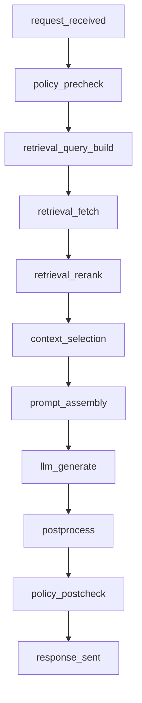

**Status:** Draft

**Last updated:** 2026-01-10

**Owner:** AI Systems Platform

**Audience:** Product engineers, ML/LLM engineers, SRE/oncall, data/analytics, security/privacy

**Applies to:** Chatbots with Retrieval‑Augmented Generation (RAG). Tool-using agents are out of scope except where noted.

## 0. What this guide is and is not

### 0.1 Purpose


This guide describes **what to instrument** and **how to instrument it** so that a chat+RAG system can:

- reconstruct what happened in an episode (end-to-end traceability),
- attribute regressions (config vs input-mix vs environment vs measurement),
- support Tier‑1 slice gating and Tier‑2 diagnostic regimes,
- drive monitoring ChangePackets and release GateReports without relying on ad hoc transcript archaeology,
- operate under privacy, security, and cost constraints.

### 0.2 Non-goals


This guide does not:

- define product-specific success metrics (that belongs to evaluation and gate policy),
- mandate a specific telemetry vendor or storage system,
- require storing raw prompts/responses for all traffic.

## 1. Prerequisites and assumptions

### 1.1 Required platform primitives


Prerequisites:

- distributed tracing (OpenTelemetry or equivalent) and log/event export,
- a stable request correlation primitive (trace_id/span_id),
- a central event pipeline (e.g., Kafka/log ingestion) that can carry structured JSON events,
- a shared library mechanism (so fingerprints and schemas are not reimplemented per service).

### 1.2 Key architectural assumption


A typical chat+RAG pipeline has these functional stages:

1. request intake (gateway)
2. safety/policy pre-check (optional)
3. query analysis / retrieval query build
4. retrieval fetch (vector + keyword, filters)
5. reranking (optional)
6. context selection / packing (token budgeting)
7. prompt assembly (template + system + context)
8. model inference (one or more calls)
9. post-processing (citations, formatting)
10. safety/policy post-check
11. response delivery

Services may be combined or split; the instrumentation should be **logical-stage consistent** even if implementation differs.

## 2. The unit of instrumentation: an Episode

### 2.1 Episode boundary


Define an **Episode** as "one user request turn" unless success cannot be determined at turn granularity.

**Default**: one turn (request -> response).

**Alternative**: a multi-turn episode (N turns) when:

- a workflow spans multiple turns and success is only meaningful at completion (e.g., guided forms),
- or the product has explicit 'task sessions'.

**Rule:** The selected boundary must be stable and explicit in the emitted record (`episode_boundary` field).

### 2.2 EpisodeRecord: the canonical runtime event


Every episode MUST emit one **EpisodeRecord** (structured event) regardless of success or failure. Partial records are acceptable; silent drops are not.

EpisodeRecord is the runtime "source of truth" used downstream to produce:

- StateEstimates (windowed metrics + uncertainty),
- StateDeltaReports (comparisons),
- ChangePackets (monitoring decisions),
- slice membership and regime conditioning.

## 3. High-level architecture: traces + structured events

### 3.1 Two complementary outputs


The instrumentation emits:

1. **Distributed trace spans**: to reconstruct the causal DAG and performance breakdown.
2. **Structured episode event (EpisodeRecord)**: to carry the semantic/provenance fields that do not fit naturally in spans, and to ensure stable downstream aggregation.

**Do not rely on "logs only" or "traces only."** Traces are excellent for flow and timing, but brittle for long-lived querying and analytics. EpisodeRecord provides a stable "row" per episode.

### 3.2 Reference flow diagram (logical spans)



## 4. Required span taxonomy (minimum for chat+RAG)

### 4.1 Required spans


Instrument these spans with consistent names (even if they occur within one service):

- `request_received`
- `policy_precheck` (optional but recommended)
- `retrieval_query_build`
- `retrieval_fetch`
- `retrieval_rerank` (if present)
- `context_selection`
- `prompt_assembly`
- `llm_generate` (may be repeated)
- `postprocess`
- `policy_postcheck`
- `response_sent`

### 4.2 Required fields on every span


Every span MUST include:

- correlation: `trace_id`, `span_id`, `parent_span_id`, `run_id`
- timing: `start_ts`, `end_ts`, `duration_ms`
- outcome: `status` ∈ {`ok`,`error`,`timeout`,`blocked`}
- errors: `error_class` (normalized), `retry_count`, `fallback_used` (bool)

**Guidance:** Prefer small enums over raw exception strings. When raw detail is needed, store a redacted summary.

### 4.3 Error normalization


Define a taxonomy such as:

- `Timeout`
- `RateLimited`
- `DependencyUnavailable`
- `InvalidRequestSchema`
- `BadRetrievalQuery`
- `RerankerFailure`
- `ModelProviderError`
- `PolicyBlocked`
- `InternalError`

Normalize at the emission point to keep downstream attribution stable.

## 5. Provenance capture (what versions produced this behavior)


Provenance is required to reproduce and attribute changes. The instrumentation MUST capture **immutable identifiers**--not "latest."

### 5.1 Configuration provenance (C-plane)


Minimum fields:

- `prompt.template_id`, `prompt.template_version`
- `prompt.system_prompt_id`, `prompt.system_prompt_version` (or equivalent)
- `model.provider`, `model.name`, `model.version_id`
- `decode.temperature`, `decode.top_p`, `decode.max_tokens`, `decode.stop_policy_id`
- `rag.index_snapshot_id` (immutable)
- `rag.embedding_model_id`, `rag.embedding_model_version`
- `rag.retrieval_k`, `rag.filters_id/version` (if filters)
- `rag.reranker_id`, `rag.reranker_version` (if present)
- `safety.policy_id`, `safety.policy_version`
- feature flags relevant to routing or formatting

### 5.2 Input regime fields (I-plane)


Minimum fields:

- `input.language` (from frozen detector)
- `input.tokens_in_estimate` (request + conversation context available pre-inference)
- `input.prior_turn_count`
- `input.ui_mode` or `product_mode` (e.g., "Ask my docs")
- privacy-safe tenant and user identifiers: `tenant_id_hash`, `user_id_hash`

### 5.3 Environment identifiers \(E_{\text{fixed}}\) and conditions \(E_{\text{observed}}\)


**E_fixed** examples:

- `rag.index_snapshot_id` (also used in C-plane provenance; treat as fixed for comparability)
- retrieval backend cluster ID/version if it changes semantics
- document store schema version (if relevant)

**E_observed** examples:

- dependency timeouts, rate limit signals, degraded mode triggers

### 5.4 Measurement regime references (R-plane)


Runtime validators or policy classifiers may influence outcomes:

- `validators.schema_validator_version`
- `validators.citation_parser_version`
- `safety.classifier_version` (if separate from policy version)

Even when judge scores are computed offline, the runtime record must include *which validators executed* and *their versions*, because they can affect block/transform outcomes.

## 6. RAG evidence instrumentation (the core of chat+RAG)


The goal is to capture enough evidence to explain RAG behavior **without logging full documents**.

### 6.1 Retrieval query build (`retrieval_query_build`)


Capture:

- `rag.query_type` (e.g., `embedding_only`, `hybrid`, `keyword_only`)
- `rag.query_terms_summary` (optional, redacted)
- `rag.filters_applied_id/version`
- `rag.index_snapshot_id`
- `rag.retrieval_k`

**Do not log raw query text by default** if it may contain sensitive user content. Use redacted summaries or hashes.

### 6.2 Retrieval fetch (`retrieval_fetch`)


Capture:

- candidate set size
- for top-k candidates:
	- `doc_id`, `chunk_id` (or passage ID)
	- rank position
	- score(s): vector similarity, BM25 score, hybrid score (as applicable)
- score distribution summaries:
	- `top1_score`, `topk_mean`, `topk_p50`, `topk_p90`, `topk_std`

**Storage rule:** IDs and scores are safe; raw text excerpts are sampled-only.

### 6.3 Rerank (`retrieval_rerank`)


If present, capture:

- reranker ID/version
- reranked list (top-k doc/chunk IDs + rank positions + rerank scores)
- latency and error taxonomy

### 6.4 Context selection (`context_selection`)


This is often the single most important RAG debugging signal.

Capture:

- `context.selected_chunk_ids` (ordered list, limited to N)
- `context.selected_doc_ids` (derived)
- `context.selection_strategy_id/version` (e.g., max-marginal-relevance, diversity)
- token budgeting:
	- `context.token_budget`
	- `context.tokens_selected`
	- `context.truncated` (bool)
	- `context.truncation_reason` (e.g., `budget_exceeded`, `formatting_overhead`)

### 6.5 Prompt assembly (`prompt_assembly`)


Capture:

- template and system prompt IDs/versions
- prompt structure metadata:
	- number of retrieved chunks inserted
	- total input token estimate
	- whether history truncation occurred
- do not store the full assembled prompt by default; store a pointer for sampled runs.

## 7. Model inference instrumentation (`llm_generate`)


Capture per model call:

- model provider/name/version_id
- decoding params actually used
- request/response token usage:
	- `tokens_in`, `tokens_out`
	- `cached_tokens_in` (if available)
- latency and error taxonomy
- safety outcomes if provider returns moderation flags
- `finish_reason` normalized (e.g., `stop`, `length`, `content_filter`, `tool_call`, `error`)

**Cost accounting:** compute `cost_estimate` at least approximately using usage * unit prices maintained in configuration. Do not embed price tables in emitted events; emit cost as a derived metric plus `pricing_version_id`.

## 8. Post-processing and citations (`postprocess`)


For systems supporting citations:

- `citations.count`
- `citations.parse_success` (bool)
- `citations.doc_ids` (if citations map to retrieved docs)
- `citations.coverage_ratio` (optional proxy: cited_docs / selected_docs)

For systems without citations:

- store `has_citations=false` explicitly so downstream doesn't assume missingness.

Also capture:

- output length (tokens/chars)
- output format mode (markdown/plain/etc.)
- any transformations applied (redaction, profanity filter, policy transforms)

## 9. Regime flags and driver metrics (required for attribution)

### 9.1 Required regime flags (per episode)


Emit these booleans on EpisodeRecord:

- `regime.retrieval_used`
- `regime.retrieval_empty`
- `regime.low_evidence`
- `regime.context_truncated`
- `regime.dependency_degraded`
- `regime.policy_blocked_pre`
- `regime.policy_blocked_post`
- `regime.fallback_model_used`
- `regime.degraded_mode`

### 9.2 Standard definitions (recommended)


- `retrieval_used`: retrieval stage executed successfully or attempted (even if empty)
- `retrieval_empty`: no candidates above a minimum score threshold (threshold is versioned)
- `low_evidence`: top-k score distribution indicates weak match (e.g., top1 below threshold OR low separation)
- `context_truncated`: context packing dropped selected evidence due to token budget
- `dependency_degraded`: any dependency flagged rate limiting / elevated error / timeout above threshold

### 9.3 Driver metrics (per episode)


Emit numeric drivers:

- latencies: retrieval, rerank, prompt assembly, llm, total
- usage: tokens_in/out, context_tokens_selected, total_cost_estimate
- retrieval quality: top1/topk score stats, candidate_count
- formatting: citation_count, citation_parse_success
- errors: normalized error_class counts, retry_count

These drivers are used by change detection attribution; they should be stable and versioned.

## 10. Tier‑1 slices and labelers (instrumentation requirements)


Tier‑1 slices must be **pre-treatment, input-defined**. For chat+RAG, Tier‑1 typically includes:

- `all`
- `non_english`
- `long_context_input`
- `adversarial_input`
- `safety_sensitive_input`
- `freshness_sensitive_input`
- `domain_code`
- `retrieval_required` (ONLY if it is an input label, not a routing outcome)

### 10.1 Required logging to compute Tier‑1 slices


Log the inputs required by these predicates:

- language
- token estimate
- prior turn count
- fixed labels: safety_sensitive, freshness_sensitive, domain, retrieval_required, redteam_member/prompt_injection_pattern

### 10.2 Labeler coupling rule (critical)


If the labeler is produced by the same model/router under test, the slice becomes post‑treatment and is NOT Tier‑1 safe.

**Operational implication:** labelers must be:

- frozen/versioned,
- monitored for drift,
- and referenced by version ID in EpisodeRecord.

## 11. Missingness and integrity counters (do not skip)

### 11.1 Field-level missingness


For each EpisodeRecord, emit:

- `missing.required_fields` (list of missing field keys) OR a compact bitmap
- `missing.reason_code` per missing field (e.g., `not_available`, `privacy_redacted`, `timeout`, `bug`)
- `excluded_from_metrics` with reason codes (for exclusions from some computations)

### 11.2 Window-level aggregation


The aggregation pipeline must compute:

- coverage rate per required field
- missingness by Tier‑1 slice and by key regimes (e.g., retrieval_empty)
- exclusion rates and reasons

**Why:** missingness is often correlated with failures. Failing to measure it can hide regressions and lead to incident misattribution.

## 12. Privacy, security, and retention (built into instrumentation)

### 12.1 Default storage posture


- Store **IDs, hashes, and derived features** broadly.
- Store **raw text** (user prompts, retrieved passages, model outputs) only via:
	- sampled exemplar pipeline, and
	- strict retention and RBAC.

### 12.2 Recommended retention tiers


- **Tier A (derived metrics):** long retention (weeks/months), low sensitivity
- **Tier B (episode metadata + IDs):** medium retention, restricted access
- **Tier C (raw exemplars):** short retention (days), strict access + audit logs

### 12.3 Redaction boundary


Implement redaction before data leaves the production boundary:

- PII/secret detectors on user text and retrieved excerpts (if stored)
- pseudonymization of tenant/user IDs
- never log authorization tokens, cookies, or full headers

### 12.4 Exemplar sampling strategy (recommended)


- Tail-based sampling: capture a high fraction of failures, timeouts, policy blocks, retrieval_empty, and latency tails.
- Stratified sampling: ensure coverage across Tier‑1 slices (avoid "all exemplars are English and short").
- Record sampling decisions in EpisodeRecord (`exemplar.sampled=true`, `exemplar.reason`).

## 13. Implementation recipes (how to instrument without chaos)

### 13.1 Correlation IDs


- Use OpenTelemetry trace context for cross-service propagation.
- Define a separate `run_id` (UUID) for episode correlation across traces and EpisodeRecord.
- Ensure every span and every event carries both identifiers.

### 13.2 Episode builder pattern


Implement an `EpisodeBuilder` that is passed through middleware and augmented at each stage.

Pseudo-interface:

```python
class EpisodeBuilder:
    def set_provenance(self, **kwargs): ...
    def add_span(self, name, start_ts, end_ts, status, **fields): ...
    def add_retrieval_candidates(self, candidates, score_stats): ...
    def set_context_selection(self, selected_ids, token_budget, truncated, reason): ...
    def add_model_call(self, call_id, model_version, usage, latency, status): ...
    def set_regime_flags(self, **flags): ...
    def set_missingness(self, missing_fields, reasons): ...
    def emit(self): ...
```

### 13.3 Where to instrument


- Gateway: request metadata, language detection, token estimate, run_id creation
- Retriever service: query build, fetch spans, candidate IDs and scores
- Reranker: rerank span and outputs
- Context packer: selection list, truncation, token budgeting
- Generator: llm_generate spans, usage/cost, finish_reason
- Postprocessor: citations and formatting
- Safety: policy outcomes and transforms

### 13.4 Avoiding high cardinality in metrics


- Do not use raw prompt text or doc IDs as metric labels.
- Aggregate doc IDs at the event level and compute metrics with controlled dimensions (slice IDs, model version, prompt version, regime flags).

## 14. Conformance and testing (must-have)

### 14.1 CI conformance tests


- EpisodeRecord schema validation on representative traffic
- Required span presence validation (at least for golden paths and error paths)
- Fingerprint stability tests (same config -> same fingerprint)
- Cost accounting sanity check (reconcile provider usage)
- Missingness tests (force partial failures and verify counters)

### 14.2 Golden episode replay


Maintain a small set of "golden" episodes (synthetic or curated) and replay them through staging:

- verify identical fingerprints and expected regimes
- verify retrieval evidence capture is stable
- verify sampling decisions and privacy redaction

### 14.3 Performance impact


Instrumentation must be low overhead:

- avoid synchronous network calls in hot path
- batch or async export
- bound payload sizes (cap candidate lists and chunk IDs)

## 15. Troubleshooting: common failure patterns


1. **Index snapshot not versioned:** retrieval regressions cannot be attributed.
	- Fix: log immutable `index_snapshot_id`; stop using "current index" pointers.
2. **Retrieval_required coupled to router:** Tier‑1 gating becomes biased.
	- Fix: compute retrieval_required via frozen classifier or explicit UI mode.
3. **No context selection record:** the record cannot establish whether evidence was provided to the model.
	- Fix: log selected chunk IDs and token budget/truncation.
4. **Missingness ignored:** regressions escape detection because failing episodes drop out.
	- Fix: emit partial records with exclusion counters and missingness reasons.
5. **Over-logging raw text:** privacy risk and high cost.
	- Fix: store-by-reference + sampled exemplars + short retention.
6. **Metric cardinality explosion:** dashboards become unusable.
	- Fix: keep metric dimensions to version IDs, slice IDs, regime flags, not doc IDs or user IDs.

## Appendix A: Example EpisodeRecord (redacted)

```json
{
  "schema_version": "episode_record_v1",
  "run_id": "b6b7c7b2-1c3d-4e4c-a4e1-7fd2f0d2c9a1",
  "trace_id": "4bf92f3577b34da6a3ce929d0e0e4736",
  "episode_boundary": "single_turn",
  "timestamp": "2026-01-10T12:34:56.123Z",
  "identity": {
    "tenant_id_hash": "t_9f3c...",
    "user_id_hash": "u_4a12..."
  },
  "provenance": {
    "prompt": {
      "template_id": "chat_rag_default",
      "template_version": "7",
      "system_prompt_id": "sys_core",
      "system_prompt_version": "12"
    },
    "model": {
      "provider": "providerX",
      "name": "modelY",
      "version_id": "modelY-2025-12-18"
    },
    "decode": {
      "temperature": 0.2,
      "top_p": 1.0,
      "max_tokens": 800,
      "stop_policy_id": "stop_v3"
    },
    "rag": {
      "index_snapshot_id": "kb_2026-01-05_00",
      "embedding_model_id": "embedA",
      "embedding_model_version": "3",
      "retrieval_k": 10,
      "filters_id": "filters_default_v2",
      "reranker_id": "rerankB",
      "reranker_version": "5"
    },
    "safety": {
      "policy_id": "policy_core",
      "policy_version": "9"
    }
  },
  "input": {
    "language": "en",
    "tokens_in_estimate": 1530,
    "prior_turn_count": 2,
    "labels": {
      "retrieval_required": true,
      "safety_sensitive": false,
      "freshness_sensitive": false,
      "domain": "general",
      "redteam_member": false,
      "prompt_injection_pattern": false
    }
  },
  "rag": {
    "query_type": "hybrid",
    "candidate_count": 10,
    "candidates_topk": [
      { "doc_id": "doc_12", "chunk_id": "doc_12#c7", "rank": 1, "score": 0.82 },
      { "doc_id": "doc_44", "chunk_id": "doc_44#c2", "rank": 2, "score": 0.79 }
    ],
    "score_stats": {
      "top1": 0.82, "mean": 0.71, "p50": 0.70, "p90": 0.80, "std": 0.06
    },
    "context": {
      "selected_chunk_ids": ["doc_12#c7", "doc_44#c2", "doc_08#c9"],
      "token_budget": 2600,
      "tokens_selected": 1980,
      "truncated": false
    }
  },
  "model_calls": [
    {
      "call_id": "call_1",
      "span": "llm_generate",
      "latency_ms": 840,
      "tokens_in": 2450,
      "tokens_out": 420,
      "finish_reason": "stop",
      "status": "ok",
      "cost_estimate_usd": 0.0123,
      "pricing_version_id": "prices_2026-01"
    }
  ],
  "postprocess": {
    "citations": {
      "count": 2,
      "parse_success": true,
      "doc_ids": ["doc_12", "doc_44"]
    }
  },
  "regime": {
    "retrieval_used": true,
    "retrieval_empty": false,
    "low_evidence": false,
    "context_truncated": false,
    "dependency_degraded": false,
    "policy_blocked_pre": false,
    "policy_blocked_post": false,
    "fallback_model_used": false,
    "degraded_mode": false
  },
  "drivers": {
    "latency_total_ms": 1320,
    "latency_retrieval_ms": 190,
    "latency_rerank_ms": 110,
    "latency_prompt_ms": 35,
    "latency_llm_ms": 840,
    "retry_count_total": 0
  },
  "integrity": {
    "missing_required_fields": [],
    "exclusions": []
  }
}
```

## Appendix B: Minimal "build checklist" (engineering tickets)


1. Emit EpisodeRecord for all episodes (success and failure), schema validated
2. Instrument required spans end-to-end with normalized error taxonomy
3. Capture immutable provenance IDs (prompt/model/rag/safety)
4. Capture RAG evidence: candidate IDs+scores, selected context IDs, truncation flags
5. Emit standard regime flags and driver metrics
6. Emit missingness and exclusion counters
7. Implement exemplar sampling pipeline (tail + stratified) with RBAC/retention
8. Integrate slice labelers (frozen/versioned) required for Tier‑1
9. Add CI conformance tests and golden episode replay

**End of document.**
