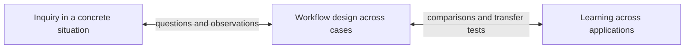

Status: proposed interpretation and editorial changes, 2026-04-01. This analysis draws on the local notes identified in the [recall audit](). It does not establish a new research methodology. The replacement passages below are proposals for discussion.

## The underlying connection

Across these notes, we encounter concrete situations, make our understanding explicit, try possibilities, interpret what happens, and reconsider what to build or believe. Some of the resulting knowledge can guide a particular task; some may justify a repeatable workflow; some may transfer to other applications.

The connection is **learning from situated work and examining how far that learning can be carried**. Its products include questions, distinctions, explanations, counterexamples, design choices, and reusable practices. Producing automation is one possible result.

The audit's flat list mixes different kinds of concepts:

| Concept | Its role in the relationship |
| --- | --- |
| Bottom-up learning | An orientation toward developing and revising concepts through concrete cases. |
| Workflow and capability discovery | Objects of inquiry: how a particular system behaves and how the work could be organized. |
| Grounded-theory-inspired coding | A method used in some notes to compare observations and develop categories. |
| Prototyping | An inquiry move that makes a possibility inspectable or experienceable. |
| LLM assistance | An allocation of work: an LLM may help investigate, build, interpret, or critique. |
| Discovery and delivery | Purposes and obligations attached to work and the commitments it supports. |

These distinctions explain why the notes overlap. One activity can involve several of them at once.

## Three connected scales of learning

The most useful organizing question is: **what are we trying to change our understanding of?**

| Scale | What develops? | Example | Main notes |
| --- | --- | --- | --- |
| Within a concrete inquiry | Our understanding of the situation, useful questions, possibilities, and the current result. | Discover that "find my notes" involves several different information needs. | [Operation model](), [LLM roles]() |
| Across cases of a workflow | A model of behavior, meaningful failure categories, and candidate decisions or policies for future cases. | Investigate when search misses useful passages and compare ways of recovering them. | [Retrieval design](), [Failure understanding](), Pipeline design |
| Across applications | Our understanding of which tools, concepts, and practices transfer, and where they need adaptation. | Compare the evidence and review needs of note search, transaction capture, and another application before extracting shared support. | [AI Project Foundation](), [Premature abstraction]() |

The arrows show possible influence. These activities can coexist, and a project does not have to progress through all three. A shared concept can help us notice something in a new case; a new case can also overturn that concept.

The [retrieval-design note](#use-interaction-for-two-learning-loops) already distinguishes improving the current investigation from improving future workflow behavior. The foundation note adds the further question of learning across applications.

### Each change of scale needs justification

| What we observed | What it supports immediately | Further claim requiring investigation |
| --- | --- | --- |
| Adding a neighboring paragraph helped this answer. | The original context was inadequate for this case. | Always including neighboring paragraphs improves future answers. |
| Similar failures recur in several traces. | A candidate failure category with examples and provisional boundaries. | A particular mechanism causes the failures, or they occur at a stated population frequency. |
| Two applications need trace inspection. | A candidate shared need. | They should use the same trace model, interface, or implementation. |

The connective work is interpretation, comparison, challenge, and evaluation. A recurring observation becomes a candidate for broader use; the conditions of that use still need to be understood.

## Bottom-up design and LLM-led execution are different choices

The [workflow-evolution note]() associates deterministic-first design with top-down development and LLM-first design with bottom-up emergence. That comparison is a useful question, but it currently combines two axes.

**Bottom-up or top-down** concerns how we arrive at and revise a design. **Deterministic or LLM-led execution** concerns how the resulting system chooses its actions.

A small deterministic search script can evolve bottom-up through concrete cases. An elaborate agent architecture can be specified top-down before any cases are examined. Using an LLM therefore does not by itself make development bottom-up.

Existing domain knowledge, explicit requirements, and established invariants can justify structure from the beginning. What should remain revisable is the part of the solution whose justification is still uncertain.

This also clarifies the relationship between two engineering proposals:

- [Sandbox-first discovery]() leaves more of the solution method open so that a prescribed sequence does not hide useful capabilities.
- Inspectable pipeline design exposes selected decisions so that their effects can be understood and changed.

They address different risks. Prescribing stages too early can narrow what we discover. Leaving everything to an opaque run can make it difficult to learn which decisions matter. A useful comparison can retain an open agent baseline while making particular inputs, outputs, or interventions inspectable. The appropriate amount of structure is a design question in its own right.

## Grounded theory contributes a method and several analogies

The notes use the term in different ways:

| Location | Intended use |
| --- | --- |
| [AI Project Foundation]() | Inspiration for comparing concrete applications and revising tentative concepts. |
| [Workflow evolution]() | An analogy for allowing structure to emerge through practice. |
| AI failure analysis | A procedural adaptation involving traces, coding, comparison, and category development. |
| Agent-assisted qualitative analysis | LLM assistance with qualitative interpretation and coding themselves. |

I would retain these connections while making their scope explicit. The failure-analysis note is the strongest procedural connection. The foundation and workflow notes use broader inspiration or analogy.

Coding helps develop distinctions worth investigating. The [failure-understanding note]() separately identifies root-cause attribution, population measurement, and intervention selection as further work. That boundary should remain visible wherever category discovery is connected to engineering decisions.

## The LLM can occupy several roles

An LLM may contribute as:

- **A collaborator in inquiry:** proposing frames, examples, implementations, questions, or critiques.
- **A component being investigated:** its behavior under particular tools, instructions, and conditions is the subject of the experiment.
- **An analysis assistant:** helping compare traces, suggest codes, or articulate candidate patterns.

One exploration can use all three roles. The distinction matters when interpreting the result: a model's proposed explanation of a run is an interpretation to examine; the run's actual outputs and conditions provide different evidence.

This is why "discovery with LLMs" and "discovery about LLM systems" intersect so often. We can use an LLM to help design and investigate a system that also contains LLMs.

## Keep open-ended inquiry and decisions in view

The [operation model](#what-counts-as-progress) allows progress through better questions and more visible possibilities, including increased awareness of uncertainty. The [operating-model note]() emphasizes uncertainty that matters to a decision and evidence for the next commitment.

Both purposes matter. Early inquiry can reveal what the decision should even concern. A targeted experiment can answer an already clear question. The [behavioral-evidence note]() also describes a clear product target whose reliable implementation remains uncertain.

The collection should therefore distinguish uncertainty about the situation or desired role from uncertainty about the behavior of a proposed system. These can change independently.

Likewise, human judgment can remain valuable in the working system. The pipeline commentary explains that review may serve the current task or an acceptance decision, regardless of whether it teaches us how to automate later.

## This search as a concrete example

The recent note search illustrates the relationships:

1. The initial inquiry concerned how several remembered themes related. Finding the foundation note changed the conceptual map by revealing that learning across applications was a separate scale.
2. The keyword script made the corpus and matching behavior inspectable. Scanning zero-hit documents found additional vocabulary and relevant material.
3. This suggests a workflow hypothesis: combining full-text retrieval with an independent metadata pass may recover useful omissions. Its performance on other questions has not been established by this one search.
4. A reusable search or evidence workbench is a further possibility. Comparing other investigations and applications would help determine what should be shared.

The work produced useful understanding without requiring an interactive prototype. A prototype could become useful later if we wanted to investigate how someone should inspect candidates or assess coverage.

## Proposed changes to the notes

### 1. Use a relationship note as the conceptual entry point

Keep the [audit]() as the dated record of what was found and how it was searched. Use this note to discuss the relationships and their implications. The reading map can link both according to those purposes.

Keep the focused material in its existing topical homes. The current evidence supports clearer relationships and introductions; it does not yet require a new universal methodology or a folder migration.

### 2. Give the foundation introduction a clear object

Proposed replacement for its unfinished opening:

> The AI Project Foundation is an effort to develop tools and practices for building and putting AI systems into use. We work through concrete applications, investigate their behavior and workflows, and compare what we learn across projects. Those comparisons guide which tools, concepts, or practices to share and which should remain specific to an application.
>
> Grounded theory inspires the comparison of observations and the revision of tentative concepts. Whether a shared practice works in another context remains a question to investigate.

Within the existing note, distinguish **learning across applications**, **tools being developed**, and **starter-kit packaging**. This would clarify the method, current work, and possible deliverable without assuming that all applications need one architecture.

### 3. Rewrite the workflow-evolution question around the uncertain decision

Proposed replacement for the deterministic-first/LLM-first comparison:

> Which parts of the workflow already have a clear justification, and which should remain open to discovery? An LLM-led flow and a more prescribed flow are possible starting points to compare. Use concrete cases and observed behavior to investigate where additional structure helps, while retaining independently justified domain rules and execution boundaries. Bottom-up development concerns how the design evolves; it does not require LLM-led execution.

Retain this as an open design question, and link the sandbox and inspectable-pipeline proposals as different ways to investigate it.

### 4. Add a short relationship section to the operation model

Proposed addition:

> This model concerns developing understanding within a design situation. Work on that situation may also reveal questions about how a repeatable workflow should behave. Comparing those questions across cases can inform workflow design; comparing workflows across applications can inform shared tools and practices. Each broader claim requires evidence about the additional cases and conditions it covers.

Link to retrieval design and the foundation note. This gives the inquiry model an explicit relationship to engineering without requiring every inquiry to produce a reusable policy.

### 5. Clarify grounded-theory usage and LLM roles

Expand the small grounded-theory reference note with the scope table above and links to the relevant applications. Keep the detailed engineering adaptation in the failure-analysis collection.

Add a compact version of the three LLM roles to [LLM roles in discovery](), or link to this section. Its existing exploration brief can remain focused on collaboration.

### 6. Make the reading map answer the reader's current question

Suggested navigation:

| Current question | Start with |
| --- | --- |
| What am I trying to understand or make possible? | Operation model and LLM roles. |
| What can this system do, and how should its workflow work? | Sandbox-first discovery, pipeline design, and retrieval design. |
| Which failures recur, and what distinctions matter? | Failure understanding and grounded-theory-inspired analysis. |
| What can be shared across applications? | AI Project Foundation and premature abstraction. |
| What evidence supports the next product commitment? | Discovery and delivery. |

This provides several entry points according to purpose. It should supplement the existing reading paths rather than imply one sequence everyone must follow.

Only this proposal note and its navigation link were added in this pass. The proposed replacement passages have not been applied to the source notes.
