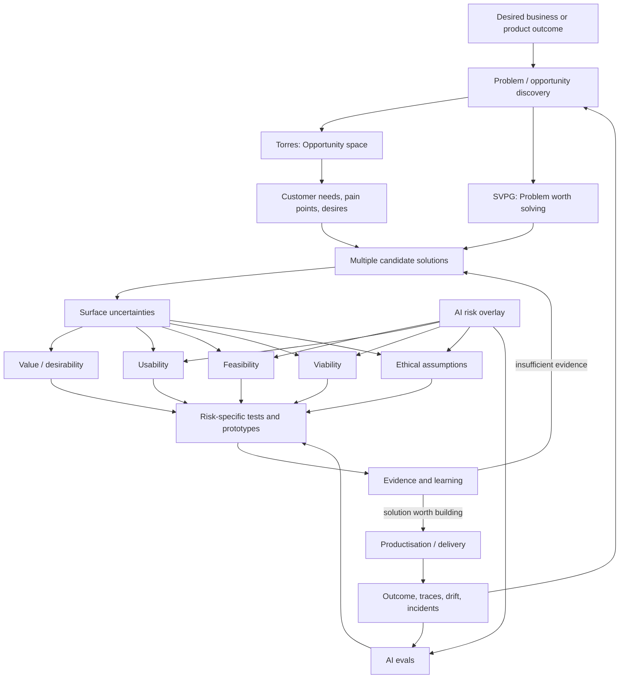
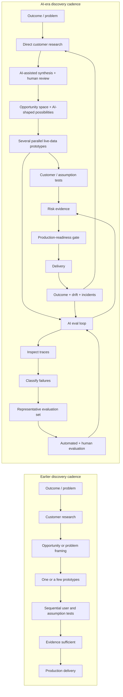

## Executive summary

As of **27 August 2026**, Marty Cagan/SVPG and Teresa Torres remain strongly aligned on the purpose of product discovery: product teams should continuously reduce uncertainty about what to build, using evidence before committing to production delivery. Their frameworks differ mainly in **where they put structure and vocabulary**. SVPG structures discovery around **product risks and empowered-team accountabilities**; Torres structures it around **continuous habits, an opportunity-to-solution decision model, and explicit assumptions**. Their methods fit together with little conceptual conflict. Torres herself says her five assumption types overlap substantially with Cagan's four risks, while SVPG's 2026 Build to Learn FAQ recommends _Continuous Discovery Habits_ and Product Talk as discovery resources.[^torres-assumptions][^svpg-build-to-learn-faq]

The latest material sharpens that complementarity. Cagan's 2026 position is that AI has made building and prototyping much cheaper, so the limiting factor increasingly becomes **discovering a solution worth building**. SVPG distinguishes **"build to learn"**, where prototypes retire value, usability, feasibility and viability risk, from **"build to earn"**, where production engineering must address reliability, scale, performance, privacy, security and other operational requirements. Cagan argues that teams can now create many realistic prototypes and explore alternatives in parallel, leaving product judgement and product sense as the harder constraint.[^svpg-build-to-learn][^svpg-ai-productivity-paradox]

Torres has reached a closely related conclusion from a different direction. Her canonical model still starts with a desired outcome, uses customer interviews to map an **opportunity space**, explores multiple solutions, identifies underlying assumptions and tests the riskiest ones. Her formal definition of continuous discovery still calls for **weekly customer touchpoints by the team building the product**, using small research activities in pursuit of an outcome.[^torres-continuous-discovery][^torres-ost] In her **5 August 2026** material, however, she explicitly identifies **AI evals as a new discovery habit for teams building AI products**: inspect failures, classify them, measure them and iteratively improve the system.[^torres-call-to-adventure]

The main synthesis is therefore:

> **AI does not invalidate either discovery framework. It increases the amount and type of uncertainty that discovery must manage while sharply reducing the cost of generating candidate solutions.**

That shift changes the risk profile. Traditional feasibility questions such as "Can the team build it?" become questions about **error distributions, data coverage, model behaviour, drift, latency and evaluation**. Usability expands to include **calibrated trust, explainability, recovery from mistakes and human oversight**. Viability acquires significant **inference cost, model-provider dependency, data-rights, copyright, regulation and operating-cost** concerns. Security must account for AI-specific attack patterns such as prompt injection, sensitive-information disclosure and excessive agency. Ethical risk becomes harder to ignore because model behaviour can vary across groups, contexts and time. NIST similarly identifies data dependence, stale or unrepresentative datasets, emergent failure modes, drift, opacity, privacy and complex attack surfaces as risks that are increased or changed in AI systems.[^svpg-ai-product-management][^nist-ai-rmf][^owasp-top10]

AI also changes discovery **as a working practice**. It can accelerate synthesis, coding, data analysis and prototype generation. That does not make all generated evidence equally trustworthy. Torres's latest "ladder of evidence" work warns that teams already have abundant weak signals and can mistake them for sufficient evidence; she continues to put high value on contextual, story-based customer interviews.[^torres-quality-evidence] Cagan makes the parallel argument from delivery economics: faster output does not necessarily improve outcomes. His July 2026 "AI Productivity Paradox" argues that organisations using AI to accelerate existing feature-production processes can simply build weak ideas faster.[^svpg-ai-productivity-paradox]

**Recommended synthesis for teams:** use Torres's **outcome -> opportunity -> solutions -> assumptions -> tests**structure as the discovery map; use Cagan's four risks as a mandatory product-risk review; retain Torres's explicit **ethical**category; then add an **AI risk overlay** covering data, model/evaluation quality, security and agency, provider dependency and AI economics. Run two continuous evidence loops: a **human discovery loop** with direct customer contact and assumption tests, and an **AI quality loop** using traces, error analysis, representative evaluation sets and human-calibrated evals. Promotion from prototype to production should require evidence from both loops plus explicit production-readiness work. This synthesis is consistent with the current direction of both authors and with AI risk and engineering research.[^torres-continuous-discovery][^torres-call-to-adventure][^svpg-build-to-learn][^nist-ai-rmf]

## The two discovery models and vocabularies

### Marty Cagan and SVPG

SVPG's original [Continuous Discovery](https://www.svpg.com/continuous-discovery/) article, published in 2012, defined continuous discovery as an ongoing process of identifying, validating and describing product work in parallel with continuous delivery. Its language reflects the backlog-oriented vocabulary of that period.[^svpg-continuous-discovery] Newer SVPG material places discovery inside the broader **product operating model**: durable, cross-functional teams are given problems or outcomes and are responsible for discovering effective solutions. Cagan's August 2026 description of the product role again highlights identifying a worthwhile problem, discovering an effective solution and ensuring that it also works for the business. [^svpg-product-role]

The core discovery vocabulary is:

**Product discovery.** Work undertaken to gain evidence that a proposed solution will succeed before committing fully to productisation. In SVPG's 2026 vocabulary, this is **building to learn**. Discovery and delivery are conceptual distinctions that continue alongside one another, rather than sequential organisational phases.[^svpg-build-to-learn-faq][^svpg-build-to-learn]

**Product risks.** The canonical SVPG taxonomy has four major risks:

- **Value risk:** whether customers will buy, choose or use the product; for AI, Cagan stresses demonstrating genuine incremental value rather than adding AI for parity or marketing.[^svpg-ai-product-management]
- **Usability risk:** whether intended users can understand and use the solution. In AI products, this includes expectations about capabilities and limitations, trust, explanation and trade-offs between accuracy, speed and experience.[^svpg-ai-product-management]
- **Feasibility risk:** whether the team can build the solution with its technology, skills and resources. For AI, SVPG explicitly adds probabilistic behaviour, data quality and quantity, processing requirements, infrastructure and scalability concerns.[^svpg-ai-product-management]
- **Viability risk:** whether the solution works for the business, including commercial, legal, regulatory and organisational constraints. SVPG's AI treatment explicitly includes monetisation and unit economics, data provenance, copyright, bias, legal responsibility and broader ethical consequences.[^svpg-ai-product-management]

SVPG also distinguishes **discovery risks from delivery risks**. Discovery establishes that there is a solution worth building. Delivery then has to produce a commercial-quality system meeting requirements such as scale, reliability, fault tolerance, security, privacy, performance, provisioning and operations. This distinction becomes particularly important with AI-generated prototypes because a visually convincing, live-data prototype can conceal substantial production work.[^svpg-build-to-learn][^svpg-prototypes-vs-products]

**Risk-specific prototypes.** SVPG argues that prototype fidelity should follow the uncertainty being tested. Visual, behavioural and data fidelity are separate dimensions; the prototype only needs enough fidelity to answer the risk question.[^svpg-purpose-prototypes] Value and usability evidence normally comes from users or customers, feasibility evidence from engineers, and viability evidence from affected stakeholders such as legal, finance, marketing, sales, compliance or operations.[^svpg-build-to-learn-faq]

**Role accountability.** In the SVPG model, the product manager has primary responsibility for **value and viability**, product design for usability, and the engineering/technical lead for feasibility, while discovery itself remains collaborative. The AI material makes the product manager's value and viability responsibilities particularly explicit.[^svpg-ai-product-management]

The latest AI-era formulation is [Build to Learn vs Build to Earn](https://www.svpg.com/build-to-learn-vs-build-to-earn/). Cagan argues that generative-AI prototyping now makes roughly 10-20 prototype iterations per week practical for many teams and makes parallel solution exploration much cheaper. The scarce capability consequently becomes knowing which evidence to collect and exercising product judgement over what has been learned.[^svpg-build-to-learn] His July 2026 [AI Productivity Paradox](https://www.svpg.com/the-ai-productivity-paradox/) extends the argument: higher production speed does not guarantee better outcomes, so discovery skills, strategy and product culture become proportionally more important.[^svpg-ai-productivity-paradox]

### Teresa Torres and Product Talk

Torres's canonical definition, currently reflected in Product Talk's [Continuous Discovery glossary](https://www.producttalk.org/glossary-discovery-continuous-discovery/), is **weekly touchpoints with customers by the team building the product, through small research activities in pursuit of a desired outcome**. The three conditions Product Talk identifies are direct team-customer interaction, research broken into small activities that fit alongside delivery, and an outcome focus.[^torres-continuous-discovery]

Her operating model is built around several connected habits.

**Desired outcome.** The discovery process has a measurable outcome that bounds exploration. Torres distinguishes business outcomes, product outcomes and feature-level traction metrics, and generally favours a product outcome, often an observable customer behaviour or sentiment, as the working scope for a team's discovery.[^torres-ost]

**Opportunity.** An opportunity is an unmet customer **need, pain point or desire**, distinct from a product feature or solution. Opportunities are grounded in evidence from customers, especially story-based interviews.[^torres-ost]

**Opportunity solution tree, or OST.** The tree represents the team's reasoning from a desired outcome through an opportunity space to possible solutions and their assumption tests. Torres recommends exploring several solution alternatives and testing risky assumptions before choosing what to build.[^torres-ost]

**Product trio.** Product manager, designer and engineer form the core cross-functional group responsible for deciding what to build and building it. Product Talk's current site describes trios as a small team designed to combine balanced perspectives while supporting fast collaborative decisions.[^torres-product-trio]

**Continuous discovery habits.** Interviews help the trio discover and refine opportunities; assumption tests help evaluate candidate solutions. These activities happen repeatedly as the tree and the team's understanding evolve.[^torres-continuous-discovery][^torres-ost]

**Assumptions rather than abstract risk labels.** Torres's five types are:

1. **Desirability:** why somebody would want the solution and whether they are willing to take the actions required to get its value.
2. **Viability:** why the solution creates business value, including its economics.
3. **Feasibility:** why the organisation can build and support the solution; Torres explicitly includes technical, legal, compliance, security and organisational feasibility, while acknowledging that other frameworks classify some of these under viability.
4. **Usability:** whether people can find, understand and perform the necessary actions, including accessibility.
5. **Ethical:** potential harms, inclusion and exclusion, data collection and use, trust and safety.[^torres-assumptions]

Torres explicitly compares these categories with Cagan's taxonomy. She says they are conceptually mostly the same; her reason for expressing them as **assumption types** is operational: a statement such as "viability risk" remains broad, whereas an explicit assumption can be judged for risk and tested. She also retains "desirability" where Cagan prefers "value", and adds ethics as a separate fifth category.[^torres-assumptions]

A second difference is responsibility. Torres argues that all trio members should be **jointly responsible and accountable for every category**. Expertise still matters: engineers will generally contribute more to technical questions and PMs to business questions. However, she warns that fixed risk ownership can recreate functional silos.[^torres-responsibility]

Her AI work now extends the habits framework. In her 2025-26 work building Product Talk's AI products, Torres increasingly treats **evals**, the systematic evaluation of AI behaviour, as a discovery feedback loop. On **5 August 2026**, she described AI evals as the missing/new discovery habit for teams building AI products: examine failures, measure them and improve the system iteratively.[^torres-call-to-adventure] This is the clearest change to her discovery vocabulary introduced by generative AI so far.

The relationship can be represented as follows:

This synthesis reflects an important point: Torres provides an explicit representation of the **decision tree**, while SVPG provides a particularly clear representation of the **risk and productisation boundary**.[^torres-ost][^svpg-build-to-learn]

## Concept mapping and terminology

Neither author uses **"risk profile"** as a formal quantified object in the core discovery framework. Cagan speaks primarily about product risks; Torres speaks about assumption categories and the relative risk of individual assumptions. For this comparison, **risk profile** means the distribution and severity of unresolved uncertainty across value/desirability, usability, feasibility, viability and ethics, plus the data, model, security and operating uncertainties introduced by AI. This is an analytical overlay, not terminology that should be attributed directly to either author.[^svpg-ai-product-management][^torres-assumptions]

|Concept|Marty Cagan / SVPG|Teresa Torres / Product Talk|Practical mapping|
|---|---|---|---|
|**Purpose of discovery**|Discover a solution worth building; reduce product risks before productisation. 2026 wording: **build to learn**.[^svpg-build-to-learn-faq][^svpg-build-to-learn]|Decide what to build through continuous evidence gathering in pursuit of an outcome.[^torres-continuous-discovery]|Same underlying purpose: evidence before expensive commitment.|
|**Continuous discovery**|Continuous process running alongside delivery; newest material stresses discovery and delivery as different purposes rather than sequential phases.[^svpg-continuous-discovery][^svpg-build-to-learn]|Weekly customer touchpoints plus small research activities by the product-building team.[^torres-continuous-discovery]|Torres specifies a stronger minimum customer cadence.|
|**Starting point**|Product strategy gives empowered teams worthwhile problems/outcomes; team discovers solutions.[^svpg-product-role][^svpg-ai-productivity-paradox]|Desired outcome bounds an OST; team builds an evidence-backed opportunity space.[^torres-ost]|Outcome/problem framing is shared. Torres provides more prescriptive visual decomposition.|
|**Problem discovery**|Latest SVPG product-role language explicitly distinguishes finding a worthwhile problem and discovering an effective solution.[^svpg-product-role]|Customer needs, pain points and desires form the opportunity space.[^torres-ost]|"Problem" and "opportunity" overlap, but opportunity has a specific Torres definition.|
|**Decision representation**|No canonical equivalent to the OST is required. SVPG focuses on strategy, risks, evidence and prototypes.[^svpg-build-to-learn-faq][^svpg-build-to-learn]|**Opportunity solution tree:** outcome -> opportunities -> solutions -> assumption tests.[^torres-ost]|OST can be used inside an SVPG-style product model.|
|**What gets tested**|A prototype or proposed solution against one or more product risks. Prototype fidelity follows the risk.[^svpg-purpose-prototypes]|The **riskiest underlying assumptions** of several candidate solutions.[^torres-ost][^torres-assumptions]|Torres tends to decompose the risk one level further into falsifiable beliefs.|
|**Value / desirability**|**Value:** will customers buy, choose or use it; for AI, does it produce material incremental value?[^svpg-ai-product-management]|**Desirability:** does somebody want it, and will they undertake the necessary effort/actions to obtain value?[^torres-assumptions]|High overlap. Torres deliberately retains different wording.|
|**Usability**|Can users use the solution? AI adds trust, expectations, explanation and handling uncertainty.[^svpg-ai-product-management]|Can users find, understand and perform what is required; accessibility is included.[^torres-assumptions]|Close correspondence.|
| **Feasibility** | Primarily technology, skills, resources and product-quality implementation; AI adds data, model uncertainty, infrastructure and computational constraints. [^svpg-ai-product-management] | Technical plus legal, compliance, security and organisational feasibility, although Torres says the exact classification is secondary to surfacing the assumption. [^torres-assumptions] | Same core technical category; Torres draws the boundary more broadly. |
| **Business / model risk** | **Viability:** marketing, sales, servicing, funding, monetisation, legal/regulatory fit and other company constraints. [^svpg-ai-product-management] | **Viability:** contribution to the desired business outcome plus economics and cost/revenue assumptions. [^torres-assumptions] | Both cover business success; precise legal/security placement differs. |
| **Ethical risk** | No fifth canonical product-risk category. AI material places bias, harm, bad actors, privacy/data and societal implications mainly within viability, with some issues touching feasibility and delivery. [^svpg-ai-product-management] | **Explicit fifth ethical assumption type:** harm, inclusion/exclusion, data practices, trust and safety. [^torres-assumptions] | Torres makes ethical analysis more visible. |
| **Technical / delivery risk** | Discovery feasibility is distinct from production risks such as reliability, performance, scale, security, privacy and operations. [^svpg-build-to-learn] | Production/delivery is distinguished from discovery, although her assumption model concentrates on uncertainty needed to decide what to build. [^torres-discovery-delivery] | SVPG makes prototype-to-production separation more explicit. |
| **Risk accountability** | PM primarily value + viability; designer usability; tech lead feasibility; team collaborates. AI increases PM's burden around value/viability. [^svpg-ai-product-management] | Every trio member responsible and accountable for all five categories, while using each member's expertise. [^torres-responsibility] | This is a genuine operating-model difference. |
| **AI/data risk** | Treated as changes within the four risks: probabilistic errors, training/data problems, infrastructure, explainability, unit economics, provenance, copyright, ethics. [^svpg-ai-product-management] | Ethical assumptions already cover data harm; recent practice adds explicit **AI evals** as a continuous discovery habit. [^torres-assumptions][^torres-call-to-adventure] | Core taxonomies can remain; AI requires new evidence techniques and an explicit overlay. |
| **AI effect on prototyping** | Live-data prototypes and parallel alternatives become much cheaper; product sense becomes more important. [^svpg-build-to-learn] | Torres uses AI for prototyping and synthesis while retaining real-customer evidence and iterative correction/evaluation. [^torres-call-to-adventure][^torres-quality-evidence] | Artifact creation accelerates; evidence quality and judgement become the constraint. |

One terminology point deserves care. Torres states directly that her assumption taxonomy and Cagan's four risks are **conceptually highly aligned**; she prefers assumptions because teams can turn a concrete statement into a specific test. She also reports that Cagan challenged her use of "desirability" rather than "value" while reviewing *Continuous Discovery Habits*, but she retained the term. [^torres-assumptions] It would therefore be misleading to treat "value versus desirability" as a major theoretical disagreement.

The more meaningful taxonomy difference concerns **ethics**. Torres makes ethics visible as its own category. Cagan's AI treatment addresses many of exactly the same concerns, including bias, harmful outputs, misuse, data provenance and societal effects, but locates them predominantly inside **business viability**. [^torres-assumptions][^svpg-ai-product-management] For AI products, keeping Torres's explicit ethical category is operationally useful even in teams otherwise using SVPG language, because ethical and safety assumptions can otherwise disappear inside a broad viability checklist.

## Differences, overlaps and implications for teams

### The frameworks operate at different levels

The frameworks are best understood as **complementary layers**.

SVPG gives a team a strong answer to: **Which fundamental uncertainties must be resolved before committing to a production solution, and which disciplines bring the expertise required to resolve them?** Its strongest vocabulary is risk, prototype, evidence, empowered teams and the build-to-learn/build-to-earn boundary. [^svpg-build-to-learn][^svpg-ai-product-management]

Torres gives a strong answer to: **How does a trio continuously organise the sequence of decisions and evidence gathering?** The OST externalises the chain from business/product outcome through customer opportunity to candidate solutions and then to testable assumptions. [^torres-ost]

There is no need to choose one. An OST can hold three solution alternatives; every alternative can be annotated with SVPG's value, usability, feasibility and viability risks and Torres's explicit ethical assumptions. The riskiest underlying beliefs then determine the next test. This combination retains the decision clarity of Product Talk and the productisation discipline of SVPG.

### Customer contact is more prescriptive in Torres's model

Torres puts direct customer contact inside the **definition** of continuous discovery and sets a weekly cadence. [^torres-continuous-discovery] Cagan advocates continuous learning and frequent testing but structures the evidence source according to the risk: customers for value/usability, engineers for feasibility and internal stakeholders for viability. [^svpg-build-to-learn-faq]

For teams, these positions work well together. Maintain the weekly stream of customer evidence that Torres recommends, while recognising that **not every important discovery question is a customer question**. A legal interpretation, model-latency limit, fraud threat, contract constraint or inference-cost assumption requires another evidence source.

This becomes more important with AI because "customer feedback" cannot establish whether an AI system is safe, robust across a long-tail distribution, economically scalable or resistant to adversarial inputs. Those require technical evaluation, data analysis, specialist review and operational testing. NIST's AI RMF similarly highlights risk sources including data representativeness, drift, privacy, opacity, difficult-to-predict failure modes and complex security surfaces. [^nist-ai-rmf]

### Accountability differs more than taxonomy

SVPG's role model gives named disciplines primary accountability for particular risks, especially PM ownership of value and viability. [^svpg-ai-product-management] Torres deliberately resists this division and says all three members should be accountable for every category, while still letting the person with the strongest expertise lead particular investigations. [^torres-responsibility]

For a mature team, a workable synthesis is **primary stewardship plus joint decision ownership**. For example, the engineer may lead a model-feasibility spike, the designer may lead calibrated-trust testing and the PM may lead unit-economics analysis, but the trio reviews all three before agreeing that the solution is sufficiently de-risked. This preserves expertise without turning the risk categories into hand-off boundaries.

AI makes this shared understanding increasingly important. A single design decision may simultaneously alter latency, inference cost, model accuracy, customer trust and safety. SVPG explicitly notes these trade-offs for AI products. [^svpg-ai-product-management] A PM who treats model accuracy as "engineering's problem", or an engineer who treats user reliance as "design's problem", will miss coupled risks.

### Evidence quality becomes more important as evidence volume rises

Torres's July 2026 discussion of a **ladder of evidence** distinguishes abundant, low-context signals, such as support tickets or sales notes, from richer story-based customer evidence. Her concern is that teams may fill gaps in weak signals with their own assumptions. [^torres-quality-evidence] This is particularly relevant when AI can summarise thousands of records into a clean-looking narrative in seconds. Greater synthesis capacity increases the importance of knowing the provenance and strength of each input.

This view is consistent with peer-reviewed AI research. Sambasivan and colleagues' CHI 2021 work on **data cascades** documents how data problems can create compounding downstream failures in high-stakes AI systems. [^sambasivan-data-cascades] Amershi and colleagues' CHI 2019 work produced 18 guidelines for human-AI interaction, reflecting that AI-powered interfaces require explicit design consideration around interaction with uncertain system behaviour. [^amershi-human-ai]

The implication is that AI-assisted discovery needs **evidence provenance**, not merely better summarisation. A team should be able to distinguish:

`direct observed behaviour -> interview story -> analytics -> support/sales signal -> AI synthesis -> AI-generated hypothesis`

An AI-generated summary can compress strong evidence. It does not raise the evidential quality of weak inputs.

### Faster building increases the value of rejection

SVPG's most important 2026 contribution is arguably the economic consequence of cheap building. Cagan argues that AI increases delivery speed without automatically increasing product outcomes; the strongest teams use that speed to accelerate learning before productisation. [^svpg-ai-productivity-paradox] The 2026 McKinsey global AI survey is directionally consistent: 80% of respondents reported individual productivity improvement, while only 37% reported positive EBIT contribution from AI, and one in five reported AI operating costs constraining use. [^mckinsey-state-ai-2026]

Google's 2025 DORA research similarly found that AI adoption was positively associated with throughput and product performance but continued to have a negative relationship with delivery stability, with the effects depending on underlying engineering practices and feedback systems. Its study drew on nearly 5,000 technology professionals and more than 100 hours of qualitative research. [^dora-ai-2025]

The discovery implication is counter-intuitive but straightforward: **when solutions become cheaper to create, teams need stronger mechanisms for discarding them**. An organisation that previously had capacity to build two candidate ideas might soon be able to generate twenty. That increases the probability of feature proliferation unless the evidence threshold remains tied to outcomes and risk reduction.

## How AI changes discovery activities and risk profiles

AI affects discovery in two separate ways that should not be conflated:

1. **AI as a tool used by the product team** for research, synthesis, prototyping, analysis and implementation.
2. **AI as part of the product being discovered**, where probabilistic models, data and autonomous behaviour become part of the customer solution.

The first changes the **cost and cadence of discovery**. The second changes the **nature of product risk**.

### Discovery work becomes faster and more parallel

SVPG's 2026 material says generative-AI tools have greatly lowered the cost of functional and live-data prototypes, enabling teams to test several approaches concurrently rather than iterating through one candidate at a time. [^svpg-build-to-learn] Product Talk's recent AI work shows the same acceleration across prototyping, coding and AI-assisted synthesis, while Torres continues to stress direct customer evidence and correction of AI-generated outputs. [^torres-call-to-adventure][^torres-quality-evidence]

This produces a shift like the following:

The diagram does not imply that interviews or prototypes disappeared before or after AI. The shift is in **speed, concurrency and the addition of a continuous model-evaluation loop**. SVPG supplies the parallel-prototype/productisation distinction; Torres supplies the explicit eval-as-discovery-loop framing. [^svpg-build-to-learn][^torres-call-to-adventure]

### Feasibility moves from binary capability to performance distributions

For conventional deterministic software, feasibility questions can often be framed as whether a team can technically implement a behaviour under known constraints. Cagan's AI Product Management article argues that generative AI changes this because outputs are probabilistic, the same class of input can produce different results, and teams must decide which mistakes are acceptable, at what rate, and how each failure should be handled. [^svpg-ai-product-management]

The new feasibility profile therefore includes:

**Model quality across the input distribution.** A convincing demo on ten examples says little about thousands of diverse production inputs. Representative evaluation sets, segment-level metrics and error analysis become discovery evidence.

**Data availability and fitness.** Data volume, representativeness, freshness, provenance and label quality can determine whether a technically promising idea is feasible. NIST warns specifically that AI datasets can be unrepresentative, stale or detached from their original context and that ground truth may be absent. [^nist-ai-rmf] Sambasivan et al.'s data-cascades research provides peer-reviewed evidence that upstream data problems can propagate through AI systems and create downstream failures. [^sambasivan-data-cascades]

**Drift.** Feasibility becomes continuous because production data, user behaviour or underlying models can change. NIST identifies data, model and concept drift as reasons AI systems may require more frequent corrective maintenance. [^nist-ai-rmf]

**Latency and compute.** A higher-quality model might be slower or materially more expensive. SVPG explicitly frames accuracy, processing requirements, user experience, scalability and cost as interacting AI-product constraints. [^svpg-ai-product-management]

**Mitigation:** before a solution is declared feasible, define a representative evaluation corpus, a failure taxonomy, performance by important slices, unacceptable error classes, latency and cost budgets, and a plan for monitoring changes after launch. Torres's eval loop provides the discovery mechanism; Cagan's feasibility model provides the risk category. [^torres-call-to-adventure][^svpg-ai-product-management]

### Value and desirability need a higher bar

AI's novelty can create false-positive value signals. Cagan explicitly warns against adding AI for marketing or competitive parity and asks whether the capability solves a real problem materially better or enables something previously infeasible. [^svpg-ai-product-management] Torres's opportunity-first model supplies a useful guardrail: start from observed customer needs, pains and desires and only then ask what newly available technology makes possible. [^torres-ost]

The AI-era value question is therefore more demanding than "Do users like this demo?" Relevant questions include:

**Does the AI remove enough work or enable enough new capability to change behaviour? Does its variability undermine the benefit? Will users provide the data/context required? Will they accept review or correction work? Does the AI beat a simpler deterministic solution on the desired outcome?**

Torres's distinction between wanting a solution and being **willing to perform the actions needed to gain its value** is especially useful for AI. [^torres-assumptions] An AI assistant might look valuable but require so much checking, prompt preparation, permission configuration or correction that users abandon it.

**Mitigation:** compare AI and non-AI alternatives in the same opportunity branch; measure successful task completion and outcome change, not merely AI feature use; explicitly test willingness to supply required context and to tolerate required review.

### Usability expands into calibrated trust

AI usability includes all traditional interaction issues plus the user's mental model of an uncertain system. SVPG says AI interfaces must communicate capability and limitations, manage expectations and determine what degree of explanation is needed to generate trust. [^svpg-ai-product-management] Peer-reviewed human-AI interaction research likewise treats interaction with uncertain AI behaviour as a distinct design problem; Amershi et al.'s CHI work synthesised this into 18 human-AI interaction guidelines. [^amershi-human-ai]

The desired outcome is **calibrated reliance**: users should know when the AI can reasonably be trusted and when verification or human intervention is appropriate.

**Mitigation:** usability tests should deliberately include success cases, ambiguous cases and failures. Test whether users detect mistakes, understand confidence or limitations where relevant, recover from errors, override AI choices and know when to escalate. For consequential actions, confirmation and undo paths should be treated as product requirements rather than late-stage polish.

### Viability acquires variable economics and dependency risk

Cagan puts AI unit economics directly inside viability. Model training, inference, data processing and external-model usage create costs that can scale differently from traditional software. [^svpg-ai-product-management] The latest McKinsey data reinforces this concern: about **20%** of 2026 survey respondents said AI-related operating costs, including token costs, constrained use. Nearly a third also reported deciding against purchasing at least one software product or feature because agentic coding tools made internal development possible, showing that AI is simultaneously changing both cost structures and build-versus-buy decisions. [^mckinsey-state-ai-2026]

AI viability also includes dependence on foundation-model providers, pricing changes, model deprecation, data residency, contractual conditions, licensing and intellectual-property questions. SVPG explicitly identifies provenance, copyright and regulatory/legal responsibility as AI viability concerns. [^svpg-ai-product-management]

**Mitigation:** discovery should include a **cost-per-successful-task** model rather than merely cost per API call. Run scenarios for expected volume, retries, long-context usage and fallbacks. Identify model-provider dependencies and exit options. Include legal/privacy/security stakeholders before a prototype handling sensitive data becomes a de facto production service.

### Ethical and data risk become first-class evidence questions

Torres's explicit ethical category is especially useful for AI because it asks teams to surface assumptions about harm, who is included or excluded, what data is collected and how it is used. [^torres-assumptions] Cagan addresses the same substance under AI viability, including bias, hallucination-related harms, misuse by bad actors and societal implications. [^svpg-ai-product-management]

NIST adds formal risk-management depth: AI risk may arise from inappropriate datasets, bias, privacy, emergent failures and third-party AI technologies, and these issues may propagate beyond the deploying organisation. [^nist-ai-rmf]

**Mitigation:** write ethical assumptions as testable statements alongside commercial and technical ones. Identify potentially affected groups, test important performance slices, specify prohibited harms and escalation thresholds, minimise sensitive-data collection, record provenance and consent, and include domain or affected-user expertise where consequences are material.

### Security changes again as systems become agentic

Traditional application security remains necessary, but generative and agentic systems add attack routes such as **prompt injection, sensitive-information disclosure, data/model poisoning, unsafe output handling and excessive agency**. OWASP's August 2026 LLM Top 10 is its current guide to security risks for LLM applications and incorporates evidence from real-world AI security incidents as well as links to agentic-AI risk frameworks. [^owasp-top10]

Prompt injection is particularly important because untrusted content can alter model behaviour, potentially influencing downstream tools and decisions; OWASP notes that retrieval-augmented generation and fine-tuning do not by themselves eliminate the problem. [^owasp-prompt-injection]

For an AI **agent**, an incorrect answer becomes more serious when the system can send an email, change a database, transfer information, modify code or invoke another service. McKinsey's 2026 trust survey describes the same transition as organisations move from risks of AI "saying" the wrong thing towards risks from systems taking unintended actions. [^mckinsey-ai-trust-2026]

**Mitigation:** include security/adversarial tests in feasibility discovery; minimise tool permissions; separate trusted instructions from untrusted content; require human approval for high-impact or irreversible actions; keep auditable action logs; isolate credentials; test prompt injection and tool misuse; and define safe fallback behaviour.

### The prototype-product gap gets larger

AI coding and prototyping tools can generate experiences that look surprisingly complete. SVPG repeatedly warns that a prototype's purpose is learning and that production software still has to satisfy a much larger set of operational requirements. [^svpg-purpose-prototypes][^svpg-prototypes-vs-products]

This creates a new discovery anti-pattern: **prototype success is mistaken for product readiness**.

A live-data AI prototype may demonstrate that users value a concept while leaving unresolved: evaluation coverage, long-tail failures, permissions, PII handling, observability, incident response, model/provider changes, adversarial behaviour, capacity, latency and cost.

The mitigation is an explicit **productisation gate**. Evidence that a solution is worth building should trigger delivery engineering; it should not be interpreted as evidence that the prototype itself can safely become the product.

## An integrated model for AI-era discovery and risk management

A practical operating model can combine the strongest parts of both frameworks without inventing an entirely new discovery methodology.

### Start with the outcome and customer problem

Set one clear product or business outcome that defines the discovery scope. Use strategy to identify a meaningful problem space, and collect direct customer evidence to construct the opportunity space. Torres's OST provides the decision structure; SVPG's product model supplies the expectation that an empowered team is solving a problem to achieve an outcome. [^torres-ost][^svpg-product-role]

AI capability scanning is valuable at this point, especially when asking what has become newly possible, but it should generate **solution hypotheses**, not fictional customer opportunities. The opportunity space should remain grounded in customer evidence.

### Maintain an OST with a risk overlay

For each target opportunity, generate several possible solutions, including a non-AI option where credible. Torres explicitly recommends exploring multiple solutions and testing their riskiest assumptions. [^torres-ost] AI's lower prototype cost makes this easier and supports SVPG's 2026 recommendation to explore alternatives in parallel. [^svpg-build-to-learn]

Annotate each solution with:

**Core product assumptions:** desirability/value, usability, feasibility, viability and ethics. [^torres-assumptions]

**AI overlay:** data readiness/provenance; evaluation/model-quality risk; drift; AI security and agency; privacy; inference economics; provider dependency; regulatory/IP constraints.

The overlay does not need to become seven more enterprise risk committees. Its purpose is to prevent AI-specific uncertainty from hiding inside a generic "feasibility" label.

### Run two continuous discovery loops

**Human evidence loop:** maintain Torres's weekly customer cadence. Interview for recent, concrete experiences; update the opportunity space; perform value/desirability and usability assumption tests; use behavioural evidence where possible. Product Talk's latest evidence work continues to favour rich, contextual customer evidence over large quantities of weak signals. [^torres-continuous-discovery][^torres-quality-evidence]

**AI quality loop:** inspect real or representative traces; identify error patterns; maintain a failure taxonomy; add representative cases to an evaluation set; run automated and human evaluation; change prompts, context, architecture, models or UX; rerun the evaluation. Torres now explicitly identifies this feedback loop as an AI discovery habit. [^torres-call-to-adventure]

These loops answer different questions. A 98% eval score does not establish customer value. Ten enthusiastic interviews do not establish a 98% reliability threshold.

### Use risk-specific evidence thresholds

A useful discovery review should look like this:

| Risk | Key AI-era question | Minimum useful evidence before productisation |
|---|---|---|
| **Value / desirability** | Does AI produce enough incremental customer benefit to change behaviour? | Real-user behaviour, demand/commitment evidence, qualitative evidence and outcome hypothesis; compare with a simpler alternative where useful. [^svpg-ai-product-management][^torres-assumptions] |
| **Usability / trust** | Can users understand, control and recover from variable AI behaviour? | Usability tests covering correct, uncertain and failed outputs; hand-off, correction and recovery tested. [^svpg-ai-product-management][^amershi-human-ai] |
| **Technical feasibility** | Does it work sufficiently across the intended distribution? | Representative eval set, failure taxonomy, critical-slice results, latency/capacity evidence and unacceptable-error thresholds. [^svpg-ai-product-management][^nist-ai-rmf] |
| **Data** | Is suitable, legal and representative data available and maintainable? | Source/provenance inventory, representative samples, rights/consent review, freshness and drift plan. [^nist-ai-rmf][^sambasivan-data-cascades] |
| **Viability / economics** | Does value exceed variable AI and operational cost, and can the business legally support it? | Cost-per-successful-task model, volume scenarios, commercial/legal review and provider-dependency analysis. [^svpg-ai-product-management][^mckinsey-state-ai-2026] |
| **Ethics / safety** | Who can be harmed and what failures are unacceptable? | Explicit harm assumptions, affected-user/subject-matter review where appropriate, slice evaluation and escalation criteria. [^torres-assumptions][^nist-ai-rmf] |
| **Security / agency** | Can untrusted inputs influence models or tools in harmful ways? | Threat model, prompt-injection/adversarial tests, least-privilege tools, approval controls and auditability. [^owasp-prompt-injection][^owasp-top10] |
| **Production delivery** | Can customers depend on it continuously? | Reliability, observability, privacy/security, scaling, operational support and regression/eval monitoring completed as production work. [^svpg-build-to-learn][^svpg-prototypes-vs-products] |

The word **minimum** here refers to a team-defined evidence threshold proportional to consequence. An AI search recommender and a system that influences medical treatment should plainly require different confidence and control levels; Cagan makes the same point by contrasting contexts where probabilistic errors are tolerable with safety-critical applications where they are unacceptable. [^svpg-ai-product-management]

### Treat evals as product discovery, not only QA

Traditional automated tests ask whether deterministic code still behaves as specified. AI evals increasingly ask a more discovery-like question: **"Is this behaviour good enough for the target user and context?"** Torres's latest work makes this connection explicit. [^torres-call-to-adventure]

A strong evaluation system should include:

**Representative cases** drawn from the intended domain; **explicit failure categories** rather than only a single aggregate score; **code-based checks** where objective correctness is available; **model-based graders** for more subjective properties; and **human/domain-expert calibration** so automated graders remain connected to human judgement. This approach is consistent with current practitioner work on LLM evaluation and with NIST's observation that AI testing is harder to specify than deterministic software testing. [^nist-ai-rmf]

The metric should also reflect the product outcome. A model that improves an abstract benchmark while making customers slower or less confident has improved the model and harmed the product.

### Preserve the distinction between learning and earning

Every AI-generated prototype should carry an explicit status such as:

**Discovery prototype: evidence generation only**

Promotion to production should be a conscious decision based on evidence across the risk profile. SVPG's build-to-learn/build-to-earn distinction is particularly valuable because modern tools make the two artefacts look deceptively similar. [^svpg-build-to-learn][^svpg-prototypes-vs-products]

Once delivery starts, AI can still accelerate implementation. DORA's 2025 findings suggest that this acceleration works best where teams already have strong feedback and engineering practices, and that increased change volume can expose weaknesses in delivery stability. [^dora-ai-2025]

### Continue discovery after launch

AI makes "validated once" especially weak as a mental model because behaviour can shift through changing traffic, context, models and data. NIST explicitly identifies drift and changing model behaviour as ongoing AI risks. [^nist-ai-rmf]

Production therefore feeds discovery:

`user outcomes -> traces -> incidents/errors -> failure taxonomy -> eval cases -> product/model changes -> outcome measurement`

A production failure may reveal a feasibility problem, an ethical assumption that was wrong, a new customer opportunity, an incorrect usability model or a viability problem caused by cost. The discovery artefacts and evaluation set should change accordingly.

### Keep judgement as the scarce resource

Both authors' latest work converges here. Cagan argues that cheap generation makes **product sense and choosing what is worth building** more important, not less. [^svpg-build-to-learn][^svpg-ai-productivity-paradox] Torres argues that teams still need strong customer evidence and now need the additional discipline of AI evals. [^torres-quality-evidence][^torres-call-to-adventure]

That suggests a useful rule for AI-assisted product organisations:

> Use AI aggressively to lower the cost of producing alternatives, prototypes, analyses and tests. Keep the burden of evidence for product decisions at least as high as before.

The organisational danger is therefore not insufficient AI-generated output. It is an **evidence-to-output imbalance**: the team can create candidate solutions much faster than it can understand customers, validate assumptions and evaluate consequences. SVPG's 2026 productivity-paradox argument and McKinsey's current productivity-versus-enterprise-impact data both point in that direction. [^svpg-ai-productivity-paradox][^mckinsey-state-ai-2026]

## Source base and primary links

The comparison above prioritises each author's own current and canonical material. As of **27 August 2026**, SVPG's author archive lists Cagan's *A Fresh Definition of The Product Role* from 10 August 2026 as his latest article, with *The AI Productivity Paradox* from 23 July 2026 and the two April 2026 Build-to-Learn articles among the most relevant recent discovery sources. [^svpg-author-archive] Product Talk currently lists *The Call to Adventure* from 5 August 2026 as Torres's latest article, alongside the August 2026 *Continuous Discovery Habits* book-club material; her July 2026 "Quality of Evidence" discussion is also directly relevant to AI-era evidence quality. [^torres-product-trio]

### Primary SVPG sources

[Marty Cagan, **Continuous Discovery**](https://www.svpg.com/continuous-discovery/) -- the original SVPG continuous-discovery framing; useful historically, although its 2012 backlog vocabulary predates the current product-operating-model language. [^svpg-continuous-discovery]

[Marty Cagan, **Build to Learn vs Build to Earn**](https://www.svpg.com/build-to-learn-vs-build-to-earn/), 16 April 2026 -- the clearest current SVPG statement about discovery versus delivery in the AI era, parallel prototyping and the four product risks. [^svpg-build-to-learn]

[Marty Cagan, **Build To Learn FAQ**](https://www.svpg.com/build-to-learn-faq/), 27 April 2026 -- clarifies how evidence sources differ by product risk and explicitly points readers towards Torres's *Continuous Discovery Habits* and Product Talk. [^svpg-build-to-learn-faq]

[Marty Cagan, **The AI Productivity Paradox**](https://www.svpg.com/the-ai-productivity-paradox/), 23 July 2026 -- SVPG's latest substantial argument about AI, delivery speed and the increasing relative importance of discovery and outcomes. [^svpg-ai-productivity-paradox]

[Marty Cagan, **A Fresh Definition of The Product Role**](https://www.svpg.com/a-fresh-definition-of-the-product-role/), 10 August 2026 -- latest product-role framing, relevant to problem discovery, solution discovery and AI-era product judgement. [^svpg-product-role]

[Marty Cagan and Marily Nika, **AI Product Management**](https://www.svpg.com/ai-product-management/), 16 April 2024 -- SVPG's most detailed mapping of AI-specific uncertainty into value, usability, feasibility and viability. [^svpg-ai-product-management]

[Marty Cagan, **The Purpose of Prototypes**](https://www.svpg.com/the-purpose-of-prototypes/), 12 September 2025 -- risk-specific prototype fidelity and the effect of generative-AI prototyping tools. [^svpg-purpose-prototypes]

[Marty Cagan, **Prototypes vs Products**](https://www.svpg.com/prototypes-vs-products/), 7 November 2025 -- production-quality requirements and the danger of treating modern prototypes as finished products. [^svpg-prototypes-vs-products]

[SVPG, **Product in the AI Era: AI Resource Guide**](https://www.svpg.com/ai-resource-guide/) -- SVPG's current index of AI-era material, including AI product management, prototyping and discovery. [^svpg-ai-resource-guide]

### Primary Teresa Torres / Product Talk sources

[Teresa Torres, **Continuous Discovery -- Definition and Overview**](https://www.producttalk.org/glossary-discovery-continuous-discovery/) -- current canonical definition of continuous discovery and weekly customer touchpoints. [^torres-continuous-discovery]

[Teresa Torres, **Opportunity Solution Trees: Visualize Your Discovery to Stay Aligned and Drive Outcomes**](https://www.producttalk.org/opportunity-solution-trees/), 6 December 2023 -- detailed canonical OST model, including outcome, opportunity space, solution space and assumption tests. [^torres-ost]

[Teresa Torres, **Evaluating Solutions: The 5 Types of Assumptions that Underlie Our Ideas**](https://www.producttalk.org/five-types-of-assumptions/), 11 October 2023 -- desirability, viability, feasibility, usability and ethical assumptions, including Torres's direct comparison with Cagan's four risks. [^torres-assumptions]

[Teresa Torres, **Assumption Testing: Everything You Need to Know to Get Started**](https://www.producttalk.org/assumption-testing/), 18 October 2023 -- practical framework for decomposing candidate solutions and testing risky assumptions. [^torres-assumption-testing]

[Teresa Torres, **Who's Responsible for What in the Product Trio?**](https://www.producttalk.org/responsibility-in-a-product-trio/), 16 February 2022 -- her explicit position on joint responsibility/accountability across all risk categories. [^torres-responsibility]

[Teresa Torres, **AI Changes Everything (And Nothing At All)**](https://www.producttalk.org/ai-changes-everything-and-nothing-at-all/), 22 October 2025 -- argues for preserving discovery fundamentals while adapting to AI-specific product behaviour. [^torres-ai-changes]

[Teresa Torres, **Lessons from 9 AI Product Teams**](https://www.producttalk.org/learning-from-8-ai-product-teams/), 19 November 2025 -- field observations about how production AI teams develop and evolve eval practices. [^torres-nine-ai-teams]

[Teresa Torres, **Quality of Evidence**](https://www.producttalk.org/quality-of-evidence-all-things-product-podcast-with-teresa-torres-petra-wille/), 14 July 2026 -- recent "ladder of evidence" framing and renewed emphasis on contextual customer evidence as AI makes building easier. [^torres-quality-evidence]

[Teresa Torres, **The Call to Adventure**](https://www.producttalk.org/the-call-to-adventure/), 5 August 2026 -- current explicit statement that AI evals constitute a new discovery habit for teams building AI products. [^torres-call-to-adventure]

Torres's book ***Continuous Discovery Habits*** remains the canonical book-length formulation; Product Talk's 2026 fifth-anniversary book club continues to teach its opportunity mapping and hidden-assumption concepts, indicating that the underlying framework remains current while the AI material is extending its practices. [^torres-book-club][^torres-product-trio]

### Supporting research and industry evidence

**Amershi et al., "Guidelines for Human-AI Interaction", CHI 2019**, ACM -- peer-reviewed foundation for designing interactions around AI behaviour; the research synthesised and evaluated 18 human-AI interaction guidelines. [^amershi-human-ai]

**Sambasivan et al., "Everyone wants to do the model work, not the data work: Data Cascades in High-Stakes AI", CHI 2021**, ACM -- peer-reviewed evidence for the compounding downstream impact of neglected data work. [^sambasivan-data-cascades]

[NIST, **AI Risk Management Framework -- How AI Risks Differ from Traditional Software Risks**](https://airc.nist.gov/airmf-resources/airmf/appendices/app-b-how-ai-risks-differ-from-traditional-software-risks/) -- authoritative treatment of representation, data dependence, drift, opacity, privacy, emergent failures and AI-specific security risk. NIST notes that AI RMF 1.0 is currently being revised. [^nist-ai-rmf]

[OWASP, **Top 10 for LLM and GenAI**](https://genai.owasp.org/initiatives/top-10-for-llm-and-genai/) -- current community security taxonomy for LLM and agentic applications; the 2026 edition was released on 3 August 2026. [^owasp-top10]

[Google Cloud DORA, **2025 State of AI-Assisted Software Development**](https://cloud.google.com/resources/content/2025-dora-ai-assisted-software-development-report) -- industry research based on nearly 5,000 technology professionals and more than 100 hours of qualitative evidence; finds that AI's effect depends heavily on the surrounding technical and organisational system and that delivery stability remains an area of concern. [^dora-ai-2025]

[McKinsey, **The State of AI in 2026: On the Road to ROI**](https://www.mckinsey.com/capabilities/quantumblack/our-insights/the-state-of-ai), 25 August 2026 -- the most recent industry survey in this source set, covering 1,719 respondents in 97 countries; useful for current evidence about productivity, enterprise financial impact, agent adoption, AI operating costs and build-versus-buy changes. [^mckinsey-state-ai-2026]

Taken together, these sources support a stable conceptual conclusion. **Cagan's four risks remain a good top-level product-risk taxonomy; Torres's habits and assumption framework provide a stronger mechanism for turning those risks into continuous decisions and tests. AI increases the value of both.** The most useful adaptation is to retain their underlying models while adding continuous AI evaluation, explicit data/security/economic risk analysis, and a disciplined boundary between increasingly cheap prototypes and production systems customers can depend on. [^svpg-build-to-learn][^torres-assumptions][^torres-call-to-adventure][^nist-ai-rmf]

[^svpg-continuous-discovery]: Marty Cagan, [Continuous Discovery](https://www.svpg.com/continuous-discovery/).

[^svpg-build-to-learn]: Marty Cagan, [Build to Learn vs Build to Earn](https://www.svpg.com/build-to-learn-vs-build-to-earn/), 16 April 2026.

[^svpg-build-to-learn-faq]: Marty Cagan, [Build To Learn FAQ](https://www.svpg.com/build-to-learn-faq/), 27 April 2026.

[^svpg-ai-productivity-paradox]: Marty Cagan, [The AI Productivity Paradox](https://www.svpg.com/the-ai-productivity-paradox/), 23 July 2026.

[^svpg-product-role]: Marty Cagan, [A Fresh Definition of The Product Role](https://www.svpg.com/a-fresh-definition-of-the-product-role/), 10 August 2026.

[^svpg-ai-product-management]: Marty Cagan and Marily Nika, [AI Product Management](https://www.svpg.com/ai-product-management/), 16 April 2024.

[^svpg-purpose-prototypes]: Marty Cagan, [The Purpose of Prototypes](https://www.svpg.com/the-purpose-of-prototypes/), 12 September 2025.

[^svpg-prototypes-vs-products]: Marty Cagan, [Prototypes vs Products](https://www.svpg.com/prototypes-vs-products/), 7 November 2025.

[^svpg-ai-resource-guide]: SVPG, [Product in the AI Era: AI Resource Guide](https://www.svpg.com/ai-resource-guide/).

[^svpg-author-archive]: SVPG, [Marty Cagan author archive](https://www.svpg.com/author/marty/).

[^torres-continuous-discovery]: Teresa Torres, [Continuous Discovery -- Definition and Overview](https://www.producttalk.org/glossary-discovery-continuous-discovery/).

[^torres-ost]: Teresa Torres, [Opportunity Solution Trees: Visualize Your Discovery to Stay Aligned and Drive Outcomes](https://www.producttalk.org/opportunity-solution-trees/), 6 December 2023.

[^torres-assumptions]: Teresa Torres, [Evaluating Solutions: The 5 Types of Assumptions that Underlie Our Ideas](https://www.producttalk.org/five-types-of-assumptions/), 11 October 2023.

[^torres-assumption-testing]: Teresa Torres, [Assumption Testing: Everything You Need to Know to Get Started](https://www.producttalk.org/assumption-testing/), 18 October 2023.

[^torres-responsibility]: Teresa Torres, [Who's Responsible for What in the Product Trio?](https://www.producttalk.org/responsibility-in-a-product-trio/), 16 February 2022.

[^torres-product-trio]: Teresa Torres, [Product Trios: What They Are, Why They Matter, and How to Get Started](https://www.producttalk.org/product-trios/), 5 June 2024; see also the [Product Talk article archive](https://www.producttalk.org/).

[^torres-discovery-delivery]: Teresa Torres and Petra Wille, [How Can Product Leaders Support Continuous Discovery?](https://www.producttalk.org/how-leaders-support-continuous-discovery/), 29 November 2023.

[^torres-ai-changes]: Teresa Torres, [AI Changes Everything (And Nothing At All)](https://www.producttalk.org/ai-changes-everything-and-nothing-at-all/), 22 October 2025.

[^torres-nine-ai-teams]: Teresa Torres, [Lessons from 9 AI Product Teams](https://www.producttalk.org/learning-from-8-ai-product-teams/), 19 November 2025.

[^torres-quality-evidence]: Teresa Torres, [Quality of Evidence](https://www.producttalk.org/quality-of-evidence-all-things-product-podcast-with-teresa-torres-petra-wille/), 14 July 2026.

[^torres-call-to-adventure]: Teresa Torres, [The Call to Adventure](https://www.producttalk.org/the-call-to-adventure/), 5 August 2026.

[^torres-book-club]: Teresa Torres, [Ch. 1-2: The What & Why of Continuous Discovery (+Opportunity Solution Trees)](https://www.producttalk.org/lets-read-continuous-discovery-habits-together-january-2026/), 5 January 2026.

[^nist-ai-rmf]: NIST, [AI Risk Management Framework -- How AI Risks Differ from Traditional Software Risks](https://airc.nist.gov/airmf-resources/airmf/appendices/app-b-how-ai-risks-differ-from-traditional-software-risks/).

[^owasp-top10]: OWASP, [Top 10 for LLM and GenAI](https://genai.owasp.org/initiatives/top-10-for-llm-and-genai/).

[^owasp-prompt-injection]: OWASP, [LLM01: Prompt Injection](https://genai.owasp.org/llmrisk/llm01-prompt-injection/).

[^dora-ai-2025]: Google Cloud DORA, [2025 State of AI-Assisted Software Development](https://cloud.google.com/resources/content/2025-dora-ai-assisted-software-development-report).

[^mckinsey-state-ai-2026]: McKinsey, [The State of AI in 2026: On the Road to ROI](https://www.mckinsey.com/capabilities/quantumblack/our-insights/the-state-of-ai), 25 August 2026.

[^mckinsey-ai-trust-2026]: McKinsey, [Responsible AI: Overcoming Adoption Barriers and Risks](https://www.mckinsey.com/capabilities/tech-and-ai/our-insights/tech-forward/state-of-ai-trust-in-2026-shifting-to-the-agentic-era), 2026.

[^amershi-human-ai]: Saleema Amershi et al., [Guidelines for Human-AI Interaction](https://doi.org/10.1145/3290605.3300233), CHI 2019.

[^sambasivan-data-cascades]: Nithya Sambasivan et al., [Everyone Wants to Do the Model Work, Not the Data Work: Data Cascades in High-Stakes AI](https://doi.org/10.1145/3411764.3445518), CHI 2021.
