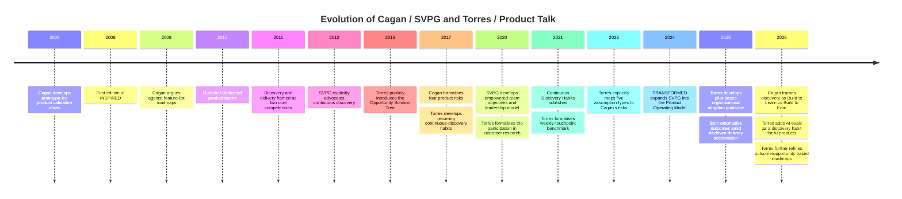
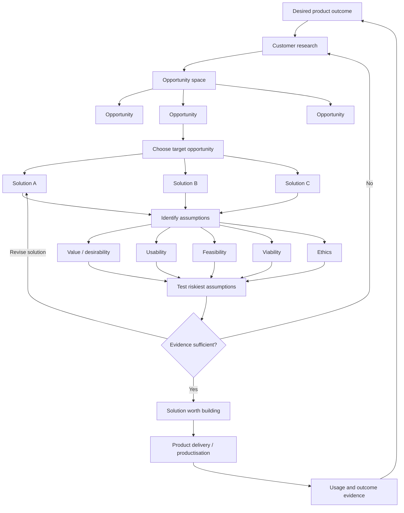

## Executive summary

Teresa Torres and Marty Cagan are often presented as offering competing approaches to modern product management. The evidence supports a different conclusion: **their approaches operate at different levels and are largely compatible**. Cagan and the Silicon Valley Product Group (SVPG) provide the broader organisational model: leaders set product vision, strategy and important problems or outcomes; durable, cross-functional product teams are empowered to discover solutions; and those teams are accountable for business and customer results. Torres provides a more explicit operating method for the discovery work inside such teams: weekly customer contact, product trios, opportunity solution trees (OSTs), multiple solution candidates, identification of assumptions, and small tests designed to reduce uncertainty. SVPG's own 2026 *Build To Learn FAQ* recommends both *INSPIRED* and Torres's *Continuous Discovery Habits* as essential discovery books. Torres, for her part, explicitly says that her assumption taxonomy and Cagan's four product risks are conceptually describing the same underlying issues. ([Cagan 2026](#cagan-2026); [Torres 2023b](#torres-2023b))

The preliminary `research-1-notes.md` reaches essentially the same conclusion, especially in its comparison of Cagan's risk model with Torres's assumption-testing model and its treatment of their recent AI-era work. That conclusion survives broader research. The notes are best understood as a detailed analysis of **one recent extension** of the two systems, the implications of AI, rather than as a complete comparison of their product-management philosophies. This report therefore retains the notes' AI findings while placing them in the longer development of both authors' ideas. ([research-1-notes.md]())

The most important difference is **where each author puts structure and decision authority**. Cagan's model gives leaders substantial responsibility for product strategy and for choosing strategically important problems, then gives empowered teams room to determine solutions. Within the team, the PM is explicitly accountable for **value and business viability**, design for usability, and engineering for feasibility. ([Cagan 2017](#cagan-2017); [Cagan 2020g](#cagan-2020g)) Torres gives the product trio, typically a PM, designer and engineer, joint responsibility for product decisions and for all five types of assumptions: desirability, viability, feasibility, usability and ethics. Her current guidance nevertheless rejects a simplistic interpretation of empowerment in which the trio acts without stakeholders: teams investigate options and trade-offs, show their evidence, and involve relevant leaders and stakeholders in consequential decisions. ([Torres 2021b](#torres-2021b); [Product Talk, Accountability](#producttalk-accountability); [Torres 2025c](#torres-2025c))

On discovery process, **Torres is considerably more prescriptive**. Continuous discovery has a concrete benchmark: weekly customer touchpoints by the team building the product, using small research activities in pursuit of an outcome. ([Product Talk, Continuous Discovery](#producttalk-continuous-discovery)) Cagan has advocated continuous discovery since 2012 and rapid qualitative and quantitative learning since at least 2011, but he deliberately selects discovery techniques according to the risk being addressed; he does not make weekly interviews a defining requirement. ([Cagan 2012](#cagan-2012); [Cagan 2011](#cagan-2011)) Torres therefore gives a team a better starting routine when its discovery practice is weak. Cagan gives stronger guidance on what organisational conditions must surround that routine.

Their views on **roadmaps and prioritisation are closer than they first appear**. Both oppose ranking long feature lists with pseudo-precise scoring formulas and then treating the result as a delivery commitment. Cagan prefers product vision, prioritised business objectives/problems and occasional high-integrity commitments. ([Cagan 2009](#cagan-2009); [Cagan 2015](#cagan-2015)) Torres prioritises opportunities before solutions and now recommends a variant of Now-Next-Later in which the near term can contain known solutions, the next horizon contains customer opportunities, and the later horizon communicates outcomes. ([Torres 2021a](#torres-2021a); [Torres 2026b](#torres-2026b)) Neither author is advocating planning without priorities; both are trying to preserve uncertainty about the solution until evidence justifies commitment.

The evidence base calls for restraint. There are strong case examples consistent with the approaches: Spotify's Discover Weekly story documents autonomous experimentation, explicit consideration of the four risks and measurable adoption; Ramsey Solutions combined SVPG training with Torres's discovery practices and product trios; Product Talk publishes smaller cases showing OSTs and assumption tests in practice. ([Cagan and Sundén 2023](#cagan-sunden-2023); [Suzuno 2024b](#suzuno-2024b); [Suzuno 2023](#suzuno-2023)) Peer-reviewed research independently supports several underlying mechanisms, including cross-functional collaboration, team learning, autonomy under some conditions, continuous experimentation and customer feedback. This is **component-level evidence**. It does not establish that adopting "the Cagan method" or "the Torres method" as a package causes superior company performance. Continuous experimentation research also finds that infrastructure, incentives and problem complexity strongly affect whether experimentation works. ([Fagerholm et al. 2017](#fagerholm-2017); [Ros et al. 2024](#ros-2024))

For an organisation with unspecified size and industry, the strongest default is therefore a **hybrid**: use SVPG's product strategy, durable-team model, outcome accountability and product-risk framing; use Torres's weekly customer-contact habit, OST, assumption decomposition and collaborative testing as the team's discovery mechanics. Treat Cagan's role-specific accountabilities as **primary stewardship**, while requiring the trio to understand and challenge all risks. Use Torres's explicit ethics category alongside Cagan's four risks. Replace feature-roadmap commitments gradually with outcomes, opportunities and high-integrity commitments. For AI products, retain the extension identified in the preliminary notes: cheap prototyping increases the need for disciplined discovery, and AI evaluation becomes an additional continuous evidence loop. This is consistent with Cagan's 2026 distinction between "build to learn" and "build to earn" and Torres's January 2026 description of AI evals as a new discovery habit. ([Torres 2026a](#torres-2026a); [Cagan 2026](#cagan-2026))

Because the company context is unspecified, these recommendations assume a technology-enabled product organisation that can form cross-functional teams and observe customer behaviour. Regulation, hardware lead times, safety-critical work, contractual delivery obligations, enterprise sales models and limited customer access should change the cadence and evidence thresholds. Neither framework should be copied literally where those conditions do not hold. Torres herself identifies customer access as the most common obstacle to continuous discovery, while Cagan explicitly retains high-integrity commitments for situations where a date or deliverable genuinely must be fixed. ([Product Talk, Customer Recruiting](#producttalk-customer-recruiting); [Cagan 2020e](#cagan-2020e))

## Foundations and evolution

Cagan's ideas grew out of technology product management and pre-date the current "product operating model" terminology. He was already describing prototype-based product validation in the mid-2000s and, by 2011, was describing **product discovery and delivery as the two core competencies** of product organisations. His principle was to test ideas as quickly and cheaply as possible, choosing between qualitative user-prototype testing and quantitative live-data experiments according to what needed to be learned. ([Cagan 2011](#cagan-2011)) By 2012 he was explicitly advocating continuous discovery alongside continuous delivery, rejecting a one-off discovery phase. ([Cagan 2012](#cagan-2012))

The first edition of *INSPIRED* appeared in 2008. In the 2017 second edition Cagan made a significant conceptual change: the earlier "valuable, usable and feasible" formulation became four explicit product risks by separating **business viability** from customer value. The resulting risks are value, usability, feasibility and viability. He also made role accountability explicit: PM for value and viability, design for usability, and lead engineering for feasibility. ([Cagan 2024](#cagan-2024); [Cagan 2017](#cagan-2017))

During the following years SVPG increasingly placed team-level discovery inside a larger organisational system. Cagan's older arguments against project funding, temporary feature teams and feature roadmaps evolved into the concept of durable **empowered product teams**. His 2020 material on team objectives and the book *EMPOWERED* emphasised that autonomy requires strategic context and capable product leadership; he even stopped recommending OKRs to most organisations because he saw them being applied to feature teams that lacked the conditions required for meaningful empowerment. ([Cagan 2020h](#cagan-2020h); [Cagan 2020c](#cagan-2020c)) *TRANSFORMED*, published in 2024, moved the framing one level higher again, presenting product strategy, discovery and delivery as dimensions of a "product operating model" and focusing on organisational transformation. ([Cagan et al., TRANSFORMED](#cagan-transformed); [Cagan 2025](#cagan-2025))

Torres's development started later and is more directly rooted in coaching product teams. When she released *Continuous Discovery Habits* in May 2021, she described it as the culmination of eight years of coaching hundreds of product teams. The book formalised a sequence that begins with a desired outcome, uses interviews to discover opportunities, and uses assumption tests to evaluate potential solutions. ([Torres 2021d](#torres-2021d))

Her most distinctive artefact, the **opportunity solution tree**, was publicly introduced in 2016. Torres described it as a way to organise the messy, non-linear decisions involved in discovery and reported that it had become central to her coaching. ([Torres 2016](#torres-2016)) The later canonical formulation has four conceptual levels: desired outcome, opportunity space, solutions and assumption tests. The opportunity nodes represent customer needs, pain points or desires; solutions are kept distinct from those opportunities. ([Torres 2023e](#torres-2023e))

By 2017 Torres was explicitly describing continuous discovery as a set of recurring habits involving the PM, design and engineering perspectives and including customer interviews, prototypes and experiments. ([Torres 2017](#torres-2017)) By 2020-21, the **product trio** and direct trio participation in customer interviews were firmly established. Torres argued that product research is most actionable when the PM, designer and engineer hear customers directly, while still using specialist research produced elsewhere in the organisation. ([Torres 2020](#torres-2020); [Torres 2021e](#torres-2021e)) The 2021 book then supplied the benchmark that became closely associated with her work: weekly customer touchpoints, small research activities and a desired outcome. ([Torres 2024b](#torres-2024b); [Product Talk, Continuous Discovery](#producttalk-continuous-discovery))

The frameworks have continued to converge. In 2023 Torres formalised five types of assumptions: desirability, viability, feasibility, usability and ethical. She explicitly compared them with Cagan's four risks. She says the underlying ideas are essentially the same; her argument for "assumptions" is practical, because a concrete assumption is easier to rank and test than an abstract statement that "viability risk exists". ([Torres 2023b](#torres-2023b); [Torres 2023c](#torres-2023c)) Ethics is the clearest taxonomy difference, although even here the gap is smaller than it sounds: Cagan has discussed ethical issues as part of viability while acknowledging that they can become obscured among commercial, legal and operational concerns. ([Cagan 2020a](#cagan-2020a))

The recent evolution also validates the AI-focused analysis in `research-1-notes.md`. Cagan's 2026 formulation distinguishes **building to learn**, meaning discovery prototypes used to retire product risk, from **building to earn**, where engineers create a dependable production product. SVPG argues that cheaper AI-assisted implementation raises the relative value of discovery and product judgement. ([Cagan 2026](#cagan-2026)) Torres has arrived at a compatible extension from her habits model: in January 2026 she described systematic AI evaluation, which involves inspecting failures, measuring them and improving, as a feedback loop and "new discovery habit" required for AI products. ([Torres 2026a](#torres-2026a)) This should be read as an extension of her framework; weekly human customer evidence, opportunity discovery and assumption testing remain intact. ([Torres 2025f](#torres-2025f); [Torres 2026a](#torres-2026a))

The main milestones can be summarised as follows. The dates and changes below draw on the authors' own archives and retrospective explanations. ([Cagan 2017](#cagan-2017); [Cagan 2011](#cagan-2011); [Torres 2021d](#torres-2021d); [Torres 2016](#torres-2016); [Cagan et al., TRANSFORMED](#cagan-transformed); [Torres 2026a](#torres-2026a))

The historical record also shows that the common shorthand "Cagan = discovery, Torres = continuous discovery" is inaccurate. SVPG used the term **continuous discovery in 2012**, years before Torres published her book. ([Cagan 2012](#cagan-2012)) Torres's contribution is a more specific definition and a repeatable set of habits, especially the weekly cadence and OST; she did not originate the general idea that discovery should happen continuously alongside delivery.

## Frameworks and practices compared

The central comparison is that **SVPG defines the surrounding operating system and risk/accountability model; Torres defines a particularly explicit discovery decision system**. Neither description is absolute. SVPG has many concrete discovery techniques, and Torres increasingly writes about leadership and organisational transformation. The comparison nevertheless explains most practical differences visible in their primary sources. ([Cagan 2011](#cagan-2011); [Torres 2025c](#torres-2025c); [Suzuno 2025](#suzuno-2025))

| Dimension                           | Teresa Torres / Product Talk                                                                                                                                                                                                                                                                         | Marty Cagan / SVPG                                                                                                                                                                                                                                                                    | Analytical assessment                                                                                                               |
| ----------------------------------- | ---------------------------------------------------------------------------------------------------------------------------------------------------------------------------------------------------------------------------------------------------------------------------------------------------- | ------------------------------------------------------------------------------------------------------------------------------------------------------------------------------------------------------------------------------------------------------------------------------------- | ----------------------------------------------------------------------------------------------------------------------------------- |
| **Primary unit of concern**         | A product trio continuously deciding what to build in pursuit of an outcome. ([Product Talk, Continuous Discovery](#producttalk-continuous-discovery); [Torres 2021b](#torres-2021b))                                                                                                                                                | A durable, empowered product team operating within product vision, strategy, objectives, discovery and delivery. ([Cagan 2020g](#cagan-2020g); [Cagan 2016](#cagan-2016))                                                                                                                 | Torres begins closer to everyday discovery work; SVPG begins one organisational level higher.                                       |
| **Discovery process**               | Desired outcome -> customer interviews -> opportunity space -> target opportunity -> multiple solutions -> assumptions -> tests. ([Torres 2023e](#torres-2023e); [Torres 2023c](#torres-2023c))                                                                                                           | Start with a problem/outcome; address value, usability, feasibility and viability risks with the cheapest appropriate evidence; discover a solution worth building. ([Cagan 2017](#cagan-2017); [Cagan 2026](#cagan-2026))                                                                  | Highly compatible. OST can structure a Cagan-style risk-reduction process.                                                          |
| **Continuous cadence**              | Explicit benchmark of weekly customer touchpoints and small research activities; assumption tests are recurring work. ([Product Talk, Continuous Discovery](#producttalk-continuous-discovery); [Torres 2023c](#torres-2023c))                                                                                                          | Discovery is continuous and parallel to delivery, but cadence and method depend on the risk. ([Cagan 2012](#cagan-2012); [Cagan 2011](#cagan-2011))                                                                                                                                | Torres supplies the stronger behavioural habit; Cagan allows more contextual variation.                                             |
| **Decision rights**                 | Trio is the core discovery decision group, but current guidance expects trade-offs and evidence to be shared with relevant stakeholders; empowerment does not imply total unilateral authority. ([Torres 2024a](#torres-2024a); [Torres 2025c](#torres-2025c))                                           | Leaders choose strategic problems/objectives and provide context; empowered teams determine solutions and are accountable for results. ([Cagan 2020b](#cagan-2020b); [Cagan 2020d](#cagan-2020d))                                                                            | Both separate strategic direction from solution discovery. Cagan specifies the leader/team boundary more explicitly.                |
| **Team composition**                | Typically PM + designer + software engineer as the product trio; other specialists still contribute. ([Torres 2021e](#torres-2021e); [Torres 2022](#torres-2022))                                                                                                                              | Durable cross-functional team with PM, product designer and several engineers; additional capabilities depend on the product. ([Cagan 2020g](#cagan-2020g))                                                                                                                              | Torres defines a decision nucleus inside the larger team.                                                                           |
| **Role of the PM**                  | One equal discovery partner bringing business/product expertise; the trio shares accountability across assumption types. ([Product Talk, Accountability](#producttalk-accountability))                                                                                                                                          | PM has a demanding individual-contributor role and primary accountability for customer value and business viability. ([Cagan 2020g](#cagan-2020g); [Cagan 2017](#cagan-2017))                                                                                                                 | This is one of the clearest philosophical differences.                                                                              |
| **Risk / assumptions**              | Desirability, viability, feasibility, usability and ethics, expressed as beliefs that can be tested. ([Torres 2023b](#torres-2023b); [Torres 2023c](#torres-2023c))                                                                                                                                          | Value, usability, feasibility and business viability; risk magnitude determines the discovery work. ([Cagan 2017](#cagan-2017); [Cagan 2020f](#cagan-2020f))                                                                                                                                 | Torres explicitly says the two taxonomies describe the same concepts; her ethics category adds useful visibility.                   |
| **Metrics**                         | A desired outcome anchors discovery; customer/product behaviour should connect to business outcomes. Teams can also monitor discovery cadence. ([Product Talk, Continuous Discovery](#producttalk-continuous-discovery))                                                                                                             | Business/customer outcomes and team objectives define success; delivery of features is insufficient. OKRs are useful only under appropriate organisational conditions. ([Cagan 2020c](#cagan-2020c); [Cagan and Castro 2025](#cagan-castro-2025))                                                      | Both favour outcome metrics. Cagan gives stronger organisational context; Torres makes the metric part of the discovery map.        |
| **Experimentation**                 | Small, frequent assumption tests; interviews, prototypes and experiments chosen to test the riskiest beliefs. ([Torres 2023c](#torres-2023c); [Torres 2018](#torres-2018))                                                                                                                   | Risk-specific prototypes and experiments; qualitative testing explains why, live-data/A-B tests can establish quantitative effects where appropriate. ([Cagan 2011](#cagan-2011))                                                                                                   | Neither equates discovery with A/B testing. Torres is more explicit about decomposing an idea before testing.                       |
| **Experimentation cadence**         | Customer contact weekly; lightweight experiments may occur many times during an opportunity's exploration. The weekly benchmark applies to discovery touchpoints, not a requirement to run an A/B test every week. ([Product Talk, Continuous Discovery](#producttalk-continuous-discovery); [Torres 2018](#torres-2018)) | No universal cadence. "Fast and cheap" relative to the risk; AI-era tools can make very high prototype iteration rates possible, but this is capability rather than a mandatory process. ([Cagan 2011](#cagan-2011); [Cagan 2026](#cagan-2026))                                      | Treating either author as prescribing "one experiment per week" would be incorrect.                                                 |
| **Prioritisation**                  | Prioritise **opportunities before solutions**; choose where to play before comparing implementation ideas. Torres criticises elaborate scoring schemes for turning strategic choices into arithmetic. ([Torres 2021a](#torres-2021a))                                                                | Leaders prioritise business problems/objectives. Cagan has long criticised feature-scoring spreadsheets and old-style roadmaps. ([Cagan 2009](#cagan-2009); [Cagan 2015](#cagan-2015))                                                                                                  | Strong agreement: strategic choice precedes feature ranking.                                                                        |
| **Roadmap philosophy**              | Reject date-based feature certainty; accepts Now-Next-Later. Her 2026 refinement uses solutions in Now, opportunities in Next and outcomes further out. ([Torres 2023a](#torres-2023a); [Torres 2026b](#torres-2026b))                                                                                       | Replace feature roadmaps with vision + prioritised objectives/problems; handle genuine fixed obligations through high-integrity commitments. ([Cagan 2015](#cagan-2015); [Cagan 2020e](#cagan-2020e))                                                                          | Torres offers a stakeholder-facing roadmap compromise. Cagan is more willing to discard the conventional roadmap artefact entirely. |
| **Leadership / strategy alignment** | Leader and trio negotiate or align on the desired outcome; discovery work should be transparent to stakeholders. Recent work increasingly covers leader behaviour during transformation. ([Torres 2021c](#torres-2021c); [Torres 2025c](#torres-2025c))                                                         | Product leaders own vision and strategy, choose important problems and provide context and coaching; teams own discovery and delivery of solutions. ([Cagan 2020b](#cagan-2020b); [Cagan 2016](#cagan-2016))                                                                     | SVPG is substantially deeper on strategy and product leadership.                                                                    |
| **Discovery vs delivery**           | Discovery and delivery coexist; discovery determines what creates value and continues as the team learns. Her framework concentrates more on discovery mechanics than production engineering. ([Product Talk, Continuous Discovery](#producttalk-continuous-discovery))                                                              | Strong conceptual distinction between discovery/build-to-learn and delivery/build-to-earn, while the same product team remains responsible for both. ([Cagan 2026](#cagan-2026))                                                                                                       | SVPG gives the clearer productisation boundary.                                                                                     |
| **Tooling**                         | Method is tool-agnostic, but visual reasoning is central: OSTs, interview snapshots and assumption maps. Product Talk cases use tools such as Miro, Maze, Pendo and research-recruiting systems. ([Suzuno 2021](#suzuno-2021); [Suzuno 2023](#suzuno-2023))                                                     | Also tool-agnostic; prototypes, analytics, telemetry, experimentation systems and increasingly AI-assisted prototypes are important. A prototype can serve as the main specification, with a PRD supplementing aspects it cannot represent. ([Cagan and Sundén 2023](#cagan-sunden-2023); [Cagan 2026](#cagan-2026)) | Neither proposes a particular software stack. Tools should lower the cost of evidence, not become the process.                      |
| **Ethics**                          | Separate ethical-assumption category covering potential harm. ([Torres 2023c](#torres-2023c))                                                                                                                                                                                                           | Historically included in viability; Cagan has acknowledged the risk that ethics gets lost inside the broad viability category. ([Cagan 2020a](#cagan-2020a))                                                                                                                                | Torres's separate category is a useful addition even for an SVPG-oriented team.                                                     |

The opportunity solution tree shows why Torres's work is easy to insert into SVPG's larger model. The team begins with an outcome, builds an evidence-backed opportunity space, selects an opportunity, develops more than one possible solution and identifies the assumptions beneath those solutions. Cagan's risks can then be used as a checklist for whether the assumption set is sufficiently complete. ([Torres 2023e](#torres-2023e); [Torres 2023b](#torres-2023b); [Cagan 2017](#cagan-2017))

There is also a subtle difference in how the two authors try to prevent functional silos. **Cagan does it through collaboration plus clear role accountability.** The PM cannot simply write requirements because value and viability must be resolved with design and engineering before delivery. ([Cagan 2020g](#cagan-2020g); [Cagan 2017](#cagan-2017)) **Torres does it through shared discovery accountability.** She argues that assigning feasibility solely to engineering, usability solely to design and viability solely to PM risks recreating the same functional boundaries inside a nominally cross-functional team. ([Product Talk, Accountability](#producttalk-accountability))

The practical resolution does not require choosing one. A team can make one member the **primary steward** of an area because of expertise while making the whole trio responsible for understanding the evidence. For example, an engineer can lead feasibility evaluation without permitting the PM and designer to ignore the feasibility assumptions. This "primary stewardship plus shared review" formulation is a synthesis also found in the preliminary notes, rather than a phrase formally prescribed by either author. ([research-1-notes.md]())

Metrics similarly expose a difference of level. Cagan's questions are often organisational: *Which business/customer result has leadership asked this team to produce? What key results show success?* His 2020 writing warns that OKRs become cargo-cult process when feature teams are still assigned outputs. ([Cagan 2020c](#cagan-2020c)) Torres asks the team to put a desired product outcome at the top of its discovery tree so that interview learning, opportunity prioritisation and experiments can all be judged against the same target. ([Torres 2023e](#torres-2023e)) These are complementary controls: strategy determines why an outcome matters; the OST makes the team's reasoning about how to move it visible.

## Organisational implications

Adopting Cagan's model requires more organisational change than merely training PMs in discovery. An empowered product team is durable and cross-functional and normally contains a PM, product designer and several engineers. The PM is expected to understand customers, data, the business and relevant industry constraints; Cagan's own PM job description asks for modern discovery/delivery knowledge, ability to work across business functions, hard-problem solving, data-informed reasoning and effective collaboration with designers, engineers and executives. ([Cagan 2020g](#cagan-2020g)) This is a substantially more demanding hiring profile than a backlog-owning or requirements-writing product-owner role.

Consequently, an organisation moving towards SVPG should expect **role remediation**: some existing PMs will need training and coaching in customer, business, analytics and discovery work; some may be better suited to delivery or programme roles; engineering and design leaders must allow their staff to participate meaningfully in product decisions; and executives must stop pre-deciding most solutions if they expect teams to own outcomes. SVPG itself says transformations often fail when organisations underestimate the breadth of change, and Cagan's 2025 "Outcomes Are Hard" acknowledges that many companies struggle to make the apparently simple shift from output to outcome. ([Cagan 2023](#cagan-2023); [Cagan and Castro 2025](#cagan-castro-2025))

Torres's structural change is usually smaller but its effect on calendars can be immediate. The PM, designer and an engineer need protected time for direct discovery, including interviews and assumption testing. The engineer does not have to be the formal tech lead, but Torres warns that a different participating engineer must have sufficient authority and communication with whoever controls architectural decisions; otherwise late feasibility vetoes can waste the trio's discovery work. ([Torres 2024a](#torres-2024a)) This is one of the practical places where "just form a trio" is inadequate as an adoption strategy.

Ramsey Solutions provides a useful real-world example because it deliberately combined the two schools. Product and engineering leadership brought in SVPG training and required product-squad members to read *Continuous Discovery Habits*. Ramsey then introduced product trios but found that engineers associated a permanent "tech lead" role with hierarchy and career implications. Its response included rotating engineers through trio participation rather than treating the discovery seat as a permanent authority position. ([Suzuno 2024b](#suzuno-2024b)) This case is important because it shows that the conceptual compatibility of Cagan and Torres does **not** remove local organisation-design problems.

Torres's own guidance also makes customer access an organisational capability rather than an individual PM chore. Product Talk reports that access to customers is overwhelmingly the most commonly reported obstacle among its students and argues for an automated or systematic recruiting mechanism so the weekly habit does not depend on a PM repeatedly asking sales or customer success for favours. ([Product Talk, Customer Recruiting](#producttalk-customer-recruiting)) In enterprise and sales-led organisations this may require changes to customer agreements, research operations and sales incentives before continuous discovery can become continuous in practice.

Her more recent transformation guidance has moved closer to SVPG's organisational perspective. Torres and Hope Gurion recommend **starting with a small set of pilot teams rather than training an entire organisation simultaneously**. Their guidance suggests roughly one pilot in a very small organisation, a few in a mid-sized organisation and up to around five in a large one, selected for good internal relationships, willingness to learn, adequate cross-functional skills, customer access and a suitable product lifecycle stage. ([Torres 2025b](#torres-2025b); [Suzuno 2025](#suzuno-2025)) They also stress that leaders and stakeholders have to learn outcome-based management alongside the teams; merely training product teams leaves conflicting management behaviours intact. ([Torres 2025c](#torres-2025c))

That creates a direct implication for **leadership hiring and development**. Cagan's system places product strategy, coaching and context-setting at the centre of product leadership. Leaders cannot compensate for weak strategy by giving every team a feature roadmap. ([Cagan 2020b](#cagan-2020b); [Cagan 2016](#cagan-2016)) Torres's system requires leaders who can agree a meaningful outcome, tolerate uncertainty in the solution and assess the quality of a team's discovery evidence. Her transformation work explicitly describes leaders' fear of losing control and desire for certainty as predictable sources of resistance. ([Torres 2025e](#torres-2025e))

Processes should therefore change in linked sets. Replacing feature roadmaps while continuing to measure teams by delivery dates creates contradictory incentives. Giving teams outcomes without customer access creates nominal empowerment. Asking engineers to join discovery while capacity planning assumes 100% coding time makes discovery structurally impossible. Applying OKRs to teams that still receive fixed feature lists adds terminology without changing decision rights. These failure modes follow directly from the organisational conditions both authors describe. ([Cagan 2020c](#cagan-2020c); [Product Talk, Customer Recruiting](#producttalk-customer-recruiting); [Torres 2025d](#torres-2025d))

For roadmaps, the two approaches can coexist neatly. At leadership level, use Cagan's combination of vision, strategy, prioritised outcomes/problems and explicit high-integrity commitments. ([Cagan 2015](#cagan-2015); [Cagan 2020e](#cagan-2020e)) For broader stakeholder communication, Torres's current Now-Next-Later formulation gives a usable artefact: **Now** can communicate solutions already sufficiently understood to be in flight, **Next** can communicate customer opportunities, and **Later** can communicate outcomes without pretending that the future solution has already been selected. ([Torres 2026b](#torres-2026b))

Tool selection should follow the process. Torres's practices benefit from a shared visual workspace for the OST, a searchable interview repository, reliable recruiting, product analytics and inexpensive prototype/test tools. A Product Talk case at 99designs, for example, describes using Miro because the team already had broad access to it, while another case used Maze and Pendo for lightweight assumption tests. ([Suzuno 2021](#suzuno-2021); [Suzuno 2023](#suzuno-2023)) The lesson is not to standardise on those vendors. The tool has to reduce the delay between a product question and credible evidence.

SVPG's infrastructure implications are deeper where quantitative experimentation is central. The Spotify case describes investment in instrumentation, telemetry, monitoring, reporting, A/B infrastructure and a dedicated platform team so empowered teams could run live-data experiments without organisational approval for each release. ([Cagan and Sundén 2023](#cagan-sunden-2023)) This illustrates a point that both authors' high-level advice can hide: **frequent discovery is partly an infrastructure property**. Teams cannot run fast behavioural experiments when it takes weeks to get telemetry, deploy a variant or identify an eligible customer cohort.

## Evidence, strengths and critiques

The strongest industry case in the SVPG corpus is Spotify's Discover Weekly. In Cagan and former Spotify coach Joakim Sundén's reconstruction, leadership chose the strategic problem of improving the "lean-back" music-discovery experience but did not dictate the solution. The cross-functional team evaluated value, usability, feasibility and viability; used internal prototypes first; and then exercised its authority to expose the feature to 1.5% of users, about one million people, without seeking additional launch permission. ([Cagan and Sundén 2023](#cagan-sunden-2023))

The experiment produced both quantitative and qualitative evidence: more than 1,500 survey responses, over 85% rating the feature four or five out of five, and 65% reporting discovery of a new favourite song. Scaling then exposed the remaining feasibility problem: the existing playlist infrastructure could not support simultaneous updates at full scale. After productisation, SVPG reports that one billion tracks were streamed through Discover Weekly in its first ten weeks, 71% of listeners added at least one song to a personal playlist and 60% of users who tried it streamed five or more tracks. ([Cagan and Sundén 2023](#cagan-sunden-2023))

This is a good illustration of Cagan's principles but **weak evidence of causal attribution to Cagan's framework**. Spotify's product culture developed independently, and the article is a retrospective account written specifically to illustrate SVPG's product model. The responsible conclusion is that Spotify shows those principles are operationally plausible at scale and that its discovery process resembles the model; it does not show that following *INSPIRED* produces Spotify-like outcomes. ([Cagan and Sundén 2023](#cagan-sunden-2023))

Amazon Prime is another SVPG reconstruction. Cagan and former Amazon/Google leader Richard Russell describe more than two years of experiments around shipping prices, speed and subscription models before Prime emerged, followed by roughly three months to productise the initial Prime offering once leadership made it a major focus and staffed a dedicated empowered team. ([Cagan and Russell 2024](#cagan-russell-2024)) The case is valuable for one point often missed in shallow summaries of SVPG: **empowerment does not mean strategy emerges independently inside every team**. Amazon leadership concentrated resources on convenience and shipping and used evidence from experiments to alter the strategy itself. ([Cagan and Russell 2024](#cagan-russell-2024)) Again, the article is an interpretive case rather than controlled evidence for SVPG.

The Product Talk evidence is generally smaller and closer to team practice. A Lingoda case describes a trio using customer interviews, an OST and lightweight prototypes to examine an opportunity around learner confidence. In one test, 90% of respondents said they would be more willing to join a group class when the teacher spoke Portuguese. ([Suzuno 2023](#suzuno-2023)) That is useful evidence that Torres's procedure can turn an opportunity into a fast, specific test. It is **not equivalent to evidence that the feature ultimately changed class attendance**, because stated willingness in a prototype test is an intermediate signal rather than a behavioural outcome.

Product Talk's 2018 case study of an established continuous-discovery team gives a better picture of actual cadence. The team reported customer contact approximately weekly, lightweight manual experiments from several times per month to several times per week, and code-dependent tests only a few times per quarter. ([Torres 2018](#torres-2018)) This helps correct a common caricature: Torres's weekly cadence is an evidence habit; it does not imply that every team must continuously run statistically powered production experiments.

The Ramsey Solutions case supplies evidence about **hybrid adoption**. It documents leadership introducing both SVPG ideas and Torres's practices, while also documenting friction around engineer participation in the trio. ([Suzuno 2024b](#suzuno-2024b)) This is more useful for transformation planning than a polished success story because it exposes the organisational adjustment needed to make the practices fit existing careers and authority structures.

Academic work provides stronger but more indirect support. Research on cross-functional new-product teams has found associations between factors such as a shared higher-level identity, customer influence, risk encouragement and new-product innovativeness; importantly, simply having functional diversity was not itself enough. ([Sethi et al. 2001](#sethi-2001)) Another study of new-product projects found that the effectiveness of autonomous versus more heavyweight team structures depends on the degree of technology novelty: autonomous teams performed better under high novelty/radical innovation, while other structures could work better for incremental work. ([Patanakul et al. 2012](#patanakul-2012)) This is an important qualification to universal claims about empowerment: context changes the optimal degree and form of autonomy.

The experimentation literature supports the emphasis both authors place on rapid learning while also exposing its prerequisites. The peer-reviewed RIGHT model links business goals to continuous customer experimentation but concludes that effective experimentation requires instrumentation, experiment management, flexible strategy and integration of results into development work. ([Fagerholm et al. 2017](#fagerholm-2017)) A 2024 multi-case study covering 12 companies and 27 practitioner interviews found that experimentation effectiveness depends on three broad factors: process/infrastructure, the complexity of the user problem, and incentive structures. Complex user problems can limit the applicability of quantitative experimentation. ([Ros et al. 2024](#ros-2024))

That evidence leads to a balanced assessment:

| Approach | Main strengths | Main weaknesses and common implementation critiques |
|---|---|---|
| **Torres** | Gives inexperienced teams an executable discovery routine; makes reasoning visible; encourages direct customer exposure; separates customer opportunities from solution ideas; encourages multiple solutions and explicit falsifiable assumptions; shared trio participation reduces hand-offs. ([Product Talk, Continuous Discovery](#producttalk-continuous-discovery); [Torres 2023d](#torres-2023d); [Torres 2021f](#torres-2021f)) | Weekly customer access can be structurally difficult; an OST can become an artefact-maintenance exercise when teams populate it from internal guesses instead of customer evidence; shared accountability can blur who must personally acquire deep business or technical expertise; the framework needs sufficiently good strategy/outcomes upstream. Product Talk's own cases document customer-access problems, overload during adoption and OSTs built from internal assumptions that produced no results. ([Product Talk, Customer Recruiting](#producttalk-customer-recruiting); [Suzuno 2024a](#suzuno-2024a)) |
| **Cagan / SVPG** | Strong connection from company strategy to team outcomes; clear expectations for leaders and PM competency; explicit product risks and role expertise; durable team design; distinguishes learning prototypes from dependable products; handles business viability and stakeholder constraints directly. ([Cagan 2020g](#cagan-2020g); [Cagan 2017](#cagan-2017); [Cagan 2026](#cagan-2026)) | Requires major changes in leadership behaviour, PM capability, planning and governance; "empowered team" language can be copied while decision rights remain unchanged; outcome-setting itself is hard; the model is demanding for organisations built around projects, contracts or centralised approvals. SVPG openly documents failed transformations and says many companies struggle to make the shift to outcomes. ([Cagan and Castro 2025](#cagan-castro-2025); [Cagan 2023](#cagan-2023)) |

A further weakness applies to **both**: techniques can become substitutes for judgement. An OST filled with dozens of nodes is not evidence. A prototype is not a validated product. An A/B result can answer the wrong question. An OKR can give a feature factory new vocabulary. Cagan explicitly warns that no framework removes the need to judge the actual risk profile of a product. ([Cagan 2020f](#cagan-2020f)) Torres likewise warns against treating internal assumptions as customer opportunities and against assuming there is one rigidly correct discovery process. ([Torres 2021a](#torres-2021a); [Suzuno 2024a](#suzuno-2024a))

Both approaches also face a **local-optimisation risk**. A team can improve its assigned product metric while harming a wider system, customer segment or long-term business objective. Cagan mitigates this through strategy, leadership and viability constraints; Torres mitigates it through the hierarchy from business outcome to product outcome and, increasingly, explicit ethical assumptions and stakeholder participation. ([Cagan 2020a](#cagan-2020a); [Torres 2023c](#torres-2023c); [Torres 2025c](#torres-2025c)) Neither mechanism eliminates the need for organisation-wide metrics and portfolio judgement.

The AI-era findings in the preliminary notes provide a useful stress test. Cheap code and prototype generation can increase the number of candidate solutions without increasing the quality of the decisions selecting among them. Cagan's 2026 argument is consequently to preserve a strong distinction between prototypes created to **learn** and production systems created to **earn**. ([Cagan 2026](#cagan-2026)) Torres's corresponding extension adds systematic model evaluation as a discovery feedback loop while still insisting that AI-generated synthesis cannot replace rich evidence from actual customer conversations. ([Torres 2026a](#torres-2026a)) The preliminary notes' conclusion that AI increases the value of disciplined discovery is therefore well supported; what should not be generalised from it is a specific AI-era prototype rate as a universal discovery target. ([research-1-notes.md]())

Overall, the evidence supports the **mechanisms** more strongly than the branded frameworks. Customer influence, cross-functional learning, rapid feedback, autonomy under appropriate conditions and systematic experimentation all have empirical support. ([Sethi et al. 2001](#sethi-2001); [Patanakul et al. 2012](#patanakul-2012); [Fagerholm et al. 2017](#fagerholm-2017); [Ros et al. 2024](#ros-2024)) The available cases demonstrate feasibility and provide implementation detail. They do not warrant claims that one author's system has been scientifically shown to outperform the other.

## Recommended hybrid and migration

For an organisation starting without a mature product model, a useful approach **combines SVPG for organisational responsibilities with Torres for the default team-level discovery workflow**. This retains the strongest element of each approach without forcing artificial agreement where their emphasis differs. The recommendation is consistent with SVPG's 2026 recommendation of *Continuous Discovery Habits* alongside *INSPIRED* and with Torres's own statement that her assumptions and Cagan's product risks overlap conceptually. ([Cagan 2026](#cagan-2026); [Torres 2023b](#torres-2023b))

The target operating pattern should be:

**Leadership** establishes product vision, strategy, a small number of important problems and measurable outcomes. Teams receive context and constraints, including real contractual or regulatory commitments. ([Cagan 2020b](#cagan-2020b); [Cagan 2016](#cagan-2016); [Cagan 2020e](#cagan-2020e))

**Durable cross-functional teams** own outcomes rather than temporary projects. Inside each team, a PM, designer and engineer form a discovery trio, while the whole engineering group and relevant specialists remain participants in the product work. ([Cagan 2020g](#cagan-2020g); [Torres 2021e](#torres-2021e))

**The trio** maintains an OST for its active outcome: direct customer research feeds the opportunity space; the team selects an opportunity; generates several plausible solutions; writes down the assumptions behind those solutions; and tests the assumptions with the highest combination of uncertainty and consequence. ([Torres 2023e](#torres-2023e); [Torres 2023c](#torres-2023c))

**Risk stewardship** uses Cagan's accountabilities without creating hand-offs: the PM leads investigation of value and viability, design brings depth on usability, and engineering leads feasibility, while all three review all evidence and Torres's ethical assumptions. This preserves specialist depth and collective product ownership. ([Cagan 2017](#cagan-2017); [Product Talk, Accountability](#producttalk-accountability))

**Evidence cadence** uses Torres's weekly customer contact as the default target where customer availability allows it, while allowing each actual uncertainty to select its evidence source. A legal constraint may require counsel, a capacity assumption a technical spike, a pricing assumption a commercial test and a behavioural causal question an A/B experiment. Cagan's risk-dependent approach provides that safeguard against treating "talk to a customer" as the answer to every question. ([Product Talk, Continuous Discovery](#producttalk-continuous-discovery); [Cagan 2011](#cagan-2011))

**Planning** communicates outcomes and opportunities while maintaining explicit high-integrity commitments where contracts or external events require them. A Now-Next-Later roadmap can expose this honestly: current validated/in-flight solutions in Now, likely opportunity areas in Next, and strategic outcomes further out. ([Cagan 2020e](#cagan-2020e); [Torres 2026b](#torres-2026b))

A migration can then proceed in controlled stages:

| Migration stage | Organisational change | Team practice | Evidence that the stage is working |
|---|---|---|---|
| **Establish the baseline** | Inventory existing teams, feature commitments, approval gates, customer-access restrictions and metrics. Identify where leaders still prescribe both problem and solution. | Measure time between customer contact, assumption tests and production feedback. | Organisation can describe its current decision rights and discovery latency without relying on job-title assumptions. |
| **Choose pilot teams** | Select a small number of existing cross-functional teams with supportive leaders, customer access and enough freedom from near-term fixed commitments. Torres's own transformation guidance recommends pilots rather than organisation-wide training. ([Torres 2025b](#torres-2025b); [Torres 2025a](#torres-2025a)) | Give each pilot one meaningful outcome/problem. | Pilot members and their leaders agree on the outcome and what decisions the team can make. |
| **Build the discovery habit** | Protect PM, design and engineering time and remove recurring approval/recruiting bottlenecks. | Weekly customer touchpoint; one shared OST; one target opportunity; multiple solution candidates; explicit assumption map. ([Product Talk, Continuous Discovery](#producttalk-continuous-discovery); [Torres 2023e](#torres-2023e)) | Recent decisions can be traced to direct evidence; OST opportunities come from customers rather than internal feature ideas. |
| **Add product-risk discipline** | Clarify business, legal, security, technical and go-to-market stakeholders. | Tag assumptions against value/desirability, usability, feasibility, viability and ethics; focus tests on the riskiest beliefs. ([Cagan 2017](#cagan-2017); [Torres 2023b](#torres-2023b)) | Fewer late feasibility/viability vetoes; teams can explain why an idea was rejected before full delivery. |
| **Change management reporting** | Replace "percentage of roadmap delivered" as the main success signal with progress against outcomes and quality of learning. | Hold short discovery reviews/demos showing opportunity changes, rejected assumptions and outcome movement. Torres's current accountability guidance uses recurring discovery demonstrations and outcome reviews. ([Product Talk, Accountability](#producttalk-accountability)) | Teams can report failed tests without being punished for missing a pre-selected solution. |
| **Change roadmaps and commitments** | Move uncertain future features out of contractual-looking plans; retain genuine high-integrity commitments explicitly. | Use outcome/opportunity-oriented Now-Next-Later where stakeholders need a roadmap. ([Cagan 2020e](#cagan-2020e); [Torres 2026b](#torres-2026b)) | Stakeholders distinguish committed delivery from areas still under discovery. |
| **Invest in evidence infrastructure** | Add customer recruiting, analytics, telemetry, experimentation, prototyping and research storage where their absence creates long delays. | Choose the cheapest credible method for each risk. | Time from question to usable evidence falls without evidence quality falling. Experimentation research identifies infrastructure/process as a central adoption factor. ([Ros et al. 2024](#ros-2024)) |
| **Scale after learning** | Expand practices only after pilots expose local obstacles; coach managers and stakeholders as well as ICs. | Preserve common principles while allowing teams to adapt the exact methods to product risk and context. ([Torres 2025c](#torres-2025c); [Torres 2025d](#torres-2025d)) | New teams adopt from demonstrated internal practice, not solely from central training material. |

For an organisation **already following Cagan/SVPG**, the migration is smaller. Keep durable empowered teams, product strategy, outcome accountability and the four-risk model. Add Torres's weekly customer-contact benchmark, OST, explicit assumption decomposition and separate ethics category. Use the OST to expose the reasoning between a problem supplied by leadership and the team's chosen solution. This addresses a weakness of loose implementations of SVPG where "do discovery" is understood conceptually but teams lack a repeatable habit. ([Product Talk, Continuous Discovery](#producttalk-continuous-discovery); [Torres 2023e](#torres-2023e); [Torres 2023c](#torres-2023c))

For an organisation **already following Torres**, retain the habits but strengthen the system around them. Ensure leadership has an actual product strategy, that outcomes represent strategically chosen business/customer problems, that PM hiring and coaching develop business and viability capability, and that production engineering is explicitly separated from discovery prototyping. This prevents the OST becoming a locally optimised research process disconnected from company strategy or production reality. ([Cagan 2020b](#cagan-2020b); [Cagan 2020g](#cagan-2020g); [Cagan 2026](#cagan-2026))

For **regulated, safety-critical or hardware organisations**, preserve the logic while changing cadence and evidence thresholds. Weekly customer contact can remain useful even when production experiments or releases are slow. Feasibility and viability discovery should include regulatory, safety, manufacturing and compliance experts early. Fixed dates that genuinely arise from regulation, contracts or physical supply chains should be managed as explicit commitments rather than used to justify fixing every future feature. Cagan's high-integrity commitment concept is designed for exactly the class of obligation where a deadline genuinely exists. ([Cagan 2020e](#cagan-2020e))

For **AI products**, carry forward the useful extension from the preliminary research: add a continuous model-evaluation loop alongside customer discovery. Inspect failures, maintain representative evaluation cases, classify errors and monitor performance after launch; then feed those findings back into the same opportunity and assumption system. Torres explicitly calls evals the missing/new discovery habit for AI products. ([Torres 2026a](#torres-2026a)) Keep Cagan's build-to-learn/build-to-earn boundary so an AI prototype that establishes value is not mistaken for evidence of production reliability, security, scalability or economics. ([Cagan 2026](#cagan-2026))

The adoption principle that follows from both authors is straightforward: **change decision rights, evidence flow and incentives together**. Training people to interview customers while leadership still commits their feature roadmap is cosmetic. Giving teams autonomy while providing no strategy is abandonment. Replacing roadmaps with outcomes while rewarding output volume changes the vocabulary without changing behaviour. The useful hybrid gives leadership clear strategic responsibilities, gives teams meaningful solution authority, and makes evidence gathering a normal part of weekly product work. ([Cagan 2020c](#cagan-2020c); [Torres 2025c](#torres-2025c); [Cagan and Castro 2025](#cagan-castro-2025))

## Primary and supporting source catalogue

The following are the main URLs used for this comparison. Primary author sources were preferred; the empirical literature and cases are included to test the authors' claims rather than simply restate them.

| Source | URL |
|---|---|
| Marty Cagan, **Continuous Discovery** | [Continuous Discovery](https://www.svpg.com/continuous-discovery/) |
| Marty Cagan, **The Two Core Competencies** | [The Two Core Competencies](https://www.svpg.com/the-two-core-competencies/) |
| Marty Cagan, **The Four Big Risks** | [The Four Big Risks](https://www.svpg.com/four-big-risks/) |
| Marty Cagan, **Product Manager Job Description** | [Product Manager Job Description](https://www.svpg.com/product-manager-job-description/) |
| Marty Cagan, **Product Roadmaps** | [Product Roadmaps](https://www.svpg.com/product-roadmaps/) |
| Marty Cagan, **The Alternative to Roadmaps** | [The Alternative to Roadmaps](https://www.svpg.com/the-alternative-to-roadmaps/) |
| Marty Cagan, **The Opportunity Backlog** | [The Opportunity Backlog](https://www.svpg.com/the-opportunity-backlog/) |
| Marty Cagan, **Team Objectives - Overview** | [Team Objectives: Overview](https://www.svpg.com/team-objectives-overview/) |
| Marty Cagan, **Team Objectives - Commitments** | [Team Objectives: Commitments](https://www.svpg.com/team-objectives-commitments/) |
| Marty Cagan, **Product Strategy - Management** | [Product Strategy: Management](https://www.svpg.com/product-strategy-management/) |
| Marty Cagan, **Vision vs. Strategy** | [Vision vs. Strategy](https://www.svpg.com/vision-vs-strategy/) |
| Marty Cagan, **Outcomes Are Hard** | [Outcomes Are Hard](https://www.svpg.com/outcomes-are-hard/) |
| Marty Cagan, **Build to Learn FAQ** | [Build To Learn FAQ](https://www.svpg.com/build-to-learn-faq/) |
| SVPG, **TRANSFORMED** | [TRANSFORMED: Moving to the Product Operating Model](https://www.svpg.com/books/transformed-moving-to-the-product-operating-model/) |
| Cagan & Sundén, **The Product Model at Spotify** | [The Product Model at Spotify](https://www.svpg.com/product-model-at-spotify/) |
| Cagan & Russell, **The Product Model at Amazon** | [The Product Model at Amazon](https://www.svpg.com/product-model-at-amazon/) |
| Teresa Torres, **Continuous Discovery -- Definition and Overview** | [Continuous Discovery: Definition and Overview](https://www.producttalk.org/glossary-discovery-continuous-discovery/) |
| Teresa Torres, **Continuous Discovery Habits** | [Continuous Discovery Habits (the Book) is Finally Here!](https://www.producttalk.org/continuous-discovery-habits/) |
| Teresa Torres, **Opportunity Solution Trees** | [Opportunity Solution Trees: Visualize Your Discovery to Stay Aligned and Drive Outcomes](https://www.producttalk.org/2016/08/opportunity-solution-tree/) |
| Teresa Torres, **Original OST article** | [Why This Opportunity Solution Tree is Changing the Way Product Teams Work](https://www.producttalk.org/opportunity-solution-tree-origin/) |
| Teresa Torres, **Five Types of Assumptions** | [Evaluating Solutions: The 5 Types of Assumptions that Underlie Our Ideas](https://www.producttalk.org/five-types-of-assumptions/) |
| Teresa Torres, **Assumption Testing** | [Assumption Testing: Everything You Need to Know to Get Started](https://www.producttalk.org/assumption-testing/) |
| Teresa Torres, **Roles in a Product Trio** | [Core Concept: What Roles are Represented in a Product Trio?](https://www.producttalk.org/roles-in-a-product-trio/) |
| Teresa Torres, **Engineer in the Product Trio** | [Ask Teresa: Does the Engineer in the Product Trio Need to be the Tech Lead?](https://www.producttalk.org/engineer-lead-product-trio/) |
| Teresa Torres, **Customer Recruiting for Continuous Discovery** | [Customer Recruiting Course: How to Recruit Customers and Users for Interviews, Week After Week](https://www.producttalk.org/2024/10/customer-recruiting/) |
| Teresa Torres, **Roadmaps with Timelines** | [Ask Teresa: My Leaders Still Want Roadmaps with Timelines -- What Should I Do?](https://www.producttalk.org/roadmaps-with-timelines/) |
| Teresa Torres, **Product Roadmaps: Planning for Uncertainty** | [Product Roadmaps: How the Best Product Teams Plan for Uncertainty](https://www.producttalk.org/product-roadmaps/) |
| Torres & Gurion, **Choosing Product Operating Model Pilot Teams** | [How to Choose the Right Pilot Teams for a Product Operating Model Transformation](https://www.producttalk.org/choosing-pilot-teams-product-operating-model/) |
| Torres & Gurion, **Preparing Leaders and Stakeholders** | [Preparing Leaders and Stakeholders to Support Product Operating Model Pilot Teams](https://www.producttalk.org/preparing-leaders-and-stakeholders/) |
| Product Talk, **Ramsey Solutions Product Trio Case** | [Product in Practice: Why Ramsey Solutions Rotates Engineers in Their Product Trios](https://www.producttalk.org/rotate-engineers-product-trio/) |
| Product Talk, **Continuous Discovery Team Case Study** | [What a Good Continuous Discovery Team Looks Like (Case Study)](https://www.producttalk.org/2018/03/continuous-discovery-case-study/) |
| Product Talk, **Lingoda Continuous Discovery Case** | [Product in Practice: One Product Manager's Quest to Adopt Continuous Discovery at Her Company](https://www.producttalk.org/one-product-managers-quest-to-adopt-cdh/) |
| Teresa Torres, **AI Changes Everything (And Nothing At All)** | [AI Changes Everything (And Nothing At All)](https://www.producttalk.org/ai-changes-everything-and-nothing-at-all/) |
| Teresa Torres, **The Call to Adventure** | [The Call to Adventure](https://www.producttalk.org/the-call-to-adventure/) |
| Ros, Bjarnason & Runeson, **Factors Affecting Continuous Experimentation**, *Empirical Software Engineering* | [doi:10.1007/s10664-023-10358-z](https://doi.org/10.1007/s10664-023-10358-z) |
| Fagerholm et al., **The RIGHT Model for Continuous Experimentation**, *Journal of Systems and Software* | [doi:10.1016/j.jss.2016.03.034](https://doi.org/10.1016/j.jss.2016.03.034) |

Taken as a whole, these sources support a clear choice of emphasis rather than a choice of ideology: **Cagan/SVPG is the stronger foundation for product organisation, strategy, leadership, PM accountability and the discovery-to-production boundary; Torres is the stronger operational system for making continuous team discovery concrete, visible and habitual.** Their disagreements about accountability and vocabulary are meaningful, but smaller than the gap between either approach and a conventional feature factory. The most defensible operating model combines their strengths and adapts the cadence to the product's actual uncertainty, evidence access and consequences. ([Cagan 2026](#cagan-2026); [Torres 2023b](#torres-2023b); [Cagan 2020f](#cagan-2020f))

<!-- Citation references converted from the Deep Research source markers. -->

## Further reading

- [Wohlin and Rainer 2022](/sources/259b57ac164515376430c68ba4848f6b.bin), *Is it a case study? A critical analysis and guidance*

## References

- Cagan, M. (2009). [Product Roadmaps](https://www.svpg.com/product-roadmaps/). Silicon Valley Product Group. ^cagan-2009
- Cagan, M. (2011). [The Two Core Competencies](https://www.svpg.com/the-two-core-competencies/). Silicon Valley Product Group. ^cagan-2011
- Cagan, M. (2012). [Continuous Discovery](https://www.svpg.com/continuous-discovery/). Silicon Valley Product Group. ^cagan-2012
- Cagan, M. (2015). [The Alternative to Roadmaps](https://www.svpg.com/the-alternative-to-roadmaps/). Silicon Valley Product Group. ^cagan-2015
- Cagan, M. (2016). [Vision vs. Strategy](https://www.svpg.com/vision-vs-strategy/). Silicon Valley Product Group. ^cagan-2016
- Cagan, M. (2017). [The Four Big Risks](https://www.svpg.com/four-big-risks/). Silicon Valley Product Group. ^cagan-2017
- Cagan, M. (2020a). [Coaching - Ethics](https://www.svpg.com/coaching-ethics/). Silicon Valley Product Group. ^cagan-2020a
- Cagan, M. (2020b). [Product Strategy - Management](https://www.svpg.com/product-strategy-management/). Silicon Valley Product Group. ^cagan-2020b
- Cagan, M. (2020c). [Team Objectives - Overview](https://www.svpg.com/team-objectives-overview/). Silicon Valley Product Group. ^cagan-2020c
- Cagan, M. (2020d). [Team Objectives - Ambition](https://www.svpg.com/team-objectives-ambition/). Silicon Valley Product Group. ^cagan-2020d
- Cagan, M. (2020e). [Team Objectives - Commitments](https://www.svpg.com/team-objectives-commitments/). Silicon Valley Product Group. ^cagan-2020e
- Cagan, M. (2020f). [Discovery - Judgement](https://www.svpg.com/discovery-judgement/). Silicon Valley Product Group. ^cagan-2020f
- Cagan, M. (2020g). [Product Manager Job Description](https://www.svpg.com/product-manager-job-description/). Silicon Valley Product Group. ^cagan-2020g
- Cagan, M. (2020h). [Inspired and Empowered](https://www.svpg.com/inspired-and-empowered/). Silicon Valley Product Group. ^cagan-2020h
- Cagan, M. (2023). [Transformation Fail](https://www.svpg.com/transformation-fail/). Silicon Valley Product Group. ^cagan-2023
- Cagan, M. (2024). [Book Discussion Guide](https://www.svpg.com/book-discussion-guide/). Silicon Valley Product Group. ^cagan-2024
- Cagan, M. (2025). [INSPIRED in the Generative AI Era](https://www.svpg.com/inspired-in-the-generative-ai-era/). Silicon Valley Product Group. ^cagan-2025
- Cagan, M. (2026). [Build To Learn FAQ](https://www.svpg.com/build-to-learn-faq/). Silicon Valley Product Group. ^cagan-2026
- Cagan, M., & Castro, F. (2025). [Outcomes Are Hard](https://www.svpg.com/outcomes-are-hard/). Silicon Valley Product Group. ^cagan-castro-2025
- Cagan, M., & Russell, R. (2024). [The Product Model at Amazon](https://www.svpg.com/product-model-at-amazon/). Silicon Valley Product Group. ^cagan-russell-2024
- Cagan, M., & Sundén, J. (2023). [The Product Model at Spotify](https://www.svpg.com/product-model-at-spotify/). Silicon Valley Product Group. ^cagan-sunden-2023
- Cagan, M., Hickman, L., Idiodi, C., Jones, C., & Moore, J. [TRANSFORMED: Moving to the Product Operating Model](https://www.svpg.com/books/transformed-moving-to-the-product-operating-model/). Silicon Valley Product Group. ^cagan-transformed
- Fagerholm, F., et al. (2017). [The RIGHT model for Continuous Experimentation](https://doi.org/10.1016/j.jss.2016.03.034). *Journal of Systems and Software*. doi:10.1016/j.jss.2016.03.034. ^fagerholm-2017
- Patanakul, P., Chen, J., & Lynn, G. S. (2012). [Autonomous Teams and New Product Development](https://onlinelibrary.wiley.com/doi/abs/10.1111/j.1540-5885.2012.00934.x). *Journal of Product Innovation Management*. doi:10.1111/j.1540-5885.2012.00934.x. ^patanakul-2012
- Product Talk. [Customer Recruiting for Continuous Discovery](https://www.producttalk.org/2024/10/customer-recruiting/). ^producttalk-customer-recruiting
- Product Talk. [Accountability](https://www.producttalk.org/glossary-discovery-accountability/). ^producttalk-accountability
- Product Talk. [Continuous Discovery](https://www.producttalk.org/glossary-discovery-continuous-discovery/). ^producttalk-continuous-discovery
- Ros, R., Bjarnason, E., & Runeson, P. (2024). [A theory of factors affecting continuous experimentation (FACE)](https://doi.org/10.1007/s10664-023-10358-z). *Empirical Software Engineering*. doi:10.1007/s10664-023-10358-z. ^ros-2024
- Sethi, R., Smith, D. C., & Park, C. W. (2001). [Cross-Functional Product Development Teams, Creativity, and the Innovativeness of New Consumer Products](https://journals.sagepub.com/doi/10.1509/jmkr.38.1.73.18833). *Journal of Marketing Research*. doi:10.1509/jmkr.38.1.73.18833. ^sethi-2001
- Suzuno, M. (2021). [Tools of the Trade: A Look at the Discovery Tech Stack at 99designs](https://www.producttalk.org/tools-99-designs/). Product Talk. ^suzuno-2021
- Suzuno, M. (2023). [Product in Practice: One Product Manager's Quest to Adopt Continuous Discovery at Her Company](https://www.producttalk.org/one-product-managers-quest-to-adopt-cdh/). Product Talk. ^suzuno-2023
- Suzuno, M. (2024a). [Ask the Community: What's a Mistake You Made Early in Your Continuous Discovery Journey?](https://www.producttalk.org/common-discovery-mistakes/). Product Talk. ^suzuno-2024a
- Suzuno, M. (2024b). [Product in Practice: Why Ramsey Solutions Rotates Engineers in Their Product Trios](https://www.producttalk.org/rotate-engineers-product-trio/). Product Talk. ^suzuno-2024b
- Suzuno, M. (2025). [The Product Operating Model Explained: From Pilot Teams to Full Transformation](https://www.producttalk.org/the-product-operating-model/). Product Talk. ^suzuno-2025
- Torres, T. (2016). [Why This Opportunity Solution Tree is Changing the Way Product Teams Work](https://www.producttalk.org/opportunity-solution-tree-origin/). Product Talk. ^torres-2016
- Torres, T. (2017). [This Keystone Habit Will Fuel the Rest of Your Continuous Discovery Habits](https://www.producttalk.org/keystone-habit/). Product Talk. ^torres-2017
- Torres, T. (2018). [What a Good Continuous Discovery Team Looks Like [Case Study]](https://www.producttalk.org/2018/03/continuous-discovery-case-study/). Product Talk. ^torres-2018
- Torres, T. (2020). [Why Product Trios Should Interview Customers Together](https://www.producttalk.org/interview-customers-together/). Product Talk. ^torres-2020
- Torres, T. (2021a). [Why There's No Single "Right" Way to Do Discovery: Part 2](https://www.producttalk.org/no-single-right-way-2/). Product Talk. ^torres-2021a
- Torres, T. (2021b). [Why There's No Single "Right" Way to Do Discovery: Part 3](https://www.producttalk.org/no-single-right-way-3/). Product Talk. ^torres-2021b
- Torres, T. (2021c). [Rethinking Product Discovery with Justice, Equity, Diversity, and Inclusion in Mind](https://www.producttalk.org/design-justice/). Product Talk. ^torres-2021c
- Torres, T. (2021d). [Continuous Discovery Habits (the Book) is Finally Here!](https://www.producttalk.org/continuous-discovery-habits/). Product Talk. ^torres-2021d
- Torres, T. (2021e). [Core Concept: What Roles are Represented in a Product Trio?](https://www.producttalk.org/roles-in-a-product-trio/). Product Talk. ^torres-2021e
- Torres, T. (2021f). [Discovery Hand-Offs Kill Momentum: Here's What to Do Instead](https://www.producttalk.org/2021/11/discovery-handoffs/). Product Talk. ^torres-2021f
- Torres, T. (2022). [Ask Teresa: My Sales Team Won't Let Me Talk To Customers. What Now?](https://www.producttalk.org/sales-owns-customer-relationships/). Product Talk. ^torres-2022
- Torres, T. (2023a). [Ask Teresa: My Leaders Still Want Roadmaps with Timelines -- What Should I Do?](https://www.producttalk.org/roadmaps-with-timelines/). Product Talk. ^torres-2023a
- Torres, T. (2023b). [Evaluating Solutions: The 5 Types of Assumptions that Underlie Our Ideas](https://www.producttalk.org/five-types-of-assumptions/). Product Talk. ^torres-2023b
- Torres, T. (2023c). [Assumption Testing: Everything You Need to Know to Get Started](https://www.producttalk.org/assumption-testing/). Product Talk. ^torres-2023c
- Torres, T. (2023d). [The Power of Opportunity Solution Trees: 7 Key Benefits Revealed](https://www.producttalk.org/2023/11/benefits-of-opportunity-solution-trees/). Product Talk. ^torres-2023d
- Torres, T. (2023e). [Opportunity Solution Trees: Visualize Your Discovery to Stay Aligned and Drive Outcomes](https://www.producttalk.org/2016/08/opportunity-solution-tree/). Product Talk. ^torres-2023e
- Torres, T. (2024a). [Ask Teresa: Does the Engineer in the Product Trio Need to be the Tech Lead?](https://www.producttalk.org/engineer-lead-product-trio/). Product Talk. ^torres-2024a
- Torres, T. (2024b). [Y Oslo 2024: When It Comes to Discovery, Something is Better Than Nothing](https://www.producttalk.org/y-oslo-2024/). Product Talk. ^torres-2024b
- Torres, T. (2025a). [Avoid This Common Organizational Transformation Mistake (And What to Do Instead)](https://www.producttalk.org/2025/03/pilot-teams/). Product Talk. ^torres-2025a
- Torres, T. (2025b). [How to Choose the Right Pilot Teams for a Product Operating Model Transformation](https://www.producttalk.org/choosing-pilot-teams-product-operating-model/). Product Talk. ^torres-2025b
- Torres, T. (2025c). [Preparing Leaders and Stakeholders to Support Product Operating Model Pilot Teams](https://www.producttalk.org/preparing-leaders-and-stakeholders/). Product Talk. ^torres-2025c
- Torres, T. (2025d). [Managing Pushback: Handling Pilot Team Resistance During Product Operating Model Rollout](https://www.producttalk.org/pilot-team-resistance/). Product Talk. ^torres-2025d
- Torres, T. (2025e). [Expecting Resistance: Handling Stakeholder & Leader Concerns During Product Operating Model Pilot](https://www.producttalk.org/expect-stakeholder-resistance/). Product Talk. ^torres-2025e
- Torres, T. (2025f). [AI Changes Everything (And Nothing At All)](https://www.producttalk.org/ai-changes-everything-and-nothing-at-all/). Product Talk. ^torres-2025f
- Torres, T. (2026a). [The Call to Adventure](https://www.producttalk.org/the-call-to-adventure/). Product Talk. ^torres-2026a
- Torres, T. (2026b). [Product Roadmaps: How the Best Product Teams Plan for Uncertainty](https://www.producttalk.org/product-roadmaps/). Product Talk. ^torres-2026b
