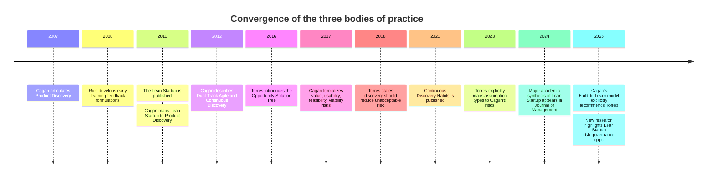
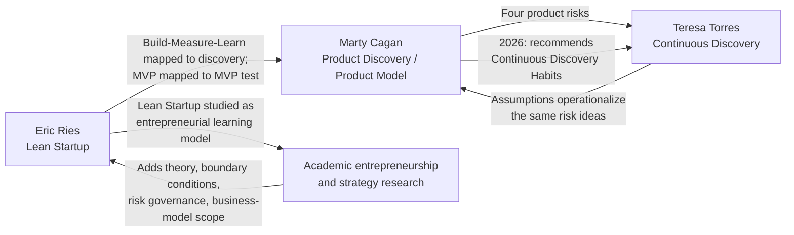
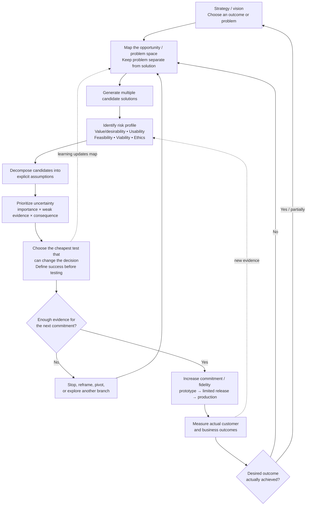

# Lean Startup, Marty Cagan, and Teresa Torres: A Comparative Synthesis of Their Product Decision Models

## Executive summary


The strongest conclusion from the research is that **Lean Startup, Marty Cagan's product discovery model, and Teresa Torres's continuous discovery model are best understood as frameworks operating at different levels of the same learning system**.

Eric Ries's Lean Startup is the broadest of the three. Its central problem is how an organization operating under extreme uncertainty can learn whether it is creating a sustainable business before exhausting its resources. Its main constructs are validated learning, the Build-Measure-Learn feedback loop, minimum viable products, innovation accounting, and pivot-or-persevere decisions. The unit of analysis is often a **business or business-model hypothesis**, and the ultimate test is whether customer behavior and business metrics support a sustainable venture. [^lean-startup-principles][^lean-startup-official-site]

Marty Cagan narrows the problem from venture learning to **product investment under uncertainty**. Product strategy supplies a problem and desired outcome; product discovery asks whether the team has found a solution worth building. Cagan decomposes that question into value, usability, feasibility, and business-viability risks. His most important contribution for a general decision framework is his concept of a **risk profile**: different work has different significant risks, and the strength and cost of the evidence should depend on the uncertainty and consequences involved. He explicitly rejects a fixed discovery recipe. [^cagan-four-big-risks][^cagan-discovery-judgement][^cagan-build-to-learn-faq]

Teresa Torres makes that risk-reduction model more explicit at the level of individual decisions. Her Opportunity Solution Tree separates outcomes, customer opportunities, candidate solutions, and assumption tests. Her five assumption categories are desirability, viability, feasibility, usability, and ethics. They are deliberately close to Cagan's taxonomy. Torres says the underlying ideas are conceptually the same; she prefers the language of assumptions because an explicit assumption gives a team something concrete to assess and test. [^torres-opportunity-solution-tree][^torres-five-types-assumptions]

The most important research finding is that **a three-way synthesis already exists implicitly in the primary literature, although no canonical academic or practitioner work was found that rigorously derives all three together**. Cagan explicitly mapped Lean Startup terminology to his product-discovery terminology in 2011, including Build-Measure-Learn -> product discovery and MVP -> MVP test. [^cagan-lean-thinking] Torres explicitly mapped her assumption categories to Cagan's four risks in 2023. [^torres-five-types-assumptions] Cagan's 2026 writing then named *INSPIRED* and Torres's *Continuous Discovery Habits* as the two essential books for learning modern discovery techniques. [^cagan-build-to-learn-faq] Product Talk has also explicitly mapped continuous discovery to Cagan's broader Product Operating Model. [^product-talk-product-operating-model]

A few industry articles put all three in the same product-discovery toolkit, but they mostly describe them side by side rather than derive a common theory. One example discusses Cagan-style dual-track discovery, Torres's Continuous Product Discovery, and Lean Startup in the same guide. [^product-discovery-scrum-teams] Another explicitly argues that Cagan and Torres illuminate more specific parts of the broader Lean Startup model, although that source is practitioner commentary and should be given substantially less evidentiary weight than the authors' own work. [^produktkraft-lean-startup]

The academic literature is asymmetric. **Lean Startup has a substantial peer-reviewed literature; Cagan and Torres remain primarily practitioner frameworks.** Academic work has decomposed Lean Startup into building blocks, connected it to entrepreneurship theory and business-model research, compared it with Discovery-Driven Growth, experimentally studied the related "scientific approach" to entrepreneurial decisions, and identified risk-management gaps. [^shepherd-gruber-lean-startup-framework][^blank-eckhardt-actionable-theory][^mcgrath-who-learns-fastest-wins][^zott-amit-business-models-lean-startup][^camuffo-scientific-entrepreneurial-decision-making][^wagenknecht-lean-startup-risk-management] The searches for this report found no peer-reviewed study that directly compared Ries, Cagan, and Torres by name. That is a finding about this search, not proof that no such publication exists anywhere.

The three frameworks converge on a deeper set of assumptions:

**Plans under substantial uncertainty contain hypotheses; learning is therefore part of progress. Evidence should be obtained before expensive commitment when that evidence can be obtained more cheaply. Customer behavior is more informative than internal opinion. Small and reversible tests preserve options. Decisions should be revised when evidence changes. Production use supplies stronger evidence and must feed the next learning cycle.** These themes recur across the primary material and the academic literature. [^lean-startup-principles][^cagan-discovery-judgement][^torres-time-in-product-discovery][^torres-discovering-solutions][^mcgrath-who-learns-fastest-wins][^camuffo-scientific-entrepreneurial-decision-making]

The major differences are equally important. Lean Startup is strongest on **venture economics, measurement, learning loops, and strategic redirection**. Cagan is strongest on **risk taxonomy, contextual evidence standards, product-team responsibilities, and deciding when an idea is safe enough to commit to delivery**. Torres is strongest on **opportunity exploration, maintaining alternatives, decomposing solutions into assumptions, prioritizing tests, and making discovery continuous and visible**. [^lean-startup-principles][^cagan-four-big-risks][^cagan-high-integrity-commitments][^torres-opportunity-solution-tree][^torres-five-types-assumptions]

The source note's synthesis is therefore well supported: `risk -> explicit assumptions -> evidence/test -> decision`, embedded in continuous discovery, delivery, and observation. The research suggests one addition: the framework should explicitly separate **the amount of risk in the decision** from **the amount of evidence required for the next commitment**, and should recognize strategy/opportunity selection, organizational risk governance, system-level stakeholder effects, and experiment validity as separate problems that the three frameworks only partially address. [^attached-note] [^cagan-discovery-judgement][^torres-time-in-product-discovery][^zott-amit-business-models-lean-startup][^wagenknecht-lean-startup-risk-management]

## Research scope and evidence base


Sources were prioritized in four tiers. First were the authors' own books and official sites: Ries and Lean Startup, Cagan/SVPG, and Torres/Product Talk. Second were direct cross-references where one of the three authors discusses another. Third were peer-reviewed papers analyzing Lean Startup, experimentation, business-model search, or risk. Fourth were industry syntheses and tools that combine or operationalize these ideas.

This is a **structured research review rather than a formal systematic review**. The search covered English-language author sites, scholarly publisher pages, journal records, and references in relevant papers through September 6, 2026. It also followed citations outward from the strongest sources. Consequently, the absence of a direct three-way academic comparison should be interpreted as "none found in this search," not as an exhaustive bibliographic proof.

Primary sources are authoritative for questions such as "What does Cagan mean by risk?" or "How does Torres define continuous discovery?" They are not independent evidence that the practices work. The peer-reviewed literature is more useful for questions about theoretical foundations, boundary conditions, critiques, and empirical effects. That distinction is especially important here because the empirical research base is much deeper for Lean Startup and scientific entrepreneurial experimentation than for named Cagan or Torres practices. [^blank-eckhardt-actionable-theory][^shepherd-gruber-lean-startup-framework][^camuffo-scientific-entrepreneurial-decision-making]

The history shows increasing convergence rather than three independent inventions. Cagan's concept of product discovery predates the 2011 Lean Startup book; after the book appeared, he explicitly interpreted it as largely a product-discovery framework. He later described continuous discovery and delivery, and eventually the four-risk model. Torres subsequently supplied a structured outcome -> opportunity -> solution -> assumption-test representation and explicitly related her assumption taxonomy to Cagan's. [^cagan-lean-thinking][^cagan-product-discovery][^cagan-four-big-risks][^torres-opportunity-solution-tree][^torres-five-types-assumptions]




The dates and relationships above come from the authors' published material and the recent academic literature. In particular, Cagan's 2011 article is a direct Lean Startup comparison; Torres's 2018 article supplies the "unacceptable risk" decision rule; her 2021 book codifies continuous discovery; her 2023 article explicitly compares assumptions with Cagan; and Cagan's April 2026 FAQ explicitly recommends *Continuous Discovery Habits*. [^cagan-lean-thinking][^torres-time-in-product-discovery][^torres-continuous-discovery-habits][^torres-five-types-assumptions][^cagan-build-to-learn-faq]

A **core corpus of sixteen sources** was also manually coded for whether eight themes were explicitly present. The corpus consisted of the core official Lean Startup methodology; five Cagan sources; four Torres sources; and six academic sources from Shepherd and Gruber, Blank and Eckhardt, McGrath, Zott and Amit, Camuffo et al., and Wagenknecht. This is a descriptive content coding, not a bibliometric study; a source was counted at most once per theme, and judgments such as "alternative search is present" necessarily involve interpretation. [^lean-startup-principles][^cagan-lean-thinking][^cagan-four-big-risks][^cagan-discovery-judgement][^cagan-build-to-learn-faq][^torres-continuous-discovery-definition][^torres-opportunity-solution-tree][^torres-five-types-assumptions][^torres-discovering-solutions][^shepherd-gruber-lean-startup-framework][^blank-eckhardt-actionable-theory][^mcgrath-who-learns-fastest-wins][^zott-amit-business-models-lean-startup][^camuffo-scientific-entrepreneurial-decision-making][^wagenknecht-lean-startup-risk-management]

```text
Explicit theme presence in the 16-source core corpus

Uncertainty / risk          16/16  ████████████████
Outcome / value             16/16  ████████████████
Experiment / testing        15/16  ███████████████
Decision rule / threshold   15/16  ███████████████
Customer evidence           14/16  ██████████████
Alternatives / search       10/16  ██████████
Cross-functional roles       8/16  ████████
Ethics / externalities       2/16  ██
```


The chart reinforces the substantive reading. **Uncertainty, value, experimentation, and evidence-based decisions are the common core.** Deliberate exploration of alternatives is more characteristic of Torres and the entrepreneurship search literature. Explicit cross-functional role design is concentrated in Cagan and Torres. Ethics and externalities remain comparatively under-specified; Torres is the clearest of the three in elevating ethics to a first-class assumption category, while Cagan has separately argued that ethics may be embedded in viability but can be lost there. [^torres-five-types-assumptions][^cagan-coaching-ethics][^cagan-product-risk-taxonomy]

## Frameworks and underlying mental models


The following mental models are an **analytical reconstruction**. Ries, Cagan, and Torres do not necessarily use labels such as "real options," "search tree," or "feedback control." Those labels describe the reasoning implied by their decision rules.

| Framework | Explicit operating model | Underlying assumptions reconstructed from the sources | Dominant mental model |
|---|---|---|---|
| **Lean Startup** | Build -> Measure -> Learn; validated learning; MVP; innovation accounting; pivot/persevere. [^lean-startup-principles] | Important parts of a new venture are hypotheses; conventional execution metrics are weak proxies under extreme uncertainty; customer behavior can invalidate assumptions; faster learning preserves scarce runway; progress can therefore be measured as validated learning. [^lean-startup-principles][^cagan-lean-thinking] | **Adaptive learning/control loop.** A venture repeatedly converts beliefs into tests, observes the system, and changes course. Lean's waste model treats substantial investment in an invalid assumption as avoidable waste. [^cagan-lean-thinking] |
| **Cagan** | Problem/outcome -> assess product-risk profile -> prototype/test the significant risks -> discover a solution worth building -> delivery and production evidence. [^cagan-four-big-risks][^cagan-discovery-judgement][^cagan-build-to-learn-faq] | Product ideas contain separable risks; risks differ by initiative; expensive production work is a poor default experiment when cheaper evidence exists; evidence has a cost and confidence level; stronger consequences justify stronger evidence; expertise is distributed across product, design, engineering, and business stakeholders. [^cagan-discovery-judgement][^cagan-discovery-excuses][^cagan-build-to-learn-faq] | **Risk-bearing investment decision.** Discovery buys information before larger commitments. Judgment determines which uncertainty deserves attention and how much evidence is enough. |
| **Torres** | Desired outcome -> opportunity space -> target opportunity -> multiple solutions -> assumptions -> tests -> decision; repeated continuously with weekly customer touchpoints. [^torres-continuous-discovery-definition][^torres-opportunity-solution-tree] | Teams tend to jump prematurely from problem to solution; comparing alternatives improves decisions; solutions can be decomposed into beliefs that must hold; some assumptions matter much more than others; current direct customer evidence should influence decisions; externalizing the decision structure creates shared understanding. [^torres-benefits-opportunity-solution-trees][^torres-five-types-assumptions][^torres-product-trio] | **Structured search and assumption decomposition.** The tree represents a changing search space; tests update the team's confidence in branches without requiring the whole solution to be built. |

**Lean Startup's deepest assumption is epistemic:** when the causal model of the business is uncertain, executing the original plan faithfully is not a sufficient definition of progress. Ries defines validated learning as the relevant unit of progress and makes the venture itself an experiment whose fundamental question is whether the proposed product and business can sustain themselves. [^lean-startup-principles] This is why innovation accounting is central rather than ancillary: without measures tied to the causal business model, Build-Measure-Learn can degrade into merely shipping frequently. [^lean-startup-principles][^cagan-lean-thinking]

There is also a **resource model** underneath Lean Startup. The scarce resource is not simply developer capacity; it is the number and quality of learning cycles a venture can complete before time or capital runs out. Cagan's 2011 interpretation of Ries emphasizes precisely this connection between rapid testing, sustainable-business hypotheses, qualitative learning, quantitative evidence, and the pivot decision. [^cagan-lean-thinking]

**Cagan's deepest assumption is that "risk" is heterogeneous.** Every candidate product idea may face value, usability, feasibility, and viability risk, but those four risks are neither equally uncertain nor equally consequential in every case. Some work needs almost no discovery; another initiative may have one decisive unknown. His "Discovery - Judgement" article is explicit that the team's task is to understand this risk profile and choose an appropriate evidence level rather than mechanically run every discovery technique. [^cagan-discovery-judgement]

This creates an implicit **cost-of-information model**. If an idea is straightforward across the relevant risks, Cagan says to build it. When meaningful risk exists, the team should find a cheaper way to investigate it; he gives as a discovery principle that a useful discovery test should normally cost at least an order of magnitude less time and effort than production implementation. [^cagan-discovery-excuses] The exact 10× rule is Cagan's heuristic, not an empirical constant.

Cagan's evidence model is also explicitly **consequence-sensitive**. Discovery evidence can range from quick qualitative evidence to live-data tests with stronger statistical confidence. The appropriate point on that spectrum depends on the cost of obtaining evidence and the consequence of being wrong. [^cagan-discovery-judgement] That makes "confidence" a decision variable rather than a binary state called "validated."

His organizational model follows from the same reasoning. Value and business concerns, interaction concerns, and technical feasibility depend on different expertise, so product, design, and engineering work together rather than pass documents between functions. Relevant business stakeholders become part of the viability evidence. [^cagan-four-big-risks][^cagan-build-to-learn-faq]

**Torres's deepest assumption is that the quality of a product decision depends on the structure of the search preceding it.** Her Opportunity Solution Tree explicitly separates the desired outcome, the opportunity space of customer needs/pains/desires, the solution space, and assumption tests. The tree is a representation of possible paths to an outcome, not merely a prioritization backlog. [^product-talk-opportunity-solution-tree-glossary][^torres-opportunity-solution-tree]

That introduces a mental model largely absent from simplistic Build-Measure-Learn diagrams: **preserve multiple alternatives while uncertainty is high**. Torres recommends exploring several candidate solutions for a selected opportunity, decomposing them, and testing their risky assumptions before converging. Evidence can therefore kill an assumption or a candidate branch without requiring the team to abandon an entire product after an MVP launch. [^torres-opportunity-solution-tree][^torres-discovering-solutions]

Her second major contribution is the change in **unit of experimentation**. An entire solution is usually a bundle of beliefs. Torres defines assumptions as beliefs that must be true for an idea to succeed and uses five lenses to surface them: desirability, viability, feasibility, usability, and ethics. She explicitly says these overlap conceptually with Cagan's risks; the practical advantage of enumerating assumptions is that the team can assess which individual belief needs testing. [^torres-five-types-assumptions][^product-talk-assumption-testing]

Her risk prioritization model can be summarized as:

> **An assumption deserves attention when it is important to the solution and the team has weak evidence for it.**

That is a conceptual restatement of Torres's importance/evidence framing, not a numerical probability formula. [^product-talk-assumption-testing][^torres-discovering-solutions]

Torres also supplies a **cadence model**. Continuous discovery means at least weekly customer touchpoints, conducted by the team building the product, using small research activities in pursuit of a desired product outcome. The intention is to make current evidence available when decisions arise, rather than making research a separate project. [^torres-continuous-discovery-definition][^torres-continuous-interviewing]

Finally, neither Cagan nor Torres advocates a literal discovery phase followed by a delivery phase. Torres explicitly says teams should be discovering and delivering continuously, and Cagan now emphasizes that discovery/delivery is a conceptual distinction rather than a phase-gate process. [^torres-time-in-product-discovery][^cagan-build-to-learn-vs-build-to-earn][^cagan-discovery-delivery]

## What the literature actually compares


The clearest direct comparison is **Cagan on Ries**. In his October 2011 "Lean Thinking" article, Cagan described *The Lean Startup* as primarily a book about what he calls product discovery. His glossary maps:

`Build-Measure-Learn -> Product Discovery`

`MVP -> MVP Test`

`Innovation Accounting -> Product Scorecards`

`Cross-functional teams -> Dedicated Product Teams`

`Small batch -> Incremental/continuous development and deployment`

He also distinguishes Ries's use of "prototype" from his own broader family of feasibility, usability, user, and live-data prototypes. The substantive agreement, in Cagan's reading, is that usability and technical feasibility are insufficient if the product cannot create customer and business value. [^cagan-lean-thinking]

That source is important because it undermines a common interpretation that Cagan's discovery model is a rejection of Lean Startup. **Cagan presented it as a translation and extension of Lean Startup into the vocabulary of established product teams.** He later described Lean Startup techniques as part of the larger set of product-discovery techniques in talks and continued to connect Lean Startup, Lean UX, and continuous discovery in his writing. [^cagan-lean-thinking][^cagan-shared-learning]

The next bridge is **Torres on Cagan**. In "The 5 Types of Assumptions," Torres directly asks how her model differs from Cagan's four risks. Her answer is that the ideas substantially overlap; the distinction is operational. "Viability risk" remains abstract until the team enumerates the concrete viability assumptions beneath it. She also uses "desirability" where Cagan uses "value" and explicitly separates ethical assumptions. [^torres-five-types-assumptions]

A third bridge runs back from **Cagan to Torres**. His April 2026 Build-to-Learn FAQ starts from a problem and an outcome, describes prototypes tested against the four risks, says discovery and delivery both generate learning, and names *INSPIRED* and *Continuous Discovery Habits* as the two essential books for learning product discovery. [^cagan-build-to-learn-faq] Product Talk has reciprocally explained how Torres's continuous-discovery habits map to the problem-selection and problem-solving dimensions of Cagan's Product Operating Model. [^product-talk-product-operating-model]

The resulting relationship is better represented as a graph than as competing schools:




The cross-links in this diagram are explicit in the primary sources; the academic branch represents the scholarly literature discussed below. [^cagan-lean-thinking][^torres-five-types-assumptions][^cagan-build-to-learn-faq][^blank-eckhardt-actionable-theory][^shepherd-gruber-lean-startup-framework][^zott-amit-business-models-lean-startup]

The academic work makes the Lean Startup side considerably more precise. Shepherd and Gruber reconstruct Lean Startup around five building blocks: **market-opportunity navigation, business-model design, validated learning/customer development, MVPs, and pivot/persevere decisions**. That analysis is useful because it shows that Lean Startup is richer than the often-repeated three-box Build-Measure-Learn diagram. [^shepherd-gruber-lean-startup-framework]

Blank and Eckhardt's 2024 *Journal of Management* article explicitly treats Lean Startup as an **actionable theory of entrepreneurship** and connects its assumptions with academic theories of entrepreneurial uncertainty and opportunity. [^blank-eckhardt-actionable-theory] An earlier historical review by Bortolini and colleagues analyzed 118 works and situated Lean Startup in prior traditions including the learning school of strategy and effectuation, emphasizing that its intellectual roots predate the label. [^bortolini-lean-startup-historical-review]

McGrath's comparison of Lean Startup with **Discovery-Driven Growth** is especially relevant to the synthesis here. Both approaches assume that high-uncertainty projects require rapid learning, assumption validation, and parsimonious resource commitment. Discovery-Driven Growth adds explicit checkpoints, documents assumptions, defines success before investment, and addresses a broader set of corporate uncertainties than Lean Startup's strong product-market-fit orientation. [^mcgrath-who-learns-fastest-wins] This is close to the commitment model that emerges when Cagan's risk logic is added to Lean Startup.

Zott and Amit identify another boundary. They argue that Lean Startup largely focuses on **customer value and product-market fit**, while business-model research asks whether value is created for a wider system of stakeholders and whether product-market-business-model fit exists. They propose system-level and stakeholder-oriented extensions to Lean Startup. [^zott-amit-business-models-lean-startup] This is one of the strongest academic reasons not to treat customer discovery alone as sufficient evidence.

There is also an active academic disagreement over **how scientific Lean Startup experimentation really is**. Felin, Gambardella, Stern, and Zenger criticize Lean-style experimentation for giving weak guidance about the generation of hypotheses and theories and for potential limits in learning from customer feedback. A response in the same *Long Range Planning* debate accepts the importance of the critique but argues that Lean Startup was primarily designed to structure iterative experimentation and uncertainty reduction, not to be a complete theory of ideation. [^felin-experimentation-revisited][^lean-startup-experimenting-novelty-impact]

That criticism is important for Torres's contribution. An experiment can be executed perfectly while testing a poor hypothesis, a trivial assumption, or a solution selected from an impoverished set of alternatives. Torres's opportunity mapping and compare-and-contrast practices partially address that upstream problem by making the search space more explicit. This is an **inference from the combination of the sources**, not a claim that Torres developed the Opportunity Solution Tree in response to Felin's academic critique. [^lean-startup-experimenting-novelty-impact][^torres-benefits-opportunity-solution-trees][^torres-opportunity-solution-tree]

The empirical evidence for a "scientific" entrepreneurial mental model is also more nuanced than "experiment more." Camuffo and colleagues' 2024 large-scale replication combined four randomized controlled trials covering 759 firms. Their results are consistent with scientific decision-making increasing methodic doubt and search efficiency: treated firms were more willing to terminate weak ideas, tended toward a limited number of focused pivots rather than no pivots or endless pivots, and performed better in their sample. [^camuffo-scientific-entrepreneurial-decision-making] This supports disciplined hypothesis testing as a decision model, but it does **not** constitute a randomized trial of every Lean Startup, Cagan, or Torres practice.

Recent work also identifies a gap directly relevant to Cagan. Wagenknecht's May 2026 study of 24 German founders found weak strategic processes for identifying and monitoring risks and argues for a multistage Lean Startup risk-governance model. [^wagenknecht-lean-startup-risk-management] That makes Cagan's explicit risk taxonomy and Torres's assumption decomposition potentially valuable complements to Lean Startup's less formal product-risk model, although that particular combination has not itself been empirically validated.

The industry literature occasionally presents all three together. One Product Discovery for Scrum Teams guide discusses Cagan-influenced dual-track discovery, Torres's Continuous Product Discovery, and Ries's Lean Startup as related techniques. [^product-discovery-scrum-teams] These comparisons are useful for identifying practitioner convergence, but they generally stop short of extracting the shared decision theory. That is where a synthesis remains useful.

## Comparative decision table


The table below compares the dimensions used in this review. "Unspecified" means that the search found no universal rule in the primary framework; it does not imply that practitioners never define one locally.

| Dimension | Lean Startup (Eric Ries) | Marty Cagan | Teresa Torres |
|---|---|---|---|
| **Starting point** | A venture vision and important business assumptions under extreme uncertainty; for a learning loop, identify the problem and create an MVP capable of testing the relevant hypothesis. [^lean-startup-principles] | Product strategy supplies a **problem to solve and outcome to achieve**; discovery searches for an effective solution. [^cagan-build-to-learn-faq] | A **desired product outcome**, plus an understanding of target customers; build an opportunity space from customer needs, pains, and desires. [^product-talk-opportunity-solution-tree-glossary][^torres-opportunity-solution-tree] |
| **Primary question** | "Should this product be built?" and can a sustainable business be built around the vision? [^lean-startup-principles] | Has a solution worth building been discovered that can achieve the outcome while addressing the significant product risks? [^cagan-four-big-risks][^cagan-build-to-learn-faq] | Which opportunity and solution path is most likely to produce the desired outcome, and which assumptions beneath the candidates are riskiest? [^torres-opportunity-solution-tree][^torres-five-types-assumptions] |
| **Unit of uncertainty** | Fundamental product/business-model hypotheses; market, solution, value/growth assumptions. Core method has **no named multidimensional product-risk taxonomy** comparable to Cagan/Torres. [^cagan-lean-thinking][^lean-startup-principles] | A proposed solution's **risk profile**. [^cagan-discovery-judgement] | Individual assumptions underneath opportunities/solutions, prioritized by importance and evidence. [^torres-five-types-assumptions][^product-talk-assumption-testing] |
| **Risk model** | Broad uncertainty around whether customers respond and whether the resulting business model is sustainable; innovation accounting tracks whether its causal drivers improve. [^lean-startup-principles] | Value, usability, feasibility, business viability. Cagan treats the taxonomy as useful but says alternative taxonomies can also work. [^cagan-four-big-risks][^cagan-product-risk-taxonomy] | Desirability, viability, feasibility, usability, ethical assumptions. Torres says these conceptually overlap with Cagan's risks. [^torres-five-types-assumptions][^product-talk-assumption-testing] |
| **Decision rule** | Measure actionable changes in business-model drivers; **persevere** when evidence supports the direction, **pivot** when a fundamental hypothesis needs structural change. [^lean-startup-principles] | If significant risk is absent, build. If significant risk exists, attack it cheaply before full delivery. Select evidence according to risk, consequence, time, and cost. [^cagan-discovery-excuses][^cagan-discovery-judgement] | Select an opportunity, compare candidate solutions, decompose them, test their riskiest assumptions, then discard, revise, continue testing, or refine a sufficiently supported solution for delivery. [^torres-opportunity-solution-tree] |
| **Evidence threshold** | **No universal statistical threshold specified.** Evidence should be actionable and demonstrate progress in relevant causal business metrics. [^lean-startup-principles] | Explicitly contextual. Higher consequence/risk can justify stronger evidence; low-risk work can proceed with less. Judgment is essential. [^cagan-discovery-judgement] | Explicitly contextual. Define success before a test and do enough discovery to reduce **unacceptable risk**; no universal sample size or probability threshold is prescribed. [^torres-time-in-product-discovery][^torres-discovering-solutions] |
| **Typical experiments** | MVP experiments, split tests, qualitative customer learning, quantitative metrics, market/demand and growth tests. [^cagan-lean-thinking][^lean-startup-principles] | Feasibility prototypes, usability prototypes, user/value prototypes, live-data tests, qualitative customer tests, quantitative experiments where the consequence warrants them. [^cagan-lean-thinking][^cagan-discovery-judgement] | Story-based interviews for opportunities; prototypes, usability studies, smoke tests, assumption tests, and quantitative experiments, with the method chosen for the assumption being tested. [^torres-continuous-interviewing][^torres-discovering-solutions][^torres-engineers-and-discovery] |
| **Typical artifacts** | MVP or other experiment, explicit hypothesis, actionable metrics, innovation-accounting measures, pivot/persevere learning record. [^lean-startup-principles][^cagan-lean-thinking] | Problem/outcome framing, risk profile, prototypes, product scorecards/metrics, evidence used to support a high-integrity commitment. [^cagan-lean-thinking][^cagan-high-integrity-commitments] | Opportunity Solution Tree, opportunity map, candidate solutions, story maps where useful, explicit assumption set, assumption tests and success criteria. [^torres-opportunity-solution-tree][^torres-discovering-solutions] |
| **Roles involved** | Cross-functional startup/innovation team; core Lean Startup does not prescribe a stable product-manager/designer/engineer responsibility matrix. [^cagan-lean-thinking][^lean-startup-principles] | Product manager, product designer, lead engineer as a cross-functional team; users/customers provide value/usability evidence, engineers feasibility evidence, and business stakeholders viability evidence. [^cagan-four-big-risks][^cagan-build-to-learn-faq] | Product trio, typically product, design, and engineering, conducts discovery directly with customers and collaborates on decisions. [^torres-continuous-discovery-definition][^torres-product-trio] |
| **When to commit** | Commit minimally to create learning, then increase investment as validated learning supports the business hypothesis. Exact commitment threshold is **unspecified**. [^lean-startup-principles] | Make production-quality/date commitments after enough discovery has addressed the significant risks to support a high-confidence commitment. [^cagan-high-integrity-commitments] | Move a solution toward delivery when the important risky assumptions have enough evidence and the remaining risk is acceptable; discovery continues after that decision. [^torres-time-in-product-discovery][^torres-opportunity-solution-tree] |
| **Post-release role of evidence** | Central: production response feeds Measure -> Learn and pivot/persevere. [^lean-startup-principles] | Production provides the ultimate outcome evidence and informs further discovery; discovery and delivery are continuous. [^cagan-build-to-learn-faq][^cagan-build-to-learn-vs-build-to-earn] | Continuous discovery and delivery continue together; fresh customer and outcome evidence updates the tree and assumptions. [^torres-time-in-product-discovery][^torres-product-discovery-basics] |

Two conclusions follow from the table.

First, **none of the three provides a universal evidence threshold**. Lean Startup uses scientific language but does not prescribe a general p-value, customer count, or confidence percentage. Cagan explicitly places the decision in judgment over risk and consequence. Torres explicitly recommends defining success before testing while allowing the amount of evidence needed to vary with the risk. [^lean-startup-principles][^cagan-discovery-judgement][^torres-time-in-product-discovery][^torres-discovering-solutions]

Second, the phrase "MVP" hides an important semantic difference. The naive Lean Startup interpretation is "build a small production product and see what happens." Cagan's 2011 reading is closer to **MVP test**: the object is whatever allows the critical business hypothesis to be tested. Torres pushes this decomposition further by asking whether the team can test one risky assumption without constructing an MVP representing the whole solution. [^cagan-lean-thinking][^torres-five-types-assumptions]

## Integrated synthesis, conflicts, and gaps


The three frameworks can be integrated without treating discovery as a sequential phase. The following diagram represents the **logic of one decision moving through increasing commitment** while multiple discovery and delivery loops may be active concurrently. Torres and Cagan are both explicit that discovery and delivery should continue together. [^torres-time-in-product-discovery][^cagan-build-to-learn-vs-build-to-earn]




The components come from Torres's outcome/opportunity/solution/assumption structure, Cagan's risk profile and consequence-sensitive discovery judgment, and Lean Startup's measurement and pivot/persevere feedback loop. The "increase commitment/fidelity" formulation is a synthesis in this report, not a term used identically by all three authors. [^torres-opportunity-solution-tree][^torres-five-types-assumptions][^cagan-discovery-judgement][^lean-startup-principles]

A useful general decision rule follows:

> **Spend enough on learning to reduce the uncertainties that could make the next commitment unacceptable; increase commitment as evidence improves, while keeping expensive or irreversible commitments behind stronger evidence.**

The first half is strongly grounded in Torres's "mitigate unacceptable risk," Cagan's risk/consequence judgment, and Lean Startup's reduction of waste through learning. The explicit treatment of **irreversibility** is an extension of those ideas and of the synthesis in the source note; it is not a named decision variable in the core three frameworks. [^attached-note] [^torres-time-in-product-discovery][^cagan-discovery-judgement][^cagan-lean-thinking]

A second useful heuristic concerns test prioritization:

\[\text{Learning priority} \;\uparrow\; \text{with criticality, uncertainty, and consequence, and} \;\downarrow\; \text{with cost of obtaining useful evidence}\]

This is deliberately a qualitative relation, not a proposed calibrated equation. Torres supplies the importance/evidence logic; Cagan supplies consequences and cost/time; Lean Startup supplies the imperative to shorten the validated-learning loop. [^product-talk-assumption-testing][^cagan-discovery-judgement][^lean-startup-principles]

The main tensions and gaps are:

| Tension or gap | Analysis |
|---|---|
| **Build first vs. learn before production build** | The apparent conflict is larger in popular summaries than in the primary sources. Ries's "Build" can be an MVP experiment whose purpose is learning; Cagan explicitly maps MVP to "MVP test." Cagan and Torres are clearer that many assumptions should be tested with prototypes or research before production-quality implementation. [^lean-startup-principles][^cagan-lean-thinking][^cagan-dual-track-agile] |
| **Venture scope vs. product-team scope** | Lean Startup asks whether a sustainable business can exist. Cagan generally assumes product strategy has selected an important problem. Torres generally begins with a desired product outcome and explores opportunities underneath it. A new venture may therefore need Lean Startup/business-model tools above Torres's tree; a mature product team may find Lean Startup too coarse for daily decisions. [^lean-startup-principles][^cagan-build-to-learn-faq][^torres-opportunity-solution-tree] |
| **Problem selection** | Torres provides the strongest explicit opportunity-space representation. Cagan says product strategy chooses the problem; his discovery model focuses heavily on solving it. Lean Startup has customer discovery and market learning but no artifact as specific as the Opportunity Solution Tree. Shepherd and Gruber's addition of market-opportunity navigation shows that academia also sees opportunity selection as a distinct Lean Startup problem. [^cagan-build-to-learn-faq][^torres-opportunity-solution-tree][^shepherd-gruber-lean-startup-framework] |
| **Hypothesis generation** | Lean experimentation is much stronger on testing than on producing high-quality theories or hypotheses. This is a central academic critique. Torres's deliberate generation of alternatives and explicit decomposition partly fills the practice gap, but none of the three supplies a general theory of creativity or strategy formation. [^felin-experimentation-revisited][^lean-startup-experimenting-novelty-impact][^torres-benefits-opportunity-solution-trees] |
| **Risk taxonomy** | Lean Startup has no equivalent to Cagan's named four-risk product taxonomy. Cagan's taxonomy is compact and role-friendly. Torres's is more granular at the assumption level and makes ethics explicit. Cagan himself says the higher-order principle is having a useful taxonomy, not preserving his exact four categories. [^cagan-product-risk-taxonomy][^torres-five-types-assumptions] |
| **Evidence threshold** | All three leave the actual threshold contextual. That flexibility is appropriate for heterogeneous decisions but creates a governance gap: teams can rationalize weak evidence after seeing favorable results. Torres's explicit recommendation to define success before running a test is the clearest protection among the three. [^cagan-discovery-judgement][^torres-discovering-solutions] |
| **System and stakeholder effects** | Customer value is insufficient when a solution shifts costs or risks to other stakeholders. Zott and Amit's business-model analysis extends Lean Startup toward product-market-business-model fit and stakeholder value. Torres's ethics category captures some externalities, but a full stakeholder/system model is outside the core three. [^zott-amit-business-models-lean-startup][^torres-five-types-assumptions] |
| **Strategic risk governance** | Cagan is strong at product-level risk; core Lean Startup is much less explicit about a formal risk-management system. Wagenknecht's 2026 research reports a strategic risk-governance gap in early-stage startups and proposes a multistage risk model. [^wagenknecht-lean-startup-risk-management] |
| **Experiment validity** | A cheap test may give fast evidence without giving valid evidence. Proxy behavior may fail to transfer to full production, customer samples may be biased, and tests can answer the wrong question. The academic debate around Lean experimentation and the scientific-decision literature makes clear that hypothesis quality and test design are independent sources of error. [^lean-startup-experimenting-novelty-impact][^camuffo-scientific-entrepreneurial-decision-making] |
| **Ethics and externalities** | Torres makes ethical assumptions first-class. Cagan has said ethics can sit inside viability but may disappear among legal, financial, sales, and compliance concerns, which is a reason to surface it separately when important. Lean Startup's core methodology does not provide a corresponding explicit ethical-risk construct. [^torres-five-types-assumptions][^cagan-coaching-ethics] |
| **Organizational prerequisites** | Cagan and Torres rely heavily on a cross-functional team with meaningful decision authority and direct access to relevant customers. Their methods become harder to apply when research, engineering, product decisions, or stakeholders are separated by organizational handoffs. [^cagan-discovery-delivery][^torres-product-trio][^torres-discovery-handoffs] |
| **Discovery vs. delivery as phases** | Treating them as sequential departments or gates contradicts both Cagan's and Torres's current positions. They distinguish the purpose of learning work from production work while keeping both continuous. [^cagan-discovery-delivery][^torres-time-in-product-discovery][^cagan-build-to-learn-vs-build-to-earn] |

The most useful abstraction is therefore:

**Lean Startup supplies the outer learning and strategic-redirection loop.**

**Cagan supplies the risk architecture and the rule for how much evidence should precede substantial commitment.**

**Torres supplies the search structure, assumption decomposition, and recurring habits that make that risk reduction executable.**

Academic work then contributes missing controls: theory generation, experiment design, opportunity navigation, broader stakeholder/business-model fit, explicit checkpoints, and risk governance. [^shepherd-gruber-lean-startup-framework][^mcgrath-who-learns-fastest-wins][^zott-amit-business-models-lean-startup][^camuffo-scientific-entrepreneurial-decision-making][^wagenknecht-lean-startup-risk-management]

That gives a more complete mental model than any of the three alone:

\[
\textbf{Strategy} \rightarrow

\textbf{Search} \rightarrow

\textbf{Risk} \rightarrow

\textbf{Assumptions} \rightarrow

\textbf{Evidence} \rightarrow

\textbf{Proportional Commitment} \rightarrow

\textbf{Observed Outcomes} \rightarrow

\textbf{Updated Strategy}
\]

The loop is recursive: production is a stronger evidence environment, not the end of discovery. [^cagan-build-to-learn-faq][^lean-startup-principles][^torres-product-discovery-basics]

## Extensions and adjacent methods


Several methods extend precisely the points where the three frameworks meet.

| Extension / tool | Relationship to the synthesis | What it adds |
|---|---|---|
| **Customer Development (Steve Blank)** | A foundational precursor and pillar of Lean Startup. Academic reconstructions treat customer development/validated learning as a core Lean building block. [^shepherd-gruber-lean-startup-framework] | Explicit search for customer and market evidence outside the building; stronger new-venture and market-discovery framing. |
| **Dual-Track Agile / Continuous Discovery + Continuous Delivery** | Cagan described dual-track work in 2012, then moved away from that label because it was too easily treated as a process with separate tracks; he now favors continuous discovery and delivery. [^cagan-dual-track-agile][^cagan-discovery-delivery] | Makes the discovery/delivery distinction compatible with ongoing Agile delivery and reduces the risk of turning discovery into an upstream department. |
| **Lean UX (Jeff Gothelf and Josh Seiden)** | Lean UX translates Lean Startup assumptions and experimentation into collaborative product/UX work. Gothelf's Lean UX Canvas starts from a business problem, identifies assumptions, converts them to hypotheses, and designs experiments around risky ones. [^gothelf-lean-ux-canvas][^lean-ux-book] | A concrete bridge from Lean Startup's business-learning logic to product discovery and design experimentation. |
| **Opportunity Solution Tree (Torres)** | Native tool for continuous discovery. [^product-talk-opportunity-solution-tree-glossary][^torres-opportunity-solution-tree] | Externalizes outcome -> opportunity -> solution -> test relationships, maintains alternatives, and lets evidence update a shared search model. |
| **Assumption Mapping / Testing Business Ideas (Bland, Osterwalder, and Strategyzer)** | Closely parallels Torres's assumption decomposition and Lean Startup experimentation. Strategyzer asks teams to extract the riskiest assumptions and track hypotheses, tests, and learning. [^strategyzer-testing-business-assumptions][^strategyzer-assumptions-mapping] | Business-model-level assumption mapping, Test Cards, and explicit desirability/feasibility/viability testing. |
| **Discovery-Driven Growth / Planning (McGrath and collaborators)** | Academic/managerial cousin of Lean Startup. McGrath's comparison finds shared emphasis on learning, assumption validation, and parsimonious resource use. [^mcgrath-who-learns-fastest-wins] | Explicit success definitions, reverse-income logic, documented assumptions, checkpoints, and broader corporate-venture uncertainty. |
| **Market Opportunity Navigator** | Shepherd and Gruber incorporate market-opportunity navigation into their academic reconstruction of Lean Startup. [^shepherd-gruber-lean-startup-framework] | More deliberate search across possible markets before locally optimizing a single customer/solution hypothesis. |
| **Business-model experimentation** | Research by Zott and Amit and the *Long Range Planning* debate extends Lean experimentation beyond a product/customer dyad. [^zott-amit-business-models-lean-startup][^lean-startup-experimenting-novelty-impact] | Stakeholder-level value creation, business-model interactions, and stronger attention to whether local product evidence generalizes to a viable system. |
| **Scientific entrepreneurial decision-making** | Closely related to Lean Startup's scientific metaphor but academically formalized and experimentally studied. [^camuffo-scientific-entrepreneurial-decision-making] | Explicit theory formation, predictions, rigorous tests, methodic doubt, and a distinction between focused search and indiscriminate pivoting. |
| **Lean Startup risk governance** | Recent research explicitly targets an underdeveloped Lean Startup area. [^wagenknecht-lean-startup-risk-management] | Formal identification, monitoring, governance, and staged treatment of strategic risks beyond individual product experiments. |

Three extensions deserve special emphasis for the framework developed here.

**Lean UX Canvas is an independent convergence on almost exactly the same chain as Torres + Cagan.** Gothelf describes starting from a business problem, breaking it into assumptions, weaving the assumptions into hypotheses, and creating experiments for the riskiest hypotheses. [^gothelf-lean-ux-canvas] That suggests the sequence `problem -> assumptions -> risk -> experiment` is broader than any one product-school vocabulary.

**Strategyzer's Testing Business Ideas ecosystem independently converges on desirability, feasibility, and viability, plus assumption mapping and experiment tracking.** Osterwalder's writing explicitly frames the innovator's task as reducing uncertainty before investing heavily and scaling. [^strategyzer-reducing-risk-uncertainty][^strategyzer-testing-business-assumptions] This strengthens the case for treating risk classification and assumption decomposition as general innovation mechanics.

**Discovery-Driven Growth supplies the missing commitment-governance layer.** Lean Startup, Cagan, and Torres all promote learning before costly commitment, but McGrath makes checkpoints and explicit assumption documentation more central to resource allocation. [^mcgrath-who-learns-fastest-wins] Combining that with Cagan's consequence-sensitive evidence model produces a stronger general principle: *the evidence needed before the next commitment should depend on what is at stake in that commitment*.

## Source guide


The table prioritizes sources by usefulness for this specific comparison. "High for definition" means the source is authoritative about what its author/framework says; it does not mean it independently proves effectiveness.

| Source and link | Type | Relevance | Reliability for this report |
|---|---|---|---|
| [Eric Ries / Lean Startup -- Methodology](https://theleanstartup.com/principles) [^lean-startup-principles] | Primary / official | Canonical concise account of extreme uncertainty, MVP, Build-Measure-Learn, validated learning, innovation accounting, and pivot/persevere. | **High for framework definition.** Promotional/authorial source, so not independent effectiveness evidence. |
| [The Lean Startup official site](https://theleanstartup.com/) [^lean-startup-official-site] | Primary / official | Confirms the framework's emphasis on rapid experimentation and validated learning and identifies Ries and the book. | **High for provenance and framing.** |
| *The Lean Startup*, Eric Ries, 2011. [^lean-startup-official-site][^cagan-lean-thinking] | Primary book | Canonical full treatment of MVPs, validated learning, innovation accounting, growth, pivoting, and entrepreneurship under uncertainty. | **Highest authority for Ries's intended framework; not independent validation.** |
| [Marty Cagan -- "Lean Thinking"](https://www.svpg.com/lean-thinking/) [^cagan-lean-thinking] | Primary / direct comparison | The single most useful Ries <-> Cagan source. Explicitly maps Build-Measure-Learn to product discovery and MVP to MVP test. | **Very high for the relationship between Cagan's and Ries's models.** |
| [Marty Cagan -- "The Four Big Risks"](https://www.svpg.com/four-big-risks/) [^cagan-four-big-risks] | Primary | Defines value, usability, feasibility, and viability risks and product-team responsibilities. | **High for Cagan's risk model.** |
| [Marty Cagan -- "Discovery - Judgement"](https://www.svpg.com/discovery-judgement/) [^cagan-discovery-judgement] | Primary | Critical source for heterogeneous risk profiles and context-sensitive evidence thresholds. | **High for Cagan's decision logic.** |
| [Marty Cagan -- "Discovery - Excuses"](https://www.svpg.com/discovery-excuses/) [^cagan-discovery-excuses] | Primary | States that low-risk ideas can proceed and discovery tests should normally be dramatically cheaper than production implementation. | **High for practice rule; the order-of-magnitude rule is practitioner judgment, not a measured universal law.** |
| [Marty Cagan -- "Dual-Track Agile"](https://www.svpg.com/dual-track-agile/) [^cagan-dual-track-agile] | Primary | Shows the development from dual-track terminology toward continuous discovery/delivery and the "fastest, cheapest validation" principle. | **High for historical evolution of Cagan's model.** |
| [Marty Cagan -- "Discovery - Delivery"](https://www.svpg.com/discovery-delivery/) [^cagan-discovery-delivery] | Primary | Explicitly rejects separate discovery and delivery teams/phases; one cross-functional team owns both continuously. | **High for topology of the operating model.** |
| [Marty Cagan -- "Build To Learn FAQ"](https://www.svpg.com/build-to-learn-faq/) [^cagan-build-to-learn-faq] | Primary, April 2026 | Current formulation: problem/outcome, four risks, prototypes, production evidence, and explicit recommendation of Torres's book. | **Very high for current Cagan <-> Torres synthesis.** |
| [Marty Cagan -- "Product Risk Taxonomy"](https://www.svpg.com/product-risk-taxonomies/) [^cagan-product-risk-taxonomy] | Primary | Clarifies that the exact four-category taxonomy is secondary to consistently using an adequate risk taxonomy. | **High for avoiding over-literal interpretation of Cagan's four risks.** |
| [Marty Cagan -- "High-Integrity Commitments"](https://www.svpg.com/managing-commitments-in-an-agile-team/) [^cagan-high-integrity-commitments] | Primary | Directly addresses when discovery evidence is sufficient to make larger delivery/date commitments. | **High for commitment logic.** |
| [Teresa Torres -- Continuous Discovery definition](https://www.producttalk.org/glossary-discovery-continuous-discovery/) [^torres-continuous-discovery-definition] | Primary / official, updated 2026 | Current definition of weekly direct customer touchpoints, small research activities, team participation, and desired outcomes. | **High for current framework definition.** |
| [Teresa Torres -- *Continuous Discovery Habits* announcement/overview](https://www.producttalk.org/continuous-discovery-habits/) [^torres-continuous-discovery-habits] | Primary book-related | Summarizes the 2021 book's structure: outcome, opportunity discovery, assumption testing, and OST. | **High for book scope; authorial rather than independent evidence.** |
| [Teresa Torres -- Opportunity Solution Tree](https://www.producttalk.org/2016/08/opportunity-solution-tree/) [^torres-opportunity-solution-tree] | Primary | Defines outcome -> opportunity -> solution -> assumption-test structure and recommended decision sequence. | **High for Torres's core artifact and search model.** |
| [Teresa Torres -- "The 5 Types of Assumptions"](https://www.producttalk.org/five-types-of-assumptions/) [^torres-five-types-assumptions] | Primary / direct comparison | The most important Torres <-> Cagan source; explicitly explains their conceptual overlap and why she uses assumptions. | **Very high for comparative interpretation.** |
| [Teresa Torres -- "How Much Time Should You Spend in Product Discovery?"](https://www.producttalk.org/time-in-product-discovery/) [^torres-time-in-product-discovery] | Primary | Gives one of the clearest general decision rules: discovery and delivery are continuous; do enough discovery to mitigate unacceptable risk. | **High for risk/commitment logic.** |
| [Teresa Torres -- "Discovering Solutions"](https://www.producttalk.org/discovering-solutions/) [^torres-discovering-solutions] | Primary | Distinguishes generative interviewing from evaluative assumption testing and recommends defining success before experiments. | **High for experiment mechanics.** |
| [Product Talk -- Product Operating Model explainer](https://www.producttalk.org/the-product-operating-model/) [^product-talk-product-operating-model] | Primary practitioner synthesis | Explicitly maps continuous-discovery habits to dimensions of Cagan's Product Operating Model. | **High for how Product Talk currently interprets Cagan; not independent scholarship.** |
| Shepherd & Gruber, "The Lean Startup Framework: Closing the Academic-Practitioner Divide" [^shepherd-gruber-lean-startup-framework] | Peer-reviewed, *Entrepreneurship Theory and Practice* | Decomposes Lean Startup into five building blocks and connects each to entrepreneurship research. | **High-quality scholarly synthesis.** |
| Blank & Eckhardt, ["The Lean Startup as an Actionable Theory of Entrepreneurship"](https://doi.org/10.1177/01492063231168095) [^blank-eckhardt-actionable-theory] | Peer-reviewed, *Journal of Management* | Clarifies assumptions and terminology and connects Lean Startup with entrepreneurship theory. | **High-quality conceptual synthesis; one author is a foundational Lean Startup practitioner.** |
| Bortolini et al., ["Lean Startup: A Comprehensive Historical Review"](https://doi.org/10.1108/MD-07-2017-0663) [^bortolini-lean-startup-historical-review] | Peer-reviewed historical review | Analyzed a large practitioner/academic source base and relates Lean Startup to earlier learning and entrepreneurship traditions. | **High for intellectual lineage and literature context.** |
| Felin et al., ["Lean Startup and the Business Model: Experimentation Revisited"](https://doi.org/10.1016/j.lrp.2019.06.002) [^felin-experimentation-revisited] | Peer-reviewed critique, *Long Range Planning* | Important critique of Lean experimentation, especially hypothesis/theory generation and limits of customer-feedback learning. | **High-value critical source.** |
| "Lean Startup and the Business Model: Experimenting for Novelty and Impact" [^lean-startup-experimenting-novelty-impact] | Peer-reviewed response, *Long Range Planning* | Responds to the Felin critique and argues for a process view in which experimentation can generate new business models. | **High-value counterpoint; useful for balance.** |
| McGrath, ["Who Learns Fastest, Wins: Lean Startup and Discovery Driven Growth"](https://doi.org/10.1177/01492063231204870) [^mcgrath-who-learns-fastest-wins] | Peer-reviewed, *Journal of Management* | Directly compares Lean Startup with an assumption/checkpoint-oriented corporate innovation method. | **Very high relevance to the commitment/risk synthesis.** |
| Zott & Amit, ["Business Models and Lean Startup"](https://doi.org/10.1177/01492063241228245) [^zott-amit-business-models-lean-startup] | Peer-reviewed, *Journal of Management* | Identifies Lean Startup's customer/product-market emphasis and extends it toward stakeholder and system-level business-model fit. | **High for scope limitations and extensions.** |
| Camuffo et al., ["A Scientific Approach to Entrepreneurial Decision-Making: Large-Scale Replication and Extension"](https://doi.org/10.1002/smj.3580) [^camuffo-scientific-entrepreneurial-decision-making] | Peer-reviewed empirical research, *Strategic Management Journal* | Four RCTs, 759 firms; tests a scientific theory/hypothesis approach closely related to Lean's underlying epistemic model. | **High empirical quality for the scientific-decision mechanism; indirect evidence for Lean Startup as a whole.** |
| Wagenknecht, ["The Path to Lean Startup Risk Management"](https://doi.org/10.1002/jsc.70090) [^wagenknecht-lean-startup-risk-management] | Peer-reviewed empirical research, *Strategic Change*, 2026 | Qualitative study of 24 founders identifying strategic risk-management gaps and proposing multistage risk governance. | **Useful recent empirical evidence; small, geographically specific qualitative sample.** |
| Silva et al., ["Lean Startup, Agile Methodologies and Customer Development for Business Model Innovation: A Systematic Review and Research Agenda"](https://doi.org/10.1108/IJEBR-07-2019-0425) [^wagenknecht-lean-startup-risk-management] | Peer-reviewed systematic review | Explicitly synthesizes Lean Startup with Agile and Customer Development, showing the broader family of methods in which these practices evolved. | **High for adjacent-method integration; does not directly study Cagan/Torres.** |
| [Jeff Gothelf -- Lean UX Canvas](https://jeffgothelf.com/blog/the-lean-ux-canvas/) [^gothelf-lean-ux-canvas] | Primary practitioner extension | Business problem -> assumptions -> hypotheses -> riskiest-hypothesis experiments; strong independent convergence with the synthesis. | **High for Lean UX's intended method; practitioner source.** |
| [Strategyzer -- reducing risk and uncertainty](https://www.strategyzer.com/library/how-to-systematically-reduce-the-risk-uncertainty-of-new-ideas) [^strategyzer-reducing-risk-uncertainty] | Primary practitioner extension | Desirability, feasibility, viability and risk reduction before large investment. | **High for Strategyzer method definition; practitioner source.** |
| [Strategyzer -- testing business assumptions](https://www.strategyzer.com/library/new-in-strategyzer-test-your-business-assumptions-directly-in-our-app) [^strategyzer-testing-business-assumptions] | Primary practitioner/tool source | Shows assumption extraction, hypothesis tracking, tests, and learnings as an operational system. | **High for tool mechanics; commercial source.** |
| [Product Discovery for Scrum Teams](https://age-of-product.com/product-discovery-scrum-teams-scrum-tools/) [^product-discovery-scrum-teams] | Industry synthesis | One of the clearer examples found that places Cagan-style discovery, Torres continuous discovery, and Lean Startup in the same practical comparison. | **Medium. Useful evidence of industry synthesis; weaker than primary or peer-reviewed sources.** |

Taken together, the sources support a fairly precise conclusion: **the common foundation is an epistemology of staged learning under uncertainty; the frameworks differ mainly in the object being learned about and the machinery used to make the learning decision.** Lean Startup operates most naturally at the venture/business-hypothesis level, Cagan at the product-risk and resource-commitment level, and Torres at the opportunity/solution/assumption level. The strongest integrated system preserves all three levels and adds explicit controls for evidence quality, strategic risk, stakeholder effects, and commitment size. [^lean-startup-principles][^cagan-discovery-judgement][^torres-five-types-assumptions][^zott-amit-business-models-lean-startup][^wagenknecht-lean-startup-risk-management]

## Citation references


[^lean-startup-principles]: [Eric Ries / Lean Startup -- Methodology](https://theleanstartup.com/principles)

[^lean-startup-official-site]: [The Lean Startup -- official site](https://theleanstartup.com/)

[^cagan-four-big-risks]: [Marty Cagan -- "The Four Big Risks"](https://www.svpg.com/four-big-risks/)

[^cagan-discovery-judgement]: [Marty Cagan -- "Discovery - Judgement"](https://www.svpg.com/discovery-judgement/)

[^cagan-build-to-learn-faq]: [Marty Cagan -- "Build To Learn FAQ"](https://www.svpg.com/build-to-learn-faq/)

[^torres-opportunity-solution-tree]: [Teresa Torres -- "Opportunity Solution Tree"](https://www.producttalk.org/2016/08/opportunity-solution-tree/)

[^torres-five-types-assumptions]: [Teresa Torres -- "The 5 Types of Assumptions"](https://www.producttalk.org/five-types-of-assumptions/)

[^cagan-lean-thinking]: [Marty Cagan -- "Lean Thinking"](https://www.svpg.com/lean-thinking/)

[^product-talk-product-operating-model]: [Product Talk -- Product Operating Model explainer](https://www.producttalk.org/the-product-operating-model/)

[^product-discovery-scrum-teams]: [Age of Product -- "Product Discovery for Scrum Teams"](https://age-of-product.com/product-discovery-scrum-teams-scrum-tools/)

[^produktkraft-lean-startup]: [Produktkraft -- "The Lean Startup" practitioner commentary](https://www.produktkraft.com/produktmanagement-blog/the-lean-startup-von-eric-ries-klassiker-auflegen)

[^shepherd-gruber-lean-startup-framework]: [Shepherd & Gruber -- "The Lean Startup Framework: Closing the Academic-Practitioner Divide"](https://doi.org/10.1177/1042258719899415)

[^blank-eckhardt-actionable-theory]: [Blank & Eckhardt -- "The Lean Startup as an Actionable Theory of Entrepreneurship"](https://doi.org/10.1177/01492063231168095)

[^mcgrath-who-learns-fastest-wins]: [McGrath -- "Who Learns Fastest, Wins: Lean Startup and Discovery Driven Growth"](https://doi.org/10.1177/01492063231204870)

[^zott-amit-business-models-lean-startup]: [Zott & Amit -- "Business Models and Lean Startup"](https://doi.org/10.1177/01492063241228245)

[^camuffo-scientific-entrepreneurial-decision-making]: [Camuffo et al. -- "A Scientific Approach to Entrepreneurial Decision-Making: Large-Scale Replication and Extension"](https://doi.org/10.1002/smj.3580)

[^wagenknecht-lean-startup-risk-management]: [Wagenknecht -- "The Path to Lean Startup Risk Management"](https://doi.org/10.1002/jsc.70090)

[^torres-time-in-product-discovery]: [Teresa Torres -- "How Much Time Should You Spend in Product Discovery?"](https://www.producttalk.org/time-in-product-discovery/)

[^torres-discovering-solutions]: [Teresa Torres -- "Discovering Solutions"](https://www.producttalk.org/discovering-solutions/)

[^cagan-high-integrity-commitments]: [Marty Cagan -- "High-Integrity Commitments"](https://www.svpg.com/managing-commitments-in-an-agile-team/)

[^cagan-product-discovery]: [Marty Cagan -- "Product Discovery"](https://www.svpg.com/product-discovery/)

[^torres-continuous-discovery-habits]: [Teresa Torres -- Continuous Discovery Habits](https://www.producttalk.org/continuous-discovery-habits/)

[^torres-continuous-discovery-definition]: [Teresa Torres -- Continuous Discovery definition](https://www.producttalk.org/glossary-discovery-continuous-discovery/)

[^cagan-coaching-ethics]: [Marty Cagan -- "Coaching - Ethics"](https://www.svpg.com/coaching-ethics/)

[^cagan-product-risk-taxonomy]: [Marty Cagan -- "Product Risk Taxonomy"](https://www.svpg.com/product-risk-taxonomies/)

[^cagan-discovery-excuses]: [Marty Cagan -- "Discovery - Excuses"](https://www.svpg.com/discovery-excuses/)

[^torres-benefits-opportunity-solution-trees]: [Teresa Torres -- "Benefits of Opportunity Solution Trees"](https://www.producttalk.org/2023/11/benefits-of-opportunity-solution-trees/)

[^torres-product-trio]: [Teresa Torres -- "The Product Trio"](https://www.producttalk.org/product-trio/)

[^product-talk-opportunity-solution-tree-glossary]: [Product Talk -- Opportunity Solution Tree glossary](https://www.producttalk.org/glossary-discovery-opportunity-solution-tree/)

[^product-talk-assumption-testing]: [Product Talk -- "Assumption Testing"](https://www.producttalk.org/assumption-testing/)

[^torres-continuous-interviewing]: [Teresa Torres -- Continuous Interviewing definition](https://www.producttalk.org/glossary-discovery-continuous-interviewing/)

[^cagan-build-to-learn-vs-build-to-earn]: [Marty Cagan -- "Build to Learn vs Build to Earn"](https://www.svpg.com/build-to-learn-vs-build-to-earn/)

[^cagan-discovery-delivery]: [Marty Cagan -- "Discovery - Delivery"](https://www.svpg.com/discovery-delivery/)

[^cagan-shared-learning]: [Marty Cagan -- "Shared Learning"](https://www.svpg.com/shared-learning/)

[^bortolini-lean-startup-historical-review]: [Bortolini et al. -- "Lean Startup: A Comprehensive Historical Review"](https://doi.org/10.1108/MD-07-2017-0663)

[^felin-experimentation-revisited]: [Felin et al. -- "Lean Startup and the Business Model: Experimentation Revisited"](https://doi.org/10.1016/j.lrp.2019.06.002)

[^lean-startup-experimenting-novelty-impact]: ["Lean Startup and the Business Model: Experimenting for Novelty and Impact"](https://www.sciencedirect.com/science/article/pii/S0024630119303887)

[^torres-engineers-and-discovery]: [Teresa Torres -- "Why Engineers Should Participate in Discovery"](https://www.producttalk.org/engineers-and-discovery/)

[^torres-product-discovery-basics]: [Teresa Torres -- "Product Discovery Basics: Everything You Need to Know"](https://www.producttalk.org/product-discovery/)

[^cagan-dual-track-agile]: [Marty Cagan -- "Dual-Track Agile"](https://www.svpg.com/dual-track-agile/)

[^torres-discovery-handoffs]: [Teresa Torres -- "Discovery Hand-Offs Kill Momentum: Here's What to Do Instead"](https://www.producttalk.org/2021/11/discovery-handoffs/)

[^gothelf-lean-ux-canvas]: [Jeff Gothelf -- "The Lean UX Canvas"](https://jeffgothelf.com/blog/the-lean-ux-canvas/)

[^lean-ux-book]: [Jeff Gothelf & Josh Seiden -- Lean UX](https://leanuxbook.com/)

[^strategyzer-testing-business-assumptions]: [Strategyzer -- "Testing Business Assumptions"](https://www.strategyzer.com/library/new-in-strategyzer-test-your-business-assumptions-directly-in-our-app)

[^strategyzer-assumptions-mapping]: [Strategyzer -- "How Assumptions Mapping Can Focus Your Teams on Running Experiments That Matter"](https://www.strategyzer.com/library/how-assumptions-mapping-can-focus-your-teams-on-running-experiments-that-matter)

[^strategyzer-reducing-risk-uncertainty]: [Strategyzer -- "How to Systematically Reduce the Risk & Uncertainty of New Ideas"](https://www.strategyzer.com/library/how-to-systematically-reduce-the-risk-uncertainty-of-new-ideas)

[^attached-note]: Source note provided for the original research report. Its path was not preserved.

## Library sources


- [Productboard 2020](/sources/thinking-and-learning/product-discovery/productboard-2020-product-discovery-playbook.pdf.enc), *The Product Discovery Playbook*
