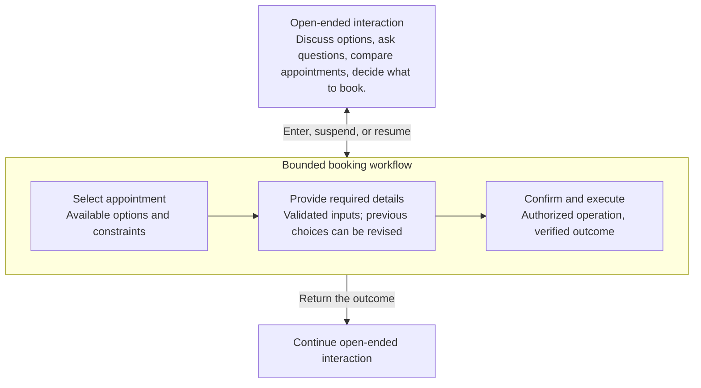
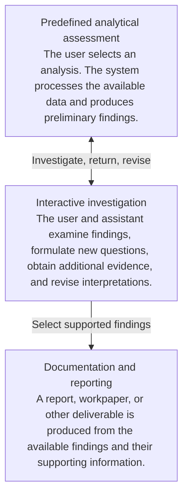

# AI-assisted analysis and investigation systems

Source: [Shared ChatGPT conversation](https://chatgpt.com/share/6ad95718-a0d8-83e9-852e-c9d1d8c463bd).

## Two Modes or Regimes

Design question: How can open-ended interaction and bounded workflows coexist, and how can users move between them?

One proposed framing is coexistence of different operating modes within one product, with transitions that preserve context and work in progress.

The important question is what changes when the operating mode changes. It might be the available operations, who controls the next step, which constraints apply, or which workflow state is active. The interface doesn't necessarily need to change.

### Coexistence of open-ended interaction and bounded workflows

A general-purpose AI assistant can combine open-ended interaction with constrained workflows within a continuous user experience.

In an **open-ended mode**, users can explore questions, obtain explanations, compare alternatives, develop ideas, and decide what they want to accomplish. The LLM has flexibility in how it responds and guides the interaction, while its access to external systems can remain restricted.

When a user wants to perform a supported task, the system can transition into a **bounded workflow**. The workflow defines the available operations, valid states, transitions, dependencies, and execution constraints. The LLM may help navigate this structure, but the application enforces its rules.

**Transitions can be initiated in different ways.** A user may explicitly select a workflow through the interface, express an intention in natural language, or accept a workflow suggested by the assistant. The application determines whether the workflow is available, which inputs can be transferred, and what authorization is required.

Movement can also occur in the opposite direction. Users may suspend a workflow to explore alternatives, ask questions, or reconsider their choices, then return to the previous workflow state. Depending on the workflow, they may navigate backward, revise inputs, or switch to another task.

The system maintains the relevant workflow state independently of the conversation so that changing the interaction mode does not silently discard progress, bypass constraints, or authorize external operations.

**An open-ended conversation and a bounded workflow can therefore coexist without sharing the same execution authority.** The assistant provides flexible interaction, while the application controls transitions and the operations permitted in each context.

### How movement might work

Consider a booking assistant embedded in a general-purpose assistant.

A useful distinction is that moving between modes and moving between workflow states are two different things.

A user might leave the booking workflow temporarily to ask about cancellation policies. The booking state remains intact. They can then resume the workflow.

Alternatively, the user might stay within the booking workflow and navigate between predefined states, such as changing the appointment time. The LLM can help select a valid transition while application logic enforces the constraints.

And there is a third possibility: a bounded workflow finishes and returns a result to the general assistant, allowing the user to continue with a different goal.

A design question is how control and context transfer between different parts of a product. Those relationships can be examined before deciding whether the parts are modes, workflows, agents, or separate components.

One constraint is essential: switching modes cannot itself grant additional permissions. Authorization must be enforced by the receiving workflow and by the operations it executes.

## Framing analysis and investigation systems

Scope questions: How should products that analyze complex information and provide informational results be framed? Are there several kinds of products, and what are their main features? Reporting may be only one result.

**“Reporting and audit assistant” is too narrow** for the work considered here. The report is one possible result of the work. The more fundamental purpose is to help people understand complex information, discover relevant patterns, evaluate evidence, and develop findings they can use.

The audit example makes this distinction concrete. analytical.md describes a system where users select from predefined analyses, but the underlying accounting data can vary enormously. The complexity comes from interpreting the data and its relationships, even though the user interaction may be as simple as clicking a button.

The other documents expand the purpose: identifying changes, connecting findings, distinguishing observations from interpretations, finding missing evidence, and directing auditors toward further investigation. The draft report records a preliminary assessment; the auditor remains responsible for professional judgment. analysis-1.md

**AI-assisted analysis and investigation** is a proposed working name for the broader area. It may contain several meaningfully different kinds of products. Those differences need examination before treating it as a single category.

### 1. Different kinds of analytical work

The examples and supporting material suggest at least three candidate patterns. These are provisional distinctions based on what the systems actually do.

| Candidate | What the system helps accomplish | Example |
| --- | --- | --- |
| Reporting and information synthesis | Organize existing information into a coherent explanation or structured deliverable. | Summarizing financial results, consolidating compliance information, preparing a periodic report. |
| Analytical assessment | Examine data to identify relevant changes, relationships, exceptions, and possible implications. | Predefined HPlatform analyses that produce preliminary findings and suggested audit follow-up. |
| Investigation and evidence analysis | Develop an understanding of a problem through repeated questions, evidence collection, comparison, and revision. | An auditor investigating unexpected journal entries or an analyst examining a complex incident. |

The second and third patterns have substantial overlap. The distinction worth investigating is how much of the analytical procedure is known beforehand.

In the HPlatform example, the analytical questions and workflow are largely predefined. An auditor selects an analysis, and the system examines data whose contents and relationships may vary greatly.

In an investigation, the questions themselves can evolve. An observation raises a new question, which requires additional information, which may change the earlier interpretation.

Both may eventually produce the same report.

### 2. What features emerge from the examples?

#### Complex information and relationships

The difficulty may come from the volume of records, the number of information sources, the relationships between records, or the domain knowledge required to understand them.

The audit example examines journal-entry sources, preparers, account pairings, timing, and posting patterns. Each analysis provides part of the picture. The system must connect relevant findings to develop a more complete understanding. prompts-input.md

A significant design question is what information is actually available. A summarized analytical view may reveal a pattern but lack the underlying transactions needed to explain it. analysis-2.md

#### Findings and justified interpretations

The system performs more than extraction or summarization.

Consider a new source of journal entries that coincides with a new account pairing and concentrated year-end activity. The system might establish those observations and suggest that they warrant investigation. It cannot conclude from those facts alone that an accounting error or new transaction process exists.

This supports a useful distinction among **observations, derived results, interpretations, hypotheses, and unresolved questions**. The application needs to preserve the relationships between them, including the supporting data and calculations. These distinctions are explicit in the audit prompts. prompts-input.md

#### Investigation and developing understanding

An analytical result can raise questions that require further work. The next step could involve examining individual transactions, consulting documents, running another analysis, or asking a domain expert for context.

Open design question: does the product only propose those steps, or also provide a workspace in which people can perform them?

That difference could produce substantially different architectures: a predefined analytical pipeline versus a system that maintains ongoing investigations, evidence, unresolved questions, and revisions.

#### Reliability of information and coverage

The audit example also highlights a distinct risk.

A closed-set task assistant controls the risk of unintended operations. An analytical assistant can cause problems through **incorrect conclusions, omitted findings, or misleading prioritization**, even when it has only read access.

The assurance notes describe a concern about *attention shadowing*: when the system highlights some findings, the user may overlook other relevant matters that the system failed to surface. assurance.md

This raises concrete engineering questions about evidence traceability, quantitative correctness, coverage, uncertainty, and how the system communicates limitations.

### 3. How these kinds of work could coexist

One possible development of the analytical system is:

This illustrates possible composition. It doesn't mean every system must have all three parts or implement them in this order.

A predefined analytical assessment can itself be a closed-set workflow, as in the closed-set task assistant case. The complexity lies in its analytical work and data, even when the available tasks are tightly constrained.

### 4. A provisional description

Proposed description of the broader category:

> **AI-assisted analysis and investigation systems** help people develop an understanding of complex information by examining data and evidence, identifying meaningful patterns and relationships, evaluating possible interpretations, and exposing unresolved questions. They may support predefined analyses, open-ended investigation, or both. Their results can be presented as findings, explanations, preliminary assessments, or formalized work products.

For the audit project, the narrower description would be **an AI-assisted analytical assessment system**, potentially extended into an investigation workspace.

The proposal keeps **analytical engines for forecasting, simulation, and optimization** as a separate case for now. They introduce questions about computational models, rules, assumptions, and scenario evaluation, considered in case 7.

An open question is whether **analytical assessment and investigation are genuinely different kinds of products, or different modes of working with information that can coexist in one product**. That comparison seems more informative than deciding immediately on a permanent name or a fixed set of defining properties.

## Coexistence within one analytical process

**Predefined analysis, open-ended investigation, and synthesis can coexist within one product—and even within the same analytical process.**

In the audit example:

1. **Predefined analysis:** The auditor launches a SCOT analysis. The system examines sources, preparers, account relationships, trends, and journal-entry patterns, producing preliminary observations.
2. **Investigation:** An unexpected pattern raises questions. The auditor can investigate interactively, request additional calculations, inspect supporting evidence, and explore possible explanations.
3. **Synthesis:** The system brings the findings together, preserves their supporting evidence and unresolved questions, and prepares a preliminary assessment or workpaper.
4. **Iteration:** New evidence may change an interpretation, reveal another question, or require an earlier analysis to be revisited.

These can operate as a continuous process. An investigation may produce several findings, run additional predefined analyses, and revise the working assessment multiple times.

### What this tells us about the product

**AI-assisted analytical and investigation system** is another proposed working name. Its central purpose is to help people develop a supported understanding of complex information.

The features emerging from the audit example include:

- **Structured and exploratory analysis:** Known analytical procedures coexist with investigation driven by emerging findings and questions.
- **Evidence and reasoning traceability:** Findings remain connected to their sources, calculations, assumptions, and interpretations.
- **Iterative development of understanding:** New evidence can revise previous findings, with unresolved questions and changes preserved.
- **Human judgment and review:** Experts inspect findings, guide investigations, challenge interpretations, and decide what conclusions are justified.
- **Multiple representations of results:** Findings can be explored through tables, charts, explanations, and eventually reports or workpapers.

These are candidate characteristics supported by this example, rather than a completed definition of the product category.

A useful distinction from the closed-set task assistant case is: **the system can have a predefined set of available analytical operations while still supporting open-ended investigation.** The flexibility lies in the questions asked, the evidence examined, and the way the investigation develops.

The proposed approach does not yet separate reporting, analytical assessment, and investigation into three product types. Instead, it examines how they relate within one system and what additional requirements arise with more exploratory work. This provides a concrete basis for understanding which parts can be combined and what each addition costs architecturally.
