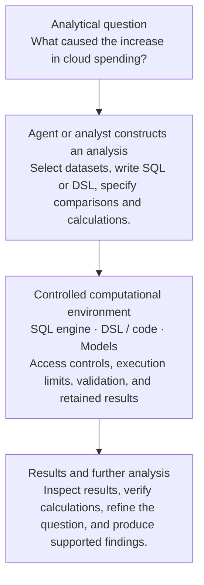

Source: [Shared ChatGPT conversation](https://chatgpt.com/share/6ad95c7a-eefc-83e9-bcc0-c1c4d292d101).

Initial scope: analytical engines with complex rules, forecasting, and multiple pipelines can support applications built on top of them. Programmable environments using SQL or DSLs may also let agents produce insights.

Open scope question: should agents working in sandboxes and execution environments belong to this case? General agentic workflows and coordinators are considered separately.

This case brings together two related ideas:

1. **Analytical engines** that implement complex calculations, domain rules, forecasting models, simulations, and data-processing pipelines.
2. **Programmable analytical environments** where people or AI agents can construct, execute, and refine analyses using SQL, DSLs, code, and other computational tools.

These can coexist within one system. The same analytical engine could execute predefined pipelines and provide a programmable environment for exploring questions that weren't anticipated when the application was built.

**Analytical engines and programmable environments** is the proposed working name for this case.

## 1. What the examples tell us

| Example | What it supports | Where the complexity arises |
| --- | --- | --- |
| Forecasting engine | Produces forecasts from historical data, assumptions, and models. | Data preparation, mathematical models, relationships, and uncertainty. |
| Decision or optimization engine | Evaluates alternatives under business rules and constraints. | Domain rules, constraints, dependencies, and algorithms. |
| Analytical platform | Provides shared analytical functions for multiple applications. | Reusable data models, execution interfaces, versioning, and integration. |
| Agent-accessible analytical environment | Lets people or agents construct and execute SQL, DSL expressions, scripts, or analytical pipelines. | Dynamic computation, data discovery, execution control, and validation of results. |

The referenced `README.md` describes a concrete experiment of the fourth kind: agents inspecting available data and capabilities, writing SQL or DSL queries, executing them, refining findings, and sharing an investigation workspace with people. It also describes saving sources and results for later comparison.[^readme]

One distinction seems particularly useful: **the analytical procedure may be defined in advance, constructed interactively, or generated by an agent at runtime**.

The underlying engine can support all three.

## 2. Where sandboxes fit

The proposal includes **agent-accessible execution environments** in this case without making sandboxes themselves a defining characteristic.

A sandbox is a mechanism for executing code or tools within controlled resource and security boundaries. It can be used by a data-analysis agent, coding assistant, investigation system, or general-purpose assistant.

For this example, the relevant use is allowing an agent to perform computational work:

The agent can exercise substantial flexibility in constructing analyses without having unrestricted authority over the data sources or business systems.

This is related to the execution boundaries of closed-set task assistants. Here, though, the permitted environment might support a much richer computational language than a small set of named tasks.

## 3. Candidate product description

### 7. Analytical engines and programmable environments

Analytical engines and programmable environments support complex data processing, calculations, domain-specific rules, forecasting, simulation, optimization, and other computational work.

Such systems may provide the computational foundation for individual applications or expose reusable analytical functions that multiple products can build upon.

**One approach uses predefined analytical pipelines.** These pipelines combine data transformations, calculations, domain models, rules, and analytical methods to produce forecasts, evaluations, scenarios, or other results. Their execution may involve deterministic code, statistical methods, machine learning models, or combinations of these approaches.

**Another approach provides a programmable analytical environment.** People or AI agents can explore available data and computational functions, construct queries or analytical procedures using SQL, DSLs, or code, execute them, inspect the results, and refine the analysis iteratively.

These approaches can coexist. An analytical engine may expose established models and reusable operations while allowing new analyses to be constructed and executed through the same underlying infrastructure.

The LLM can help users formulate analytical questions, construct computational procedures, select available functions, interpret results, and explain findings. The actual calculations and data operations can be performed by computational engines with defined execution semantics.

Programmable environments may use sandboxed execution, restricted data access, validated query or program representations, resource limits, and execution tracing to control agent-generated computations.

Depending on the application, important requirements may include correctness of calculations, consistency of domain rules, data provenance, reproducibility, versioning of models and pipelines, and visibility into assumptions and uncertainty.

Results may be consumed directly by people, explored interactively, or exposed through APIs to other applications.

**Examples:** Forecasting systems, optimization and decision engines, analytical platforms, programmable data-analysis workbenches, and environments where AI agents construct and execute analytical procedures.

## 4. Relationship to the investigation case

The potential overlap with **AI-assisted analysis and investigation** is substantial, but the original examples emphasize different things.

The investigation case examines how users develop understanding through evidence, findings, questions, and revision.

This case also examines the **computational environment that makes complex analysis possible**: domain models, calculation engines, transformation pipelines, programming interfaces, and execution infrastructure.

An investigation workspace may use such an environment. A forecasting engine may provide results to an application that has no investigation interface at all.

Also, **platform** describes how widely those analytical functions are made available. A complex analytical engine can serve one application, while a comparatively simple engine can serve many products.

## 5. Scope of analytical work and coordination

General agentic workflows and coordination are considered separately from this analytical case for now.

An agent that writes SQL, runs a calculation, inspects results, and revises its query is already exercising some autonomy. But the subject here is its **computational environment and analytical operations**.

Design questions for agentic workflows and coordinators include delegation, selection of subsequent activities, coordination of external services and people, persistent objectives, and management of execution across systems.

The central observation from this example is that **a product may contain both established computational procedures and an environment in which new procedures can be constructed and executed**. That flexibility can be available to people, agents, or both, without requiring them to share unrestricted execution authority.

This distinction remains relevant to comparison across the product cases.

[^readme]: `README.md` — attachment cited in the source conversation.
