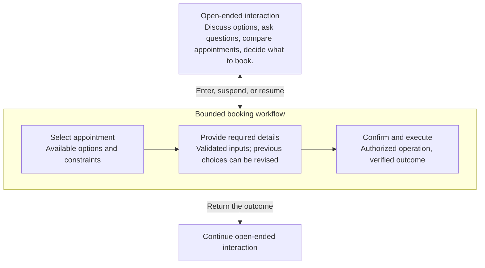
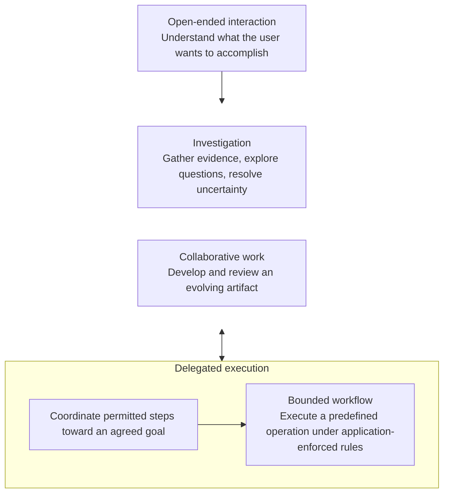

Source: [Shared ChatGPT conversation](https://chatgpt.com/share/6ad955c1-dabc-83e9-947c-5dbdd0d507e6).

## Two Modes or Regimes

Design question: How can open-ended interaction and bounded workflows coexist, and how can users move between them?

One proposed framing is coexistence of different operating modes within one product, with transitions that preserve context and work in progress.

The important question is what changes when the operating mode changes. It might be the available operations, who controls the next step, which constraints apply, or which workflow state is active. The interface doesn't necessarily need to change.

### Coexistence of open-ended interaction and bounded workflows

A general-purpose AI assistant can combine open-ended interaction with constrained workflows within a continuous user experience.

In an **open-ended mode**, users can explore questions, obtain explanations, compare alternatives, develop ideas, and decide what they want to accomplish. The LLM has flexibility in how it responds and guides the interaction, while its access to external systems can remain restricted.

When a user wants to perform a supported task, the system can transition into a **bounded workflow**. The workflow defines the available operations, valid states, transitions, dependencies, and execution constraints. The LLM may help navigate this structure, but the application enforces its rules.

**Transitions can be initiated in different ways.** A user may explicitly select a workflow through the interface, express an intention in natural language, or accept a workflow suggested by the assistant. The application determines whether the workflow is available, which inputs can be transferred, and what authorization is required.

Movement can also occur in the opposite direction. Users may suspend a workflow to explore alternatives, ask questions, or reconsider their choices, then return to the previous workflow state. Depending on the workflow, they may navigate backward, revise inputs, or switch to another task.

The system maintains the relevant workflow state independently of the conversation so that changing the interaction mode does not silently discard progress, bypass constraints, or authorize external operations.

**An open-ended conversation and a bounded workflow can therefore coexist without sharing the same execution authority.** The assistant provides flexible interaction, while the application controls transitions and the operations permitted in each context.

### How movement might work

Consider a booking assistant embedded in a general-purpose assistant.

A useful distinction is that moving between modes and moving between workflow states are two different things.

A user might leave the booking workflow temporarily to ask about cancellation policies. The booking state remains intact. They can then resume the workflow.

Alternatively, the user might stay within the booking workflow and navigate between predefined states, such as changing the appointment time. The LLM can help select a valid transition while application logic enforces the constraints.

And there is a third possibility: a bounded workflow finishes and returns a result to the general assistant, allowing the user to continue with a different goal.

A design question is how control and context transfer between different parts of a product. Those relationships can be examined before deciding whether the parts are modes, workflows, agents, or separate components.

One constraint is essential: switching modes cannot itself grant additional permissions. Authorization must be enforced by the receiving workflow and by the operations it executes.

## Broadening the Context

Open questions: What distinguishes the first two regimes? What other regimes could be identified, and what should they be called?

**Operating regime** is a proposed working term. It describes how an AI system is allowed to conduct work within a particular context: how the next step is determined, how progress is maintained, and what constraints are enforced.

Before defining more regimes, the basis for the first two needs to be clear.

### 1. Basis for the two regimes

The comparison starts with two examples:

| | Open-ended interaction | Bounded workflow |
| --- | --- | --- |
| User's goal | Can emerge or change during interaction | Must fit a supported task |
| Progression | User and LLM determine what to explore next | Progression follows permitted states and transitions |
| Structure | No predefined task sequence required | Application provides an enforceable structure |
| Completion | May have no explicit completion condition | Defined outcome, failure, or cancellation conditions |

The distinction emerging here is **how the progression of work is governed**.

It isn't about how freely the LLM can reason. An LLM inside a bounded workflow can still reason about a user's request or choose between permitted paths. The application enforces the boundaries.

Likewise, an open-ended assistant can have strict permissions.

These are two approaches to managing work; they have not been established as the only ones.

### 2. What other regimes might exist?

The following cases do not fit either description particularly well.

#### Investigation regime

An auditor investigates unexplained activity. The question is known, but the next step depends on what the evidence reveals.

The system might examine evidence, develop hypotheses, identify contradictions, request further information, and preserve unresolved questions.

Progress is governed by what is known and what remains uncertain. Evidence, provenance, and justified conclusions become central.

#### Collaborative work regime

A person and the assistant jointly develop an artifact, such as a report, clinical note, document, or software change.

Progress occurs through edits, review, feedback, and revision. The artifact has a persistent state, and contributions may need to be inspected or accepted.

The work is organized around the evolution of a shared result.

#### Delegated execution regime

A person delegates a goal, such as coordinating meetings with several participants.

The system determines subsequent steps, uses permitted tools, waits for responses, handles failures, and may request human intervention.

The goal is bounded, but the exact sequence of steps need not be predefined. Individual operations remain subject to independently enforced constraints.

These are **candidate regimes**, derived from differences in how work progresses. They are not yet established as an exhaustive classification.

### 3. What would make something a separate regime?

A separate regime needs a stronger criterion than "this is a different kind of task."

Proposed criterion:

> A distinct operating regime exists when the system needs a meaningfully different set of rules for conducting and managing work.

For example:

- Exploration advances through user questions and responses.
- A bounded workflow advances through valid state transitions.
- Investigation advances by developing and resolving questions against evidence.
- Collaborative work advances through changes to a shared artifact.
- Delegated execution advances through the system's selection and completion of steps toward a goal.

These describe different ways for work to progress.

This also explains why some of the product examples might not be regimes.

A contextual support assistant describes an application purpose. It could use open-ended interaction and investigation, then hand off to a bounded workflow.

A medical copilot describes a domain-specific application. It could operate through collaborative document work, constrained procedures, or both.

An analytical engine or platform might provide computations and pipelines used by several regimes, without being a user-facing regime itself.

### 4. Regimes could coexist and even be nested

This is an illustration of possible composition, not a required architecture.

A delegated coordinator might invoke a bounded scheduling workflow. An investigation could generate a report that the user collaboratively edits. A user might suspend any of these and return to open-ended interaction.

The application would need to preserve each workflow's relevant state and enforce the rules of the receiving regime. Context transfer does not automatically transfer permissions.

### 5. An unresolved conceptual distinction

The proposed classification may still mix two things:

**Operating regimes** describe how work is conducted and controlled.

**Properties of a particular deployment** include read/write permissions, access to domain data, required verification, and available interfaces.

For instance, investigation could be read-only or could use permitted tools. Collaborative work could require strict domain validation or ordinary editorial review. These differences don't necessarily create new regimes.

Proposed next step: test whether these candidate regimes are distinct, especially investigation versus open-ended exploration and delegated execution versus bounded workflows.

If a difference requires different management of progress, state, responsibility, or validation, it may justify a separate operating regime. If the difference is only the subject matter or task name, it probably doesn't.

That would let the classification emerge from actual design consequences, without prematurely deciding how many regimes exist.
