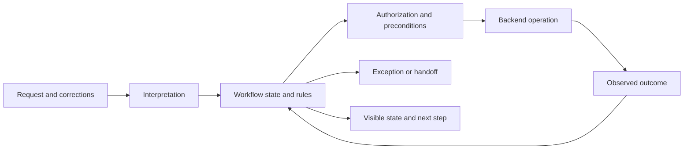
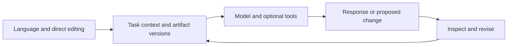
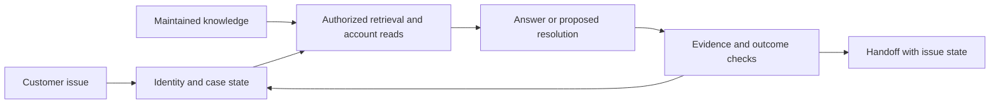
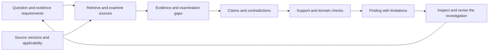
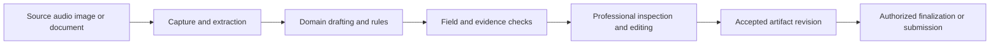
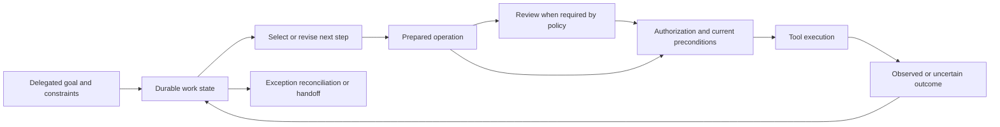
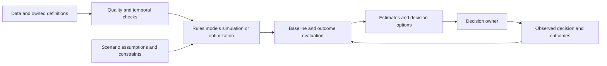

# Practitioner guide to seven AI product archetypes

Revised 2026-10-18. Use the [short taxonomy]() for the vocabulary and this guide to turn a product idea into design decisions, evaluation, operating requirements, and an estimate.

The [editable tldraw board](https://www.tldraw.com/f/LO7apgTgZZn1VGy9rb0qL) maps the argument behind the guide: **Ideas and influences** connects work properties to design requirements, while **Principles and feedback** relates human control, evidence, acceptance, authority, and policy learning. Supporting diagrams remain on reference pages.

## Start with the work

AI products combine different kinds of work, context, collaboration, and authority. The seven archetypes describe common product purposes. A deployment can combine several, and their numbering does not rank maturity, cost, autonomy, or risk.

A booking assistant can execute a consequential transaction through a fixed workflow. An investigation workspace can handle substantial uncertainty without changing any external system. A forecasting application can support one decision before anyone needs a reusable platform.

Start by identifying the work people are trying to do, the objects they need to inspect and change, and the responsibilities distributed across people, models, and conventional software. Then define the required properties and choose an architecture that can support them.

| # | Archetype | Primary work object | Example outcome |
|---|---|---|---|
| 1 | Bounded workflow assistant | Request and workflow state | An authorized booking reaches the correct state. |
| 2 | General work assistant | Question, draft, document, code, or analysis | A person produces useful work or develops understanding. |
| 3 | Contextual support assistant | Customer issue and case history | The issue is resolved or transferred with sufficient context. |
| 4 | Investigation and evidence-synthesis system | Questions, evidence, claims, and unresolved gaps | A finding has adequate support, or its limitations are explicit. |
| 5 | Domain work copilot | Professional artifact and its source material | A document or decision input satisfies stated domain requirements. |
| 6 | Delegated operations and coordination system | Goal, plan, actions, waits, and handoffs | Authorized work completes within scope, with exceptions accounted for. |
| 7 | Analytical and decision system | Data, assumptions, scenarios, and decision options | Analysis improves a defined decision against a meaningful baseline. |

The guide's design method is a synthesis of the local design-research collection. Those notes contain retained dialogues, corrections, and proposals. The external [case studies](#deployment-examples-and-source-limits) illustrate deployments; they do not validate this taxonomy or establish expected returns for another organization.

## Describe the deployment before choosing components

Use the same profile for every archetype. Record unanswered questions as discovery work rather than silently turning them into defaults.

| Dimension | Decisions to record |
|---|---|
| **Work and outcome** | Unit of work; goal; progress and completion criteria; bounded or ongoing operation; intended benefit. |
| **Context and meaning** | Authoritative sources and live state; business definitions; freshness; access; applicability and source precedence. |
| **Collaboration** | Information, execution, judgment, and authority owners; review purpose; initiative; steering and handoffs. |
| **Effects and autonomy** | Permitted reads and writes; action selection; resource limits; approval conditions; consequences. |
| **Evidence and acceptance** | Required properties; checks; evidence gaps; result revision; acceptance purpose and conditions. |
| **Continuity and recovery** | Persistent state; goal and input revisions; waits; stale results; cancellation; retries; reconciliation. |
| **Integration and reuse** | Systems and identities involved; interface quality; coordination; one application or shared capabilities. |

Sensitivity belongs to the information and use. Autonomy belongs to particular actions. A product can retrieve automatically, prepare a change for review, and execute a different operation under an existing delegation.

Identify responsibility at important transitions:

| Responsibility | Question |
|---|---|
| Information | Who knows the necessary facts, and how will missing or conflicting information surface? |
| Execution | Who performs this part of the work? |
| Judgment | Who assesses the contribution, using which evidence and criteria? |
| Authority | Who may commit the result or authorize a concrete external action? |

One person need not hold all four responsibilities. A customer may describe an issue while an employee owns its resolution, software enforces an account restriction, and a specialist judges an exception. See the research's responsibility-allocation model.

### Separate the questions behind “correct”

| Concern | Question | What passing does not establish |
|---|---|---|
| Intent | Is the intended task understood, including important terms and assumptions? | Agreement does not establish factual support or permission. |
| Admissibility | Are the inputs, operations, and transitions valid under the relevant contracts? | A valid request can still express the wrong task. |
| Execution | What actually completed, failed, or has an uncertain outcome? | A completed run can produce a poor result. |
| Result quality | Which factual, behavioral, numerical, and domain properties hold under the checks used? | Successful checks have limits and assumptions. |
| Acceptance | Is this exact result suitable for this purpose and these conditions? | Acceptance does not apply automatically to a changed revision or purpose. |
| Authority | May this principal perform this concrete action on these resources with these arguments? | Tool availability or result acceptance does not grant authority. |

These are design questions, not six mandatory dialogs or a requirement to build a compiler. Some properties admit deterministic enforcement; others need measured evaluation or professional judgment. The verification-and-acceptance note explains the distinctions.

## 1. Bounded workflow assistant

Use this archetype when the allowed requests, important states, and acceptable end states can be specified. Examples include booking, account recovery, document collection, and order-status routing.

**Shared work and responsibility.** Show the interpreted request, relevant details, current state, and next transition. A person should be able to correct a date or identifier without restarting. The workflow owns allowed transitions; a model can interpret language or explain the result. Identify who handles exceptions and who authorizes consequential operations.

**Architecture and data.** Combine intent and field extraction with explicit workflow state, domain rules, authenticated APIs, and outcome records. Data work includes historical requests, API schemas, business rules, routing decisions, and failure cases. The governing system must check current preconditions when applying an operation.

**Evaluation and operation.** Test requests against expected state transitions, including ambiguity, unavailable inventory, duplicate submissions, and expired sessions. Track successful completion, wrong operations, abandonment, repeat contact, escalation, and time per completed task. A fluent response cannot substitute for checking backend state.

**MVP and launch criteria.** Start with a few frequent intents and a clear owner for each. Launch when expected transitions, unknown requests, access boundaries, and interruption paths have been exercised. For writes, define duplicate-request behavior and how to reconcile an uncertain result before retrying.

**Effort drivers.** Legacy interfaces, identity, concurrency, exception paths, and consequence of writes often matter more than the number of intents. A single payment-related workflow can require more work than many informational ones.

**Common failure.** Expanding conversational breadth before confirming that the intended transaction completes correctly. [AWS customer examples](#case-aws) illustrate bounded contact-center work, although their reported outcomes cover broader system changes.

## 2. General work assistant

Use this archetype for writing, summarizing, explaining, coding assistance, comparison, and exploration across many tasks. Define intended roles and use cases even when the interaction is open-ended.

**Shared work and responsibility.** Make drafts, selected passages, assumptions, and decisions available outside the message stream when the task benefits from them. Support narrow edits, protected content, comparison between alternatives, and version history. Choose the relationship deliberately: delegation for a draft, joint construction for an evolving document, critique for work the person wants to improve, or shared reasoning for an uncertain question.

**Architecture and data.** A model gateway, relevant context, application state, and a document or analysis surface may be enough. Retrieval and tools can be added according to the deployment profile. Preserve where context came from and what the person selected. Fine-tuning is a separate decision that should follow an identified performance need.

**Evaluation and operation.** Evaluate each intended task separately. For editing, check whether requested changes preserve intentional content. For explanation, assess factual accuracy and comprehension. For coaching, include a later unassisted task. Measure quality and time after review and correction; message count and repeated use are supporting signals.

**MVP and launch criteria.** Choose a few recurring uses with representative inputs and a baseline process. Make data handling, revision behavior, source access, and any tool effects explicit. Test plausible mistakes and the person's ability to detect them with the available representation.

**Effort drivers.** Artifact interaction, context assembly, privacy requirements, and the breadth of distinct evaluation criteria. A chat interface alone says little about sensitivity or integration cost.

**Common failure.** Treating all tasks as one “helpfulness” problem, or completing work that the person needed to perform to learn. The [TRY case](#case-try) illustrates several work uses; its vendor-reported time savings are specific to that organization.

## 3. Contextual support assistant

Use this archetype when resolving an issue depends on product knowledge, authenticated account state, and case history. It may combine diagnosis, bounded transactions, and delegated follow-up.

**Shared work and responsibility.** Preserve the issue, symptoms, relevant account observations, attempted fixes, evidence, and unresolved questions. Show which interpretation or account detail a person can correct. An escalation should tell the recipient what happened and who owns the next step; a transcript alone may leave those questions unanswered.

**Architecture and data.** Use identity-aware source access, retrieval over maintained knowledge, account reads, explicit case state, and an escalation route. Account state can change while a conversation continues. Record when it was observed and refresh facts that matter to a proposed action.

**Evaluation and operation.** Measure resolution by issue, unsupported answers, retrieval misses, repeat contact, escalation quality, and customer outcome. Audit samples labeled resolved. Keep document owners, source permissions, freshness, deletion, and employee-only content under explicit management.

**MVP and launch criteria.** Start with one channel, a defined issue set, maintained sources, and human escalation. Add account reads or transactions when required by the chosen scope. Before launch, test conflicting documentation, unavailable account data, access changes, failed fixes, and continuity across a handoff.

**Effort drivers.** Content ownership, permission-aware retrieval, live integrations, and the quality of case transitions. Historical tickets need filtering and interpretation before reuse as either evidence or evaluation labels.

**Common failure.** Counting a closed conversation as a resolved problem. The [Breathe case](#case-breathe) illustrates continued knowledge work after launch; [L'Oréal](#case-loreal) illustrates authenticated order data and contextual escalation.

## 4. Investigation and evidence-synthesis system

Use this archetype when questions evolve through evidence gathering and analysis. Audit preparation, due diligence, incident investigation, and policy research are examples. A useful outcome can be a supported finding, an explicit gap, or a better explanation.

**Shared work and responsibility.** Let people inspect questions, scope, evidence requirements, passages, claims, contradictions, source applicability, and open issues. They should be able to challenge a claim, change a definition, inspect neighboring context, or pursue a competing hypothesis. Use tables, source viewers, documents, or other stable views as the work requires; allow useful operations to compose.

**Architecture and data.** Preserve source identity and versions through ingestion, retrieval, extraction, calculation, and synthesis. Keep retrieved candidates distinguishable from evidence assessed as supporting a claim. Source precedence is an owned policy with scope and version, rather than a universal quality score.

**Evaluation and operation.** Test passage-level support, material omissions, conflicting authorities, calculations, and appropriate abstention against known cases. Track ingestion failures and the scope of examination. Keep claim support, examination coverage, and source conflict separate: a supported claim can coexist with incomplete coverage. Screening every document does not prove that every relevant fact was found.

**MVP and launch criteria.** Choose one question family and bounded source collection. Produce findings with exact supporting passages, unresolved requirements, and recorded examination limits. Define who accepts results for which use. Test missing sources, superseded policy, unreadable inputs, contradictory evidence, and plausible unsupported conclusions.

**Effort drivers.** Evidence requirements, source quality, domain definitions, omission costs, and the work needed for meaningful review. Report generation is only one part of the product.

**Common failure.** Treating citations or an execution trace as proof that a conclusion follows. The research's bounded-corpus proposal and comments distinguish coverage records from completeness. The [KPMG announcement](#case-kpmg) illustrates audit work with professional oversight.

## 5. Domain work copilot

Use this archetype when people develop or check artifacts under specialized requirements: clinical notes, translated transcripts, contract assessments, or classified receipts. Similar interaction patterns do not imply similar consequences or regulatory requirements.

**Shared work and responsibility.** Present the source and proposed artifact at a level the responsible professional can assess. Support corrections to individual fields or passages, protected content, explicit exceptions, and comparison between revisions. Define what the professional is judging and who may finalize or submit the artifact.

**Architecture and data.** Combine secure capture, speech or image processing where needed, domain extraction, owned terminology and rules, drafting, checks, and integration with the destination system. Preserve the relation between source observations and generated statements. A manually edited result becomes a new revision.

**Evaluation and operation.** Use domain-specific error categories and severity. For clinical documentation, assess material omissions, unsupported additions, medication or dose errors, correction burden, and time to sign. For receipts, assess amounts, currencies, dates, transaction matches, and policy exceptions. Evaluate difficult input conditions and disagreement between qualified assessors.

**MVP and launch criteria.** Select one specialty, artifact type, or document flow. Make the source comparison and review purpose explicit. Domain experts should own the evaluation criteria and exception policy. Test source ambiguity, consequential factual errors, conflicting corrections, and failed destination writes. A model's reported confidence cannot grant permission to skip required review.

**Effort drivers.** Domain evaluation, source variation, integration, data handling, and professional review design. Identify applicable privacy and sector requirements for the actual use; assign ownership and record the basis for decisions.

**Common failure.** Assuming that polished output or a professional's approval establishes correctness. The [Abridge product description](#case-abridge) illustrates a specialty-specific note with review and editing; it does not establish accuracy for every clinical setting.

## 6. Delegated operations and coordination system

Use this archetype when a person delegates a goal and the system selects subsequent steps within a defined scope. Work can span tools, people, waits, and exceptions. A fixed API workflow may also perform writes; delegated action selection is the additional design question here.

**Shared work and responsibility.** Preserve the goal, constraints, current plan, completed effects, blocked steps, and next responsibility. Let people correct scope, inspect prepared actions, stop further work, or take over. Define triggers for initiative, permitted contributions, budgets, and stopping conditions.

**Architecture and data.** Separate planning from the executor's authorization checks. Tool contracts need business meaning, preconditions, observable outcomes, and retry behavior as well as argument schemas. Check the actor, resource, concrete arguments, and current state when committing an effect. Bind any required approval to that operation; changes may require another decision.

The direct path from preparation to authorization represents actions already permitted by policy. Required review must be enforced, not merely suggested by the diagram or model prompt.

**Evaluation and operation.** Test complete tasks with access denial, midstream constraint changes, partial failure, duplicate requests, expired approvals, and ambiguous tool results. Measure wrong or unauthorized actions, successful outcomes, exception burden, human effort, latency, and cost. A timeout after a write may mean its outcome is unknown; reconcile before issuing another write.

**MVP and launch criteria.** Choose one workflow and a small tool set. Specify the authority for each operation, meaningful review points, deadlines, retries, cancellation, and recovery. Exercise shutdown and takeover. Demonstrate that a scope change affects subsequent behavior and that external effects remain accounted for after interruption.

**Effort drivers.** Independent systems, identities, side effects, waits, and exception paths. A confident model or repeated past approval does not expand the delegation.

**Common failure.** Treating tool access as authorization, or retrying an uncertain external operation as though it were a harmless computation. The research's concrete-operation discussion and result-use proposal give related design questions.

## 7. Analytical and decision system

Use this archetype when rules, calculations, forecasts, simulations, or optimization support a defined decision. A deployment may use conventional software, statistical models, machine learning, LLMs, or a combination. It may serve one application or expose reusable capabilities.

**Shared work and responsibility.** Make the decision, metric definitions, input assumptions, constraints, scenario differences, and uncertainty visible. Let the decision owner compare with a baseline, challenge an assumption, or explore another scenario. Specify who accepts the analysis and who authorizes any action based on it.

**Architecture and data.** Begin with the decision and its data requirements. Rule-based systems need maintained definitions and tested calculations. Forecasting needs historical outcomes and temporal validation. Optimization needs objectives, constraints, and feasibility checks. Add training, feature stores, registries, or online serving when the workload calls for them.

**Evaluation and operation.** Compare with a simple meaningful baseline. For forecasts, backtests should use information available at each historical decision time; examine relevant segments, horizons, unusual periods, and uncertainty calibration. For rules and optimization, test domain invariants, boundary cases, and infeasible inputs. Measure whether decisions improve as well as whether numerical error falls.

Monitor freshness, definition changes, pipeline failures, performance when outcomes arrive, adoption, and cost. Assign an owner and a fallback for stale or degraded output. Shared access controls must cover derived data and outputs as well as raw inputs.

**MVP and launch criteria.** Choose one decision, one consumer, and a simple delivery path. Establish the baseline, evaluation conditions, assumptions, data lineage, fallback, and outcome feedback before expanding reuse. Simulation results need a stated basis for applicability to the real decision.

**Effort drivers.** Data readiness, granularity, latency, feedback delay, scenario complexity, and number of consumers. Shared infrastructure adds product and operational work; it is a separate scope decision.

**Common failure.** Building a generic platform before showing that an analysis changes a useful decision. [DoorDash's engineering account](#case-doordash) illustrates an accuracy/runtime/cost tradeoff. [Metaflow](#case-metaflow) illustrates reusable infrastructure for data-intensive applications.

## Design interaction around inspectable work

Select collaboration patterns according to the intended outcome and allocation of responsibility. A workflow can change patterns as it progresses.

| Pattern | Useful when | Interaction to support |
|---|---|---|
| Elicitation | A person holds information needed for the task. | Focused questions and editable interpretations. |
| Delegation | The system can own a bounded part of execution. | Scope, progress, stopping conditions, and handback. |
| Proposal and review | A contribution needs judgment before commitment. | Changes, evidence, alternatives, and an explicit decision. |
| Joint construction | People and software develop an artifact together. | Local edits, protected properties, revisions, and disagreement. |
| Shared reasoning | Both contribute information or judgment to an uncertain question. | Hypotheses, assumptions, contradictions, and revisable conclusions. |
| Critique or coaching | A person needs to perform or learn the work. | Specific feedback and opportunities to apply it. |
| Handoff | Information, execution, judgment, or authority needs another owner. | Current state, remaining work, reason, recipient, and acknowledgment. |

Language is useful for expressing goals and compositional requests. Direct controls help people inspect details and make precise changes. Stable views can expose different aspects of the same work: a document for prose, a table for evidence, a calendar for availability, or a chart for scenario comparison. Shared stored state still requires visible interpretation and repair when participants understand it differently.

Choose the objects and controls needed for the task. Inspection should show actual sources, observations, changes, and action records; a generated rationale is not automatically an execution record. The local design-practices comments explain these qualifications. The CHI 2019 [Guidelines for Human-AI Interaction](https://www.microsoft.com/en-us/research/publication/guidelines-for-human-ai-interaction/) provide a separate practitioner resource, evaluated across multiple interaction scenarios.

## Preserve continuity and distinguish recovery operations

For work that spans revisions or waits, connect the relevant goal, inputs, configuration, execution attempt, result, checks, and decisions. These are relationships to preserve; they need not become separate services or one universal schema.

| Record | What it needs to identify |
|---|---|
| Goal or task revision | Confirmed scope, definitions, constraints, and who accepted the change. |
| Execution attempt | Procedure/configuration version and exact inputs actually observed. |
| Result revision | Producing attempt or manual derivation and parent revision. |
| Check or judgment | Assessed revision, property, method or assessor, finding, and limitations. |
| Acceptance decision | Exact result, purpose, conditions, decision owner, and applicable policy. |
| External action | Principal, resource, concrete arguments, authority, attempt, and observed outcome. |

An old run completing late must not silently replace work for a newer goal. A changed source, configuration, or purpose may require another check or acceptance decision. Define dependencies and compatibility rules so the system can explain what remains usable.

| Operation | Meaning and limit |
|---|---|
| Inspect history | Read recorded observations and results. Their retention supports understanding of the past. |
| Rerun computation | Perform another attempt. Models, inputs, and external services can yield a different result. |
| Re-execute an external action | Make a new request with possible real effects. It needs applicable authority and duplicate handling. |
| Cancel | Request that further work stop. Record acknowledgment and effects that already occurred or remain uncertain. |
| Undo | Restore or derive an earlier application/artifact state under a defined scope. |
| Compensate or reconcile | Address an external effect or establish what happened. Some consequences cannot be reversed. |

Define an idempotency mechanism for operations that support one: key scope, duplicate behavior, retention, and observable outcome. For unsupported or uncertain cases, specify reconciliation or human handling. A trace and a checkpoint do not, by themselves, guarantee safe replay or rollback. See the research's inspection-and-replay comments.

## Evaluate the product, the collaboration, and the operation

Build evaluation around the properties the deployment needs. Separate cases used to develop prompts or policies from cases used to assess them. Record conditions, data versions, resource budgets, and human assistance so comparisons remain interpretable.

| Layer | Revealing checks |
|---|---|
| Component and domain quality | Interpretation, extraction, retrieval, source support, calculations, rule behavior, and forecast performance. |
| End-to-end work | Final task state, omissions, exceptions, unauthorized effects, freshness, and outcome quality. |
| Collaboration | Detectable errors, effective steering, shared understanding after handoff, appropriate reliance, and recovery. |
| Business operation | Quality-adjusted completion, total human effort, adoption, cost per useful outcome, and realized benefit. |

Seed plausible errors to test review, and include correct cases to measure unnecessary rejection. Interrupt work with a changed constraint and inspect subsequent behavior. Break a tool or remove access and test whether people can take over with enough context. If the intended outcome is learning or understanding, measure that outcome directly.

Use the current process and a simpler alternative as baselines. Compare human-alone and AI-alone conditions when claiming complementarity. Where feasible, hold task, model, tools, information, and budgets constant while comparing interaction designs. See the collaboration-evaluation comments.

Expert review supplies judgments and decisions, which can disagree or be mistaken. Record the assessor, reason, uncertainty, and revision. A correction useful in the current task can suggest a reusable rule, but adoption requires a separate scope, evaluation, and decision. Observed approvals do not grant new authority.

A useful evaluation record includes:

`case | intended outcome | task and source revisions | expected properties | unacceptable outcomes | checks | human judgments | execution conditions | result`

Add concrete action and authority records for effects, and predictions, decision context, actual outcomes, and relevant uncertainty for analytical work. Set task-specific release thresholds, severity limits, escalation conditions, and owners before launch.

### Launch review

| Question | Evidence to bring |
|---|---|
| Does the scope make sense? | Defined work, owners, boundaries, and baseline. |
| Can people steer and review effectively? | Interaction tests with plausible errors, corrections, interruptions, and handoffs. |
| Is quality adequate for the proposed use? | Representative evaluations, severity analysis, evidence limits, and acceptance criteria. |
| Are effects controlled? | Enforced authority and preconditions for the concrete operations in scope. |
| Can work recover? | Exercised failure, stale-result, uncertain-outcome, and takeover paths. |
| Can the product be operated? | Monitoring, response owners, data lifecycle, budgets, and fallback. |
| Does it create value? | Useful outcomes and total effort/cost measured against the baseline. |

Identify applicable professional, privacy, contractual, and regulatory requirements from the deployment's actual function, data, and jurisdiction. Assign an owner to maintain that assessment. For EU deployments, use the European Commission's [AI Act overview and implementation material](https://digital-strategy.ec.europa.eu/en/policies/regulatory-framework-ai) to investigate the applicable category and timing; the archetype number does not establish a legal classification.

## Estimate a defined scenario

Estimate from the deployment profile and unresolved discovery work. Include interface and application work, integration, data preparation, domain evaluation, security and authority enforcement, recovery, rollout, and ongoing ownership. Separate a purchased service configuration from a custom application or a reusable platform.

The examples below illustrate how scope and staffing assumptions can be made explicit. They are planning exercises, not industry averages, recommended teams, or delivery commitments. Specialist time and non-staff costs must be added where they are not included in the named team.

| Archetype | Illustrative scope and prerequisites | Assumed team and elapsed time | Staff effort |
|---|---|---|---|
| 1 | Three booking intents; existing identity and documented booking API; one channel; defined exception owner. | 3 full-time equivalents for 3 months | 9 person-months |
| 2 | Drafting and explanation for two roles; managed model; document editing; no external writes. | 2 full-time equivalents for 2 months | 4 person-months |
| 3 | One support channel; maintained knowledge collection; two account reads; existing case-management system. | 3 full-time equivalents for 4 months | 12 person-months |
| 4 | One contract-review question family; bounded corpus; existing access controls; funded expert evaluation. | 4 full-time equivalents for 4 months | 16 person-months |
| 5 | One clinical note type; established capture service; one EHR integration; domain and privacy work included in the team. | 5 full-time equivalents for 6 months | 30 person-months |
| 6 | One coordination workflow; three documented tools; scoped identities; review and reconciliation paths. | 4 full-time equivalents for 4 months | 16 person-months |
| 7 | One batch forecast and consumer; usable history; owned metric; no self-service platform. | 3 full-time equivalents for 4 months | 12 person-months |

These numbers make the arithmetic visible. Before budgeting, replace them with a work breakdown, local costs, dependency lead times, and evidence from discovery. Hiring, procurement, specialist availability, and source-system changes can affect elapsed time independently of person-months.

Use separate calculations:

- **Initial investment:** staff effort × fully loaded cost, plus non-staff setup, external work, and explicit contingency.
- **Monthly operating cost:** inference/compute, infrastructure, licenses, data maintenance, monitoring, support, review, and exception handling.
- **Monthly net benefit:** realized business value at actual adoption, minus incremental operating cost.
- **Simple payback:** initial investment ÷ positive monthly net benefit, with ramp-up and uncertainty stated.

For a purely illustrative calculation, nine person-months at an assumed \(18,000 per person-month plus \)18,000 of other initial costs gives \(180,000. If 3,000 successfully handled cases each save six net human minutes per month, the released capacity is 300 hours. Valuing fully usable capacity at an assumed \)60/hour gives \(18,000/month. With \)8,000/month in incremental operating costs, steady-state net benefit is $10,000/month and simple payback is 18 months.

That result assumes the capacity has a use worth the stated amount. It is not automatically a cash saving. Include adoption ramp-up, failed cases, review and repair, and the organization's ability to redeploy capacity. Keep the accounting consistent: if review labor is already deducted from time savings, do not charge it again in incremental operating costs. Show downside scenarios; if net benefit is not positive, this payback calculation has no positive result.

Calculate model and compute cost from the workload, including retrieval, evaluators, retries, context size, and volume. Use dated rates when preparing an estimate. A single token-price quote cannot establish the total cost structure.

## Build shared capabilities from demonstrated requirements

A platform is a reuse scope available to all seven archetypes. Start with common needs that already exist: identity, model access, version records, evaluation, tracing, retrieval, or guarded execution. Product-specific meanings, evidence requirements, permissions, and acceptance rules still need owners.

Derive infrastructure from a required property:

**Desired property → observable failure → constraint or check → enforcement owner → evidence that it works.**

| Desired property | Example failure | Design response to assess |
|---|---|---|
| An action must match its authorization. | An approved refund amount changes before execution. | Bind approval to the concrete operation; validate it at the effect boundary. |
| A finding must identify its support. | A citation points to a document that does not support the claim. | Retain passage and source revision; check the support relation. |
| A result must remain associated with its task. | An older run finishes and overwrites the newer task's result. | Bind results to input/goal revisions; define explicit selection and compatibility rules. |
| A handoff must preserve usable context. | A recipient repeats diagnosis because prior attempts are unclear. | Transfer issue state, observations, remaining work, and ownership; test recipient understanding. |

Choose the minimum constraints appropriate to the property and stated assumptions. A schema, audit store, shared database, or sandbox supports particular controls; the component name alone does not establish the desired behavior. The local builder-method discussion supplies the design approach, with qualifications in its comments.

## Worked example: contract investigation with controlled result use

An analyst wants to identify contract clauses that may conflict with policy. The product combines evidence synthesis and a domain copilot; sending the report would add an external operation.

1. **Agree on the task.** Record the contract collection, policy revision P1, scope, definitions, evidence requirements, and unresolved questions. Confirm which interpretation the analyst intends.
2. **Run and inspect.** A run produces extracted clauses, candidate findings, supporting passages, and examination gaps. A table and source viewer let the analyst compare each finding with its source.
3. **Revise deliberately.** Changing a materiality threshold changes an input or interpretation. Record the revision and reconsider affected findings. Sorting the display alone changes presentation.
4. **Handle concurrent work.** If a run for an earlier threshold finishes later, retain its result under its originating inputs. It does not silently become the current answer.
5. **Accept a specific use.** The analyst accepts finding F2 for an internal review under P1. Record the result revision, purpose, checks, and conditions. Publication or emailing requires the applicable separate authority.
6. **Respond to change.** Policy P2 arrives. Preserve the earlier records and use dependency rules to identify which findings need reconsideration. Explain the limits of continued use.
7. **Learn without silently changing policy.** An analyst's repeated extraction corrections suggest a reusable rule. Preserve the interventions and reasons, evaluate a rule candidate on separate cases, and decide its scope before adoption.

The example requires explicit relationships between edits, inputs, runs, results, and decisions. It leaves storage technology and orchestration choices open. The research's edits, runs, and result-use proposal develops the related revision questions.

## Deployment examples and source limits

The sources below were checked on 2026-10-18. Case studies and product descriptions are first-party reports. Engineering accounts explain particular implementations. Their metrics should retain the source's population, definition, and observation period; none is a general forecast of another deployment's ROI. These examples illustrate selected capabilities rather than assigning a vendor product to one exclusive archetype.

| Source | Supported observation | Interpretation limit |
|---|---|---|
| [AWS: Amazon Lex customers](https://aws.amazon.com/lex/customers/) | TransUnion reports shorter IVR navigation and fewer transfers after a contact-center migration using Amazon Connect and Lex. | The report concerns a broader system change; it does not isolate the model's contribution. |
| [Anthropic: TRY customer story](https://claude.com/customers/try) | TRY reports 30% less time on routine tasks and 40% faster proposal development, with uses across creative, strategy, and technical work. | Vendor-reported organizational results; not a controlled estimate of general assistant productivity. |
| [Fin: Breathe customer story](https://fin.ai/customers/breathe) | Breathe reports resolution increasing from 56% to 82% over nine months, alongside knowledge-base improvements, snippets, and guidance. | The metric and eligible workload belong to this support deployment; several changes occurred. |
| [KPMG: Clara AI integration announcement, 22 April 2025](https://kpmg.com/xx/en/media/press-releases/2025/04/kpmg-advances-ai-integration-in-kpmg-clara-smart-audit-platform.html) | KPMG describes agents for audit procedures, a financial-report analyzer, and continuing professional oversight. | An organization announcement describes intended capabilities and approach; it is not independent evidence of audit accuracy. |
| [Abridge: platform for clinicians](https://www.abridge.com/platform/clinicians) | The product description includes structured specialty-specific notes ready for review and editing. | A workflow description does not establish clinical accuracy, acceptable review burden, or suitability for every setting. |
| [Salesforce: L'Oréal order-status support](https://www.salesforce.com/customer-stories/loreal/agentic-order-status-support/) | The case describes identity verification, order-data APIs, approved response language, contextual escalation, and case creation with email confirmation when advisers are unavailable. | These are bounded capabilities. Broader write authority and action selection require their own specification. |
| [DoorDash: ensemble time-series forecasting, 20 June 2023](https://careersatdoordash.com/blog/how-doordash-built-an-ensemble-learning-model-for-time-series-forecasting/) | The engineering account describes ELITE and tradeoffs among accuracy, data/model configurations, temporal validation, runtime, and compute cost. | One forecasting implementation; its architecture and performance improvements are not universal requirements. |
| [Metaflow: What is Metaflow?](https://docs.metaflow.org/introduction/what-is-metaflow) | The documentation describes infrastructure for developing, deploying, and operating data-intensive applications, originally developed at Netflix. | Reusable infrastructure is a separate scope choice from the business purpose of an analytical application. |

For the local research behind the guide, begin with the document map, collaborative-system design practices, collaboration patterns, and composable investigation workspaces, reading their corrections and comments alongside the proposals.
