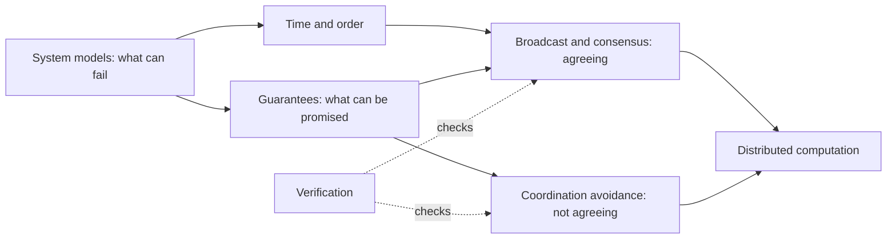

These notes explain why the options in the [system design hubs]() behave as they do. The hubs decide which pattern to use; these notes cover what the pattern assumes, what it can promise, and how to check that it keeps the promise.

## Notes

| Note | Question it answers |
| --- | --- |
| [System models and failures]() | What can go wrong, and what does an algorithm assume about it? |
| [Time and order]() | How do nodes agree on the order of events without a shared clock? |
| [Consistency guarantees]() | What can a replicated system promise, and what does each promise cost? Includes CAP and PACELC. |
| [Broadcast and consensus]() | How do nodes agree on a value or an order of operations when some may fail? |
| [Coordination avoidance]() | When can replicas proceed without agreeing, and what do they give up? |
| [Distributed computation]() | How is a computation split across machines, and how is the result kept correct when parts fail? |
| [Verification]() | How do you gain confidence that a distributed protocol or system is correct? |

**Mechanism notes:**

| Note | What it covers |
| --- | --- |
| [Replication]() | Single-leader replication (synchronous, semi-synchronous, asynchronous, chain), failover, replication logs and change data capture, multi-leader topologies, leaderless quorums and anti-entropy, and choosing a strategy |
| [Partitioning]() | Key-range, hash, and compound partition keys, skew and hot keys, local and global secondary indexes, rebalancing, request routing, multitenancy and cells, and cross-partition operations |
| [Transactions]() | ACID, isolation mechanisms by anomaly, serializability, two-phase commit and XA, Spanner and Calvin, exactly-once processing, and sagas with the outbox |
| [Hashing]() | Why hash mod N fails, consistent hashing with virtual nodes, rendezvous and jump hashing |

The [reading list]() has courses, books, papers, and verification resources.

## Reading order

1. **System models** first: every later guarantee holds only under a stated fault and timing model.
2. **Time and order**, then **guarantees**: what order and visibility a client can be promised.
3. **Consensus** and **coordination avoidance** together: the two answers to "must the replicas agree before acting?"
4. **Distributed computation** applies these to work spread over many machines.
5. **Verification** last, as the way to check a protocol built from the rest.

## How it connects

- **Data at scale:** replication, partitioning, hashing, coordination services, and Dynamo-style stores appear as options in [data at scale](). The [coordination](#coordination) section is the short version of the consensus and time notes.
- **Consistency requirements:** the requirement side, deciding what each operation needs, is in [consistency](). It links back here for the models and theorems.
- **Across services:** sagas and the transactional outbox in [data across services]() are what replaces distributed transactions between services.
- **Messaging:** consumer-group rebalancing and task scheduling in [messaging]() rely on leases, idempotency, and at-least-once delivery.
- **Failure handling:** [containing failure]() covers timeouts and retries in callers; [system models]() covers why a timeout cannot tell a slow node from a dead one.
- **Control planes:** Kubernetes keeps its state in etcd, a consensus store; see the [control plane]().

## Library sources

- [Vitillo 2021](/sources/ad3d4e8b5cefd65937e33aaa96a1f034.bin), *Understanding Distributed Systems, Second Edition* -- part II, coordination, for most notes here
- [Tornow 2025](/sources/70c0d56c1ae98a9f558a6a07dc87c787.bin), *Think Distributed Systems*
- [Kleppmann and Riccomini 2026](/sources/f639f3efb30ff1f78d5f3bec89441c6e.bin), *Designing Data-Intensive Applications, Second Edition* -- chapters 6-12
- [Cachin et al. 2011](/sources/ba524a2347f2a938124b8603dc085d10.bin), *Introduction to Reliable and Secure Distributed Programming, Second Edition*
- [van Steen and Tanenbaum 2023](/sources/f2bbf8813969eb53517df7404b01c885.bin), *Distributed Systems, Fourth Edition*

Further reading:

- [Petrov 2019](/sources/611239aecf452fc6fb065bb3088b0326.bin), *Database Internals* -- part II, distributed systems
- [Wattenhofer 2016](/sources/31e8cfe1b5a2478873df1d290ecbc86b.bin), *Principles of Distributed Computing* -- lecture notes on consensus, Byzantine agreement, and quorum systems
