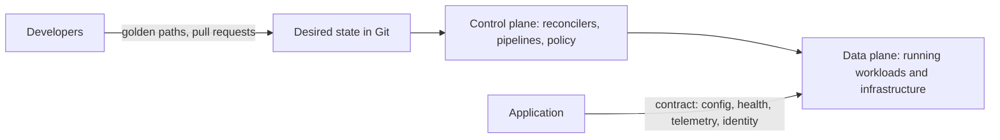

These notes cover the platform side of a contract. The [Twelve-Factor App]() defined it in 2011, and each of its successors rewrote it for a new unit of deployment.

- **The application provides:** configuration from outside, disposable processes, health and readiness signals, telemetry, and an identity.
- **The platform provides:** building, deploying, configuring, running, observing, and securing what the application hands over.

## Notes

| Note | Question it answers |
| --- | --- |
| [Twelve-Factor and its descendants]() | What must an application provide so a platform can run it, and how has that contract changed? |
| [Deployment]() | How does software reach an environment and then its users? |
| [Delivery capabilities]() | What must a delivery system be able to do to change production safely and learn from the result? |
| [Infrastructure as code]() | How are environments created and kept consistent? |
| [Terraform]() | How do you learn one infrastructure-as-code tool in practice? |
| [Kubernetes]() | How does the most common desired-state platform work? |
| [GitOps and declarative configuration]() | How are changes to a running system reviewed, recorded, reversed, and applied automatically? |
| [Platform engineering and developer experience]() | How do you make the right way to ship also the easiest way? |
| [Platform product framing]() | What is the platform for, and how do the people who depend on it agree on that? |
| [Engineering operating model]() | Which standards apply, and how are they enforced and measured? |

The [control plane and data plane]() pattern sits in the system design notes, because it is a structural choice with options rather than a mechanism. The diagram above uses it.

## How it connects

- **System design:** the [operating services]() hub lists deployment, cross-cutting concerns, observability, security, and testing as design choices. These notes hold the mechanisms behind them. The [defaults and triggers]() note gives the default for a prototype.
- **Delivery techniques:** feature flags, canaries, pilots, and hardening are in the [lifecycle techniques](). Golden-path templates for RAG, agents, and evaluation are in the [golden-path notes]().
- **Declarative design:** [declarative design]() describes the specification-plus-engine idea that GitOps and Kubernetes rely on.
- **AI systems:**
  - [declarative system configuration]() applies the same model to AI system definitions;
  - [model gateway designs]() apply the control plane split to model access;
  - the AI platform notes cover the [capability map](), capabilities derived from the [team delivery loop](), and a separate [discovery platform]().
- **ML platforms:** the MLOps guide covers the ML lifecycle. Berberi et al. 2025 and Faubel and Schmid 2024 (in the library sources below) compare MLOps platforms by feature, which helps when the choice is buying a platform rather than building one.

## Library sources

- [Chankramath et al. 2026](/sources/f86bda9692a5543309568d5a8296c48b.bin), *Effective Platform Engineering*
- [Fournier and Nowland 2025](/sources/3c79e44be07e3bb68b2346dc79796c36.bin), *Platform Engineering: A Guide for Technical, Product, and People Leaders*
- [Salatino 2024](/sources/24f4d3918f79380228576a86e50b692c.bin), *Platform Engineering on Kubernetes*
- AI agent platform book, *O'Reilly early release, chapters 1-7* -- an internal platform for AI applications and agents; chapter 2 defines a platform and lists its anti-patterns and success factors

Further reading:

- [Beyer et al. 2016](/sources/66e3d117bdfddedf20fc8fa46d6753b0.bin), *Site Reliability Engineering: How Google Runs Production Systems* -- chapter 8, release engineering
- [AWS 2024](/sources/7e7195dd160b0a64fe44c392ec32afaa.bin), *Reducing the Scope of Impact with Cell-Based Architecture* -- control plane and data plane, and static stability
- [AWS 2024](/sources/888786943005255f919192cab2e45684.bin), *Container Build Lens (AWS Well-Architected Framework)* -- container build and CI/CD pipelines
- [Berberi et al. 2025](/sources/f56b8454c88db743347ed2fec4565baa.bin), *Machine learning operations landscape: platforms and tools* ([doi:10.1007/s10462-025-11164-3](https://doi.org/10.1007/s10462-025-11164-3)) -- 16 MLOps platforms assessed by feature and adoption, with a decision flowchart
- [Faubel and Schmid 2024](/sources/55b106ef70f4f319564b76561a087eff.bin), *A Systematic Analysis of MLOps Features and Platforms* ([doi:10.64552/wipiec.v10i2.73](https://doi.org/10.64552/wipiec.v10i2.73)) -- MLOps platforms as an architectural design space; work in progress
