**Backward design derivation** starts with a user need and works out which responsibilities and design choices are needed to meet it:

> user need -> required outcome -> user workflow -> what the system must make possible at each step -> system responsibilities -> design

Methods that support this chain mainly come from **requirements engineering, strategic design, and architecture evaluation**. Architecture-diagramming methods address a different part of the work.

C4 describes a software system through diagrams at different levels of detail. Its FAQ says that C4 does not define a software delivery or design process. Business processes, workflows, and domain models are also outside its main focus. ([C4 model](https://c4model.com/ "Home | C4 model"))

The key distinction is:

> **Architecture description:** "What exists, and how is it connected?"
>
> **Architecture reasoning:** "What problem does the system solve, for whom, what behavior/outcome is required, and therefore why must these architectural elements exist?"

Backward design derivation mainly concerns the reasoning behind the architecture.

## Related approaches

### 1. JTBD -> capabilities -> target architecture

An industry example directly connects user jobs to a target architecture.

Capital One published **"Leveraging Jobs to Be Done to Start a Target Architecture."** Their chain is roughly:

**Product vision -> JTBD -> capabilities -> systems/data/interfaces -> target architecture**

Their JTBD formulation is:

`While [situation], users need to [action], for the purpose of [goal]`

They map each **action** to a business capability and decide which system should provide it. Doing this for every JTBD produces an initial architecture plan. They also use EventStorming and identified pain points. ([Capital One](https://www.capitalone.com/tech/software-engineering/leveraging-jtbd/ "Leveraging Jobs to Be Done to Start a Target Architecture | Capital One"))

The chain explains why an architectural element is needed. *Why does `AccountDetailsService` exist?*

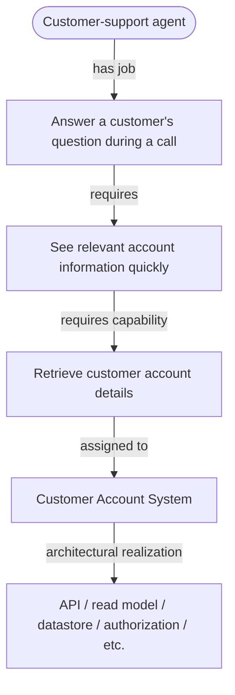

The `Account Details API` has a **causal ancestry**: its purpose can be traced from the API to the capability it provides, and then to the user job it supports.

The Capital One article is one of the first sources to read for this approach.

### 2. JTBD-Oriented Requirements Engineering + RE4SA

Research in requirements engineering describes related methods.

Utrecht University researchers proposed **Jobs-to-be-Done Oriented Requirements Engineering**, giving Job Stories a defined structure. Each requirement includes the **situation, motivation, and expected outcome**, so a feature stays connected to its purpose. ([Utrecht University](https://research-portal.uu.nl/en/publications/jobs-to-be-done-oriented-requirements-engineering-a-method-for-de/ "Jobs-to-be-Done Oriented Requirements Engineering: A Method For Defining Job Stories - Utrecht University"))

A related Utrecht line of work developed **RE4SA -- Requirements Engineering for Software Architecture**. RE4SA directly links requirements to architectural elements. It connects epic stories and user stories to modules and features to keep requirements and architecture in agreement. ([Utrecht University Repository](https://dspace.library.uu.nl/handle/1874/396208 "Explicit Alignment of Requirements and Architecture in Agile Development"))

Put the two together conceptually:

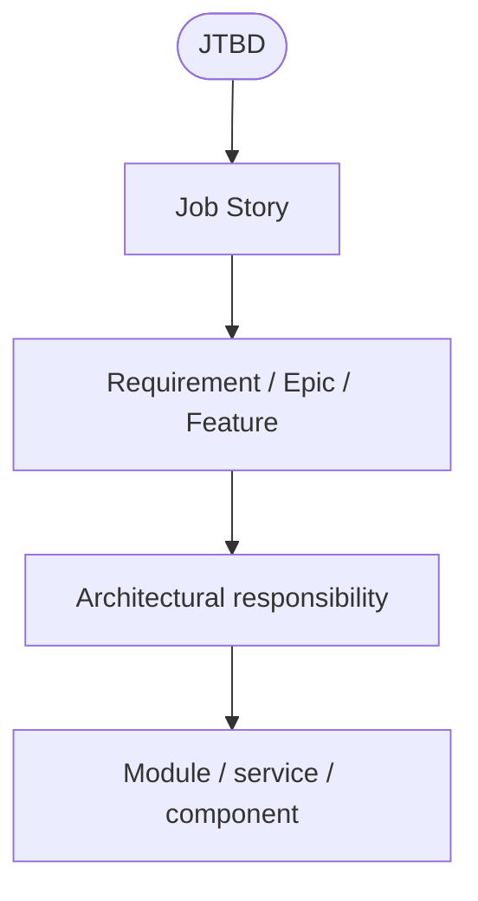

Together, these approaches suggest a way to trace architectural choices back to user jobs.

RE4SA does not itself explain the product-level `why`. The JTBD-oriented requirements work provides that earlier context.

### 3. User Requirements Notation -- probably the closest _single modelling language_

URN is one of the less well-known methods in this comparison.

The ITU standard **User Requirements Notation (URN)** combines two models that cover different needs:

- **GRL -- Goal-oriented Requirement Language**
- **UCM -- Use Case Maps**

GRL models stakeholder goals and intentions. UCM models scenarios of how a system works and helps reason about its architecture. The ITU describes URN as supporting elicitation, analysis, specification, validation, and traceability of requirements. ([itu.int](https://www.itu.int/epublications/publication/itu-t-z-151-2018-10-user-requirements-notation-urn-language-definition "User Requirements Notation (URN) - Language definition"))

Conceptually:

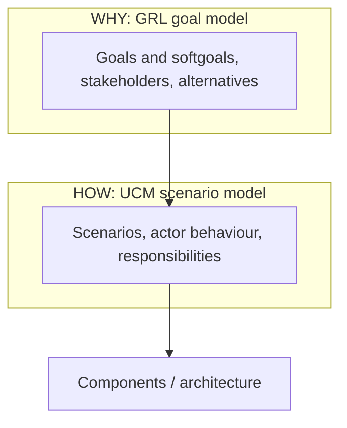

For integrating goals with operational scenarios, **URN is one of the strongest matches in this comparison** because goals and operational or architectural scenarios share one notation. This keeps them connected rather than spread across unrelated Jira tickets and architecture diagrams.

Its drawback is practical adoption. It comes from formal requirements engineering, so it may feel heavy compared with a lightweight product and engineering workflow.

### 4. Wardley Mapping -- user need as literal "north"

A Wardley Map starts by identifying:

1. users,
2. their needs,
3. capabilities required to satisfy those needs,
4. dependencies between those capabilities,
5. the evolutionary state of those capabilities.

The landscape is explicitly **anchored on the user and their needs**. ([learnwardleymapping.com](https://learnwardleymapping.com/landscape/ "Landscape"))

So:

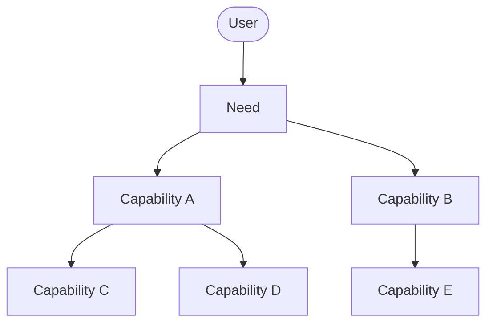

This gives every lower-level capability an answer to:

> **"Needed by what?"**

This keeps the reason for each capability and dependency visible.

Wardley Mapping then adds another dimension: whether each capability is genesis/custom/product/commodity. That supports decisions such as:

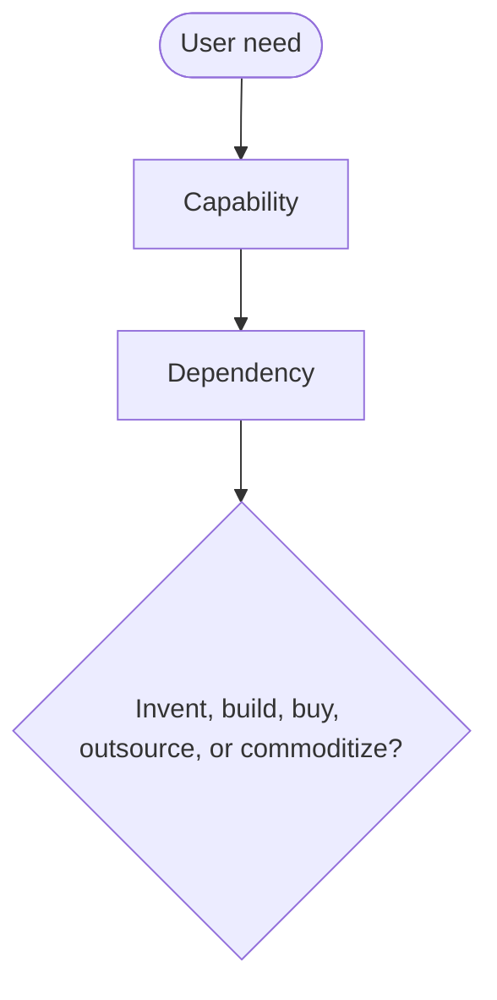

It does not model runtime software behaviour in detail. It belongs **above architecture**, especially when deciding boundaries, ownership, build-vs-buy choices, platforms, and which capabilities make the product different.

### 5. Problem Frames / Architectural Frames

Michael Jackson's **Problem Frames** tradition starts from this principle:

software exists to produce some required effect **in a world outside the software**.

The approach explicitly separates:

- **problem world**
- **domain properties**
- **requirement**
- **machine / software**

Jackson describes software development problems as being about the real environment in which the system must have its effect. ([Oro](https://oro.open.ac.uk/7513/ "Open Research Online"))

Later work linked Problem Frames to software architecture through **Architectural Frames** and related extensions. These let architecture help break a problem into parts while keeping each part connected to the original requirements and problem context. ([Oro](https://oro.open.ac.uk/3334/ "Open Research Online"))

This keeps architectural reasoning connected to the problem being solved.

Instead of:

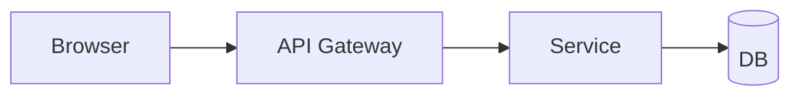

the derivation begins with:

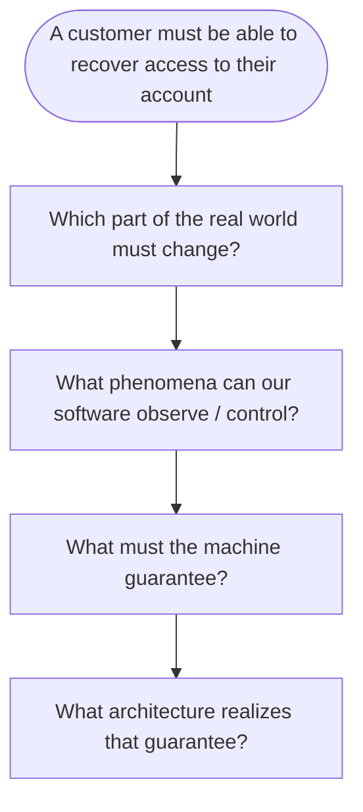

It uses less product-management language than JTBD, but gives more attention to **problem context**.

### 6. Impact Mapping

Impact Mapping comes before architecture. Its structure is well suited to explaining the goals and behavior that architecture needs to support:

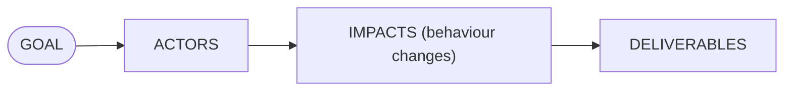

Its purpose is to show how technical deliverables are expected to change actor behaviour, and how those changes support business goals. ([Impact Mapping](https://www.impactmapping.org/drawing.html "Drawing impact maps"))

So instead of a bare task like *"Implement notification service"*, the reasoning becomes:

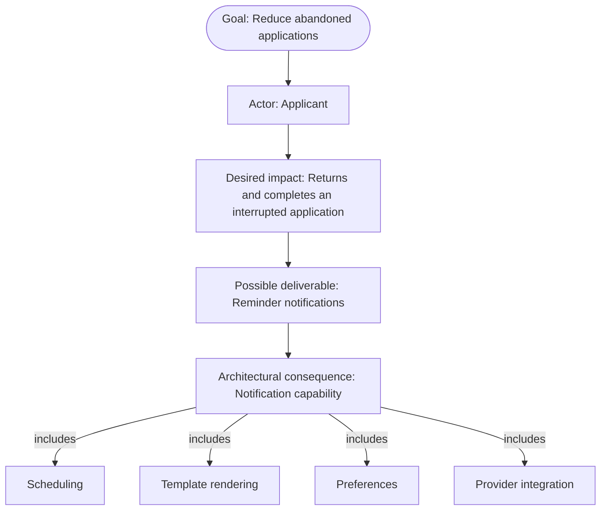

Impact Mapping stops before architecture. But as the **top layer of an architecture model**, it's very good.

### 7. Domain Storytelling + DDD

**Domain Storytelling** starts from actual domain actors performing activities with work objects. Its stated goal is to make business processes and domain knowledge concrete, then use that understanding to develop business software. ([Domain Storytelling](https://domainstorytelling.org/ "Domain Storytelling"))

The method can help develop requirements, user-story maps, domain models, and DDD designs. ([Domain Storytelling](https://domainstorytelling.org/requirements "Requirements - Domain Storytelling"))

The derivation can proceed through:

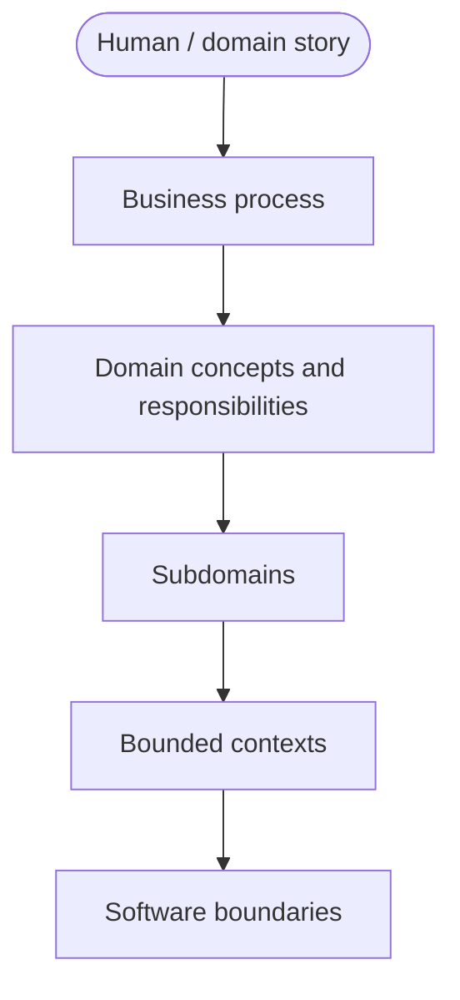

This is excellent at answering:

> "What real process is this software participating in?"

It's somewhat weaker at answering:

> "Why should that process/product exist at all?"

JTBD or Impact Mapping can supply that upstream rationale.

EventStorming belongs roughly in the same family: it is explicitly a collaborative exploration method for complex business domains. ([EventStorming](https://www.eventstorming.com/ "EventStorming"))

### 8. SEI: business goals -> quality scenarios -> architecture

Another group of methods examines **architectural forces**: the needs and constraints that shape a design.

SEI's **Quality Attribute Workshop / ATAM** methods start with **business and mission goals**. They identify the quality attributes that matter to the architecture and turn them into concrete scenarios before analyzing the design. ([SEI](https://insights.sei.cmu.edu/library/the-sei-quality-attribute-workshop/ "The SEI Quality Attribute Workshop"))

For example:

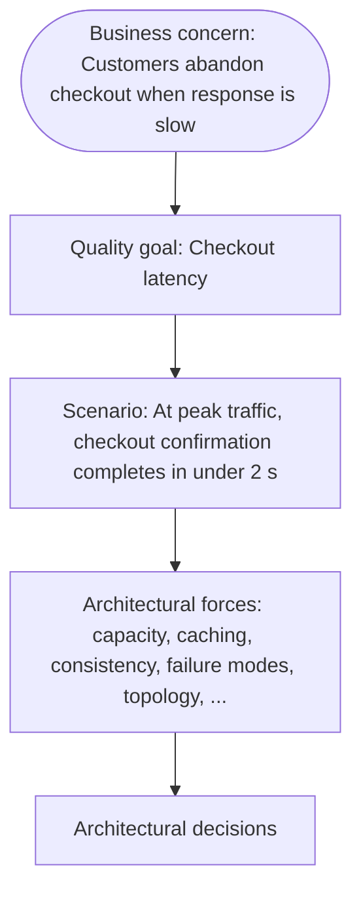

This is very good for answering:

> "Why does this architecture need a queue/cache/replica/failover mechanism?"

The reason for the mechanism can be traced to a concrete quality-attribute scenario, and from there to a business need.

It doesn't solve the functional/JTBD side by itself.

### 9. arc42 -- useful as the envelope around all of this

arc42 is worth distinguishing from C4.

Its first section explicitly asks for the **driving forces** of the architecture:

- underlying business goals,
- essential features/functional requirements,
- architecture quality goals,
- stakeholders and expectations. ([arc42 Documentation](https://docs.arc42.org/section-1/ "1 - Introduction and Goals | arc42 Documentation"))

Its solution-strategy section connects the main architecture choices to the problem, quality goals, and constraints. ([arc42 Documentation](https://docs.arc42.org/section-4/ "4 - Solution strategy | arc42 Documentation"))

And the newer **Architecture Inception Canvas** goes further: it starts with the business case/economic driver and quality goals before proceeding to architecture. ([Software Architecture Canvas](https://canvas.arc42.org/architecture-inception-canvas "Architecture Inception Canvas - Software Architecture Canvas"))

For this purpose, arc42 provides a more complete **document structure** than C4 alone. It has places to record the reasons for decisions alongside the structural views.

But it doesn't impose strong traceability such as:

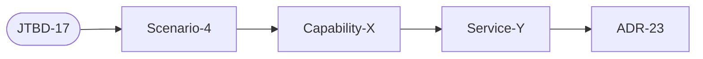

Such links need to be added explicitly.

## A causal architecture model

One proposed way to combine these methods is a **causal architecture model**:

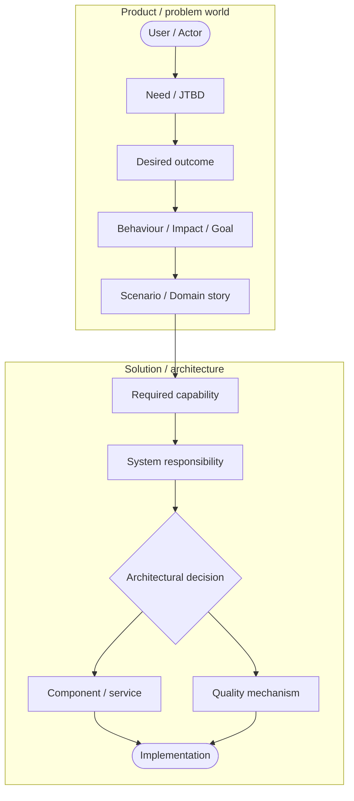

The important property here is that **every downward edge means "therefore this is required..."**.

And every upward edge means **"this exists because..."**.

This adds questions about purpose to structural questions such as:

> "What does this service call?"

Questions about the reasons for the design include:

> "Remove this service. Which user outcome becomes impossible?"

or:

> "Why is this Kafka topic here?"

and walk:

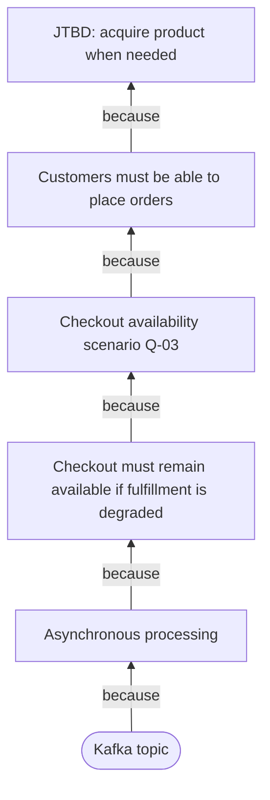

This explains the reasons behind the architecture.

## A practical methodology

C4 can describe the structure at the lower end of this reasoning chain:

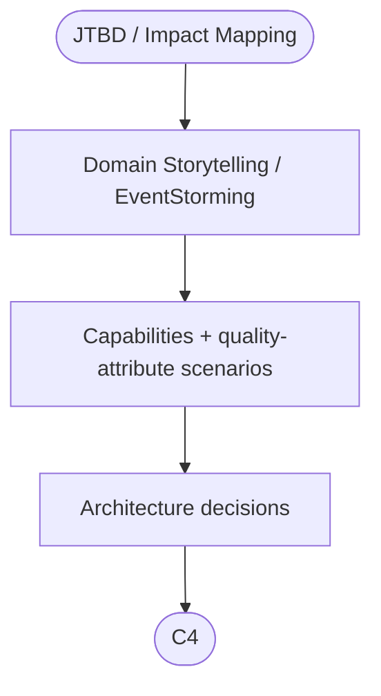

Record the links between the levels:

- `JTBD-12`
  - `DomainStory-07`
    - `Capability-CustomerIdentity`
      - `ADR-018`
      - `C4:System.Identity`
    - `Capability-AccountRecovery`
      - `ADR-027`
      - `C4:Container.RecoveryService`

For a more formal approach, **URN** is the closest existing model found in this comparison that combines goals and scenarios.

A lighter practical approach combines **JTBD -> Impact Mapping -> Domain Storytelling/EventStorming -> capabilities -> arc42/C4**, with **QAW-style quality scenarios** supplying the non-functional architectural forces.

The Capital One article provides an example of the chain: **JTBD -> capability -> system -> target architecture**. ([Capital One](https://www.capitalone.com/tech/software-engineering/leveraging-jtbd/ "Leveraging Jobs to Be Done to Start a Target Architecture | Capital One"))

## Library sources

- [Bass et al. 2021](/sources/887eb03f3c5ac3d5c24aeeb4705f0245.bin), *Software Architecture in Practice, 4th Edition* -- on *8. SEI: business goals -> quality scenarios -> architecture*
- [Brown 2026](/sources/98db09f724a7584933b9628fbab6dd54.bin), *The C4 Model: Visualizing Software Architecture* -- on *Backward design derivation*

Further reading:

- [Cervantes and Kazman 2024](/sources/b6584be4eff5ad6afd064e5012e63f75.bin), *Designing Software Architectures: A Practical Approach, 2nd Edition*
- [Kazman et al. 2000](/sources/38eda7233da8012027d48c1292ec9ca2.bin), *ATAM: Method for Architecture Evaluation*
