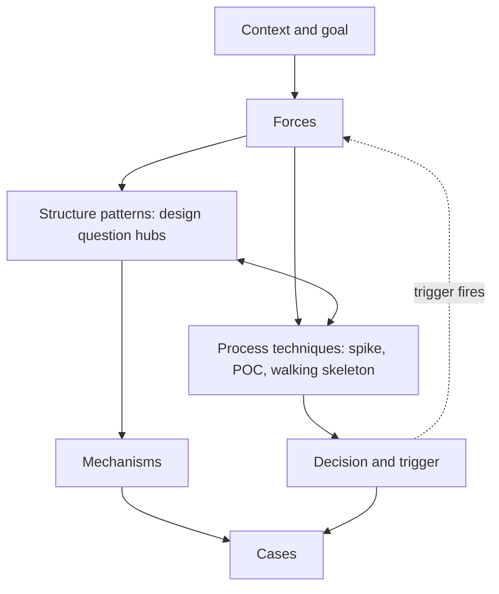

These notes treat system design as a pattern flow you can walk while prototyping, reviewing, or explaining a system. Each step asks a question, offers options, and records what the chosen option leads to. A trigger records when to revisit a decision.

Interview preparation is one route through the same flow, compressed into an hour.

## The flow

Structure patterns say *what to build*. Process techniques say *how to learn whether it is right*. A prototype is where the two meet: a walking skeleton carries the default choices, and a spike or proof of concept tests the risky one.

| Step | Question it answers | Notes |
| --- | --- | --- |
| Context and goal | What outcome, for whom, inside which boundary? | [Design principles](#start-with-the-context), [backward design](), [goal-oriented architecture]() |
| Forces | Which qualities and constraints decide this design? | [Non-functional requirements](), [catalog of architectural characteristics]() |
| Structure patterns | Which option answers this design question, and what does it lead to? | [Pattern map](), [hubs by question]() |
| Process techniques | Which technique resolves the riskiest open question? | [Lifecycle techniques](), [delivery techniques guide]() |
| Decision and trigger | What did we choose, why, and what would make us revisit it? | [Compare choices](#compare-choices-in-their-setting), [trade-off analysis](), [problem-solving checklist](), [defaults and triggers]() |
| Mechanisms | How does this component actually work? | [Engineering topic notes](#where-detail-lives), [platform and delivery]() |
| Cases | Where has this been applied? | [Practice cases](), [AI and RAG designs](#same-patterns-in-other-domains) |

## Routes

| I want to... | Path through the flow |
| --- | --- |
| Prototype a system quickly | [Defaults and triggers]() -> the hub for the riskiest question -> a [technique]() to test it -> record the decision with the [case template](). |
| Review or improve a design | [Design principles]() -> [forces]() for the operations that matter -> the costs and *Leads to* of the relevant [hubs]() -> [problem-solving checklist](). |
| Design an AI or RAG system | [Same patterns in other domains](#same-patterns-in-other-domains) -> the RAG runtime layers and the [testable boundary map]() -> the matching hubs. |
| Prepare for an interview | [Interview preparation](): study plan, frameworks, communication, and mock review. |
| Practice on a case | [Practice cases]() with the [case template](). |
| Find courses, books, and talks | [Resources](). |

## How the folders map to the flow

- [`elements/`](): structure patterns as design questions, the [pattern map](), and [defaults and triggers]().
- [`nfr/`](): forces.
- [`projects/`](): cases.
- [`interview/`](): the interview route.
- Top level: [design principles](), the [problem-solving checklist](), and [resources]().
- Process techniques and mechanisms live in the [engineering notes](); the flow links to them rather than copying them.

[Collected notes]() keep reading excerpts and design-review material. [The archive]() preserves earlier versions of rewritten notes.
