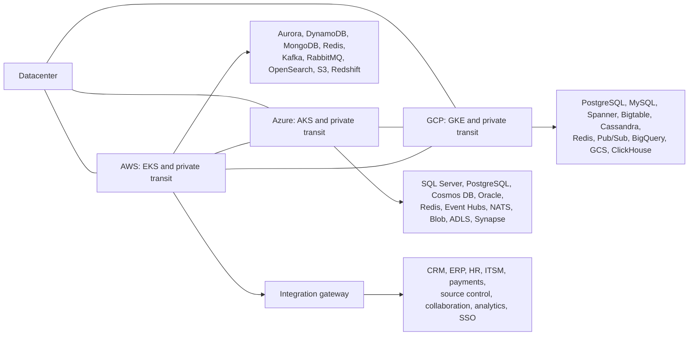

# Enterprise infrastructure

Cross-cloud infrastructure inventory spanning AWS, Azure, GCP, a datacenter,
and external business systems. The catalog contains **400,000 credential
artifacts** across eight families, with ownership, environment, target, and
rotation metadata. An artifact can include related fields such as an access-key
ID and its secret; the count refers to records rather than individual fields.

## Architecture

Five environments (`dev`, `test`, `stage`, `prod`, `dr`) each have isolated cloud
accounts, private networks, Kubernetes clusters, identity domains, application
services, and data services. Production-to-DR replication has a separate graph
from application connectivity.



The 16 application services cover identity, customer accounts, orders, payments,
billing, inventory, search, notifications, recommendations, analytics, fraud,
workflows, support, documents, API routing, and integrations. The connection graph
includes database access, authentication dependencies, and API routing.

External integrations cover Salesforce, ServiceNow, Workday, SAP, Oracle ERP,
GitHub, GitLab, Jira, Slack, Twilio, Stripe, Snowflake, Databricks, and Okta.

## Files

| Path | Contents |
| --- | --- |
| `model/enterprise.json` | Canonical topology, endpoints, dependencies, and DR pairs |
| `clouds/{aws,azure,gcp}/` | Accounts, networks, clusters, datastores, identity |
| `environments/` | Environment-specific references into the canonical topology |
| `network/cross-cloud.json` | Private transit, datacenter links, routing, DNS |
| `integrations/connections.json` | Connection graph and retry settings |
| `platform/` | Services, telemetry, alerts, CDC pipelines, disaster recovery |
| `security/controls.json` | Rotation, classification, federation, policies |
| `examples/` | Terraform inventory, Kubernetes ConfigMap, application variables |
| `catalog/` | Sharded JSONL credential artifacts |
| `manifest.json` | Counts, file sizes, SHA-256 checksums, shard ranges |
| `tools/generate.py` | Catalog generator and verifier |

The website build uses its existing Hugo mounts; this inventory is maintained
under `infra/` independently of the published content.

## Catalog

| Family | Records | Contents |
| --- | ---: | --- |
| `aws-iam` | 50,000 | Access-key IDs, secret keys, session tokens |
| `azure-identity` | 50,000 | Client IDs, client secrets, token endpoints |
| `gcp-service-account` | 50,000 | Service-account identities and private-key fields |
| `database` | 50,000 | Database usernames, passwords, hosts, ports |
| `messaging-cache` | 50,000 | Broker, cache, and search credentials |
| `saas-integration` | 50,000 | External-system API keys and connections |
| `workload-pki` | 50,000 | Workload identities, signing keys, private-key fields |
| `data-platform` | 50,000 | Object-storage and warehouse tokens |
| **Total** | **400,000** | **80 files of 5,000 records** |

## Maintenance

Use Python 3.11 or later from the repository root:

```sh
python3 infra/tools/generate.py generate --records 400000
python3 infra/tools/generate.py verify
```

The generator also accepts `300000` or `500000`, divided equally across the same
families. It overwrites generated views and shards and removes obsolete shards
matching its naming pattern. The table describes the 400,000-record edition.

Verification checks record definitions, checksums, file sizes, contiguous shard
ranges, family totals, topology references, connection states, environment
isolation, network ranges, credential fields, and endpoint domains.
